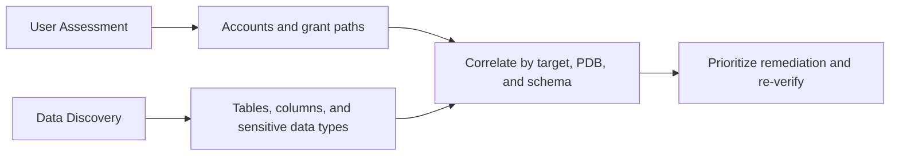

# User Assessment and Sensitive Data Discovery

In the **Database Management and Optimization** chapter of the **CLOUD_PROVIDERS_ORACLE** module, this lesson uses Oracle Data Safe to answer two questions: **which accounts could cause major impact if abused, and where does sensitive data reside inside Oracle Database?** Combining both answers helps identify the right targets to restrict privileges, monitor, or protect before moving data to another environment.

The running scenario is a customer management application database on OCI. A reporting account only needs customer IDs and segments, yet it can currently read email addresses and membership identifiers too. The goal is not merely generating an assessment report: learners need to prove the grant path, verify sensitive columns, adjust privileges in the lab, and retest authorized functionality.

## 1. Expected Outcomes and Scope

After this lesson, learners will be able to:

- Distinguish OCI IAM users from accounts inside Oracle Database.
- Read a User Assessment, identify privileged accounts, and interpret login status, authentication, and profiles.
- Inspect direct privileges, role-inherited privileges, and access paths requiring further review.
- Create a sensitive data model using Data Discovery, choose scan scope, and validate sensitive types.
- Combine account privilege findings with objects containing sensitive data to propose evidence-backed actions.
- Maintain baselines and update models after schema changes while keeping operational impact under control.

The exercise uses **Oracle Database 19c in a non-production PDB**, already registered as a Data Safe target. The illustrative SQL statements run in that PDB; administrative privileges and execution accounts are noted at each step. These are instructions for learners to execute in an authorized environment, not scan results from a live database.

## 2. Two Complementary Assessment Outputs

### 2.1. User Assessment and Data Discovery

| Component | Primary Question | Output Used |
| --- | --- | --- |
| User Assessment | Which privileges, roles, and authentication traits does an account have? | Account list, potential risk, and access details |
| Data Discovery | Which columns show signs of containing sensitive data? | Sensitive data model, data types, and column locations |
| Security Assessment | Which database security settings have areas to improve? | Configuration findings; complements this lesson |
| Activity Auditing | Which activities have been recorded? | Behavioral evidence within collected audit scope |

Data Safe reads account and privilege metadata from the data dictionary to assess users, while also providing data discovery based on metadata and content. Each capability serves a different purpose; a privilege report does not prove an account actually read the data. [Source: Oracle Data Safe Overview](https://docs.oracle.com/en-us/iaas/data-safe/doc/oracle-data-safe-overview.html).



For example, an account with no system administration privileges can still hold `SELECT` on a customer table. Conversely, an administrative account may hold strong privileges without any evidence of accessing a specific application's data. Distinguish **access capability**, **business need**, and **recorded behavior**.

### 2.2. Potential Risk Is Not a Conclusion of Compromise

User Assessment categorizes potential risk by granted privileges and roles using levels such as Critical, High, Medium, and Low. Use these levels to prioritize review, then inspect the underlying reasons and account context. Do not automatically turn a risk color into a conclusion that an account was compromised. [Source: User Assessment Overview](https://docs.oracle.com/en-us/iaas/data-safe/doc/user-assessment-overview.html).

In this lesson's scenario, permission to read customer emails may violate the reporting role's remit even if the account does not carry the highest risk rating. Therefore, business findings must specify the exposed objects and data fields rather than simply counting red accounts.

## 3. Preparing the Target and Two Authorization Layers

### 3.1. Input Prerequisites

| Component | Lab Requirement |
| --- | --- |
| Data Safe target | Register the exact PDB and verify connection succeeds |
| Compartment | Use `DatabaseSecurityLab` for this lesson's Data Safe resources |
| Data Safe service account | Granted the appropriate privilege groups for assessment and discovery |
| Operating OCI group | `DataSafeReviewers`, adjust name to match actual identity domain |
| Owner schema | `DS_OWNER_LAB`, used solely for synthetic data |
| Reporting account | `DS_APP_LAB`, has `CREATE SESSION`, no `ANY` or DBA privileges |
| Application role | `DS_REVIEW_READ_LAB`, created specifically for this lesson |

The DBA prepares both local accounts in the same PDB following the environment's password management process. `DS_OWNER_LAB` needs privileges to create tables/views and adequate quota on the lab tablespace. Never put real passwords into documentation, shared command history, or scripts committed to a repository.

The connection path from Data Safe to the database must be operational, using a private endpoint or connector appropriate for the target's location. Confirm the PDB service name, routes, firewalls, certificates if applicable, and credential status. Seeing a DB system resource in the Console does not mean Data Safe has connected to the exact database. [Source: Target Database Registration](https://docs.oracle.com/en-us/iaas/data-safe/doc/target-database-registration.html).

### 3.2. OCI IAM Controls Who Uses Data Safe

Example policy for a group performing both parts of the lab, with the target and output resources in the same compartment:

```text
Allow group DataSafeReviewers to read target-databases in compartment DatabaseSecurityLab
Allow group DataSafeReviewers to manage user-assessments in compartment DatabaseSecurityLab
Allow group DataSafeReviewers to read data-safe-security-policy-reports in compartment DatabaseSecurityLab
Allow group DataSafeReviewers to read data-safe-work-requests in compartment DatabaseSecurityLab
Allow group DataSafeReviewers to manage data-safe-sensitive-data-models in compartment DatabaseSecurityLab
Allow group DataSafeReviewers to manage data-safe-discovery-jobs in compartment DatabaseSecurityLab
Allow group DataSafeReviewers to manage data-safe-sensitive-types in compartment DatabaseSecurityLab
```

This policy assumes the target is already registered. It does not include permissions to provision database users or manage network infrastructure. When the target, assessment, sensitive types, and model reside in different compartments, verify permissions at each corresponding location. Refer to resources and examples in [Create IAM Policies for Oracle Data Safe Users](https://docs.oracle.com/en-us/iaas/data-safe/doc/create-iam-policies-oracle-data-safe-users.html).

`manage user-assessments` allows running/refreshing, setting baselines, and comparing. Read permission on `data-safe-security-policy-reports` supports viewing details of schemas/tables accessed by users. For groups that only view results, consider `read` rather than `manage` depending on the resource. [Source: Assessment Resources](https://docs.oracle.com/en-us/iaas/data-safe/doc/assessment-resources.html).

This policy is scoped for the exercise and is not a mandatory design for every organization. In real operations, you can separate the group assessing accounts from the group creating sensitive types or managing models. OCI user permissions do not automatically become `SELECT` privileges inside the database.

### 3.3. Service Account Privileges Inside the Database

The DBA grants privileges per the guide for the target type rather than granting `DBA` just to bypass errors:

| Capability | Privilege Group for Non-Autonomous Targets | Corresponding Role on Autonomous |
| --- | --- | --- |
| User/Security Assessment | `ASSESSMENT` | `DS$ASSESSMENT_ROLE` |
| Data Discovery | `DATA_DISCOVERY` | `DS$DATA_DISCOVERY_ROLE` |

Grant privileges using the Oracle-documented mechanism/script for your target; names in the second column describe Data Safe privilege groups, not instructions to run a guessed `GRANT` command on your own. Default grant status and extra requirements when Database Vault is enabled must be checked separately. [Source: Grant Roles to the Oracle Data Safe Service Account](https://docs.oracle.com/en-us/iaas/data-safe/doc/grant-roles-oracle-data-safe-service-account-your-target-database.html).

A user with sufficient IAM permissions can still encounter failed jobs or incomplete results if the service account lacks in-database privileges. Conversely, granting privileges to the service account in the database does not allow everyone in the tenancy to view reports or sample data.

## 4. Reading User Assessments in Context

### 4.1. Run or Refresh on the Exact Target

In the Data Safe Console, open **User assessment**, select the right region/compartment, and open the lab target's assessment. Check the latest run timestamp; use **Refresh now** if you need fresh data after privilege changes. Wait for completion before interpreting results. Having an existing resource or submitted job does not prove the assessment succeeded. [Source: View and Analyze User Assessments and Assessment History](https://docs.oracle.com/en-us/iaas/data-safe/doc/view-and-analyze-user-assessments-and-assessment-history.html).

Record the target/PDB, assessment OCID or name, assessment timestamp, and selected scope. If aggregating multiple targets, every finding must retain its link to the source database; the same username across two PDBs is not necessarily the same business identity.

### 4.2. How to Review an Account

| Review Item | Question to Answer | Supporting Evidence |
| --- | --- | --- |
| Owner and purpose | Who is responsible? Used for human, application, or administration? | Account inventory, application configuration |
| Roles and system privileges | Where do strong privileges come from, and are they necessary? | Data dictionary and DBA explanation |
| Schema/table access | Can it read data beyond its remit? | Object grants and testing with that account |
| Status/authentication | Direct login, external, or schema-only? | `ACCOUNT_STATUS`, `AUTHENTICATION_TYPE` |
| Profile | Which policy applies and what are effective values? | Assigned profile and default profile |
| Recent activity | Are there signs the account is no longer used? | Last login, scheduled jobs, collected audit |

A locked or schema-only account can still own objects used by applications through other mechanisms. Do not drop a schema simply because it does not log in directly. Break-glass/backup accounts may be rarely used while still serving incident recovery; they require clear ownership and usage controls.

Do not apply identical local password-change rules across all authentication methods. For external/global authentication, inspect policies in the corresponding identity system. Having `APP` in a username also does not guarantee Data Safe classifies it under the product's Application label.

### 4.3. Metadata Cross-Check SQL

The following queries are intended for a DBA or an account granted required dictionary read privileges. Run them in the **lab PDB**; do not grant `DBA` to the reporting account so it can inspect its own privileges.

```sql
SELECT SYS_CONTEXT('USERENV', 'CON_NAME') AS con_name,
       SYS_CONTEXT('USERENV', 'SESSION_USER') AS session_user
FROM dual;

SELECT username, account_status, authentication_type,
       profile, last_login, oracle_maintained
FROM dba_users
WHERE username IN ('DS_OWNER_LAB', 'DS_APP_LAB')
ORDER BY username;
```

`LAST_LOGIN` is not updated for connections using administrative privileges such as `AS SYSDBA`. A null value is not enough to conclude an account has never been active. `ORACLE_MAINTAINED = 'Y'` identifies users created and maintained by Oracle scripts; do not modify those users arbitrarily. [Source: DBA_USERS, Oracle Database 19c](https://docs.oracle.com/en/database/oracle/oracle-database/19/refrn/DBA_USERS.html).

Check system privileges granted directly to the lab account or role:

```sql
SELECT grantee, privilege, admin_option
FROM dba_sys_privs
WHERE grantee IN ('DS_APP_LAB', 'DS_REVIEW_READ_LAB')
ORDER BY grantee, privilege;
```

Privileges such as `SELECT ANY TABLE` differ in scope from an object grant. `ADMIN_OPTION` is also worth checking because it relates to the ability to pass on system privileges. The query above is limited to two principals; it does not expand the full role graph. [Source: DBA_SYS_PRIVS](https://docs.oracle.com/en/database/oracle/oracle-database/19/refrn/DBA_SYS_PRIVS.html).

Inspect direct roles, then expand nested roles:

```sql
SELECT grantee, granted_role, admin_option, default_role
FROM dba_role_privs
WHERE grantee = 'DS_APP_LAB'
ORDER BY granted_role;

SELECT DISTINCT granted_role
FROM dba_role_privs
START WITH grantee IN ('DS_APP_LAB', 'PUBLIC')
CONNECT BY NOCYCLE PRIOR granted_role = grantee;
```

Roles can be granted to users or to other roles. Distinguish granted privileges from roles actually active in a specific session; the list above is evidence of the grant path, not a full simulation of every runtime condition. [Source: DBA_ROLE_PRIVS](https://docs.oracle.com/en/database/oracle/oracle-database/19/refrn/DBA_ROLE_PRIVS.html).

If you need to cross-check profiles:

```sql
SELECT profile, resource_name, limit
FROM dba_profiles
WHERE resource_type = 'PASSWORD'
  AND (profile = 'DEFAULT'
       OR profile IN (
         SELECT profile
         FROM dba_users
         WHERE username = 'DS_APP_LAB'
       ))
ORDER BY profile, resource_name;
```

`DEFAULT` values in a profile must be resolved against the default profile to understand effective settings. Do not read a single row and assume an account has no policy. [Source: DBA_PROFILES](https://docs.oracle.com/en/database/oracle/oracle-database/19/refrn/DBA_PROFILES.html).

## 5. Data Discovery: Models and Limitations

### 5.1. Sensitive Types and Sensitive Data Models

A **Sensitive type** describes signals for finding sensitive columns, such as column names, comments, or content patterns. A **Sensitive data model (SDM)** stores the list of identified columns and relationships for a target. An SDM serves scope management and downstream protection steps; it is not a full copy of the database.

Built-in types help start with common emails, names, or identifiers. Internal application codes may require custom sensitive types. Do not assume the system recognizes every Vietnamese identifier or custom business rule simply because all built-in types were selected.

Data Discovery has limitations by data type and object type. For example, current documentation notes content scanning via data patterns is unsupported for certain types such as `BLOB` and `JSON`; some types may only be recognized from metadata. Views are also on the list of objects unsupported for discovery. Therefore, document what falls outside scope rather than interpreting zero findings as zero sensitive data. [Source: Data Discovery Overview — unsupported types and objects](https://docs.oracle.com/en-us/iaas/data-safe/doc/data-discovery-overview.html).

### 5.2. Storing Sample Data Is a Separate Choice

The **Collect, display and store sample data** option captures extra sample values to assist validation. In this lesson, **do not enable that option**. When verification is needed, use known synthetic records or bounded queries in the lab.

Not storing samples does not mean metadata-only reading: discovery rules may still inspect column contents to match data patterns. In operational planning, account for read privileges, query impact, and the service's data-handling path. If sample storage is allowed in another scenario, restrict view access strictly to authorized users and manage lifecycle for both samples and the model. [Source: Create Sensitive Data Models](https://docs.oracle.com/en-us/iaas/data-safe/doc/create-sensitive-data-models.html).

A discovery result is a candidate for confirmation: a column named `EMAIL` might contain test data, while a column named `VALUE_TEXT` might hold real emails. Coordinate with data owners to determine semantics, sensitivity, and handling; regex does not replace business decisions.

## 6. Lab Combining User Assessment and Discovery

### Step 1 — Create Synthetic Data in the Lab Schema

Log in as `DS_OWNER_LAB` into the exact registered PDB. The objects below must not already exist; if you hit a name-collision error, check for an earlier run rather than dropping objects of unknown origin.

```sql
SELECT SYS_CONTEXT('USERENV', 'CON_NAME') AS con_name,
       SYS_CONTEXT('USERENV', 'SESSION_USER') AS session_user
FROM dual;

CREATE TABLE ds_customer_lab (
    customer_id NUMBER PRIMARY KEY,
    email       VARCHAR2(120),
    member_ref  VARCHAR2(20),
    segment     VARCHAR2(20)
);

COMMENT ON COLUMN ds_customer_lab.email
IS 'Synthetic email address used only for training';

COMMENT ON COLUMN ds_customer_lab.member_ref
IS 'Synthetic membership identifier used only for training';

INSERT INTO ds_customer_lab
VALUES (1, 'learner01@example.com', 'LAB-000001', 'STANDARD');

INSERT INTO ds_customer_lab
VALUES (2, 'learner02@example.com', 'LAB-000002', 'PREMIUM');

INSERT INTO ds_customer_lab
VALUES (3, 'learner03@example.com', 'LAB-000003', 'STANDARD');

COMMIT;

SELECT COUNT(*) AS row_count FROM ds_customer_lab;
```

Expect three rows. The emails and `LAB-...` codes are synthetic data for the exercise, not taken from real customers. You do not need real national IDs or payment details to test discovery.

### Step 2 — Create an Initial Grant Path for Assessment

In the lab PDB, the DBA creates a new role and grants that role to the reporting account:

```sql
CREATE ROLE ds_review_read_lab;
GRANT ds_review_read_lab TO ds_app_lab;
```

Then the owner `DS_OWNER_LAB` grants table read access to the role:

```sql
GRANT SELECT ON ds_customer_lab TO ds_review_read_lab;
```

This state simulates broader privileges than the reporting requirement in the test environment. No DBA or database-wide read privileges are granted. Open a fresh connection as `DS_APP_LAB`, ensure the lab role is enabled per session settings, and verify:

```sql
SELECT customer_id, email, member_ref, segment
FROM ds_owner_lab.ds_customer_lab
ORDER BY customer_id;
```

If the query succeeds, the reporting account can read every column of the test table. This is direct evidence of the condition to remediate, even if the potential risk rating in User Assessment does not jump to Critical.

### Step 3 — Capture Initial Assessment and Grant Path

Refresh User Assessment on the target, wait for success, locate `DS_APP_LAB`, and record its status, roles, potential risk, schema access, and timestamp. Keep the initial assessment for later comparison; **do not set this over-privileged state as an accepted baseline**.

The DBA can cross-check object grants to the user, `PUBLIC`, and related roles:

```sql
WITH principals AS (
    SELECT 'DS_APP_LAB' AS grantee FROM dual
    UNION
    SELECT 'PUBLIC' AS grantee FROM dual
    UNION
    SELECT granted_role AS grantee
    FROM dba_role_privs
    START WITH grantee IN ('DS_APP_LAB', 'PUBLIC')
    CONNECT BY NOCYCLE PRIOR granted_role = grantee
)
SELECT p.grantee, p.owner, p.table_name,
       p.privilege, p.grantable
FROM dba_tab_privs p
JOIN principals q ON q.grantee = p.grantee
WHERE p.owner = 'DS_OWNER_LAB'
ORDER BY p.table_name, p.grantee, p.privilege;
```

Expect to see `SELECT` on `DS_CUSTOMER_LAB` granted to `DS_REVIEW_READ_LAB`. `DBA_TAB_PRIVS` describes object grants and includes a field indicating grantability. [Source: DBA_TAB_PRIVS](https://docs.oracle.com/en/database/oracle/oracle-database/19/refrn/DBA_TAB_PRIVS.html).

This query is a grant-tracing aid, not a complete effective-privilege calculator. It does not cover `ANY` system privileges, ownership privileges, column grants, proxies, definer-rights packages, Database Vault, or row-level security policies. Not seeing a direct object grant does not prove a user cannot read data. In complex cases, inspect each path individually and test in the actual application session.

### Step 4 — Create a Sensitive Type for Lab Membership Codes

In Data Safe, go to **Data discovery → Sensitive types** and create a custom type with the following settings:

| Attribute | Value |
| --- | --- |
| Name | `LAB_MEMBERSHIP_REFERENCE` |
| Compartment | `DatabaseSecurityLab` |
| Category | Custom category for the lab |
| Column name pattern | `^MEMBER_REF$` |
| Column data pattern | `^LAB-[0-9]{6}$` |
| Column comment pattern | Leave blank |
| Search type | `AND` |

With the two selected patterns, `AND` requires matching both column name and data when the column contains data. This selection illustrates a narrow, verifiable rule; it must not be used as a rule for detecting real government IDs or production membership numbers. [Source: Create Sensitive Types and Categories](https://docs.oracle.com/en-us/iaas/data-safe/doc/create-sensitive-types-and-categories.html).

Before running discovery, you can self-check the synthetic dataset using the owner account:

```sql
SELECT COUNT(*) AS matched_rows
FROM ds_customer_lab
WHERE REGEXP_LIKE(member_ref, '^LAB-[0-9]{6}$');
```

Expect three matching rows. This query checks the lab data against regex; it does not replicate Data Safe's full discovery algorithm. When building real rules, test both cases that must match and cases that must not match; retain synthetic examples to document pattern choices.

### Step 5 — Create a Narrowly Scoped Sensitive Data Model

In **Data discovery**, choose data discovery or create a sensitive data model via discovery:

1. Name the model `SDM_CUSTOMER_LAB` and select compartment `DatabaseSecurityLab`.
2. Select the exact target PDB.
3. Select only schema `DS_OWNER_LAB`, scoped to table `DS_CUSTOMER_LAB`.
4. Select the built-in sensitive type for email and the custom type `LAB_MEMBERSHIP_REFERENCE`.
5. Do not enable **Collect, display and store sample data**.
6. Do not enable application-level relationship discovery in this lab to keep scope simple.
7. Launch discovery, wait for completion, and open the sensitive columns list.

Expected output to verify is that column `EMAIL` is identified under the appropriate email type and `MEMBER_REF` under the custom type. If results differ, check the exact sensitive types selected, committed data, and job scope; do not mark the exercise PASS simply because the model was created.

Application-level relationship discovery must be controlled when scaling up: Oracle documentation states discovered relationships can traverse schemas outside the selected schema list. Therefore, initial schema selection is not an absolute boundary for every discovery option. [Source: Create Sensitive Data Models — discovery options](https://docs.oracle.com/en-us/iaas/data-safe/doc/create-sensitive-data-models.html).

### Step 6 — Validate Results Rather Than Accepting Labels Blindly

Verify each finding by schema, table, and column, not solely by data type label:

| Location | Lab Expectation | Interpretation |
| --- | --- | --- |
| `DS_OWNER_LAB.DS_CUSTOMER_LAB.EMAIL` | Email candidate | Confirm synthetic data and selected pattern |
| `DS_OWNER_LAB.DS_CUSTOMER_LAB.MEMBER_REF` | Lab membership code type | Confirm column name and `LAB-` format |
| `DS_OWNER_LAB.DS_CUSTOMER_LAB.SEGMENT` | No dedicated sensitive type in this lesson | Do not assume the column is always harmless in every context |

A **false positive** is a column tagged as sensitive that carries no sensitive meaning for the review objective. A **false negative** is a column holding data requiring protection that was not detected. In the lab, synthetic values still help test detector behavior; in live operations, protection decisions must rely on both data semantics and relationships to other columns.

If the tool misses a known column, verify scope, supported data types, sensitive types, patterns, and privileges before manually adding it to the SDM. Manual addition is a model-management decision and does not prove the scanner detected it automatically.

### Step 7 — Combine Discovery Results with Reporting Account Privileges

From Step 3, `DS_APP_LAB` receives table `SELECT` via a role. From Steps 5–6, that table contains two confirmed columns in the sensitive data model. The exercise conclusion is:

> The reporting account has a read path to email addresses and membership identifiers in the lab table, whereas business requirements only need customer ID and segment.

This correlation is performed by the reviewer across the same target/PDB/schema. Do not assume every Data Safe screen automatically merges all privilege paths, models, and business impact into a single score.

A minimal remediation record should keep:

| Attribute | Example Content |
| --- | --- |
| Target/PDB | Confirmed lab target |
| Account | `DS_APP_LAB` |
| Grant path | User → `DS_REVIEW_READ_LAB` → table `SELECT` |
| Object | `DS_OWNER_LAB.DS_CUSTOMER_LAB` |
| Data to restrict | `EMAIL`, `MEMBER_REF` |
| Valid requirement | Read `CUSTOMER_ID`, `SEGMENT` |
| Control | Grant access via a view exposing only required columns |
| Evidence | Assessment ID/timestamp, SDM, verification query output |

### Step 8 — Narrow Privileges and Test Both Directions

Using owner account `DS_OWNER_LAB`, create a view with an explicit column list:

```sql
CREATE VIEW ds_customer_summary_lab_v AS
SELECT customer_id, segment
FROM ds_customer_lab;

GRANT SELECT ON ds_customer_summary_lab_v TO ds_review_read_lab;
REVOKE SELECT ON ds_customer_lab FROM ds_review_read_lab;
```

Open a new connection as `DS_APP_LAB` and run the authorized test:

```sql
SELECT customer_id, segment
FROM ds_owner_lab.ds_customer_summary_lab_v
ORDER BY customer_id;
```

Expect three rows with the exact two columns. Next, test the revoked access path:

```sql
SELECT email, member_ref
FROM ds_owner_lab.ds_customer_lab;
```

Expect the second query to be rejected, typically with a table-or-view-does-not-exist or insufficient-privileges error. If it still succeeds, check for another grant path such as direct grants, another role, or `SELECT ANY TABLE`. Never conclude revocation succeeded just because `REVOKE` ran without error.

A column-restricting view fits the simulated requirement and does not encrypt or mask underlying data. Using an explicit column list in the view also prevents new columns from automatically appearing in outputs when the base table expands. Data Discovery does not scan views as supported tables; the model continues tracking sensitive columns in the underlying table.

After making adjustments, refresh User Assessment and re-verify object grants. Confirming the reporting function still works is an independent requirement from proving the excess read path is blocked. Outside the lab, test using the application's actual authentication mechanism, roles, and runtime binary.

## 7. Prioritizing and Remediating Findings

### 7.1. Prioritizing by Impact and Context

Do not invent an arbitrary scoring formula and present it as Data Safe's algorithm. You can use a business-impact matrix agreed upon by the operations team:

| Scenario | Review Priority | Initial Handling Direction |
| --- | --- | --- |
| Unowned account with administrative privileges | Very high | Verify dependencies, restrict login paths and privileges |
| Reporting account reading sensitive data outside remit | High based on data sensitivity and scope | Narrow object/column access, check role grant paths |
| Valid administrative account used for recovery | Deliberate review | Preserve operational readiness, tighten usage controls and auditing |
| Account reading only required summary data | Periodic monitoring | Confirm remit stays unchanged and no new privileges appear |

This is a training scenario prioritization approach, not a replacement for the product's potential risk rating. When the two differ, document why: database-level privilege risk and business data sensitivity measure different dimensions.

### 7.2. Choosing Remediation by Root Cause

- **Excessive privileges:** narrow system privileges, roles, or object grants; retest both valid operations and prohibited operations.
- **Unused account:** confirm with owner and technical dependencies before locking or revoking; locking does not automatically terminate active existing sessions.
- **Unsuitable authentication/policy:** fix at the authentication layer actually used, with a plan to update application secrets.
- **Data copied to non-production:** prefer synthetic data or a designed and tested masking workflow.
- **Need to know who read data:** enable or inspect Activity Auditing over the exact collected window; never use assessments in place of an audit trail.

Data Masking is a separate protection step that can take an SDM as input. It modifies data according to masking policies and can affect usability of the target dataset; therefore, never run masking on production just to verify discovery. [Source: Data Masking Overview](https://docs.oracle.com/en-us/iaas/data-safe/doc/data-masking-overview.html).

A finding report does not automatically re-grant privileges, lock accounts, or replace data. Every action needs an owner, scope, timestamp, and post-change verification evidence. Approved exceptions also require a justification and review date rather than deleting findings to make reports look cleaner.

## 8. Baselines, Drift, and Schema Changes

### 8.1. A Baseline Must Represent an Approved State

After remediating excess privileges and testing the application, run a fresh assessment and review every account in scope. Set that assessment as the baseline only once the state and any remaining exceptions have been accepted.

In subsequent runs, compare the latest assessment against the baseline or a saved assessment of the **same target**. Inspect new accounts, deleted accounts, privileges/roles, and related attributes. Do not immediately update the baseline upon seeing drift before determining whether the drift was intentional. [Source: Compare User Assessments](https://docs.oracle.com/en-us/iaas/data-safe/doc/compare-user-assessments-single-target-databases.html).

To practice the drift workflow in the lab PDB, the DBA can temporarily grant a system privilege outside the reporting account's remit:

```sql
GRANT CREATE VIEW TO ds_app_lab;
```

Refresh the assessment, compare, and inspect the corresponding change. After the test, the DBA revokes it:

```sql
REVOKE CREATE VIEW FROM ds_app_lab;
```

Refresh again to confirm it returned to the expected state. There is no need to create a view with the reporting account; the goal is observing the grant change. The potential risk color does not necessarily change when one attribute changes, and job completion does not replace inspecting the comparison details.

### 8.2. Incremental Discovery Must Be Reviewed and Applied

An old model can miss columns added after a migration. To simulate this, the owner can add a lab column:

```sql
ALTER TABLE ds_customer_lab ADD (backup_email VARCHAR2(120));

UPDATE ds_customer_lab
SET backup_email = 'backup01@example.com'
WHERE customer_id = 1;

COMMIT;
```

Run **Incremental discovery** on `SDM_CUSTOMER_LAB` with appropriate scope and sensitive types. Review the proposed differences, confirm the new column, and select the console action to approve/apply changes to the SDM. The change-discovery job and the updated model are two separate milestones to verify. [Source: Update Sensitive Data Models](https://docs.oracle.com/en-us/iaas/data-safe/doc/update-sensitive-data-models.html).

If `BACKUP_EMAIL` is not detected, check the email detector, scope, and committed data state first. Do not expand to the entire database or turn on sample collection as a knee-jerk reaction. When scope changes are needed, document what was added so comparisons with previous runs remain valid.

After migrations, also check views and grants: in the lab, the explicit view includes only `CUSTOMER_ID` and `SEGMENT`, so the new email column does not automatically appear in output. In real applications, also check APIs, exports, ETL pipelines, and data copies.

## 9. Controlled Operations for Workload and Output Data

### 9.1. Sizing Scan Scope to Need

Discovery can read data to classify it, so plan it like a workload with impact on the target. Start from the specific application schema or tables under review, pick relevant sensitive types, time the run, and monitor impact before expanding.

No single run window or parallelism level fits every database. On transaction-serving systems, coordinate with the DBA to choose windows and watch CPU, I/O, sessions, and application latency. Avoid launching multiple heavy jobs concurrently on the same target simply because the Console lets you submit requests.

For User Assessment, check the active schedule rather than assuming assessments refresh at your desired cadence. You can combine scheduled runs with deliberate refreshes after account/privilege changes. When automating via APIs or infrastructure tooling, monitor job/work request status and link outputs to the exact target.

Estimate costs based on the service and actual usage in your tenancy, including storage or auditing components if added. Do not assume every Data Safe feature is always free simply because a database is registered. This lesson sets no fixed currency figures or quotas for the learner's environment.

### 9.2. Protecting Reports, Models, and Samples

Metadata such as schema names, payroll tables, or identifier column names also holds value for someone probing a system. Restrict who can view models/reports and where exports are stored. When discussing findings, prefer object names, data types, and aggregate counts; never put raw sensitive values into tickets, screenshots, or remediation logs.

If samples are enabled in another workflow, assign an owner and retention period. Keeping an export offline does not automatically make a personal laptop an appropriate storage location. Review access permissions and lifecycle for downloaded files as well, not just resources in the Console.

An SDM can be moved across compartments or exported using supported features. Deleting a model is permanent for that model; do so only after verifying dependent processes and evidence-retention requirements. [Source: Manage Sensitive Data Models](https://docs.oracle.com/en-us/iaas/data-safe/doc/manage-sensitive-data-models.html).

## 10. Diagnosing Easily Misinterpreted Results

| Symptom | What to Verify | Approach |
| --- | --- | --- |
| Target not visible | Region, compartment, and `read target-databases` permission | Confirm scope before registering a duplicate target |
| Assessment/discovery fails | Connectivity, credentials, service account, and work request errors | Separate IAM errors from in-database privilege errors |
| Assessment has an old timestamp | Has the new job actually finished? | Refresh and read result timestamp, not just button state |
| Last login is null | Connection type, admin accounts, audit source | Do not conclude the user was never used |
| No direct object grant found | Nested roles, `PUBLIC`, `ANY` privileges, execution context | Trace and test with the exact account |
| Column not found by discovery | Scope, sensitive types, patterns, data types, and committed data | Test narrow hypotheses before broadening scans |
| Column mislabeled | Column name matches pattern but means something else | Verify with owner and adjust rules/model with rationale |
| Revoked grant but still readable | Another privilege path or another session/execution mechanism | Re-test from a fresh session and inspect all access paths |
| Model exists but misses new column | Incremental job and apply-results step | Confirm current model accepted the update |
| No audit record for an operation | Was auditing enabled and collected at that time? | Do not use missing logs as proof an action did not happen |

Evaluate an error's blast radius while preserving target name, timestamp, job/work request, and related action. Do not solve every error by granting broad `data-safe-family` across the tenancy or granting `DBA` to the service account. Over-broad permissions hide root causes and open access outside the problem scope.

## 11. Completion Evidence and Lab Cleanup

A practice run meets its objectives when it includes:

1. A completed assessment on the exact target/PDB capturing the initial account and grant path.
2. An SDM and discovery results checked for both lab columns, stating scope and the choice not to store samples.
3. A conclusion explaining why the reporting account had access to data beyond its remit.
4. After adjustment, verification that the account can read the column-restricted view while failing to read the base table through the revoked path.
5. Updated assessment and metadata matching the change, with a baseline set only on a reviewed state.
6. If incremental discovery was tested, verification of the new column and deliberate application of updates to the model.

You do not need to copy real data values to compile this evidence package. Recording resource identifiers, timestamps, scope, grant paths, and bounded test outputs is sufficient for training goals.

At the end, revoke temporary privileges used for drift testing and stop jobs/schedules created solely for the lab. Drop lab objects, roles, or accounts once no dependencies remain and per environment procedures; do not deregister shared targets or delete shared models just to clean up one exercise.

User assessment reveals account privileges and traits at a point in time. Discovery reveals where sensitive data candidates reside within scanned scope. The operational value of both outputs lies in checking them against actual business duties, applying appropriate changes, and re-verifying both access controls and application functionality.
