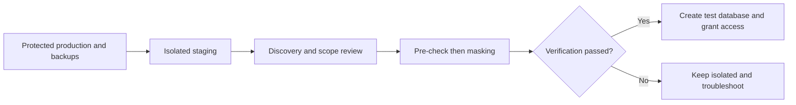

# Data Masking for Test Environments

## Objectives and Context

In the **Database Management and Optimization** chapter of the Oracle Cloud Infrastructure (OCI) learning path, data masking helps produce useful test data from sensitive sources while controlling who can access the original data. This lesson focuses on Oracle Database and **Oracle Data Safe**, from discovering sensitive columns to configuring masking, verifying data, and releasing a test environment.

Suppose the Java application `orders-api` needs production-like data to test customer lookups, order creation, notification delivery, and reporting queries. Copying the raw database to dev spreads real customer names, emails, phone numbers, and notes. Conversely, replacing every value with the same constant string can break uniqueness, cross-table relationships, and test scenarios.

The goal is to produce a dataset **accurate enough for testing while properly transforming protected information**, backed by clear verification evidence.

After this lesson, you will be able to:

- Distinguish stored-data masking from query-time redaction and encryption.
- Design a production → isolated staging → test pipeline.
- Use Data Discovery and sensitive data models to define masking scope.
- Choose masking formats according to data types, uniqueness, and business relationships.
- Verify results using Data Safe reports, Oracle SQL, and application behavior.
- Automate refreshes without skipping verification steps or access controls.

## 1. What Is Data Masking and How Does It Differ from Other Controls?

In this lesson, masking means replacing sensitive values in a dataset intended for non-production environments with values designed for that purpose. Oracle Data Safe supports discovering sensitive data and applying masking policies to target databases. [Oracle: Oracle Data Safe Overview](https://docs.oracle.com/en-us/iaas/data-safe/doc/oracle-data-safe-overview.html).

| Control | Modifies Stored Data? | Role for Test Environments |
| --- | --- | --- |
| Static data masking | Replaces values inside the processed dataset | Produces a test copy with replaced values |
| Data Redaction | Keeps original values; alters query results per policy | Restricts displayed data at query time |
| Data encryption | Protects data representation with keys | Protects storage or transit; authorized users still read cleartext |
| Synthetic data | Generates fake data from models and scenarios | Fits unit tests, boundary cases, and many functional tests |

Oracle Data Redaction modifies query outputs without altering underlying stored data. TDE decrypts transparently during authorized queries. Therefore, turning on redaction or encryption alone does not produce a dataset with replaced values ready to hand over to a test team. [Oracle: Oracle Data Redaction and Other Oracle Products](https://docs.oracle.com/en/database/oracle/oracle-database/26/dbred/oracle-data-redaction-and-other-oracle-products-faqs.html).

Nor should you equate all masking with an irreversibility guarantee. Data Safe includes a **Deterministic Encryption** format that supports reversal; designers must choose formats according to usage requirements. A dataset with names replaced can still contain combinations of attributes sufficient to identify an individual. [Oracle: Deterministic Encryption](https://docs.oracle.com/en-us/iaas/data-safe/doc/deterministic-encryption.html).

Illustrative example of target outputs, not default output from a single format:

| Attribute | Source Requiring Protection | Value Used in Test |
| --- | --- | --- |
| Name | Real customer name | `Test user 001` |
| Email | Real transactional email | `qa-001@example.invalid` |
| Phone number | Real contact number | Fake data matching test contract or NULL when permitted |
| Identifier | Real personal ID | Replacement value verified for format and uniqueness |
| Notes | May contain free-form details | Synthetic content matching test scenarios |

## 2. Designing the Data Pipeline with Isolated Staging

Oracle recommends creating a staging copy from a protected source, performing discovery and masking there, verifying results, and then creating the test database from the processed data. Never grant developers and testers access to staging containing raw original data. [Oracle: Data Masking Overview — workflow](https://docs.oracle.com/en-us/iaas/data-safe/doc/data-masking-overview.html).



Three zones require separate accountability:

| Zone | Who Has Access | Data State |
| --- | --- | --- |
| Production / original backups | Operations team and source-authorized principals | Real data |
| Masking staging | Service account and masking operators | May still contain real data or partially processed data |
| Released test | Test team per granted permissions | Data that passed release criteria |

In OCI, compartments can organize lifecycle and IAM, paired with private subnets, NSGs, and appropriate connectivity to restrict access paths. Compartments alone do not replace network controls or in-database privileges.

For `orders-api`, keep the test application disconnected from staging. Disable jobs, database links, or integration settings capable of reaching production. Email, SMS, payments, and webhooks must point to test stubs or sandboxes.

Also manage backups, exports, snapshots, Object Storage copies, logs, and collected samples. Masking one set of tables does not automatically replace copies residing elsewhere. When reducing historical traces is required, consider exporting processed data into a fresh database while evaluating recovery mechanisms and accompanying copies.

## 3. Cataloging Data to Be Processed

### 3.1. Look Beyond Obviously Named Columns

Data Discovery uses sensitive types to find data by column name characteristics, data values, and metadata, and also supports detecting database-declared and application-level relationships. Results are stored in a **sensitive data model (SDM)**. If sample collection is enabled, those samples remain sensitive data and viewer access must be restricted. [Oracle: Data Discovery Overview](https://docs.oracle.com/en-us/iaas/data-safe/doc/data-discovery-overview.html).

For an ordering application, review at minimum:

| Data Group | Example Locations | Question to Ask |
| --- | --- | --- |
| Direct identifiers | Name, email, phone number, national ID | Does testing need real values preserved? |
| Combinable attributes | Date of birth, street address, small region | Can combined fields still identify someone? |
| Business copies | Recipient email on orders, address history | Does replacing the source column miss copies? |
| Free-form content | Support notes, CLOBs, JSON | Does sensitive info sit outside dedicated columns? |
| Secrets and accounts | Tokens, password hashes, connection strings | Can they be removed or replaced with dedicated test accounts? |
| External-to-DB assets | Attachments, objects, search indexes | Database is masked, but do referenced assets still hold real data? |

The SDM must be reviewed with application knowledge. A column not flagged does not prove it is non-sensitive; a suggested match may also need its sensitive type adjusted.

### 3.2. Document Relationships Between Columns

For example, `CUSTOMERS.CUSTOMER_ID → ORDERS.CUSTOMER_ID` may have a foreign key, whereas `CUSTOMERS.EMAIL → ORDERS.CONTACT_EMAIL` is maintained only by the application. Both relationship types matter when designing masking.

Data Safe allows adding application-level relationships to an SDM to support consistency. Verify real relationships before adding them to the model; never assume two columns sharing a name always share the same identifier semantics. [Oracle: Update Sensitive Data Models](https://docs.oracle.com/en-us/iaas/data-safe/doc/update-sensitive-data-models.html).

### 3.3. Lock Down What Must Be Preserved for Meaningful Tests

The development team and data steward should agree on:

- Which technical keys to preserve or replace; can those keys link back to real data?
- Which columns must remain equal across multiple tables or multiple systems?
- Which columns require uniqueness, `NOT NULL`, checksums, or specific lengths?
- What NULL ratios, date distributions, and data categories are needed for tests?
- Which contents can be replaced completely with synthetic data?

Choosing to keep a surrogate key is appropriate only after evaluating its role and linkability. Never assume every numeric ID is harmless.

## 4. Choosing Masking Formats by Data Contract

Data Safe provides built-in formats and lets you create custom formats. When selecting, verify data types, output length, multibyte character handling, determinism, and uniqueness behavior of the specific format. [Oracle: Create or Edit Masking Formats](https://docs.oracle.com/en-us/iaas/data-safe/doc/create-or-edit-masking-formats.html).

| Need | Selection Direction | What Must Be Checked |
| --- | --- | --- |
| Replace name, email, phone | Appropriate format or designed expression | Is the output valid for the application? |
| Drop unneeded test values | NULL or fixed value if schema allows | Does it violate `NOT NULL` or `UNIQUE`? |
| Same input produces same output | Suitable deterministic format | Are configs and dependencies identical across runs? |
| Preserve multi-column address consistency | Group masking with replacement dataset | Do city, region, and country still match? |
| Preserve parent–child links | Coordinated SDM, relationships, and formats | Could orphan rows appear or keys shift inconsistently? |
| Handle JSON/CLOB or custom structures | Suitable SQL expression/UDF | Are nested fields missed or structures broken? |

### 4.1. Deterministic Does Not Mean Unique

**Deterministic Substitution** uses a lookup table of replacement values and a seed. Deterministic output requires keeping the seed and replacement data unchanged; this format does not guarantee uniqueness. Therefore, do not pick it for a `UNIQUE` column solely because you want stable results across multiple refreshes. [Oracle: Deterministic Substitution](https://docs.oracle.com/en-us/iaas/data-safe/doc/deterministic-substitution.html).

For example, a list with only 100 replacement values cannot supply one million distinct values. Even when the list exceeds input count, you must verify the format and collision behavior rather than assuming safety from list size alone.

Deterministic output also enables linkage across datasets. Maintain cross-environment stability only when tests require it, and govern seeds and configurations within the agreed scope.

### 4.2. Group Masking and Cross-Table Relationships Are Distinct

Group masking processes related columns within the **same table** to preserve their relationship, such as a city–region–country tuple. Data Safe supports specific formats for this grouped approach. [Oracle: Group Masking](https://docs.oracle.com/en-us/iaas/data-safe/doc/group-masking.html).

Keeping a customer's email consistent with the email stored on an order is a cross-table requirement. It requires configuring relationships or coordinated transformations; do not merely assign the same group name and assume all data stays synchronized.

Be cautious with shuffling as well: swapping real values can still leave the original sensitive set intact, and small groups may not produce meaningful changes. If the requirement is removing real values from the test set, use replacement data that meets that requirement.

### 4.3. Do Not Build New Values from Unmasked Sensitive Parts

An expression like `first_name || last_name || '@test-domain'` can still preserve real names. Keeping part of an identification number or merely hashing a predictable input domain also does not eliminate linkability on its own.

Prefer an explicit contract: what outputs may contain, which relationships must hold, and whether recipients can use remaining details to link back to the source.

## 5. Preparing Target, Permissions, and Recovery Plan

### 5.1. Separating OCI Permissions and In-Database Privileges

Data Safe requires IAM permissions to use service resources and database privileges for the service account on the target. Masking operators also need access scoped to the compartments holding the target, model, policy, and reports. [Oracle: Security and Permissions](https://docs.oracle.com/en/cloud/paas/data-safe/dsiad/datasafe_iam.html).

In a lab, placing related resources in the same compartment simplifies verification. Production should separate duties: whoever creates copies, whoever configures masking, and whoever uses test data do not have to be the same group.

For the service account, select the exact capabilities required:

| Target Type | Discovery | Masking |
| --- | --- | --- |
| Non-Autonomous Oracle Database | `DATA_DISCOVERY` feature privilege via Data Safe privilege script | `MASKING` feature privilege via script |
| Autonomous Database | Corresponding Data Safe discovery role | `DS$DATA_MASKING_ROLE` for the executing account |

Non-Autonomous targets use the `datasafe_privileges.sql` script per Oracle's procedure; Autonomous provides `DS_TARGET_UTIL`. Never bypass these steps by granting `DBA` to an application account. [Oracle: Grant Roles to the Oracle Data Safe Service Account](https://docs.oracle.com/en-us/iaas/data-safe/doc/grant-roles-oracle-data-safe-service-account-your-target-database.html).

**Note for the lab using SQL Expression below:** on Autonomous Database, policies using SQL expressions, UDFs, post-processing functions, or pre/post scripts require a dedicated Data Masking account instead of defaulting to `DS$ADMIN`. Provide that dedicated account's credentials when running pre-checks and jobs as required by the service. [Oracle: Create a Data Safe Service Account — exception for Autonomous](https://docs.oracle.com/en-us/iaas/data-safe/doc/create-oracle-data-safe-service-account-your-database.html).

### 5.2. Preparing Data and Workspace

Before running masking:

- Confirm the OCID, database name, service/PDB, region, and compartment of **staging**.
- Prepare a way to recreate staging from the protected source if results fail criteria.
- Stop application writes during processing so data and verification checks do not shift unexpectedly.
- Check tablespaces, `TEMP`, undo, dependent objects, and the execution window.
- Record constraints, indexes, triggers, and protection policies to verify after the job.

Do not treat masking as a small `UPDATE` you can always undo with `ROLLBACK` at the end of a session. Service steps may process tables and dependent objects. If a job fails, determine what changed before proceeding.

## 6. Execution Workflow in Oracle Data Safe

### Step 1: Register Staging and Create a Sensitive Data Model

Register the exact staging target with Data Safe, then test connectivity and service account privileges. In **Data Discovery**, create an SDM for the in-scope schemas/tables. Enable sample collection only if operators are authorized to store and view those samples.

Review discovered columns and add business columns, free-form content, and required application-level relationships. The SDM must reflect the current schema scope, not just the initial discovery run.

### Step 2: Create and Review a Masking Policy

In **Data Masking → Masking policies**, create a policy from the SDM. Data Safe may assign default formats to columns; the operator still must verify those choices and any columns lacking an appropriate format. [Oracle: Create Masking Policies](https://docs.oracle.com/en-us/iaas/data-safe/doc/create-masking-policies.html).

Review column by column:

```text
Schema / table / column
Sensitive data type
Format and parameters
Relationships to preserve
Length / NULL / uniqueness / conditional rules
Expected output and verification check
```

Pay special attention to conditional branches. A branch that preserves data or an unmatched condition can leave real values behind unexpectedly.

### Step 3: Run Pre-Masking Check

Pre-check verifies job readiness, including privileges, storage capacity, dependent objects, and target conditions. Inspect the report, fix any errors, and re-run before proceeding. Another masking job running concurrently on the same target must also be ruled out. [Oracle: Pre-Masking Check](https://docs.oracle.com/en-us/iaas/data-safe/doc/pre-masking-check.html).

Passing pre-check proves the checked technical prerequisites are satisfied; it does not prove the policy covers every sensitive column or that the application will pass all tests.

### Step 4: Run the Job and Monitor the Work Request

Select **Mask sensitive data** or **Mask data** from the policy, confirm the target and policy, and provide seeds/credentials if required by formats. Monitor the work request and job errors. Data Safe allows only one active masking job on the same target at a time. [Oracle: Mask Sensitive Data on a Target Database](https://docs.oracle.com/en-us/iaas/data-safe/doc/mask-sensitive-data-target-database.html).

During this period, staging is not yet ready for release. Do not grant read access to testers just because some tables have finished.

### Step 5: Verify and Create the Test Environment

Inspect the masking report, column scope, dependent objects, output data, and business logic. Once criteria pass, create the test database by cloning appropriately or importing processed data into a fresh database, then grant access to the test team.

Check test configuration once more: datasources, accounts, email/SMS gateways, API sandboxes, scheduled jobs, and connection details must never point back to production.

## 7. Hands-On Practice with Synthetic Data and Two Related Tables

This lab uses **completely synthetic self-created data**, allowing you to learn configuration without copying real customer records. The commands below are instructions for learners and are not pre-executed on a database.

### 7.1. Create the Lab Data Schema

Use a dedicated test schema on a target supported by Data Safe. If table names already exist, verify whether they belong to an earlier lab run before continuing; never overwrite business tables.

```sql
CREATE TABLE mask_lab_customers (
    customer_id NUMBER
        CONSTRAINT ml_customers_pk PRIMARY KEY,
    full_name VARCHAR2(100) NOT NULL,
    email VARCHAR2(100) NOT NULL
        CONSTRAINT ml_customers_email_uk UNIQUE,
    phone VARCHAR2(30),
    national_id VARCHAR2(30)
);

CREATE TABLE mask_lab_orders (
    order_id NUMBER
        CONSTRAINT ml_orders_pk PRIMARY KEY,
    customer_id NUMBER NOT NULL,
    contact_email VARCHAR2(100) NOT NULL,
    total_amount NUMBER(12,2) NOT NULL,
    internal_note VARCHAR2(500),
    CONSTRAINT ml_orders_customer_fk
        FOREIGN KEY (customer_id)
        REFERENCES mask_lab_customers(customer_id),
    CONSTRAINT ml_orders_total_ck
        CHECK (total_amount >= 0)
);

INSERT INTO mask_lab_customers
    (customer_id, full_name, email, phone, national_id)
VALUES
    (1, 'Sample customer A', 'seed-a@example.invalid',
     'TEST-PHONE-A', 'SYNTH-ID-A');

INSERT INTO mask_lab_customers
    (customer_id, full_name, email, phone, national_id)
VALUES
    (2, 'Sample customer B', 'seed-b@example.invalid',
     NULL, 'SYNTH-ID-B');

INSERT INTO mask_lab_orders
    (order_id, customer_id, contact_email, total_amount, internal_note)
VALUES
    (101, 1, 'seed-a@example.invalid', 150000, 'SYNTHETIC_NOTE_A');

INSERT INTO mask_lab_orders
    (order_id, customer_id, contact_email, total_amount, internal_note)
VALUES
    (102, 1, 'seed-a@example.invalid', 250000, 'SYNTHETIC_NOTE_B');

INSERT INTO mask_lab_orders
    (order_id, customer_id, contact_email, total_amount, internal_note)
VALUES
    (103, 2, 'seed-b@example.invalid', 350000, 'SYNTHETIC_NOTE_C');

COMMIT;
```

The fixture baseline is 2 customers and 3 orders. Two orders belong to the same customer so you can verify email transformation consistency.

### 7.2. Configure the Lab Policy

Run discovery or manually add the columns to the SDM. Synthetic markers such as `SYNTH-ID-A` may not match a real sensitive type; you still must include the target test columns in the policy scope.

Choose the following configuration for the lab:

| Column | Handling | Output Contract |
| --- | --- | --- |
| `CUSTOMERS.FULL_NAME` | Fixed String | `Test user` |
| `CUSTOMERS.EMAIL` | SQL Expression using `CUSTOMER_ID` | Unique test email per lab customer |
| `CUSTOMERS.PHONE` | Null Value | NULL; lab column allows NULL |
| `CUSTOMERS.NATIONAL_ID` | Fixed String | `MASKED`; lab column has no UNIQUE constraint |
| `ORDERS.CONTACT_EMAIL` | Same SQL Expression using `CUSTOMER_ID` on orders table | Matches the customer's new email |
| `ORDERS.INTERNAL_NOTE` | Fixed String | `Test note` |
| IDs and `TOTAL_AMOUNT` | Preserved in synthetic lab | Keeps fixture relationships and business totals |

`CUSTOMERS` and `ORDERS` in the table above are shorthand for `MASK_LAB_CUSTOMERS` and `MASK_LAB_ORDERS`.

In both SQL Expression fields for email, use:

```sql
'qa-' || TO_CHAR(%CUSTOMER_ID%, 'FM9999999990') || '@example.invalid'
```

This is a **Data Safe** configuration expression, not a standalone SELECT statement. Data Safe uses `%COLUMN_NAME%` to reference columns in the same table inside a SQL Expression. [Oracle: SQL Expression masking format](https://docs.oracle.com/en-us/iaas/data-safe/doc/sql-expression.html).

For fixture IDs 1 and 2, expected outputs are `qa-1@example.invalid` and `qa-2@example.invalid`. Because the ID is preserved in both tables, both expressions stay coordinated.

This formula is specific to **a synthetic lab with a small ID domain**. It does not prove a formula based on production IDs protects identity; ID numbers, lengths, relationships, and linkability must be evaluated independently on real data.

In this lab, uniqueness comes from generating distinct strings for known IDs, not from the "SQL Expression" label itself. `Fixed String` is used only on columns without `UNIQUE` requirements where losing data distribution is acceptable.

### 7.3. Run Pre-Check and Masking

Confirm the policy targets only the exact lab schema/tables, prepare the account and credentials per Section 5, run pre-check, and only then run the job. After the job finishes, keep the lab zone isolated while executing the verification queries below.

## 8. Verifying Results: Data Protection and Usability

### 8.1. Read the Data Safe Report

The masking report records target, policy, timestamps, tables/columns, and counts of processed values. Cross-check that list against the agreed scope; seeing many masked columns in the report does not prove every column needing protection was included in the policy. [Oracle: Download Data Masking Reports](https://docs.oracle.com/en-us/iaas/data-safe/doc/download-data-masking-reports.html).

The report and work request provide execution evidence. Data queries and application tests provide output-compliance evidence. Both are required before release.

### 8.2. Check Row Counts and Lab Uniqueness

In the lab schema after masking:

```sql
SELECT 'CUSTOMERS' AS dataset, COUNT(*) AS row_count
FROM mask_lab_customers
UNION ALL
SELECT 'ORDERS', COUNT(*)
FROM mask_lab_orders;
```

Fixture expectations are 2 and 3. This is a value-replacement policy, not a row-deletion policy; if row counts differ from baseline, you must explain why.

Check for duplicate email groups:

```sql
SELECT COUNT(*) AS duplicate_email_groups
FROM (
    SELECT email
    FROM mask_lab_customers
    WHERE email IS NOT NULL
    GROUP BY email
    HAVING COUNT(*) > 1
);
```

Expect 0. On real data, also verify constraint states, NULL values, and uniqueness rules enforced by the application, such as case-insensitive emails.

### 8.3. Check Parent–Child Integrity and Business Email Consistency

Find orders missing a customer:

```sql
SELECT COUNT(*) AS orphan_orders
FROM mask_lab_orders o
LEFT JOIN mask_lab_customers c
  ON c.customer_id = o.customer_id
WHERE c.customer_id IS NULL;
```

Find order emails that do not match customer emails per the lab contract:

```sql
SELECT COUNT(*) AS email_mismatches
FROM mask_lab_orders o
JOIN mask_lab_customers c
  ON c.customer_id = o.customer_id
WHERE o.contact_email IS NULL
   OR c.email IS NULL
   OR o.contact_email <> c.email;
```

Both expect 0. The email check covers a business invariant that a foreign key on `CUSTOMER_ID` does not enforce.

In real applications, an email on an order may be a historical snapshot permitted to differ from the current customer email. In that case, redefine the verification contract rather than forcing one lab rule onto a different business model.

### 8.4. Check Formats and Replaced Columns

Verify customer emails match the designed transformation:

```sql
SELECT COUNT(*) AS unexpected_customer_emails
FROM mask_lab_customers
WHERE email IS NULL
   OR email <>
       'qa-' || TO_CHAR(customer_id, 'FM9999999990') || '@example.invalid';
```

Verify fixed values and NULLs:

```sql
SELECT COUNT(*) AS unexpected_customer_values
FROM mask_lab_customers
WHERE full_name IS NULL
   OR full_name <> 'Test user'
   OR phone IS NOT NULL
   OR national_id IS NULL
   OR national_id <> 'MASKED';

SELECT COUNT(*) AS unexpected_order_notes
FROM mask_lab_orders
WHERE internal_note IS NULL
   OR internal_note <> 'Test note';
```

Each query expects 0. These queries encode fixture-specific criteria; they are not a general detector for all forms of sensitive data in an arbitrary database.

### 8.5. Check Constraints and Dependent Objects

```sql
SELECT table_name, constraint_name, constraint_type, status, validated
FROM user_constraints
WHERE table_name IN ('MASK_LAB_CUSTOMERS', 'MASK_LAB_ORDERS')
ORDER BY table_name, constraint_name;
```

Compare against baseline: expected constraints must remain active and validated. Also inspect indexes, triggers, invalid objects, and protection policies associated with processed tables.

Never declare success after temporarily disabling a constraint and leaving it disabled. Data may be readable while subsequent application writes fail.

### 8.6. Check Functionality and Residual Data

Run the test application using an account with only required permissions and verify:

- Customer search and order listing return accurate results.
- Creating or updating orders preserves relationships and validation checks.
- Authentication flows no longer use copied production credentials.
- Email/SMS/webhooks route to stubs or sandboxes.
- Logs, exported files, reports, and referenced objects do not leak the original dataset.

You can re-run discovery to look for missed scope, but fake data can still match "email" or "phone number" patterns. A column still classified as sensitive after masking does not by itself prove original values remain intact; evaluate against policies and protection goals.

Conversely, spotting a few rows free of real values does not prove every row was processed. Combine policy coverage, reports, verification queries, and reviews of unstructured data locations.

## 9. Handling Errors, Mapping Tables, and Auxiliary Scripts

| Scenario | How to Handle | Isolation Condition |
| --- | --- | --- |
| Job stops mid-run | Inspect work request, processed tables, and errors before choosing resume or restart | Full scope not yet confirmed complete |
| Format produces values that are too long | Adjust format or output domain, re-run pre-check | Columns still failing or skipped |
| UNIQUE collision | Pick a format/value domain able to satisfy uniqueness, retest | Duplicates remain or constraints not restored |
| Parent–child data mismatch | Review SDM, relationships, and coordinated transforms | Orphan rows remain or contract violated |
| Application validation failure | Fix test data contract or format to match test needs | Usability not yet confirmed |
| Out-of-scope data found | Expand scope, handle copies and related assets | Real values still accessible to testers |

Data Safe supports rerunning a failed job from a chosen step. Before using this, check the current state and whether resuming is appropriate; restarting from scratch on partially masked data may behave differently from running on a fresh staging copy. [Oracle: Mask Sensitive Data — rerun a failed job](https://docs.oracle.com/en-us/iaas/data-safe/doc/mask-sensitive-data-target-database.html).

Pay special attention to the option for deleting temporary mapping tables. Mapping tables can hold original-to-masked value pairs; never leave them in an environment handed over to test users. Data Safe provides options to manage deleting these tables and refreshing statistics after masking. [Oracle: Edit Masking Policies](https://docs.oracle.com/en-us/iaas/data-safe/doc/edit-masking-policies.html).

If using pre/post masking scripts, inspect the log of each step. According to documentation, statement/block errors may be logged while execution continues; when retried due to connectivity issues, a script may restart from the beginning. Therefore, design scripts to be safely re-runnable and verify post-processing conditions independently. [Oracle: Create Masking Policies — pre/post script behavior](https://docs.oracle.com/en-us/iaas/data-safe/doc/create-masking-policies.html).

For example, a pipeline must not release data merely because the final job status is success if a post-script meant to drop auxiliary tables failed. Similarly, re-verify redaction, auditing, or other protection policies when pre-check notes they must be recreated after masking.

## 10. Automating Refreshes While Controlling Outputs

Each refresh from production introduces a fresh source copy into the pipeline. Never assume a test database masked in a prior run stays safe after reloading unprocessed data.

An automation workflow can be described in pseudocode:

```text
create isolated staging from protected source
confirm target is within authorized scope
reconcile schema against SDM and policy version
if schema has unhandled changes: halt release
run pre-check and resolve errors
run masking then verify reports and related scripts
verify data, relationships, objects, and application behavior
if all criteria pass:
    create test copy, configure sandbox, and grant access
if any criterion fails:
    keep isolated and log cause
revoke temporary permissions and clean up resources per retention window
```

When the SDM changes, Data Safe can compare and synchronize selected changes into the policy. An old policy does not prove it covers columns newly added to the schema. [Oracle: Edit Masking Policies — compare with sensitive data model](https://docs.oracle.com/en-us/iaas/data-safe/doc/edit-masking-policies.html).

Manage a reconcilable configuration bundle including: SDM, policy, custom formats, substitution datasets, seed rules, schema, and verification suite. Credentials and seeds must be managed according to the sensitivity of their mechanism—never print them to CI logs for troubleshooting convenience.

For cost, account for staging storage, test storage, backups, temporary space, runtime duration, and recovery readiness. Choose a dataset size suited to testing goals; a smaller subset is useful only if it preserves the relationships and scenarios under test.

For performance testing, identical row counts are not enough. Masking can change distinctness, data skew, and column selectivity. Re-evaluate statistics and workload representativeness rather than using a lab fixed-value dataset to predict production execution plans.

## 11. Release Criteria and Completing the Practice Exercise

A dataset is ready for a test environment once sufficient evidence is gathered:

1. Exact target and copy source confirmed, with staging access restricted.
2. Column scope and relationships reviewed against the current schema.
3. Pre-check, job, report, and auxiliary steps verified.
4. No mapping tables or original datasets remain within tester-accessible scope.
5. Uniqueness, `NOT NULL`, relationships, and required business contracts all pass.
6. Application operates properly against processed data and sandbox integrations.
7. Owner, configuration version, and resource retention deadline are recorded.

For the fixture in this lesson, save evidence of the 2/3 row counts, zero-error verification queries, intact constraints, and order read/create operations in the test application. These are results learners must verify themselves; this document does not claim those steps have already been executed.

After the lab, end test transactions, revoke temporary permissions, and clean up dedicated created resources when no longer needed. If keeping the environment for continued study, continue managing permissions and sandbox settings.

The value of data masking works on both sides: limiting the spread of sensitive data while preserving a genuinely usable test dataset. Oracle Data Safe handles the technical execution, while data scope, relationships to preserve, and release criteria must be explicitly designed for the application.
