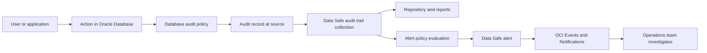

# Database Activity Auditing and Anomalous Access Alerting

In the **Database Management and Optimization** chapter of the Oracle Cloud Infrastructure (OCI) module, auditing helps answer: who accessed the database, what action they performed, on which object, at what time, and with what result. When auditing is combined with alert rules and investigation procedures, operations teams can quickly detect credential misuse, unplanned privilege changes, or data access through unexpected connection paths.

This lesson focuses on Oracle Database and Oracle Data Safe on OCI. Deployment connects to compartments, IAM, VCN connectivity, log retention, monitoring, and cost. The SQL examples use synthetic data in a lab database; they are practice instructions, not requests to run commands on production.

## 1. Expected Outcomes

After this lesson, you will be able to:

- Distinguish database auditing from OCI Audit, application logs, and access-prevention controls.
- Design audit scope by account, action, object, and operation outcome.
- Inspect Unified Auditing and read evidence from `UNIFIED_AUDIT_TRAIL`.
- Explain the roles of audit policies, audit trails, alert policies, and notifications.
- Collect audit records into Data Safe and create alerts from verified conditions.
- Build anomalous access indicators without equating every failed login with an attack.
- Control log read permissions, storage volume, retention, and collection pipeline quality.

## 2. Distinguishing Observation and Control Layers

### 2.1. Database Audit and OCI Audit

OCI Audit records calls to supported public API endpoints, including operations via the Console, CLI, or SDK. It provides evidence of actions on OCI resources. Source: [Overview of Audit](https://docs.oracle.com/en-us/iaas/Content/Audit/Concepts/auditoverview.htm).

Database auditing records activity inside Oracle Database according to the active mechanism and policies. Someone can connect with SQL Developer and read a table without making any OCI management API call for each SQL statement. Therefore, looking at OCI Audit alone is not enough to identify who read a customer table.

| Layer | Example Question | Evidence to Look For |
| --- | --- | --- |
| IAM and OCI resources | Who changed infrastructure settings or cloud access permissions? | OCI Audit and related IAM data |
| Oracle Database | Which account read a table or changed privileges? | Database audit record |
| Application | Which business user submitted the request? | Application logs, request ID, and authenticated identity |
| Network | Which path did the database connection take? | Network logs or relevant connection data |
| Performance | How much load did the query generate? | Performance metrics, execution plans, and monitoring tools |

These layers complement one another. IAM identities, database users, and application users can differ; do not link them merely because two names look similar.

### 2.2. Auditing Records Events; Access Control Decides Permissions

A `SELECT` statement that is valid under granted privileges may still warrant investigation if run from an unfamiliar host or outside an account's remit. Conversely, a rejected action can still produce useful evidence.

Auditing does not replace:

- Database privileges, roles, and the principle of least privilege.
- IAM policies and network connection path controls.
- Credential and privileged-account management.
- Specialized protection mechanisms when required by the environment.

Audit-based alerts typically fire after an event has occurred and logs have been processed. Do not present auditing as an instant blocking control for every anomalous SQL statement.

## 3. Understanding the Chain from Action to Notification

Oracle Data Safe Activity Auditing collects audit records from target databases into the Data Safe repository for analysis and reporting. Target registration, policy configuration, and starting collection are separate tasks. Source: [Activity Auditing Overview](https://docs.oracle.com/en-us/iaas/data-safe/doc/activity-auditing-overview.html).

Data Safe generates an alert when a collected audit record matches an active alert policy. Without a matching record, there is no alert. Source: [Alerts Overview](https://docs.oracle.com/en-us/iaas/data-safe/doc/alerts-overview.html).



Four concepts must be kept distinct:

| Component | Role |
| --- | --- |
| Database audit policy | Specifies which activities should be recorded |
| Audit trail collection | Reads and transfers records from source into Data Safe |
| Alert policy | Defines conditions on records to generate alerts |
| Notification | Delivers alert details to the receiving destination |

An end-to-end check must verify every link. "Did not receive email" is not enough to blame the database; "log exists in the database" also does not prove notifications are working.

## 4. Designing Risk-Based Audit Scope

### 4.1. Start from Investigation Questions

Do not start with the goal of "logging everything". Identify which behaviors require evidence and what action will be taken when they are detected.

| Objective | Data to Capture | Example Signals to Investigate |
| --- | --- | --- |
| Detect credential misuse | Successful/failed logins, accounts, and connection sources | Multiple failures followed by success from an unknown source |
| Track privileged activity | Administrative actions and privilege changes | Granting strong privileges outside a maintenance window |
| Protect critical data | Access to designated tables or operations | Reporting account reading objects outside its remit |
| Detect structural changes | DDL and affected objects | Altering a procedure or dropping a table outside plan |
| Protect auditing itself | Policy changes and audit trail management | Disabling a policy right before suspicious access |
| Separate app path from direct access | Database user, program, host, and app context | Service account appearing from a personal workstation |

A policy must specify objects, users/roles, actions, PDB/CDB scope, and outcomes to record. If you audit only failed operations, you will lack evidence of successful actions performed with abused valid credentials.

### 4.2. Unified Auditing and Fine-Grained Auditing

Unified Auditing enables configuring audits by actions, privileges, and objects. When finer conditions such as specific columns or accessed data values are needed, Oracle provides fine-grained auditing via `DBMS_FGA`. Source: [Choosing an Auditing Type](https://docs.oracle.com/en/database/oracle/oracle-database/19/dbseg/steps-provision-unified-audit-policies.html).

For example, "audit every read of the mock customer table" fits starting with an object action policy. "Care only about sensitive column access when a data condition holds" calls for a finer design. When choosing FGA, verify semantics and limitations on your database version, and measure policy overhead on representative workloads. Source: [Fine-Grained Auditing](https://docs.oracle.com/en/database/oracle/oracle-database/19/dbseg/value-based-auditing-fine-grained-audit-policies.html).

An audit record does not by default prove how many rows were retrieved or how much data crossed the network. Concluding large-scale data extraction requires combining appropriate additional evidence; repeated `SELECT` records are only one signal.

### 4.3. Creating a Baseline to Judge "Anomalous"

A baseline describes acceptable behavior within a specific scope:

- Which database user serves which application?
- What are the expected hosts, programs, and connection paths?
- At what times do batches, reports, or maintenance run?
- Who is allowed to alter privileges, and under which change requests?
- Which tables are only meant to be read by a specific job group?

A baseline must have an owner and a review due date. A temporary exception for a migration should not turn into a permanent allowlist. Never use "different from yesterday" alone as proof of compromise when an application just changed architecture.

## 5. Preparing Permissions, Targets, and Connectivity on OCI

### 5.1. Separating OCI Permissions and In-Database Privileges

At least three permission groups must be distinguished:

| Principal | Permissions to Review |
| --- | --- |
| Report/alert viewers | Read access to Data Safe resources and data in assigned compartments |
| Audit and collection configurators | Manage permissions on required Data Safe components |
| In-database service account | Privileges to collect audits and, if delegated, configure audits |

Inside Oracle Database, `AUDIT_ADMIN` handles audit administration; `AUDIT_VIEWER` handles viewing and analyzing audits. In multitenant environments, target the exact container when configuring and querying. Source: [Introduction to Auditing](https://docs.oracle.com/en/database/oracle/oracle-database/19/dbseg/introduction-to-auditing.html).

For OCI IAM, example read-only group for Activity Auditing resources:

```text
Allow group Default/DbAuditReaders to read data-safe-audit-family in compartment DbSecurity
```

Replace the identity domain, group, and compartment with actual values. This family spans multiple related resources; to narrow permissions, consider resource types such as `data-safe-audit-events`. Permissions on Alerts, Events, and Notifications must be designed according to each role's duties. Source: [Activity Auditing Resources](https://docs.oracle.com/en-us/iaas/data-safe/doc/activity-auditing-resources.html).

Do not grant tenancy-wide manage access just so someone can download an audit report. Likewise, do not treat an audit reader as someone permitted to edit policies or purge audit data.

### 5.2. Preparing the Service Account for the Target Type

Data Safe uses different roles between Autonomous Database and non-Autonomous Database. Documentation distinguishes roles for audit collection from roles for audit settings; grant only the capabilities needed. Source: [Roles for Data Safe Service Accounts](https://docs.oracle.com/en-us/iaas/data-safe/doc/grant-roles-oracle-data-safe-service-account-your-target-database.html).

List required privileges according to your operating model. If the DBA team manages source policies independently, whether to grant policy-modification privileges to the collection account must be evaluated separately. Use the Oracle-documented privilege mechanism for the target type and deployed version instead of substituting a shared DBA account.

### 5.3. Checking VCN and Database Connectivity

Data Safe supports direct connections or private endpoint/on-premises connector paths depending on database type and location. For private addresses, choose an option with an actual network path to the target. Source: [Connectivity Options for Target Databases](https://docs.oracle.com/en-us/iaas/data-safe/doc/connectivity-options-target-databases.html).

When the target resides in a private subnet, verify step by step:

1. Do the endpoint, service name, and listener port match the exact database/PDB?
2. Do DNS and routes deliver traffic to the right destination?
3. Do NSGs or security lists allow the exact required flow?
4. Do credentials, TLS, and wallets match the chosen connection method?
5. Does the collection account have privileges to read the exact audit trail?

An open port does not prove authentication succeeds; logging in does not prove privileges to read the trail. Layered checks prevent broadening network rules or database privileges without fixing the root cause.

## 6. Checking Unified Auditing Before Creating Policies

Examples in this section use Oracle Database 19c syntax as a baseline. For Autonomous Database or other versions, verify service-allowed privileges and existing policies before applying. Do not assume every version ships with identical default policy states.

### 6.1. Verify Container and Audit Mode

Connect with an account having privileges to read required metadata inside the exact lab PDB:

```sql
SELECT SYS_CONTEXT('USERENV', 'DB_NAME') AS db_name,
       SYS_CONTEXT('USERENV', 'CON_NAME') AS con_name,
       SYS_CONTEXT('USERENV', 'SESSION_USER') AS session_user
FROM dual;

SELECT value
FROM v$option
WHERE parameter = 'Unified Auditing';
```

In Oracle Database 19c, the value from `V$OPTION` indicates whether pure unified auditing is enabled. A `FALSE` value does not by itself prove the database lacks unified auditing: mixed mode remains a possibility to inspect. Source: [Auditing Modes and Scope](https://docs.oracle.com/en/database/oracle/oracle-database/19/dbseg/introduction-to-auditing.html).

Do not switch audit modes or alter instance configuration solely to complete an example. First inspect existing audit policies and actual records in the current configuration.

### 6.2. Inspect Currently Enabled Policies

```sql
SELECT policy_name,
       enabled_option,
       entity_name,
       entity_type,
       success,
       failure
FROM audit_unified_enabled_policies
ORDER BY policy_name, entity_name;
```

This view shows enabled policies, applied entities, and whether successes/failures are captured. A policy existing in policy definitions does not automatically mean it is enabled. Source: [AUDIT_UNIFIED_ENABLED_POLICIES](https://docs.oracle.com/en/database/oracle/oracle-database/19/refrn/AUDIT_UNIFIED_ENABLED_POLICIES.html).

For example, Oracle Database 19c includes `ORA_LOGON_FAILURES` for failed logins, yet default enabled status can differ between newly created databases and upgraded databases. Check the actual state on your target. Source: [Predefined Unified Audit Policies](https://docs.oracle.com/en/database/oracle/oracle-database/19/dbseg/auditing-activities-predefined-unified-audit-policies.html).

## 7. Hands-On Auditing on a Synthetic Table

The lab goal is observing one table read and one failed login using the assigned test account.

Initial conditions:

- A lab PDB allowing Unified Auditing under its current configuration.
- Schema `LAB_APP` and user `LAB_READER` already created by the administrator.
- `LAB_APP` has table creation privileges and needed quota; `LAB_READER` has login privileges.
- The user configuring policies holds appropriate audit privileges; the user reading evidence holds audit viewing privileges.
- The table and policy names below are not already in use by another exercise.

User creation and password management belong to the lab's account provisioning process. Never put real passwords into scripts, terminal history, or shared documents.

### 7.1. Create the Mock Object

Connect as `LAB_APP` in the lab PDB:

```sql
CREATE TABLE customer_demo (
    customer_id       NUMBER PRIMARY KEY,
    full_name         VARCHAR2(100),
    sensitivity_label VARCHAR2(20)
);

INSERT INTO customer_demo
    (customer_id, full_name, sensitivity_label)
VALUES
    (1, 'Demo Customer A', 'SAMPLE');

COMMIT;

GRANT SELECT ON customer_demo TO LAB_READER;
```

Customer names and labels are purely mock data. The `SELECT` grant makes the lab read succeed; generating an alert afterward does not turn that operation into a database privilege violation.

### 7.2. Create and Enable Policies

Connect as a user with audit management privileges, still inside the exact PDB:

```sql
CREATE AUDIT POLICY lab_customer_access
    ACTIONS SELECT ON LAB_APP.CUSTOMER_DEMO;

AUDIT POLICY lab_customer_access BY LAB_READER;

CREATE AUDIT POLICY lab_reader_logon
    ACTIONS LOGON;

AUDIT POLICY lab_reader_logon BY LAB_READER;
```

The first policy records reads on the selected object. The second records logins by the lab user; the example adds no success-only or failure-only filter. These are narrowly scoped lab policies, not a production-wide monitoring baseline.

Object action syntax uses `CREATE AUDIT POLICY ... ACTIONS ... ON ...`. After creation, enable with `AUDIT POLICY`. Source: [Auditing Object Actions](https://docs.oracle.com/en/database/oracle/oracle-database/19/dbseg/auditing-object-actions.html).

For clear test results, open a **new session** as the audited user after enabling the policies. Under 19c policy-application mechanics, pre-existing sessions may not pick up newly enabled audit settings. Source: [Enabling and Applying Unified Audit Policies](https://docs.oracle.com/en/database/oracle/oracle-database/19/dbseg/enabling-and-applying-unified-audit-policies-users-and-roles.html).

### 7.3. Generate an Identifiable Read

In the new session of `LAB_READER`:

```sql
BEGIN
    DBMS_SESSION.SET_IDENTIFIER('audit-lab-request-001');
END;
/

SELECT customer_id, full_name
FROM LAB_APP.CUSTOMER_DEMO
WHERE customer_id = 1;
```

The client identifier ties the action to the test request. This is context supplied by the session/application, not independent authentication proof of an end user.

If an application uses a connection pool, set and clear the context along the request lifecycle to avoid attributing one user's actions to another. For logon records, do not expect an identifier set after connecting to appear retroactively on the earlier logon event. Source: [Client Identifier in Audits](https://docs.oracle.com/en/database/oracle/oracle-database/19/dbseg/troubleshooting-for-audit.html).

### 7.4. Trigger One Failed Login

Using SQL*Plus or an equivalent client, select the exact lab account and enter a wrong password **once** at the prompt. Before testing, verify the account's failed-login limit and unlock procedure in the lab. Never use an application account serving real users.

Example connection command without embedding a password:

```text
sqlplus LAB_READER@<lab_PDB_connect_identifier>
```

Then log in normally using the lab procedure. The goal is creating a controlled single failure record; do not loop password attempts to flood events.

## 8. Reading and Interpreting Audit Records

### 8.1. Key Fields to Understand

`UNIFIED_AUDIT_TRAIL` provides session identity, timestamp, action, object, outcome, and associated policies. `RETURN_CODE = 0` indicates success; non-zero values must be interpreted via the corresponding error code. Source: [UNIFIED_AUDIT_TRAIL 19c](https://docs.oracle.com/en/database/oracle/oracle-database/19/refrn/UNIFIED_AUDIT_TRAIL.html).

| Field | Meaning During Investigation |
| --- | --- |
| `EVENT_TIMESTAMP_UTC` | UTC timestamp |
| `DBUSERNAME` | Database user performing the action |
| `USERHOST` | Host associated with the session |
| `CLIENT_PROGRAM_NAME` | Client program |
| `CLIENT_IDENTIFIER` | Session client context |
| `ACTION_NAME`, `AUDIT_TYPE` | Action and audit type |
| `OBJECT_SCHEMA`, `OBJECT_NAME` | Affected object |
| `RETURN_CODE` | Operation outcome |
| `UNIFIED_AUDIT_POLICIES` | Policy generating the record, when applicable |
| `DBID`, `INSTANCE_ID`, `SESSIONID` | Metadata correlating source and session |

Some fields may be empty or vary by connection type, audit type, and version. Never treat host or program name as a sole trustworthy identity.

### 8.2. Query Bounded by Time and Account

Using an account authorized to read audits, run in the exact PDB:

```sql
SELECT event_timestamp_utc,
       dbusername,
       userhost,
       client_program_name,
       client_identifier,
       action_name,
       return_code,
       object_schema,
       object_name,
       unified_audit_policies
FROM unified_audit_trail
WHERE event_timestamp_utc >=
          SYS_EXTRACT_UTC(SYSTIMESTAMP) - INTERVAL '30' MINUTE
  AND dbusername = 'LAB_READER'
ORDER BY event_timestamp_utc DESC
FETCH FIRST 100 ROWS ONLY;
```

Inspect the record for reading `LAB_APP.CUSTOMER_DEMO`, the operation outcome, and the lab policies. Verify the failed logon separately by action, timestamp, and actual error code. Do not assume each application request creates exactly one audit record: counts also depend on operations, policies, and audit types.

Filtering on UTC timestamps bounds the dataset. Oracle recommends filtering `EVENT_TIMESTAMP_UTC` when querying the unified audit trail to enable partition pruning. Source: [Guidelines for Auditing](https://docs.oracle.com/en/database/oracle/oracle-database/26/dbseg/guidelines-auditing.html).

In real investigations, you may also need to inspect SQL text and binds per granted privileges. Those fields can contain sensitive data; never copy them verbatim into tickets or wide notification channels.

### 8.3. Counting Failed Logins Over a Window

Example analyzing failed logon counts over the past 5 minutes:

```sql
SELECT dbusername,
       userhost,
       COUNT(*) AS failed_logons,
       MIN(event_timestamp_utc) AS first_seen_utc,
       MAX(event_timestamp_utc) AS last_seen_utc
FROM unified_audit_trail
WHERE event_timestamp_utc >=
          SYS_EXTRACT_UTC(SYSTIMESTAMP) - INTERVAL '5' MINUTE
  AND action_name = 'LOGON'
  AND return_code <> 0
GROUP BY dbusername, userhost
HAVING COUNT(*) >= 5
ORDER BY failed_logons DESC;
```

This is a point-in-time SQL query grouping by database user and host over a rolling 5-minute window. It is not a Data Safe SCIM rule, does not run periodically on its own, and does not send alerts. The number 5 is an illustrative threshold; there is no need to enter 5 wrong passwords to complete the lab.

Before using in operations, verify actual actions on the source being collected. If source auditing does not capture failed logins across all protected accounts, counts do not represent the entire database. Grouping by host is also not equivalent to grouping by IP address or end-user identity.

## 9. Collecting and Viewing Audits in Data Safe

### 9.1. Standardizing Policies Without Creating Duplicates

Data Safe now manages deployment of unified audit policies via **Security Policies**. A security policy holds audit configurations and can deploy to targets or target groups. Source: [Security Policies Overview](https://docs.oracle.com/en-us/iaas/data-safe/doc/security-policies-overview.html).

The SQL examples above help explain policies at the source. In environments managed centrally with Data Safe, identify who owns policies, how state is synchronized, and the authoritative configuration source. Never create another equivalent policy set simply because a name did not appear immediately on one screen.

Reconcile desired configurations against actual policies on the target. Document overlapping policies capturing the same action types to assess record volume and avoid misreading audit coverage.

### 9.2. Enabling Collection on the Right Audit Trail

A practical workflow:

1. Register the exact database/PDB with Data Safe per target type.
2. Verify credentials, in-database privileges, and connectivity status.
3. Inspect the audit profile and discovered audit trails.
4. Select the appropriate trail, such as `UNIFIED_AUDIT_TRAIL`, along with the collection start time.
5. Start collection and monitor status, errors, or interventions required.
6. Use a lab event with a known timestamp to reconcile the source against Data Safe.

Data Safe lets you discover, start, stop, and resume audit trails; collection status must be monitored independently of target existence. Source: [View and Manage Audit Trails](https://docs.oracle.com/en-us/iaas/data-safe/doc/view-and-manage-audit-trails.html).

To read back already-generated lab records, the collection start timestamp must cover them and the records must still exist at the source. When ingesting backlogs, distinguish **when the event occurred** from **when the data was collected**.

### 9.3. Inspecting Reports with the Right Filters

In Activity Auditing, verify the active compartment, target, time range, and displayed time zone. Locate the lab events in the appropriate report and compare user, object, outcome, and timestamp against the source query.

Missing events in a report may be due to:

- The policy is not capturing the action type you are looking for.
- You are viewing the wrong PDB, target, compartment, or time range.
- Records exist at the source, but collection has not read them yet.
- The pipeline is erroring or stopped.
- Records fall outside the selected retention window or collection start time.

Never use "target is registered" as proof that audit collection is running. Nor should you treat a quiet chart as proof of no suspicious activity.

## 10. Designing Anomalous Access Alerts

### 10.1. Choosing Conditions Tied to Actionable Responses

| Signal | Why It Matters | What to Rule Out or Verify |
| --- | --- | --- |
| Repeated failed logins | Wrong credentials, password guessing, or misconfigured service | Password recently rotated while connection pool was not updated |
| Privileged account logging in from a new source | Access path differs from baseline | Authorized support session confirmed by an operator |
| Unplanned user, role, or privilege changes | Potential privilege escalation | Valid deployment or approved change request |
| Service account used from an unexpected program | Credentials might be used interactively | Program name does not accurately reflect identity |
| Critical object read by out-of-remit user | Possible access beyond job duties | Newly approved report whose baseline was not updated |
| Audit policy modified before a sequence of actions | Risk of losing visibility | Controlled audit administration work |
| Spike in read activity | Possible anomalous query or data extraction | Legitimate batch, query-pattern change, or retries |

A single signal is only an investigative starting point. For instance, failed logins after password rotation often stem from an application component holding an old secret. Handling that differs from a valid account being used successfully from an unknown source.

Data Safe provides built-in alerts for changes to audit policies, parameters, privileges, schemas, and failed admin logins. Source: [Types of Data Safe Alerts](https://docs.oracle.com/en-us/iaas/data-safe/doc/alerts-overview.html).

### 10.2. Distinguishing Single-Record Rules from Multi-Event Correlation

A rule like "a read on a critical table by user X" can be evaluated on a single record containing the required fields. A rule like "at least 5 failures within 5 minutes, followed by a successful login and table read" requires state, time windows, and linking multiple records.

Do not write a single record-filtering SCIM expression and claim it handles counting or sequence correlation on its own. When such logic is needed, use a dedicated analytics layer such as aggregated queries paired with a workflow or SIEM. Explicitly specify data source, latency, grouping keys, and deduplication.

Design logic example, not syntax entered directly into Data Safe:

```text
Within the same target and same database user:
  Multiple failed logons occur within the observation window
  Followed by a successful logon
  And access to a protected object occurs
  Connection source is outside the confirmed baseline
=> Create a higher-priority investigation ticket
```

If successful logon data or source identity is missing, conclusions must note the missing evidence. Never assume consecutive records from the same service account belong to the same application user.

## 11. Creating Custom Alerts from Verified Events

### 11.1. Using a Lab Record as a Template

Start with the `SELECT` record already appearing in Data Safe. From the All Activity report, filter the relevant business fields and use **Create as alert rule** to build the condition. Avoid baking fixed report time filters or single-report targets into reusable expressions unless supported by the workflow. Source: [Create and Manage Custom Alert Policies](https://docs.oracle.com/en-us/iaas/data-safe/doc/view-and-manage-alert-policies.html).

Illustrative condition using Data Safe field names:

```text
eventName eq "SELECT" and objectOwner eq "LAB_APP" and objectName eq "CUSTOMER_DEMO" and dbUserName eq "LAB_READER"
```

Data Safe supports SCIM rules with fields such as `eventName`, `objectOwner`, `objectName`, `dbUserName`, `clientIp`, and `clientProgram`. Verify actual values and Console-generated expressions before using them. Source: [Fields for Alert Conditions](https://docs.oracle.com/en-us/iaas/data-safe/doc/view-and-manage-alert-policies.html).

This example intentionally matches an authorized lab read to test the pipeline. It does not claim `LAB_READER` is attacking the database.

When moving to real requirements, base conditions on an owned baseline. If checking for sources outside an allowlist, decide explicitly how to handle empty IP/host fields; a failed inequality check does not prove a record came from a trusted source.

### 11.2. Applying the Policy and Testing with a Fresh Event

Assign a recognizable name and a severity suitable for the lab, then associate the policy with the exact target or target group. Creating a policy does not replace associating it with resources.

After confirming the association is enabled:

1. Open an appropriate lab session.
2. Run the exact `SELECT` statement on the mock table again.
3. Record the UTC timestamp of the test run.
4. Confirm the source record, Data Safe record, and alert align.
5. Verify user, object, rule, and target on the alert.

Do not rely on a record processed before enabling the rule to trigger a retroactive alert. Using a fresh event separates configuration errors from evaluation-timing differences.

Ingesting backlogs can generate alerts for historical events. Data Safe applies throttling when too many alerts fire. Source: [Alert Evaluation and Throttling](https://docs.oracle.com/en-us/iaas/data-safe/doc/alerts-overview.html).

### 11.3. Testing Cases That Should Not Match

To avoid creating an unintentionally broad rule, perform another valid lab action—such as reading an object excluded from the condition if the account has permission. Verify that action does **not** trigger an alert from the rule under test.

Also confirm the underlying audit policy and source logs still work. No alert from one rule does not mean no logs exist, nor does it mean every other rule stayed silent.

## 12. Sending Notifications via OCI Events and Notifications

Data Safe can integrate with OCI Events to forward events to a Notifications topic. For alerts, select event type **Alert Generated**; you can filter by `targetId`. Subscriptions must be created and confirmed per channel type. Source: [Data Safe Events in OCI Events](https://docs.oracle.com/en-us/iaas/data-safe/doc/oracle-data-safe-events-in-events-service.html).

An implementation sequence:

1. Identify the topic and the receiving team responsible for handling alerts.
2. Create an appropriate subscription and complete confirmation if required by the channel.
3. Create an Events rule for the Data Safe event to route.
4. Verify compartment, target conditions, and action routing to the right topic.
5. Generate a fresh lab event once the entire delivery path is ready.
6. Reconcile the notification against the actual alert in the Console.

In the event payload, `targetId` is the OCID of the **Data Safe target database**. It is not by default the OCID of the underlying DB system, DB home, or Autonomous Database. Inspect sample JSON and actual payloads to select the exact attribute. Source: [Data Safe Event Structure](https://docs.oracle.com/en-us/iaas/data-safe/doc/oracle-data-safe-events-in-events-service.html).

Notification content should give responders enough context to reach the evidence: target, priority, timestamp, rule name, and alert link. For deeper details, use an incident management system with proper access controls instead of broadcasting full SQL text or binds to wide audiences.

Repeat the notification test after changing topics, subscriptions, compartments, or Events rule conditions. Sending a test email directly from the topic only checks the final leg of the pipeline and does not prove a Data Safe event matched the rule.

## 13. Investigating and Reducing Noise

### 13.1. Build a Timeline Instead of Concluding from One Log Line

When receiving an alert:

1. Confirm the target, event timestamp, and detection timestamp.
2. Inspect the source audit record or corresponding collected copy.
3. Check the account, connection path, outcome, and affected object.
4. Cross-check deployment schedules, maintenance windows, secret rotations, and owners.
5. Search for related before/after actions within an appropriate time window.
6. Record conclusions, missing evidence, and follow-up actions.

Hypothetical timeline example:

| UTC Time | Observation | Meaning to Verify |
| --- | --- | --- |
| 01:10 | Multiple failed logons for service account | Stale credential or unauthorized access attempt? |
| 01:12 | Successful logon from non-baseline host | Valid new machine or unauthorized connection path? |
| 01:13 | Read on critical object | Corresponding business request or batch job? |
| 01:15 | Privilege change for another user | Approved change request exists? |

This is an example of multi-event reasoning, not an automatic conclusion produced by Data Safe. If the host is an intermediary connection-pool server, request IDs and application logs are needed to identify the business user.

### 13.2. Choosing Responses Based on Evidence and Impact

If signs of account abuse appear, authorized teams evaluate restricting network paths, revoking privileges, or rotating credentials. For service accounts, evaluate application impact, connection pools, and recovery procedures before locking an account.

Never auto-lock a production account after a single failed login. A misguided automated response can cause downtime and generate extra noise. If deploying automated responses, rules need explicit conditions, scope, blast-radius limits, and outcome verification.

During an investigation, preserve timestamps, filters, and related record identifiers. Distinguish raw evidence from analyst interpretation, and note explicitly where data was unavailable.

### 13.3. Tuning Without Losing Evidence

Evaluate alerts against clear criteria: did it detect the intended condition, is there legitimate activity explaining it, is the priority appropriate, and can the recipient act on it?

An exception should specify target, account, connection source, and expiration date. During maintenance, prefer adjusting alert evaluation/routing per agreed procedures rather than turning off source audit logging by default.

Disabling an alert policy does not stop audit collection. Source: [Target Policy Association](https://docs.oracle.com/en-us/iaas/data-safe/doc/alerts-overview.html).

## 14. Retention, Capacity, and Protecting Evidence

### 14.1. Separating Three Data Lifecycles

| Data Layer | Decisions to Make |
| --- | --- |
| Source database audits | Storage capacity, archive/purge mechanism, and tolerance for collection interruptions |
| Audits collected in Data Safe | Online/offline retention periods and query requirements |
| Alerts and investigation records | Retention of conclusions, reference records, and required evidence |

Audit profiles support configuring online/offline retention, paid usage, and viewing audit volume. Target-level settings can override group or global settings, so verify the effective settings actually in force. Source: [View and Manage Audit Profiles](https://docs.oracle.com/en-us/iaas/data-safe/doc/view-and-manage-audit-profiles.html).

Choose retention durations based on investigative needs and your organization's data governance requirements. Do not assume alert lifecycles match full audit record lifecycles, or treat personal exports as official evidence repositories.

### 14.2. Estimating Audit Volume

Suppose an audit scope generates an average of 20 records/second, about 1 KiB per record:

```text
Records per day = 20 × 86,400 = 1,728,000
Raw volume per day ≈ 1,728,000 KiB ≈ 1.65 GiB
Raw volume for 30 days ≈ 49.4 GiB
```

This is illustrative arithmetic excluding metadata, indexes, compression, long SQL text, or service charges; do not use it as a Data Safe billing rate.

Before expanding policies:

- Measure record generation rates under representative workloads.
- Weigh record volume against detection objectives.
- Estimate backlog buildup if collection is interrupted.
- Check paid usage settings and behavior when limits are reached.
- Reserve sufficient source space for expected recovery windows.

Never silently sacrifice audit coverage to fit a budget. If scope must be reduced, document which behaviors lose visibility and who approved the change.

### 14.3. Purging Must Follow Collection and Retention Verification

Data Safe supports auto purge of collected audit data and updating the last archive timestamp (LAT). This configuration must be coordinated with audit management inside the database. Source: [Collection Settings and Auto Purge](https://docs.oracle.com/en-us/iaas/data-safe/doc/view-and-manage-audit-trails.html).

Never delete internal audit tables directly to free space. Use Oracle-supported mechanisms, verify required data has been collected/archived, and check active investigation needs before changing data lifecycles.

If multiple systems read audits concurrently, define which party manages archive and purge markers. Do not assume one collector finishing means every downstream consumer has read the records.

### 14.4. Protecting Access to Audit Data

Audit logs can expose system structure, usernames, SQL text, and query-context data. Grant read access on a need-to-know basis, control exports, and store evidence in access-controlled repositories.

When exporting for investigations, record export timestamp, source, filters, format, and operator. Checksums can verify file integrity during transfer, though a checksum does not prove source data was complete or unaltered prior to export.

## 15. Monitoring the Auditing Pipeline Itself

An alerting system can stay quiet because workloads are normal, or because the collector stopped. Those two states must be distinguished.

Monitor:

- Target connection and audit trail status.
- Collector last active timestamp, latest errors, and backlog.
- Unusual spikes or drops in record volume relative to workload.
- Policy/association status and throttled alerts.
- Events rules, topics, subscriptions, and delivery paths to on-call responders.
- Audit storage usage at the source and lifecycle management job results.

If a database has low activity, the age of the latest record alone does not prove the collector failed. Combine system status, processing timestamps, and a controlled audit test when needed. Any test must have an explicit account, object, frequency, and owner.

With Active Data Guard, audit profiles may include table-based trails and spillover file trails on registered primary or peer databases. Understand your topology and actual collection paths. Source: [Audit Profile and Active Data Guard](https://docs.oracle.com/en-us/iaas/data-safe/doc/view-and-manage-audit-profiles.html).

After a switchover/failover, endpoint change, credential rotation, or database upgrade, re-verify the chain from audit to notification. Do not assume auditing on the primary automatically covers every action occurring on a standby.

## 16. Troubleshooting Common Scenarios

| Scenario | Priority Check |
| --- | --- |
| Action ran but no record appears at source | Container, user, action, object, policy status, and fresh session |
| Record exists at source but missing in Data Safe | Trail, collection start time, connectivity, privileges, and backlog |
| Record exists in Data Safe but no alert fires | Actual fields, expression, association, rule status, and evaluation time |
| Alert exists but no notification arrives | Events rule, compartment, target ID, topic, subscription, and permissions |
| Alerts surge after starting collection | Is backlog ingestion matching many historical records? |
| Alerts drop suddenly | Lower workload, rule edit, collection error, or throttling? |
| Many failed logins after password change | Which component still holds the old credential and retries? |
| Cannot identify the end user | Is a connection pool sharing a user without request context? |
| Report shows unexpected source | Is there a proxy, gateway, middle-tier host, or empty field? |
| Audit growth fills storage | Over-broad policy, unsuitable lifecycle, or interrupted collector? |

After fixing a link in the chain, re-run an end-to-end test with a clear timestamp. Do not merely check that a configuration screen displays the expected status.

## 17. Concluding the Lab and Documenting Operational Configuration

When finishing the exercise and removing the lab policies created earlier, an authorized audit administrator runs in the corresponding PDB:

```sql
NOAUDIT POLICY lab_customer_access BY LAB_READER;
NOAUDIT POLICY lab_reader_logon BY LAB_READER;

DROP AUDIT POLICY lab_customer_access;
DROP AUDIT POLICY lab_reader_logon;
```

Also remove or disable only the lab-specific notification associations/rules created during setup. Never disable organizational baseline policies, delete audit records to "clean up" lab traces, or delete shared topics.

For an operational environment, the configuration record should include:

```text
Database/PDB and Data Safe target OCID:
Region, compartment, and owner:
Audit mode, source policies, and enabled status:
Users/roles, actions, objects, and recorded outcomes:
Collection path, trail, and start timestamp:
Alert policy, expression, and target association:
Baseline conditions, exceptions, and expiration dates:
Events rule, topic, and destination:
Retention, expected volume, and paid usage:
LAT/purge management method and responsible owner:
Latest end-to-end test and evidence:
Alert responder and escalation workflow:
Configuration review date:
```

An auditing configuration delivers value when the operations team captures the needed evidence, knows collection is complete, routes alerts to accountable responders, and follows a verification workflow before taking action.
