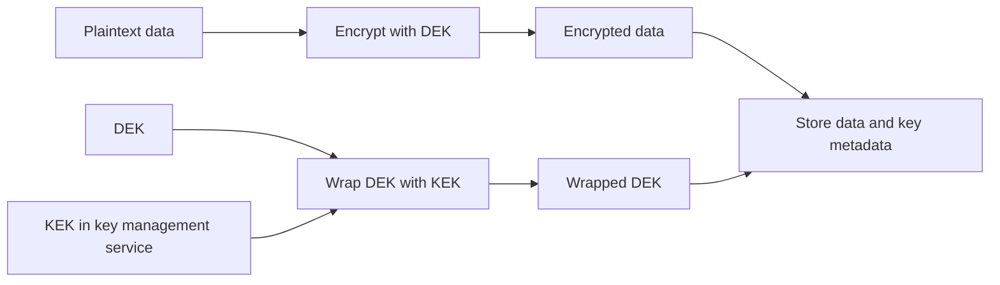
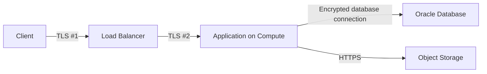

# Encryption at Rest and in Transit on OCI

## 1. Objectives and Scope

In Oracle Cloud Infrastructure (OCI), a single record can pass through a browser, Load Balancer, Compute, database, Object Storage, and backup systems. Each hop has its own protection boundary. The fact that a service encrypts disks does not prove that the application uses TLS; the fact that an API has HTTPS does not prove that data exported to a personal computer is encrypted.

This lesson belongs to the **Encryption, Secrets, and Certificates** chapter of the Oracle Cloud Infrastructure track. The focus is on designing and verifying encryption at rest and encryption in transit, combining tenancy, compartment, IAM, VCN, Compute, storage, and database services. Secrets and certificate management are covered only where needed to establish these protection layers.

After this lesson, you will be able to:

- Identify data that requires protection and encryption termination points in an OCI system.
- Distinguish between Oracle-managed keys, customer-managed keys, and application-level encryption.
- Design TLS from the client to the application and database, including behind a Load Balancer.
- Collect configuration evidence, key usage permissions, and TLS connection evidence; plan key rotation, recovery, and cost control.

No single option applies identically to every service: key selection capabilities, internal traffic encryption, key replacement, and recovery depend on the specific service, resource type, and actual configuration.

## 2. Two Data States, Two Control Groups

| State | Examples in an OCI System | Common Protection Mechanisms | What to Verify |
| --- | --- | --- | --- |
| At rest | Block Volume, object, file, database data, backups | Service-side encryption, TDE, application-level encryption | Scope of encrypted data, key source, key usage permissions, and recoverability |
| In transit | Client calling API, Load Balancer calling backend, application connecting to database | TLS, SSH, service-specific private transport protection mechanisms | Both ends of the connection, peer authentication, protocol, and risk of downgrade to unencrypted connections |
| In use | Decrypted data in application memory | Process controls, IAM, host protection; specialized solutions if available | Who can access the application or memory; encryption at rest and TLS do not automatically address this state |

For example, an application may download an object over HTTPS from an encrypted bucket and then write the plaintext to `/tmp`. Both protection layers at Object Storage still work, but the new copy must be evaluated separately. Logs, CSV exports, data snapshots, and backups are also data that must be included in the design scope.

### 2.1. Which Risks Does Encryption Address?

Encryption at rest limits the ability to read data from the storage layer without a valid decryption path. TLS protects content in transit, detects tampering, and authenticates the remote peer when the client validates the certificate properly.

However, an account with permission to read an object can still receive decrypted content via the API. Similarly, malicious code running inside the application can read data after the application receives or decrypts it. Therefore, encryption must go hand in hand with least-privilege IAM, application configuration, network segmentation, and host management.

**Three questions to answer separately:** is the data encrypted; who is allowed to obtain plaintext data; who could cause loss of decryption capability?

## 3. Encryption at Rest in OCI

### 3.1. Oracle-Managed Keys and Customer-Managed Keys

Many OCI storage services provide encryption at rest by default. Depending on the service, you can continue using Oracle-managed keys or select customer-managed keys through OCI Key Management. When the UI or documentation refers generically to Vault, distinguish between an **encryption key** and a **secret** stored in the secret management service.

| Option | How It Is Organized | Appropriate When | Responsibilities to Account For |
| --- | --- | --- | --- |
| Oracle-managed keys | The service operates keys for default encryption | You want to reduce operational overhead and have no requirement to control key lifecycle yourself | Verify configuration, data IAM, and backups; access accounts must still be protected |
| Customer-managed keys (CMK) | Select a key in OCI Key Management for supported resources | You need separation of duties, key lifecycle control, or specific governance requirements | Key IAM, key state, key rotation, dependencies during backup and recovery |
| Application-level or client-side encryption | The application encrypts data before it enters the service | You need to limit plaintext readability at the storage layer or protect individual fields | Cryptographic design, key distribution, data versioning, querying, and recovery |

CMKs add control; choosing a CMK alone does not prove that the algorithm is stronger or that the system has higher availability. A disabled key or lost usage permission can disrupt resources that depend on it.

Placing keys in a separate compartment can help separate duties. However, a compartment is only an organizational and authorization boundary: an appropriate policy must exist for the service to use the key. Do not assume that being in the same tenancy or same compartment automatically grants permission.

### 3.2. Understanding Envelope Encryption

A common model for encrypting large volumes of data is **envelope encryption**:

1. The system uses a data encryption key (DEK) to encrypt the data.
2. A key encryption key (KEK) protects the DEK via a key-wrapping operation.
3. The encrypted data and the wrapped DEK are stored together with the metadata needed to select the key or key version.
4. When an authorized read request arrives, the system uses the key management service through the integrated mechanism to unwrap the DEK and then decrypt the data.



This is a conceptual model; it is not a guarantee of the DEK structure or internal storage layout of every OCI service. With service-side encryption integration, the application typically only calls normal read/write APIs; the application does not need to receive the master key in plaintext.

**Do not use a centrally managed key to manually encrypt entire large files through an API intended for small cryptographic operations.** If you build application-level encryption, use appropriate cryptographic libraries and designs, including authenticated encryption, nonce management, and version metadata. Do not invent algorithms yourself.

### 3.3. Scope to Verify by Service

| Component | Encryption at Rest | Additional Points to Verify |
| --- | --- | --- |
| Boot Volume and Block Volume | OCI provides encryption at rest for volume data; CMK option available in supported configurations | Attached key, service permissions, backups/clones, target volume upon restore; inspect data on instance local devices separately |
| Object Storage | Objects are encrypted server-side; buckets have key selection options as supported | Bucket key, existing objects, object versions, copies, and data downloaded outside OCI |
| File Storage | File systems are encrypted at rest | Configured key, replicas, snapshots, and NFS connections; do not equate storage disk encryption with NFS session encryption |
| Oracle Database services | TDE is a key mechanism for protecting stored data in supported Oracle Database services and configurations | Service type, TDE scope, key or wallet, backups, standby, and specific restore procedures |
| Logs and exported data | Depends on the destination storage | Do logs contain sensitive data; are exported files copied to unprotected disks or systems |

TDE — Transparent Data Encryption — protects database data at the storage layer according to the database configuration. Valid SQL queries still return plaintext data to authorized users. TDE does not replace table access permissions, application-level data controls, or database connection encryption.

Default bucket encryption is also not proof that a bucket is private. Public access settings, IAM policies, pre-authenticated URLs, and object read permissions must be reviewed independently.

### 3.4. Key Replacement, Key Rotation, and Re-encryption Are Different

Distinguish three actions:

- **Key rotation:** generating new key material or a new key version according to the key management system's mechanism.
- **Changing the key attached to a resource:** switching a resource's configuration from one key to another, if supported by the service.
- **Re-encrypting data:** updating the encryption layer of the data or re-wrapping DEKs; the exact behavior is determined by the service.

Do not conclude that creating a new key version immediately re-encrypts all objects, volumes, and backups. Old data may still depend on older key versions. For Object Storage, also do not assume that changing a bucket's default key moves all existing objects and all historical versions to the new key.

Before retiring a key or key version, identify which data still requires it and verify the read, restore, or migration procedures for each service. Mark key rotation complete based on usage and recovery evidence, not merely on the timestamp when Rotate was clicked.

## 4. IAM for Data and IAM for Keys

A CMK integration typically involves at least three distinct permission groups:

| Principal | Required Permissions by Role | Boundaries to Enforce |
| --- | --- | --- |
| Key administration team | Create, configure, rotate, and manage key lifecycle | Do not automatically grant business data read access or tenancy-wide administration |
| OCI service using the key | Perform key operations required for the integrated resource | Correct service principal or service authorization mechanism, specific key, and resource scope |
| Operations team or application | Create resources, configure key references, or read/write data by role | Do not grant full key administration permissions just for an application to read objects |

Permission to read data and permission to call cryptographic APIs directly are two different things. For example, with Object Storage server-side encryption, an application with permission to read objects normally receives data through Object Storage; the service handles key integration via policy. Do not take a policy meant for an application calling KMS directly and apply it verbatim to this case.

Process for defining policies:

1. Identify which service uses the key, in which region, and in which compartments the key and resource reside.
2. Identify who is allowed to select the key when creating or updating resources.
3. Identify the principal that the service uses to perform key operations according to the actual integration.
4. Grant least-privilege permissions for the exact key; check parent-level policies and inherited permissions as well.
5. Re-verify read/write operations after configuration; do not stop at successful resource creation.

Do not use a sample policy with guessed service names or regions. Different integrations may use different service principals, authorization mechanisms, and policy conditions. For workloads on Compute, prefer supported workload identity mechanisms, such as instance principals, instead of copying a user private key into source code.

A secret such as a database password is not a KEK used to wrap DEKs. A TLS certificate verifies the identity of a connection endpoint; the corresponding private key must be protected separately. Manage these three types of material according to their respective roles.

## 5. Encryption in Transit: Checking Hop by Hop

### 5.1. A Private VCN Does Not Mean Encrypted

Private subnets, route tables, security lists, and network security groups control network reachability. They do not automatically enable TLS for an application listening on HTTP.

FastConnect is a private connectivity option; do not assume by default that all FastConnect connections are encrypted. If security requirements demand transport encryption, you must choose and configure a supported mechanism on the specific link, such as IPsec or an appropriate link encryption capability. Application-layer TLS still plays a role in protecting and authenticating the connection session.

### 5.2. Where Does TLS Terminate?

Consider an architecture with a Load Balancer terminating TLS:



The two TLS connections on either side of the Load Balancer are two independent sessions. The Load Balancer decrypts the request before forwarding it according to the backend configuration. The certificate on the listener only protects the client-to-Load-Balancer hop.

| Hop | Configuration to Verify | Common Mistakes |
| --- | --- | --- |
| Client → Load Balancer | HTTPS listener, certificate with matching hostname, valid CA chain, appropriate TLS policy | HTTPS is present, but certificate has wrong name or client skips certificate verification |
| Load Balancer → backend | Backend actually speaks TLS, trusts CA, and verifies backend certificate as configurable | External listener is HTTPS, but backend still uses HTTP |
| Application → Oracle Database | Driver and listener use the selected encryption method; verify server identity when using TLS | Database config supports TLS, but application connection string still uses an unencrypted path |
| Application → Object Storage | Use HTTPS endpoint, verify certificate in SDK or HTTP client | Using a proxy or client configuration that disables TLS verification |

If the architecture requires TLS to terminate directly at the application, select an appropriate forwarding model and service instead of assuming all Load Balancer types behave the same way. Security requirements must state explicitly which points are permitted to see plaintext.

Health checks must be verified separately: health check protocols and ports may differ from the business request path. A backend reporting healthy does not prove that application data is encrypted.

### 5.3. Encryption Must Be Paired with Peer Authentication

A reliable TLS configuration needs all of the following simultaneously:

- Protocol versions and cipher suites compliant with the system's policy; legacy protocols removed from the actual configuration.
- A valid certificate with the matching hostname in the Subject Alternative Name and a trust chain accepted by the client.
- Hostname and certificate verification enabled in clients, drivers, and relevant intermediate proxies.
- Private keys not written to logs, embedded in public images, or stored alongside source code.
- A mechanism to renew and deploy certificates before expiration, including backend certificates and internal CAs.

Standard TLS with a server certificate authenticates the server to the client. **mTLS** adds client authentication using a certificate. mTLS does not replace authorization: after knowing who the client is, the application still has to decide what the client is allowed to do.

Self-signed certificates or internal CAs can be used within an appropriate governance scope if trust stores are distributed and verified properly. Disabling certificate verification to make a connection work removes the required authentication mechanism.

### 5.4. OCI Cases Requiring Special Attention

**Block Volume:** encryption at rest and encryption of traffic between Compute and the volume are two separate properties. If encryption on this hop is required, check support for the instance shape, attachment type, image, and corresponding configuration. Do not infer in-transit status from the volume's encryption-at-rest state.

**File Storage:** NFS in a private subnet is not sufficient to conclude that the mount session is encrypted. Use OCI-supported encryption in transit and mount utilities for your operating system, client type, and configuration; verify on the client. Do not simply add an arbitrary mount option and assume TLS is enabled.

**Oracle Database:** TCPS is how Oracle Net is used with TLS. Native Network Encryption is a different mechanism in supported configurations, with its own negotiation and verification behavior. Choose according to the service and requirements; do not conflate the two mechanisms and do not use TDE as evidence for either. For services using a wallet or mTLS, distribute the wallet, CA, and connection details strictly according to the service documentation.

**Administrative access:** use SSH or an appropriately protected administrative protocol; restrict access paths using IAM and networking. An encrypted tunnel only protects the segment inside the tunnel; the connection beyond the tunnel endpoint still needs to be evaluated.

## 6. Designing a Sample System

Suppose a customer record management application runs on Compute, stores documents in Object Storage, and stores transaction data in Oracle Database. The application exposes an HTTPS endpoint through a Load Balancer.

| Requirement | Design Decision | Acceptance Evidence |
| --- | --- | --- |
| Documents in the bucket are encrypted with the security team's key | Use a service-supported CMK; private bucket; separate key and data policies | Bucket configuration pointing to the right key, object write/read test, and related policies |
| Database data and backups are protected at rest | Verify database service encryption configuration and backup protection mechanism | Service encryption details; test restore in an authorized environment |
| Client to application is protected on both hops through Load Balancer | HTTPS listener and TLS to backend, properly configured certificate verification | Client-side check, backend config, trust store, and TLS handshake evidence on the internal hop |
| Application connects to database over an encrypted channel | Choose TLS/TCPS or a service-supported mechanism as required | Driver configuration and evidence from an actual database session |
| Limit permissions and reduce secret exposure | Use workload identity; retrieve passwords from an appropriate secrets management mechanism | Properly scoped policies, no secrets in source code or logs |
| Recoverable when keys change or switching recovery location | Document key dependencies and verify service support at the target location | Successful restore drill with required identity, key, and data |

For availability, treat keys and certificates as operational dependencies. Do not assume a key in the source region can be used directly by resources in a target region. Recovery plans must verify backup, restore, or replication capabilities for keys and resource integrations at the target location, rather than only copying encrypted data.

## 7. Hands-On: Verifying Object Storage and TLS

### 7.1. Objectives and Prerequisites

This lab has two independent parts: verifying encryption at rest for a test bucket and verifying TLS for an endpoint under your management. You do not need to create a new Load Balancer or database just to complete the bucket verification part.

Prerequisites:

- A lab compartment and an authenticated OCI CLI targeting the right tenancy and region.
- A usable symmetric key in the same region as the bucket, with CMK integration supported by Object Storage.
- Policies allowing the practitioner to configure resources and allowing Object Storage to use the key, within the environment's permission scope.
- A small file containing dummy data, plus an HTTPS endpoint with a valid certificate if practicing the TLS part.

The commands below run in **Bash**, assuming an environment with OCI CLI installed. OCID, namespace, and hostname values are placeholders that must be replaced with your environment details; do not use real customer data.

### 7.2. Create a Test Bucket with CMK

```bash
export COMPARTMENT_OCID='ocid1.compartment...'
export KEY_OCID='ocid1.key...'
export BUCKET='lab-encryption-example'
export NAMESPACE="$(oci os ns get --query data --raw-output)"

oci os bucket create \
  --namespace-name "$NAMESPACE" \
  --compartment-id "$COMPARTMENT_OCID" \
  --name "$BUCKET" \
  --public-access-type NoPublicAccess \
  --kms-key-id "$KEY_OCID"
```

Only use a bucket name dedicated to the lab. If the bucket already exists, stop and determine ownership; do not modify existing resources to force commands to run. If you encounter permission or key errors, check the region, key, compartment, and policies instead of granting tenancy-wide admin rights.

Read back the bucket details:

```bash
oci os bucket get \
  --namespace-name "$NAMESPACE" \
  --bucket-name "$BUCKET"
```

In the returned output, verify the bucket name, compartment, `public-access-type`, and `kms-key-id`. The key must match the selected key. For other buckets using Oracle-managed keys, the absence of a CMK in the configuration field does not mean objects are unencrypted.

### 7.3. Write, Read, and Compare Data

```bash
printf '%s\n' 'Dummy data for OCI encryption lab' > lab-encryption.txt

oci os object put \
  --namespace-name "$NAMESPACE" \
  --bucket-name "$BUCKET" \
  --name 'lab-encryption.txt' \
  --file './lab-encryption.txt'

oci os object get \
  --namespace-name "$NAMESPACE" \
  --bucket-name "$BUCKET" \
  --name 'lab-encryption.txt' \
  --file './lab-encryption.download.txt'

cmp ./lab-encryption.txt ./lab-encryption.download.txt
```

`cmp` prints no differences and returns exit code `0` when the two files are identical. Downloading plaintext back is normal behavior of server-side encryption when the read request is authorized; it is not a sign that encryption failed.

This test proves that the write/read path works and the contents match. Evidence of CMK selection comes from the resource configuration and the service's encryption mechanism. File comparison alone does not prove that data on the storage device was encrypted with a specific key.

Both files on the machine running the CLI remain plaintext. Do not assume the bucket's encryption policy protects these two local copies.

### 7.4. Verify TLS of an Application Endpoint

Replace `api.example.com` with the hostname of an endpoint you manage; the `/health` path must exist and allow appropriate checks.

```bash
curl --verbose --fail --output /dev/null \
  'https://api.example.com/health'

openssl s_client \
  -connect api.example.com:443 \
  -servername api.example.com \
  -verify_hostname api.example.com \
  -verify_return_error \
  -showcerts </dev/null
```

`curl` verifies certificates by default against the environment's trust store; do not add `-k` or `--insecure`. When using an internal CA, configure the proper trusted CA, such as via curl's `--cacert` or the appropriate OpenSSL CA options. If you do not have a test endpoint, record the TLS section as not executed; do not use an external website as evidence for your OCI system.

Observe the handshake output, negotiated TLS version, certificate, and verification result. `-servername` sends SNI so the server selects a certificate; `-verify_hostname` enforces hostname checking. Do not treat SNI as server name verification.

curl's `--fail` also checks for HTTP errors: an HTTP error response can occur after the TLS handshake has succeeded. Read both the TLS output and the HTTP status code to distinguish certificate errors, network errors, and application errors.

This test only observes the hop from the machine running the command to the endpoint. If the endpoint is a Load Balancer, concluding anything about TLS to the backend requires checking the backend configuration and the connection on that hop from an appropriately authorized location. Do not expose the backend to the Internet just to test.

### 7.5. Results to Record and Resource Cleanup

| Item | Expected Result | Limitations of the Evidence |
| --- | --- | --- |
| Bucket configuration | Correct compartment, private, pointing to the right CMK | Does not prove that copies outside the bucket use the same key |
| Object write/read | Succeeded, both files have identical contents | Does not replace encryption-at-rest configuration evidence |
| HTTPS connection | Handshake succeeded, certificate and hostname valid against trust store | Covers only the observed hop |
| TLS to backend/database | Corresponding configuration and session evidence if within system scope | Cannot be inferred solely from the browser HTTPS icon |
| Data recovery | Plan or drill results in an isolated environment | A short read/write check is not a disaster recovery test |

After finishing, delete the objects and bucket created by this lab once you confirm there is no data to keep; handle object versions separately if versioning was enabled. Clean up local test files and any dedicated test materials created. Do not schedule deletion of a key shared with other resources.

Control costs by using small datasets, short test durations, and reusing authorized endpoints. Monitor storage costs, API operations, key management services, and network components used; do not assume all vault or key types cost the same.

## 8. Key, Certificate, and Recovery Operations

### 8.1. Controlled Key Rotation

A key rotation procedure should include an inventory of dependent resources, approvers according to internal processes, test results in a practice environment, and rollback criteria. Verify the ability to read old data, write new data, and restore backups still within retention.

Do not disable a key serving a production system as an encryption test. If you need to test key-dependency failure, use a separate key and resource in an authorized environment, and define impact and recovery steps before testing. A single successful read also does not prove a resource has no key dependency: caching and service-specific decryption behavior can affect results.

### 8.2. Renewing Certificates Before Expiration

Maintain an inventory of hostnames, TLS termination points, certificates, CAs, expiration dates, and operational owners. After renewal, verify the actual certificate served by the endpoint; merely updating a certificate store does not prove the listener or backend has picked up the new version.

With mTLS, updating trust stores and client certificates is also part of the lifecycle. A CA replacement plan needs an appropriate overlap/compatibility phase so neither side loses mutual authentication capability.

### 8.3. Monitoring and Alerting

Combine OCI Audit for logged control-plane/API events with service logs, application logs, and monitoring systems. Do not assume every data read or every decryption operation has a separate built-in entry in Audit.

Signals to monitor include key policy changes, changes to keys attached to resources, key lifecycle events, key-related read/write errors, TLS handshake errors, and certificate expiration times. Specific metric or event emission capabilities vary by service; use composite alarms or periodic checks when direct signals are unavailable.

Avoid writing private keys, passwords, tokens, wallets, or sensitive data into investigation logs. Operational evidence should include timestamps, resource OCIDs, configuration state, and necessary error types, with appropriate log read permissions.

### 8.4. Recoverability Is Part of Encryption

A byte-intact backup can still be unusable if the key, key version, wallet, permissions, or configuration are missing at the recovery target. Recovery plans must specify which documentation and materials must remain extant, protected, and accessible by the right identity.

Before disabling or scheduling deletion of a key, check active data, snapshots, backups, replicas, historical versions, and recovery environments. Deleting a key can make recovery impossible; do not treat this as a default substitute for data deletion and retention management procedures.

## 9. Troubleshooting Common Issues

| Symptom | Where to Investigate | Remediation by Cause |
| --- | --- | --- |
| Creating bucket or volume with CMK is denied | Correct key, region, key state; configurator permissions and service permissions | Fix the missing policy or reference; do not grant global permissions to bypass the error |
| Data becomes hard to access after key or policy changes | Change events, active key, key state, permissions, and integration mechanism | Restore configuration or permissions per plan; preserve data and evidence |
| `curl` or SDK reports certificate error | Hostname/SAN, expiration, CA chain, trust store, and system clock | Fix the certificate or trust store; do not disable TLS verification |
| Client uses HTTPS but backend receives HTTP | Listener, backend config, proxy, and actual connection path | Enable TLS on the right hop, configure backend validation, and re-verify |
| TDE is enabled but database session is unencrypted | Driver, connection string, listener, wallet, and session status | Configure the appropriate encryption-in-transit method; do not infer from TDE |
| New key version created but old data still needs old key | Service's key rotation and migration mechanism, remaining objects/versions or backups | Run the supported migration procedure and verify before retiring the old key |
| Restore at target location fails | Usability of key, wallet, policies, and service integration at target location | Complete recovery dependencies; do not merely copy more encrypted data |

## 10. Key Takeaways

- Encryption at rest, encryption in transit, and authorization are complementary protection layers.
- Default encryption does not mean a CMK is used; using a CMK brings lifecycle, IAM, and recovery responsibilities.
- TLS must be verified on each hop. HTTPS on the client side does not prove the connection behind the Load Balancer is protected.
- Certificate and hostname verification are prerequisites for TLS to authenticate the right endpoint; mTLS still requires authorization after authentication.
- Key rotation does not mean all data has been re-encrypted; retain necessary dependencies for active data and valid backups.
- A complete design requires read/write, configuration, connectivity, and recovery evidence, along with cost and availability monitoring.
