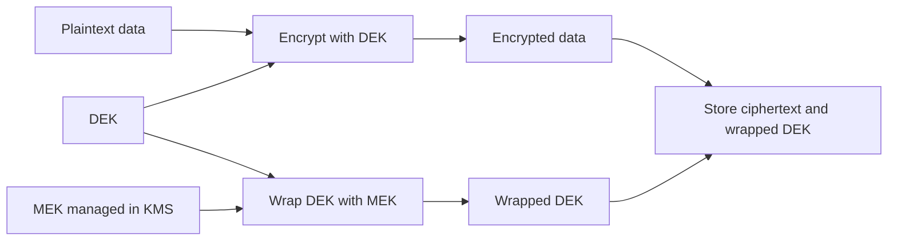

# OCI Vault, Vault Types, and Key Management Models

In the **Encryption, Secrets, and Certificates** chapter of the Oracle Cloud Infrastructure (OCI) track, key management is the bridge between encryption mechanisms and infrastructure operations. A bucket, volume, or database may remain completely intact yet become unreadable to the application if key usage permissions are lost.

This lesson focuses on OCI Vault and how to choose a key management model for infrastructure with compartments, IAM, and requirements for cost, monitoring, and availability. After this lesson, you should be able to distinguish three decisions: **choosing the vault type, choosing the key protection mode, and choosing where key material is controlled**.

## 1. Separating Three Decisions Before Designing

When you receive a requirement to "use customer-managed keys," clarify the following:

| Decision | Question to Answer | Example |
| --- | --- | --- |
| Vault type | What level of isolation and features are needed? | Default/virtual vault or virtual private vault |
| Key protection mode | Where is key material stored and processed? | HSM or Software in a standard vault |
| Management model | Who generates the key, who controls the lifecycle, and does the material reside outside OCI? | Oracle-managed, customer-managed, BYOK, External KMS |

Design example: "Customer-managed key, OCI-generated, HSM-protected, placed in a `DEFAULT` vault in compartment `SecurityProd`." This statement clearly specifies control, origin, and where the key is protected.

Another statement such as "we used a private vault so the key never leaves the enterprise's systems" must be verified: a dedicated HSM partition in OCI still resides within OCI infrastructure. Key material location and isolation level are two separate properties.

## 2. Vault, Key, Key Version, and Secret

A **Vault** is a logical resource for organizing keys. A **Key** is a resource with an OCID and one or more **key versions**; each version holds specific cryptographic material. Access policies typically reference the key OCID, while the application or service must retain sufficient metadata to process data with the right version. [Source: Oracle — Overview of Vaults and Key Management](https://docs.oracle.com/en-us/iaas/Content/KeyManagement/Concepts/keyoverview.htm).

Terms that must be used accurately in a design:

| Term | Role in This Lesson |
| --- | --- |
| Master encryption key — MEK | Master key used to protect data encryption keys |
| Data encryption key — DEK | Key that directly encrypts data content |
| Key encryption key — KEK | Functional name: a key used to encrypt another key |
| Wrapping key | Key used to wrap key material during import or export via a supported mechanism |
| Secret | A value an application needs to retrieve and use, such as a password or token |
| Certificate | Credential binding an identity to a public key; both trust chain and expiration must be managed |

Do not equate invoking a cryptographic operation with reading a secret's contents. With an HSM key, an application typically sends a request to use the key without receiving the key's secret material.

Oracle now describes secrets functionality under the **Secret Management Service**. This lesson uses secrets only to distinguish object types; password distribution and certificate management require separate processes. [Source: Oracle — note on Secret Management Service](https://docs.oracle.com/en-us/iaas/Content/KeyManagement/Concepts/keyoverview.htm).

## 3. Why Do MEK and DEK Usually Appear Together?

A typical model is **envelope encryption**:



Conceptually:

```text
ciphertext  = Encrypt(DEK, plaintext)
wrapped_DEK = Wrap(MEK, DEK)

On read:
DEK       = Unwrap(MEK, wrapped_DEK)
plaintext = Decrypt(DEK, ciphertext)
```

This is notation to explain the processing flow, not cryptographic code to put directly into an application. The actual encryption, metadata, and DEK management depend on the integrated service. [Source: Oracle — Envelope Encryption](https://docs.oracle.com/en-us/iaas/Content/KeyManagement/Concepts/keyoverview.htm).

Design implication: a copy of data is only useful if the key usage path still works. In recovery plans, manage data, key metadata, IAM, and endpoints together.

## 4. Vault Types and Their Corresponding API Names

### 4.1. Default Vault and Virtual Private Vault

Within OCI-hosted key vaults, the two foundational options are:

| Attribute | Default/virtual vault | Virtual private vault |
| --- | --- | --- |
| `vaultType` value | `DEFAULT` | `VIRTUAL_PRIVATE` |
| Isolation at HSM layer | Multi-tenant shared HSM partition | Dedicated HSM partition |
| Intended use | General key management needs, scaling with usage | Need for isolation and features of a dedicated partition |
| Decided at creation | Chosen upfront | Chosen upfront |

A vault is a customer-created resource in a tenancy; "default" here refers only to the vault type. The customer must still choose a compartment and configure access permissions. The vault type cannot be changed after creation. [Source: Oracle — Creating a Vault](https://docs.oracle.com/en-us/iaas/Content/KeyManagement/Tasks/managingvaults_topic-To_create_a_new_vault.htm).

A virtual private vault provides a dedicated HSM partition, but that does not mean the customer administers the entire physical HSM appliance. Vaults and keys also have their own compartments: moving a vault to another compartment does not automatically move the compartments or access permissions of every key inside it. [Source: Oracle — Managing Vaults](https://docs.oracle.com/en-us/iaas/Content/KeyManagement/Tasks/managingvaults.htm).

### 4.2. External Vault in the Current Model

The CLI currently lists three `--vault-type` values:

```text
DEFAULT
VIRTUAL_PRIVATE
EXTERNAL
```

`EXTERNAL` is for External KMS integration. Therefore, stating that "OCI only has two vault type values in all cases" does not accurately reflect the current API. When comparing Default against Virtual Private, the scope under consideration is vaults that store keys in OCI. [Source: Oracle — OCI CLI vault create](https://docs.oracle.com/en-us/iaas/tools/oci-cli/latest/oci_cli_docs/cmdref/kms/management/vault/create.html).

Some product pages use the short names "Virtual Vault" and "Private Vault." When writing automation, use the exact API enum; do not guess parameter values from display names.

## 5. HSM and Software Are Key Attributes

A master encryption key in a standard vault can be protected by HSM or Software:

| Aspect | HSM | Software |
| --- | --- | --- |
| Where key is stored and processed | Inside the HSM | In the service's server layer |
| Selection focus | Keep operations with secret material within the HSM boundary | Need for software-based key usage |
| Can protection mode be changed in place? | No | No |

The protection mode is chosen when creating the key. To change modes, you must design a process to use a new key and migrate the associated resources. AES is used for symmetric encryption; RSA and ECDSA serve different functions, with ECDSA intended for signatures. Always check which algorithms the target service supports before choosing. [Source: Oracle — Creating a Master Encryption Key](https://docs.oracle.com/en-us/iaas/Content/KeyManagement/Tasks/managingkeys_topic-To_create_a_new_key.htm).

Software keys can be exported through a supported procedure and require appropriate permissions. Exporting a key creates the responsibility to protect the copy outside the service. HSM keys do not allow exporting secret material via this key export mechanism. [Source: Oracle — Exporting Vault Keys and Key Versions](https://docs.oracle.com/en-us/iaas/Content/KeyManagement/Tasks/exportingkeys.htm).

For asymmetric keys, downloading the public key to verify signatures is a different need from exporting the private key.

Selection example for an application team: if you only need to attach a key to a bucket and want to keep secret material inside an HSM, evaluate HSM with the appropriate vault type. Only move up to a virtual private vault when isolation, feature, and budget requirements justify that choice.

## 6. Key Management Models

### 6.1. Oracle-Managed Keys

The OCI service manages default keys on the customer's behalf. For example, Object Storage encrypts data by default using Oracle-managed keys; users do not need to create a separate vault for this option. [Source: Oracle — Object Storage Data Encryption](https://docs.oracle.com/en-us/iaas/Content/Object/Tasks/encryption.htm).

This option should be evaluated when the operations team wants to minimize key lifecycle management overhead. If project requirements demand choosing keys or independent lifecycle control, evaluate the customer-managed model.

### 6.2. OCI-Generated Customer-Managed Keys

The customer creates and manages the key resource; OCI provides the service infrastructure. With Object Storage, you can select a customer-managed vault and key for a bucket. [Source: Oracle — Assigning a Key to an Object Storage Bucket](https://docs.oracle.com/en-us/iaas/Content/Object/Tasks/managingbuckets_topic-To_assign_a_Vault_master_encryption_key_to_a_bucket.htm).

Organizational example: the security team holds key administration permissions; the platform team configures services to use the key; the application team uses the data service. Responsibilities must be clearly documented so application owners know whom to contact when decryption fails.

"Customer-managed" describes control over the resource and lifecycle. Key material can still be generated by OCI and stored in OCI's HSM.

### 6.3. Bring Your Own Key — BYOK

BYOK uses key material generated externally by the customer and imported into OCI Vault. Vault uses an imported copy. The import process requires wrapping the key material using a supported mechanism; Base64-encoding the data does not replace the cryptographic wrapping step. [Source: Oracle — Importing Vault Keys and Key Versions](https://docs.oracle.com/en-us/iaas/Content/KeyManagement/Tasks/importingkeys.htm).

Operational implications:

- Record the generation source, responsible owner, and retention process for the original material.
- Control copies, intermediate files, and the device performing the import.
- During key rotation, decide whether to continue importing material from the external source or use OCI-generated material.
- Verify algorithm, size, and wrapping mechanism before every automation run.

BYOK does not satisfy a requirement that "key material must never enter OCI," because importing puts a copy into the service.

### 6.4. Hold Your Own Key — HYOK via External KMS

External KMS integrates with a key management system outside OCI. The customer keeps key material in that system; OCI stores a reference. This is the appropriate model to evaluate when regulations mandate that key storage remain outside OCI. [Source: Oracle — External Key Management Service](https://docs.oracle.com/en-us/iaas/Content/KeyManagement/Tasks/external_key_management.htm).

Cryptographic operations are executed on the external key manager. When access to the external system is revoked, cryptographic operations through the integration will fail. [Source: Oracle — How External KMS Works](https://docs.oracle.com/en-us/iaas/Content/KeyManagement/Tasks/tasks_ekms_how_it_works.htm).

Therefore, an External KMS design must assign owners for network connectivity, authentication, throughput capacity, and recovery of the external KMS. This is the architectural consequence of placing an external system on the data-serving path.

The onboarding process includes configuring endpoints, connectivity, TLS, authentication/authorization, and key references. You cannot integrate an arbitrary KMS simply by entering a URL. [Source: Oracle — Onboarding with External KMS](https://docs.oracle.com/en-us/iaas/Content/KeyManagement/Tasks/ekms_onboarding.htm).

Creating or deleting a key reference in OCI does not automatically create or delete key material on the external key manager. Both sides must be managed as linked objects. [Source: Oracle — Managing Key References](https://docs.oracle.com/en-us/iaas/Content/KeyManagement/Tasks/ekms_managing_key_references.htm).

### 6.5. Dedicated KMS

Dedicated KMS provides deeper control over HSM partitions and cryptographic users, supporting interfaces such as PKCS#11. This is a dedicated service option to evaluate when applications require direct communication with an HSM.

An HSM user is different from an IAM user. Customers must also manage user and key synchronization across replicas according to Dedicated KMS responsibilities. [Source: Oracle — Dedicated KMS](https://docs.oracle.com/en-us/iaas/Content/KeyManagement/Tasks/dedicated_kms.htm).

Do not use the term "private vault" as a substitute for Dedicated KMS in design documents. The two models have different interfaces and administrative responsibilities.

### 6.6. Guidance Table

The table below is an architectural evaluation guide, not a substitute for checking target service capabilities:

| Primary Requirement | Model to Evaluate First |
| --- | --- |
| Use default encryption and minimize key administration | Oracle-managed |
| Choose keys yourself and manage lifecycle in OCI | OCI-generated customer-managed key |
| Have an independent key generation process but accept importing a copy into OCI | BYOK |
| Keep key material outside OCI | External KMS/HYOK |
| Application needs to use HSM interfaces directly | Dedicated KMS |

Oracle Key Vault is also a separate product in the Oracle ecosystem; do not use this name as a synonym for OCI Vault. [Source: Oracle — Key Management](https://www.oracle.com/security/cloud-security/key-management/).

## 7. Organizing Compartments and IAM Around Responsibilities

An illustrative structure:

```text
Tenancy
├── SecurityProd
│   ├── vault-prod
│   ├── key-orders-storage
│   └── key-database-tde
├── AppProd
│   ├── bucket-orders
│   └── compute-orders
└── SecurityLab
    └── vault-lab
```

This is an organizational suggestion for the example, not a mandatory OCI structure. Separating environments helps limit the blast radius of accidental actions and clarifies who is responsible for keys.

Distinguish between permission to read metadata, permission to use a key, and permission to delegate key usage to a service. `key-delegate` allows attaching a key to an integrated service; it does not grant the user permission to call cryptographic operations on the key directly. `manage keys` includes permission to use the key, so separation of duties is not achieved merely by naming a group "KeyAdmins." [Source: Oracle — Details for Vault, Key Management, and Secret Management Service](https://docs.oracle.com/en-us/iaas/Content/Identity/Reference/keypolicyreference.htm).

Example for a bucket in `ap-singapore-1`, with the key in `SecurityProd`:

```text
Allow group BucketProvisioners to use key-delegate in compartment SecurityProd where target.key.id = '<KEY_OCID>'
Allow service objectstorage-ap-singapore-1 to use keys in compartment SecurityProd where target.key.id = '<KEY_OCID>'
```

The first line lets the deployment group delegate key usage; the second line lets Object Storage use the key. Replace `<KEY_OCID>` with the actual OCID, and adjust group/compartment names and group qualifiers according to the active identity domain. [Source: Oracle — Common Policies](https://docs.oracle.com/en-us/iaas/Content/Identity/Concepts/commonpolicies.htm).

This is only the key-related portion of the policy. The deployment group also needs permissions to create or update buckets in the data compartment and view resources required by the deployment interface.

For Oracle databases, look up the exact service integration model and principal. Do not copy an Object Storage policy and merely change the resource name.

## 8. Management Endpoint, Crypto Endpoint, and Connectivity

Two API paths serve different purposes:

| Endpoint | Example Operations |
| --- | --- |
| Management endpoint | Create key, read configuration, create key version |
| Cryptographic endpoint | Encrypt, Decrypt, GenerateDataEncryptionKey, Sign, Verify |

Retrieve endpoints from the vault details. Using the wrong endpoint can cause commands to fail even when the OCID and credentials are valid. [Source: Oracle — endpoints in Creating a Master Encryption Key](https://docs.oracle.com/en-us/iaas/Content/KeyManagement/Tasks/managingkeys_topic-To_create_a_new_key.htm).

Integrated services often have region requirements for resources and keys; verify these before designing cross-region setups. For access from a VCN, OCI Vault supports traffic via a service gateway. [Source: Oracle — Overview of Vaults and Key Management](https://docs.oracle.com/en-us/iaas/Content/KeyManagement/Concepts/keyoverview.htm).

Accordingly, an operational troubleshooting sequence should follow this order: right region, right vault, right endpoint, working connectivity, then verify IAM and key state. If calling through External KMS, add external system health and the authentication flow to that system.

## 9. Hands-On: Creating a Default Vault and an HSM Key

The goal of this section is to observe the learned attributes on real resources. Run in **OCI Cloud Shell Bash** or a Bash environment configured with OCI CLI; this is not PowerShell syntax.

Prepare a test compartment `SecurityLab`, permissions to create vaults/keys, a subscribed region, and an appropriate budget. A broad policy dedicated solely to the lab practitioner could be:

```text
Allow group VaultLabAdmins to manage vaults in compartment SecurityLab
Allow group VaultLabAdmins to manage keys in compartment SecurityLab
```

These permissions include key usage and lifecycle operations; use only within the defined lab scope. Adjust the group name according to the tenancy's identity domain.

### 9.1. Create a DEFAULT Vault

```bash
set -euo pipefail

REGION="ap-singapore-1"
COMPARTMENT_ID="<SECURITYLAB_OCID>"

VAULT_ID=$(oci kms management vault create \
  --region "$REGION" \
  --compartment-id "$COMPARTMENT_ID" \
  --display-name "vault-lab-keys" \
  --vault-type DEFAULT \
  --wait-for-state ACTIVE \
  --query 'data.id' \
  --raw-output)

printf 'Vault OCID: %s\n' "$VAULT_ID"
```

The command creates a new resource each time it runs. Record the OCID after creation and reuse that resource when continuing; do not re-run the creation step just because the shell session closed.

The `DEFAULT` parameter selects the vault type. Creating the key in the next step determines the protection mode. [Source: Oracle — OCI CLI vault create](https://docs.oracle.com/en-us/iaas/tools/oci-cli/latest/oci_cli_docs/cmdref/kms/management/vault/create.html).

### 9.2. Retrieve Endpoints and Create an AES-256 Key

```bash
MGMT_ENDPOINT=$(oci kms management vault get \
  --region "$REGION" \
  --vault-id "$VAULT_ID" \
  --query 'data."management-endpoint"' \
  --raw-output)

CRYPTO_ENDPOINT=$(oci kms management vault get \
  --region "$REGION" \
  --vault-id "$VAULT_ID" \
  --query 'data."crypto-endpoint"' \
  --raw-output)

KEY_ID=$(oci kms management key create \
  --region "$REGION" \
  --endpoint "$MGMT_ENDPOINT" \
  --compartment-id "$COMPARTMENT_ID" \
  --display-name "key-lab-aes256" \
  --key-shape '{"algorithm":"AES","length":32}' \
  --protection-mode HSM \
  --wait-for-state ENABLED \
  --query 'data.id' \
  --raw-output)

printf 'Key OCID: %s\n' "$KEY_ID"
```

`length: 32` is 32 bytes, corresponding to 256 bits. The JSON is enclosed in single quotes per Bash syntax. Key creation uses the vault's management endpoint. [Source: Oracle — OCI CLI key create](https://docs.oracle.com/en-us/iaas/tools/oci-cli/latest/oci_cli_docs/cmdref/kms/management/key/create.html).

### 9.3. Read Back Attributes

```bash
oci kms management vault get \
  --region "$REGION" \
  --vault-id "$VAULT_ID"

oci kms management key get \
  --region "$REGION" \
  --endpoint "$MGMT_ENDPOINT" \
  --key-id "$KEY_ID"
```

Cross-check:

- Vault has type `DEFAULT` and state `ACTIVE`.
- Key has mode `HSM` and state `ENABLED`.
- Key shape has algorithm AES, length 32 bytes.
- Compartment and region match the test environment.
- Both management endpoint and crypto endpoint are recorded.

There is no need to export the key or read key material to prove this configuration. After the lab, inventory the resources and clean up according to your lab environment's procedure once you are sure they do not protect data that must be kept.

## 10. Key Lifecycle and Reading Historical Data

### 10.1. Distinguishing Rotation from Key Replacement and Data Migration

```text
Stable Key OCID
├── version 1: used for previously encrypted data
└── version 2: created on rotate
```

Rotation creates a new key version; older data still needs the version that protected it. Switching to a different key OCID is a key replacement decision, whereas re-encryption/rewrapping is the task of processing data or data keys according to the service's mechanism. Creating a new version does not automatically prove that all data has been migrated to that version. [Source: Oracle — Rotating a Key](https://docs.oracle.com/en-us/iaas/Content/KeyManagement/Tasks/managingkeys_topic-To_rotate_a_master_encryption_key.htm).

A complete rotation cycle in a design should identify the executor, affected resources, how reading old data is verified, and completion criteria. Key retention duration must account for backups and long-term retention requirements.

Automatic key rotation is currently documented for virtual private vaults. For other vaults, check supported capabilities and build an appropriate operational schedule. [Source: Oracle — Automatic Key Rotation](https://docs.oracle.com/en-us/iaas/Content/KeyManagement/Concepts/keyoverview.htm).

There are important differences between services: Block Volume documentation currently requires switching to a new key to rotate a volume's encryption key; creating multiple versions of the same key is not applied to volumes by default. Backups/clones taken before the change may still depend on the old key. [Source: Oracle — Managing Vault Encryption Keys for Block Volume](https://docs.oracle.com/en-us/iaas/Content/Block/Concepts/managingblockencryptionkeys.htm).

### 10.2. Disable and Scheduled Deletion

Disabling makes a key unusable for operations that depend on it; re-enabling can serve as a recovery step when conditions allow. This must be an operation with an impact assessment for data and applications. [Source: Oracle — Disabling a Vault Key](https://docs.oracle.com/en-us/iaas/Content/KeyManagement/Tasks/managingkeys_topic-To_disable_a_key.htm).

For keys in a standard vault, scheduled deletion has a 7–30 day waiting period. The `PENDING_DELETION` state already renders the key unusable; the waiting period is not a window during which applications are guaranteed to still read data. When deletion completes, key material and metadata are destroyed. [Source: Oracle — Deleting a Key](https://docs.oracle.com/en-us/iaas/Content/KeyManagement/Tasks/managingkeys_topic-To_delete_a_key.htm).

Before deleting, list all dependent resources, historical data, and backups. Observing no recent calls is only one signal and is insufficient to conclude a key is no longer needed.

## 11. Availability, Replication, and Backup

### 11.1. Check Replication on the Vault Itself

Cross-region replication is no longer exclusive to virtual private vaults. Eligible virtual/default vaults can also support it; older vaults may not. Check the `isVaultReplicable` attribute from GetVault; in OCI CLI JSON output, the corresponding field typically appears as `is-vault-replicable`. [Source: Oracle — Replicating a Vault and Its Keys](https://docs.oracle.com/en-us/iaas/Content/KeyManagement/Tasks/replicatingvaults_topic-To_create_a_vault_replica.htm).

Replicas serve cryptographic operations; do not use a replica as an independent vault to create new keys. Replication also synchronizes lifecycle changes, so distinguish between the goal of recovering from a region outage and the goal of protecting against accidental deletion. [Source: Oracle — Replicating Vaults and Keys](https://docs.oracle.com/en-us/iaas/Content/KeyManagement/Tasks/replicatingvaults.htm).

### 11.2. Backup Does Not Mean Plaintext Key Export

The vault backup/restore mechanism is documented for virtual private vaults; backed-up keys must be HSM keys per service conditions. Do not apply this mechanism to Software keys or secrets. Backups are protected by the service and only the service can restore them. [Source: Oracle — Backing Up and Restoring Vaults and Keys](https://docs.oracle.com/en-us/iaas/Content/KeyManagement/Tasks/backingupvaultsandkeys.htm).

A recovery drill should verify the dependency chain:

| Component | What Must Be Proven |
| --- | --- |
| Data | The copy in the target region is usable |
| Key | Required key material/versions exist at the recovery location |
| Identity and permissions | The recovery principal is authorized to use the key |
| Application configuration | Uses the right region and endpoint |
| Procedure | Operators know how to switch over and verify functionality |

These are suggested criteria for an operational plan. Having a key replica does not by itself prove the application meets its target RTO/RPO.

## 12. Monitoring and Cost Control

### 12.1. Distinguishing Audit from Service Logs

Audit records administrative operations such as creating, updating, deleting, and rotating keys. Cryptographic operations such as `Decrypt` and `GenerateDataEncryptionKey` are not fully captured by Audit; enable Key Management **Service Logs** to observe the data plane. Metadata can include principal, key OCID, key version, operation type, and timestamp. [Source: Oracle — Monitoring Key Usage](https://docs.oracle.com/en-us/iaas/Content/KeyManagement/Tasks/managingkeys-usage.htm).

Accordingly, the operations team should maintain two views: who modifies key lifecycle and who is using the keys. Log retention must be configured long enough to support investigations or key keep/delete decisions.

OCI Events can be used for events such as disable, scheduled deletion, and key version limit warnings. [Source: Oracle — Events for Vaults and Keys](https://docs.oracle.com/en-us/iaas/Content/KeyManagement/Tasks/event_notification.htm).

### 12.2. Estimating by the Right Billing Units

Oracle's price list distinguishes HSM key versions per month, virtual private vaults per hour, and External KMS per key version/month. Software-protected keys have their own pricing line items. Check the applicable price list for your account and contract before estimating. [Source: Oracle — Cloud Price List](https://www.oracle.com/cloud/price-list/).

An internal estimation model might look like:

```text
Estimated cost =
    time-based vault/HSM component
  + billable key version component
  + replication or standby resources
  + log retention and backups
  + external KMS system, connectivity, and operations if applicable
```

These items are a checklist to evaluate, not an official billing formula.

Planning example: 10 keys starting with one version and each rotated three times creates 30 additional versions. Account for the number of versions that must be retained for legacy data rather than counting only the 10 key names. Do not delete versions that are still needed just to reduce the count.

## 13. Decision Record for a Workload

Suggested example for an application storing order records in Object Storage:

| Item | Illustrative Decision | Evidence to Collect |
| --- | --- | --- |
| Model | OCI-generated customer-managed key | Meets lifecycle control requirements |
| Vault type | `DEFAULT` | Meets the project's isolation and feature needs |
| Protection mode | HSM | Key metadata reflects the exact mode |
| Organization | Key in `SecurityProd`, bucket in `AppProd` | Clear compartment scope and ownership |
| IAM | Deployment team has delegate; Object Storage allowed to use the specific key | Policies and actual access checks |
| Rotation | Per Object Storage procedure and data retention period | Data readable before and after change |
| Recovery | Evaluate replica and end-to-end recovery procedure | Drill using sample data |
| Cost | Track versions, standby resources, and logs | Estimate updated upon changes |

This is an illustrative option for practicing reasoning. If the project adds a requirement for a dedicated HSM partition, re-evaluate virtual private vault. If key material must remain outside OCI, evaluate External KMS along with operational responsibility for the external system.

A key management design is ready for handover when operators can answer: which key protects which resource, who is allowed to use it, who is allowed to modify its lifecycle, which versions old data needs, and what procedure restores decryption when an incident occurs.
