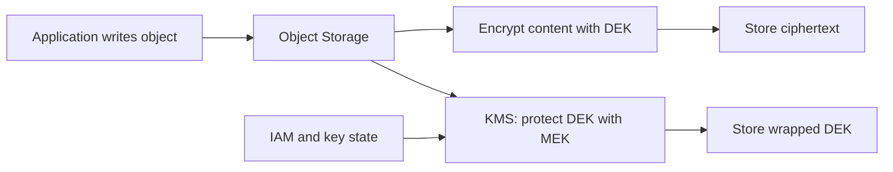

# Master Encryption Keys and Customer-Managed Keys

## 1. Objectives and Context

In Oracle Cloud Infrastructure (OCI), data encryption and key governance are two related but distinct responsibilities. A bucket may already be encrypted while the organization still needs to decide who can rotate keys, who is granted usage permissions, and how data can be recovered years later.

This lesson belongs to the **Encryption, Secrets, and Certificates** chapter and focuses on master encryption keys and customer-managed keys in OCI Vault/Key Management Service (KMS). The examples tie key governance to compartments, IAM, Object Storage, and infrastructure operational requirements including monitoring, automation, cost control, and availability.

After this lesson, you will be able to:

- Distinguish between data encryption keys, master encryption keys, and key versions.
- Choose between Oracle-managed keys and customer-managed keys.
- Design key delegation, key usage, and key administration permissions.
- Create an AES key, attach it to a bucket, and verify reading data before and after key rotation.
- Plan key replacement, key retention, and recovery without losing the ability to decrypt data.

## 2. From Data Encryption to Envelope Encryption

### 2.1. Two Key Layers

Suppose an application stores invoices in Object Storage. There are two types of assets to protect: the invoice content and the key that can decrypt that content.

| Component | Role | Example in This Lesson |
| --- | --- | --- |
| Plaintext | Unencrypted data | Invoice content |
| Ciphertext | Encrypted data | Content stored on storage infrastructure |
| Data encryption key, DEK | Directly encrypts data | Key used for an object |
| Master encryption key, MEK | Protects the DEK | Key selected from OCI Vault |
| Wrapped DEK | DEK encrypted by its protecting key | Stored alongside metadata needed for decryption |

In the **envelope encryption** model, data is encrypted with a DEK; the DEK is in turn encrypted with an MEK. The MEK fulfills the role of a key encryption key (KEK). This is a functional distinction, not a requirement to create an additional KEK resource alongside the MEK.

Conceptual flow for writing data:

1. The service generates or obtains an appropriate DEK.
2. Encrypts the data using the DEK.
3. Protects the DEK with the MEK through KMS.
4. Stores the ciphertext, wrapped DEK, and necessary metadata.
5. Manages the plaintext DEK in memory according to the service's mechanism, avoiding placing it in persistent storage.

On read, the service retrieves the wrapped DEK, uses KMS to recover the DEK, and then decrypts the data. With integrated services, the application typically only calls the storage service's read/write APIs. [Oracle documentation on envelope encryption](https://docs.cloud.oracle.com/en-us/Content/KeyManagement/Concepts/keyoverview.htm).



The diagram illustrates the direct MEK–DEK model. Some optimizations introduce an intermediate key layer; do not use this diagram to infer the exact number of KMS calls for every operation.

### 2.2. Why Not Encrypt Every File Directly with the MEK?

Separating the DEK from the MEK splits key usage scope from lifecycle governance. The storage service processes large content with the DEK, while KMS focuses on protecting keys and controlling cryptographic operations.

For example, when changing the key layer protecting a DEK, the system may only need to rewrap the DEK instead of reading, decrypting, and re-encrypting the entire file. However, which operation actually occurs depends on each service's mechanism.

Do not interpret "using a CMK" as "every byte of content is sent to KMS." Likewise, do not interpret "encryption at rest" as "an authorized reader cannot see the data": the service still returns plaintext for authorized requests.

## 3. How Are Master Encryption Keys and Customer-Managed Keys Different?

**Master encryption key** describes the key's role in the encryption architecture. **Customer-managed key (CMK)** describes the party responsible for managing the key.

Both terms can refer to the same key: an organization creates an MEK in OCI Vault and uses that key as the CMK for a bucket.

| Criterion | Oracle-Managed Key | Customer-Managed Key in OCI Vault |
| --- | --- | --- |
| Who controls key lifecycle | Oracle manages via the service's mechanism | Customer controls within KMS-supported scope |
| Selecting key for resource | Service uses default key | Deployer specifies the appropriate key |
| Key access policy | Handled by default mechanism | Requires IAM for operators and integrated services |
| Operational responsibility | Minimal key administration tasks for customer | Adds rotation, monitoring, retention, and recovery |
| Configuration risk | Concentrated on data permissions | Also includes policy and CMK state risks |

Object Storage encrypts data by default; choosing a CMK changes who controls the key, not an action that turns on encryption for a bucket that previously stored plaintext data. [Object Storage encryption documentation](https://docs.oracle.com/en-us/iaas/Content/Object/Tasks/encryption.htm).

CMKs are useful when you need an application-specific key lifecycle, control evidence, or a responsibility boundary between the data team and the security team. This benefit introduces a new operational dependency: data remains intact, yet if the key becomes unusable, the ability to serve that data can still be lost.

### Objects Not to Confuse with a CMK

- **Secret:** a sensitive value that needs to be stored and retrieved, such as a password. A KMS key is an object used in cryptographic operations.
- **API signing key or SSH key:** authenticates a principal or access session; does not act as an MEK for storage services.
- **TLS certificate:** binds an identity to a public key for authentication and TLS communication; does not replace bucket encryption configuration.
- **Object Storage SSE-C:** the customer supplies the key in the request. This mechanism differs from specifying the OCID of a key in Vault.

## 4. Key Resource Model in OCI

### 4.1. Vault, Key, Key Version, and Key Material

Four layers must be distinguished:

| Layer | Meaning |
| --- | --- |
| Vault | Resource that houses and organizes keys |
| Key | Logical identifier of a key, with its own OCID |
| Key version | A version of cryptographic material belonging to a key |
| Key material | The actual bits participating in cryptographic operations |

Display names help humans identify resources; the OCID is the identifier required in configuration references. When rotating a key, the key keeps its OCID but gets a new version. Therefore, recording "key rotated" requires both the version information and the timestamp, not just a screenshot of the key name. [OCI keys and versions concepts](https://docs.oracle.com/en-us/iaas/Content/KeyManagement/Concepts/keyoverview.htm).

Operational record example:

```text
Application: billing
Environment: production
Key compartment: SecurityKeys
Key: billing-prod-object-storage
Key OCID: ocid1.key...<actual identifier>
Resource using key: invoices bucket in selected region
Owner: platform security team
Key retention period: covers data and copies required for recovery
```

The record contains only identifiers and responsibilities. Do not store key material in records, tickets, or logs.

### 4.2. Algorithms and Lengths

The lab uses **AES-256**, suited to protecting symmetric data keys. OCI KMS also supports asymmetric keys, but not every key type can be attached to every service.

| Algorithm | General Purpose | Key Note |
| --- | --- | --- |
| AES | Symmetric encryption and decryption | Choice for this lab |
| RSA | Encryption or signing per supported operations | Cannot automatically replace AES in storage integrations |
| ECDSA | Signing and signature verification | Not a content encryption algorithm |

In the `KeyShape` structure, the `length` field uses **bytes**. AES-256 corresponds to `length: 32`, not `length: 256`. [Oracle KeyShape documentation](https://docs.oracle.com/en-us/iaas/tools/python/latest/api/key_management/models/oci.key_management.models.KeyShape.html).

### 4.3. HSM and Software Protection

For keys stored in OCI:

- `HSM`: key material is held and cryptographic operations using the key are performed inside a hardware security module.
- `SOFTWARE`: the key is protected at rest, while cryptographic processing happens on servers; export mechanisms exist subject to corresponding conditions and permissions.

You cannot change the protection mode of an existing key. If you need to move from software to HSM, plan to create a new key and migrate resources/data rather than treating it as editing a property. [Master encryption key creation parameters](https://docs.oracle.com/en-us/iaas/tools/oci-cli/latest/oci_cli_docs/cmdref/kms/management/key/create.html).

For HSM, distinguish between not exporting plaintext key material and service-provided backup/restore capabilities. Do not infer that "plaintext key cannot be extracted" means "there is no recovery option."

## 5. OCI-Created Keys, BYOK, and External Keys

Three models must be distinguished when discussing control:

| Model | Source of Key Material | Main Governance Point |
| --- | --- | --- |
| Create key in OCI KMS | OCI generates the cryptographic material | Customer controls key resource and policies |
| Bring Your Own Key, BYOK | Material generated externally and imported | Customer also governs origin and external retention copy |
| External KMS | Material resides in an external key management system | OCI uses a reference and supported integration mechanism |

**A CMK does not have to be BYOK.** A key generated in OCI can still be customer-managed.

When importing, key material must be wrapped according to the KMS procedure. The wrapping key used for import is not the MEK that gets attached to the bucket. [Importing keys and key versions documentation](https://docs.oracle.com/en-us/iaas/Content/KeyManagement/Tasks/importingkeys.htm).

External KMS adds a dependency on the external system and connectivity to it. Do not assume every service supporting Vault CMKs also supports External KMS; verify the target service's integration list. [Overview of OCI KMS and external key management](https://docs.oracle.com/en-us/iaas/Content/KeyManagement/Concepts/keyoverview.htm).

A BYOK design must answer: who generates the key, who controls the original copy, how new versions are imported, and whether recovery testing includes access to the externally retained copy. Merely having a key file stored elsewhere does not constitute a complete recovery procedure.

## 6. IAM Design: Key Assigner and Service Using the Key

### 6.1. Three Permission Paths

Consider a bucket in compartment `AppData` and a key in `SecurityKeys`. There are three separate permission paths:

1. **Key administration:** creating keys, changing configuration, rotating keys, or performing lifecycle tasks.
2. **Resource deployment:** creating buckets and assigning an authorized key.
3. **Service using the key:** Object Storage invoking the cryptographic operations needed to serve the bucket.

`key-delegate` allows a principal to authorize key usage through an integrated service. It does not mean that principal can directly call all cryptographic operations. [IAM reference for Key Management](https://docs.oracle.com/en-us/iaas/Content/Identity/Reference/keypolicyreference.htm).

Practical implication: having permission to create a bucket does not guarantee permission to assign a CMK; having permission to assign a CMK does not guarantee the Object Storage service principal is allowed to use the key.

### 6.2. Example Policy Scoped to a Specific Key

The following example assumes group `StorageDeployers` is in identity domain `Default`. Replace domain, group, compartment, region, and key OCID according to your actual environment.

```text
Allow group Default/StorageDeployers to manage buckets in compartment AppData

Allow group Default/StorageDeployers to manage objects in compartment AppData

Allow group Default/StorageDeployers to use key-delegate in compartment SecurityKeys where target.key.id = '<KEY_OCID>'

Allow service objectstorage-ap-singapore-1 to use keys in compartment SecurityKeys where target.key.id = '<KEY_OCID>'
```

This is a policy for the read/write and key-assignment lab; bucket/object scope should be narrowed further for production responsibilities. Key administration permissions for those creating and rotating keys are designed separately.

The principal name `objectstorage-ap-singapore-1` contains the region identifier. Only use this name when the lab resources are in `ap-singapore-1`. [Oracle examples on delegation and service key usage permissions](https://docs.oracle.com/en-us/iaas/Content/Identity/Concepts/commonpolicies.htm).

If operators need to select resources via the Console, add vault/key metadata viewing permissions as needed. Do not fix "cannot see key in dropdown" by granting `manage all-resources in tenancy`.

### 6.3. Limitations of Group Separation

Separating key administration and data administration groups is a step in organizing responsibilities. Actual effectiveness also depends on all policies a person inherits.

For example, `manage keys` is broader than just rotating keys. If one person simultaneously holds data permissions and broad key permissions, two different group names do not create real separation. When strict separation is required, restrict permissions to specific tasks and control who can edit IAM policies.

Similarly, a user without permission to call KMS directly can still read plaintext through Object Storage if allowed to read objects and the service has sufficient decryption permissions. CMKs add a key governance layer; data access permissions must still be designed thoroughly.

## 7. Hands-On: Creating a CMK and Attaching It to Object Storage

### 7.1. Prerequisites

Command examples use **Bash in OCI Cloud Shell** or a Bash environment configured with OCI CLI. These are hands-on instructions, not scripts meant to run as-is in PowerShell.

Prerequisites:

- An active vault in the lab region.
- Compartment OCIDs for the key compartment and bucket compartment.
- Management endpoint retrieved from that vault's details.
- A principal authorized to create, read, and rotate keys.
- Policies for the bucket deployment principal and service principal as shown in the previous section.
- Non-sensitive sample data; a bucket name that does not yet exist in the namespace.

If using two principals to separate duties, perform key creation/rotation with the key admin principal and bucket operations with the deployment principal. Even with a lab account holding both roles, recognize this boundary.

### 7.2. Create an HSM-Protected AES-256 Key

Replace all placeholders before running:

```bash
export OCI_REGION='ap-singapore-1'
export KEY_COMPARTMENT_OCID='<SECURITY_KEYS_COMPARTMENT_OCID>'
export DATA_COMPARTMENT_OCID='<APP_DATA_COMPARTMENT_OCID>'
export KMS_MANAGEMENT_ENDPOINT='<VAULT_MANAGEMENT_ENDPOINT>'
export BUCKET_NAME='<UNIQUE_LAB_BUCKET_NAME>'

export KEY_OCID="$(
  oci kms management key create \
    --region "$OCI_REGION" \
    --endpoint "$KMS_MANAGEMENT_ENDPOINT" \
    --compartment-id "$KEY_COMPARTMENT_OCID" \
    --display-name 'billing-lab-object-storage' \
    --key-shape '{"algorithm":"AES","length":32}' \
    --protection-mode HSM \
    --query 'data.id' \
    --raw-output
)"
```

Proceed only when the key creation command succeeds and `KEY_OCID` holds a valid value. This command creates a resource that may incur charges.

Inspect the key details:

```bash
oci kms management key get \
  --region "$OCI_REGION" \
  --endpoint "$KMS_MANAGEMENT_ENDPOINT" \
  --key-id "$KEY_OCID"
```

Verify `ENABLED` state, algorithm, protection mode, and current version before assigning the key.

The management endpoint is for administration; the cryptographic endpoint is for operations like encrypt/decrypt. Do not swap the two endpoints. [Viewing key details and endpoints documentation](https://docs.oracle.com/en-us/iaas/Content/KeyManagement/Tasks/managingkeys_topic-To_view_key_details.htm).

Once you have the actual OCID, update the placeholders in your lab policies and wait for the policies to take effect.

### 7.3. Create a Bucket Using the CMK

```bash
export OS_NAMESPACE="$(
  oci os ns get \
    --region "$OCI_REGION" \
    --query 'data' \
    --raw-output
)"

oci os bucket create \
  --region "$OCI_REGION" \
  --namespace-name "$OS_NAMESPACE" \
  --compartment-id "$DATA_COMPARTMENT_OCID" \
  --name "$BUCKET_NAME" \
  --kms-key-id "$KEY_OCID"

oci os bucket get \
  --region "$OCI_REGION" \
  --namespace-name "$OS_NAMESPACE" \
  --name "$BUCKET_NAME"
```

In the bucket response, verify that `kms-key-id` points to the newly created key. This is the **key OCID**, not the OCID of a key version. [OCI CLI bucket create parameters](https://docs.oracle.com/en-us/iaas/tools/oci-cli/latest/oci_cli_docs/cmdref/os/bucket/create.html).

### 7.4. Verify the Data Path

```bash
printf '%s\n' 'invoice-lab-before-rotation' > invoice-before.txt

oci os object put \
  --region "$OCI_REGION" \
  --namespace-name "$OS_NAMESPACE" \
  --bucket-name "$BUCKET_NAME" \
  --name 'invoice-before.txt' \
  --file invoice-before.txt

oci os object get \
  --region "$OCI_REGION" \
  --namespace-name "$OS_NAMESPACE" \
  --bucket-name "$BUCKET_NAME" \
  --name 'invoice-before.txt' \
  --file invoice-before-downloaded.txt

cmp invoice-before.txt invoice-before-downloaded.txt
```

Expected result: upload and download succeed, and `cmp` reports no differences. Successfully creating a bucket proves only part of the configuration path; read/write operations verify the data path.

Use a destination filename that does not already exist when re-running the lab. Record the request ID if an operation fails for log correlation; do not write sensitive content into investigation notes.

## 8. Key Rotation, Key Replacement, and Re-encryption

### 8.1. Three Different Operations

| Operation | Key Identifier | What Changes | What to Verify |
| --- | --- | --- | --- |
| Rotate key | Keeps same OCID | Creates a new key version | Old data remains readable |
| Change key assigned to resource | Uses a different key OCID | The key configured for the resource | Which key existing data still depends on |
| Rewrap/re-encrypt | Depends on plan | Updates DEK protection layer or data | Processing scope and completion status |

Key rotation does not mean all historical data has moved to the new version. In OCI, old versions are retained to decrypt corresponding data. [Key rotation guide](https://docs.oracle.com/en-us/iaas/Content/KeyManagement/Tasks/managingkeys_topic-To_rotate_a_master_encryption_key.htm).

Conceptual example:

```text
Before rotation:
  Object A -> wrapped DEK using key K, version V1

After rotation of K:
  K keeps the same OCID, has new version V2
  Object A may still depend on V1

After properly scoped rewrap:
  Object A's DEK is protected under the target version
  Object content does not necessarily have to be re-encrypted with a new DEK
```

If the goal is to remediate an incident where a DEK or plaintext was exposed, merely rewrapping the DEK is insufficient to undo prior exposure. Incident response must be based on the type of asset exposed.

### 8.2. Test Key Rotation in the Lab

Save the key information before the operation, especially the current version OCID, then create a new version:

```bash
oci kms management key-version create \
  --region "$OCI_REGION" \
  --endpoint "$KMS_MANAGEMENT_ENDPOINT" \
  --key-id "$KEY_OCID"

oci kms management key get \
  --region "$OCI_REGION" \
  --endpoint "$KMS_MANAGEMENT_ENDPOINT" \
  --key-id "$KEY_OCID"
```

Expect the key OCID to remain unchanged while the current version changes after completion. Next:

1. Download `invoice-before.txt` again to a new target file and compare contents.
2. Create an `invoice-after.txt` file, upload, then download and compare.
3. Cross-check logs if you need to identify which version was used in KMS operations.

These two data-read checks do not by themselves prove that all DEKs now use the new version. They verify continuity of the data path across the rotation point.

### 8.3. Re-encrypt for Object Storage

If you want to update the DEK protection layer of the lab object to the key assigned to the bucket:

```bash
oci os object reencrypt \
  --region "$OCI_REGION" \
  --namespace-name "$OS_NAMESPACE" \
  --bucket-name "$BUCKET_NAME" \
  --name 'invoice-before.txt'
```

To move a specific object to a different Vault key, this operation can specify `--kms-key-id` of the target key along with the required permissions. [Guide to re-encrypting an object](https://docs.oracle.com/en-us/iaas/Content/Object/Tasks/managingobjects_topic-To_reencrypt_an_object.htm).

At the bucket level, OCI provides an operation to re-encrypt DEKs under the appropriate key/version. Track the work request until completion and define the scope of data to migrate, including historical data with recovery requirements. Do not treat editing a bucket property as proof of migration completion. [Guide to re-encrypting a bucket's DEKs](https://docs.oracle.com/en-us/iaas/Content/Object/Tasks/managingbuckets_topic-To_reencrypt_a_buckets_data_encryption_keys.htm).

### 8.4. Automatic Key Rotation

According to OCI documentation, automatic key rotation is available for keys in a **virtual private vault**, with a rotation interval from **60 to 365 days**. Do not assume every vault supports this option. [Configuring automatic key rotation](https://docs.oracle.com/en-us/iaas/Content/KeyManagement/Tasks/tasks_tasks_managingkeys_topic_edit_auto_key_rotation.htm).

Whether rotating automatically or on a schedule built by the operations team, designate someone to receive alerts when rotation fails. A configured schedule does not prove a new version was created successfully.

For BYOK, decide explicitly whether new versions must continue to be generated externally or may be generated by KMS. This is a key-origin requirement, distinct from simply having a new version on schedule.

## 9. Disabling and Deleting Keys: Impact on Data

The operational lifecycle can be viewed in the following simplified model; OCI also has transitional states:

```text
ENABLED <-> DISABLED
    |
    +--> PENDING_DELETION --> DELETED
                |
                +--> Cancel scheduled deletion before expiration
```

Disabling stops key usage and provides a path to re-enable. Deleting a key is a decision that can permanently eliminate decryption capability.

For keys stored in OCI, scheduled deletion has a waiting period of **7 to 30 days**, defaulting to 30 days. However, a key in `PENDING_DELETION` is already unusable for dependent data; the waiting period is not a grace period during which normal service continues. Once deletion completes, key material and metadata are destroyed. [Key deletion guide](https://docs.oracle.com/en-us/iaas/Content/KeyManagement/Tasks/managingkeys_topic-To_delete_a_key.htm).

If scheduled by mistake, cancel deletion while the key is still in `PENDING_DELETION`; verify the key returns to `ENABLED` and re-test the data path. [Cancel key deletion guide](https://docs.oracle.com/en-us/iaas/Content/KeyManagement/Tasks/managingkeys_topic-To_cancel_the_deletion_of_a_key.htm).

Before retiring a key, inventory at minimum:

- Resources assigned the key and objects with per-object key overrides.
- Backups, snapshots, object versions, or long-term archive copies still requiring decryption.
- Whether restore procedures and target environments still need the old key.
- Background jobs, batch jobs, or recovery tasks that run infrequently.
- Evidence that migration is complete and who is accountable for approval.

Do not use production keys to "test whether disabling has an impact." Disruption tests require dedicated lab keys and data, with clear recovery criteria.

The design rule is to retain the key at least for the entire duration that data and dependent copies may need decryption. A period with zero requests is insufficient proof that a key has no remaining value: a backup might only need the key when an incident occurs.

## 10. Monitoring and Investigation

### 10.1. Audit and Service Logs Serve Different Roles

Audit tracks administrative activities such as creating, updating, and rotating keys. Data-plane operations such as `Decrypt` or `GenerateDataEncryptionKey` are not logged by Audit via the same mechanism; enable service logs for Key Management. [Key usage monitoring guide](https://docs.oracle.com/en-us/iaas/Content/KeyManagement/Tasks/managingkeys-usage.htm).

In OCI Logging, enable logs for the vault under the **Crypto Operations** category. Log metadata helps identify the operation, principal, and key version used. [Key Management log structure](https://docs.oracle.com/en-us/iaas/Content/Logging/Reference/details_for_kms.htm).

Operational guidance:

| Signal | What to Investigate | Action |
| --- | --- | --- |
| Unplanned key state change | May impact multiple resources | Cross-check actor, ticket, and dependent data |
| Rotation did not complete | Key lifecycle schedule interrupted | Check state, permissions, and service limits |
| Object read failure after IAM edit | One permission path may be missing | Cross-check object permissions, delegation, and service principal |
| Increased latency or throttling | May be hitting KMS call limits | Cross-check traffic, logs, and integration mechanism |
| Access from unexpected principal | Overly broad permissions may exist | Review effective policies and data activity |

Logs must suffice for investigation without containing plaintext, plaintext DEKs, or secret contents. Log read permissions must also be restricted because metadata can reveal resource structure.

### 10.2. Do Not Jump to Conclusions from One Symptom

| Symptom | Logical Checkpoints |
| --- | --- |
| User can create bucket but assigning CMK fails | `key-delegate`, key OCID, key state, bucket permissions |
| Assigning CMK succeeds but read/write fails | Service principal for the right region, key usage permission, object permissions |
| Reading legacy data fails after key change | Old key dependency, re-encrypt scope, unmigrated copies |
| Admin CLI returns endpoint error | Does management endpoint belong to the right vault/region |
| No decrypt operations visible in Audit | Is the Crypto Operations service log enabled |
| Restore fails even though backup exists | Key, version, IAM, and usability in recovery environment |

A resource-not-found message sometimes requires investigating both identifiers and permissions; do not immediately assume the resource was deleted. Collect the request ID, timestamp, and principal for correlation.

## 11. Recoverability, Blast Radius, and Cost

### 11.1. Choosing Key Boundaries

One key for all workloads simplifies design, but a lifecycle or policy mistake can have a broad impact. One key per object increases resource counts and administrative work without necessarily delivering commensurate benefit.

A reasonable starting point is defining boundaries by environment, application, owner, and data retention period. For example:

```text
billing-production -> key serving billing data and retention policy
analytics-production -> key following analytics lifecycle
development -> separated from production keys
```

This is an architectural choice that must be adapted to actual requirements. Do not use compartment names as automatic proof that IAM isolation is properly enforced.

### 11.2. Recovery Must Include Both Data and Keys

For every DR plan, map out:

```text
Data to recover
    -> required key/version
    -> corresponding vault and region
    -> principal performing restore
    -> service principal using the key
    -> post-recovery data read test
```

Vault/key replication support depends on vault type and capabilities. Not every older virtual vault supports it; check the `isVaultReplicable` attribute. [Vault and key replication documentation](https://docs.oracle.com/en-us/iaas/Content/KeyManagement/Tasks/replicatingvaults.htm).

Do not treat replication as protection against all deletions: Oracle notes that deleting a source vault also deletes the corresponding vault and keys at the destination when replication is enabled. [Vault deletion guide](https://docs.oracle.com/en-us/iaas/Content/KeyManagement/Tasks/managingvaults_topic-To_delete_a_vault.htm).

Therefore, a drill must test reading recovered data with the right principal in the target environment. Merely seeing the key resource or backup in the Console does not prove target RTO/RPO is met.

### 11.3. Controlling Cost and Traffic

When estimating, include vault type, protection mode, key/version counts, replication requirements, log retention duration, and operational effort. Do not delete old keys or versions just to save money before proving no data depends on them.

In Object Storage, **SSE-KMS Bucket Key** is an option that uses a bucket-scoped intermediate key to reduce KMS calls. It does not replace the governance role of a CMK. Do not assume every read/write generates a direct KMS call. [Object Storage encryption and Bucket Key](https://docs.oracle.com/en-us/iaas/Content/Object/Tasks/encryption.htm).

Enabling Bucket Key applies to new objects; existing objects require a re-encrypt workflow to switch protection mechanisms. [Updating Bucket Key guide](https://docs.oracle.com/en-us/iaas/Content/Object/Tasks/managingbuckets_topic-To_update_a_bucket_to_use_sse_kms_bucket_key.htm).

The lab keeps the basic model for observability. For large workloads, evaluate optimization mechanisms alongside permission revocation, throughput, and service limits.

## 12. Applying to Other OCI Services

OCI allows assigning customer-managed MEKs to supported resources such as block/boot volumes, buckets, file systems, and certain database services. Workflows, principals, and conditions differ for each integration. [Assigning master encryption keys guide](https://docs.oracle.com/en-us/iaas/Content/KeyManagement/Tasks/assigningkeys.htm).

Do not copy an Object Storage policy verbatim to a database or Block Volume. For each service, verify:

1. Supported key types, algorithms, and protection modes.
2. Region, compartment, and key reference mechanisms.
3. Service principals and permissions required.
4. Behavior on rotate, key change, disable, or scheduled deletion.
5. Backup/restore procedures and dependencies on old keys.

In the context of Oracle Database, distinguish between the key used for Transparent Data Encryption, the key management configuration of each database product, and the key of the underlying storage volume. Volume encryption does not automatically prove that the database is configured to use the required CMK.

## 13. Automation and Deployment Completion Criteria

Automation should manage configuration and operational evidence, never placing key material in source code.

A pipeline can:

1. Create or reference the vault/key with explicit identifiers.
2. Apply IAM before attaching keys to resources.
3. Wait for resources to reach a usable state.
4. Deploy the bucket or target service.
5. Run a sample data write/read smoke test.
6. Record results, key OCID, and necessary request IDs.
7. Monitor rotation, permission errors, and end-of-lifecycle plans.

In IaC tools, protect critical key resources from accidental destroy operations using the tool's appropriate safeguards. This is an operational guardrail; you must still control IAM and review change plans.

A deployment can be considered ready for operational handover once you verify:

- Resources use the right key OCID and the right environment.
- Deployment, service, and key admin principals have defined permission scopes.
- Both new data and data created prior to rotation are readable.
- An owner is assigned to handle failed rotations and key state changes.
- Key retention covers data and backups needed for recovery.
- Restore procedures have verified both the data path and the key usage path.

In the lab, clean up keys only after cleaning up test data and verifying no dependencies remain. Do not use key deletion as a shortcut to clean up a storage resource.

## 14. Principles to Remember

- MEKs protect DEKs; DEKs encrypt content in the envelope encryption model.
- CMK refers to governance control; key material does not have to be generated outside OCI.
- Key OCID and key version are two different identifiers.
- Data permissions, key delegation permissions, and service key-usage permissions must all be correct.
- Rotate creates a new version; migrating data to a target key/version requires a separate procedure.
- Data and backups are only useful while keys, permissions, and decryption capability remain intact.
