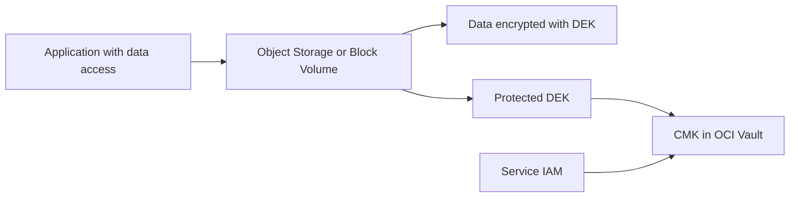

# Assigning Encryption Keys to Storage and Database Services

## 1. Objectives and Scope

In Oracle Cloud Infrastructure (OCI), many storage and database services already encrypt data at rest using their default service mechanisms. When an organization needs to control key lifecycles directly, enforce separation of duties, or prove the use of a specific key, the required step is to select a customer-managed key in OCI Vault and assign that key to a supported resource.

This lesson belongs to the **Encryption, Secrets, and Certificates** chapter and focuses on assigning keys to Storage and Database services. After this lesson, you will be able to:

- Distinguish between default encryption, customer-managed keys, and application-side encryption.
- Prepare keys, compartments, and IAM permissions for both deployers and the services using the keys.
- Assign keys to Object Storage and Block Volume, and identify the appropriate workflow for the Oracle database service in use.
- Verify configuration, data access, and recoverability after key changes.
- Design rotation, monitoring, and key protection plans according to cost and availability requirements.

The running example is a business application running on Compute in a private VCN. The application writes files to Object Storage, uses Block Volume for host data, and stores transactions in an Oracle database service. The security team manages Vault in compartment `Security`; the application team manages infrastructure in compartment `Application`. This is an illustrative model, not mandatory OCI compartment names.

## 2. Understanding What Is Actually Being Assigned

### 2.1. An Encryption Key Is Not a Secret or Certificate

| Component | Role | Used Directly as an Encryption Key for Storage/Database? |
| --- | --- | --- |
| Encryption key in OCI Vault | Performs or supports cryptographic operations per service integration | Yes, when the key type and target service support it |
| Secret in Vault | Stores a secret value such as a password or token | No; a secret's OCID does not replace a key's OCID |
| TLS certificate | Authenticates identity and protects TLS connections | Does not replace storage encryption-at-rest configuration |
| SSH key | Authenticates operating system access | Does not replace a volume encryption key |
| Oracle Database wallet/keystore | Component of key management and TDE inside the database | Must be handled per the database service integration; not treated as the same resource as Vault |

Assigning a CMK does not configure HTTPS for Object Storage, does not enable TLS for database connections, and does not grant data read permissions to application users. Those protection layers must be configured separately.

### 2.2. Oracle-Managed Keys and Customer-Managed Keys

**Oracle-managed keys** are used by the service through its default mechanism. Users do not directly manage that key's lifecycle as a separate Vault resource in their tenancy.

**Customer-managed keys (CMKs)** are keys that customers administer in OCI Vault and select for supported resources. Customers control decisions such as granting usage permissions, rotation, disabling, and scheduling key deletion. Data encryption is still performed by the integrated service; applications typically do not call Vault directly for every data read or write.

Moving to CMKs adds control, while also adding operational dependencies: misconfigured IAM or key lifecycles can affect data access, resource creation, backups, or restores.

### 2.3. Envelope Encryption Model

For storage integrations that use envelope encryption, imagine two layers:

1. Data is encrypted with a data encryption key (DEK).
2. The DEK is protected by a higher-level key. The CMK in Vault participates in the key protection layer according to the service's integration.



This diagram is a conceptual model and does not describe a mandatory Vault call for every I/O operation. Services may use caching and internal key handling. For Oracle Database, also study TDE semantics and Vault integration; do not infer from the diagram that every database type shares the same keystore architecture.

The **key OCID** identifies the key resource. The **key version** identifies key material within that resource's lifecycle. Rotation creates a new version; it does not mean the key OCID changes or all existing data is immediately re-encrypted.

## 3. Selecting the Right Resource Level and Support Scope

There is no single global key-assignment switch for an entire tenancy, compartment, or service group. You must identify the exact resource each service uses to bind a key.

| Service or Resource | What to Check When Assigning a Key | Evidence to Collect |
| --- | --- | --- |
| Object Storage | Encryption key configured on the bucket; service principal permissions by region | Key OCID on the bucket and object write/read results |
| Block Volume | Key attached to each volume; keys of clone sources and backups reviewed separately | Key OCID on the volume, resource state, and I/O results |
| Boot Volume | Key attached to the boot volume; do not infer from data volumes by default | Boot volume configuration and appropriate operational checks in a test environment |
| File Storage | CMK support, linked resource type, and workflow of the active service configuration | File system encryption config and read/write test via mount |
| Oracle Base Database Service or Exadata Database Service | Customer-managed key support for the exact deployment type, version prerequisites, and corresponding TDE/Vault integration workflow | Key management configuration, database status, and appropriate TDE evidence |
| Autonomous Database | Customer-managed key options for the exact Autonomous deployment model and database configuration | Published key OCID or key management info, work request, and test transaction |

This table organizes the work; it does not claim that every combination of service, version, region, and topology supports the exact same operation. Before working with databases or File Storage, verify capabilities for your exact deployment and API/provider. Do not apply Object Storage commands to File Storage, or Autonomous Database procedures to Base Database Service.

An instance with both a boot volume and multiple block volumes can use different keys. Assigning a key to one volume does not automatically change the keys of the remaining volumes. Similarly, the key of a bucket holding data exports does not replace the TDE configuration of the source database.

## 4. Preparing Keys, Placement, and IAM Permissions

### 4.1. Checks Before Selecting a Key

Before creating or updating resources, record:

| Attribute | What to Confirm |
| --- | --- |
| Tenancy and region | Key, vault, and target resource fall within the integration's supported scope; for examples in this lesson, use the same tenancy and region |
| Key state | Key is in a usable state, not disabled or pending deletion |
| Key type | Select an AES symmetric key matching service requirements; AES-256 is used for examples in this lesson |
| OCID | Use the key OCID; do not use a vault, secret, or key version OCID when the field expects a key OCID |
| Key compartment | Identify where policies are placed and the permission scope for key resources |
| Data compartment | Identify where deployers have permission to create or update buckets, volumes, or databases |
| Lifecycle | Someone is accountable for rotation, incident response, and approving changes affecting decryption capability |

Keys and data can reside in two different compartments. A compartment is an organizational and authorization boundary; it does not automatically grant permission to use a key. Deployer permissions on `Application` do not replace key-related permissions in `Security`.

If you must choose between different vault types, key protection levels, or management models, evaluate according to service and organizational requirements. Do not treat a higher-cost configuration as a mandatory prerequisite for every CMK to work.

### 4.2. Two Principals That Must Be Granted Permissions

Distinguish two permission tracks:

1. **The deploying user or pipeline:** has permission to create/update data resources, view the key to select, and delegate key usage as required by the service.
2. **The OCI service actually using the key:** has permission to perform the necessary cryptographic operations on the key.

Seeing a key in the Console does not prove the service can use it. Conversely, granting a service permission to use a key does not mean everyone is allowed to assign that key to resources.

Illustrative policy example for Object Storage and Block Volume:

```text
Allow group StorageProvisioners to read vaults in compartment Security
Allow group StorageProvisioners to read keys in compartment Security
Allow group StorageProvisioners to use key-delegate in compartment Security

Allow service objectstorage-ap-singapore-1 to use keys in compartment Security
Allow service blockstorage to use keys in compartment Security
```

In this example:

- `StorageProvisioners` is an illustrative group. Adjust group identifiers according to your actual IAM and identity domain setup.
- `Security` is the compartment holding the keys.
- `ap-singapore-1` is an illustrative region for the Object Storage service principal; replace it with the bucket's region.
- `key-delegate` serves the key delegation permission in integrations that require it. It does not replace bucket or volume management permissions.
- The policy for `blockstorage` applies to Block Volume integration; do not copy that principal to databases.

This is only the key-related portion of permissions, not a complete deployment policy set. Users or pipelines still need storage resource permissions in the application compartment. Place policies at a scope that can grant permissions for the target compartment.

When you need to restrict a service principal to a specific key, use a condition matching the key resource, for example:

```text
Allow service objectstorage-ap-singapore-1 to use keys in compartment Security where target.key.id = '<KEY_OCID>'
```

Replace the placeholder with the actual OCID before use. Do not simultaneously keep a broader policy for the same principal if the goal is to restrict to this key; `Allow` statements are additive.

For databases, required principals, dynamic groups, and key permissions depend on the service and deployment mode. If the procedure requires a dynamic group, restrict membership to the exact resources and scope documented. Do not grant `manage all-resources in tenancy` to fix a key access error.

### 4.3. Key Permissions and Data Permissions Are Independent

An application authorized to read objects does not need key administration permissions just so the service can decrypt objects for it. Object Storage checks the application's data permissions and uses the service's permissions for the key integration.

Conversely, Vault administration permissions do not automatically grant permission to download objects, mount volumes, or run SQL. Separating these two tracks lets the security team manage keys without becoming data consumers by default.

## 5. Assigning Keys to Object Storage

### 5.1. Creating a New Bucket with a CMK

Basic Console workflow:

1. Select the right region and application compartment.
2. Create the bucket, reviewing access, storage, and data protection options suited to the workload.
3. In the encryption configuration, select customer-managed key.
4. Select the vault, key compartment, and appropriate AES key.
5. Finish creating the bucket, wait for the resource to be ready, and read back the configuration.
6. Write a test object, download it back, and compare contents.

The CLI snippets below are examples for **Bash** with OCI CLI configured and valid authentication. They contain no credentials; replace placeholders and select the region in your profile or CLI options before running.

```bash
NAMESPACE='<OBJECT_STORAGE_NAMESPACE>'
APP_COMPARTMENT_OCID='<APPLICATION_COMPARTMENT_OCID>'
KEY_OCID='<VAULT_KEY_OCID>'
BUCKET_NAME='oci-cmk-lab'

oci os bucket create \
  --namespace-name "$NAMESPACE" \
  --compartment-id "$APP_COMPARTMENT_OCID" \
  --name "$BUCKET_NAME" \
  --kms-key-id "$KEY_OCID"
```

Read back the associated key:

```bash
oci os bucket get \
  --namespace-name "$NAMESPACE" \
  --name "$BUCKET_NAME" \
  --query 'data."kms-key-id"' \
  --raw-output
```

The result must match the expected key OCID. Save the output along with the bucket's region and compartment to avoid confusion across similarly named environments.

Test writing and reading a non-sensitive file:

```bash
printf 'OCI CMK lab\n' > cmk-check.txt

oci os object put \
  --namespace-name "$NAMESPACE" \
  --bucket-name "$BUCKET_NAME" \
  --name 'checks/cmk-check.txt' \
  --file cmk-check.txt

oci os object get \
  --namespace-name "$NAMESPACE" \
  --bucket-name "$BUCKET_NAME" \
  --name 'checks/cmk-check.txt' \
  --file cmk-check.download.txt

cmp cmk-check.txt cmk-check.download.txt
```

`cmp` returns success when the two files match. Choose a new object name or handle existing objects explicitly; do not use accidental overwrites as a test step.

This test confirms a working write/read path at test time. Proof of key assignment remains the configuration read back from the bucket. Keep both pieces of evidence together.

### 5.2. Changing the Key on an Existing Bucket

For an existing bucket, first record the old key, data volume, versioning, retention, and recoverability. Then use the key update procedure supported by the service. Example CLI configuration field:

```bash
oci os bucket update \
  --namespace-name "$NAMESPACE" \
  --name "$BUCKET_NAME" \
  --kms-key-id "$KEY_OCID"
```

Do not treat the changed `kms-key-id` field as the sole proof that all objects, old versions, and copies have completed protection under the target key. Verify Object Storage update and re-encrypt semantics for the operation used, track associated work requests if any, and then test both old and new data.

List all data requiring protection during the change: active objects, previous versions, copies in other buckets, and recovery copies. Only retire dependencies on the old key after collecting evidence covering that entire scope.

Do not confuse assigning a Vault CMK to a bucket with customer-supplied keys per request or application-level content encryption. They have different key transmission methods and operational responsibilities.

## 6. Assigning Keys to Block Volume and Boot Volume

### 6.1. Creating a Block Volume with a CMK

When creating a Block Volume, select the right availability domain, size, performance tier, and key. Assigning a key does not automatically configure attachment, filesystem, or mount point on Compute.

Bash and OCI CLI example:

```bash
APP_COMPARTMENT_OCID='<APPLICATION_COMPARTMENT_OCID>'
AD_NAME='<AVAILABILITY_DOMAIN_NAME>'
KEY_OCID='<VAULT_KEY_OCID>'

oci bv volume create \
  --compartment-id "$APP_COMPARTMENT_OCID" \
  --availability-domain "$AD_NAME" \
  --display-name 'cmk-data-volume' \
  --size-in-gbs 50 \
  --kms-key-id "$KEY_OCID"
```

Capture the volume OCID from the creation output, wait for the volume to become available, then inspect:

```bash
VOLUME_OCID='<VOLUME_OCID>'

oci bv volume get \
  --volume-id "$VOLUME_OCID" \
  --query 'data.{id:id,state:"lifecycle-state",key:"kms-key-id"}'
```

Next, attach the volume to a test Compute instance, prepare a filesystem if it is a new volume, and write/read test data. Do not run format commands on a volume containing existing data just to verify encryption.

### 6.2. Checking Boot Volumes Separately

A Boot Volume has a lifecycle tied to instance bootability. Verify the boot volume's key configuration when launching the instance or via a service-supported update workflow. Do not conclude the boot volume uses a CMK merely because an instance's data volume uses a CMK.

In a test environment, verification may include rebooting the instance or creating a recovery instance from backup. For live systems, plan the impact and select appropriate tests; key assignment is not by default a non-disruptive change.

### 6.3. Key Changes, Clones, and Backups

A resource tree may include a source volume, clones, boot volumes, and multiple point-in-time backups. Check the configuration of each branch according to the service workflow:

- Which key does the source use, and is that key still available?
- Which key will the clone or restore target use?
- Are usage permissions required for both the source key and the target key?
- Does the operation produce a work request or transitional state that needs tracking?
- Can old backups still be restored after the change?

Changing the key association on a volume is not proof that all historical backups have been processed. Retain keys required for recovery throughout the retention period of the associated data.

## 7. Assigning Keys to Oracle Database Services

### 7.1. Relationship with Transparent Data Encryption

Oracle Database uses Transparent Data Encryption (TDE) to protect stored data according to database and service configuration. In a multi-tier key model, data encryption keys and the TDE master encryption key are related; Vault integration determines how the master key is managed or protected outside the database.

Distinguish between:

- **Vault key OCID:** the OCI resource identifier.
- **TDE key identifier in the database:** belongs to Oracle Database's internal key management mechanism.
- **Keystore/wallet:** a component of the database's key configuration; its state must be interpreted according to the deployment type.

Do not treat these three components as the same value. An SQL query showing TDE is active does not by itself prove the database is configured with the expected Vault key OCID.

### 7.2. Choosing the Workflow by Database Type

| Deployment Type | Approach |
| --- | --- |
| Base Database Service | Verify customer-managed key support for the DB system/database, version prerequisites, and corresponding Vault integration workflow |
| Exadata Database Service | Identify database scope, VM cluster, and deployment model; apply the service's exact key management workflow |
| Autonomous Database | Use the key management feature for the exact Autonomous model; verify configuration conditions, backups, clones, and related standbys |
| Self-managed Oracle Database on Compute | This is a separate TDE/keystore and software integration problem; assigning a CMK to boot/block volumes is insufficient to prove TDE is configured with Vault |

Console option names and API fields are not necessarily identical across rows. Do not create a single generic database command and plug in OCIDs from every database type.

### 7.3. Execution Procedure

1. **Capture pre-change configuration.** Record database type, region, compartment, service state, current key management method, backup config, and HA/DR topology.
2. **Confirm support.** Verify that the exact deployment type supports CMKs at creation or conversion of existing resources, along with version or configuration prerequisites.
3. **Prepare key and IAM.** Select the appropriate vault/key; grant permissions to deployers and the principal or dynamic group required by the database integration.
4. **Select key on the right resource.** Within the service's creation or key management flow, select customer-managed mode and supply the required vault/key identifiers.
5. **Monitor application progress.** If the service returns a work request, track it until a successful terminal state. Do not treat request acceptance as completion.
6. **Read back configuration.** Cross-check the resource's post-operation key and key management mode against the plan.
7. **Test the database.** Connect with an appropriate application account, run a test transaction within authorized scope, and verify pre-existing data.
8. **Test recovery.** Create or use a test backup to verify restoration to a test resource with all required key dependencies.

Do not run `ADMINISTER KEY MANAGEMENT` or manually edit wallets on a managed service just to swap a Vault key OCID. On managed services, control-plane workflows may coordinate multiple components; manual SQL cannot substitute for that workflow.

### 7.4. Evidence at the Database Layer

When authorized and permitted by the service to query the relevant views, a DBA can collect additional TDE status, for example:

```sql
SELECT con_id, status, wallet_type
FROM v$encryption_wallet
ORDER BY con_id;

SELECT tablespace_name, encrypted
FROM dba_tablespaces
ORDER BY tablespace_name;
```

These are inspection queries, not key-assignment commands. Output semantics depend on the connected CDB/PDB, account privileges, and the TDE mechanism used by the service. Managed services may restrict view access or expose evidence via dedicated management interfaces.

Combine three layers of evidence:

| Inspection Layer | Question Answered |
| --- | --- |
| OCI configuration | Is the resource linked to the right key and right management mode? |
| TDE/database status | Do the encryption mechanism and database state match the design? |
| Transactions and recovery | Do the application and restore procedures actually work? |

Do not use a single `OPEN` status in a wallet view or one successful transaction to replace all other checks.

### 7.5. Backups, Data Guard, and Multi-Region Deployments

A database can run normally while its recovery plan is still missing a key. Evaluate all of the following:

- Backups created before and after a key change.
- Clones, refreshable clones, or test environments created from source data, if applicable.
- Standbys and supported switchover/failover procedures.
- Copies in another region and key requirements in the target region.
- How long old keys must be retained per retention policies and data preservation obligations.

Do not assume a key OCID works as-is in another region. Prepare vaults, keys, permissions, and key replication or mapping according to each service's capabilities. Prove DR through a recovery drill in an authorized environment rather than merely seeing that a backup exists.

## 8. Automating Key Assignment

When provisioning multiple resources, pass the key OCID as a controlled input to infrastructure as code. Never download key material to the deployment machine to assign to buckets or volumes.

The Terraform snippet below is a configuration excerpt meant to fit into a project that already has an OCI provider, pinned provider version, and corresponding input variables:

```hcl
resource "oci_objectstorage_bucket" "documents" {
  compartment_id = var.application_compartment_id
  namespace      = var.object_storage_namespace
  name           = "application-documents"
  kms_key_id     = var.storage_key_id
}

resource "oci_core_volume" "application_data" {
  compartment_id      = var.application_compartment_id
  availability_domain = var.availability_domain
  display_name        = "application-data"
  size_in_gbs         = 50
  kms_key_id          = var.storage_key_id
}
```

The variables in the example must be declared and populated in the actual project. Having Vault exist before data resources only resolves creation ordering; it does not grant IAM automatically. When policies have just been updated, account for permission propagation delay and retry only defined transient errors.

Before applying, inspect the plan to see whether the tool intends an in-place update or resource replacement, especially for databases and attributes with specific constraints. After applying, still read back configuration from OCI and run functional tests. A successful Terraform state does not replace data-read or restore tests.

For databases, add key fields according to the exact resource for your database type and provider version. Do not copy `kms_key_id` mechanically if the resource also requires a vault ID, keystore configuration, or has specific transition constraints.

## 9. Rotation, Key Replacement, and Re-encryption

Three commonly confused operations:

| Operation | Primary Change | What Must Not Be Inferred |
| --- | --- | --- |
| Rotate a Vault key | Creates a new key material version for the same key resource | That all data, backups, and TDE keys have moved to the new version |
| Assign a different key to a resource | Changes linkage to another key OCID per service workflow | That all historical copies no longer depend on the old key |
| Service-level re-encrypt/rekey | Executes a workflow to update data protection or underlying keys | That all services share the same implementation and impact level |

For databases, Vault rotation and TDE master key rotation may be related steps but are not identical. Follow only service-supported mechanisms and verify evidence after each step.

A controlled change process includes:

1. Inventory resources, backups, and HA/DR dependencies of the current key.
2. Create a new version or prepare a new key, along with required IAM.
3. Execute the service-supported operation and monitor until completion.
4. Verify configuration, old data, new data, and restores.
5. Monitor errors for a period suited to workload traffic and service caching behavior.
6. Consider retiring the old key only after dependencies are proven no longer needed.

Do not assume reverting to the old OCID is a guaranteed rollback. Rollback feasibility depends on resource state, completed operations, and service limits. Pre-change plans must specify either a supported reverse-update path or a backup restore plan.

## 10. Monitoring and Troubleshooting

### 10.1. What Changes Should Be Logged?

Track administrative changes affecting key usage: IAM policies, resource key configurations, rotation, key disabling, and scheduled key deletion. Correlate OCI Audit, work requests, and service-provided logs/metrics during investigations.

Do not assume every application read of an object or block produces a corresponding Vault log entry. Caching mechanisms and integration design determine key-service call frequency. Design alerts around telemetry actually emitted by the service.

Keep in the change record: timestamp, executing user/pipeline, resource, before-and-after keys, request/work request IDs if available, and test results. Never write passwords, secret contents, or key material into logs.

### 10.2. Diagnostic Table

| Symptom | Cause Categories to Check | Remediation Direction |
| --- | --- | --- |
| Key not visible in selection list | Wrong region/compartment, missing view permission, or unsupported key type | Verify placement, key type, and deployer permissions |
| Key selectable but resource creation fails | Service lacks key usage permission, missing delegate permission, or key unusable | Check both permission tracks and key state |
| Unauthorized or not-found style errors | Wrong OCID, missing IAM permissions, or resource outside access scope | Do not conclude key was deleted from this message alone; check identifiers and permissions |
| CLI returns success but resource is not ready | Asynchronous operation still running | Track work request and final lifecycle state |
| Active data works but restore fails | Backup still depends on old key, target lacks permissions, or wrong region | Identify key needed for source backup and target resource requirements |
| Errors persist briefly after policy change | Possible permission propagation delay | Verify policy correctness first, then perform bounded retries |
| Database encounters key-related error after change | Incomplete TDE/Vault workflow or invalid key permissions/state | Collect control-plane and database evidence; follow the service runbook |

During an incident, prioritize restoring valid permissions or key state and completing supported procedures. Do not create another key expecting it to decrypt data protected by the old key; two AES keys of the same length do not share key material.

### 10.3. Disabling and Deleting Keys

Disabling a key can cause failures in operations requiring that key. However, impact may not appear simultaneously across all active sessions due to caching and internal state. A successful read immediately after disabling a key does not prove the system has no remaining dependency on it.

Test permission-loss or key-unavailability scenarios only in an isolated test environment, using disposable data and a clear recovery plan. Never use key deletion to test authorization. Losing a required key can render data and backups unrecoverable even while the storage resources still exist.

## 11. Cost and Availability

A CMK design must evaluate both data resources and key resources:

- Evaluate vault/key costs based on the selected protection mode and deployment model; do not assume all configurations share the same pricing.
- Account for additional storage, backup, clone, and test database costs used for recovery drills.
- Check quotas, service limits, and key-request serving capacity under the application's load profile.
- Separate key administration, policy modification, and data permissions to reduce the blast radius of mistakes.
- Protect key state-change workflows and maintain recoverability if an administrator or pipeline fails.

Using a single shared key across many resources simplifies management, but widens the blast radius if the key is disabled or IAM breaks. Using multiple keys separates environments, data classes, or responsibilities, while increasing the number of dependencies to inventory and test. Choose key boundaries based on operational and authorization requirements, not merely resource count.

## 12. Integrated Hands-On Lab

### 12.1. Preparation

Use an OCI test environment with security and application compartments. Prepare an active AES-256 key in a Vault in the same region. Use an account or pipeline with appropriately scoped permissions; sample data must contain no sensitive information.

If deploying a database for the lab, confirm the deployment type supports CMKs and estimate costs before provisioning. The database portion can be performed independently of the Storage portion to align with access rights and lab budget.

### 12.2. Steps

1. Record region, compartments, vault OCID, key OCID, and IAM scope in the lab log.
2. Configure deployer and service principal permissions for the two Storage resources.
3. Create a bucket with the CMK; read back `kms-key-id`; write and download a test object, and compare contents.
4. Create a Block Volume with the CMK; read back the key; attach it to a test Compute instance and verify I/O.
5. Inspect the boot volume's key to prove this resource was checked separately.
6. For the selected database, execute the CMK assignment procedure for that exact service; record completion state and read-back configuration.
7. Run a test database transaction and verify pre-existing data if the lab converts an existing resource.
8. Perform a supported restore test to a test resource; confirm data and required keys.
9. If practicing rotation, distinguish clearly between creating a new key version and switching to a different key OCID; repeat necessary verification checks.
10. Clean up lab resources according to environment policy; only end key lifecycle after inventorying any retained data, backups, and dependent resources.

### 12.3. Completion Criteria

| Item | Passing Condition |
| --- | --- |
| Scope | Correctly identified tenancy, region, and compartments for both keys and resources |
| IAM | Can explain deployer permissions and service permissions without granting tenancy-wide rights to fix errors |
| Object Storage | Bucket returns expected key OCID and test object reads back identical content |
| Block/Boot Volume | Each volume type checked separately; test Block Volume works after attachment |
| Database | Confirmed CMK mode, completion status, and test transaction on the exact deployment type |
| Recovery | Test restore succeeded within lab scope, clearly stating keys that must be retained |
| Lifecycle | Distinguished rotation, key replacement, and re-encrypt; dependency list prepared before retiring old key |
| Evidence | Configuration read-back, functional results, and change investigation records collected without secrets |

## 13. Principles to Remember

Assigning an encryption key establishes a dependency among the data resource, the key, and IAM. Succeeding at one layer is insufficient: you need the right key on the OCI configuration, service authorization to use the key, accessible data, and restorable backups.

Object Storage, Block Volume, and Oracle database services have different binding points and key management workflows. Automation should reflect those differences explicitly. For databases, always distinguish the Vault key, the TDE master key, and keystore state; for every service, retain required keys throughout the entire lifecycle of data and recovery copies.
