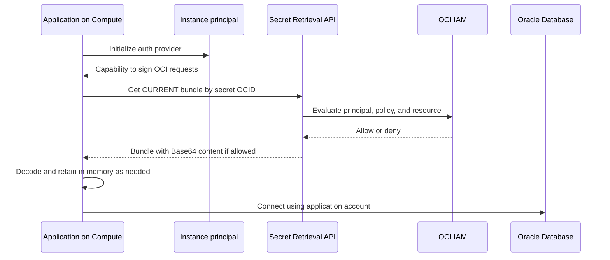

# Storing, Retrieving, and Authorizing Access to Secrets

An application running on Oracle Cloud Infrastructure (OCI) may need an Oracle Database account password, an API token, or an access key for an external system. Embedding these values in source code, virtual machine images, or deployment configurations turns every copy of the software into a copy of the secret. A better approach is to store secrets centrally, authenticate the application's identity, and allow the application to read only the exact content it needs.

This lesson belongs to the **Encryption, Secrets, and Certificates** chapter and focuses on storing and consuming secrets in OCI: selecting a compartment, associating a vault and encryption key, granting IAM permissions, retrieving via CLI or Java SDK, and operating without leaking data. The examples use an application on Compute and a database account; they do not deploy a full VCN or database.

## 1. Learning Outcomes

After this lesson, you will be able to:

- Distinguish between a secret, secret version, secret bundle, and encryption key.
- Separate the identity that creates/updates secrets from the read-only identity used to run the application.
- Write a policy allowing a dynamic group to read a specific secret.
- Retrieve the `CURRENT` version via instance principal, decode Base64 properly, and keep data out of logs.
- Explain the impact of caching, permission changes, and credential changes on the target system.

## 2. Resource Model and Protection Boundaries

### 2.1. A Secret Is Not an Encryption Key

| Component | Role in the Usage Flow |
| --- | --- |
| Secret | Resource representing a secret; has an OCID, name, compartment, and versions |
| Secret version | One stored instance of content; has a version number and a stage such as `CURRENT` or `PENDING` |
| Secret bundle | Retrieval result containing secret content along with version info and related attributes |
| Vault | Resource involved in organizing keys and protecting secrets when created |
| Master encryption key | Encryption key protecting the secret content inside the service; not the password the application uses |
| Principal | Identity making the OCI call, such as an operator or a Compute instance |

For example, `orders-db-password` represents the password of an Oracle Database account. When the password changes, the application can still reference that secret's OCID and request the `CURRENT` content; the content's version number changes. A secret bundle is data that must be protected even while the content field is still Base64-encoded. [Source: Secret Management overview](https://docs.oracle.com/en-us/iaas/Content/secret-management/overview.htm).

OCI now refers to secrets management as the **Secret Management Service**. Older documentation may refer to secrets in Vault; the CLI command groups for managing and retrieving secrets still appear under `oci vault` and `oci secrets`, respectively. When looking up references, distinguish command functionality from Console display names. [Source: service rename notice](https://docs.oracle.com/en-us/iaas/releasenotes/secret-management/introducing-secret-management.htm), [`vault` command group reference](https://docs.oracle.com/en-us/iaas/tools/oci-cli/latest/oci_cli_docs/cmdref/vault.html).

### 2.2. Three Protection Layers That Must Work Together

**Storage layer:** the service keeps content protected with an appropriate key. When creating a secret by supplying content, OCI requires a symmetric key belonging to the selected vault. [Source: creating a secret](https://docs.oracle.com/en-us/iaas/Content/secret-management/Tasks/create-secret.htm).

**Access layer:** IAM determines which principals can manage metadata, create or modify content, or retrieve secret bundles. Someone who can see a secret's name cannot necessarily read its value.

**Application layer:** once authorized and after receiving the data, the process can use the plaintext content. Therefore, service-side encryption does not stop an application from writing a password to logs, saving it into a config file, or returning it in an HTTP response.

Base64 only converts bytes into a string suitable for JSON transport; anyone with that string can decode it back. Do not treat `secret-bundle-content.content` as safe to log merely because it does not look like a human-readable password yet.

### 2.3. Placing Resources by Responsibility Scope

In this example, the tenancy has two compartments:

- `OrdersApp`: holds the Compute instance running the application.
- `OrdersSecrets`: holds the secret, vault, and key for the lab.

In real systems, the vault, key, and secret may reside in different compartments. Policies must target each resource's respective compartment; the application's location does not determine the secret's location. Moving a secret to another compartment also changes which policies apply to it. [Source: managing and moving secrets](https://docs.oracle.com/en-us/iaas/Content/secret-management/Concepts/manage-secrets.htm).

Separate `dev`, `test`, and `prod` into independent permission scopes. Names, tags, and descriptions should contain only administrative info such as application, environment, and owner; never put passwords or tokens in them. For small systems, one vault with separated secrets may suffice; creating additional vaults or keys should tie to specific authorization, operational, and budget needs.

## 3. Flow from Application to Secret



The diagram illustrates authentication and authorization relationships, not internal service details. The application's deployment config only needs references such as region, secret OCID, and database address. The password content is fetched at runtime.

There are two independent authentications:

1. Instance principal authenticates the application to OCI to retrieve the secret.
2. The database account authenticates the application to Oracle Database.

Successfully reading a secret does not guarantee database login will succeed. The password might be stale, the account locked, or network connectivity to the database not ready.

## 4. Preparing and Storing a Secret

### 4.1. Preparing Inputs

The practitioner needs the target region, target compartment, an active vault, and a symmetric key in that vault. The operator must have permission to create secrets and use the associated vault/key. Whoever creates dynamic groups and policies has separate IAM responsibilities; do not hand IAM administration permissions to the application.

Record the references, not the secret value:

```text
region                 = <secret-region>
secret_compartment_id  = <OrdersSecrets-compartment-ocid>
vault_id               = <vault-ocid>
key_id                 = <symmetric-key-ocid>
secret_name            = orders-prod-db-password
```

Every string inside `<...>` must be replaced with resources from your lab environment. Pick a dummy value; do not use real credentials on your first run-through.

### 4.2. Entering a Secret via the Console

1. Open Secret Management under Identity & Security and select the right region.
2. Select compartment `OrdersSecrets` and start creating a secret.
3. Set the name to `orders-prod-db-password` and a description containing no secret content.
4. Select the corresponding vault and symmetric key.
5. Enter dummy content in the secret form; if you choose plain-text entry, the Console performs Base64 conversion for the request sent to the service.
6. Complete creation and record the secret OCID from the resource details.

Field labels and form layout may change across UI updates; the required items remain compartment, vault, key, and content. [Source: Console secret creation workflow](https://docs.oracle.com/en-us/iaas/Content/secret-management/Tasks/create-secret.htm).

### 4.3. CLI Example with Dummy Data

The snippet below uses **Bash on Linux or OCI Cloud Shell**, not PowerShell syntax. The operator's CLI is already authenticated and authorized to create resources. This illustrates the command; it does not require running on the workstation authoring documentation.

```bash
SECRET_COMPARTMENT_OCID='<OrdersSecrets-compartment-ocid>'
VAULT_OCID='<vault-ocid>'
KEY_OCID='<symmetric-key-ocid>'
OCI_REGION='<secret-region>'

# Use dummy string only: "demo-only-not-a-password".
DEMO_CONTENT_BASE64='ZGVtby1vbmx5LW5vdC1hLXBhc3N3b3Jk'

SECRET_OCID=$(oci vault secret create-base64 \
  --region "$OCI_REGION" \
  --compartment-id "$SECRET_COMPARTMENT_OCID" \
  --vault-id "$VAULT_OCID" \
  --key-id "$KEY_OCID" \
  --secret-name 'orders-prod-db-password' \
  --description 'Dummy value for Orders lab' \
  --secret-content-content "$DEMO_CONTENT_BASE64" \
  --secret-content-stage CURRENT \
  --query 'data.id' \
  --raw-output)
```

`create-base64` accepts content that is already Base64-encoded; when creating a new secret, `CURRENT` is the appropriate content stage. Do not Base64-encode twice. [Source: `create-base64` reference](https://docs.oracle.com/en-us/iaas/tools/oci-cli/latest/oci_cli_docs/cmdref/vault/secret/create-base64.html).

The example intentionally uses a dummy value because command-line arguments, shell tracing, transcripts, or CI systems may persist inputs. With real data, use a controlled ingestion workflow, disable logging of sensitive inputs, and avoid putting plaintext into shell command history. If using a request file, protect file read permissions, directory permissions, lifetime, and backup locations. A JSON file containing Base64 still contains the secret.

When using IaC, referencing the secret OCID in application config helps limit value exposure. If a pipeline creates the secret itself from real content, evaluate state, plans, artifacts, and logs; do not assume a value masked on screen is absent from all stored records.

## 5. Authorization by Responsibility

### 5.1. Separating Metadata from Content

The resource types to recognize are `secrets`, `secret-versions`, and `secret-bundles`. `secret-family` encompasses all three. `read secrets` covers metadata; to fetch content with `GetSecretBundle`, the principal needs `read secret-bundles`. [Source: IAM reference for secrets](https://docs.oracle.com/en-us/iaas/Content/Identity/policyreference/keypolicyreference.htm).

| Role in Example | Required Task | Desired Boundary |
| --- | --- | --- |
| Vault/key management team | Prepare and protect cryptographic resources | Does not simultaneously hold broad permissions across all workloads |
| Secret publishing team | Create/update content per workflow | Scoped only to assigned secrets |
| Orders application | Retrieve active password | Single secret; cannot create, modify, or delete |
| Operations support | View resource status and error evidence | Does not need to view passwords to handle most incidents |

This table illustrates responsibility design. A principal can inherit permissions from multiple policies, so inspect effective permissions in total before concluding roles are separated.

### 5.2. Illustrative Policy for Publishers

Assume group `SecretPublishers`, vault, key, and secret are all within the lab scope. The policy below grants secret management in `OrdersSecrets` and restricts vault/key usage by OCID:

```text
Allow group SecretPublishers to manage secrets in compartment OrdersSecrets
Allow group SecretPublishers to use vaults in compartment OrdersSecrets where target.vault.id = '<vault-ocid>'
Allow group SecretPublishers to use keys in compartment OrdersSecrets where target.key.id = '<symmetric-key-ocid>'
```

This is a **manage** permission within the compartment, including lifecycle operations; it is not a minimal policy that only allows adding a version. Creating a secret requires permissions on the secret, vault, and key; for production, administrators must narrow permissions further by operation and responsibility. This example does not grant the publishing group permission to retrieve bundles. [Source: API permissions](https://docs.oracle.com/en-us/iaas/Content/Identity/policyreference/keypolicyreference.htm), [common administrative policies](https://docs.oracle.com/en-us/iaas/Content/Identity/Concepts/commonpolicies.htm).

Group names in the example assume the default identity domain. If using another domain, use domain-qualified names or OCIDs per your tenancy's policy syntax. Policies must be placed at a scope with authority over the target compartments; an administrator with permissions only in the application compartment cannot grant access to resources outside that scope.

Someone permitted to modify a secret can change the password or push bad data into a new version. Therefore, separating read permissions from content management permissions is only part of control; the publishing pipeline must also be protected.

### 5.3. Dynamic Group for the Compute Instance

Create dynamic group `OrdersRuntime` with a matching rule matching only the lab instance:

```text
ALL {instance.id = '<orders-compute-ocid>'}
```

If using `instance.compartment.id` instead of `instance.id`, the scope includes all matching instances in that compartment, including future ones. For scalable instance fleets, you can combine defined tags with compartments; in that case, permission to attach or modify tags becomes part of the authorization boundary. Do not use free-form tags as IAM conditions. [Source: dynamic group matching rules](https://docs.oracle.com/en-us/iaas/Content/Identity/dynamicgroups/Writing_Matching_Rules_to_Define_Dynamic_Groups.htm).

A dynamic group defines membership; policies grant permissions to those members. Creating a group without a policy does not let the instance read the secret. [Source: managing dynamic groups](https://docs.oracle.com/en-us/iaas/Content/Identity/Tasks/managingdynamicgroups.htm).

### 5.4. Allow Runtime to Read Only One Secret

```text
Allow dynamic-group OrdersRuntime to read secret-bundles in compartment OrdersSecrets where target.secret.id = '<orders-db-password-secret-ocid>'
```

The `target.secret.id` condition restricts which resource can be read. For the bundle retrieval operation in the example, the runtime does not need additional direct key-decryption permissions or `manage secret-family`. [Source: resource types, conditions, and permissions for `GetSecretBundle`](https://docs.oracle.com/en-us/iaas/Content/Identity/policyreference/keypolicyreference.htm).

This condition restricts by secret; it does not prove the principal can only read `CURRENT`. Selecting `CURRENT` in application code is a usage convention; do not treat that convention as an IAM barrier protecting other versions of the same secret.

Instance principals avoid distributing user API signing keys to VMs. However, anyone able to access and execute code on the instance can use that instance's permissions. A VM hosting multiple applications with different trust levels must therefore be carefully evaluated before granting secret read access. [Source: calling services from instances](https://docs.oracle.com/en-us/iaas/Content/Identity/Tasks/callingservicesfrominstances.htm).

## 6. Retrieving via CLI Without Printing Content

Run the following example **on the Compute instance belonging to `OrdersRuntime`**, with OCI CLI installed and network connectivity to required endpoints. Do not use a successful test run under an administrator account on a personal laptop as evidence that the runtime has been authorized.

```bash
SECRET_OCID='<orders-db-password-secret-ocid>'
OCI_REGION='<secret-region>'

oci secrets secret-bundle get \
  --region "$OCI_REGION" \
  --auth instance_principal \
  --secret-id "$SECRET_OCID" \
  --stage CURRENT \
  --query 'data."version-number"' \
  --raw-output
```

The command prints only the version number so you can verify access. The request itself still calls the bundle retrieval API; `--query` only filters output on the client—it does not reduce required permissions or strip content from the API response. Never enable `--debug` in flows handling real secrets.

`oci vault secret get` inspects resource metadata; it does not return secret content. To retrieve content, use the Secret Retrieval API, such as `oci secrets secret-bundle get`. [Source: secret metadata reference](https://docs.oracle.com/en-us/iaas/tools/oci-cli/latest/oci_cli_docs/cmdref/vault/secret.html), [getting secret contents](https://docs.oracle.com/en-us/iaas/Content/secret-management/Tasks/get-secrets-contents.htm).

When fetching a value for a Bash process, you can hold the Base64 string in a local variable without printing it to the terminal:

```bash
SECRET_BASE64=$(oci secrets secret-bundle get \
  --region "$OCI_REGION" \
  --auth instance_principal \
  --secret-id "$SECRET_OCID" \
  --stage CURRENT \
  --query 'data."secret-bundle-content".content' \
  --raw-output)

# Inside the application, decode and pass directly to the consuming library.
# Do not echo, export, or write the value to a configuration file.
unset SECRET_BASE64
```

This only illustrates the data retrieval path; the snippet does not connect to a database itself. `unset` removes the variable reference but does not guarantee all copies in memory are cleared. For long-running programs, an SDK is preferable because it manages errors, caching, and client lifecycle inside the application.

When no version selector is specified, the API defaults to `CURRENT`; still declare it explicitly to show intent. `LATEST` is the most recently uploaded content and may not yet be the active value in use. [Source: `secret-bundle get` reference](https://docs.oracle.com/en-us/iaas/tools/oci-cli/latest/oci_cli_docs/cmdref/secrets/secret-bundle/get.html).

## 7. Retrieving with the Java SDK

The example below is a library class for a Java application on OCI Compute. The project requires the OCI Java SDK with the `oci-java-sdk-secrets` module and an SDK-supported HTTP client, with compatible dependency versions managed by the project. The code does not read any user API signing key and does not write the secret value to stdout.

```java
import com.oracle.bmc.Region;
import com.oracle.bmc.auth.InstancePrincipalsAuthenticationDetailsProvider;
import com.oracle.bmc.secrets.SecretsClient;
import com.oracle.bmc.secrets.model.Base64SecretBundleContentDetails;
import com.oracle.bmc.secrets.model.SecretBundleContentDetails;
import com.oracle.bmc.secrets.requests.GetSecretBundleRequest;

import java.util.Base64;

public final class OciSecretReader {
    private OciSecretReader() {
    }

    public static byte[] loadCurrent(String regionId, String secretOcid) {
        if (regionId == null || regionId.isBlank()
                || secretOcid == null || secretOcid.isBlank()) {
            throw new IllegalArgumentException("Missing secret reference");
        }

        var provider = InstancePrincipalsAuthenticationDetailsProvider
                .builder()
                .build();

        try (SecretsClient client = SecretsClient.builder()
                .region(Region.fromRegionId(regionId))
                .build(provider)) {
            var request = GetSecretBundleRequest.builder()
                    .secretId(secretOcid)
                    .stage(GetSecretBundleRequest.Stage.Current)
                    .build();

            var bundle = client.getSecretBundle(request).getSecretBundle();
            SecretBundleContentDetails details = bundle.getSecretBundleContent();

            if (!(details instanceof Base64SecretBundleContentDetails)) {
                throw new IllegalStateException("Unsupported secret content type");
            }

            String encoded = ((Base64SecretBundleContentDetails) details).getContent();
            if (encoded == null) {
                throw new IllegalStateException("Missing secret content");
            }
            return Base64.getDecoder().decode(encoded);
        }
    }
}
```

The class uses Java 11+ syntax. Request construction and `Stage.Current` selection follow the Java SDK interface; Base64 content is read via `Base64SecretBundleContentDetails`. [Source: `GetSecretBundle` in Java](https://docs.oracle.com/en-us/iaas/tools/java-sdk-examples/latest/secrets/GetSecretBundleExample.java.html), [Base64 content type](https://docs.oracle.com/en-us/iaas/tools/java/latest/com/oracle/bmc/secrets/model/Base64SecretBundleContentDetails.html).

The return type is `byte[]` to avoid assuming every secret is text. If the data contract specifies a UTF-8 password, the database integration layer converts it into the form expected by the connection library. Do not call `trim()` on passwords; whitespace or newline bytes may be part of the value.

The caller is responsible for limiting data lifetime. You can clear the byte array you own with `Arrays.fill` after the consuming library copies the data per its contract, but you cannot guarantee erasure of strings or copies created by the SDK and driver. Never include the bundle in `toString()`, exceptions, APM attributes, or HTTP responses.

To keep the example focused, each call creates and closes a client. For long-running services, reuse the provider/client across the application lifecycle, with timeouts, bounded retry policies, and an appropriate caching layer. This is illustrative code to integrate into a project; it is not a compiled program tested on your tenancy.

## 8. Versioning and Consistency with the Target System

| Stage | Meaning to Remember When Consuming |
| --- | --- |
| `CURRENT` | Content marked as currently active for the target resource |
| `PENDING` | Content prepared but not yet promoted to active value |
| `LATEST` | Most recently uploaded content; may coincide with `PENDING` |
| `PREVIOUS` | Content that was `CURRENT` immediately prior to the latest promotion |

A single version can carry multiple stage labels. The version number identifies the content; the stage describes its usage role. [Source: secret versions](https://docs.oracle.com/en-us/iaas/Content/secret-management/Concepts/secret-versions.htm), [rotation states](https://docs.oracle.com/en-us/iaas/Content/secret-management/Concepts/manage-secrets.htm).

For example, version 1 is currently `CURRENT`. An operator creates version 2 in `PENDING`; applications reading `CURRENT` still get version 1, while selecting `LATEST` may retrieve version 2. Promoting version 2 to `CURRENT` does not automatically change the password inside Oracle Database unless an integration or workflow performs that step.

Coordination procedures must ensure the target system accepts the new value before consumers switch to it, while handling overlap between versions. If the database only accepts one password at a time, operations must pick an appropriate cutover strategy, such as rotating application accounts in waves or using a maintenance window. Do not assume you can swap a password while all new connections continue seamlessly.

Rollbacks must also consider both sides. Marking old content as `CURRENT` only helps if the target system still accepts it or has been reverted to the matching value. When a password is compromised, prioritize invalidating the credentials at the target system; merely revoking secret read access does not invalidate a value that was already copied.

This section explains only the impact on retrieval; implementing a full automatic rotation mechanism requires dedicated workflows for the target system.

## 9. Operations: Caching, Networking, and Availability

### 9.1. Time-Bounded Caching

Calling the secret retrieval API for every business request increases latency and unnecessary API calls. Conversely, holding a value indefinitely causes the application to miss credential changes.

A reference design is fetching `CURRENT` on startup, holding it in memory, and refreshing according to a TTL. An example 5-minute TTL is a design choice for discussion, not an OCI default. Actual TTL must reflect revocation requirements, replica count, and how the connection pool updates credentials.

Decide explicitly:

- Fail startup if the secret cannot be fetched initially; never fall back to a hardcoded password.
- When a refresh fails, whether the old value may be used for a bounded window, who approves that, and where it alerts.
- When a connection is rejected, whether one controlled refresh is permitted before failing.
- When many replicas start simultaneously, use random jitter and bounded retries to avoid thundering-herd load.

You can roughly estimate hourly refreshes as `number of replicas × 3600 / TTL in seconds`, plus startups and retries. This formula helps assess load; it does not replace current pricing or service limits.

### 9.2. Networking and Identity Are Two Separate Prerequisites

An instance in a private subnet still needs DNS, routes, and egress rules for the OCI endpoints in use. The authentication provider also needs access to the appropriate identity-providing components. Test from the exact subnet and process running the application.

Timeouts or DNS resolution failures usually require investigating the network path first. A permission-denied response from the API shows the request reached the service, though it does not prove identity, resource, and policy are all correct. Never handle timeouts by escalating IAM permissions.

### 9.3. Recovery and Deployment Regions

Secret references are tied to the deployed resource and region. A DR configuration must plan for the secret, associated vault/key, IAM, application configuration, and target system credentials. Internal service availability does not automatically create an application-wide recovery plan across regions.

In the lab, create only necessary resources and review costs of vaults, keys, and related components before scaling out. When cleaning up, inspect consumers and dependencies before scheduling secret or key deletion. An existing secret cannot help the application if the key protecting it becomes unusable.

## 10. Observability and Troubleshooting

### 10.1. Evidence to Collect

OCI Audit provides events for supported API calls, helping correlate time, principal, resource, operation, and outcome. When investigating a secret read error, combine Audit evidence with SDK/CLI errors and the call's request ID. [Source: Audit overview](https://docs.oracle.com/en-us/iaas/Content/Audit/Concepts/auditoverview.htm).

Applications should log operation type, processing duration, success/failure status, and the version used when appropriate. Never log secret contents, Base64 strings, or connection strings containing passwords. Dashboards should distinguish secret retrieval errors from Oracle Database login errors.

Useful operational signals include refresh failure rate, secret retrieval latency, cache age, and unexpected changes in retrieving principals. These are metrics the application itself can emit; do not assume all of them are built-in service metrics. Logging and alerting policies must also avoid placing sensitive data in notifications.

### 10.2. Isolating Errors by Symptom

| Symptom | First Place to Check |
| --- | --- |
| Secret visible in Console, but runtime cannot read it | Which principal is in use; does runtime have `read secret-bundles` on that exact secret |
| Creating secret fails with insufficient permissions or resource not found | Target compartment, selected vault/key, region, and related creation permissions |
| `NotAuthorizedOrNotFound` on read | Check permissions as well as OCID, region, and resource state; do not assume the secret was deleted |
| Instance just added to group cannot read yet | Matching rule and propagation delay for membership change |
| Received unreadable string | Likely Base64; check content type before decoding |
| Decode succeeds, but password is wrong | Charset, trailing newline bytes, selected stage/version, cache, and actual value on target system |
| Timeout or DNS failure | DNS, route, egress, proxy, and endpoint from the runtime environment itself |
| `CURRENT` changed, but application still uses old value | Cache TTL, configured secret OCID, and connection pool credentials |

Oracle provides specific guidance for secret creation errors involving permissions or missing resources. For dynamic group matching rule updates, documentation also notes that changes take time to take effect; retrying immediately is insufficient to conclude the policy is wrong. [Source: Secret Management troubleshooting](https://docs.oracle.com/en-us/iaas/Content/secret-management/troubleshooting.htm), [updating dynamic groups](https://docs.oracle.com/en-us/iaas/Content/Identity/Tasks/managingdynamicgroups.htm).

When a principal is unauthorized, fix the matching rule, policy, or resource reference properly. Temporarily granting tenancy-wide permissions to bypass errors defeats least-privilege validation.

## 11. Hands-On Deployment with Dummy Data

This lab applies the commands and policies presented directly, without using production passwords.

1. Prepare `OrdersApp`, `OrdersSecrets`, a Compute instance, and an appropriate vault/key.
2. Store a dummy value as a secret; record its OCID and region.
3. Create `OrdersRuntime` matching only the lab instance.
4. Grant `read secret-bundles` conditioned on the exact secret OCID.
5. On the instance, call the CLI with `--auth instance_principal` and output only the version number.
6. On an instance outside the group, try the same operation; expect read failure if that principal has no permissions via another path.
7. With a second dummy secret outside the policy condition, confirm the runtime cannot read it even though it can read the Orders secret.
8. Using an operator account, create a new dummy version in `PENDING`; confirm that the runtime's `CURRENT` selection still points to the active version.
9. During cleanup, revoke policies no longer needed, check dependencies, and execute appropriate resource deletion steps.

Acceptable evidence includes: correct OCID references, successful retrieval by the runtime principal, denied out-of-scope accesses, and no secret content in saved outputs. If extending the lab with a real database, include evidence of connecting with an application account holding appropriate data permissions; do not use a database admin account just to simplify the secret setup.

## 12. Key Takeaways

A secret must be protected end-to-end from ingestion, storage in the service, retrieval, through its lifetime in application memory. Vault and keys handle storage protection; principals and IAM govern who may retrieve content; the application is responsible for not leaking the value after receipt.

In OCI, the reliable pattern for this lesson is: reference secrets by OCID and region, use instance principals for Compute, grant `read secret-bundles` scoped to the exact resource, select `CURRENT`, decode Base64 at the consuming layer, and run a time-bounded cache. Secret read permissions, content management permissions, and Oracle Database permissions must be evaluated separately, then tested together in an end-to-end runtime flow.
