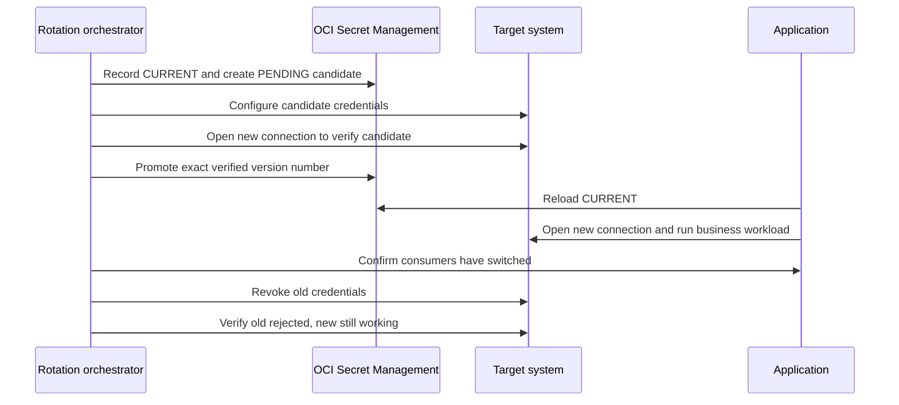

# Secret Versions, Rotation, and Safe Credential Changes

In the **Encryption, Secrets, and Certificates** chapter of the `CLOUD_PROVIDERS_ORACLE` module, this lesson covers how to rotate passwords, tokens, and credentials stored in OCI Secret Management. The focus is on coordinating the secret store, the target authentication system, and the applications consuming credentials so access remains uninterrupted while minimizing the lifetime of old credentials.

A running scenario throughout: a Java service running across multiple OCI Compute instances accesses an Oracle database in a private network. The application fetches credentials from a secret; the operations team needs to rotate credentials while keeping instances, connection pools, and background jobs running as planned.

After this lesson, you will be able to:

- Distinguish between a secret, secret version, secret bundle, and version stage labels.
- Select a transition strategy matching the target system's credential acceptance capabilities.
- Execute a procedure to prepare, verify, promote, reload, and revoke credentials.
- Define rollback conditions, handle retries, and control access to secret contents.
- Monitor rotation outcomes using both OCI signals and actual application connections.

## 1. Three Places That Must Agree When Rotating Credentials

Credentials live across three independent operational layers:

| Layer | What You Need to Know | Example of Mismatch |
| --- | --- | --- |
| OCI secret store | Which version the application retrieves | Store returns new password, but database does not accept it yet |
| Target system | Which credentials actually authenticate | Database password changed, but store still returns old version |
| Application | Which processes and connections still hold old credentials | One instance updated, nightly job still holds old version |

Saving a new password in the secret store changes only the first layer. Changing the database password changes only the second layer. To complete rotation, the application must also retrieve the appropriate version and establish new connections using those credentials.

A secret keeps the same OCID across rotations. Content changes are represented by secret versions; a secret bundle contains the content along with version details and metadata. Consequently, the application can keep a stable `secretId` configuration while fetching new content over time. [Oracle Secret Management concepts](https://docs.oracle.com/en-us/iaas/Content/secret-management/overview.htm).

In this lesson's example:

```text
secretId: one stable OCID
version 12: old credentials
version 13: candidate credentials
target: Oracle database the application needs to access
consumers: API instances, background workers, and scheduled jobs
```

Version numbers identify the exact content used. Labels such as `CURRENT` select a version by role; a label can move to a different version number on the next rotation.

## 2. Understanding OCI Version Stages Correctly

### 2.1. Version Numbers and Stage Labels

When updating a secret's content, OCI creates a new version. Version numbers start at 1 and increment. Applications can reference a version by number, version name, or rotation stage. [Secret Versions](https://docs.oracle.com/en-us/iaas/Content/secret-management/Concepts/secret-versions.htm).

| Label | Meaning |
| --- | --- |
| `CURRENT` | Version currently selected for use |
| `PENDING` | Version prepared for transition |
| `LATEST` | Version with the most recently uploaded content |
| `PREVIOUS` | Version that held the `CURRENT` role immediately prior to the latest promotion |
| `DEPRECATED` | Version that is no longer current, pending, or previous |

A single version can carry multiple labels; the first version is simultaneously `CURRENT` and `LATEST`. OCI allows scheduling deletion only for `DEPRECATED` versions. [SecretVersion model in OCI SDK](https://docs.oracle.com/en-us/iaas/tools/python/latest/api/vault/models/oci.vault.models.SecretVersion.html).

### 2.2. Why Applications Typically Read CURRENT

Suppose version 12 is serving the application. Operations uploads version 13 labeled `PENDING`. At that point, the newest version may not yet be ready for use. An application that always reads `LATEST` bypasses the verification checkpoint before releasing new credentials.

The design convention in this lesson is:

- Normal serving traffic reads `CURRENT`.
- Candidate verification flows read the exact recorded version number.
- Any deployment pinning a specific version number must plan to unpin or update configuration on the next transition.

The secret bundle retrieval API lets you choose stage, name, or version number; if no selector is specified, it returns `CURRENT`. This is retrieval behavior, not proof that the database accepts the received content. [OCI CLI: secret-bundle get](https://docs.oracle.com/en-us/iaas/tools/oci-cli/latest/oci_cli_docs/cmdref/secrets/secret-bundle/get.html).

### 2.3. Store Stage Does Not Revoke Credentials at the Target

`PREVIOUS` reflects the secret store's selection history. It does not guarantee the old password can still log in. Likewise, moving a version off `CURRENT` does not automatically invalidate a token at an external provider, lock a database account, or terminate open sessions.

During operations, always ask two separate questions:

1. Which content will the store return for an application request?
2. Which content does the target system currently accept?

## 3. Choosing a Credential Transition Strategy

The workflow below is an illustrative operational design. Whether two credentials can be valid simultaneously depends on the target product, version, account configuration, and security policy; it must not be inferred merely from having two secret versions.

| Target System Capability | Transition Approach | What to Verify |
| --- | --- | --- |
| Allows two active tokens or keys | Create new, switch application, then revoke old | Credential count limits and exact revocation procedure |
| Supports password rollover mechanism | Use configured overlap window | Overlap duration and new-login behavior |
| Can use two application accounts | Switch from account A to B | Privileges, default schema, ownership, and business behavior |
| Accepts only one password at a time | Coordinate target change with application update in a controlled window | Skew window and risk of authentication failures |

With two accounts, store username and password together as one consistent configuration unit. If they are updated in two independent secrets, a process might read the new username with the old password. Also check differences beyond passwords: procedure execution privileges, session initialization, quotas, audit policies, and object permissions.

Example content structure for a version:

```json
{
  "username": "APP_LOGIN_B",
  "password": "<value-generated-and-transmitted-over-secure-channel>"
}
```

This is an illustrative structure, not real credentials. Endpoints and service names can reside in separate configuration if their lifecycles differ from credential lifecycles.

If the system accepts only one password, creating `PENDING` is still useful for staging. However, between changing the password at the target and all consumers picking up the new version, login attempts with the old password may fail. You must throttle traffic, pause jobs, use a maintenance window, or accept a defined disruption window. Promotion alone gives no guarantee of zero downtime.

## 4. Preparing Access, Networking, and Consumer Inventory

### 4.1. Inventory Where Credentials Are Used

Before making changes, record:

- Secret OCID, region, compartment, `CURRENT` version number, and corresponding target system.
- All API instances, workers, cron jobs, admin tools, and infrequently started processes.
- How the secret is fetched: at startup, by TTL, via a reload task, or when creating connection pools.
- Maximum durations of caches, rollouts, long-running jobs, and active connections.
- Responsible person or orchestrator, stop conditions, and revocation conditions.

A healthy API service does not prove a month-end batch job has updated. Infrequently run consumers need controlled test triggers or explicit updates and verification before closing the transition window.

### 4.2. Separating Content Read Access from Orchestration Permissions

OCI distinguishes `secrets`, `secret-versions`, and `secret-bundles` resources. Viewing metadata does not mean reading content; `GetSecretBundle` requires bundle read permission. Policies can be scoped with `target.secret.id`. [IAM reference for Vault and Secret Management](https://docs.oracle.com/en-us/iaas/Content/Identity/Reference/keypolicyreference.htm).

Example policy for a Compute application dynamic group:

```text
Allow dynamic-group app-compute-dg to read secret-bundles in compartment AppSecurity where target.secret.id = '<SECRET_OCID>'
```

Adjust names and OCIDs to match your environment. This policy illustrates only retrieving content for one secret. It does not grant permission to update the secret or alter database accounts.

The rotation workflow must be designed separately with sufficient permissions to update the secret and manage credentials at the target. Creating an initial secret, using encryption keys, and deleting versions are distinct needs; map each API to IAM before granting permissions. Avoid granting `manage secret-family` to an application that only needs to read.

The `stage=CURRENT` parameter selects data within a request. Do not treat this call option as a security boundary preventing the same principal from requesting another version. If you must isolate who can read candidate credentials, redesign the secret boundaries and principals accordingly.

### 4.3. Checking Both Network Paths

A process that can retrieve a secret cannot necessarily connect to the database. Independently verify the path to the Secret Retrieval endpoint and the path to the database endpoint: DNS, routing, NSGs or security lists, TLS, and workload authentication capability.

In the private subnet Compute example, choose the OCI service access path matching your network architecture. Do not expose the database to the Internet to work around a routing issue from the workload.

## 5. Controlled Rotation Procedure

This example assumes the target system allows old and new credentials to coexist during the transition window. Without that capability, apply the controlled window from Section 3.



### Step 1 — Record Starting State and Lock Orchestration

Read the version number currently marked `CURRENT`, e.g., 12. Assign a rotation batch ID and prevent another batch from modifying the same secret or target account concurrently. If an automatic rotation schedule exists, ensure it does not collide with manual operations.

The rotation target identifier must encompass both the secret and the target account. Two different secrets holding credentials for the same account can still collide at the database.

### Step 2 — Create a Candidate in PENDING

Generate credentials per target system requirements, then create a candidate version and record the exact version number OCI returns. Do not assume it always equals `CURRENT + 1`: other staged versions may already exist.

When updating content, explicitly select `PENDING` if you are not ready to switch the application yet. In `update-base64`, the default stage is `CURRENT`, so omitting the stage can put the new content into use prematurely. [OCI CLI: update-base64](https://docs.oracle.com/en-us/iaas/tools/oci-cli/latest/oci_cli_docs/cmdref/vault/secret/update-base64.html).

Never put credential values in version names, tags, descriptions, source code, or logs. Record the version number and batch ID for tracking; content travels only over protected channels.

### Step 3 — Update and Verify at the Target System

Configure the new credentials on the exact target account, endpoint, and environment. Use the content of the exact candidate version number to open a fresh authentication session.

For a database, check at minimum:

1. Open a new physical connection rather than borrowing an existing pooled connection.
2. Verify the exact login identity and exact database/service.
3. Run an authorized test query.
4. Run a representative business operation within test data scope.

A successful login lacking business privileges is still a failing candidate. A password-change statement returning success is also insufficient to pass this step.

### Step 4 — Promote the Exact Verified Version

Re-read the status to confirm `CURRENT` is still the starting version and the candidate still matches the active batch. Then promote the verified version number to `CURRENT`.

Do not select `LATEST` at promotion time instead of the saved candidate number. If another upload occurred, `LATEST` could point to unverified content.

### Step 5 — Move Consumers to the New Credentials

Have a small group of consumers reload first. Expand only after they establish new connections and execute business operations successfully. For workloads that read secrets only at startup, perform a controlled rollout or restart; waiting for a TTL will not update those processes.

Keep evidence per consumer: loaded version number, reload timestamp, and new connection test results. Never store passwords in evidence.

### Step 6 — Wait Out the Transition Window and Revoke Old Credentials

Confirm consumers have switched, old connection pools have drained per plan, and long-running jobs have finished. Then revoke the old credentials at the target system.

Run two separate checks: old credentials can no longer open a new login session; new credentials still open new sessions and run business workloads. If security requirements include terminating existing sessions, perform target-side session management as supported by the product.

### Step 7 — Close Out the Rotation Batch

Record the outcome, new version number, revocation timestamp, and verified consumers. Cleaning up versions in the store follows stage constraints, retention periods, and recovery policies. Deleting a version in the store does not replace revoking it at the target.

Example milestones for one transition:

| Milestone | Version 12 | Version 13 | Target System | Consumers |
| --- | --- | --- | --- | --- |
| Initial | `CURRENT`, `LATEST` | Not yet created | Accepts old | Read old |
| Staged | `CURRENT` | `PENDING`, `LATEST` | New not configured yet | Still read old |
| Candidate verified | `CURRENT` | `PENDING`, `LATEST` | Accepts both per assumption | Test flow uses new |
| Promoted | `PREVIOUS` | `CURRENT`, `LATEST` | Still accepts both | Rolling over |
| Complete | `PREVIOUS` | `CURRENT`, `LATEST` | Old revoked | Use new |

This table assumes no other uploads or rotations intervene. `PREVIOUS` on the final row still exists even after old credentials are revoked at the target.

## 6. Hands-On on OCI Using Console and CLI

Practice in a test compartment with a dedicated lab secret and target account. The commands below use PowerShell with OCI CLI configured for the right region and principal. Never run update operations on production secrets without a corresponding operational plan.

### 6.1. List Versions Before Changing

```powershell
$secretId = '<LAB_SECRET_OCID>'

$versionsJson = oci vault secret-version list --secret-id $secretId --all
if ($LASTEXITCODE -ne 0) { throw 'Failed to list secret versions' }

$versions = $versionsJson | ConvertFrom-Json
$versions.data | Select-Object 'version-number', stages, 'time-created'
```

This command fetches version metadata; `--all` retrieves all result pages. Record the starting version number in the lab log. [OCI CLI: secret-version list](https://docs.oracle.com/en-us/iaas/tools/oci-cli/latest/oci_cli_docs/cmdref/vault/secret-version/list.html).

### 6.2. Create a Candidate and Verify Out of Band

In the OCI Console, open the exact secret, create a new content version, and select `PENDING`. After creation, list versions again to record the candidate number. For automation, use an SDK and pass content inside protected process memory.

Secret bundle content is Base64-represented; decoding it for application use does not make it less sensitive. Base64 is not an encryption layer protecting passwords. [Getting a Secret's Contents](https://docs.oracle.com/en-us/iaas/Content/secret-management/Tasks/get-secrets-contents.htm).

Pseudocode for the verification flow, not runnable SDK function names:

```text
candidate = readBundle(secretId, versionNumber = candidateVersion)
credentials = decodeAndParse(candidate.content)
connection = openFreshPhysicalConnection(target, credentials)
try:
    verifyIdentity(connection)
    verifyRequiredOperation(connection)
finally:
    close(connection)
    releaseSensitiveReferences(credentials)
```

Never place real passwords in command-line arguments, shell history, or JSON files inside a repository. Disable logging of request/response bodies containing secrets in pipelines and diagnostic tools. Releasing in-memory references reduces retention time; it does not guarantee erasure of all string copies in the JVM.

### 6.3. Promote by Version Number

Execute only after the candidate has been accepted at the target and the fresh connection check passes. The value 13 below is an example and must be replaced with your lab's actual version number.

```powershell
$candidateVersion = 13

oci vault secret update --secret-id $secretId --current-version-number $candidateVersion
if ($LASTEXITCODE -ne 0) { throw 'Promote failed; must re-read status' }
```

The `update` command supports changing the current version number via `--current-version-number`. It also supports `--if-match` for optimistic concurrency control using ETags. When using ETags, read from the management response immediately before updating and resolve conflicts by re-reading state. [OCI CLI: secret update](https://docs.oracle.com/en-us/iaas/tools/oci-cli/latest/oci_cli_docs/cmdref/vault/secret/update.html).

ETags protect OCI resource updates conditionally; they do not create an atomic transaction with the database. The lab executes sequentially in an isolated environment. A production orchestrator still needs locks and a state ledger as in Section 8.

### 6.4. Confirm State and Application Behavior

Re-run the list command to confirm the candidate number holds the `CURRENT` label. If you need to verify the bundle read path under the workload principal, you can display only the stages list:

```powershell
oci secrets secret-bundle get --secret-id $secretId --stage CURRENT --query data.stages
if ($LASTEXITCODE -ne 0) { throw 'Workload could not read CURRENT' }
```

The command still fetches the sensitive bundle and filters display at the CLI. Never enable `--debug` or log the full response. The stage output confirms only the read path; completing the lab also requires reloading the application, opening new database connections, and revoking old credentials per the procedure.

## 7. Java Application: Cache, Reload, and Connection Pool

### 7.1. Do Not Call the Secret Store on Every Request

A reference design is time-bounded caching, staggered refresh schedules across instances, and an operational reload trigger. When successfully retrieving a bundle, store the version number alongside it so you know which content the process is using.

Choosing the TTL balances cutover latency, API call volume, fault tolerance, and revocation requirements. A long TTL slows adoption of new credentials; a TTL that is too short can leave the entire cluster tightly coupled to the secret retrieval path.

If a secret is temporarily unreachable, continue using the cached version only if policy permits, credentials remain valid, and no emergency revocation has been issued. Document explicit bounds for stale cache usage; never extend the TTL indefinitely after repeated refresh failures.

### 7.2. Replacing Credentials and Replacing Connections Are Different

A connection pool may still hold many physical connections opened before rotation. Requests continuing to succeed over those connections can mask broken new credentials.

A controlled application implementation approach:

1. Fetch the new bundle and parse username/password as a complete configuration unit.
2. Create a candidate pool using the new configuration.
3. Open real connections and verify business operations on the candidate pool.
4. Route new requests to the candidate pool using the application's synchronization mechanism.
5. Stop issuing connections from the old pool and wait for in-flight transactions to finish.
6. Close the old pool within a set deadline; handle overdue transactions according to policy.

This is an illustrative design, not default behavior of JDBC or every pooling library. Verify how your library and framework support configuration updates, draining, and pool shutdown. If unsupported, use rolling restarts with appropriate spare capacity.

### 7.3. Sizing the Overlap Window by the Slowest Consumer

For a periodic refresh flow, a conservative estimate for the example is:

```text
W_overlap >= T_discover_new
           + T_rollout_or_create_pool
           + T_max_drain
           + T_observe
           + T_buffer
```

Assuming components of 5, 7, 15, 10, and 5 minutes respectively, the expected window is at least 42 minutes. These are scenario design parameters, not OCI defaults.

Include explicit handling for long-sleeping jobs or consumers that read secrets only at startup. If the target-allowed overlap window is shorter than the transition time required, change the rollout approach or shorten old credential retention before deploying.

## 8. Automation, Retries, and Concurrent Updates

OCI supports automatic secret rotation integrated with Autonomous Database and OCI Functions. With a rotation function, Oracle describes four steps: `VERIFY_CONNECTION`, `CREATE_PENDING_VERSION`, `UPDATE_TARGET_SYSTEM`, `PROMOTE_PENDING_VERSION`. Check supported target types and configurations before enabling. [Managing Secrets: Automatic Secret Generation and Rotation](https://docs.oracle.com/en-us/iaas/Content/secret-management/Concepts/manage-secrets.htm).

These four credential-handling steps must still be paired with reload and consumer-verification mechanisms for your specific system. Enabling an automatic schedule does not add reload capability to a program that reads secrets only at startup.

### 8.1. Keep a State Ledger Without Secret Content

Example orchestration record:

```text
rotationId: rot-lab-2026-11-21-01
secretId: <SECRET_OCID>
targetAccount: <TARGET_ACCOUNT_IDENTIFIER>
startingCurrentVersion: 12
candidateVersion: 13
phase: TARGET_VERIFIED
lastSuccessfulStepAt: <UTC_TIMESTAMP>
```

`phase` in the example is the orchestrator's state, not an OCI version label. The state ledger must be protected from unauthorized modification; never store passwords, tokens, or full bundles here.

### 8.2. Retries Must Inspect What Already Happened

A timeout can occur after the target system has already changed credentials successfully. If a retry generates yet another password, store and target easily drift further apart.

Design retries around observable state:

- If a candidate already exists for this batch, reuse that exact version number instead of creating a new one on every attempt.
- Before updating the target again, test a new connection with the recorded candidate.
- If the candidate already works, resume from the appropriate verification or promote step.
- If `CURRENT` is already the candidate, confirm the outcome and continue monitoring consumers.
- If `CURRENT` shifted to a version outside this batch, halt and investigate the conflict.
- If neither old credentials nor the candidate work, switch to a recovery flow with target administrative privileges.

Do not rely on matching `rotationId` as sole proof of correctness. Cross-check secret, version number, account, and authentication result at the exact target. Orchestration locks also need expiration, renewal, and recovery mechanisms if the process crashes.

## 9. Rollback Must Restore the Authentication Relationship

Rolling back merely by switching the store back to version 12 fails if the target has already revoked version 12's password. Decisions must be based on which credentials the target still accepts and which consumers are using them.

| Where Failure Occurred | State to Verify | Remediation Direction |
| --- | --- | --- |
| Candidate creation failed | `CURRENT` and target unchanged | Keep current operations running, fix root cause, then continue |
| Pending created, target update failed | Candidate not active, old still works | Do not promote; fix permissions, format, or target policy |
| Target accepted new, promote timed out | Actual `CURRENT` number and which candidate works | Re-read state before retrying; do not generate different credentials |
| A group of consumers failed after promote | Whether old is still valid; permission vs. reload error | Halt expansion; fix consumers or perform coordinated rollback if eligible |
| Old already revoked | Only new works at target | Prioritize rolling forward; do not blindly revert to old |
| New credentials compromised | Exposure scope and privileges of credentials | Create clean candidate, cut over rapidly, and revoke compromised credentials |

Where old credentials remain valid and policy permits reuse, you can revert the old version number to `CURRENT` and have consumers reload. Before doing so, check retrieval conditions, expiration, and active secret rules. If credentials must be restored at the database, that is a separate operation subject to database authority and constraints.

Never reuse credentials known to be compromised just to restore service faster. Incident response requires fresh credentials and an independently protected recovery path.

## 10. Expiry, Revocation, and Version Cleanup

OCI provides secret reuse rules and secret expiry rules. An expiry rule can block content retrieval after expiration depending on configuration. Setting expiry does not automatically execute the credential update sequence at the target system and application deployments. [Secret Rules](https://docs.oracle.com/en-us/iaas/Content/secret-management/Concepts/secret-rules.htm).

Distinguish four timestamps:

1. When rotation is scheduled.
2. When the version in the store expires or has retrieval blocked.
3. When credentials at the target expire or are revoked.
4. When previously authenticated sessions terminate.

If a secret expires before consumers refresh, newly started instances can fail even while older instances keep serving from cache. Leave buffer time to detect, retry, and recover before expiration; do not wait until right before expiration to start rotating.

For every version retained, document a specific purpose: controlled recovery, investigation, or historical correlation. Track current service version limits and cleanup plans. Neither retain every version indefinitely nor delete old versions immediately before verifying recoverability.

When restoring a database from backup, a mismatch can appear between credentials inside the restored database and `CURRENT` in the store. Recovery runbooks must re-verify authentication, then select authorized credentials or set a fresh pair. Do not assume an old version kept in the store can always be used to log in.

## 11. Monitoring Outcomes and Controlling Operational Cost

OCI provides metrics in the `oci_secrets` namespace, including `GetSecretBundle` and `UpdateSecret`, with dimensions such as resource and response code. Use them to observe retrieval or update failures and configure appropriate alarms. [Monitoring Secrets](https://docs.oracle.com/en-us/iaas/Content/secret-management/Concepts/metrics.htm).

Supplement with signals emitted by the application and target system:

| Signal | Question Answered |
| --- | --- |
| Loaded version number per instance or workload group | Which consumers are still on the old version? |
| New physical connection successes/failures | Do the new credentials authenticate? |
| Authentication errors vs. business privilege errors | Is the failure in the password or in account permissions? |
| Transactions and connections in old pool | Can the old path be closed yet? |
| Time spent stuck in each rotation phase | Which stage did the batch stall at? |
| Verification of old credentials after revocation | Has old login capability been cut off? |

The additional signals above are design suggestions for this lesson; not all of them are built-in OCI metrics. Collect them with appropriate instrumentation and bound metric dimensions to avoid cardinality explosion by instance or batch ID.

Example operational thresholds for a test environment: halt rollout if new login errors exceed baseline, if a consumer group fails to transition within the expected window, or if business checks fail. Actual thresholds must derive from SLOs and real traffic.

To control workload and cost, use bounded caches, staggered refreshes, retries with backoff, and attempt caps. Never trigger unbounded Functions invocations, secret versions, or new connections on failure. Limit lab resource lifetimes and clean up test accounts once sufficient evidence is collected.

Logs should include only batch ID, version number, consumer identifier, phase, and sanitized outcome. Never log raw bundles, connection strings containing passwords, or unmasked HTTP traces containing sensitive data.

## 12. Lab Completion Criteria

A rotation batch in this lesson is considered complete only with the following evidence:

- The exact verified candidate version number became `CURRENT`.
- All listed consumer groups loaded the new version or were handled per plan.
- Fresh authenticated connections and business operations using the new credentials succeeded.
- Old credentials were revoked at the target and can no longer open new login sessions.
- Sessions, pools, and jobs using old credentials were handled per operational requirements.
- Remaining rollback conditions, expiration, next rotation schedule, and version cleanup plan are recorded.
- Operational evidence contains no secret content.

`CURRENT` indicates the selection in the secret store. Operational success also depends on alignment among store content, target authentication capability, and the actual credentials held by each consumer. That alignment must be verified end-to-end on every change.
