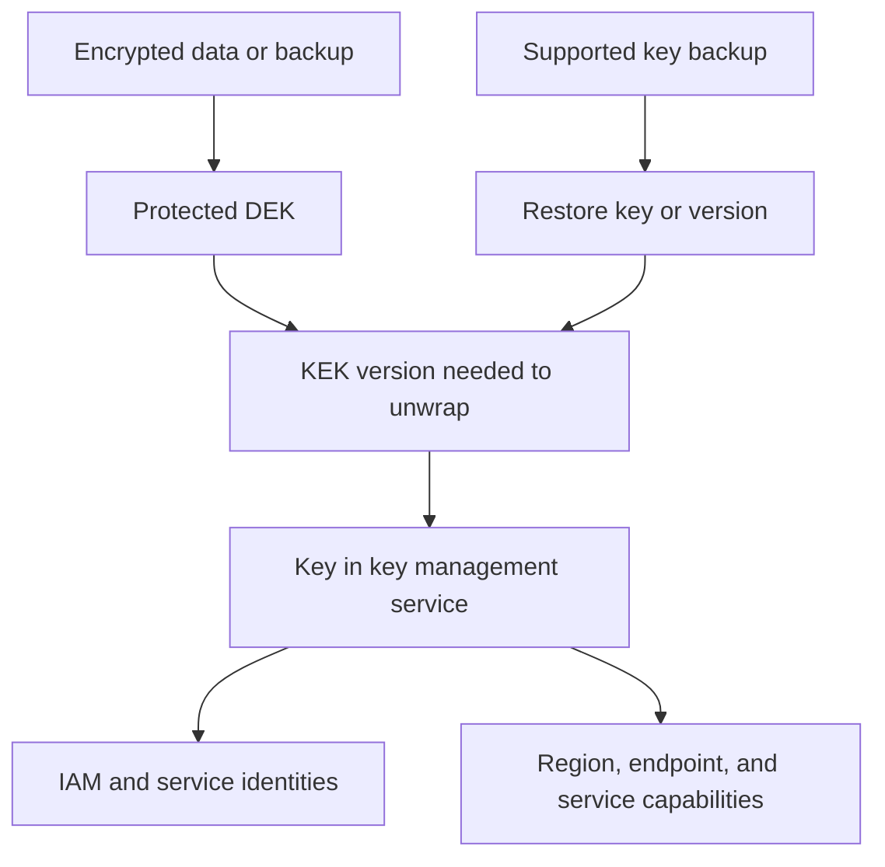

# Key Rotation, Backup, and Key Deletion Procedures

## 1. Objectives and Scope

In Oracle Cloud Infrastructure (OCI), an encryption key is a data dependency. An object, volume, or database backup may remain intact yet become unusable without the corresponding key, key version, access permissions, or recovery configuration.

This lesson belongs to the **Encryption, Secrets, and Certificates** chapter of the Oracle Cloud Infrastructure track. The content focuses on encryption key lifecycles: rotating keys, protecting key backups, and controlling key deletion. Scenarios are set within the context of tenancy, compartments, IAM, storage, Compute, and Oracle database services, accounting for monitoring, automation, cost, and availability.

After this lesson, you will be able to:

- Distinguish between rotating a key version, changing the key attached to a resource, and re-encrypting data.
- Identify why historical data and backups may still require old key versions.
- Design key backup and recovery evidence rather than merely confirming a backup file exists.
- Execute a key deletion runbook with stop conditions, waiting periods, and post-change verification.
- Separate key administration, data administration, and recovery verification duties.

This lesson primarily examines symmetric keys used for encryption at rest in OCI Key Management, typically operated in the context of Vault. Password rotation in Secrets, TLS certificate renewal, and asymmetric key-pair replacement have separate procedures; do not apply the steps below mechanically to those materials.

## 2. Objects That Must Be Distinguished

| Object | Meaning | Operational Implication |
| --- | --- | --- |
| Vault | Resource organizing and providing key management context by vault type | Vault-level operations can affect multiple keys and services |
| Key | Key resource with identifier, algorithm, state, and access policy | Storage resources can reference a key by OCID |
| Key version | One version of key material belonging to a key | Previously encrypted data or wrapped DEKs may still need old versions |
| DEK — data encryption key | Key used to encrypt data in the envelope encryption model | Not necessarily the same key the administrator selects for a bucket or volume |
| KEK — key encryption key | Key protecting or wrapping a DEK | Rotating a KEK does not automatically replace all DEKs or rewrite all data |
| Data backup | Copy of objects, volumes, databases, or application data | Insufficient for recovery if cryptographic dependencies are lost |
| Key backup | Protected copy of key metadata or material per service-supported mechanisms | Contains no business data and does not replace data backups |

A key with multiple versions remains one key resource. Conversely, creating another key creates a new identifier and a new dependency relationship. These two cases may require different IAM, service configuration, and recovery procedures.

Do not infer algorithm, protection mode, or backup capability from a key's name. Read actual resource attributes and confirm the vault type, key type, and integration mechanism of the consuming service.

### 2.1. Dependency Model



This diagram is a conceptual model. How services store DEKs, cache them, and reference key versions may vary. What must be managed is a valid recovery path from encrypted data to the exact key material and an authorized identity.

## 3. What Does Key Rotation Actually Change?

### 3.1. Three Different Operations

| Operation | Primary Change | What Must Not Be Assumed |
| --- | --- | --- |
| Create a new key version | New key material within the same key, per supported mechanism | That all old data has been re-encrypted |
| Move resource to another key | Resource uses a key with a different identifier | That all objects, snapshots, backups, and historical copies moved to the new key |
| Re-encrypt data or rewrap DEKs | Updates encryption layer per service capabilities | That no old key dependency remains without checking all copies |

For a symmetric key supporting rotation, creating a new version usually keeps the key's OCID intact and adds a new version OCID. Applications or resources referencing the key OCID do not necessarily have to change the key identifier. However, when the service starts using the new version and how old data is handled depend on the specific integration.

**Rotating a key does not mean revoking old versions.** Data encrypted with old material may still need it for decryption. Retaining old versions to read valid data is part of normal operations, not a sign that rotation failed.

### 3.2. Example with Object Storage and Databases

Suppose a bucket uses key K. Last month, several objects were written while K was on version V1. Today, the administrator creates V2.

Questions to answer separately:

1. How and when does the service begin using V2 for new operations?
2. Are existing objects reprocessed, or do they still need the old material?
3. What do object versions, cross-location copies, and long-term archives still reference?
4. Is there a supported procedure to migrate old data to another key or version?
5. What evidence permits retiring V1?

For Oracle Database, also determine which layer is being rotated: a key in OCI Key Management, a TDE master key, or a key belonging to another database service mechanism. A change at the key management layer does not by itself prove the entire database encryption layer and backups have completed a transition cycle.

Do not use Object Storage procedures as procedures for Block Volume or TDE. Each service manages DEKs, copies, metadata, and key-service call timing differently.

### 3.3. BYOK and Suspected Key Compromise

BYOK — Bring Your Own Key — brings key material from an external source into an OCI-supported mechanism. Distinguish between generating new key material inside the service and importing new material from an externally managed source. Do not assume an auto-generated rotation satisfies a requirement to keep using organization-controlled material from that source.

The original imported material must be protected under the organization's key management procedures. Never put it in Git, tickets, emails, or shared config files. Also do not treat a source file as a complete copy of all key versions, metadata, and usage relationships in OCI.

If key compromise is suspected, a routine rotation schedule may be insufficient. Creating a new version does not strip an adversary holding a copy of the old key from reading old ciphertext they possess. Address the exposure source, assess affected data, and plan appropriate encryption migration before deciding to retire the old key.

## 4. Key Rotation Runbook

### 4.1. Prepare the Dependency Inventory

Each key should have an operational record sufficient to answer:

| Information Group | Details to Record |
| --- | --- |
| Identification | Tenancy, region, compartment, vault OCID, key OCID, and related versions |
| Attributes | Algorithm, protection mode, material origin, and state |
| Owners | Key admin team, data owner, service operations team, and incident responder |
| Active resources | Buckets, volumes, database resources, or applications per actual integration |
| Historical copies | Backups, snapshots, object versions, replicas, exports, and long-term archives |
| Permissions | Policies for key administration, resource configurators, and principals using the key |
| Recovery | Corresponding key backup, storage location, tested restore date, and target environment |
| Changes | Most recent rotation, before/after versions, and verification results |

Do not automatically treat a resource search by key OCID as a complete inventory. Exports or backup metadata may sit outside the resource set listed by a tool. Combine service configs, backup catalogs, and application data records.

### 4.2. Execute by Checkpoints

1. **Define the goal:** scheduled rotation, material custody transition, or incident response. Pick the right operation rather than creating a new key out of habit.
2. **Pre-change checks:** key is usable; required permissions, service state, and backups are ready; record current version.
3. **Test in an isolated environment:** use test resources with the same integration mechanism; verify reading old data and writing new data.
4. **Execute rotation:** create a version or import material using the mechanism supported for that key.
5. **Post-change checks:** before/after reads, new writes, behavior of dependent services, and key-related errors.
6. **Update the recovery path:** take a post-rotation backup if supported; record which backup contains the new version.
7. **Close the change:** archive results, update the inventory, and update the old-version retention plan.

Do not delete the old version in the same operation just because the new version was created successfully. Creating a new version is one technical milestone; verifying data and recoverability are separate milestones.

### 4.3. Rollback Must Be Designed Upfront

Do not assume OCI provides a button to roll every service back to a previous version. In many situations, the right remediation is fixing policies, restoring key state, or fixing integration configuration while retaining the versions already used.

If data has already been written using the new version, do not delete that version to make the environment "look like before the change." When switching to another key, reverting to the source key is also subject to the service's transition capabilities. Keep both sides as needed until data and backups are verified.

### 4.4. CLI Example for a Lab Environment

The following commands run in **Bash** with an authenticated OCI CLI. Only use a symmetric key permitted for rotation in a practice compartment; never run these against production keys just to complete a lesson.

```bash
export KEY_OCID='ocid1.key...'
export KMS_MGMT_ENDPOINT='https://<vault-management-endpoint>'

oci kms management key get \
  --endpoint "$KMS_MGMT_ENDPOINT" \
  --key-id "$KEY_OCID"

oci kms management key-version list \
  --endpoint "$KMS_MGMT_ENDPOINT" \
  --key-id "$KEY_OCID" \
  --all
```

Retrieve the management endpoint from the actual vault details. The management endpoint and cryptographic endpoint serve different roles; do not construct endpoints manually from the vault name or OCID.

After recording the current version and confirming lab prerequisites, create a new version via the supported operation:

```bash
oci kms management key-version create \
  --endpoint "$KMS_MGMT_ENDPOINT" \
  --key-id "$KEY_OCID"

oci kms management key get \
  --endpoint "$KMS_MGMT_ENDPOINT" \
  --key-id "$KEY_OCID"

oci kms management key-version list \
  --endpoint "$KMS_MGMT_ENDPOINT" \
  --key-id "$KEY_OCID" \
  --all
```

In the output, cross-check the key OCID, current version, version list, and resource state. This version-creation command illustrates rotation with service-generated material where supported; it does not replace the material import procedure of a BYOK requirement.

Do not repeat the version-creation command when uncertain whether the previous call succeeded. On disconnect or timeout, re-read state and the version list before deciding how to proceed.

## 5. Key Backup: Having a File Does Not Mean It Is Recoverable

### 5.1. Three Layers Must Be Protected Together

An encrypted data recovery path must address at least three layers:

- **Data:** database, object, volume, or application data copies.
- **Cryptography:** required key/version material or recovery mechanism, wallets, and related components per service.
- **Operational configuration:** IAM, service identities, regions, endpoints, key references, and integration details.

Key backups do not replace database backups. Conversely, an encrypted database backup does not automatically contain every dependency needed to use an external key.

### 5.2. Determine Supported Backup/Restore Capabilities

OCI provides backup/restore mechanisms for supported combinations of vaults, keys, and protection modes. Not every resource type has the same capabilities or the same recovery conditions.

Before designing, confirm specifically:

1. Can you back up the whole vault, individual keys, or only use another protection mechanism?
2. Which key types and protection modes are supported?
3. Which versions are included in the backup at creation time, and how do concurrent changes affect it?
4. Can it be restored in the planned target region, tenancy, and vault type?
5. How does restore handle identifiers, existing versions, and resource conflicts?
6. Which permissions and configuration steps are required post-restore for services to use the key?

If a configuration does not support exporting copies as desired, redesign the recovery plan or select suitable resources. Never attempt to extract private material or HSM keys through an unsupported path.

### 5.3. A Key Backup File Is Not a Plaintext Key Export

A key backup created through a service mechanism is a protected artifact meant for the corresponding restore procedure. Do not treat it as a plaintext key file that can be opened in a text editor or fed into an arbitrary cryptographic library.

Even when protected, backup artifacts remain sensitive. Restrict readers, control copying, log creation history, and avoid attaching them to tickets. Having a backup does not permit bypassing access boundaries for key material.

Integrity checksums like SHA-256 detect file modification if the trusted reference digest is protected separately. They do not prove the file is restorable, contains the right versions, or was not swapped together with the manifest.

### 5.4. Avoid Circular Dependencies

Suppose backups of key K are stored in bucket B and B also uses K itself as its CMK. If K becomes unusable, fetching the file from B may be blocked before restore can even begin.

A cryptographically valid backup can still be inaccessible due to storage dependencies. Storage location design must consider:

- Permissions to retrieve the backup when the source system is down.
- The key protecting the storage location and whether that key depends on the key being recovered.
- Region, network path, and accounts needed to download the artifact.
- Protections against unauthorized deletion or replacement outside approved procedures.

You do not need to disable encryption on the backup storage location. Choose a protected access path that is sufficiently independent of the failure you are trying to recover from.

### 5.5. Manifest for a Backup Run

Alongside the backup artifact, maintain an identification record, for example:

```yaml
backupRecord:
  sourceRegion: "<source-region>"
  sourceVaultOcid: "<vault-ocid>"
  sourceKeyOcid: "<key-ocid>"
  capturedAtUtc: "<UTC-timestamp>"
  includedVersionOcids:
    - "<version-confirmed-in-backup>"
  artifactLocation: "<protected-artifact-location>"
  artifactSha256: "<measured-checksum>"
  lastRestoreTestUtc: "<timestamp-or-untested>"
  restoreTestResult: "<result-with-evidence>"
```

This is an operational record template, not an OCI API request schema. Record only versions confirmed by the backup mechanism; do not assume every version seen afterward is inside the file.

Never put plaintext keys, passwords, tokens, or sensitive wallet contents into the manifest. OCIDs, storage locations, and organizational details themselves also require appropriate read permissions.

## 6. Designing and Testing Recoverability

### 6.1. The Gap Between Rotation and Backup

Consider this hypothetical sequence of events:

| Milestone | Event | Impact During an Incident |
| --- | --- | --- |
| T0 | Key K has V1; create key backup B1 | B1 is considered to contain only versions confirmed at T0 |
| T1 | Create V2 | B1 is not automatically updated |
| T2 | Data protected with V2-related material is written | New data begins needing a recovery path for V2 |
| T3 | Create backup B2 and verify V2 is included | Recovery artifact now covers the new version |
| T4 | Test restoring B2 and reading test data | Stronger evidence than merely downloading the backup file |

If key usability is lost after T2 while only B1 exists, even the newest data backup may not suffice to read data requiring V2. That is why rotation schedules must be linked to protecting new versions and testing recovery paths.

**Data RPO and acceptable key-state loss must align.** Backing up data hourly loses full value if new key material only has an untested recovery path. Replication or other protection mechanisms, if supported and verified, can form part of the solution; do not infer guarantees from feature names.

### 6.2. Restore Runbook

1. **Identify the scenario:** IAM error, disabled key, configuration change, or actual loss of required resources/material. Do not restore if fixing a policy or canceling an incomplete change solves it.
2. **Select the artifact:** verify provenance, integrity, and required version set; cross-check against the data to be recovered.
3. **Check the target:** region, tenancy, vault type, restore capability, existing resources, and conflict conditions.
4. **Execute the supported restore mechanism:** use an authorized identity and record results, OCIDs, and resource states.
5. **Restore related configuration:** policies, service identities, key references, endpoints, or wallets as required.
6. **Verify the data path:** read legacy data, perform new operations if in scope, and test restoring related data backups.
7. **Record timing and limits:** which versions were tested, which data remains untested, and which steps required manual intervention.

Do not assume having the right key material makes every OCID reference work automatically. Also do not assume a newly created key can replace the source key merely by renaming it. Post-restore identifier behavior and re-attachment to resources must be verified per the specific mechanism.

### 6.3. Testing with Data Across Multiple Generations

A recovery test suite should include:

- Data created before rotation.
- Data created after rotation.
- A backup or snapshot retained from before rotation.
- Data from each consuming service, if the key serves multiple integrations.
- Target configurations that the recovery plan actually relies upon.

A direct test decrypt call to KMS can verify one cryptographic path, but does not prove Object Storage, Block Volume, or a database has successfully resumed using the key. Test at the service and application levels.

RTO must account for the critical path determining recovery duration: accessing artifacts, restoring keys, waiting for active state, fixing IAM, restoring data, and verifying applications. Some steps can run in parallel; do not measure only the key restore API completion time.

### 6.4. Replication Does Not Replace All Backup Objectives

An active replica in another region can help handle infrastructure outages, yet may not protect against erroneous administrative actions or key deletion. State and lifecycle synchronization scope must be checked for the replication mechanism in use.

Similarly, multiple copies of a backup file within the same administrative permission domain can all be deleted or overwritten together. Recovery design must address data failures, key failures, operator errors, and access-permission failures separately.

## 7. Disabling, Scheduling Deletion, and Permanent Deletion

### 7.1. Understanding States Accurately

| Action or State | Operational Meaning | Cautious Usage |
| --- | --- | --- |
| Disable key | Halts key usage per service state and behavior; key resource is not yet deleted | Perform only after impact assessment; may disrupt data access |
| Schedule deletion | Enters resource into deletion workflow after service-permitted waiting period | An impactful change, not a reminder note |
| Cancel deletion | Halts schedule before permanent deletion if state still permits | Must re-read state and verify services can use the key again |
| Deleted | Resource has completed deletion and cannot be undone by canceling schedule | Do not assume creating another key or reusing the old OCID will recover data |

Detailed state names and valid transitions differ across vaults, keys, and key versions. Do not treat this table as a complete API enum list. Always read the actual state and constraints of the specific resource type before acting.

**The deletion waiting period is not a guarantee that the key keeps serving data.** Once a resource is disabled or enters pending deletion, operations requiring the key can be affected before deletion completes.

A single read still succeeding after a change also does not prove the key is unused: the service may cache results or a read path may not yet hit a new key operation. Do not use that observation to conclude deletion is safe.

### 7.2. Three Deletion Scopes

| Scope | Assets at Risk | Mandatory Question |
| --- | --- | --- |
| Single key version | Data still needing that version | Do any historical data, copies, or backups still depend on it? |
| Entire key | Dependent versions and resources | Does any workload or recovery path still need this key? |
| Vault | Multiple keys and usage relationships within the vault | Have every key and the vault's deletion conditions been checked? |

Do not treat deleting a vault as tidying up an empty container. Also do not assume every version can be deleted individually, or that deleting the current version is permitted. Check the corresponding constraints before putting them in a runbook.

### 7.3. Key Deletion and Data Recoverability

If required key material and valid recovery paths are gone, encrypted data may become unreadable even while the ciphertext remains intact.

However, deleting a key resource alone is insufficient to conclude all copies of data have been completely eliminated. Consider external BYOK source material copies, recoverable key backups, exported plaintext, DEKs or content already residing in another system, and application-managed copies.

Therefore, do not treat a "key deleted" message as sole proof for a data erasure objective. Define the objective's scope clearly: stopping key use in the service, rendering specific data unreadable, or purging all related copies and artifacts.

## 8. Safe Key Deletion Runbook

### 8.1. Gate A — Define the Exact Request

Specify whether this deletes a version, key, or vault; the reason for deletion; which data is approved to lose serviceability; who owns the data; and who owns the change.

Reject requests containing only a display name like "delete old key." Use OCID, region, and compartment to avoid picking the wrong resource with a similar name.

If the reason is decommissioning an application, distinguish when the application stops running from when its retained data stops needing recovery. Those two dates rarely coincide.

### 8.2. Gate B — Inventory All Dependencies

Cross-check at minimum:

- Running resources and paused resources that still hold data.
- Buckets, related objects/versions, volumes, snapshots, clones, and copies.
- Databases, standbys, backups, data exports, and related recovery components.
- Long-term archive backups or data transferred to external systems.
- Keys/versions recorded in application or pipeline metadata.
- Key copies, backup artifacts, and BYOK material if applicable.
- Policies and identities that might still use the key for improperly tagged workloads.

If the owner of a dependency cannot be identified, halt the deletion request for clarification. "Found nobody using it" and "proved no dependencies remain" are two different levels of evidence.

### 8.3. Gate C — Complete Migration or End Retention

For data that must be kept, run the service-supported migration procedure to an actively managed key. Verify data and all copy layers within the required scope.

Do not merely update the key field on a resource and mark completion. If migration does not process legacy data, maintain a separate plan or continue retaining the old key.

For data no longer needing retention, confirm the retention-end workflow has completed. Do not delete data or backups merely to bypass a key deletion precondition without authorization to dispose of those copies.

### 8.4. Gate D — Obtain Recovery Evidence and Decide Key Backup Retention

For data continuing under protection of a new key, verify successful restores. For the key being deleted, decide explicitly what purpose any remaining key backup artifacts serve, for how long, and under which permissions.

Two objectives may require opposite handling:

- If recoverability is still needed, do not delete required access paths to key backups or related material.
- If the goal is ending decryption capability within a defined scope, a recoverable key backup is also a dependency that must be handled per authorized procedures.

Neither automatically create and retain backups indefinitely for every deletion, nor automatically destroy backups solely because the key resource was deleted. Decisions must align with data objectives and delegated authority.

### 8.5. Gate E — Follow Approval Workflow and Schedule

Key administrators prepare the change; data owners confirm impact and scope; recovery testers provide evidence. For critical changes, require independent verification rather than letting one person self-approve everything.

Select a waiting period within the OCI-allowed range for the exact resource. Before confirming, re-read the OCID, deletion timestamp, timezone, and blast radius. Use UTC in records and display local time if needed to avoid confusion.

Do not hardcode guessed waiting-period numbers into scripts. Check the API/Console requirements of the live environment and verify the service-accepted timestamp in the response.

### 8.6. Gate F — Monitor During the Waiting Period

After scheduling:

1. Re-read resource state and deletion time from the service rather than relying solely on a success message.
2. Monitor errors across dependent resources, applications, and scheduled backups/restores.
3. If an unhandled dependency surfaces, cancel deletion while still permitted and investigate.
4. After cancellation, verify operational state, IAM, and data path; do not conclude recovery solely from successful cancellation.
5. Record all changes in the log along with the accountable owner.

Never use production to test whether errors show up during the waiting period. Impact checks must be prepared beforehand, and post-change monitoring is an added detection layer.

### 8.7. Gate G — Close the Change

Once deletion completes, update resource inventories, dependency mappings, obsolete policies, and monitoring records. Clean up permissions or auxiliary resources within authorized scope; never bulk-delete merely because of matching names or compartments.

Save final-state evidence and the list of data migrated or retired. If anything could not be verified, document the exact limitation rather than reporting full completion of all data-security goals.

## 9. Hands-On Lab with Dedicated Key and Data

### 9.1. Objectives and Boundaries

The goal is to generate evidence for rotation and recovery paths, then rehearse the deletion procedure with records and state checks. You do not need to actually delete a key that still has dependencies to prove understanding.

Prepare a lab compartment, a dedicated symmetric key, test data resources supporting that key integration, and least-privilege permissions. If practicing backup/restore, pick a supported vault type, key, and target; check costs before creating additional dedicated resources.

If your current environment does not support backup/restore for the scenario, document clearly that this part was not executed and list the missing prerequisites. Do not mark recovery verified merely because you downloaded a key configuration file.

### 9.2. Practice Phase by Phase

| Phase | Action | Evidence to Keep |
| --- | --- | --- |
| Pre-rotation | Read key/version details; write dummy data A via integrated service | Key OCID, current version, data config, and read result for A |
| Initial backup | Create backup via supported mechanism if available | Artifact location, timestamp, covered versions, integrity checksum |
| Rotation | Create new version using lab steps in Section 4 | Before/after version output and state |
| Post-rotation | Write dummy data B, re-read A and B | Matching contents, no unhandled key errors in service |
| Protect new state | Create post-rotation backup or verify chosen recovery mechanism | Evidence new version is covered in recovery path |
| Restore | Execute in supported environment separated from real data | Key state, IAM, and multi-generation data test results |
| Deletion drill | Complete Gates A through G for the lab key | Go/stop decision with rationale and dependency inventory |

A test that only reads data through the still-active source key does not prove the restored key works. When designing the restore step, distinguish reading via the source resource from reading truly backed by a supported restore result.

If a service integration does not allow swapping the recovery key as planned, do not manually edit OCIDs or metadata to force it through. Document that limitation in the plan and pick a valid recovery scenario.

### 9.3. Completion Criteria

- Identified key and versions before and after rotation.
- Evidence that pre-change and post-change data remains readable through the service.
- Identified which artifact or mechanism protects the new version and to what extent it was tested.
- Clearly distinguished data backups, key backups, and configuration needing restoration.
- Deletion runbook identifies at least one mandatory stop condition.
- Did not use a single command's success status as proof for the entire recovery path.

Unexecuted limitations, such as no restore environment or database not tested, must be documented separately. Completing the rotation part does not automatically complete backup or key deletion.

### 9.4. Resource Cleanup and Cost Control

After the lab, clean up test data and resources created by the lab per authorized permissions. Check which resources still use the key before considering deleting the lab key or vault.

Track charges related to vault/key type, backup artifacts, Object Storage, API calls, data resources, and cross-location data transfer. Do not assume every vault type shares the same pricing model. Do not delete a key that is still needed just to trim a near-term bill.

## 10. IAM, Monitoring, and Automation

### 10.1. Separating Permissions by Duty

| Duty Group | Permissions to Consider | Permissions Not to Bundle by Habit |
| --- | --- | --- |
| Key lifecycle admin | View, create versions, and lifecycle operations per duty | Read access to all business data |
| Service using key | Key operations required by integration for the right resources | Key admin or key deletion permissions |
| Backup admin | Create/store/read backup artifacts within assigned scope | Permission to delete all artifacts and source keys simultaneously |
| Recovery operator | Read artifacts, restore, and apply runbook configuration | Tenancy-wide admin just to run one restore |
| Independent auditor | Read required configurations and evidence | Permission to mutate state of inspected resources |

Write OCI IAM policies tailored to actual resource types, permissions, and integration mechanisms. Do not reuse a single generic policy across every service. Inspect inherited policies, group permissions, service principals, and workload identities involved.

For emergencies, determine required identities, permissions, access paths, and logging mechanisms ahead of time. Do not wait until a key outage to discover the recovery account cannot even fetch the backup file.

### 10.2. Monitoring Meaningful Signals

Combine OCI Audit with service logs, application logs, and available monitoring telemetry. Signals worth watching include:

- Key version creation, key changes, or imported material.
- Disabling, scheduled deletion, cancellation, and critical state changes.
- Changes to policies or identities authorized to administer/use keys.
- Backup/restore failures, inaccessible artifacts, or failed integrity checks.
- Key-related data access errors and concurrent changes.
- Completed rotations where the recovery path has not been updated yet.

Do not assume Audit contains a separate record for every data decryption. Data-plane activity, caching, and logging capabilities vary by service. "No recent key-usage events seen" is insufficient to conclude a key is no longer needed.

### 10.3. Automation with State and Preconditions

A rotation pipeline should include an orchestration lock to prevent concurrent runs, inspect versions before acting, wait for completion state, and verify outcomes. If a version-creation call times out, re-read state instead of immediately retrying creation.

Conceptual flow:

```text
read key + version + state
  -> confirm right resource and no change already running
  -> create version using appropriate mechanism
  -> re-read until clear outcome
  -> verify before/after data
  -> update backup or recovery path
  -> store evidence and notify outcome
```

Automatic rotation schedules should not trigger old-version deletion based solely on age in days. Deletion criteria must tie to data dependencies, backups, and retention decisions. Whenever the outcome of a step is uncertain, the pipeline must halt in a state requiring intervention rather than proceeding to higher-impact operations.

## 11. Troubleshooting Common Scenarios

| Symptom | Where to Investigate | Remediation by Cause |
| --- | --- | --- |
| Creating new version is denied | Management endpoint, key state, IAM, and rotation support of key type | Fix the exact condition; do not create another key to bypass the error without a migration plan |
| New version exists, but old data still needs old version | Envelope encryption mechanism and service behavior | Retain old dependency or execute a supported migration workflow |
| Backup file exists, but restore fails | Backup type, target location, support matrix, integrity, and permissions | Select valid artifact and configuration; do not assume every file works everywhere |
| Key restored, but application still fails | Identifier, endpoint, policy, and service integration configuration | Restore full configuration and verify the data plane |
| Data begins failing right after scheduling deletion | Key state and remaining dependent resources | Cancel schedule if still permitted, restore required state, and fix inventory gaps |
| Key looked unused, but restoring old backup fails | Long-term backups and related versions | Restore valid key path if still possible; update dependency inventory |
| Key backup sits in a bucket inaccessible during key outage | Key protecting bucket, IAM, and circular dependency | Use prepared independent recovery path; redesign backup placement |
| Key rotated, but data-exposure incident continues | Exposure source, plaintext copies, old material, and application permissions | Remediate root cause; rotation is only part of the response |

## 12. Key Takeaways

- Rotation adds or changes key material; it does not by itself prove old data has been re-encrypted.
- Active data and historical data may require different versions within the same key.
- Key backups, data backups, and recovery configurations are three parts that must coordinate together.
- After rotation, protect the new version and explicitly identify any recovery gap.
- Only restoring and testing at the service level provides stronger evidence than merely having a backup file.
- Disabling and scheduling deletion can affect availability before permanent deletion completes.
- Version deletion, key deletion, and vault deletion carry different blast radii; every action requires scoping the right inventory.
- Never use key age, quiet logs, or a single successful read as the sole condition for deletion.
