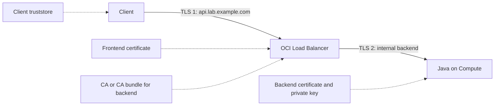
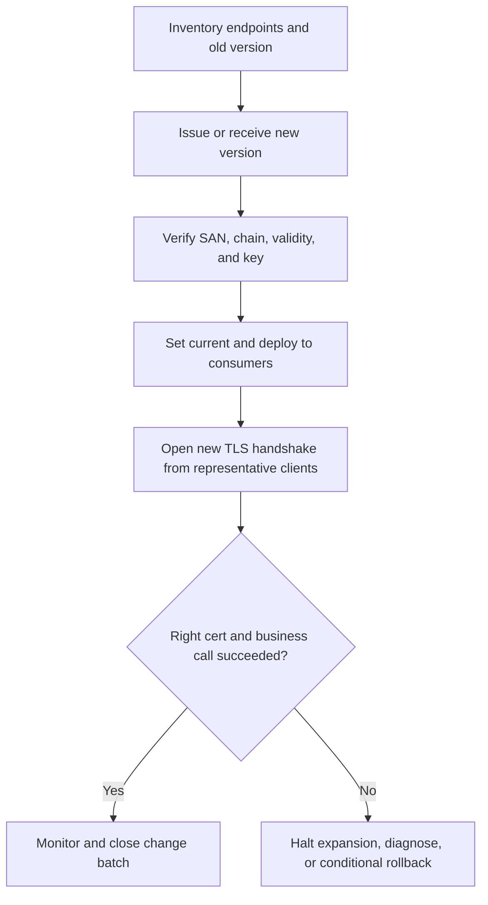

# OCI Certificates and TLS Certificate Lifecycle Management

In the **Encryption, Secrets, and Certificates** chapter of the `CLOUD_PROVIDERS_ORACLE` module, this lesson covers managing TLS certificates with OCI Certificates: choosing issuance sources, protecting private keys, associating with consuming services, renewing, verifying deployment, revoking, and cleaning up resources.

The running scenario is a Java API running on OCI Compute in a private subnet, accessed via an OCI Load Balancer. The operations team needs to secure TLS connections, delegate certificate management by compartment, and rotate certificates before expiration while maintaining client accessibility.

After this lesson, you will be able to:

- Distinguish between a leaf certificate, certificate authority, CA bundle, certificate bundle, and private key.
- Select the right issuance and management mode in OCI Certificates.
- Design TLS for both the client–Load Balancer hop and the Load Balancer–backend hop.
- Track versions, renew, and confirm the actual certificate served by the endpoint.
- Handle CA replacement, key compromise, revocation, and resource deletion according to purpose.

## 1. What Must TLS Prove?

TLS protects a connection between two endpoints. For standard HTTPS, the client must verify the server's identity before trusting that data is being sent to the right service.

A certificate check must evaluate multiple conditions:

| Condition | Operational Question |
| --- | --- |
| Endpoint identity | Is the DNS name used by the client covered by the certificate? |
| Trust chain | Can a chain be built from the server certificate to a trust anchor accepted by the client? |
| Time validity | Is the current time within `Not Before` and `Not After`? |
| Key usage / purpose | Are the certificate and constraints valid for TLS server or client authentication? |
| Key possession | Does the endpoint hold the corresponding private key to complete TLS authentication? |
| Revocation status | Under client policy, is there evidence the certificate has been revoked? |

Having a certificate in OCI does not prove these conditions are met. The certificate may be created properly while the listener is not using it yet, an intermediate is missing, the DNS name mismatches, or the client does not trust the CA.

At the same time, TLS does not replace application authorization. A client with a valid certificate must still be mapped to an appropriate identity and permissions. IAM permissions used to manage OCI resources are also a separate layer from clients trusting a certificate chain when connecting to an API.

## 2. Resources in OCI Certificates

OCI Certificates manages certificate authorities, certificates, and CA bundles; the service supports issuing, storing, renewing, associating, and revoking within supported scopes. [Overview of Certificates](https://docs.oracle.com/en-us/iaas/Content/certificates/overview.htm).

| Component | Role | Key Distinction |
| --- | --- | --- |
| Certificate authority (CA) | Issues and signs certificates under a trust hierarchy | A CA signing key has a far larger blast radius than a single server key |
| Leaf certificate | Binds a public key to a server or client identity | Usually the endpoint certificate presented during TLS |
| Certificate version | A version of content and validity period of a certificate resource | Renewal can create a new version within the same resource |
| Certificate bundle | Certificate content, chain, and related metadata | Bundle type may include the private key or only public content |
| CA bundle | Collection of public CA certificates for trust configuration | Not a server leaf certificate and private key pair |
| Association | Linkage to an OCI resource consuming the certificate or trust material | Must verify the target resource actually picked up the configuration |

The private key is the secret proving possession of the public key. Public certificates and chains can be distributed to clients; server private keys and CA signing private keys must be protected in two separate scopes.

### 2.1. A Private CA Does Not Automatically Create Trust on the Internet

A CA created in OCI Certificates is a private CA. Clients must have the appropriate trust anchor; a browser or JVM does not trust a CA merely because it resides in your tenancy. [Oracle lab on internal certificates](https://docs.oracle.com/en/learn/internal-certs-nginx/index.html).

For internal APIs, an organization can distribute the root CA to managed truststores. For websites serving general Internet users, you need a certificate whose chain is trusted by target clients, such as one issued by a suitable public CA and then imported into OCI. Importing does not turn a private CA into a public CA accepted by all browsers.

## 3. Choosing How to Issue and Manage Certificates

The modes below differ primarily in where the certificate is issued and where the private key is managed. Do not choose solely because they appear on the same Certificates page.

### 3.1. Issued by Internal CA, Managed Internally

In this mode, OCI Certificates issues the certificate from an internal CA and manages the certificate's private key. This option supports configuring automatic renewal by the service. When creating, select the issuer, subject, SAN, profile, and appropriate validity constraints. [Creating a Certificate](https://docs.oracle.com/en-us/iaas/Content/certificates/creating-certificate.htm).

This mode suits internal endpoints and integrated services when the organization has a trust distribution plan. Having the service manage the key does not mean every principal is allowed to read it; bundle retrieval permissions must still be controlled.

### 3.2. Issued by Internal CA, Managed Externally

The organization generates and holds the private key outside the service, creates a certificate signing request (CSR), and requests OCI's internal CA to sign it. The service does not auto-renew certificates whose private keys are managed externally. [Creating a Certificate to Manage Externally](https://docs.oracle.com/en-us/iaas/Content/certificates/creating-certificate-to-manage-externally.htm).

The operational flow must include where the key is stored, how new CSRs are generated when needed, and how the signed certificate is deployed to the endpoint. Do not select this mode for an integration that requires the service to supply the private key without verifying integration support.

### 3.3. Imported

If you already have a certificate from an external CA, you can import the PEM content, chain, and private key per OCI Certificates requirements. Check current supported algorithms, formats, and import limits. [Importing a Certificate](https://docs.oracle.com/en-us/iaas/Content/certificates/importing-certificate.htm).

Renewal at the public CA or external PKI remains that issuance pipeline's responsibility. Once new material arrives, operations updates the imported resource and verifies the endpoint; do not assume storing a certificate in OCI enables renewal at the external CA.

| Management Mode | Issuer | Where Private Key Lifecycle Is Managed | OCI Auto-Renews Certificate |
| --- | --- | --- | --- |
| Issued and managed internally | OCI internal CA | OCI Certificates per configuration | Configurable |
| Issued internally, managed externally | OCI internal CA | External system | No |
| Imported | External CA or PKI pipeline | External pipeline and storage for imported copy | No |

For the last two types, maintain a proper PEM or CSR update workflow. Oracle also requires keeping the same common name when updating the PEM of an existing resource; a mismatched common name can produce a failed version. [Updating a Certificate PEM](https://docs.oracle.com/en-us/iaas/Content/certificates/updating-certificate-PEM.htm).

## 4. Designing TLS for Load Balancer and Java Application

An illustrative architecture with two separate TLS connections:



Domain names in this lesson are illustrative only. In real deployments, replace them with names your organization owns and include those exact names in the SAN.

### 4.1. Client to Load Balancer Hop

The HTTPS listener presents a certificate to the client. The certificate must cover the DNS name used by the client; the client must trust the issuer and receive a complete chain to verify.

If the Load Balancer terminates TLS and forwards HTTP to the backend, the backend hop is not protected by TLS. A private subnet does not automatically turn HTTP into an encrypted connection. When security requirements include the backend hop, configure TLS separately for the backend.

### 4.2. Load Balancer to Backend Hop

The backend Java application or reverse proxy needs a server certificate and corresponding private key. The Load Balancer acts as the TLS client and needs peer verification configured with the appropriate CA or CA bundle.

The CA bundle on the backend set holds trust material to verify the peer; it does not replace installing the server certificate and private key on the backend. Also verify the identity-checking options supported by the service, the chain, verification depth, and the name the application or verifier checks. Do not assume enabling encryption automatically enables all verification checks.

### 4.3. When Mutual TLS Is Required

With mTLS, the receiver also validates the client certificate. Separately design trusted CAs, certificate purpose, accepted identities, and authorization mapping. If mTLS terminates at the Load Balancer, the backend application does not directly perform that same TLS handshake.

Clearly distinguish which certificate each endpoint presents and which CA set each side uses to trust its peer. Never place a client's private key inside a CA bundle.

## 5. Preparing CA, Keys, Compartments, and IAM

### 5.1. Prerequisites for a CA Created and Managed in OCI

Creating a CA in OCI Certificates requires a hardware-protected asymmetric key in OCI Vault. If configuring a certificate revocation list (CRL) using Object Storage, prepare an appropriate bucket and permissions. [Creating a Certificate Authority](https://docs.oracle.com/en-us/iaas/Content/certificates/creating-certificate-authority.htm).

Distinguish this CA signing key from a listener leaf private key. Losing access to the CA signing key can break issuance or renewal flows; compromising a CA private key can impact the entire trust hierarchy beneath it.

When a CA calls Vault and Object Storage, corresponding resource principal policies are required; an administrator's permission to create a CA does not substitute for the CA's own operational permissions. Oracle documents dynamic groups and policies for CAs at [Certificate Authorities: Required IAM Policy](https://docs.oracle.com/en-us/iaas/Content/certificates/managing-certificate-authorities.htm).

### 5.2. Splitting Roles by Duty

A reference design:

- PKI team manages CAs, signing keys, lifetimes, and revocation configurations.
- Application team requests or renews leaf certificates within delegated scope.
- Networking team or pipeline is authorized to attach certificates to the right listeners and backend sets.
- Monitoring team reads metadata and public content for auditing.

Place resources in compartments with clear owners. When resources span different compartments, verify sufficient permissions on both certificates and consuming resources. Never grant permission to manage all CAs just so a pipeline can swap a listener certificate.

Example policy granting read access only to the public bundle of one certificate:

```text
Allow group TlsObservers to read leaf-certificate-bundles in compartment AppSecurity where all {target.leaf-certificate.id = '<CERTIFICATE_OCID>', target.leaf-certificate.bundle-type = 'CERTIFICATE_CONTENT_PUBLIC_ONLY'}
```

This policy is not a complete permission set to create certificates, modify Load Balancers, or read private keys. Map every operation to `leaf-certificates`, `leaf-certificate-bundles`, and associations. [Details for the Certificates Service](https://docs.oracle.com/en-us/iaas/Content/Identity/Reference/certificatespolicyreference.htm).

### 5.3. Restricting Private Key Export

Only principals that truly need to deploy the key should have permission to retrieve bundles containing private keys. Never place keys in repositories, build logs, tickets, descriptions, or tags. A PEM file having human-readable headers does not make it public data.

If the Java application needs PKCS#12 or another keystore format, treat the format conversion step as secret handling: restrict file permissions, protect passwords, and avoid printing keys to the terminal. Never export a CA key to satisfy a leaf certificate deployment need.

## 6. Issuing a Certificate and Attaching It to a Service

### 6.1. Define Requirements Before Creation

Record at minimum:

| Information | Illustrative Example |
| --- | --- |
| Owner | API operations team |
| Environment and compartment | Lab, `AppSecurity` |
| DNS name | `api.lab.example.com` |
| TLS termination point | Load Balancer listener 443 |
| Issuer | Internal CA trusted by lab clients |
| Profile | TLS server appropriate for the endpoint |
| Deployment path | Associate Certificates resource with listener |
| Alert recipient | On-call operations team |

Before issuing, identify every required SAN. Do not use one broad wildcard across multiple environments just to reduce resource count if doing so distributes the same private key across too many places.

### 6.2. Console Workflow

In the OCI Console, open Certificates and select the right compartment. For a lab using an internal CA:

1. Choose to create a certificate issued and managed internally by an internal CA.
2. Select the prepared issuer along with subject and SAN for the test endpoint.
3. Choose profile, validity period, and renewal rule compliant with CA policy.
4. Create and wait for provisioning to complete; record the certificate OCID and version number.
5. In the listener's SSL/TLS configuration, select the corresponding Certificates resource.
6. Verify associations and execute a TLS handshake from a lab client.

The CA must have enough remaining validity to issue a certificate for the desired lifetime. Setting `Not Before` in the future can make the certificate unusable right away even if resource creation succeeded.

### 6.3. Distinguishing OCI Certificates Association from Direct Upload to Load Balancer

With Certificates resource reference integration, Load Balancer automatically detects changes and uses the current version of Certificates entities in supported SSL configurations. [Creating a Load Balancer Backend Set](https://docs.oracle.com/en-us/iaas/Content/Balance/Tasks/managingbackendsets_topic-Creating_Backend_Sets.htm).

Managing certificates by uploading bundles directly inside Load Balancer follows a different update workflow: upload the new bundle and update the listener or backend set to use it. [Updating an Expiring Load Balancer Certificate](https://docs.oracle.com/en-us/iaas/Content/Balance/Tasks/update_certificate.htm).

Therefore, do not assume a previously copied bundle automatically syncs with OCI Certificates. For Java or Nginx managing certificates directly, you also need a distribution and reload pipeline. For every integration, verify current support conditions and inspect the actual endpoint certificate after updating; never assume a fixed propagation time without corresponding guarantees.

## 7. Certificate Versions and Selecting the Current Version

Renewal creates a new certificate version with new content and validity dates. OCI supports auto-renewal only for certificates issued and managed within the service; old versions are not automatically deleted after creating a new version. [Renewing a Certificate](https://docs.oracle.com/en-us/iaas/Content/certificates/renewing-certificate.htm).

| Common Label | Meaning |
| --- | --- |
| `CURRENT` | Version selected for active use |
| `LATEST` | Version with the most recently added content |
| `PENDING` | Staged version, not yet promoted to active use |
| `PREVIOUS` | Version that was current immediately prior to the latest promotion |
| `DEPRECATED` | Version that is no longer current, pending, or previous |

A single version can hold multiple labels. The first version is typically both `CURRENT` and `LATEST`; latest does not guarantee it has been selected for serving. [Certificate Versions and Rotation States](https://docs.oracle.com/en-us/iaas/Content/certificates/rotation-states.htm).

Distinguish version labels from resource lifecycle states such as `ACTIVE`, `UPDATING`, or `FAILED`. Also read validity windows and revocation status. `ACTIVE` does not prove the DNS name is right, client truststores are complete, or the listener is already serving the new version.

In a scenario with a candidate version:

```text
certificate OCID: stable for the managed resource
version 4: CURRENT, currently served by the endpoint
version 5: PENDING and LATEST, awaiting verification/cutover
```

When promoting, select the exact verified version number rather than assuming the highest number is always the candidate for this change batch. Coordinate automatic renewal schedules with manual actions so two flows do not collide.

## 8. Renewal and Verified Deployment Procedure

The workflow below is an illustrative operational design. Depending on management mode, creating the new version may be triggered by a renewal rule, Console action, or external PKI pipeline.



### Step 1 — Record State and Remaining Lifetime

List certificate OCID, version number, fingerprint, SAN, issuer, expiration, and associations. Also note endpoints where certificates are copied outside the service, regions, and critical client groups.

Do not check only leaf lifetime. An expiring intermediate or root can constrain the entire chain; replacing a leaf under the same issuer does not solve an expiring trust anchor.

### Step 2 — Create or Receive the New Version

For internally managed certificates, use renew or a renewal rule. For imported certificates, complete renewal at the external CA and then update the PEM. For externally managed keys, prepare the CSR and key through a protected workflow.

Renewal, rekeying, and CA replacement are three distinct decisions. Do not assume every renewal replaces the key as required by your organization. Inspect the configuration and public key of the new version; if rekeying is required, verify a new key pair was generated and deployed properly.

### Step 3 — Verify the Candidate Before Serving

Confirm SAN, profile, chain, validity window, and algorithm compatibility with target clients. If handling keys externally, verify the certificate and private key form a matching pair.

If a staging path or isolated test resource exists, use it to run a real handshake. Never switch production to a certificate whose `Not Before` is still in the future, lacks its chain, or is not yet trusted by clients.

### Step 4 — Switch and Deploy

For a pending version, run Make current once prerequisites pass. For Certificates-referenced integrations, observe the consumer picking up the current version. For self-installed certificates, update leaf, chain, and key together and reload as supported by the software.

When updating listener or backend set configuration, assess impact on open connections and prepare contingency plans. Do not assume every TLS configuration change is non-disruptive by default.

### Step 5 — Verify with Fresh Connections

Initiate fresh TLS handshakes from representative networks and runtimes. Read the actual leaf fingerprint or serial, compare against the expected version, and run business checks.

An existing HTTP keep-alive connection does not prove the endpoint is serving the new certificate. TLS session resumption can also hide full certificate verification during a check; use a fresh test process and appropriate inspection methods.

### Step 6 — Close Out and Retain Bounded Recovery Capability

Close out only once required endpoints and client groups pass. Record version, deployment timestamp, verification results, and retention or cleanup conditions for the old version.

Rollback is appropriate only if the old version is still valid, unrevoked, its key remains uncompromised, and clients still trust its chain. Never roll back to a certificate whose private key was compromised just to restore service.

### 8.1. Choosing the Advance Renewal Window

A renewal rule specifies a renewal interval and an advance renewal period; configuration is calculated relative to the expiration time of the current version. [Editing Certificate Rules](https://docs.oracle.com/en-us/iaas/Content/certificates/editing-certificate-rules.htm).

One way an operations team estimates the buffer window:

```text
Advance_renewal_time >= Reissuance_time
                      + Verification_time
                      + Distribution_and_reload_time
                      + Recovery_time
                      + Buffer
```

For example, with an internal certificate assigned a 90-day organizational lifetime, a team might design renewal 14 days ahead if sufficient for that entire chain. These numbers are purely illustrative parameters, not OCI defaults or limits. Do not apply them to a public CA without checking current issuance policies.

## 9. Hands-On Verification with OCI CLI, OpenSSL, and curl

The commands below apply to a lab with an existing certificate, Load Balancer, and appropriate test DNS or IP. You do not need to retrieve the private key to inspect the certificate presented by an endpoint.

### 9.1. Read Metadata and List Versions

PowerShell example with OCI CLI configured for the right region, principal, and compartment:

```powershell
$certificateId = '<LAB_CERTIFICATE_OCID>'

oci certs-mgmt certificate get --certificate-id $certificateId
if ($LASTEXITCODE -ne 0) { throw 'Failed to read certificate' }

oci certs-mgmt certificate-version list --certificate-id $certificateId --all
if ($LASTEXITCODE -ne 0) { throw 'Failed to list versions' }
```

Both commands belong to the management API and inspect metadata and versions. Retrieving a certificate bundle is a separate path that may involve content or private key read permissions. [CLI certificate get](https://docs.oracle.com/en-us/iaas/tools/oci-cli/latest/oci_cli_docs/cmdref/certs-mgmt/certificate/get.html), [CLI certificate-version list](https://docs.oracle.com/en-us/iaas/tools/oci-cli/latest/oci_cli_docs/cmdref/certs-mgmt/certificate-version/list.html).

### 9.2. Promote a Verified Version to Current

Execute only when an eligible, verified version exists. The number 5 is an example and must be replaced with your lab's actual candidate number.

```powershell
$candidateVersion = 5

oci certs-mgmt certificate update --certificate-id $certificateId --current-version-number $candidateVersion
if ($LASTEXITCODE -ne 0) { throw 'Failed to update current; must re-read status' }
```

Changing `current-version-number` is a standalone operation, not combined with updating other attributes in the same request. Orchestrators can use ETags and `--if-match` for concurrency control. On timeout, re-read state before retrying or creating another version. [CLI certificate update](https://docs.oracle.com/en-us/iaas/tools/oci-cli/latest/oci_cli_docs/cmdref/certs-mgmt/certificate/update.html).

OCI does not allow promoting a `DEPRECATED` version to current. Therefore, do not build a rollback plan assuming every remaining version can be re-selected. [Making a Certificate Version Current](https://docs.oracle.com/en-us/iaas/Content/certificates/making-certificate-version-current.htm).

### 9.3. Inspect Public Certificate Content

Assume `leaf.pem`, `intermediates.pem`, and `trusted-root.pem` are public files prepared in the lab environment. The trust anchor must be obtained over an authenticated channel; never trust a root merely because the endpoint sent it.

```powershell
openssl x509 -in .\leaf.pem -noout -subject -issuer -serial -dates -ext subjectAltName -fingerprint -sha256
if ($LASTEXITCODE -ne 0) { throw 'Failed to parse leaf certificate' }

openssl verify -CAfile .\trusted-root.pem -untrusted .\intermediates.pem -purpose sslserver -verify_hostname api.lab.example.com .\leaf.pem
if ($LASTEXITCODE -ne 0) { throw 'Invalid chain, purpose, or endpoint name' }
```

`-untrusted` supplies intermediates to build the chain; the trust anchor sits in the trusted source specified with `-CAfile`. If the chain has no intermediates, omit `-untrusted`. This checks the supplied files; it does not yet prove the listener is serving that exact content. [OpenSSL x509](https://docs.openssl.org/3.5/man1/openssl-x509/), [OpenSSL verify](https://docs.openssl.org/3.5/man1/openssl-verify/).

### 9.4. Test the Live Endpoint, SNI, and DNS Name

Suppose the lab Load Balancer has private IP `10.0.1.20` and the test machine has network reachability to that IP:

```powershell
'' | openssl s_client -connect 10.0.1.20:443 -servername api.lab.example.com -verify_hostname api.lab.example.com -verify_return_error -CAfile .\trusted-root.pem -showcerts
```

`-servername` sends SNI so the server picks a certificate by name. `-verify_hostname` checks that hostname identity. They are distinct functions; sending SNI alone does not perform hostname verification. `-verify_return_error` exits with an error if verification fails. Inspect the verification result, server-sent chain, and leaf fingerprint rather than looking only at TCP connection success. [OpenSSL s_client](https://docs.openssl.org/3.5/man1/openssl-s_client/).

To test both HTTPS and the application path while preserving the endpoint hostname:

```powershell
curl.exe --resolve api.lab.example.com:443:10.0.1.20 --cacert .\trusted-root.pem --connect-timeout 5 --max-time 20 --fail-with-body https://api.lab.example.com/health
```

`--resolve` binds the connection IP for the hostname in the URL; `--cacert` specifies the trusted CA for this check. Replace `/health` with an endpoint suited to the application. Never use `-k` or `--insecure` as TLS acceptance evidence. [curl manual](https://curl.se/docs/manpage.html).

For Java clients, also run requests from the actual JVM and truststore. OpenSSL or curl succeeding does not prove the JVM has the same updated truststore, proxy settings, or TLS configuration.

## 10. Replacing a CA Is a Trust Migration

Renewing a leaf under the same issuer usually preserves the trust anchor clients already know. Switching to another CA or chain may require updating clients before swapping server certificates.

A reference plan when both old and new CAs are still permitted to be trusted:

1. Prepare the new CA, chain, and new leaf; verify constraints and lifetimes.
2. Distribute the new trust to clients while retaining required old trust.
3. Verify representative clients can validate the new leaf in a test environment.
4. Switch servers to the new certificate and chain, then open fresh connections to verify.
5. Confirm all endpoints and clients have migrated; remove old trust per policy.

This ordering prevents the server from presenting the new chain before clients receive the trust anchor. With mTLS, plan both directions: server trusting clients and clients trusting the server.

If the Java truststore is baked into a container image or loaded only at startup, roll out accordingly. Editing a CA bundle in OCI does not automatically alter an independent truststore inside a JVM.

CA renewal is also a separate operational schedule. Do not assume a leaf's renewal rule automatically renews its CA; Oracle does not support auto-renewing a CA via a renewal rule. [Renewing a Certificate Authority](https://docs.oracle.com/en-us/iaas/Content/certificates/renewing-certificate-authority.htm).

If the old CA was compromised, continuing to keep old trust may be unacceptable. Switch to an incident procedure with explicit blast radius, trust-cutoff deadline, and assessed disruption.

## 11. Revocation, Expiration, and Deletion Have Different Purposes

| Action or Event | Meaning | What It Does Not Automatically Guarantee |
| --- | --- | --- |
| Expiration | Certificate passes its validity window | Does not delete the key on the endpoint |
| Revocation | Announces the certificate is no longer trusted before expiration | Does not guarantee every client fetches and checks revocation status |
| Changing current version | Changes the content selected for consumers | Does not revoke previously copied versions |
| Deleting certificate or version | Removes resource/content per service mechanism | Does not replace revoking a certificate whose key was exposed |
| Removing association | Unlinks consuming resource | Does not erase key copies residing outside the service |

In OCI Certificates, service-side revocation has specific scope limits: do not use the service to revoke imported or externally managed certificates; do not revoke a root CA version using a certificate version revocation operation. Work with the corresponding issuer or PKI pipeline. [Certificate Revocation](https://docs.oracle.com/en-us/iaas/Content/certificates/revocation.htm).

### 11.1. CRLs Must Reach Verifiers

A CRL is a list of revoked certificates published by the issuer. Having a CRL in Object Storage is not enough: issuance config must be valid, distribution URLs must be reachable from verifiers, data must stay updated, and clients must have appropriate checking policies.

The TLS commands in Section 9 do not by themselves prove revocation checking works. If the system requires CRL checks, run a dedicated test with a valid CRL and a revoked test certificate, and observe how clients behave when revocation data is unreachable.

Do not assume every Java library, browser, and Load Balancer shares identical CRL or OCSP behavior. Verify each component individually rather than extrapolating from one client rejecting a test certificate.

### 11.2. When a Leaf Private Key Is Compromised

Generate a new key pair and replacement certificate through a protected workflow. Deploy, verify endpoints, revoke the affected certificate via the appropriate issuer, and dispose of distributed key copies.

Preserve investigation evidence and identify who had key read permissions. Merely renewing with the same compromised key does not resolve the root cause. For a compromised CA key, the scope may span many child certificates and truststores; execute a PKI incident plan at that corresponding scale.

### 11.3. Cleaning Up Versions and Resources

Schedule version deletion only when resource state and service conditions permit. Check associations before removing resources. Retain versions needed for recovery with documented justification and track current certificate/version limits.

Never delete a CA-signing Vault key or CRL bucket as part of lab cleanup before handling dependent resources. Identify dependencies and evidence retention windows before deleting.

## 12. Monitoring Two Places: Management Service and Serving Endpoint

A useful dashboard observes both metadata in OCI Certificates and the certificate visible over the network. The two sources can diverge when a reload has not occurred, an association is wrong, or one node still runs old config.

The signals below are instrumentation suggestions for this lesson, not default OCI Certificates metric names:

| Signal | Purpose |
| --- | --- |
| Remaining valid days of actual leaf on endpoint | Detect where an expiring version is still served |
| Remaining valid days of critical issuers | Detect risks in the CA chain |
| Endpoint fingerprint vs. expected version | Detect missing or erroneous deployment |
| Fresh TLS outcomes by client group | Detect hostname, trust, or compatibility failures |
| Issuance/renewal results and stalled duration | Detect IAM, key, or CA prerequisite errors |
| Backend TLS errors and health | Separate frontend hop errors from backend errors |
| CRL check outcomes if required | Detect revocation data failing to reach verifiers |

You can build periodic probes and emit custom metrics to OCI Monitoring, then configure alarms and appropriate Notifications channels. Monitoring supports both resource metrics and custom metrics; select signals actually available in your environment. [Overview of Monitoring](https://docs.oracle.com/en-us/iaas/Content/Monitoring/Concepts/monitoringoverview.htm).

Set thresholds based on your organization's reissuance and deployment time. For example, a lab might warn at 14 days remaining and escalate at 7 days, though these thresholds are purely illustrative. Alerts must have owners, runbooks, and a way to distinguish probe failures from certificates actually nearing expiration.

To control cost and operational load, bound probe frequency, retry with backoff, avoid creating a new version after every timeout, and clean up test resources according to dependencies. Track costs related to Load Balancers, Vault, Object Storage, Functions, or chosen monitoring systems; check current pricing for real estimates.

## 13. Troubleshooting Common Errors

| Symptom | First Check | Focused Remediation |
| --- | --- | --- |
| OCI shows active, but client reports unknown issuer | Server-sent chain and that exact client's truststore | Supply missing intermediate or distribute trust to the right scope |
| Hostname mismatch | URL hostname, SAN, and SNI | Issue with the right SAN and call the right endpoint name |
| Certificate not yet valid | `Not Before` and clocks on both sides | Fix validity window or synchronize time |
| Certificate expired despite renewal | Endpoint fingerprint and current number in OCI | Fix missing association, deployment, or reload |
| One client group fails after CA change | That group's truststore, image, JVM, and proxy | Complete trust distribution and re-test with real runtime |
| Frontend healthy, but backend unreachable | Backend TLS, CA bundle, peer verification, and health checks | Fix the Load Balancer–backend hop separately |
| Import or version update fails | PEM, key/certificate match, chain, and common name | Re-prepare content per service requirements |
| Auto-renew does not trigger | Certificate type, rule, issuer, IAM, and resource state | Fix renewal workflow appropriate to the management mode |
| Revoked, but a client still accepts it | Client revocation policy, CRL reachability, and cache | Check distribution path and actual enforcement |

Never fix issues by disabling hostname verification, installing a trust-all TrustManager in Java, or making `--insecure` permanent configuration. Those workarounds skip the condition being proven and defeat TLS authentication.

## 14. Lab Completion Criteria

In a test compartment, complete one certificate issuance and rotation cycle for the lab endpoint. Collect public evidence without including private keys in reports:

- Certificate exists with the designed management mode, SAN, and issuer.
- Appropriate IAM permissions exist, with no private key read permissions granted to monitoring-only roles.
- Listener uses the right certificate resource; backend TLS is configured separately if required.
- Representative clients trust the chain and validate the endpoint hostname successfully.
- After renewal or update, the new version number and fingerprint are recorded on both the managed resource and the live endpoint.
- Fresh TLS handshakes and application requests succeed.
- Handling paths exist for imported/externally managed certificates, CA changes, and compromised keys.
- Pre-expiration alerts, owners, and dependency-aware version/resource cleanup plans are in place.

A certificate renewed in OCI is only one lifecycle milestone. The true target outcome is the right certificate and key deployed to the right endpoint, the right clients trusting that chain, and the entire change process remaining observable, recoverable, and properly access-controlled.
