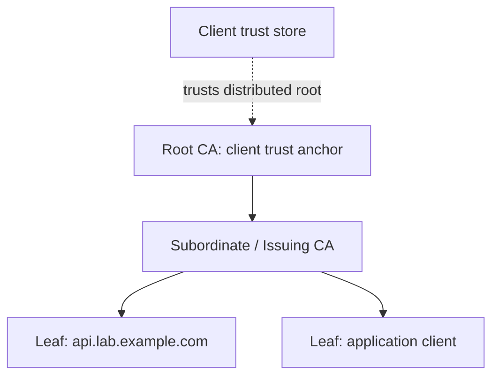
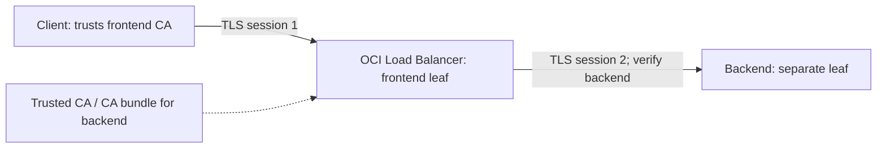

# Certificate Authorities and Deploying Certificates to Services

## 1. Objectives and Context

An HTTPS service needs more than a certificate file: it needs the right identity, the matching private key, a valid CA chain, trust verification points, and an update process before expiration. If any link is missed, resources may still show as active in OCI while the application fails to connect.

In the **Encryption, Secrets, and Certificates** chapter of the Oracle Cloud Infrastructure (OCI) module, this lesson focuses on certificate authorities (CAs) and putting certificates into service. The content connects OCI Certificates with Vault, compartments, IAM, VCN, Load Balancer, and Compute, while considering monitoring, automation, cost, and availability.

After this lesson, you will be able to:

- Explain root CAs, subordinate CAs, leaf certificates, and trust chains.
- Choose between an internal CA and a certificate issued by a public CA according to the target audience.
- Prepare permissions and keys to create a CA in OCI.
- Issue a certificate for a hostname and deploy it on a Load Balancer or server.
- Verify live endpoints, renew certificates, replace CAs, and handle private key incidents.

## 2. CAs and Trust Chains

### 2.1. What Does a Certificate Attest?

An X.509 certificate binds a public key to an identity and usage constraints. A CA signs the certificate content so verifiers can validate the signature along a trust chain.

| Component | Meaning |
| --- | --- |
| Subject | The certified entity |
| Subject Alternative Name, SAN | DNS names or IP addresses used to identify the endpoint |
| Issuer | The CA that issued the certificate |
| Public key | Public key belonging to the subject |
| Validity | Time window during which the certificate is valid |
| Key Usage and Extended Key Usage | Permitted purposes for the key/certificate |
| Serial number | Certificate identifier scoped under the issuer |
| Signature | The CA's signature over the certificate content |

**The private key is not inside the public certificate.** For server TLS, the server must be able to use the matching private key to prove key possession. A certificate with the right hostname paired with a different private key still produces an invalid TLS configuration.

Nor does a certificate directly encrypt every byte of application data. TLS uses handshake mechanisms and session keys to protect the connection; the certificate participates in identity authentication.

### 2.2. Root, Subordinate, and Leaf



- **Root CA** sits at the top of the CA hierarchy; root certificates are typically self-signed.
- **Subordinate CA**, often called an intermediate CA, is issued a certificate by an upstream CA and is authorized to issue further according to constraints.
- **Leaf certificate**, or end-entity certificate, is used for a server, client, or end purpose; it is not used as a CA to issue downstream certificates.

A self-signed root does not become trusted automatically. Clients must hold the appropriate trust anchor in their trust store via a trusted administrative channel. Having the server also send the root during the handshake does not grant that trust. [OCI concepts of CAs and chain of trust](https://docs.oracle.com/en-us/iaas/Content/certificates/overview.htm).

Separating root and issuing CAs helps divide responsibilities and blast radius. However, a root created and operated online in OCI is not an offline root merely because it sits at the top of the diagram.

### 2.3. Hostname Verification Is Different from Signature Verification

Connecting to `api.lab.example.com` requires a certificate containing the matching identity, typically a DNS SAN for that name. Under modern TLS service identity verification models, do not rely on Common Name as a substitute for SAN. [RFC 9525 on TLS service identity](https://www.rfc-editor.org/rfc/rfc9525.html).

Examples:

| Access Method | Identity to Verify |
| --- | --- |
| `https://api.lab.example.com` | DNS SAN for `api.lab.example.com` |
| `https://10.0.2.15` | Corresponding IP SAN if intentionally accessed by IP |
| `https://api.lab.example.com/health` | Still the hostname, not the `/health` path |

Never put `https://` prefixes, ports, or URL paths into a DNS SAN. Wildcards also have matching limits; do not assume one wildcard is valid across arbitrary subdomain levels.

## 3. Choosing Trust and Certificate Management Models

### 3.1. Internal CA vs. Public CA

| Need | Deployment Direction |
| --- | --- |
| Internal APIs, servers, and clients managed by the organization | Internal CA with controlled trust anchor distribution |
| Websites serving public Internet user browsers | Certificate with a chain trusted by target clients, usually from a public CA |
| Enterprise already has its own PKI | Integrate existing CA chain or use certificates issued by that system |
| Service requiring client certificates | Design client identity, trust stores, and application authorization together |

A private CA created in OCI Certificates is not trusted by public browsers by default. For third-party issued certificates, OCI can manage imported copies for use within the tenancy. [OCI Certificates overview](https://docs.oracle.com/en-us/iaas/Content/certificates/overview.htm).

For example, HTTPS on a private load balancer using an internal CA is appropriate if clients already trust that root. Conversely, asking Internet customers to install an enterprise root just to visit a website rarely meets expected user experience.

### 3.2. Three Ways to Manage Leaf Certificates

| Method | Where Is the Private Key Managed? | Update Responsibility |
| --- | --- | --- |
| Issued by internal CA, managed internally | Managed by Certificates service per config | Can be configured for auto-renewal |
| Issued by internal CA, managed externally | Operators generate and keep key outside service | Organization owns CSR workflow and deployment |
| Imported | Certificate and required material imported from outside | Organization obtains renewal from issuer and updates import |

With external management, you can generate a private key and certificate signing request (CSR) on the host and submit the CSR to an OCI CA for signing. A CSR contains the public key and issuance request, not the private key. [Creating a certificate to manage externally](https://docs.oracle.com/en-us/iaas/Content/certificates/creating-certificate-to-manage-externally.htm).

Imported certificates and certificates with externally managed private keys are not auto-renewed by OCI under the mechanism meant for internally issued and managed certificates. [Certificate renewal guide](https://docs.oracle.com/en-us/iaas/Content/certificates/renewing-certificate.htm).

## 4. OCI Resources and Private Key Boundaries

OCI Certificates has resources that must be distinguished:

| Resource | Function |
| --- | --- |
| Certificate authority | Issues certificates and manages CA lifecycle |
| Certificate | Logical object holding one or more leaf certificate versions |
| Certificate version | Specific certificate content, including validity dates and serial |
| CA bundle | Collection of public CA certificates for building/verifying chains |
| Association | Link between a certificate/CA/bundle resource and a consuming resource |

**A CA bundle is not a package containing a CA's private key.** A bundle for trust verification and a server certificate set with its private key are two different kinds of data, even though some tools use the word "bundle" for both.

### 4.1. CA Signing Keys in Vault

To create a CA, OCI requires an asymmetric key protected by **HSM** in Vault. Documented supported options include RSA 2048/4096 or ECDSA with NIST_P384. AES keys for data encryption are unsuitable as CA signing keys; software-protected keys also do not meet this prerequisite. [CA creation prerequisites](https://docs.oracle.com/en-us/iaas/Content/certificates/creating-certificate-authority.htm).

CA signing keys and per-service TLS private keys serve different roles:

```text
CA key:
    signs certificates for subjects

api.lab.example.com TLS key:
    proves possession of the public key in the leaf certificate

Bucket AES key:
    protects data/data keys per storage encryption mechanism
```

Do not share one key across these roles merely to reduce resource count.

### 4.2. Permissions That Must Be Protected Separately

Someone viewing certificate metadata does not necessarily need to retrieve the private key. Permission to read a certificate bundle with a private key is sensitive and must be granted separately by bundle type and duty. [Certificates IAM permissions reference](https://docs.oracle.com/en-us/iaas/Content/Identity/Reference/certificatespolicyreference.htm).

Never put private keys in Git, server images, CI logs, or tickets. Public certificates can be distributed more broadly, yet trust anchors must still have verified provenance: swapping a root in a trust store can alter the entire trust relationship.

## 5. Designing IAM for CAs and Deployment

### 5.1. Separating Administrators from Resource Principals

A CA needs permission to use a Vault key for signing. If publishing a certificate revocation list (CRL), the CA also needs permission to write objects to the corresponding bucket. These are permissions for the **CA resource**, not just for the user clicking Create.

Example compartment split:

```text
SecurityPKI   : root CA, issuing CA, leaf certificates, and CA bundles
SecurityKeys  : Vault and CA signing keys
PKIPublication: dedicated bucket storing CRLs
AppNetwork    : Load Balancer, listeners, and network configs
```

These names are resource-organization examples and do not create automatic permissions.

### 5.2. Dynamic Group for CAs

Example matching rule targeting only CAs in the PKI compartment:

```text
ALL {
  resource.type = 'certificateauthority',
  resource.compartment.id = '<PKI_COMPARTMENT_OCID>'
}
```

Then grant permissions to the dynamic group, e.g., `CertificateAuthorityDG`:

```text
Allow dynamic-group CertificateAuthorityDG to use keys in compartment SecurityKeys where target.key.id = '<CA_SIGNING_KEY_OCID>'

Allow dynamic-group CertificateAuthorityDG to manage objects in compartment PKIPublication where target.bucket.name = '<CA_CRL_BUCKET>'
```

Replace names with full names matching your tenancy's identity domain. If root and subordinate CAs use separate keys/buckets, add policies scoped to each specific resource. [Oracle guide on IAM for CAs](https://docs.oracle.com/en-us/iaas/Content/certificates/managing-certificate-authorities.htm).

The example covers only signing and CRL publishing permissions. CA administrators still need permissions to manage CAs, read Vault/keys, delegate key usage, and view buckets per their duties.

### 5.3. Permissions for Certificate Issuers and Deployers

Separate these duties:

| Role | Permissions to Consider |
| --- | --- |
| PKI admin | CAs, signing keys, issuance rules, and revocation |
| Certificate issuer | Issue leaves under authorized CAs and manage versions |
| Deployer | Read required resources, manage associations, and update target services |
| Application or host retrieving material | Read only needed certificate/bundle, plus private key only if required by model |

Teams managing leaf certificates do not necessarily need permission to create or delete CAs. Association permissions and listener/backend set update permissions must also be evaluated separately. [Managing certificates and policy examples](https://docs.oracle.com/en-us/iaas/Content/certificates/managing-certificates.htm).

When configuring native Load Balancer integration, map both Certificates permissions and Load Balancer permissions for the specific task. Do not assume permission to read a certificate grants permission to attach it to every listener.

## 6. Determining Where TLS Terminates

Before issuing certificates, determine who presents each certificate and who verifies it.

| Model | Client to Load Balancer | Load Balancer to Backend | Where Certificates Are Managed |
| --- | --- | --- | --- |
| TLS termination | HTTPS | HTTP | Primarily at listener |
| TLS re-encryption | HTTPS | Independent HTTPS | Listener and backend; plus Load Balancer trust |
| TCP forwarding TLS | Forwarded TLS connection | Backend terminates TLS | Backend holds certificate/private key |

With re-encryption there are two TLS sessions, not one end-to-end session. Frontend and backend certificates can differ because they represent different identities.



OCI Load Balancer supports SSL/TLS configuration on listeners and backend sets. Enabling HTTPS on a listener does not automatically enable TLS on the backend connection. [Load Balancer SSL guide](https://docs.oracle.com/en-us/iaas/Content/Balance/Tasks/managingcertificates.htm).

In one-way TLS, the server presents a certificate to the client. With **mutual TLS (mTLS)**, the client also presents a certificate and the server verifies it. A valid client certificate provides only cryptographic identity; the application must still map that identity to access permissions.

## 7. Core Hands-On Lab: Issuing a Certificate and Attaching It to Load Balancer

### 7.1. Lab Scope

The goal is deploying frontend HTTPS for `api.lab.example.com` using a private CA. The domain is an example; replace it with an internal name owned by your organization.

Prepare within the same lab region:

- Compartments for PKI, keys, and application, with IAM configured.
- Two appropriate CA signing keys in Vault, separating root and issuing CA.
- An OCI Load Balancer with a working test backend.
- A `/health` endpoint on the backend returning expected results.
- A test client with network reachability to the Load Balancer.
- OpenSSL and curl in Bash; the commands below are not PowerShell syntax.

The main lab uses TLS termination to focus on the frontend. If the backend uses HTTP, the Load Balancer–backend connection remains HTTP. The next section extends to backend HTTPS.

For a private load balancer, the client needs appropriate network connectivity, such as from the VCN or a network connected to the VCN. Having a certificate does not create routes or NSG rules.

### 7.2. Create Root and Issuing CAs

In the Certificate Authorities section of OCI Certificates:

1. Create a root CA for the lab in the PKI compartment, selecting the prepared root signing key.
2. Set the CA identifying subject and lifetime per lab policy.
3. If using CRLs, configure a dedicated bucket for the CA along with a CRL distribution point (CDP) reachable by clients.
4. Wait for the root CA to become active.
5. Create a subordinate CA issued by this root, selecting the subordinate's dedicated signing key.
6. Configure leaf issuance rules and validity within limits permitted by the parent CA.
7. If the subordinate publishes a CRL, use a dedicated bucket separate from the root's bucket.

OCI also supports a subordinate type issued by an external CA and managed internally; this workflow requires a CSR and a completion step with the external CA. Do not consider creating such a subordinate finished before importing its signed certificate. [Creating CAs and subordinate types](https://docs.oracle.com/en-us/iaas/Content/certificates/creating-certificate-authority.htm).

For the lab, make the leaf shorter-lived than the issuing CA and the issuing CA shorter-lived than the root. This is lifecycle design, not a reason to skip actual limits and rules in the CA creation form.

### 7.3. Issue the Frontend Leaf Certificate

Create a certificate with these key choices:

| Field | Example Value |
| --- | --- |
| Resource name | `lab-api-frontend` |
| Management type | Issued by internal CA, managed internally |
| Issuer | The newly created Issuing CA |
| Profile / purpose | TLS Server |
| Common Name | `api.lab.example.com` |
| DNS SAN | `api.lab.example.com` |
| Key algorithm | Key type supported by target clients and services |
| Validity | Short period suited to lab, not exceeding issuer |
| Renewal rule | Configured to renew before expiration |

Do not select TLS Client for a server-only certificate. Verify the SAN and validity dates inside the issued certificate rather than checking only the OCI resource name. [Leaf certificate configuration in OCI](https://docs.oracle.com/en-us/iaas/Content/certificates/creating-certificate.htm).

Record the certificate OCID, issuer, serial, current version, and expiration date in the operational record. You do not need to download the private key to a personal workstation when using managed Load Balancer integration.

### 7.4. Distribute Public Material to the Test Client

Obtain the public root certificate over an authenticated PKI administrative channel and save it as `lab-root-ca.pem` on the lab client. Keep public intermediates if needed for chain inspection.

For production, distribute trust anchors through device management, application configuration, or change-controlled trust stores. Never fetch a root from an unverified endpoint and trust it by default.

Do not install a lab root into the system-wide trust store just to run one test command. With curl, specify the dedicated CA for the request using `--cacert`.

### 7.5. Attach Certificate to the Listener

In the OCI Load Balancer configuration:

1. Confirm the existing backend set and health check are working.
2. Create or update an HTTPS listener on port 443.
3. Choose the certificate resource type managed by the **Certificates service**.
4. Select the right compartment and leaf certificate `lab-api-frontend`.
5. Select the target backend set; configure TLS versions and compatibility options as required.
6. Apply, wait for the work request to complete, and re-check the listener.

Select a leaf certificate to represent the server. Selecting a CA or CA bundle for trust is a separate task; attaching only a CA bundle does not provide the server's TLS identity and private key.

Load Balancer integration uses the current version of linked Certificates resources and detects updates automatically. Verify the endpoint after changes, as this is not a guarantee of instantaneous simultaneous updates across all connections. [Configuring and updating certificates for Load Balancer](https://docs.oracle.com/en-us/iaas/Content/Security/Reference/configuration_tasks.htm).

Check NSGs/security lists for client to port 443 and Load Balancer to the backend on the right port. DNS must point to the right Load Balancer; before updating DNS, you can test using `--resolve`.

### 7.6. Test from the Client

Replace the IP address below with the actual Load Balancer IP reachable by the client:

```bash
export SERVICE_DNS='api.lab.example.com'
export LB_IP='<LOAD_BALANCER_IP_ADDRESS>'

curl --fail --show-error --verbose \
  --cacert lab-root-ca.pem \
  --resolve "$SERVICE_DNS:443:$LB_IP" \
  "https://$SERVICE_DNS/health"
```

The command still uses the hostname in the URL for identity verification; `--resolve` only overrides hostname/port-to-IP resolution. Expected results include valid TLS and the expected HTTP status code from `/health`. [curl documentation on CA and name resolution](https://curl.se/docs/manpage.html).

Inspect more deeply:

```bash
openssl s_client \
  -connect "$LB_IP:443" \
  -servername "$SERVICE_DNS" \
  -verify_hostname "$SERVICE_DNS" \
  -CAfile lab-root-ca.pem \
  -verify_return_error \
  -showcerts </dev/null
```

- `-servername` sends SNI so the endpoint selects configuration by name.
- `-verify_hostname` checks the expected identity.
- `-verify_return_error` fails the check when certificate verification fails.

Do not treat an `s_client` connection that completed a handshake as passing verification if the tool merely continued past errors. [OpenSSL s_client documentation](https://docs.openssl.org/master/man1/openssl-s_client/).

Never use `curl -k` as acceptance criteria, since that flag skips the exact verification this lab demonstrates.

## 8. Deploying on Compute and Extending to Backend HTTPS

### 8.1. Workflow for Self-Managed Hosts

When Nginx or an application on Compute terminates TLS directly, a dedicated certificate installation workflow is required. Creating a new version in OCI does not automatically overwrite files on every host.

One workflow using a host-generated private key:

1. Generate the key and CSR in a protected environment.
2. Choose the certificate mode issued by internal CA and managed externally; submit the CSR.
3. Receive the leaf certificate and public chain.
4. Verify the certificate matches the private key and has the right SAN.
5. Install versioned files and apply file permissions.
6. Test configuration, reload, and test fresh connections.
7. Record which certificate version each host is serving.

If instead fetching a certificate bundle containing a private key from OCI, use resource principals or workload identity with least-privilege permissions. Avoid baking long-lived credentials into images just to download certificates.

### 8.2. Verify Files Before Installing

Assume you have:

```text
backend-leaf.pem       : leaf for backend.lab.example.com
backend.key            : corresponding private key
issuing-chain.pem      : intermediate, ordered toward issuer
lab-root-ca.pem        : pre-trusted root
```

Inspect metadata and verify the chain for TLS server purpose:

```bash
openssl x509 -in backend-leaf.pem -noout \
  -subject -issuer -serial -dates -ext subjectAltName

openssl verify \
  -CAfile lab-root-ca.pem \
  -untrusted issuing-chain.pem \
  -purpose sslserver \
  -verify_hostname backend.lab.example.com \
  backend-leaf.pem
```

Here, the intermediate is input to chain building; the root is the intentional trust anchor for the test. This check does not automatically exercise all application revocation-checking policies. [openssl verify documentation](https://docs.openssl.org/3.5/man1/openssl-verify/).

You can compare the SHA-256 fingerprint of the public key to verify the key pair:

```bash
openssl x509 -in backend-leaf.pem -pubkey -noout \
  | openssl pkey -pubin -outform DER \
  | openssl dgst -sha256

openssl pkey -in backend.key -pubout -outform DER \
  | openssl dgst -sha256
```

Both values must match. If they differ, halt deployment and locate the right private key; never edit PEM content manually to force them to match.

### 8.3. Nginx Configuration Example

Build the full chain ordered leaf followed by intermediate, closest to leaf first:

```bash
cat backend-leaf.pem issuing-chain.pem > backend-fullchain.pem
```

Normally the server does not need to send the root in the chain; the client must hold its own trust anchor.

After installing the files into managed paths on the host, configure:

```nginx
server {
    listen 8443 ssl;
    server_name backend.lab.example.com;

    ssl_certificate     /etc/nginx/tls/backend-fullchain.pem;
    ssl_certificate_key /etc/nginx/tls/backend.key;
    ssl_protocols       TLSv1.2 TLSv1.3;

    location = /health {
        default_type text/plain;
        return 200 "ok\n";
    }
}
```

The private key needs restricted permissions while remaining readable by the process responsible for loading it. Verify ownership, OS protections, and Nginx config before reloading. [Official Nginx HTTPS guide](https://nginx.org/en/docs/http/configuring_https_servers.html).

On a Linux system using systemd and a service named `nginx`, apply after all files are installed:

```bash
sudo nginx -t
# Run reload only when the config test above succeeds.
sudo systemctl reload nginx
```

With multiple backends, deploy host by host and verify before proceeding. Keep the previous configuration version for rollback if that version remains uncompromised and valid.

### 8.4. Configuring TLS Between Load Balancer and Backend

Once the backend serves HTTPS:

1. Open network reachability from Load Balancer to the backend TLS port, e.g., 8443.
2. Update the backend set to use SSL/TLS to the backend.
3. Configure the CA/CA bundle used to verify the backend certificate.
4. Enable peer certificate checking per security model requirements.
5. Verify chain, verification depth, and hostname options in the live configuration.
6. Adjust the health check to the right protocol, port, and path.
7. Verify both backend health and HTTPS requests through the frontend.

SNI used to select a certificate and hostname verification used to verify identity are two different functions; configuring one does not imply the other is configured properly.

If encountering 502 errors, check whether the backend actually accepts TLS, whether its certificate is valid, and whether the trust chain is complete. A valid frontend TLS setup does not prove the backend TLS connection succeeded. [Troubleshooting OCI Load Balancer SSL errors](https://docs.oracle.com/en-us/iaas/Content/Balance/Reference/troubleshooting_ssl.htm).

## 9. Renewal, Version Replacement, and CA Replacement

### 9.1. Distinguishing Issuance from Serving

Renewing in Certificates creates a new certificate version. Depending on the management mode, this may happen automatically or require an external PEM update. Old versions are not automatically deleted merely because a new version exists. [Certificate renewal lifecycle](https://docs.oracle.com/en-us/iaas/Content/certificates/renewing-certificate.htm).

Track at least three states:

```text
New version issued
    -> desired version is current
    -> live endpoint serves the right certificate
```

With native integration, verify associations and wait for the service update. With self-managed hosts, distribute files, test config, and reload. Never treat a successful renewal job as proof that all backends have updated.

### 9.2. Post-Renewal Verification

Record serial, fingerprint, and expiration date before changes. After updating, open fresh connections and cross-check:

- Endpoint presents the expected version.
- SAN, issuer, and validity window are right.
- Clients can build the chain to the trust anchor.
- Backend health and application error rates remain stable.
- Every node or endpoint required to serve has updated.

Existing connections and TLS session resumption may not reflect a full new handshake. When testing rotation, explicitly open fresh connections.

To check whether a PEM certificate expires within seven days:

```bash
openssl x509 -in backend-leaf.pem -checkend 604800 -noout
```

This command checks only the time limit; it does not prove hostname, chain, or revocation status are valid. [openssl x509 documentation](https://docs.openssl.org/3.5/man1/openssl-x509/).

### 9.3. Replacing an Issuing CA or Root CA

Replacing a CA requires managing both the issuance side and the trust side. Typical sequence:

1. Prepare the new CA and trust chain.
2. Distribute new trust to clients before they encounter leaves from the new CA.
3. Issue and deploy new leaves to a small scope.
4. Test representative clients, including applications with dedicated trust stores.
5. Expand deployment and inventory resources still using the old chain.
6. Remove old trust only when no valid need remains and retention requirements are met.

The trust overlap period needs a defined deadline and owner. In a CA compromise scenario, do not keep trusting the old CA just for a convenient migration schedule; follow an appropriate incident response procedure.

A Java application may use its own trust store instead of the OS CA store. Installing a root in the OS is insufficient proof that the application trusts the new chain.

## 10. Revoking Certificates and Handling Key Compromise

**Expiration**, **revocation**, and **resource deletion** are three different things:

| Action | Meaning |
| --- | --- |
| Expiration | Certificate passes its Not After timestamp |
| Revocation | Issuer announces a certificate is no longer trusted before expiration |
| Deletion | Removing managed resources/materials per service lifecycle |

OCI Certificates uses CRLs for its supported revocation mechanism. CRLs list serials of revoked certificates and are published to Object Storage; clients must be able to reach the CDP and actually check the CRL. The organization is responsible for CDP reachability. [Certificate revocation in OCI](https://docs.oracle.com/en-us/iaas/Content/certificates/revocation.htm).

Do not assume by default that a client checks revocation, or that OCI provides OCSP for every certificate. Verify the exact checking mechanism and fail-behavior of the specific software in use.

If a TLS private key is compromised:

1. Identify all endpoints and copies holding the key.
2. Generate a new key pair in a secure environment.
3. Issue and deploy the replacement certificate.
4. Revoke the affected version via the issuer.
5. Verify clients process the revocation info and endpoints no longer serve the old version.
6. Investigate the leak source and remediate related permissions, logs, or pipelines.

For imported certificates, revocation must be performed through the external issuer. OCI does not replace the revocation authority of the CA that issued that certificate. [Scope of revoking certificate versions](https://docs.oracle.com/en-us/iaas/Content/certificates/revoking-certificate.htm).

Do not delete the CA key or CRL bucket before revocation completes: losing the key, bucket, or policy can cause revocation/CRL publishing to fail. [Certificates known issues](https://docs.oracle.com/en-us/iaas/Content/certificates/known-issues.htm).

## 11. Monitoring and Troubleshooting

### 11.1. Monitor Both Control Plane and Endpoints

Audit supports investigating configuration changes and actors. Load Balancer logs/metrics and external TLS probes show impact on the serving path.

A certificate record should include:

```text
Certificate OCID and version:
Hostname / SAN:
Issuer and trust chain:
Expiration date:
Consuming listener, backend, or host:
Deployment method: association or file install
Operational owner:
Renewal mechanism and alerting:
Where CRL is checked if applicable:
```

For service-managed integrations, inspect Associations to inventory resources using a certificate. For copies deployed as files, maintain an additional inventory outside the association list. [Viewing certificate associations](https://docs.oracle.com/en-us/iaas/Content/certificates/viewing-certificate-associations.htm).

Set alert thresholds suited to your organization's lifetime and response time; for example, 30, 14, and 7 days are design milestones, not default OCI guarantees. Monitor issuing CA/root expiration dates and renewal failures too, not just leaves.

### 11.2. Isolating by Symptom

| Symptom | Checkpoints |
| --- | --- |
| Unknown CA / unable to get local issuer | Client trust anchor, server-sent intermediate, complete chain |
| Hostname mismatch | URL, DNS/IP SAN, SNI, and the certificate selected by listener |
| Certificate expired / not yet valid | Validity dates, UTC, host clock, and actual served version |
| Key pair mismatch | Leaf public key vs. installed private key |
| OCI does not show key when creating CA | Key type, HSM, size/curve, compartment, and IAM |
| Attaching certificate fails | Association permissions, target service permissions, region, and resource type |
| Frontend TLS works, but returns 502 | Backend health, port, protocol, chain, and backend trust |
| OCI renewed, but server still serves old version | Current version, association, or distribution/reload pipeline |
| Revocation does not take effect as expected | CRL publishing, CDP reachability, caching, and client checking mechanism |

Never fix a trust error by disabling verification system-wide. Collect hostname, timestamp, serial/fingerprint, request ID, and relevant logs to pinpoint the exact broken link.

## 12. Availability, Cost, and Automation

### 12.1. Operational Dependencies

If a server has already loaded its leaf and private key, routine TLS handshakes do not need the CA to re-sign the certificate. Therefore, a CA temporarily unable to issue certificates does not mean all live TLS sessions immediately break.

Impact can appear on renewal, new issuance, CRL publishing, or status checks. Model these dependencies rather than monitoring CA state alone.

Multi-region plans must prepare corresponding resources, permissions, certificates, and trust at the target. Do not assume OCIDs, associations, or TLS material replicate automatically alongside the application. Failover drills must cover TLS and DNS identity.

### 12.2. Cost and Limits

Estimate HSM vault/keys, Load Balancers, Compute, CRL storage, logs, and operational effort; check current pricing for actual resource types before deploying. You do not need a separate CA per backend if they share the same trust boundary.

Certificate versions have service limits. Establish a process to clean up old versions after verifying rollback needs, operational evidence, and dependent resources; never delete arbitrarily just to shorten the list. [OCI Service Limits](https://docs.oracle.com/en-us/iaas/Content/General/service-limits/default.htm).

### 12.3. What Should a Deployment Pipeline Verify?

A sound pipeline connects certificate issuance to live serving verification:

1. Validate requested names, profile, and allowed issuer.
2. Issue/import/renew and wait for appropriate state.
3. Verify SAN, lifetime, chain, and key pair if handling private keys.
4. Update association or distribute versioned material.
5. Test config, roll out incrementally, and open fresh TLS connections.
6. Cross-check fingerprint/serial at the endpoint.
7. Store evidence and monitor post-change errors.

Protect IaC state and artifact stores if they contain private keys. Prefer resource references and appropriate workload identity while knowing explicitly which component holds the private key.

## 13. Completion Criteria

Creating a certificate in OCI is only part of the deliverable. A deployment is ready for handover once you verify:

- The leaf represents the right hostname and right server/client purpose.
- The private key matches the pair, is protected, and is accessible only by required principals.
- The endpoint sends the right chain; clients trust the right root and verify identity.
- Every TLS hop, including the backend if applicable, operates with the expected verification configuration.
- Renewal produces a new version and that version reaches every serving location.
- Alert recipients, a safe rollback option, and a revocation procedure are in place.
- Inventory of associations and host-side copies is complete enough to swap certificates or CAs when needed.

A CA provides the foundation of trust; complete certificate deployment brings that foundation into every serving point, verification point, and day-to-day operational workflow.
