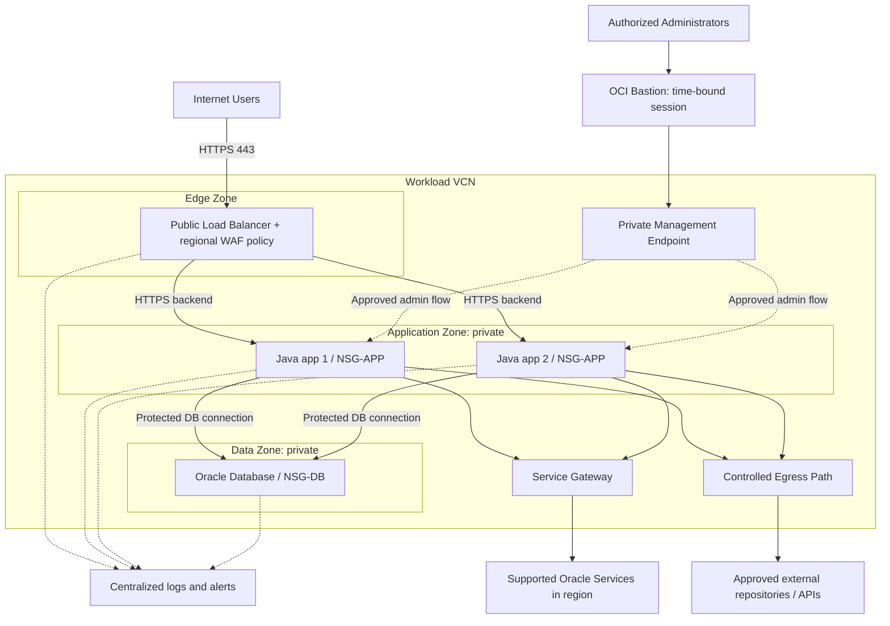

# Designing Defense in Depth for OCI Workloads

**Defense in depth**, or layered defense, is the practice of combining controls so that a single misconfiguration or a bypassed protection layer does not open the entire path to data. With Oracle Cloud Infrastructure (OCI), this design must cover identity, network, host, application, data, and operational capabilities.

This lesson belongs to the **Network and Host Security** chapter, using a Java application running on OCI Compute and accessing an Oracle database as a running example. The focus is on identifying what each layer protects, what it depends on, who operates it, and what evidence is needed to know that the layer is working.

## 1. Understanding the True Meaning of Multiple Protection Layers

Suppose an application has a WAF in front, yet the application server still accepts direct connections from the Internet. An attacker can take a path that bypasses the WAF. Even if that access path is fixed, if the application uses a database account with administrative privileges, a code execution flaw in the application can still cause major damage.

A good design needs to answer four questions simultaneously:

1. **Prevention:** What restricts who or which connections are allowed in?
2. **Containment (Blast Radius):** If a component is compromised, what can it access?
3. **Detection and Response:** Who notices anomalies, and what actions are taken next?
4. **Recovery:** How are services and data restored to a trusted state?

The number of security products is not the sole metric. Two layers that both depend on a single administrative account with permission to modify everything can still fail at the same time. Therefore, both separation of duties and paths that could bypass controls must be considered.

| Layer | Objective in the design | Limitations to understand |
| --- | --- | --- |
| IAM and governance | Restrict who can modify infrastructure | OCI permissions do not replace in-application authorization |
| Network and entry points | Restrict source, destination, protocol, and transmission path | An allowed connection can still carry malicious requests |
| Host | Reduce exploitation and privilege escalation capabilities | A patched host can still run a vulnerable application |
| Application and data | Verify identity, business permissions, and data scope | Encryption does not stop an authorized user from reading data for unintended purposes |
| Monitoring and response | Detect, investigate, and isolate | Having logs without someone to act on them still leaves response slow |
| Recovery | Restore from trusted configurations and data | A backup that has never been restored has not proven recoverability |

## 2. Defining Responsibilities Between Oracle and the Customer

OCI uses a shared security responsibility model. Oracle secures the underlying infrastructure; the customer is responsible for configuring their resources, access controls, and workloads. The exact division of responsibility also depends on the type of service used. [Source: Oracle — Security Overview](https://docs.oracle.com/en-us/iaas/Content/Security/Concepts/security_overview.htm).

In this lesson's example, an internal responsibility table should be established as follows:

| Item | Proposed owner | Specific tasks |
| --- | --- | --- |
| Tenancy and administrative identities | Identity management team | Permission grant/revocation workflow, strong authentication, emergency accounts |
| VCN, NSGs, and routes | Network platform team | Review connection flows, audit configuration changes |
| OCI Compute | Host operations team | Images, patches, OS accounts, host firewall, and agents |
| Java application | Development team | Libraries, API authorization, input validation, and releases |
| Database | Data team | Access permissions, updates per DB service, backup, and restore |
| Monitoring | Security operations team | Log collection, alerting, investigation, and response coordination |

This is an illustrative assignment. For managed database services, you must identify what Oracle manages and what the customer still needs to configure; do not assume all DB security is the provider's responsibility.

## 3. Starting from Assets and Attack Paths

The illustrative workload is an order management API:

- Customers call the HTTPS API from the Internet.
- A Load Balancer forwards requests to two Compute instances running Java.
- The application accesses Oracle Database over a private connection.
- The application requires certain secrets and may write documents to Object Storage.
- Administrators only need host access during maintenance windows.
- The system must preserve forensic evidence and data recoverability.

The assets to protect are order data, credentials, OCI administrative privileges, cryptographic keys, and service availability.

| Scenario to consider | Primary risk | Control direction |
| --- | --- | --- |
| Compromised admin account | IAM changes, network exposure, backup deletion | Strong authentication, least privilege, separation of duties, and Audit |
| Vulnerable API | Data exposure or code execution | Application controls, WAF, library patching, and process privilege limits |
| One app server compromised | Lateral movement to other hosts or secret theft | Network segmentation, narrow workload permissions, and secret management |
| Misconfigured security rule | Unintended access path opened | IaC, change review, and drift detection |
| Data-destroying malware | Disruption and data loss | Restricted delete permissions, privilege-separated backups, and recovery drills |

This table is an analysis for the example, not an exhaustive list of all threats. It helps select controls based on the consequences to prevent rather than enabling services out of habit.

## 4. Reference Architecture and Trust Boundaries

The example uses VCN `10.40.0.0/16`:

| Tier / Zone | Illustrative CIDR | Components |
| --- | --- | --- |
| Edge | `10.40.10.0/24` | Public Load Balancer |
| Application | `10.40.20.0/24` | Compute running Java, no public IP |
| Data | `10.40.30.0/24` | Private endpoint of Oracle Database |
| Management | `10.40.40.0/24` | Private administrative connectivity per Bastion design |

The CIDRs are examples and must avoid overlapping with corporate networks or other VCNs.



The diagram shows logical flows and does not depict every gateway, interface, or internal service connection. The regional WAF policy is attached to the Load Balancer in this example; a WAF does not necessarily have to be a separate intermediary machine.

Each boundary requires both appropriate connectivity controls and identity controls. Having the app server inside a private network does not automatically make every call originating from it trustworthy.

## 5. Governance Layer: IAM, Compartments, and Guardrails

### 5.1. Restricting Who Can Modify Protection Layers

An illustrative organizational structure:

```text
Tenancy
├── SharedNetwork
├── OrdersProd
│   ├── Edge
│   ├── App
│   └── Data
├── SecurityOperations
└── OrdersNonProd
```

Compartments help organize resources and scope IAM policies. They do not automatically create a firewall between two resources. If two VNICs have a routing path and network controls allow it, placing them in different compartments does not by itself block traffic.

Apply the following principles to the example:

- The application deployment team only has permissions needed for their workload.
- Permissions to modify IAM, networking, and evidence retention policies are clearly assigned.
- Day-to-day operators do not need permission to delete all resources.
- Emergency accounts have defined usage procedures and are monitored.
- CI/CD pipeline permissions are also treated as those of an identity that could be compromised.

Do not inspect only individual policies in isolation: effective permissions also depend on other policies and inherited permissions. A broad permission at a higher level can defeat the intent of restrictions at a lower level.

### 5.2. Using Security Zones for Requirements That Must Be Blocked Immediately

Security Zones validate resource creation/update operations against a recipe and can deny violating operations. A recipe can include restrictions on public access or data protection requirements. Security Zones do not grant IAM permissions. [Source: Oracle — Overview of Security Zones](https://docs.oracle.com/en-us/iaas/Content/security-zone/using/security-zones.htm).

For this example, evaluate the recipe before applying it to data compartments. The area containing the public Load Balancer must align with the selected policies. Do not apply a recipe that prohibits public resources across the entire architecture and expect the Internet entry point to still be created normally.

This is a resource placement and guardrail decision that must be made before deployment, not an exception handled by expanding administrative privileges.

## 6. Network Layer: Designing from a Traffic Matrix

### 6.1. Separating Subnets Is Not Sufficient for Segmentation

OCI provides local routing for traffic within a VCN. Two subnets in the same VCN do not require an explicit route just to communicate with each other. Therefore, do not use "not seeing a route to the DB subnet" as proof that the DB is isolated. [Source: Oracle — VCN Route Tables](https://docs.oracle.com/en-us/iaas/Content/Network/Tasks/managingroutetables.htm).

A private subnet prevents assigning public IPs to VNICs as a subnet property, but you must still consider connectivity from other VCNs, corporate networks, internal hosts, and paths through connected services. The goal to prove is that **only the right sources can access the right destinations**, rather than only proving a resource lacks a public IP.

### 6.2. Creating Role-Based NSGs

In this example:

- `NSG-LB`: the Load Balancer VNICs.
- `NSG-APP`: the application VNICs.
- `NSG-DB`: DB resources that support NSGs.
- Administrative flow: based on the Bastion endpoint source and the deployed session type.

NSGs apply to the VNICs attached to the group; they can reference another NSG in the same VCN as a source or destination. You must check service support for each resource as well as secondary VNICs. [Source: Oracle — Network Security Groups](https://docs.oracle.com/en-us/iaas/Content/Network/Concepts/networksecuritygroups.htm).

The illustrative matrix below describes **initiated connections**, not yet a complete rule list to apply directly:

| Initiating source | Destination | Example port/protocol | Purpose |
| --- | --- | --- | --- |
| Internet | Load Balancer | TCP 443 | Public API |
| `NSG-LB` | `NSG-APP` | TCP 8443 | HTTPS to backend |
| `NSG-LB` | App backend | Configured health check port | Verify backend readiness |
| `NSG-APP` | `NSG-DB` | Configured DB listener port | Data access |
| Bastion private source | Designated app host | TCP 22 | Granted SSH session |
| App host | Supported Oracle services | TCP 443 | Required secrets, storage, or APIs |
| App host | Approved external repositories/APIs | TCP 443 | Updates and integrations |
| App host | Configured DNS/NTP | Per service protocol | Name resolution and time sync |

`8443` is the sample application's choice. If using TCPS, `2484` may be a configured listener port; do not assume every Oracle Database uses this port. Actual settings must match the listener, certificates, and client configuration.

### 6.3. Reviewing the Effective Rule Set

NSGs and security lists use allow rules. Rules applied to a VNIC are additive; a permissive rule in a security list is not overridden by a narrower NSG. With stateful rules, return traffic for tracked connections is handled based on state; stateless rules require evaluating the return direction as well. [Source: Oracle — Security Rules](https://docs.oracle.com/en-us/iaas/Content/Network/Concepts/securityrules.htm).

Implication for the example: after allowing only `NSG-APP` into the DB, you must inspect every applied security list and NSG. If a rule still allows the entire VCN to reach the DB port, the goal of restricting access to the app tier has not been achieved.

Do not treat stateful as "needing a rule on only one side." For a new connection between two resources with network filtering, you must still consider egress on the initiating side and ingress on the receiving side.

If Zero Trust Packet Routing (ZPR) is also deployed, endpoints with security attributes must additionally satisfy the corresponding ZPR policies. Adding attributes can affect existing active connections. [Source: Oracle — ZPR note in Network Security Groups](https://docs.oracle.com/en-us/iaas/Content/Network/Concepts/networksecuritygroups.htm).

## 7. Entry Point Layer and Outbound Traffic Control

### 7.1. HTTP Protection at the Load Balancer and WAF

OCI WAF supports HTTP controls such as protection rules and rate limiting; a regional WAF policy can be attached to a Load Balancer. A WAF can inspect certain application attack patterns, but it does not replace business-level authorization checks in the API. [Source: Oracle — Overview of Web Application Firewall](https://docs.oracle.com/en-us/iaas/Content/WAF/Concepts/overview.htm).

For the orders application, the design should additionally address:

- Expose only the listeners that need to be used.
- Protect TLS from client to TLS termination point; explicitly decide on LB–backend encryption.
- Restrict the backend to prevent unintended direct paths.
- Verify that rate limiting does not disrupt customers sharing NAT/proxies.
- Monitor alerts and tune rules based on legitimate traffic before expanding blocking.

If using another WAF model, such as an edge policy, you must redesign the path to the origin according to that model. Changing DNS alone does not prove the origin has no remaining direct access path.

### 7.2. A NAT Gateway Is Not an Allowlist of Permitted Destinations

A NAT Gateway allows resources without public IPs to initiate Internet connections and receive responses, while not accepting inbound Internet-initiated connections over that NAT path. [Source: Oracle — NAT Gateway](https://docs.oracle.com/en-us/iaas/Content/Network/Tasks/NATgateway.htm).

This introduces a design limitation: a compromised host can still attempt to exfiltrate data if egress is broadly allowed. Destinations must be controlled with an appropriate solution, such as a proxy, firewall, or approved endpoint set, alongside monitoring newly observed destinations.

### 7.3. Service Gateway and Network Firewall Solve Different Problems

A Service Gateway provides a private path to supported Oracle services within the same region. It does not by itself grant access to buckets or secrets, and it is not a path to arbitrary external websites. [Source: Oracle — Access to Oracle Services: Service Gateway](https://docs.oracle.com/en-us/iaas/Content/Network/Tasks/servicegateway.htm).

Network Firewall can inspect and enforce policies on traffic routed through it. Merely creating a firewall resource does not automatically cause all VCN flows to traverse the firewall. [Source: Oracle — Overview of the Network Firewall Service](https://docs.oracle.com/en-us/iaas/Content/network-firewall/overview.htm).

If choosing Network Firewall for egress or inter-zone traffic, the design document must specify forward/return routes, potential bypass paths, and how high availability is ensured. The impact of TLS inspection, trusted certificates, performance, and operations must be evaluated before enabling related features.

## 8. Host Administration Layer: Short-Lived and Scoped Access

OCI Bastion provides time-limited access to resources without public endpoints. IAM controls permissions on the Bastion and sessions, while the client CIDR allowlist and SSH keys participate in connection control. [Source: Oracle — Bastion Overview](https://docs.oracle.com/en-us/iaas/Content/Bastion/Concepts/bastionoverview.htm).

Recommended workflow for a maintenance session:

1. Identify the target host, session type, operator, and task to be performed.
2. Grant permissions to the appropriate person or group, with session scope matching the design.
3. Allow only approved client source CIDRs.
4. Ensure the path from the Bastion's private endpoint to the target opens only required ports.
5. Use an OS account with appropriate privileges and record activity.
6. End the session, revoke temporary permissions, and verify the changes.

Permission to create a session does not replace OS or database permissions. Conversely, a highly privileged OS account should not be used as everyone's default login account.

Managed SSH has specific requirements regarding Linux image, Oracle Cloud Agent, the Bastion plugin, and the SSH server. SSH port forwarding has different prerequisites; you must select the right session type instead of assuming they are identical. [Source: Oracle — Session Types](https://docs.oracle.com/en-us/iaas/Content/Bastion/Concepts/bastionoverview.htm).

There is no need to stand up a long-lived public SSH VM just because the workload has private hosts. If the organization uses VPN/FastConnect and a private management network, identity, connection source, and grant duration must still be restricted toward the same goal.

## 9. Host Layer: Images, Patching, Processes, and Metadata

### 9.1. Building a Baseline for Compute Instances

A baseline is a reproducible standard configuration. For a Linux app server, a practical baseline should specify:

| Component | Illustrative design requirement |
| --- | --- |
| Image | Approved source, still supported, versioned |
| Packages | Install only what is necessary and track updates |
| Accounts | Separate administrator accounts from the application runtime account |
| Services | Disable unused services, open only required listeners |
| Privileges | Application runs without root privileges unless required |
| Host firewall | Matches approved flows and preserves system dependencies |
| OS controls | Maintain mechanisms such as SELinux per organizational baseline |
| Telemetry | Required agents and logs operational, with health monitoring |

This is a recommended baseline for the example; not all images include the same services, files, or tools.

Shielded Instances can add Secure Boot, Measured Boot, and a TPM on supported shape/image combinations. These features protect the boot process within their scope and do not replace application patching. [Source: Oracle — Shielded Instances](https://docs.oracle.com/en-us/iaas/Content/Compute/References/shielded-instances.htm).

### 9.2. Separating Vulnerability Detection from Remediation

Vulnerability Scanning checks supported resource types, images, and vulnerabilities within its supported scope. Scan results are an input for remediation; they do not prove that a host is patched or that an application has no remaining flaws. [Source: Oracle — Vulnerability Scanning Overview](https://docs.oracle.com/en-us/iaas/Content/scanning/using/overview.htm).

A remediation cycle requires: detection, impact assessment, selecting a patch or mitigation, deployment, verification, and updating records. Java libraries, the JDK, and application code need their own workflow aligned with the release pipeline.

OS Management Hub supports centralized update management for supported environments. Instances must be registered, with agents, software sources, and update schedules configured appropriately for the environment in use. [Source: Oracle — Overview of OS Management Hub](https://docs.oracle.com/en-us/iaas/osmh/doc/arch-overview.htm).

With two app servers behind an LB, you can update one machine, verify it, and then move to the next if the application and remaining capacity can handle it. Do not reboot all components simultaneously just to finish a patching schedule.

For a DB system, follow the update process of that specific database service; do not blindly apply Compute OS patching commands to every service-managed host.

### 9.3. Protecting Instance Metadata

OCI provides IMDSv2; v2 requests use the `Authorization: Bearer Oracle` header. Transitioning requires compatibility testing, migrating clients, and then disabling IMDSv1 depending on image conditions. [Source: Oracle — Getting Instance Metadata](https://docs.oracle.com/en-us/iaas/Content/Compute/Tasks/gettingmetadata.htm).

IMDSv2 must still be paired with SSRF prevention in the application, workload privilege limits, and process-level metadata access controls. Do not treat that static header as a secret password protecting the entire host.

When tightening the host firewall, you must preserve necessary system flows such as metadata, DNS, NTP, and iSCSI depending on configuration. Oracle explicitly documents these link-local dependencies in the Compute security guide. [Source: Oracle — Securing Compute](https://docs.oracle.com/en-us/iaas/Content/Security/Reference/compute_security.htm).

## 10. Application Layer, Workload Identity, and Data

### 10.1. Limiting the Application's Own Privileges

If the Java API only needs to read and write orders, its DB account should not hold full database administrative privileges. The API must verify both identity and per-object authorization: knowing an order ID does not mean being permitted to read that order.

Several design decisions should be explicitly documented:

- The service account and schema used by the application.
- The exact read, write, or procedure execution privileges truly needed.
- How the DB connection is secured and how the endpoint is verified.
- How libraries, the JDK, and application images are updated.
- Credential rotation procedures that preserve service availability.

Even when a WAF blocks many payload patterns, these business-logic checks still belong to the application.

### 10.2. Using Instance Principals with Scoped Permissions

Instance principals allow a Compute instance to call OCI APIs without storing an IAM user's credentials on the machine. Dynamic groups and policies define the granted permissions. Anyone with access to the instance must also be considered capable of exercising the permissions granted to that instance. [Source: Oracle — Calling Services from an Instance](https://docs.oracle.com/en-us/iaas/Content/Identity/Tasks/callingservicesfrominstances.htm).

Implication for the example: instances running the Orders API should only have permissions for the secrets or resources needed by the Orders API. Do not grant tenancy-wide management privileges to a dynamic group just so the application can read a configuration value.

Dynamic group membership rules must also be protected. If someone can create or place a resource into a privileged group using operations they are permitted to perform, that is also a privilege escalation path that needs evaluation.

### 10.3. Protecting Data Through Multiple Mechanisms

For the sample workload, the design should combine:

| Objective | Recommended control |
| --- | --- |
| Protection in transit | TLS and certificate verification at each hop |
| Protection at rest | Service encryption mechanisms and an appropriate key management model |
| Keeping credentials secret | Secret management service and restricted distribution process |
| Reducing data exposure in logs | Do not log tokens, passwords, or unnecessary sensitive data |
| Limiting data access | IAM for OCI services, DB privileges, and API business authorization |
| Maintaining recoverability | Backups, key usage permissions, and necessary metadata |

Do not place secrets in source code, user-data, images, or pipeline outputs simply because those components are "internal." Every copy increases the number of places that must be controlled and revoked.

Data encryption does not prevent legitimate reads performed with compromised credentials. Therefore, key protection must accompany controls over which users and workloads are permitted to use the keys.

## 11. Detection Layer: Correlating Signal Sources

### 11.1. Choosing Logs Based on Investigation Questions

| Signal source | Question to answer in the example |
| --- | --- |
| OCI Audit | Who modified NSGs, routes, or cloud resources? |
| Configured WAF/LB logs | Where did requests enter, and how were they handled? |
| VCN Flow Logs | Which sources communicated with which destinations, and what were the filtering outcomes? |
| OS and application | Who logged in, what process errors occurred, and which requests failed? |
| Configured DB audit | Which account performed operations on the data? |
| Cloud Guard / scan findings | Are there configurations or behaviors requiring investigation? |
| Metrics and alarms | Are there signs of availability loss or abnormal load spikes? |

Audit automatically records calls to supported OCI APIs. It does not replace OS login logs, internal application actions, or data-level operations across all services. [Source: Oracle — Overview of Audit](https://docs.oracle.com/en-us/iaas/Content/Audit/Concepts/auditoverview.htm).

Flow Logs provide metadata such as addresses, ports, protocols, byte counts, and ACCEPT/REJECT actions per record. Do not treat Flow Logs as a full copy of HTTP payloads or proof that business authorization was enforced properly. Both collection status and log scope must be accounted for. [Source: Oracle — Details for VCN Flow Logs](https://docs.oracle.com/en-us/iaas/Content/Logging/Reference/details_for_vcn_flow_logs.htm).

### 11.2. Positioning Cloud Guard Appropriately

Cloud Guard inspects resources and activities according to target and detector recipes, generates problems, and can recommend or execute actions according to responder configurations. Enabling Cloud Guard does not mean all issues are automatically remediated. [Source: Oracle — Cloud Guard Concepts](https://docs.oracle.com/en-us/iaas/Content/cloud-guard/using/cg-concepts.htm).

In this example, the operations team must define the monitored scope, alert types, recipients, and response SLAs. Responders capable of modifying resources must be restricted to avoid unintended service disruption.

An actionable alert should include:

- The affected resource and timestamp.
- Reason for suspicion and priority level.
- Assigned responder or team.
- Initial triage step and isolation criteria.
- How to confirm the incident is closed.

Centralized logs require appropriate access controls and retention policies. App operators do not inherently need permission to delete all forensic evidence of that very application.

## 12. Response and Recovery When a Layer Fails

### 12.1. Preparing in Advance to Isolate an App Server

For example, when a host is detected connecting to multiple destinations outside the design:

1. Identify the instance, VNIC, timestamp, and relevant log sources.
2. Assess service impact before removing it from the LB.
3. Isolate the flows to block using a rehearsed procedure.
4. Revoke or restrict potentially compromised identities and credentials.
5. Preserve necessary evidence and deploy a replacement host from a trusted source.
6. Inspect data, configurations, and related hosts before closing the incident.

Do not merely attach an NSG named "quarantine" and conclude the host is blocked: permissive rules in other NSGs or security lists may still be in effect. Existing established connections and host/service-level controls must also be addressed.

Execution order depends on severity and service continuity requirements. These actions should be documented in an owner-assigned runbook before an incident occurs.

### 12.2. Separating Availability from Data Recoverability

Two app servers and health checks reduce disruption when one machine fails. They do not protect against an application bug deleting valid data in the DB.

Block Volume supports volume backup and restore using the service's mechanisms. For DB data, you must choose a backup/restore method that ensures consistency for the database type and service in use. [Source: Oracle — Block Volume Backups](https://docs.oracle.com/en-us/iaas/Content/Block/Concepts/blockvolumebackups.htm).

A recovery profile should define:

| Component | What to specify |
| --- | --- |
| RPO | Maximum acceptable data loss |
| RTO | Maximum acceptable downtime |
| Backup | Creation schedule, retention, data scope, and delete permissions |
| Configuration | How to rebuild VCN, IAM, hosts, and application |
| Keys/secrets | How to restore decryption and connection capabilities |
| Drills | Evidence of successful restore and business verification |

RPO/RTO are workload-wide targets. Do not infer from a single HA feature or an individual backup that the entire application meets its targets.

## 13. Hands-On: Building the Design and Collecting Evidence

This section is performed in an authorized test environment. Illustrative commands use **Bash**, a configured OCI CLI with appropriate read permissions; OS commands run on Oracle Linux with the corresponding tools.

### 13.1. Finalizing the Design Before Creating Many Rules

Proceed in order:

1. Select the assets and data to protect.
2. Map entry points, administrative paths, DB paths, and outbound paths.
3. Complete the source–destination–protocol–port–purpose matrix.
4. Assign modification permissions for IAM, networking, hosts, and backups.
5. Select logs and response procedures for the identified scenarios.
6. Define cost and recovery objectives.

Then represent resources using IaC or reproducible configuration processes. Every change that expands permissions or connectivity must have a stated purpose and a scheduled review date.

### 13.2. Inspecting Subnet and NSG Configuration

```bash
REGION="ap-singapore-1"
APP_SUBNET_ID="<OCID_SUBNET_APP>"
APP_NSG_ID="<OCID_NSG_APP>"

oci network subnet get \
  --region "$REGION" \
  --subnet-id "$APP_SUBNET_ID"

oci network nsg rules list \
  --region "$REGION" \
  --nsg-id "$APP_NSG_ID" \
  --all
```

The subnet command returns information to verify CIDR, public IP assignment eligibility, route table, and security lists. The NSG command only lists rules of the selected NSG; it does not yet show the complete set of rules applied to a VNIC. [Source: Oracle — OCI CLI subnet get](https://docs.oracle.com/en-us/iaas/tools/oci-cli/latest/oci_cli_docs/cmdref/network/subnet/get.html), [OCI CLI NSG rules list](https://docs.oracle.com/en-us/iaas/tools/oci-cli/latest/oci_cli_docs/cmdref/network/nsg/rules/list.html).

Continue verifying VNIC membership, all related NSGs, and the subnet's security lists via the Console or corresponding management tools. Store the output in a way that does not expose secrets or credentials.

### 13.3. Observing Host Configuration

```bash
# Run on an Oracle Linux host within the authorized scope.
sudo ss -lntup
sudo systemctl --failed
sudo firewall-cmd --get-active-zones
sudo firewall-cmd --list-all-zones
sudo sshd -T
getenforce
```

These commands read listener states, failed services, firewall rules, SSH configuration, and SELinux status. If the baseline does not use firewalld or SELinux, use the corresponding inspection tools; do not enable or disable protection mechanisms just to make the output match the example.

Connect the output back to the design: which process is listening on which port, which approved flow does that port serve, and does the host have any services outside the approved scope?

### 13.4. Verifying Both Allowed Paths and Paths That Must Be Blocked

| Test behavior in lab | Expected result | Evidence to inspect |
| --- | --- | --- |
| Call valid API over HTTPS | Succeeds | LB/app logs and business response |
| Call app directly from the Internet | No direct access path | IP configuration, routes, and connectivity check |
| From a test host outside the app tier, call DB port | Blocked per design | Effective rules, Flow Logs within logged scope |
| Use app account to read unauthorized object | Denied by API | App logs and authorization test result |
| Call external API outside approved destinations | Blocked by chosen egress control | Proxy/firewall logs |
| Terminate admin session then reconnect | Cannot continue using expired session | Session status and related logs |
| Restore sample data into an isolated environment | Data can be read and reconciled | Restore report and business verification |

A timeout alone does not identify which layer blocked the traffic; it could be DNS, routing, a firewall, or an inactive service. Correlated evidence is required before concluding that a control has met its objective.

Only test resources within the authorized scope and do not use real customer data to simulate leak scenarios.

## 14. Balancing Cost, Availability, and Handover Documentation

Defense in depth must be maintained continuously, so both resource costs and operational effort must be accounted for. For the sample workload, an evaluation table can be created:

| Decision | Value to achieve | Cost or dependency to consider |
| --- | --- | --- |
| LB and multiple app instances | Maintain service during a host failure/maintenance | Spare capacity and load handling |
| WAF | Control HTTP traffic based on risk | Rules, traffic volume, and tuning effort |
| Dedicated egress control | Restrict destinations and observe outbound traffic | Infrastructure, routing, performance, and operations |
| Scanning and patching | Reduce vulnerability exposure window | Agents, maintenance windows, and remediation ownership |
| Centralized logging | Enable investigation and response | Volume, retention period, and access control |
| Backup/DR | Recover within RPO/RTO | Storage, replication, and drill time |

This table is a decision-making tool, not an OCI price list. When selecting billable services, check the applicable units and pricing for the account at deployment time.

Do not omit logs, backups, or access controls simply to make the initial deployment cheaper without evaluating the consequences. If budget is limited, reduce the scope of test data, select redundancy levels aligned with targets, and roll out in phases with assigned owners.

The design handover package should include flow diagrams, the access matrix, IAM owners, host baseline, monitoring scope, response runbooks, and recovery evidence. For each protection layer, document residual risk and the owner responsible for re-evaluating it when the workload changes.
