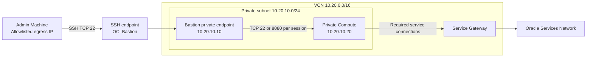

# OCI Bastion and Accessing Private Subnet Resources

A server in a private subnet has no public IP, yet the operations team still needs to log in to troubleshoot incidents or access an internal service. Attaching a public IP to the server just to open SSH creates an additional access path that must be protected. OCI Bastion provides an alternative: creating an access session restricted by time, source address, and IAM permissions, and then connecting to private resources over SSH.

This lesson belongs to the **Network and Host Security** chapter within the scope of Oracle Cloud Infrastructure. Learners will combine tenancy, compartment, IAM, VCN, and Compute to establish a controlled administrative path, while understanding how to use tunnels with Oracle database services, record access evidence, and clean up resources after the lab.

## 1. Objectives and Scope

After this lesson, learners can:

- Explain the difference between the OCI Bastion service and a self-managed virtual machine acting as a jump host.
- Choose Managed SSH, SSH port forwarding, or dynamic port forwarding appropriate to the access goal.
- Distinguish between IAM, CIDR allowlist, SSH keys, network rules, and permissions on the target system.
- Access a private Compute instance or a private TCP port without assigning a public IP to the target resource.
- Isolate errors and terminate sessions without leaving an access path broader than intended.

The addresses and OCIDs in this lesson are illustrative data. Commands are presented for learners to execute in an authorized OCI environment; the article does not claim that resources have already been created or that commands have been run on a live tenancy.

## 2. What Problem Does OCI Bastion Solve?

OCI Bastion provides restricted access to resources that lack a public endpoint. The service can support SSH to Linux hosts or forward connections to ports on other services. A Bastion is tied to a single VCN; you should not design a Bastion in VCN A and assume it can be used by default for resources in VCN B. [Source: Bastion Overview](https://docs.oracle.com/en-us/iaas/Content/Bastion/Concepts/bastionoverview.htm).

There are two common ways to create an administrative entry point:

| Approach | Expected operational responsibilities |
| --- | --- |
| Self-managed jump host VM | Manage the OS, SSH server, patches, accounts, logs, Compute resources, and network paths |
| OCI Bastion | Manage Bastion configuration, policies, allowlist, keys, sessions, and permissions on the target resource |

OCI Bastion is an Oracle-managed service. Users create and connect to sessions; they do not SSH into a Bastion OS to administer it like a traditional jump host. [Source: Connecting to Bastion Sessions](https://docs.oracle.com/en-us/iaas/Content/Bastion/Tasks/connectingtosessions.htm).

Bastion is suitable for administrative tasks with a clear start and end: inspecting a server, viewing logs, or running database management tools during a work window. For continuous application flows, inter-enterprise system connectivity, or broad access, an appropriate network connectivity design such as VPN or FastConnect is required rather than relying on a tunnel on an individual's laptop.

## 3. Components to Distinguish

### 3.1. Bastion, Session, and Target

- **Bastion**: the service resource holding network configuration, CIDR allowlist, and session time limits.
- **Session**: a time-bound access grant associated with a public key and a specific connection type.
- **Target resource**: the private resource to be accessed, such as a Compute instance or a database endpoint.
- **Bastion private endpoint IP**: the VCN-side address that must be identified when permitting traffic from Bastion to the target.
- **Session SSH endpoint**: the service address that the SSH client connects to; obtained from the command provided by OCI.

The Bastion OCID and session OCID are two distinct identifiers. When connecting, you must use the details of the specific active session, not substitute the Bastion OCID for the session OCID.

### 3.2. Five Independent Conditions of an Access Path

| Condition | Question that must be answered |
| --- | --- |
| IAM | Which sessions is this person allowed to create, read, or delete? |
| CIDR allowlist | Does the SSH connection to Bastion originate from an allowed IP? |
| Session SSH key | Does the client have the private key matching the public key used when creating the session? |
| Network from Bastion to target | Are the IP, port, routes, and security rules all correct? |
| Permissions at the target | What is the OS, application, or database account allowed to do? |

For example, someone permitted to create a port forwarding session to an Oracle Database port must still authenticate with a database account. A tunnel does not automatically grant permission to read tables. Conversely, having a valid database password does not bypass a tunnel that has not been established.

In practice, a successful connection should be viewed as the conjunction of all five layers. Satisfying one layer does not substitute for the remaining layers.

## 4. Choosing the Session Type

### 4.1. Managed SSH

Managed SSH is used to SSH into a Linux Compute instance that has an OpenSSH server, Oracle Cloud Agent, and the Bastion plugin enabled. Do not use this session type to log in to Windows. You must verify that the plugin is actually running, rather than merely seeing an option enabled in the Console. [Source: Accessing Private Compute Using Bastion](https://docs.oracle.com/en-us/iaas/Content/Compute/Tasks/connect-to-instance-private-subnet.htm), [Oracle Cloud Agent and Plugins](https://docs.oracle.com/en-us/iaas/Content/Compute/Tasks/manage-plugins.htm).

This session type is suitable when the goal is to work in a shell on a qualifying instance. The session creator selects the instance, OS username, and public key for the session.

The username must exist and be appropriate for the task. Do not default to `root`; also do not treat `opc` or `ubuntu` as low-privilege accounts since default accounts on platform images typically have `sudo` capability. For read-only status checks, prepare an OS account with appropriate privileges before creating the session. [Source: Bastion Security](https://docs.oracle.com/en-us/iaas/Content/Security/Reference/bastion_security.htm).

### 4.2. SSH Port Forwarding

Port forwarding creates a forwarded path from a port on the client machine to a specific IP and TCP port at the target. This session type itself does not require the target to run Oracle Cloud Agent or an SSH server; the target needs the corresponding destination service listening. If the destination port is SSH, an SSH server still needs to be running because that is the service you intend to use. [Source: Creating a Port Forwarding Session](https://docs.oracle.com/en-us/iaas/Content/Bastion/Tasks/create-session-port-forwarding.htm).

Some usage scenarios:

| Need | Session target | Authentication still required at target |
| --- | --- | --- |
| SSH to a host not meeting Managed SSH requirements | Actual private IP and SSH port | Valid OS account and SSH login method |
| RDP to Windows | Actual private IP and RDP port | Windows account permitted for RDP |
| Oracle Database administration tools | Actual private endpoint and listener port | DB account, service name, and TLS/wallet config if applicable |
| Inspecting an internal web service | Actual private IP and HTTP/HTTPS port | Application login mechanism, if any |

In the lab, port forwarding will point to a health check endpoint at `10.20.10.20:8080`. This is an assumed prepared service, not a default Bastion port.

### 4.3. Dynamic Port Forwarding, SOCKS5

Dynamic port forwarding creates a SOCKS5 proxy so the client decides which destination to connect to while using the tunnel. It is more flexible than a fixed IP/port session, while also opening a broader scope of use. The Bastion must be configured to support FQDN/SOCKS5 when this capability is needed. [Source: Creating a Bastion with FQDN/SOCKS5](https://docs.oracle.com/en-us/iaas/Content/Bastion/Tasks/create-bastion.htm), [Connecting to a Dynamic Port Forwarding Session](https://docs.oracle.com/en-us/iaas/Content/Bastion/Tasks/connect-dynamic-port-forwarding.htm).

The client application must know how to use SOCKS5; opening a proxy does not automatically route all traffic from the computer into OCI. DNS must also be designed properly: private names that a laptop cannot resolve may need to be resolved via an appropriate proxy mechanism.

For a task requiring only one specific port, a fixed IP/port session is usually easier to control and explain. Enable dynamic forwarding only when there is a clear requirement and the destinations reachable via the VCN network path have been defined.

## 5. Lab Model

### 5.1. Path Diagram



The diagram illustrates connectivity relationships, not the internal structure of the Bastion service. The target machine has no public IP. The Bastion service's public endpoint does not turn the target's private IP into a public address.

### 5.2. Illustrative Values

| Reference | Value used for illustration |
| --- | --- |
| Lab compartment | `PrivateLab` |
| VCN | `10.20.0.0/16` |
| Private subnet | `10.20.10.0/24` |
| Bastion private endpoint IP | `10.20.10.10`, must retrieve the actual IP after creation |
| Compute target | `10.20.10.20` |
| User's public egress IP | `203.0.113.25`, documentation address only |
| CIDR allowlist | Actual egress IP with `/32` |
| Prepared Linux account | `opsreader` |
| Lab session TTL | `1800` seconds, i.e., 30 minutes |

Do not enter `203.0.113.25` literally as your own IP; this address is reserved for examples. If the machine is on a VPN or corporate network, the IP Bastion observes is the egress address after NAT/VPN, not an internal Wi-Fi address like `192.168.1.10`.

In this simple model, Bastion, network, and Compute reside in the same compartment so policies are easy to follow. If a real system splits them across different compartments, read and administrative permissions must be scoped appropriately for each resource.

## 6. Preparing the Network Properly

### 6.1. Path from Client to the Bastion Service

The client must be able to resolve the SSH endpoint hostname and be permitted outbound TCP 22 to that endpoint. A corporate firewall or proxy may block this path even if the OCI Console still opens over HTTPS.

Bastion's CIDR allowlist restricts the connection source to the session. Choose a specific egress IP or an approved corporate network range; do not open `0.0.0.0/0` just to avoid updating the IP when switching networks. When the egress IP changes, update the list following operational procedures.

### 6.2. Path from Bastion to Target

On the network rules applied to the target, the source to permit is the **Bastion private endpoint IP**, not the laptop's public IP. OCI instructs retrieving this address from the Bastion details and allowing ingress to the target port. [Source: Allowing Network Traffic from Bastion](https://docs.oracle.com/en-us/iaas/Content/Bastion/Tasks/connectingtosessions.htm).

Rule design for the example:

| Where applied | Direction | Source or destination | Protocol and port |
| --- | --- | --- | --- |
| Rules protecting target | Ingress | Source `10.20.10.10/32` | Destination TCP `22` when using Managed SSH |
| Rules protecting target | Ingress | Source `10.20.10.10/32` | Destination TCP `8080` when practicing web tunneling |
| Bastion subnet/endpoint side if egress is restricted | Egress | Destination `10.20.10.20/32` | TCP to the port permitted for the task |

Add only the rules corresponding to the task to be performed. The two ports in the table are two lab options; there is no requirement to always open both.

NSGs can help attach rules by target role. However, allow rules in security lists and associated NSGs are combined; adding a `/32` rule in an NSG does not disable a broad rule existing in a security list. If resources use ZPR, applicable ZPR policies must also be considered. [Source: VCN Security Rules](https://docs.oracle.com/en-us/iaas/Content/Network/Concepts/securityrules.htm).

The host firewall must also align with the access path. The destination service must listen on the private interface or an appropriate address, not solely on the target's own loopback. `127.0.0.1` on the laptop and `127.0.0.1` on the VM are two different places.

### 6.3. Path to Oracle Services Network

The lab selects a Service Gateway to meet the model's OCI service connectivity requirements. Prepare a Service Gateway, the service CIDR label matching the region, and a route from the required subnet to the gateway. Use the service group `All <region> Services in Oracle Services Network` when access to supported OCI services is needed, rather than configuring only Object Storage and assuming every OCI endpoint is reachable.

A Service Gateway enables private resources to access supported Oracle services in the region without needing a public IP. It is not a general Internet path and does not replace ingress rules from Bastion to the target. [Source: Service Gateway](https://docs.oracle.com/en-us/iaas/Content/Network/Tasks/servicegateway.htm).

With Managed SSH, the agent/plugin communication path must also be checked. The path the agent uses to communicate with the service and the TCP path from Bastion to the SSH server are two separate concerns. Merely creating the gateway without an appropriate route or egress rule is not enough for the plugin to work.

## 7. IAM: Separating Infrastructure Preparers from Session Openers

### 7.1. Roles in the Model

| Role | Responsibility |
| --- | --- |
| Infrastructure admin | Create Bastion, prepare subnets, routes, network rules, and session limits |
| `PrivateOps` group | Create and use sessions within the assigned lab scope |
| Server/DB admin | Prepare target accounts, OS/DB permissions, logs, and service configuration |
| Access auditor | Reconcile sessions, principals, destinations, and operational evidence |

The session creator does not necessarily need permission to modify routes or open additional ports. Separating network configuration permissions keeps access boundaries intact when a user starts a work session.

### 7.2. Baseline Policy for the Lab Compartment

Assume an administrator has created the Bastion and prepared the network. The policy below grants `PrivateOps` permission to use Bastion, manage sessions, and read related information in `PrivateLab`:

```text
Allow group PrivateOps to use bastion in compartment PrivateLab
Allow group PrivateOps to manage bastion-session in compartment PrivateLab
Allow group PrivateOps to read instance-family in compartment PrivateLab
Allow group PrivateOps to read virtual-network-family in compartment PrivateLab
Allow group PrivateOps to read instance-agent-plugins in compartment PrivateLab
```

The primary resource types are `bastion` and `bastion-session`; `bastion-family` encompasses both. Read permissions support selecting and inspecting targets/networks; Managed SSH also involves plugin read permissions. [Source: Bastion Policy Reference](https://docs.oracle.com/en-us/iaas/Content/Bastion/Reference/bastionpolicyreference.htm).

This policy is intended for an isolated lab compartment. It permits managing sessions within that scope without restricting specific targets, specific usernames, or only the creator's own sessions. Do not treat this as a least-privilege production policy. The group name assumes the default identity domain; for other domains, use the domain-qualified name or OCID matching the tenancy.

### 7.3. Narrowing Scope in Production Deployments

Supported Bastion conditions can be used to restrict the specific Bastion, target Compute instance, and OS username at session creation time. You must verify the conditions applied to each operation; a condition tied to creation-time data does not automatically guarantee that list, read, or delete operations behave as intended.

A more suitable design for a log-viewing-only team is:

1. Grant session creation permissions only to assigned instances.
2. Allow only the restricted `opsreader` account.
3. Separate Bastion and network administration permissions from the support group.
4. Clearly define who can read details and terminate sessions.
5. Inspect all other policies that the user benefits from; one restrictive policy does not narrow a broad permission granted elsewhere.

IAM permissions and OS-level permissions must jointly reflect job responsibilities. A session restricted to the right instance that logs in with an account holding full `sudo` privileges still allows massive impact on that instance.

## 8. Creating a Bastion and Preparing SSH Keys

### 8.1. Creating a Bastion via the Console

In the correct region of the lab environment:

1. Open the Bastion service and select the `PrivateLab` compartment.
2. Choose to create a Bastion; give it a recognizable name, such as `PrivateLabAccess`.
3. Select the VCN and private subnet used to reach the target.
4. Enter the CIDR allowlist matching the admin machine's actual egress IP.
5. Set an appropriate maximum session TTL, for example 30 minutes for the lab.
6. Enable FQDN/SOCKS5 only if that access type is required.
7. Once the resource is active, record the Bastion OCID and private endpoint IP.

The Bastion creation documentation requires preparing a private subnet, Service Gateway, and related routes. The TTL limit currently allows roughly 30 to 180 minutes; the session TTL must fit within the maximum configured for the Bastion. [Source: Creating a Bastion](https://docs.oracle.com/en-us/iaas/Content/Bastion/Tasks/create-bastion.htm).

### 8.2. Keys for the Session

Use a dedicated SSH key pair per session when possible; send only the public key to OCI. The private key must be kept on a controlled admin machine, protected with appropriate file permissions and passphrase. Do not put private keys into description fields, tickets, team chats, or repositories.

The example below uses **Bash with OpenSSH**. Choose a new path where no key exists yet to avoid overwriting an active key pair:

```bash
KEY_PATH="$HOME/.ssh/oci-bastion-lab-session"
ssh-keygen -t rsa -b 3072 -f "$KEY_PATH" -C 'private-lab-session'
```

`ssh-keygen` prompts for a passphrase when run. The file with the `.pub` suffix is the public key used to create the session; the file without `.pub` is the private key used to connect. The key type and algorithm must be compatible with the service configuration and the environment's SSH client. Do not resolve compatibility errors by disabling host key verification or applying weak algorithm settings machine-wide.

MFA for OCI administrative operations helps protect the account creating sessions. Do not infer that each time the private key connects over SSH it will automatically prompt for MFA; if additional OS-level authentication is required, the corresponding mechanism must be configured on the target.

## 9. Performing Managed SSH

### 9.1. Checking the Target Before Creating a Session

The Linux target must be running, with an SSH server listening, Oracle Cloud Agent running, and the Bastion plugin enabled. Prepare the `opsreader` username along with the necessary working permissions. Verify the network path and TCP 22 rule from the Bastion private endpoint.

If there is not yet an SSH path into the machine to enable the plugin, use the image build process, instance initialization, or an approved management mechanism. There is no need to turn a private machine public just to handle this preparation step.

### 9.2. Creating and Connecting to the Session

1. In the Bastion details, open the Sessions list and choose to create a session.
2. Select Managed SSH.
3. Choose the target instance in the right compartment, enter `opsreader` and the prepared public key.
4. Select an appropriate TTL, such as 30 minutes.
5. Wait for the session to become ready; if creation fails, inspect the error instead of trying SSH immediately.
6. Select **Copy SSH command**, replacing the private key path placeholder with the corresponding file on the client machine.
7. Run the adjusted command, handle the passphrase, and verify the host key per the environment's procedure.

OCI provides a connection command based on session details. Use that command to preserve the exact endpoint and session OCID rather than guessing the hostname by region. [Source: Creating a Managed SSH Session](https://docs.oracle.com/en-us/iaas/Content/Bastion/Tasks/create-session-managed-ssh.htm), [Connecting to Managed SSH](https://docs.oracle.com/en-us/iaas/Content/Bastion/Tasks/connect-managed-ssh.htm).

After logging in, verify identity and target host with read-only commands:

```bash
whoami
hostname
id
```

The expected output is the assigned account and host. If the goal is only to view logs, a successful login is not a reason to escalate privileges with `sudo`.

Exit the shell when finished and terminate the session when no longer needed. TTL is the outer bound of the access window, not a reason to leave a session open until it expires on its own.

## 10. Performing Port Forwarding to a Private Service

### 10.1. Creating a Fixed IP and Port Session

Assume the target already has an HTTP health check endpoint at `10.20.10.20:8080`, and network rules and host firewall are prepared. The following CLI example uses Bash; the OCI CLI on the operator's machine is already configured to authenticate with the proper permissions.

```bash
OCI_REGION='<environment-region>'
BASTION_OCID='<bastion-ocid>'
KEY_PATH="$HOME/.ssh/oci-bastion-lab-session"

oci bastion session create-port-forwarding \
  --region "$OCI_REGION" \
  --bastion-id "$BASTION_OCID" \
  --display-name 'private-lab-health' \
  --target-private-ip '10.20.10.20' \
  --target-port '8080' \
  --ssh-public-key-file "${KEY_PATH}.pub" \
  --key-type PUB \
  --session-ttl '1800'
```

Creating a session is an asynchronous operation. Record the session OCID from the output or Console and check its status; do not treat a request-accepted response as proof that the tunnel is working. The `--session-ttl` parameter uses seconds. [Source: CLI Creating Port Forwarding](https://docs.oracle.com/en-us/iaas/tools/oci-cli/latest/oci_cli_docs/cmdref/bastion/session/create-port-forwarding.html).

You can read the session's state and metadata with:

```bash
SESSION_OCID='<created-session-ocid>'

oci bastion session get \
  --region "$OCI_REGION" \
  --session-id "$SESSION_OCID" \
  --query 'data."lifecycle-state"' \
  --raw-output

oci bastion session get \
  --region "$OCI_REGION" \
  --session-id "$SESSION_OCID" \
  --query 'data."ssh-metadata"'
```

Only connect when the session is ready, typically displaying `ACTIVE`. Retrieving details uses the session read API; if the user lacks the required read permission, succeeding in session creation is not enough for this verification snippet to run. [Source: CLI `session get`](https://docs.oracle.com/en-us/iaas/tools/oci-cli/latest/oci_cli_docs/cmdref/bastion/session/get.html).

### 10.2. Opening the Tunnel on Loopback

Retrieve the session's SSH command from the Console or metadata. The command below illustrates the structure for the target fixed in the previous step; replace `BASTION_HOST` with the actual hostname from the command OCI provides:

```bash
BASTION_HOST='<hostname-from-session-SSH-command>'

ssh -i "$KEY_PATH" \
  -o IdentitiesOnly=yes \
  -o ExitOnForwardFailure=yes \
  -N \
  -L 127.0.0.1:18080:10.20.10.20:8080 \
  -p 22 \
  "${SESSION_OCID}@${BASTION_HOST}"
```

Meaning of the components:

- `-i`: private key matching the public key used when creating the session.
- `-N`: keep the forwarding connection open without requesting a shell on the Bastion service.
- `127.0.0.1:18080`: listening address and port on the client machine.
- `10.20.10.20:8080`: private endpoint matching the created session.
- `IdentitiesOnly=yes`: restricts the SSH keys the client tries to those specified in the configuration.
- `ExitOnForwardFailure=yes`: exits if initial forwarding cannot be established; does not replace checking the target application.

The terminal continuing to run without returning a shell prompt is normal tunnel behavior. Do not add `-g` or change the listening address to `0.0.0.0` if access is only needed from the client machine itself, as doing so can expose the tunnel port to other machines on the network.

In a second terminal:

```bash
curl --fail --show-error http://127.0.0.1:18080/health
```

The request path goes through client loopback, the SSH tunnel, Bastion, and then the private target. Do not call `10.20.10.20:8080` directly from the laptop expecting a network route simply because the tunnel is open. When done, stop the SSH process with `Ctrl+C` and delete the session that is no longer in use.

The workflow of opening the tunnel and connecting onward to the local port is based on OCI's port forwarding guide. Port `18080` and path `/health` are specific choices for this lab. [Source: Connecting Port Forwarding](https://docs.oracle.com/en-us/iaas/Content/Bastion/Tasks/connect-port-forwarding.htm).

### 10.3. When the Target Is SSH or a Database

If a session is created to port 22, a second SSH connection to the local port must still use an OS account and key/authentication method accepted by the target. The port forwarding session's public key is not automatically installed into the target's `authorized_keys`. Two separate key pairs can be used: one for the tunnel and one for the OS.

With Oracle Database, you must retrieve the actual listener port, service name, and connection configuration. Do not assume every system uses the same port. SQL Developer or a corresponding tool connects through the local port, yet still requires a valid DB account.

An SSH tunnel does not replace database TLS/mTLS requirements. When changing the client-side endpoint to `localhost`, you must preserve server identity verification per driver and wallet configuration; do not disable certificate validation to ignore hostname mismatches. If the connection mechanism relies on FQDN, DNS, or multiple endpoints, evaluate FQDN/SOCKS5 support and client configuration rather than mechanically editing the connection string.

Tunnel encryption protects the SSH hop to the service. For a TCP stream forwarded to the target, you must still consider how the protocol is protected on the private hop and at the destination application. The HTTP example in this lesson is for dummy test data only.

## 11. Expiration, Revocation, and Access Evidence

### 11.1. Managing the Session Lifecycle

Every session should have an accountable owner, purpose, target, and specific work window. Sessions can be named with a work ticket ID containing no sensitive data. Choose a TTL sufficient for the planned operation and terminate early once finished.

Keep three actions distinct:

1. **Closing the tunnel or shell on the client**: stops the active connection on that machine.
2. **Terminating/deleting the session in OCI**: ends the access resource granted for the session.
3. **Revoking permission to create new sessions**: modifies IAM permissions or group membership per procedure.

Do not assume modifying IAM permissions is the sole or immediate way to sever an already-established SSH key connection. During incident response, identify and terminate active sessions, and also address target accounts and credentials if there is a risk of misuse.

### 11.2. Audit Is Not a Shell Recording

Bastion management events, such as session creation, can be reconciled through OCI Audit. Evidence should link the creator, session OCID, Bastion, timestamp, and target. API Audit should not be interpreted as a recording of every keystroke, SQL statement, or data payload traversing the tunnel.

If you need to know which commands were executed on the server, an appropriate OS recording mechanism and `sudo` controls must be in place. For databases, use DB auditing capabilities as required. Avoid shared OS/DB accounts when individual traceability is required.

In lab reports, store only necessary references and results. Do not include private keys, passphrases, database passwords, or sensitive business log contents in evidence.

### 11.3. Availability and Operational Cost

Sessions have a TTL and depend on the network path, client, and target service. Do not place critical background jobs or continuous production flows over a session on a laptop and expect long-term operation.

Operational design must include a way to recreate sessions when they expire, a process to update the allowlist when egress IPs change, and an approved alternative management path when the primary path is unavailable. The alternative path must also preserve clear permission scopes and access evidence.

For budgeting, evaluate the entire environment: Compute, storage, databases, connectivity, and supporting resources. Do not infer from using the Bastion service that all lab resources are free of charge. After the lab, clean up components no longer needed according to their dependencies.

## 12. Layer-by-Layer Fault Isolation

| Symptom | Area to check first |
| --- | --- |
| Bastion or instance not visible when selecting resources | Region, compartment, and read permissions of the active principal |
| Session creation API denied | IAM, resource scope, supporting permissions, and allowed session type |
| Managed SSH creation fails | Oracle Cloud Agent, Bastion plugin, supported OS, username, and service communication path |
| Cannot connect to Bastion SSH endpoint | DNS, outbound TCP 22 from client, egress IP in allowlist, and active session validity |
| `Permission denied (publickey)` | Correct session OCID, private key, key format, and details in the generated command |
| Tunnel opens but accessing service times out | Target IP/port, ingress from Bastion private endpoint, egress, host firewall, and listening service |
| `Connection refused` when calling local port | Tunnel process still running, correct local port; check target connection error in tunnel terminal |
| Unable to bind local port | Port already in use or invalid listening address |
| DB prompts for authentication but login fails | DB account, service name, wallet/TLS, and DB permissions; the tunnel may already be working |
| Session disconnects after some time | TTL, session state, client network, VPN, and timeouts of involved components |

When checking Managed SSH, plugin status and the path to OCI services are key points. Oracle documentation provides dedicated guidance for session creation failures caused by the agent or Bastion plugin. [Source: Managed SSH Session Creation Failed](https://docs.oracle.com/en-us/iaas/Content/Bastion/Tasks/troubleshooting_managed_ssh_session_creation_failed.htm).

For connection errors, verify the OCI-provided command, keys, allowlist, and network rules first. You can add `-v` to observe SSH progress per Oracle's instructions; the documentation advises against using `-vv` or `-vvv` for this flow. Diagnostic logs should be reviewed before sharing. [Source: Troubleshooting Session Connection Failures](https://docs.oracle.com/en-us/iaas/Content/Bastion/Tasks/troubleshooting_connect_session_failed.htm).

A logical investigation sequence is:

1. Confirm the correct region, Bastion, session, and target.
2. Check that the session is ready and not expired.
3. Confirm the client reaches the SSH endpoint from an allowed egress IP.
4. Check the session keys and credentials.
5. Check the path from Bastion to the target's exact IP/port.
6. Check authentication and permissions inside the target service.

Do not use opening `0.0.0.0/0`, granting tenancy-wide privileges, or disabling the host firewall as a default troubleshooting step. Those changes can both obscure the root cause and violate the access scope of the lab.

## 13. Lab Practice and Completion Evidence

Perform in a lab environment using dummy data:

1. Confirm the Compute target resides in a private subnet and has no public IP.
2. Prepare the Service Gateway, routes, agent/plugin if choosing Managed SSH, along with the target service to access.
3. Create a Bastion with an allowlist matching a specific egress IP and an appropriate maximum TTL.
4. Permit the exact Bastion private endpoint to reach the exact target port.
5. Using a user in `PrivateOps`, create a session within the granted scope.
6. With Managed SSH, log in with the right OS username and run read-only commands to verify the target.
7. With port forwarding, bind only on `127.0.0.1` and call the test endpoint through the local port.
8. In a controlled test environment, confirm that a source outside the allowlist or an unauthorized principal cannot perform the corresponding action.
9. Stop the connection, terminate the session, and record cleanup results.

Evidence should demonstrate private topology, policy scope, CIDR allowlist, target port rules, session OCID/TTL, and access results. When performing negative/denial tests, ensure the test user or source has no alternative permission path that would skew conclusions.

If deleting the entire lab, handle the Bastion and network dependencies before deleting the subnet/VCN according to service procedures. Do not delete shared resources simply because your own session has ended.

## 14. Key Takeaways

OCI Bastion helps establish a time-bound administrative path to private resources. Choose Managed SSH when Linux Compute meets agent/plugin requirements; choose port forwarding when a specific TCP service is needed; consider SOCKS5 when flexibility is truly required and destination scope is controlled.

A proper access path simultaneously requires appropriate IAM permissions, a source IP in the allowlist, the session key, network rules from the Bastion private endpoint, and permissions at the target. Keeping targets private, restricting ports and accounts, terminating sessions upon completion, and collecting evidence at the right layers makes OCI administration clear, auditable, and operable.
