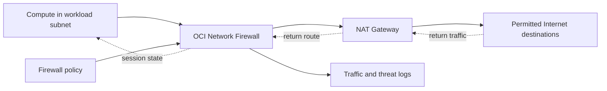
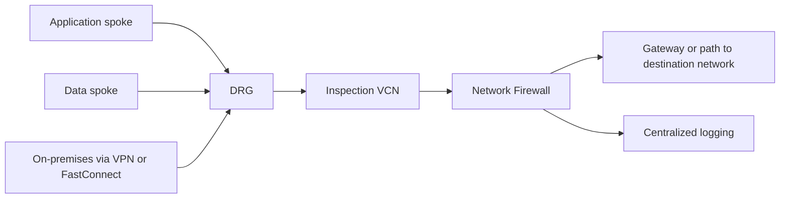

# Network Firewall and Centralized Traffic Control

## 1. The Problem to Solve

In Oracle Cloud Infrastructure (OCI), an application often spans multiple subnets, VCNs, or connects to on-premises systems over VPN/FastConnect. If each team opens its own Internet path and sets rules per server, the organization struggles to answer three questions: which control point did the traffic traverse, which policy allowed it, and where should evidence be collected during an incident?

**OCI Network Firewall** is a managed network firewall service used to inspect and control traffic according to policy. The service helps establish a centralized control point for traffic flows routed through it. Centralization does not come from merely creating a firewall: it requires combining network topology, routing, policies, IAM permissions, and monitoring.

This lesson belongs to the **Network and Host Security** chapter and focuses on:

- Distinguishing Network Firewall from NSGs, security lists, WAF, and host-based firewalls.
- Routing traffic through the firewall in both outbound and return directions.
- Building policies based on sources, destinations, services, and deep inspection needs.
- Organizing centralized control for a single VCN and a multi-VCN hub–spoke model.
- Verifying paths, policy actions, availability, and operational costs.

The running example is an application running on OCI Compute in a private subnet. The application needs to download updates from permitted destinations, connect to an internal database, and must not open arbitrary Internet connections. The security team manages the firewall and policies; the platform team manages connectivity and route tables; the application team manages the workload.

## 2. Where Does Network Firewall Sit in the Defense Architecture?

### 2.1. Control Layers Have Different Purposes

| Component | Primary scope | Typical role |
| --- | --- | --- |
| NSG | VNICs/resources placed in the group per service support | Allow necessary network connectivity to or from a group of resources |
| Security list | VNICs within the subnet affected by the list | Allow network traffic at the subnet scope |
| OCI Network Firewall | Traffic actually routed through the firewall | Enforce centralized policies, inspect traffic, and apply configured protection features |
| WAF | Web traffic passing through the corresponding HTTP/HTTPS protection point | Protect web applications based on application-layer characteristics and requirements |
| OS firewall | Specific host or network namespace | Restrict connections to processes and interfaces on the host |
| IAM | Administrative operations on OCI resources | Define who can create or update firewalls, policies, route tables, and logs |

OCI NSGs and security lists are allow-rule sets; they are not ordered deny/allow rule lists like a dedicated firewall's policy. When multiple security lists/NSGs apply simultaneously, the union of those allow rules must be evaluated. Do not assume that a group lacking an allow rule will override an allow rule in another group.

Network Firewall is a separate enforcement layer along the traffic path. A connection may be allowed by an NSG yet still be blocked by the firewall. It may also be allowed by the firewall yet blocked by the host firewall or the application's listener configuration.

### 2.2. Control Plane and Data Plane

- **Control plane** includes creating the firewall, editing policies, updating route tables, IAM, and logging.
- **Data plane** consists of the actual packets or connection sessions traveling from source to destination.

Successfully creating a firewall resource is a control-plane success. For the data plane to be inspected, routes must direct traffic to the firewall and the policy must match. A firewall in an active state that does not sit on the traffic path will not protect that path.

### 2.3. What the Firewall Does Not Do Automatically

Creating a Network Firewall does not automatically:

- Change the default route of application subnets.
- Remove public IPs from Compute instances or disable other direct Internet paths.
- Route all internal VCN traffic through the firewall.
- Establish connectivity between unconnected VCNs.
- Replace a NAT Gateway, Internet Gateway, or DRG.
- Configure TDE, volume encryption, or database account security.
- Enable reading full TLS payloads merely by enabling inspection on TCP/443.

The firewall can only inspect what actually traverses it and what the configured inspection mechanisms are capable of observing.

## 3. Components of OCI Network Firewall

### 3.1. Firewall and Firewall Policy

**Firewall** is the resource deployed in a selected subnet, possessing network details so routes can direct traffic to it. **Firewall policy** contains the objects and rules that determine how traffic is handled.

Separating these two concepts helps answer the right questions during troubleshooting:

| Question | Component to inspect first |
| --- | --- |
| Do packets reach the firewall? | Route tables, gateways, DRG, and firewall endpoint |
| Which rule set is the firewall applying? | Association between the firewall and its policy |
| Which rule matches the connection? | Content, ordering, and conditions of security rules |
| Can encrypted data be inspected? | Decryption policy, certificates, and TLS session characteristics |
| Have changes taken effect yet? | Resource state, work requests, and read-back verification |

Policies can use reusable objects such as address lists, service lists, or URL lists depending on service capabilities. Application support, object types, quantity limits, and update behavior must be confirmed for the specific region, API/provider, and deployed configuration. Do not treat a conceptual design as proof that every attribute is available in every environment.

### 3.2. Traffic Handling Actions

When designing policies, distinguish the following semantics:

- **Allow**: permits traffic according to the rule's semantics.
- **Drop**: discards traffic; the source typically observes a timeout.
- **Reject**: denies with a protocol-appropriate response when this action is supported.
- **Intrusion detection**: inspects and logs threats; does not imply actively blocking every detected threat.
- **Intrusion prevention**: inspects and applies blocking actions according to the configured protection mechanism.

API field names may represent intrusion inspection using an inspect action paired with an inspection type. When automating, use the exact schema of the resource in use; do not treat the conceptual labels above as raw JSON payloads.

Do not assume an Allow rule already has IPS enabled. If the objective is intrusion inspection, you must verify the inspection selection and the corresponding threat log evidence.

### 3.3. Stateful Firewall and Symmetry Requirements

The firewall tracks connection state. For a TCP session, both the forward path and return path must traverse the appropriate inspection point so the firewall can correlate packets with the same session.

Example of an incorrect path:

```text
Outbound: Workload -> Network Firewall -> NAT Gateway -> Internet
Return:   Internet -> NAT Gateway -> Workload
```

The return path bypassed the firewall. Depending on the topology and state handling, connections may fail or lose the intended inspection coverage. Therefore, the design must define both directions, not merely add a default route on the source subnet.

## 4. Designing a Single-VCN Egress Control Lab

### 4.1. Illustrative Addresses and Resources

| Component | Illustrative value |
| --- | --- |
| VCN | `10.60.0.0/16` |
| Workload subnet | `10.60.10.0/24`, private subnet |
| Database subnet, used in the east–west section | `10.60.20.0/24`, private subnet |
| Firewall subnet | `10.60.100.0/24`, dedicated to the firewall in the lab |
| Firewall private address | `10.60.100.10`, assumed value after creation |
| Test Compute | `10.60.10.10`, no public IP |
| Internet egress path | NAT Gateway |

The firewall address in the table is only for explaining the path. During deployment, retrieve the actual endpoint and route target identifier published by OCI for the real firewall. When routing to a private IP, select the proper private IP object; do not substitute an IP string or policy OCID into a field requiring a private IP OCID.

The firewall subnet is separated from workloads to simplify permissions, routing, and operations. NAT Gateway is a VCN gateway resource, not a NAT server placed inside the firewall subnet.



NAT Gateway provides an outbound path with source address translation and handles corresponding return traffic. The firewall enforces policy inspection; it does not replace the NAT role merely by sitting in front of the gateway.

### 4.2. Required Routing Matrix

For the illustrative egress topology, design the routes as follows:

| Where route table is applied | Destination | Expected next hop |
| --- | --- | --- |
| Workload subnet | `0.0.0.0/0` | Network Firewall private endpoint |
| Firewall subnet | `0.0.0.0/0` | NAT Gateway |
| Route table for ingress traffic into VCN from NAT Gateway | `10.60.10.0/24` | Network Firewall private endpoint |
| Firewall subnet, returning to workload | `10.60.10.0/24` | Local path to workload, not looping back to firewall |

The last row expresses a path requirement. In this topology, VCN local routing can satisfy it; adding an explicit custom route is unnecessary if local routing already handles it correctly. The key is not sending the workload destination back to the firewall itself or the NAT Gateway.

A route table attached to a gateway to control traffic entering the VCN differs from the route table attached to the workload subnet. When configuring the return path, verify the actual association on the NAT Gateway and ingress routing capabilities of the chosen topology. Editing only the firewall subnet's route table cannot substitute for this step.

### 4.3. Tracing a Session Hop by Hop

Assume Compute opens an HTTPS connection to an allowed test server:

1. Compute sends to the Internet destination address. The workload subnet's default route selects the firewall.
2. The firewall checks the policy and session state. If permitted, the packet is forwarded per the firewall subnet's route.
3. The route to the Internet selects the NAT Gateway. The gateway translates the address for outbound connectivity.
4. Reply packets arriving at the NAT Gateway are mapped back to the source Compute instance.
5. The route table for VCN ingress traffic from the gateway sends reply packets through the firewall.
6. The firewall recognizes the return leg of the session and forwards it to the workload over the local path.

At each hop, inspect the effective routes and applied network controls. Workload NSGs/security lists, host firewall, and listeners can still affect connectivity. For managed service subnets or endpoints, follow the supported network requirements of that service; do not assume every endpoint supports attaching NSGs like a Compute VNIC.

### 4.4. Three Common Routing Mistakes

**Routing loop:** the firewall subnet's default route points back to the firewall itself. Already-inspected traffic loops back to the inspection point instead of reaching the NAT Gateway.

**Asymmetry:** the workload's default route goes through the firewall, but the return route from the gateway goes directly to the workload.

**Bypass path:** a more specific route or another Internet path sends part of the traffic around the firewall. Longest-prefix match can cause a `/32` route or specific service route to win over the default route.

Do not fix these errors by broadening Allow rules. When packets take the wrong path, loosening policies usually fails to address the root cause.

## 5. East–West Control Within the Same VCN

Traffic between internal subnets normally has direct VCN local routing. A default route `0.0.0.0/0` through the firewall does not automatically push internal connections through the firewall, because internal destinations have more specific routes.

If connections from the application to a database in another subnet must be inspected, you must design corresponding intra-VCN routing. Logical requirements example:

| Subnet | Destination | Desired path |
| --- | --- | --- |
| Workload `10.60.10.0/24` | Database `10.60.20.0/24` | Through firewall |
| Database `10.60.20.0/24` | Workload `10.60.10.0/24` | Through the same firewall |
| Firewall subnet | Both application/database subnets | To destination subnet, without self-looping |

Use sufficiently specific destination routes supported by OCI to steer internal paths. Before applying, reconcile against local routes and any existing custom routes. Confirm the source and destination genuinely reside in the two subnets to be controlled; do not assume modifying a subnet route table can force traffic between two hosts in the same subnet through a firewall outside the subnet.

Once routing is correct, the firewall should permit only the database port actually needed. For instance, if the application uses Oracle Database over TCPS on a configured port, allow that exact port from approved application subnets/addresses. Do not open all common Oracle Database ports simultaneously by default.

Database-side NSGs still restrict valid sources. A centralized firewall helps control and observe inter-subnet paths; it does not replace TLS configuration, database authentication, or SQL privileges.

## 6. Building Policies from Business Requirements

### 6.1. Creating a Connectivity Matrix Before Writing Rules

A good request describes source, destination, protocol, purpose, owner, and duration. Avoid vague requests such as "open Internet so the application works."

Example matrix for the lab:

| Flow | Source | Destination | Service | Purpose |
| --- | --- | --- | --- | --- |
| Software updates | Test workload | Approved update server list | TCP/443 | Download update packages |
| Database transactions | Test workload | Internal database endpoint | Configured TCPS port | Business transactions |
| Name resolution | Sources genuinely traversing firewall | Approved DNS resolver | UDP/TCP per DNS config | Valid name resolution |
| Other connections | Controlled scope | Remaining destinations | Remaining services | Deny by design |

OCI-provided DNS or metadata services may have separate platform access paths, such as link-local addresses. Do not assume those flows traverse the firewall merely because the workload has a default route through the firewall. Include them in firewall rules only after confirming their actual path and control capability.

### 6.2. Using Named Objects with Clear Scopes

Conceptual objects can be organized as follows:

```text
SRC_APP_LAB       = approved workload address or CIDR
DST_UPDATE_TEST   = update destination addresses within test scope
DST_DATABASE      = approved database endpoint or CIDR
SVC_HTTPS         = TCP/443
SVC_DB_TCPS       = TCP/actual database TCPS port
```

This is a design notation, not OCI policy import syntax. When translating into address lists, service lists, or other objects, use the exact types supported by the policy.

IP address lists and URL lists do not have the same semantics. If a domain uses multiple IPs, a CDN, or changing addresses, IP-based rules may be incomplete or overly broad. Conversely, URL filtering requires application-layer data that the firewall can actually inspect; do not substitute one object type for another merely because they represent the same business service.

### 6.3. Rule Ordering and Actions

Example logical ordering:

| Priority | Condition | Expected action |
| --- | --- | --- |
| 10 | DNS flow confirmed to traverse firewall, to approved resolver | Allow or inspect per design |
| 20 | `SRC_APP_LAB` to `DST_UPDATE_TEST` over `SVC_HTTPS` | Inspect with intrusion prevention mode if configured |
| 30 | `SRC_APP_LAB` to `DST_DATABASE` over `SVC_DB_TCPS` | Allow or inspect per database requirements |
| 900 | Remaining traffic within policy scope | Drop, while collecting appropriate traffic logs |

Security rules are ordered; an early broad rule can shadow specific rules placed later. When implementing the design in OCI, check exact rule positions, relationships with other rule types, and default policy behavior. Place an explicit terminating rule when the policy mechanism allows, rather than relying on an assumption about defaults.

Error example: placing `SRC_APP_LAB -> Any -> Any -> Allow` ahead of a rule blocking unapproved destinations. The broad Allow rule defeats egress restriction even though the blocking rule remains in the list.

A rule change must clarify how existing sessions are handled. Do not assume editing a policy immediately terminates all existing TCP sessions. Test with new connections and verify the service's policy update behavior.

### 6.4. Intrusion Inspection Requires Separate Evidence

Moving from network allowlists to intrusion inspection adds traffic analysis capabilities. You must specify which rules apply inspection, detection vs. prevention mode, how threat logs are recorded, and the workflow for handling false positives.

A request blocked due to a wrong port does not prove IPS is working. Similarly, the absence of threat logs during a routine HTTPS test does not prove IPS is broken. IPS testing must use benign test methods authorized in the environment and aligned with service capabilities; do not scan or attack unmanaged Internet systems.

## 7. HTTPS and Limits of Inspecting Encrypted Data

### 7.1. TCP/443 Does Not Equal Full URL Inspection

A connection to TCP/443 can be identified at the level of addresses, ports, and certain protocol metadata. That does not mean the firewall can read the full HTTP path, headers, or downloaded payload inside TLS.

When the requirement is "allow downloads only from a specific set of URLs," determine what data is observable in the current mode. Hostname visibility may have limitations; newer encryption mechanisms or protocols can reduce visible metadata. Do not use a successful port test to conclude that a URL policy is enforced.

### 7.2. TLS Decryption Is an Architectural Change

When using TLS decryption supported by Network Firewall, you must design both the decryption policy and related certificate/key management. Two directions commonly distinguished are inspecting outbound connections in a forward proxy model and inspecting inbound connections to organization-managed servers.

Issues that must be addressed include:

- Certificate and private key sources appropriate for the decryption mode.
- Client trust stores and deployment processes for organization-approved CAs.
- Applications using certificate pinning, mutual TLS, or authentication mechanisms incompatible with intermediary decryption.
- Exceptions for data or services prohibited from decryption by organizational policy.
- Impact on performance, latency, and incident troubleshooting.
- Read permissions for certificate/secret material by supported components, without leaking keys into logs or pipeline output.

Do not disable client TLS certificate verification as a long-term workaround. When HTTPS fails after enabling decryption, check the trust chain, exceptions, and decryption mode before broadening network policies.

## 8. Centralized Control in a Hub–Spoke Model

### 8.1. Role of the Inspection VCN and DRG

When multiple VCNs need a shared inspection point, an inspection VCN containing the firewall can be built with a Dynamic Routing Gateway (DRG) interconnecting the networks. Each spoke holds a workload group; the hub holds the inspection point and shared connectivity paths per design.



The diagram only illustrates components. A DRG has multiple attachments and multiple route tables; there is no single route automatically applying to all directions. You must separately design paths entering the inspection VCN, post-inspection paths, and return paths.

### 8.2. Route Layers That Must Be Synchronized

| Layer | Question to answer |
| --- | --- |
| Spoke subnet route table | Is traffic needing inspection routed to the DRG? |
| DRG route table attached to source attachment | Is that destination routed to the inspection attachment or straight to another network? |
| Inspection VCN attachment route table | Does traffic entering the VCN reach the firewall? |
| Firewall subnet route table | After inspection, which gateway/DRG/internal target do packets go to? |
| Post-inspection DRG route table | Does it select the right destination attachment without looping back into inspection? |
| Return routes | Do they traverse the same inspection point matching session state? |

DRG route import distributions can introduce direct paths between spokes or to on-premises networks. Therefore, inspect effective routes, not just declared import policies. An unintended imported route can create a bypass even with a strict firewall policy.

Do not assume attaching all VCNs to the same DRG means traffic is centrally inspected. Inspect both DRG attachment route tables and VCN/subnet route tables.

### 8.3. Policy Segmentation and Responsibilities

Centralization does not mean all workloads share one overly broad source rule. Policies should still recognize source/destination zones or CIDRs corresponding to environments, applications, and trust levels.

For example, a development environment may reach a staging software repository but must not connect to the production database. The network path may share the hub, yet the policy must enforce that separation.

Avoid assuming source addresses remain preserved across every hop. NAT, load balancers, or intermediary devices can alter the address the firewall sees. Identify where address translation occurs before using source CIDR as a segmentation criterion.

## 9. Routing Ingress Through the Firewall Deliberately

Internet traffic to a public application has different requirements than egress. Before placing a firewall on the ingress path, identify whether the public endpoint is a load balancer, network load balancer, host, or another component, and how source/destination addresses change along the path.

The design must explicitly state:

1. Which gateway or endpoint receives external connections.
2. Which route directs traffic to the firewall before the protected target.
3. How post-inspection traffic reaches the frontend/backend.
4. Whether return traffic traverses the same firewall and preserves required state.
5. Which path health checks and administrative connections follow.

Do not copy an egress-via-NAT-Gateway matrix verbatim for public ingress. A NAT Gateway is not a service-publishing entry point for inbound Internet-initiated connections. If HTTP-layer web protection is needed, combine WAF and other layers according to objectives; do not expect Network Firewall alone to replace all WAF capabilities.

## 10. Controlled Deployment Workflow

### 10.1. Preparation and Authorization

Document the compartment housing the firewall/policy, the network and workload compartments, region, deployment subnet, planned paths, and owners responsible for each change type.

IAM should separate permissions to manage firewalls/policies from permissions to alter routes or gateways. Someone authorized to edit policies without managing routes can still heavily impact traffic traversing the firewall; someone authorized to alter routes can create a bypass without ever touching policies.

Grant only the necessary permissions within the required scope. Logging permissions, log retention, and certificate/secret read access (if using TLS decryption) must also be defined. Do not grant tenancy-wide privileges to resolve an isolated missing-permission error.

### 10.2. Order of Operations

1. Back up current network configurations and maintain an independent admin path for recovery if workloads lose connectivity.
2. Create subnets and foundational resources per the approved topology.
3. Create the firewall policy, objects, and rules required for the test.
4. Create the firewall attached to the policy; wait for the active state.
5. Read back the firewall ID, policy, endpoint address, and status.
6. Enable required log types and confirm log access permissions.
7. Prepare forward routes, return routes, and post-inspection paths.
8. Cut over one test subnet or narrow scope first; do not switch all production paths simultaneously.
9. Run allow, deny, and return-path tests while observing logs.
10. Expand scope once evidence is verified, while continuing to monitor errors and latency.

Do not route live traffic into an empty or incomplete policy and plan to add essential rules afterward. Understand default behavior and prepare a rollback path before switching routes.

### 10.3. Automation

The following Terraform snippet only illustrates the firewall–policy association in a project with the OCI provider and input variables already configured:

```hcl
resource "oci_network_firewall_network_firewall_policy" "central" {
  compartment_id = var.security_compartment_id
  display_name   = "central-inspection-policy"
}

resource "oci_network_firewall_network_firewall" "central" {
  compartment_id             = var.security_compartment_id
  subnet_id                  = var.firewall_subnet_id
  display_name               = "central-inspection-firewall"
  network_firewall_policy_id  = oci_network_firewall_network_firewall_policy.central.id
}
```

This snippet does not include security rules, decryption, logging, or route tables; it is not a complete traffic control system. In real deployments, add the resources matching your provider version, sequence dependencies properly, and switch routes only after the policy is ready.

Inspect the plan to distinguish in-place updates from resource replacement. Replacing a firewall may change the route target endpoint; do not check only the display name. Keep route, policy, and certificate changes traceable alongside configuration versions.

## 11. Verifying Paths and Policy Behavior

### 11.1. Reading Back Control-Plane Configuration

The OCI CLI examples below use Bash, with the CLI authenticated and set to the right region. These are configuration read commands; replace placeholders with your test environment's OCIDs.

```bash
FIREWALL_OCID='<NETWORK_FIREWALL_OCID>'
POLICY_OCID='<NETWORK_FIREWALL_POLICY_OCID>'
RT_WORKLOAD_OCID='<WORKLOAD_ROUTE_TABLE_OCID>'
NAT_GATEWAY_OCID='<NAT_GATEWAY_OCID>'

oci network-firewall network-firewall get \
  --network-firewall-id "$FIREWALL_OCID"

oci network-firewall network-firewall-policy get \
  --network-firewall-policy-id "$POLICY_OCID"

oci network route-table get \
  --rt-id "$RT_WORKLOAD_OCID"

oci network nat-gateway get \
  --nat-gateway-id "$NAT_GATEWAY_OCID"
```

Reconcile the policy attached to the firewall, resource status, route rules, and gateway route table associations. Continue inspecting related route tables and security rules via the Console or API; policy metadata retrieval does not necessarily include every child rule object in full.

If prior operations generated work requests, check their final status. An API acknowledgement or IaC tool reporting command submission is not proof that the data plane has finished applying changes.

### 11.2. Testing from Compute in the Workload Subnet

Prepare two test HTTPS servers controlled or authorized by the team: one destination on the allowlist and one outside the allowlist. Both must work normally from an independent test path to avoid mistaking a broken target server for a firewall block.

```bash
ALLOWED_TEST_HOST='<ALLOWED_TEST_HOST>'
DENIED_TEST_HOST='<DENIED_TEST_HOST>'

curl --connect-timeout 5 --max-time 15 \
  -I "https://${ALLOWED_TEST_HOST}/"

curl --connect-timeout 5 --max-time 15 \
  -I "https://${DENIED_TEST_HOST}/"
```

Do not use flags that skip TLS certificate verification. Choose targets supporting the HEAD method or replace with a valid test request supplied by the application team.

Expectations:

- The permitted destination completes the connection and returns an appropriate response.
- The unpermitted destination is handled per the deny rule, with corresponding log evidence.
- No direct path exists from the workload to the gateway bypassing the firewall.

A timeout by itself does not prove the firewall blocked the connection. An HTTP `403` may also come from the target server or another web protection layer. Reconcile the actual destination address, timestamp, and control-point logs.

### 11.3. Minimum Test Suite

| Test | What to prove |
| --- | --- |
| New connection to permitted destination/port | Bidirectional routing and allow rule work |
| New connection to unpermitted destination | Deny rule takes effect, no bypass |
| Connection to unpermitted port on an approved host | Policy is not merely checking overly broad destination addresses |
| Internal database connection | East–west flow follows design and opens only the needed service |
| Data-transfer session with multi-packet replies | Return path and session state work, not just initial SYN |
| Domain resolving to multiple IPs | Actual resolved addresses are handled within intended policy scope |
| Controlled policy modification | New connections reflect updated configuration after application completes |
| Required platform/admin flows | DNS, agent updates, or incident recovery paths are not inadvertently broken |

If IPv6 is enabled, design and test IPv6 traffic according to component support. Testing only `0.0.0.0/0` and IPv4 policies is insufficient to prove a dual-stack network is controlled.

### 11.4. Logs and Observability Tools

Combine evidence sources:

| Source | Practical value | Limitations to remember |
| --- | --- | --- |
| Firewall traffic logs | Reconcile flows and actions per log fields | Requires enabling the right log type, scope, and accounting for ingestion delay |
| Firewall threat logs | View events from threat inspection mechanisms | Not every legitimate connection generates a threat event |
| VCN Flow Logs at supported points | Observe network flows and decisions at the corresponding control layer | Does not substitute for conclusions about URLs, payload, or IPS |
| Audit and work requests | Identify who changed what, when, and operation outcomes | Does not prove a specific application session traversed the firewall |
| Application and OS logs | Confirm connections, TLS errors, listeners, and transactions | Must be correlated with network evidence to pinpoint root cause |

When querying logs, use timestamps with explicit timezones, source/destination addresses and ports, protocol, firewall resource, policy/rule, or action where provided by the log schema. Do not assume field names are identical across all log types.

Traceroute is only a supporting signal. Firewalls or gateways may not respond as traceroute expects, so missing a hop does not imply traffic bypassed the firewall. Limited packet captures on test Compute instances can observe handshakes or retransmissions, yet host captures alone do not prove which firewall policy matched.

## 12. Diagnosing Common Failures

| Symptom | Causes to check | Verification direction |
| --- | --- | --- |
| All Internet destinations time out | Wrong routes, firewall not active, missing essential rules, NAT, or wrong return path | Read back associations and routes hop by hop before loosening policy |
| Only certain destinations bypass inspection | More specific route, another gateway, direct peering, or uncontrolled IPv6 | Check effective routes, address families, and actual path per destination |
| TCP handshake or session stalls | Asymmetry, session state, MTU, or another network component | Reconcile forward/return paths, logs, and retransmissions |
| Policy has Allow rule yet connection fails | Earlier rule matched, wrong object, firewall attached to different policy, or failure at another layer | Confirm active policy, rule order, and actual addresses/ports |
| Traffic succeeds but no threat logs appear | No threat triggered, logging not enabled properly, or rule does not run inspection | Check inspection mode and run a supported benign test |
| HTTPS fails after enabling decryption | Client does not trust CA, pinning/mTLS, or missing exception | Inspect trust chain and decryption design; do not disable client TLS checks |
| Policy edited yet old sessions behave unchanged | Existing established session or change still applying | Check work requests and test with a new connection |
| No logs at the firewall | Traffic did not traverse firewall or logging misconfigured | Separate routing verification from log configuration verification |
| Internal apps still connect directly | Only Internet default route configured | Design bidirectional intra-VCN routing if east–west inspection is needed |

Investigation should proceed from read-back configuration, bidirectional paths, and rule matching, before moving to deep inspection and application checks. Changing multiple rules and routes simultaneously eliminates the ability to isolate which change caused or fixed an issue.

## 13. Availability, Rollback, and Cost

### 13.1. Managed Services Still Require Operational Design

OCI manages the Network Firewall service infrastructure, yet the customer remains responsible for topology, policies, routes, certificates, and inspection scope. Do not configure routes to assumed internal nodes; use endpoints supported by the service.

Assess the impact if the firewall becomes unavailable, a policy is wrong, or paths to gateways/DRG fail. Do not assume the network will automatically route around the firewall or fail open. When mandatory inspection is the goal, an uncontrolled bypass path may violate the design even if it restores connectivity.

Across multiple regions, prepare firewall resources, policies, routing, and logging per region. A firewall in one region does not automatically inspect flows in another region. DR drills must include traffic control verification, not just spinning up workloads.

### 13.2. Rollback Plans Must Be Concrete

Before switching routes, record previous route rules, associations, and policies along with the restoration sequence. Maintain an administrative path that does not depend entirely on the flow under test to avoid losing remediation access.

If rollback returns traffic to a direct path, explicitly define whether that is a permitted system state, its maximum duration, and compensating controls. Do not automatically create a bypass as a default reaction to every alert.

After rollback, re-test new sessions and return paths. Restoring a single route table is insufficient if gateway associations or DRG route tables were also changed.

### 13.3. Cost of Centralized Control

Estimate costs based on the service's actual billing model and configuration rather than a fixed figure across all regions and times. Components to consider include the firewall, processed traffic volume, logging/log retention, gateways, inter-network/inter-region data transfer, and test resources.

Centralizing many flows can increase blast radius, processed throughput, and latency along a single path. TLS decryption, inspection, and log volume must be evaluated under representative load. Do not infer throughput capacity or convergence time from a single successful `curl` command.

Set appropriate log retention and read permissions. Network logs can contain sensitive information about accessed destinations or system topology; collect, retain, and share them strictly according to defined operational needs.

## 14. Comprehensive Lab Exercise

### 14.1. Preparation

Use a test tenancy or compartment, a private workload subnet, a dedicated firewall subnet, a NAT Gateway, and a Compute instance without a public IP. Budget for firewall, logging, and lab resource costs before creation.

Prepare permitted and denied HTTPS destinations within the authorized test scope. If practicing east–west inspection, add a test database or service in a second subnet. Do not use a production database just to test network rules.

### 14.2. Execution

1. Diagram outbound and return paths, noting the route table attached to each subnet/gateway.
2. Create a policy with specific source/destination objects, required rules, and deny behavior for remaining traffic.
3. Create the firewall, wait until active, and read back its policy/endpoint.
4. Enable traffic logs and threat logs per lab objectives.
5. Prepare firewall and gateway routes; transition the test workload through the firewall according to plan.
6. Test permitted and unpermitted destinations/ports using new connections.
7. Reconcile results against logs; do not conclude based solely on timeouts or HTTP status codes.
8. Check for more specific routes, paths via other gateways, and IPv6 if present to identify bypasses.
9. If performing east–west testing, configure bidirectional routing and prove database traffic traverses the intended inspection point.
10. Practice rollback within the lab scope, verifying both connectivity and security posture after restoration.
11. Clean up resources in dependency order: remove routes pointing to resources slated for deletion, confirm no active traffic remains, then delete lab resources and handle logs per retention policy.

Do not delete a firewall while routes still point to it. A functionally completed lab that leaves a nonexistent next hop behind can disrupt other resources continuing to use that VCN.

### 14.3. Completion Criteria

| Item | Passing condition |
| --- | --- |
| Scope | Correct region, compartment, subnets, and flows requiring control identified |
| Routing | Next hops explained for both directions, no loops or unintended shortcuts |
| Policy | Distinguishes allow, deny, and inspection; rule order and default behavior verified |
| Egress | Permitted destinations work; unpermitted destinations handled properly with log evidence |
| East–west | If in lab scope, bidirectional routing and service-specific database rules exist |
| TLS | Does not confuse TCP/443 checks with full URL/content inspection; decryption requirements described |
| Monitoring | Can correlate admin changes, traffic logs, and application outcomes over time |
| Recovery | Controlled rollback executed without leaving routes to a deleted firewall |
| Cost | Billable resources identified and remaining lab resources cleaned up |

## 15. Core Principles to Keep

Centralized control is only achieved when in-scope flows actually traverse Network Firewall, policies enforce intended goals, and the system produces operational evidence. Routing determines whether the firewall sees the traffic; policy determines how seen traffic is handled.

In OCI, you must coordinate subnet route tables, gateway ingress routing, and DRGs when topology requires; always design return paths and look for routes creating bypasses. Maintain NSGs, host hardening, TLS, IAM, and appropriate database controls. Each layer holds its own responsibility, and completion tests must prove both valid connectivity and the rejection of out-of-scope traffic.
