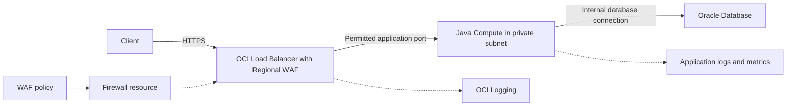

# Web Application Firewall and Web Application Protection

In the **Network and Host Security** chapter of the `CLOUD_PROVIDERS_ORACLE` module, this lesson explains how to use OCI Web Application Firewall to control HTTP traffic, detect common web attack patterns, and deploy blocking mechanisms that can be observed, tuned, and recovered.

The running scenario is a Java application running on OCI Compute in a private subnet, accessing an Oracle database over an internal network path. Users call the application through an OCI Load Balancer. The operations team needs to restrict malicious requests while preserving legitimate login, search, file upload, and API integration flows.

The hands-on focus is **Regional WAF attached to OCI Load Balancer**. Edge WAF is introduced so learners can distinguish architecture, terminology, and feature scope.

After this lesson, learners can:

- Place WAF properly within a defense-in-depth architecture.
- Distinguish WAF policy, firewall resource, rule, condition, and action.
- Design access control, protection rules, body inspection, and rate limiting.
- Transition rules from observation to blocking based on evidence from legitimate traffic.
- Verify enforcement using real requests, WAF logs, and application logs.
- Prevent bypass paths around the protection point and control blast radius when changing policies.

## 1. What Does a WAF Protect in a Web Application?

WAF inspects properties of web traffic against a configured policy. OCI WAF provides protection capabilities against patterns such as SQL injection and cross-site scripting (XSS). The service supports enforcement models both regionally and at the edge. [Overview of Web Application Firewall](https://docs.oracle.com/en-us/iaas/Content/WAF/Concepts/overview.htm).

A request valid at the network layer can still carry malicious content:

```text
TCP 443 allowed through NSG
    -> valid TLS handshake
    -> HTTP request with suspicious parameters or payload
    -> WAF applies policy before the request is forwarded to the application
```

An NSG permitting TCP 443 is not responsible for understanding search query strings, JSON payloads, or XSS patterns. Conversely, a WAF is not a mechanism for SSH administration, OS patching, or database data-access authorization.

| Protection layer | Primary responsibility in this lesson's scenario |
| --- | --- |
| NSGs and security lists | Restrict source, destination, protocol, and port at the network level |
| TLS | Protect the connection and verify identity per trust configuration |
| WAF | Apply HTTP controls and detect request patterns per policy |
| Java application | Authentication, authorization, input validation, and business logic |
| Database | Account privileges, safe queries, and data access controls |
| Host protection | Patching, service configuration, accounts, and process monitoring |

For example, parameterized queries in Java remain necessary even when the WAF has SQL injection rules enabled. A WAF can reduce the risk of exploiting a class of flaws, but it does not fix concatenated SQL strings in source code.

A WAF also cannot inherently understand full ownership of an order. A request reading another user's order may be completely valid in HTTP syntax; the application must enforce authorization on that specific object.

## 2. Distinguishing Regional WAF and Edge WAF

### 2.1. Regional WAF on Load Balancer

A WAF policy is a regional protection configuration. A firewall resource binds the policy to an enforcement point—in this lesson, an OCI Load Balancer. One policy can be shared across multiple Load Balancers in the same region; Network Load Balancers and TCP listeners are not compatible targets for this WAF policy. [Getting Started with Web Application Firewall Policies](https://docs.oracle.com/en-us/iaas/Content/WAF/Policies/getting_started_with_waf-policies.htm).

The listener must handle HTTP at the application layer. To serve HTTPS, configure TLS on the appropriate HTTP listener so the Load Balancer processes decrypted traffic. Do not expect the WAF to read HTTP inside a TLS stream forwarded intact via TCP passthrough.

Regional WAF can protect either public or private applications on a compatible Load Balancer. Consequently, internal API protection requirements can also fall within this architecture's scope. [Oracle hands-on guide for WAF on Flexible Load Balancer](https://docs.oracle.com/en/learn/oci-waf-flex-lbaas/index.html).

### 2.2. Edge WAF

With Edge WAF, clients connect through edge infrastructure, and the edge forwards requests to the origin. Configuration typically involves domains, DNS, and controlling connection sources to the origin. This is a different deployment model from attaching a Regional WAF to a Load Balancer. [Getting Started with Edge Policies](https://docs.oracle.com/en-us/iaas/Content/WAF/Concepts/gettingstarted.htm).

Challenge features such as JavaScript challenges, human interaction, or CAPTCHA are documented under the Edge Policies workflow. Do not assume those steps and features apply to regional policies without confirming support. [Managing Edge Policies](https://docs.oracle.com/en-us/iaas/Content/WAF/Tasks/managingwaf.htm).

| Aspect | Regional WAF in this lesson | Edge WAF |
| --- | --- | --- |
| Enforcement point | Integrated with Load Balancer in the region | Edge infrastructure in front of the origin |
| Attachment | Policy and firewall resource | Edge policy, domain, and origin |
| Traffic path | Client to WAF-attached Load Balancer | Client to edge, then to origin |
| Verification focus | Rules, association, and paths to backend | DNS, TLS, edge policy, and direct origin access |

When reading documentation, confirm whether you are in the **WAF Policies** or **Edge Policies** section. States, action names, APIs, logging, and limits should not be extrapolated from one type to the other.

## 3. Sample Architecture and Controlling Bypass Paths



The diagram depicts logical roles. Regional WAF is an integration on the Load Balancer, not a Compute instance that learners manually insert into a route table.

### 3.1. Do Not Leave the Backend with an Unprotected Public Path

If the application still has a public IP exposing port 8080, a request can go straight to Compute without passing through the WAF-attached Load Balancer. A legacy hostname or secondary Load Balancer without a policy attached can also create a bypass path.

A reference design:

| Resource | Designed ingress flow |
| --- | --- |
| Load Balancer | Frontend ports genuinely required by clients |
| Backend Compute | Application port from the appropriate Load Balancer group or source |
| Database | Database port from the application group needing access |
| Host administration | Dedicated, controlled management path |

With NSGs in the same VCN, a source NSG can be referenced in security rules to express the relationship between the Load Balancer and the backend. You must check resource support and include required health check traffic. [Managing Security Rules for an NSG](https://docs.oracle.com/en-us/iaas/Content/Network/Concepts/manage-nsg-security-rules.htm).

Inspect all associated security lists and NSGs. Rules applied to a VNIC combine additively; adding a restrictive NSG does not automatically cancel out a broad rule allowing traffic in another security list. [Security Rules](https://docs.oracle.com/en-us/iaas/Content/Network/Concepts/securityrules.htm).

### 3.2. Inventory All Entry Points

List all hostnames, listeners, public IPs, backup endpoints, and internal paths. For each entry point, record whether WAF is required, which policy protects it, and who owns verification.

An origin is only considered locked against bypass when tests from unauthorized sources cannot reach the application directly. A request via the primary hostname being blocked by WAF does not prove this.

With Edge WAF, in addition to the backend, the origin itself must be protected against direct connections bypassing the edge. Follow Edge WAF's current connection-source model and origin requirements; do not use an arbitrary client-supplied header as sole proof that a request came from the edge.

### 3.3. Separate Request Protection from Connection Protection

TLS certificates on the frontend do not automatically encrypt the Load Balancer–backend hop. If the architecture requires TLS on that hop, separately configure certificates and peer verification for the backend. WAF is only one part of the HTTP processing pipeline and does not replace TLS design between components.

## 4. Policy, Rules, and Actions Must Be Read Together

### 4.1. Configuration Objects

| Object | Role |
| --- | --- |
| WAF policy | Contains access control, rate limiting, protections, and actions configurations |
| Firewall resource | Binds the policy to the Load Balancer requiring enforcement |
| Rule | A control unit with a defined scope and action |
| Condition | Criteria determining when the rule applies |
| Action | How processing continues, logs, or returns a response when a rule matches |
| Network address list | Set of IP addresses or CIDRs used within the policy |

Creating a policy without binding a firewall resource to the right Load Balancer does not protect the request path. Similarly, an attached policy whose rules lack the appropriate scope may fail to handle the intended endpoint.

### 4.2. General Processing Order

For a request passing through the relevant steps without being terminated, the module order of a regional WAF policy is:

```text
requestAccessControl
    -> requestRateLimiting
    -> requestProtection
    -> backend processes request
    -> responseAccessControl
    -> responseProtection
```

Module ordering and rule ordering within each module affect the outcome. In particular, response-side processing occurs after the backend may already have executed an operation. [WAF Policies Processing Order](https://docs.oracle.com/en-us/iaas/Content/WAF/Policies/getting_started_with_waf-policies.htm).

Therefore, do not rely on replacing a response with an error code as a guarantee that a data write did not take place. When you need to stop a request from reaching the application, block it in the appropriate request-side stage.

### 4.3. Meaning of the Three Actions

| Action | Behavior |
| --- | --- |
| Allow | Skips the remaining rules within the current module |
| Check | Logs the match result and continues rule evaluation |
| Return HTTP response | Terminates request or response processing and returns the configured response |

`Allow` does not mean bypassing the entire WAF policy. `Check` on one rule also does not guarantee a request will reach the backend if another rule still blocks it. When returning a response on the request side, the request is not forwarded to the backend by that action. [Actions for Web Application Firewalls](https://docs.oracle.com/en-us/iaas/Content/WAF/Actions/actions_management.htm).

Design responses suitable for clients. You might choose 403 for access control or 429 for rate limiting in this lesson's configuration; these are operational choices, not the default outcome of every rule. Avoid responses containing stack traces, database table names, or detailed descriptions of internal detection signatures.

## 5. Access Control and Endpoint Conditions

OCI WAF uses JMESPath for rule conditions and exposes request, response, and connection data for evaluation. [Understanding Conditions](https://docs.oracle.com/en-us/iaas/Content/WAF/Concepts/understanding_conditions.htm).

Example lab condition matching an exact path:

```text
http.request.url.path == '/__waf_lab__/blocked'
```

Attaching this condition to a request access rule with an action returning 403 gives the operations team an enforcement test independent of SQL injection or XSS signatures. A condition alone does not block; the paired action determines behavior.

Example condition for a lab API designed to use only GET, POST, and OPTIONS:

```text
starts_with(http.request.url.path, '/api/') && !contains(['GET', 'POST', 'OPTIONS'], http.request.method)
```

This is an example of method restriction for a specific API. Do not apply that list to an API requiring PUT, PATCH, or DELETE. Also verify CORS preflight, payment callbacks, webhooks, and integration tools.

### 5.1. Watch Out for Condition Breadth

A prefix condition `/admin` can match `/administrator` when using string prefix matching. An exact path might miss a trailing slash or child routes. Design scope according to actual routing, then test all URL representations accepted by the system.

Do not assume every proxy layer and application normalizes URLs identically. When investigating a request, compare the path representation seen by the WAF against the route actually handled by Java.

### 5.2. IP Address Is Not User Identity

If a CDN or reverse proxy sits in front, the connection source address seen by the WAF may be the proxy's address. A client-supplied `X-Forwarded-For` header is untrustworthy if the proxy chain does not control overwriting, appending, and source validation.

Before using IP addresses for restrictions or exceptions, confirm which address the WAF evaluates in the actual configuration. Account for users behind NAT, corporate proxies, and IPv6 if supported by the architecture.

Geo or ASN can serve as traffic filtering signals, but they do not replace authentication. Do not treat geographic conditions as proof that a request belongs to a specific corporate account.

## 6. Protection Rules: Application-Specific Selection and Exception Tuning

Protection rules use protection capabilities provided by OCI. Regional WAF policies do not offer custom protection rules in the sense of writing arbitrary protection signatures; this differs from writing custom conditions for access rules. Select capabilities and versions from the current list in the Console. [Request Protection Rules](https://docs.oracle.com/en-us/iaas/Content/WAF/Protections/protections_management.htm).

For the Java application in this lesson's scenario, you can evaluate groups related to SQL injection, XSS, anomalous paths, protocol compliance, and the technology stack in use. Select based on risk and actual request shapes; do not treat enabling as many capabilities as possible as a guarantee of safety.

### 6.1. Two Types of Mismatch to Track

- **False positive:** a legitimate request is flagged as malicious or blocked.
- **False negative:** a malicious request is not detected or stopped by the active rules.

False positives can occur when users save HTML snippets in an editor, search text containing special characters, or submit strings resembling SQL syntax inside a document. You must inspect endpoint context and authorization rather than looking only at a suspicious string.

A request pattern passing through also does not prove it is safe. The application must still enforce size limits, schema validation, parameterized queries, and context-appropriate output encoding.

### 6.2. Observe First, Block with Scope

A reference rollout approach:

1. Select capability groups tailored to the application and record detection goals.
2. Put the evaluated capabilities into an appropriate Check behavior.
3. Collect traffic representative of business flows and client types.
4. Investigate matched patterns and classify them as legitimate or invalid.
5. Create narrow exceptions or refine scope when clearly justified.
6. Move validated capabilities to blocking behavior and re-test.

Check both the rule action, capability-level overrides, and other actions in the policy. One rule in Check mode does not put the entire policy into observe-only mode.

### 6.3. Exceptions Must Have Owners and Boundaries

For a content-editing endpoint, an exception may need to be scoped by host, path, method, and the relevant data field. Depending on OCI exclusion support, combine rule scoping with supported exclusions; do not assume every condition dimension fits inside a single exclusion box.

An exception design record might include:

```text
Reason: valid HTML content in the description field
Route scope: authenticated content editing endpoint
Field scope: description field to be processed
Affected capability: investigated ID and version
Owner: application team
Review condition: schema or application version change
Exception expiration date: per operational plan
```

This is change-governance metadata, not a JSON schema submitted directly to OCI. Avoid disabling SQL injection or XSS groups application-wide just to accommodate one specialized field.

## 7. Request Body Inspection and Limits on Inspected Data

Per current OCI documentation, request bodies are not inspected by protection rules by default; body inspection must be enabled on the relevant rule. The WAF buffers the body before forwarding, and the configurable inspection byte limit ranges from 0 to 8,192 bytes. You must choose the action taken when a body exceeds the limit. [HTTP Request Body Inspection](https://docs.oracle.com/en-us/iaas/Content/WAF/Protections/request-body-inspection.htm).

A key point is that **the inspection limit is not the upload size limit accepted by the application**. If configured to inspect only the initial portion and continue, the remainder does not carry the same assurance of protection-rule analysis.

| Design choice | Trade-off to evaluate |
| --- | --- |
| Inspect body within limit and continue | Supports large data streams, but leaves a portion uninspected |
| Return response when limit exceeded | Limits uninspected payload exposure, but may block valid uploads |
| Separate endpoints with different body types | Enables business-aligned tuning, requires managing additional rules |

For instance, a small JSON API can enforce stricter limits than a document upload endpoint. However, the upload endpoint still needs size limits, file-type validation, access controls, and scanning at the application or processing service layer. The WAF does not automatically act as a malware scanner for all uploaded files.

Test with the exact `Content-Type`—JSON, form, or multipart—used by the application. Do not use query string test results to conclude that JSON bodies are being inspected.

Body buffering can alter latency and upload handling characteristics. Measure impact on legitimate requests, especially streaming or long uploads; consult the limits of the exact policy type in use rather than applying Edge WAF limits to Regional WAF.

## 8. Rate Limiting for Costly or High-Risk Endpoints

Regional WAF rate limiting caps request frequency per client IP address. You can configure the request count, time window, and action duration; rules also support conditions to scope traffic. [Rate Limiting](https://docs.oracle.com/en-us/iaas/Content/WAF/RateLimiting/rate_limiting_rule_management.htm), [Adding a Rate Limiting Rule](https://docs.oracle.com/en-us/iaas/Content/WAF/RateLimiting/create_rate_limiting_rule.htm).

Endpoints commonly needing separate evaluation include login, password reset, resource-intensive search, and report export. Do not use a single threshold for the entire website when images, background APIs, webhooks, and user actions have different traffic profiles.

### 8.1. Thresholds Derived from Real Behavior

Suppose a legitimate search endpoint normally sees at most a few requests per second per user session, yet many users share a corporate NAT IP. Setting a per-IP threshold calculated for a single person will mistakenly block the entire group.

Consider:

- Bursts when a page loads multiple parallel requests.
- Traffic from NAT gateways, proxies, integration systems, and monitors.
- Action duration affecting subsequent requests.
- Automatic SDK or client retries after errors.
- Possibility of an attacker distributing load across many IPs.

IP-based rate limiting is one control layer. For per-account or per-tenant quotas, add limits at an identity-authenticated layer. Do not rely on an unauthenticated account ID header as grounds for rate-limit exemption.

### 8.2. Do Not Use Rate Limits as Exact Business Counters

Measure actual enforcement behavior in the deployed architecture, including concurrent traffic and multiple processing points. Do not assume a rate rule acts as a globally exact transaction counter for billing, service quotas, or entitlement consumption.

The application still needs timeouts, concurrency limits, backpressure, and controls on expensive queries. A WAF also does not replace all network-layer DDoS protections.

## 9. Deploying Regional WAF in a Test Compartment

### 9.1. Preparing Permissions and Baseline

Prepare a working Load Balancer, an application-layer HTTP listener, healthy backends, and a separate administrative path. For HTTPS, certificates and TLS settings must be working before using HTTP results to evaluate the WAF.

OCI uses resource types such as `waf-policy`, `web-app-firewall`, `waf-network-address-list`, and the aggregate family `waf-family`. Example read-only role for regional resources:

```text
Allow group WafObservers to read waf-policy in compartment AppSecurity
Allow group WafObservers to read web-app-firewall in compartment AppSecurity
```

The policies above do not grant permissions to modify WAF, edit Load Balancers, or read logs. Grant administrative and logging permissions according to actual duties, verifying conditions for each relevant API and resource. [Policy Details for Web Application Firewall](https://docs.oracle.com/en-us/iaas/Content/Identity/Reference/wafpolicyreference_topic-Details_for_WAF_Policies.htm).

Record the application baseline: error rate, latency, critical routes, and health check results. Do not start from an unhealthy backend and blame every 5xx response on the WAF.

### 9.2. Creating the Policy and Enforcement Point

In the OCI Console:

1. Select the correct region and lab compartment.
2. Create a regional WAF policy with a name and tags indicating ownership.
3. Review actions, default actions, and built-in rules before adding configurations.
4. Create a firewall resource linking the policy to the lab Load Balancer.
5. Wait for the operation to complete, then read back the policy and firewall resource.
6. Enable WAF logging and send requests to verify the enforcement path.

There is no need to enable blocking across bulk protection capabilities yet. First prove the right policy is attached to the right request path.

### 9.3. CLI to Read Status and Create the Lab Association

PowerShell example, assuming the lab policy is already created and all OCID variables belong to the test environment:

```powershell
$wafPolicyId = '<LAB_WAF_POLICY_OCID>'
$firewallId = '<LAB_WEB_APP_FIREWALL_OCID>'

oci waf web-app-firewall-policy get --web-app-firewall-policy-id $wafPolicyId
if ($LASTEXITCODE -ne 0) { throw 'Failed to read WAF policy' }

oci waf web-app-firewall get --web-app-firewall-id $firewallId
if ($LASTEXITCODE -ne 0) { throw 'Failed to read firewall resource' }
```

These are two separate read commands for the policy and the firewall resource. [CLI policy get](https://docs.oracle.com/en-us/iaas/tools/oci-cli/latest/oci_cli_docs/cmdref/waf/web-app-firewall-policy/get.html), [CLI firewall get](https://docs.oracle.com/en-us/iaas/tools/oci-cli/latest/oci_cli_docs/cmdref/waf/web-app-firewall/get.html).

If you have not created the firewall resource via the Console and the lab Load Balancer does not yet have a corresponding association, you can use:

```powershell
$compartmentId = '<LAB_COMPARTMENT_OCID>'
$loadBalancerId = '<LAB_LOAD_BALANCER_OCID>'

oci waf web-app-firewall create-for-load-balancer --compartment-id $compartmentId --load-balancer-id $loadBalancerId --web-app-firewall-policy-id $wafPolicyId --display-name 'lab-java-waf'
if ($LASTEXITCODE -ne 0) { throw 'Check firewall creation result and work request' }
```

Creation uses a work request to track progress. After an initial response or timeout, read back the resource and operation status before attempting to create again. [CLI create-for-load-balancer](https://docs.oracle.com/en-us/iaas/tools/oci-cli/latest/oci_cli_docs/cmdref/waf/web-app-firewall/create-for-load-balancer.html).

Do not use the create-association command as a blind retry when a resource may already exist. Record OCIDs and outcomes of each change batch to avoid duplicate configurations or targeting the wrong environment.

## 10. Lab Exercise: Verifying Enforcement and Legitimate Traffic

The following tests are sent only to lab endpoints controlled by the learner. Broad vulnerability scanning is unnecessary to prove a rule works.

### 10.1. Preparing Two Test Routes

The lab application should expose safe read routes `/__waf_lab__/blocked` and `/__waf_lab__/rate`, initially returning success. These route names are lesson conventions, not built-in OCI endpoints.

Before adding blocking rules, call each route to record the baseline. Then create a request access rule with the exact path condition from section 5 and an action returning 403 for `/__waf_lab__/blocked`.

Assume DNS and TLS for `app.lab.example.com` are already configured in the lab:

```powershell
$baseUrl = 'https://app.lab.example.com'

curl.exe --silent --show-error --connect-timeout 5 --max-time 15 --output NUL --write-out 'HTTP=%{http_code}\n' "$baseUrl/health"
curl.exe --silent --show-error --connect-timeout 5 --max-time 15 --output NUL --write-out 'HTTP=%{http_code}\n' "$baseUrl/__waf_lab__/blocked"
```

Replace `/health` with the application's actual health check route. If using a private CA, provide the appropriate trusted CA to curl instead of disabling TLS verification.

Expected result once the rule is applied: the health route still returns normally; the blocked route receives 403 per the configured action. Also check logs to confirm the response was generated by the request access rule, not an existing 403 from the application.

### 10.2. Demonstrating the Difference Between Check and Block

Switch the same test rule to Check, wait for the update to finish, and send the same request again. If no other layer blocks it, the request will reach the backend and receive the application's response; logs record that the rule matched.

Switch back to the blocking action and repeat the test. Compare both client-side responses and backend logs. Do not rely solely on seeing a rule-match log entry to conclude enforcement is active.

### 10.3. Testing a Rate Rule with Light Load

Create a rate rule targeting only `/__waf_lab__/rate`. For example, the lab might pick 5 requests in 30 seconds, an action duration of 10 seconds, and a 429 response. These values are test design choices, not OCI defaults or production thresholds.

Send a small burst of requests from the same test machine:

```powershell
1..8 | ForEach-Object {
    curl.exe --silent --show-error --connect-timeout 5 --max-time 10 --output NUL --write-out 'HTTP=%{http_code}\n' "$baseUrl/__waf_lab__/rate"
    Start-Sleep -Milliseconds 500
}
```

Observe when the rate rule's response appears and verify access recovers after the configured duration. Do not validate by mechanically assuming every architecture must block on the exact sixth request. Test additional clients or NAT paths as required.

### 10.4. Testing Protection and Body Inspection Separately

For selected capabilities, use the team's security test samples in a lab environment with test data. Record whether the payload is in the query, header, or body; inspect which rule matched and which action actually terminated the request.

For body inspection, test both a small valid body and a body exceeding the configured limit. Verify the oversize action matches the design; do not use a blocked query string as proof of full JSON or file upload inspection capability.

### 10.5. Re-running Legitimate Flows

Test login, searches with accented/Unicode characters, content with special characters, CORS, webhooks, and properly formatted uploads. Test from representative clients such as browsers, Java HTTP clients, and integration tools.

Add direct backend access tests from unauthorized sources and via secondary endpoints. Results must reflect the designed architecture, not just the primary hostname.

## 11. Logging, Event Correlation, and Alerting

Enable firewall logs in OCI Logging. If centralized analysis is needed, Connector Hub can route logs to Log Analytics under a separate configuration; deploying that entire pipeline is not mandatory to start observing. [Setting Up Firewall Logging](https://docs.oracle.com/en-us/iaas/Content/WAF/Protections/setting_up_logging_analytics.htm).

In regional WAF logs, useful fields include `request.id`, `request.path`, `response.code`, `responseProvider`, and matched rules groups. `backendStatusCode` helps correlate upstream responses when corresponding data exists. [Details For Web Application Firewall Logs](https://docs.oracle.com/en-us/iaas/Content/Logging/Reference/details_for_lbwaf.htm).

### 11.1. Investigating a Blocked Response

A reference investigation flow:

1. Record timestamp, host, path, method, and any correlation ID available from the client.
2. Search logs for the right firewall, region, and time window.
3. Inspect the response provider and relevant module/rule.
4. Cross-check Load Balancer and application logs if needed.
5. Classify whether it was caused by an access rule, rate rule, protection rule, the application, or an upstream layer.
6. Determine whether a legitimate request was falsely blocked or an intended target was properly stopped.

An HTTP status code alone does not identify the root cause. A 403 can come from the WAF or the application; a 429 can come from a rate rule or a backend service. If a failure occurred at DNS, TCP, or TLS before HTTP, do not always expect a corresponding WAF log entry.

### 11.2. Metrics Must Tie to Business Operations

The following metrics are observability design goals, not default OCI metric names:

| Metric | Meaning |
| --- | --- |
| Traffic by host, route, and client group | Recognize load shifts and client profiles |
| Block rate per rule | Detect newly introduced rules having abnormal impact |
| Confirmed blocked legitimate requests | Measure false positives with business evidence |
| Application latency and error rate | Identify impact following policy updates |
| Login, payment, or webhook failures | Detect disruption to critical flows |
| Entry points without WAF attached | Track coverage gaps |

A spike in blocks may indicate a real attack or a frontend release changing request shapes. Do not use an increased block count as sole proof that a new configuration is better.

### 11.3. Log Data Also Needs Protection

Paths or matched data can contain sensitive information. Do not put passwords, tokens, or personal data in query strings; do not dump full Authorization headers or session cookies into investigation reports.

Restrict log read permissions, retention periods, forwarding destinations, and access to stored data. Correlation IDs should be handled consistently across layers; an arbitrary client-supplied header does not become a trusted system identifier on its own.

## 12. Operating Policy Changes, Rollback, and Cost Control

### 12.1. Start with Small, Evaluable Changes

A policy shared across multiple Load Balancers has a large blast radius. Before editing, list every firewall and application using the policy. If applications have different profiles, consider splitting policies or scoping conditions explicitly.

Store desired configurations in the team's change management workflow, read the current configuration before updating, and verify results after applying. With APIs or IaC, check the schema for the exact resource and use concurrency control mechanisms when supported. Do not submit a stripped-down configuration that wipes out active rules or actions.

A change record should specify: which rule changed, relevant capability/version, legitimate traffic tested, logs to watch, and concrete rollback steps. Keep administrative access separate from the application call path so an API-blocking rule does not lock operators out of fixing the policy.

### 12.2. Root-Cause Rollback

If legitimate requests are mistakenly blocked after a change, stop expanding rollout and identify the exact rule generating the response. You can restore the modified rule configuration, switch the specific capability back to Check, or narrow the condition based on evidence.

Do not randomly switch one rule to Check when responses are coming from another rule or an oversize body action. Do not expose the backend publicly to let users bypass the WAF while investigating.

If the traffic is genuinely an attack, disabling the entire WAF to reduce error counts removes the very control protecting the system. Coordinate between application owners and security to make narrow adjustments, retain necessary controls, and fix the root cause in the application or backend.

### 12.3. WAF Is a Risk-Reduction Layer; the Application Must Still Be Fixed

When a new vulnerability emerges, an appropriate rule can serve as temporary mitigation while deploying a patch. Confirm the exact endpoint, request shape, and detection coverage; do not treat a rule as proof that all exploit variants are blocked.

After patching, re-run functional and security tests, and evaluate whether to keep or adjust the rule based on risk. Business authorization flaws, exposed secrets, host configurations, and database issues still need remediation at the layer that owns them.

### 12.4. Resource and Data Volume Control

Budget based on traffic volume, resource counts, logging, storage, and selected analytics services. Check current pricing tables when estimating real costs; do not assume WAF or the entire log pipeline is always free.

Limit the duration of lab load runs, retries, and test requests. Choose retention aligned with investigation needs, control data forwarded via Connector Hub, and clean up test resources once dependencies are gone. Do not delete a policy shared by multiple applications simply because one lab Load Balancer has finished.

## 13. Deployment Pitfalls to Recognize

| Symptom | Causes to check | Resolution direction |
| --- | --- | --- |
| Policy exists yet no enforcement seen | Firewall resource not created or attached to wrong Load Balancer | Check OCIDs, region, and actual association |
| Cannot attach to Network Load Balancer | Wrong enforcement point chosen for Regional WAF | Use a compatible Load Balancer and listener |
| One rule is Check yet requests still blocked | Another module, capability override, or body limit action | Locate the response source in logs |
| Allow rule does not skip protections | Allow only terminates rules within the current module | Design an exception scoped to what needs tuning |
| Query inspected yet JSON body passes through | Body inspection not enabled or inspection limit insufficient | Check the exact rule, body type, and limit |
| Corporate users hit rate limit together | Multiple users sharing a NAT IP or proxy | Adjust threshold, scope, and app-layer identity limits |
| Valid uploads fail after change | Oversize action, buffering, or related limits | Check upload path and endpoint-specific conditions |
| Backend called directly | Public IP, secondary listener, or overly broad security rules | Close bypass paths and re-test from unauthorized sources |
| 5xx spike without corresponding blocks | Backend, TLS, or network failure | Check health, Load Balancer logs, and application logs |
| Editing one app breaks multiple apps | Shared policy with broad scope | Track consumers and separate scopes appropriately |

## 14. Lab Completion Criteria

The lab meets requirements when evidence exists for both protection effectiveness and application availability:

- The right regional policy is associated with the right Load Balancer in the chosen region.
- Exact-path test requests are blocked by the expected rule, with logs confirming the response provider.
- When switching the test rule to Check, observed behavior matches the remaining rules.
- Critical legitimate flows continue succeeding through the WAF.
- Body inspection and oversize actions are verified independently.
- Rate limiting is verified under light load, including evaluation of NAT or proxy impact.
- Backend and secondary entry points create no unintended bypass paths.
- Appropriate IAM permissions, logging, alert owners, and concrete rollback steps are defined.
- Plans exist for application patching, host hardening, database controls, and lab resource cleanup.

The required outcome is not merely a policy in an active state. The WAF must sit on the right request path, enforce the right rules, preserve legitimate traffic, and provide enough evidence for operations to understand why any request was allowed or blocked.
