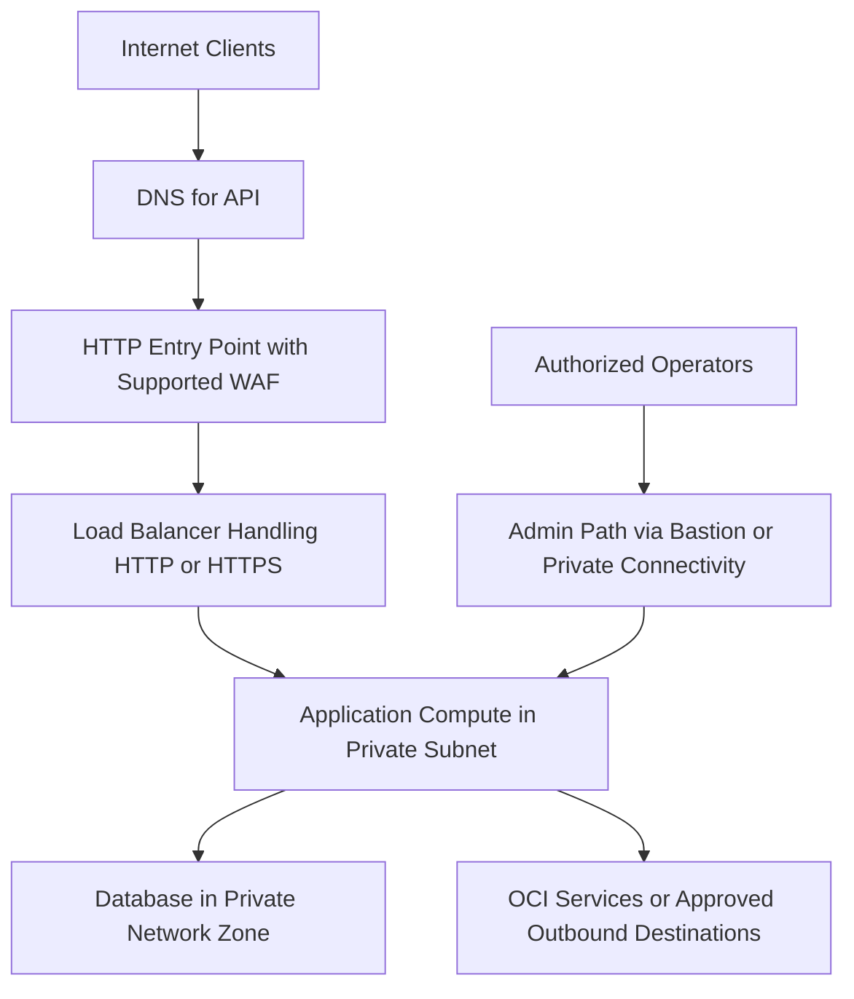

# DDoS Protection and Attack Surface Reduction Design

## 1. Objectives and OCI Context

A system with HTTPS can still go down if the network path, load balancer, application workers, or database connection pool runs out of resources. Conversely, adding more Compute instances does not fix an exposed administrative port or an endpoint capable of triggering an extremely expensive query.

Within the **Network and Host Security** chapter of the Oracle Cloud Infrastructure (OCI) track, this lesson combines tenancy, compartment, IAM, VCN, Load Balancer, Compute, and data services to design defense in depth. Objectives include maintaining availability, minimizing directly reachable resources, observing impact, and controlling costs during traffic spikes.

After this lesson, you can:

- Distinguish network/transport-layer DDoS from HTTP-layer and application-resource abuse.
- Choose the right roles for OCI infrastructure protection, WAF, NSGs, security lists, and host-level controls.
- Design controlled entry points, private backends, and isolated administrative paths.
- Prevent origins or secondary listeners from becoming bypass paths around protection layers.
- Collect evidence, respond to incidents, and verify configurations using small test traffic in an authorized environment.

**DDoS — Distributed Denial of Service** — is the degradation or loss of service caused by traffic or requests generated from multiple sources. Attack surface reduction is reducing the number of resources, protocols, ports, endpoints, and privileges accessible to unintended actors. Both support each other, yet neither replaces the other.

## 2. Identifying Attack Types and Bottlenecks

### 2.1. Not All Traffic Spikes Are Alike

| Scenario group | Exhausted resource | Primary defense direction |
| --- | --- | --- |
| High-volume network-layer traffic | Bandwidth and packet-processing capacity | Infrastructure/network-layer protection in front of workloads, coordinating with provider when needed |
| Transport-layer attacks, such as TCP connection pressure | Connection state, queues, and connection-handling resources | Network/transport protection, proper load balancer configuration, and timeouts |
| HTTP floods or continuous bot calls | HTTP processing capacity of WAF, Load Balancer, and application | WAF, traffic control, caching, and concurrency limits |
| Low-rate but expensive requests | CPU, memory, connection pools, queries, or downstream services | Per-request cost limits, timeouts, resource caps, and authorization |
| Abuse of login, search, or billable APIs | Accounts, backend, and budget | Identity/function quotas, anomaly detection, and bot mitigation per supported capabilities |
| Legitimate load spike | Actual serving capacity | Forecasting, caching, bounded scaling, and business prioritization |

A report taking minutes to generate can consume more resources than thousands of requests for static content. Therefore, requests per second is an indicator, not a complete measure of severity.

Distinguish DDoS from deployment bugs, DNS errors, expired certificates, slow databases, or business events generating genuine load. Enabling broad blocking before identifying the root cause can disrupt legitimate users.

### 2.2. Defining Protection Objectives

Before selecting rules, explicitly document:

- Which functions must stay operational, such as login and transaction processing.
- Which functions can be deprioritized, such as large report exports.
- Success metrics: valid transaction success rate, latency, error counts, and recovery time.
- Capacity limits of Load Balancers, backends, databases, and dependent services.
- Acceptable cost during a traffic surge.

Do not use "the WAF blocked many requests" as the sole conclusion. If legitimate transactions still fail because the database ran out of connections, the availability objective has not been met.

## 3. Protection Layers in OCI

### 3.1. Infrastructure Protection and Customer Controls

OCI provides infrastructure-layer DDoS protection for network/transport traffic types within service scope. This is part of the platform, not proof that every form of HTTP abuse or application configuration is automatically handled.

Customers remain responsible for configuring entry points, HTTP protection, minimizing public endpoints, controlling application resources, and preparing incident response. Do not assume specific bandwidth thresholds, mitigation times, or cost commitments without verifying the applicable service and agreement.

| Component | Role | Limitations to understand |
| --- | --- | --- |
| OCI infrastructure protection | Detects/mitigates network and transport attacks via platform mechanisms | Does not replace API authorization or limits on expensive queries |
| OCI WAF | Inspects and handles HTTP(S) at supported enforcement points | Not a firewall for all protocols or all public IPs |
| Load Balancer | Distributes requests, checks backends, and acts as a centralized entry point | Load balancing itself does not guarantee every request is valid |
| NSGs and security lists | Allow traffic by protocol, port, and source/destination | Do not understand SQL query semantics or HTTP business payloads |
| Host firewall | Protects host ports and adds host-level restrictions | Sits behind the network path; cannot rescue an already-saturated ingress path |
| Application and database | Limit processing cost, concurrency, and identity-based privileges | Must be designed specifically for each function |
| IAM and configuration governance | Restrict who can open ports, change WAF, or grant public access | Does not replace data-plane traffic filtering |

OCI offers different WAF models and resources with distinct deployment patterns. Confirm the enforcement point, supported Load Balancer or endpoint types, features, and logging capabilities before applying. Do not assume an edge WAF configuration and a policy attached to a Load Balancer protect an origin the same way.

### 3.2. One Device Should Not Carry Every Objective

Placing a network firewall or proxy machine in the path can add control, yet it also introduces capacity limits and availability dependencies. You must design routing, symmetric paths where state is required, scaling, and incident handling.

Putting a firewall on a small Compute instance behind the Internet path cannot replace upstream high-volume protection. Similarly, adding more backends only helps when the bottleneck can truly be load-balanced and downstream services still have capacity.

## 4. Designing Entry Points and Backends

### 4.1. Sample Architecture

Assume an order management application has an HTTPS API, runs on Compute, and uses Oracle Database.



The diagram shows logical roles. WAF can be enforced directly at the Load Balancer integration layer; a separate network hop between WAF and Load Balancer is not mandatory. Choose an actual deployment model and verify the entire request path.

Key principles:

1. Expose only necessary entry points, typically the HTTPS endpoint for business traffic.
2. Backends have no direct Internet path for application or administrative ports.
3. The database accepts traffic only from the required application group.
4. Administrative paths use authentication, time limits, and controlled access sources.
5. Outbound connectivity is designed by need, rather than opening all destinations for deployment convenience.
6. Resources are tied to compartments, owners, and auditable configurations.

Private subnets and NSGs do not automatically enable TLS. Encryption, certificate validation, and secret management must still be configured separately at each hop.

### 4.2. Minimum Connectivity Matrix

The example below uses an HTTP(S) Load Balancer acting as a proxy with backends in the same VCN. Application and database ports are illustrative choices only.

| Destination | Traffic to allow | Sources to restrict | Do not open out of habit |
| --- | --- | --- | --- |
| Public listener | TCP 443 | Permitted clients per service model; if using a separate edge, check edge sources | Backend administrative ports |
| Application backend | TCP 8443 in example | Load Balancer NSG or actual source supported by service | Entire Internet or whole VCN range when unnecessary |
| Database | Selected database service port | Application NSG or defined source | Internet user machines |
| Compute SSH | TCP 22 if needed | Permitted Bastion/private path per actual configuration | `0.0.0.0/0` and `::/0` |
| Health checks | Health check port and protocol | Backend-checking component | Publicly exposed admin endpoints |
| Outbound connections | Required destinations and ports | Workloads with legitimate needs | All protocols to all destinations |

Do not copy source rules from a proxy Load Balancer to a Network Load Balancer or a source-preserving mode without testing. The packet source seen by the backend may differ; policies must follow the actual data path.

### 4.3. NSGs and Security Lists Are Additive

In OCI, traffic can be allowed by security list rules applied to a subnet and NSGs associated with a VNIC. A restrictive NSG does not automatically override a permissive rule in a security list.

For example, a backend has an NSG allowing port 8443 only from the Load Balancer, while the subnet's security list allows the same port from `0.0.0.0/0`. If the backend still has a valid public network path, the broad rule can defeat source restriction.

When evaluating a port, check simultaneously:

- Public/private IPs and reachability of those addresses.
- Route tables, Internet Gateways, and intermediary components.
- All associated security lists and NSGs.
- Stateful/stateless rules and corresponding return traffic.
- Host OS firewall and the process actually listening.

NSGs and security lists are not ordered deny lists where a narrow line automatically overrides a broad line. Remove broad rules only after assessing impact and preparing the right replacement configuration.

### 4.4. IPv6 and Secondary Access Paths

Inspect IPv6 separately. Removing a broad IPv4 rule does not address an IPv6 rule allowing `::/0`. DNS AAAA records, IPv6 addresses, routes, and listeners must be included in the same public surface inventory.

Frequently overlooked secondary access paths include:

- Legacy public IPs on servers after migrating behind a Load Balancer.
- Test listeners or hostnames lacking required policies.
- Operational dashboards, admin APIs, debug ports, or overly detailed health endpoints.
- Public buckets, pre-authenticated access paths, and unexpectedly published backup files.
- Dev/test environments sharing data or credentials with production.

Not every public resource can or should sit behind the same WAF. For data services, use IAM and each service's native access controls.

### 4.5. Outbound Paths and Administrative Paths

A NAT Gateway serves certain outbound patterns for private workloads; it is not a WAF proxy for inbound traffic. A Service Gateway provides a path to supported OCI services per route configuration, not access to arbitrary Internet destinations.

Prefer administrative paths through OCI Bastion or appropriate private connectivity, with IAM, time-bound sessions, and scoped privileges. Separate operational accounts from application identities; do not allow administrators to modify WAF or open public IPs just to troubleshoot an application bug without impact assessment.

## 5. Avoiding WAF Bypass Paths

### 5.1. Know Where WAF Is Enforced

| Model | Risk to evaluate | Evidence required |
| --- | --- | --- |
| Reverse proxy/edge in front of public origin | Clients hit origin directly, bypassing edge policies | Origin accepts only valid sources/channels per supported model |
| WAF enforced at Load Balancer | Another entry path does not traverse the protected listener/resource | Policy is actually attached to the right Load Balancer and request path |
| Backend with public IP | Clients bypass both Load Balancer and WAF | Backend is unreachable directly from unauthorized sources |
| Multiple hostnames or listeners | A legacy endpoint lacks equivalent configuration | Inventory and test every entry point |

Do not conclude that calling a Load Balancer's IP directly always bypasses WAF. If the policy is enforced right on that Load Balancer, requests may still fall within inspection scope. Conversely, switching DNS to an edge does not automatically shut down the old origin.

Hiding the origin hostname is a secondary measure. Historical DNS, application configs, or other leaks can expose the address. Protection must rely on access controls or origin authentication mechanisms appropriate to the chosen service.

### 5.2. Preserving Accurate Client Identity

A proxy chain can cause the application to see the proxy address instead of the real user. Rate limiting on that address can lump all users into one bucket.

Identify which component generates or normalizes client info and which components are permitted to trust it. Do not directly trust an Internet-supplied header such as `X-Forwarded-For` as a reliable identity unless clear proxy rules are in place.

Even a genuine client IP has limits: many users may share NAT, while distributed bots can use many addresses. Combine network-layer signals with accounts, API credentials, tenants, and business behavior in the application.

## 6. Controlling HTTP Traffic and Application Resources

### 6.1. Phased WAF Rollout

A practical workflow includes:

1. **Select enforcement point:** confirm the exact resource, region, hostname, and listener in scope.
2. **Collect baseline:** understand valid endpoints, methods, request sizes, and client types.
3. **Enable needed capabilities:** access control, protection rules, or traffic controls supported by the WAF type.
4. **Observe before broad blocking:** use detection/logging actions if supported by the mechanism.
5. **Tune narrow exceptions:** scoped by endpoint, parameter, or verified condition.
6. **Block with control:** roll out incrementally, monitor valid transactions, and keep a rollback plan ready.
7. **Check alternate entry points:** do not let an alternate endpoint nullify policy enforcement.

Managed rules reduce operational toil yet still require false-positive evaluation. Do not disable an entire protection group just because one feature fails; isolate legitimate requests and tune exact conditions.

Capabilities such as bot mitigation, challenges, rate limiting, and response actions depend on the WAF type and supported configurations. In particular, browser-oriented challenges may not suit mobile apps, API clients, or webhooks.

### 6.2. Choosing Rate Limiting Units

| Limiting unit | Useful for | Limitations |
| --- | --- | --- |
| Properly identified IP | Throttling a single continuous sender | NAT can group users; distributed sources can evade limits |
| Account or API credential | Business usage quotas | Requires authentication and handling multiple credentials |
| Tenant/customer | Fair protection across usage groups | Must be designed for multi-tenant models |
| Endpoint or function | Isolating expensive tasks like search/reports | One global threshold may not fit all functions |
| Concurrent tasks | Protecting workers, DB pools, and downstream services | Requires timeouts, queues, and clear error responses |
| Request size or processing cost | Uploads, complex queries, billable actions | Must be checked at the right layer before consuming excessive resources |

WAF can enforce part of the policy upfront; the application must handle quotas requiring identity or business awareness. Do not assume every criterion in the table is a built-in OCI WAF configuration field.

An example threshold like "100 requests in a time window" is only meaningful when you know how the window is calculated, the grouping key, enforcement scope, and action on exceedance. Do not treat a configured threshold as an absolute guarantee on total requests, cost, or backend traffic at all times.

Applications can use HTTP 429 for quota-exceeded situations and indicate appropriate retry timing. Clients need bounded backoff with jitter; immediate retries from many clients can worsen load.

### 6.3. Limiting Per-Request Cost

Application design must control:

- Body size, file uploads, multipart counts, and request read timeouts.
- Pagination item counts, query complexity, and filter scope.
- Task execution time, database queries, and dependent service calls.
- Connection counts, threads/workers, and concurrent jobs.
- Queue sizes alongside rejection policies when full.
- Retry counts and total transaction timeouts.

For Java applications, check web server, executor, and connection pool settings together. Increasing threads while keeping an already-saturated database can increase wait times and memory usage rather than throughput.

Offloading long tasks to queues separates interactive requests from background processing, yet queues must have controlled capacity, quotas, and consumers. An unbounded queue merely moves the exhaustion point elsewhere.

### 6.4. Caching and Intentional Degradation Modes

Caching can reduce load for suitable content. Design cache keys, TTLs, cacheable data, and cache-miss behavior. Never mix personal data across users in caches.

Prevent cache stampedes: multiple concurrent expirations should not all trigger an expensive query. Use coordinated refresh, staggered TTLs, or serving stale data per business requirements.

Predefine degradation modes, such as temporarily throttling reporting while preserving core transactions. Circuit breakers and timeouts help prevent a dependency failure from cascading system-wide, though they must be calibrated to real traffic.

## 7. Reducing Attack Surface on Hosts and Services

### 7.1. Inventory of Services to Expose

Every public port or endpoint should have an owner, purpose, and access condition. If Internet access is unnecessary, move it to an appropriate private path or disable the service.

Items to inspect on Compute:

- SSH, RDP, database ports, and administrative tools.
- Management consoles, debug ports, JMX, and diagnostic endpoints.
- Admin APIs, endpoints like `/actuator` in applications using them.
- Default web servers, sample apps, and installed but unused services.
- Listeners bound to all interfaces when only an internal address is needed.
- Outdated software, images, and OS packages.

An obscure URL does not replace authentication. Conversely, a public health endpoint can return a simple status when needed, but must not leak stack traces, credentials, dependency lists, or network topology.

### 7.2. Host Protection and Workload Identity

Maintain patching, OS hardening, file permissions, and task-scoped service accounts. Restrict application processes from running with administrative privileges and protect configuration files containing secrets.

Prefer OCI-supported workload identities for calls to OCI services instead of placing long-lived personal credentials on hosts. Workload IAM policies should permit only required resources and actions.

For administrative flows, apply appropriate authentication, access logging, and privilege limits. Someone able to open a subnet-wide security list represents a major part of the administrative attack surface, even if the application port is currently closed.

### 7.3. Do Not Forget Databases, Storage, and Non-Prod Environments

Databases should have dedicated access paths and identities for applications, along with least privilege at the database layer. NSGs only govern network reachability; connecting entities must still be authenticated and authorized.

Object Storage requires checking public access, IAM, and pre-authenticated requests. A WAF in front of an application API will not fix a public bucket or revoke an unexpectedly published URL.

Scope dev/test permissions and data appropriately. A test machine with a public IP and production-read credentials can undermine a tightly protected production architecture.

## 8. Monitoring Serving Capacity and Cost

### 8.1. Measuring Across Multiple Layers

| Layer | Signals to watch | Questions to answer |
| --- | --- | --- |
| Entry point / WAF | Allowed, blocked, rate-limited requests; rules/actions and endpoints | Is the policy handling the right traffic types? |
| Load Balancer | Connections, throughput, response codes, latency, and backend health per available metrics | Is the bottleneck at the listener or backend? |
| Compute / application | CPU, memory, workers, queues, timeouts, and errors | Is the backend running out of processing capacity? |
| Database | Connections, query times, waits, and load via service tools | Can downstream resources handle application scaling? |
| Network | Flow logs and service-supported network signals | Do actual sources, destinations, and paths match design? |
| Business | Valid transaction success rate, completion time | Can real users continue using the system? |
| Cost | Traffic, logs, scaled resources, and observed spend | Is defense triggering unexpected cost growth? |

Use exact metric names and logging capabilities of actual resources; do not assume every OCI product exposes identical metrics. Flow logs are not HTTP payload records, and HTTP logs do not replace monitoring connection health or network paths.

### 8.2. Correlating Evidence

Combine OCI Monitoring, Logging, and Audit according to function:

- Monitoring supports tracking metrics and alarms.
- Logging collects enabled logs supported by services.
- Audit tracks administrative/API changes, such as policy or configuration edits.
- Client-side checks show availability from a specific access path.

Record timestamps in UTC, resource/OCID, hostname, relevant rule/action, and request ID if available. Distinguish event occurrence time from log ingestion time.

Do not log full tokens, passwords, sensitive payloads, or request bodies solely to investigate DDoS. Logging detail can be increased temporarily within a needed scope, paired with access controls, retention limits, and cost caps.

### 8.3. Actionable Alerts

An example alert set may include:

- Error rate or latency rising simultaneously as backend health degrades.
- Unusual spikes in WAF-blocked requests.
- Connection counts or concurrency approaching operational capacity.
- Expensive endpoints receiving far more requests than baseline.
- Unplanned changes opening ports, detaching WAF, or adding public IPs.
- Resources scaling up to configured caps.

Every alert needs a recipient and a first verification step. One static request threshold does not fit all times; compare against history, seasonality, and business metrics.

### 8.4. Autoscaling and Budgets

Autoscaling can help with legitimate load and some traffic pressure, yet requires caps on instance count, database capacity, scaling time, and scale-in conditions. Do not set a massive maximum just because you want the service to "never run out of resources."

OCI Budgets and cost alerts help track spending within service capabilities; do not treat a budget as a traffic kill switch or instantaneous hard cap. Billing data may arrive after costs are incurred.

Account for costs across WAF, Load Balancer, Compute, data transfer, logs, and dependent services. Agree upfront on permitted emergency scaling limits to avoid making budget decisions while the system is degraded.

## 9. Runbook When DDoS or Traffic Abuse Is Suspected

### 9.1. Verifying Impact and Root Cause

1. Check errors from a client and compare across multiple appropriate observation points.
2. Check whether legitimate transactions are failing; pinpoint bottlenecked endpoints and resources.
3. Review recent changes: DNS, certificates, WAF, NSGs, routes, deployments, and database.
4. Classify pressure primarily at network, connection, HTTP, or business-processing layer.
5. Save baseline state evidence before changing configurations.

Do not infer DDoS solely from high CPU. A bad query plan, background job, or retry bug can produce similar symptoms.

### 9.2. Mitigating at the Affected Layer

- For network/transport pressure, use OCI's available signals and mitigation mechanisms, coordinating with support per tenancy procedures when needed.
- For HTTP, apply scoped rules or limits; avoid blocking the entire API when only one function is abused.
- For expensive endpoints, lower concurrency, restrict parameters, temporarily degrade secondary features, or move tasks to controlled queues.
- For origin bypass paths, close the unauthorized path after confirming the valid path still works.
- For database pressure, throttle load in the application and protect connection pools; adding more frontends can worsen the situation.

Do not open the backend to the Internet or disable the entire WAF to resolve an unisolated false positive. Emergency changes still require an owner, scope, and rollback condition.

### 9.3. Verifying Effectiveness and Rolling Back When Needed

After each change, re-measure valid transaction rates, latency, resource usage, and blocked requests. Rules blocking many requests while dropping critical transactions must be tuned.

When legitimate requests are blocked, pinpoint the exact rule, condition, and request pattern. Exceptions should be narrow by endpoint, method, or verified attribute; do not create a broad bypass any client can claim via a header.

Record the sequence of changes to know what worked. If a measure worsens conditions, roll back that specific piece per plan rather than stripping away all controls.

### 9.4. Coordination and Post-Incident Review

Prepare UTC timestamps, region, affected resources, symptoms, metrics, request IDs, and changes made when escalating to operations or OCI support. Never include private keys or credentials in incident records.

After the incident, update baselines, capacity plans, rules, application limits, and the public surface inventory. Any temporary exceptions created must have an expiration date and an owner to confirm cleanup.

## 10. Hands-On Defense Verification with Low Request Volume

### 10.1. Environment and Conditions

Use a test application, a hostname you manage, and an HTTPS endpoint authorized for testing. Existing environments can be used; there is no need to create extra WAF, Load Balancer, or database resources without proper authorization and budget.

The lab's scope is verifying configuration and paths, not load-testing attack resilience with high traffic. Do not run floods, generate distributed spoofed sources, or call third-party resources.

Prepare:

- Diagram of the active WAF model and enforcement point.
- List of relevant public IPs, hostnames, listeners, and backends.
- Pre-change configuration snapshot along with rollback steps.
- Permissions to view metrics/logs and modify the exact lab resources.
- A simple health endpoint returning no sensitive data.

### 10.2. Pre-Change Inventory

In the Console or authorized management tools, verify:

1. Which entry point the WAF policy is actually attached to.
2. Which listeners and backends the Load Balancer has.
3. Whether backends have public IPs or alternate entry paths.
4. What all NSGs and security lists currently allow.
5. Routes, IPv4/IPv6, and administrative paths.
6. Whether databases or storage resources are unintentionally public.

Document the source → destination → port → purpose matrix. Every unexplained broad entry is an issue to fix, not something to leave open by default for compatibility.

### 10.3. Verifying Valid HTTPS

The commands below run in **Bash**. Replace the hostname with your environment's, and send only individual requests with bounded timeouts:

```bash
curl --silent --show-error \
  --connect-timeout 5 \
  --max-time 10 \
  --dump-header - \
  --output /dev/null \
  'https://api.lab.example.com/health'
```

Inspect the HTTP status code, TLS outcome, and corresponding logs. Do not add `-k` or `--insecure`. With an internal CA, configure the trusted CA via the proper mechanism instead of skipping certificate verification.

An HTTP 200 confirms the endpoint succeeded for that request; it does not prove the request traversed the WAF. Reconcile the policy, path, and observed evidence at the protection layer.

### 10.4. Testing a Narrowly Scoped WAF Rule

If the WAF type supports suitable conditions and actions, create a lab rule matching only when **all** of the following hold:

- A dedicated path, such as `/lab-waf-check`.
- Test header `X-Lab-Check: approved`.
- Lab source scope if configurable and appropriate to the model.

Configure an explicit block action or test response and log per supported capabilities. This rule verifies enforcement; it does not prove managed rule effectiveness against a real attack.

Send one request without the header and one request with the header:

```bash
curl --silent --show-error \
  --connect-timeout 5 --max-time 10 \
  --dump-header - --output /dev/null \
  'https://api.lab.example.com/lab-waf-check'

curl --silent --show-error \
  --connect-timeout 5 --max-time 10 \
  --header 'X-Lab-Check: approved' \
  --dump-header - --output /dev/null \
  'https://api.lab.example.com/lab-waf-check'
```

Reconcile the rule/action in logs with configured behavior. The non-matching request may receive 200 or 404 from the application depending on the endpoint; do not force the application to add a new feature just to return 200.

A standalone 403 does not prove the WAF blocked it: the application or another proxy could also return that code. Combine timestamp, test condition, and records from the exact enforcement layer.

### 10.5. Verifying the Origin Path According to Model

Test only endpoints and addresses you manage. If you need to preserve the TLS/HTTP hostname while connecting to a specific public IP, you can use:

```bash
curl --silent --show-error \
  --connect-timeout 5 --max-time 10 \
  --resolve 'api.lab.example.com:443:<PUBLIC_IP_TO_CHECK>' \
  --dump-header - --output /dev/null \
  'https://api.lab.example.com/health'
```

Replace the placeholder with a valid IP authorized for testing. The command preserves the hostname for certificate verification; do not switch to an IP URL and disable TLS verification.

Interpret according to the architecture:

- With an edge in front of the origin, accessing the origin from an unauthorized source must be denied by designed controls.
- With WAF on the Load Balancer under test, accessing that IP may still be protected. Use the test rule and logs to confirm.
- With private backends, there is no need to create a public IP just to run tests. Rely on configuration and tests from an authorized network location.

Do not take a timeout as sole proof that an NSG blocked traffic properly: routing errors, DNS issues, or a non-listening service can also cause timeouts.

### 10.6. Verifying Application Limits Without Heavy Load

Review timeouts, request size limits, worker counts, pools, and queues. If you need to verify behavior when limits are exceeded, use a small lab threshold approved by the environment owner and a bounded number of requests, then restore the configuration to the agreed state.

Do not use results from a small manual test to claim DDoS resilience. Large-scale load testing requires separate planning, boundaries, monitoring, and service usage compliance.

### 10.7. Results to Record and Lab Cleanup

| Item | Passing criterion | Evidence limitation |
| --- | --- | --- |
| Valid path | HTTPS works with verified certificate | Reflects only the tested request and location |
| WAF enforcement | Lab rule/action recorded accurately | Does not measure effectiveness against all attack types |
| Origin | Access state matches selected model | Must also inventory other hostnames/listeners |
| Backend | No public paths outside design | Check configuration together with combined effective rules |
| Application | Resource limits and overload behavior defined | Requires dedicated load testing to measure capacity |
| Monitoring | Can correlate test requests with logs and state | Not every layer provides identical logs/metrics |

Clean up test rules, exceptions, lab resources, and logs within authorized retention periods. Keep approved security improvements and final configuration evidence. Confirm the valid path still works after cleanup.

## 11. Automation and Handover Criteria

Managing WAF, NSGs, routes, and entry-point configs via reviewable workflows reduces drift between environments. When using IaC or pipelines, audit changes such as adding public IPs, broadening sources, detaching policies, or raising scaling limits.

A deployment pipeline should:

1. Verify assigned resources and scope.
2. Diff the before/after connectivity matrix.
3. Apply reversible changes.
4. Send a small set of test requests and check logs.
5. Verify both allowed paths and paths that must be denied.
6. Monitor metrics and transactions after changes.
7. Record owners alongside expiration dates for exceptions.

Automated configuration checks do not prove a system can withstand arbitrary traffic volumes. Combine them with planned capacity testing, incident drills, and dependency reviews.

Handover is ready when verified that:

- Public endpoints have clear purposes, owners, and protection layers.
- WAF applies at the right entry points, with sufficiently narrow exceptions.
- Backends, databases, and administrative paths are not exposed outside design.
- IPv4, IPv6, NSGs, and security lists have all been evaluated.
- Applications implement timeouts, concurrency limits, and load-shedding mechanisms.
- Monitoring reflects impact on legitimate users, not solely blocked request counts.
- Autoscaling, logs, and emergency actions carry appropriate cost caps.
- Runbooks exist for response, rollback, and post-incident exception cleanup.
