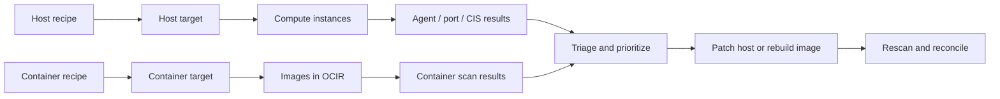

# Vulnerability Scanning for Hosts and Container Images

Within the **Network and Host Security** chapter of the Oracle Cloud Infrastructure (OCI) track, Vulnerability Scanning helps turn "servers and images might have vulnerabilities" into findings with specific resources, timestamps, and owners.

This lesson uses a Java service as an example: the application can run directly on Compute or be packaged as a container image in OCI Container Registry. The two deployment modes require two different scan scopes. The goal is to configure the right scope, interpret reports accurately, and complete the **detect → prioritize → remediate → verify** loop while controlling cost and availability.

## 1. What Problem Does the Service Solve?

OCI Vulnerability Scanning Service inspects Compute hosts and container images in Container Registry, generating reports on detected issues. Service resources and reports are region-scoped. [Source: Oracle — Vulnerability Scanning Overview](https://docs.oracle.com/en-us/iaas/Content/scanning/using/overview.htm).

A vulnerability management workflow must distinguish:

| Activity | Required output |
| --- | --- |
| Scanning | Findings on the right resource, with a defined configuration and timestamp |
| Analysis | Determining whether the resource is truly affected and its priority |
| Remediation | Patching, replacing images, fixing configuration, or applying mitigations |
| Verification | Evidence of post-change state |
| Governance | Assigned owner, due date, exceptions, and re-evaluation schedule |

The scanner supplies input to this workflow. A generated report does not patch servers automatically; a scanned image does not automatically make a pipeline block deployment.

"No vulnerabilities found" is only meaningful after confirming the scan succeeded, targeted the right resource, used the right check types, and is sufficiently fresh. An empty report caused by missing permissions or the wrong target is not proof of safety.

## 2. Host Scan and Image Scan Protect Different Objects

| Scope | Observed target | Typical remediation action |
| --- | --- | --- |
| Host | Selected server state and enabled checks | Update packages, fix configurations, disable unnecessary listeners |
| Container image | Image contents in the selected repository | Fix build source/base image, rebuild and release a new image |
| Running container | Requires corresponding runtime observation | Inspect actual workload and replace deployed version |
| Application source/libraries | Requires scanning workflows suited to dependency types | Fix code, update dependencies, and verify release |

The last two rows describe complementary design needs, not claims about the full feature set of OCI Vulnerability Scanning.

For example, scanning a host running containers does not prove every image in the registry has been checked. Conversely, a clean image report does not prove host hardening, Kubernetes configuration, or container privileges are appropriate.

A workload must link these identities together:

```text
Java Workload
├── Host: instance OCID and OS state
├── Artifact: repository, image digest, and build
└── Deployment: running version and deployment environment
```

That way, when a vulnerability is found in an image, operations can identify which deployments are running that exact image.

## 3. Recipes, Targets, and Reports

Three objects should be understood by their responsibilities:

| Object | Question to answer |
| --- | --- |
| Scan recipe | What kinds of issues are checked, with which options and schedule? |
| Scan target | Which instances, compartments, or repositories is the recipe applied to? |
| Scan report/result | What did the scan observe on a specific resource? |

Configuration and processing flow:



Do not use a host recipe as a container recipe. When naming, reflect the environment and purpose, such as `host-ol9-app-lab` or `image-orders-lab`; avoid putting sensitive information into names.

You can select individual Compute instances or compartment scopes, including subcompartments depending on target options. For repositories, the target must also clearly specify the selected scope. Broad scopes automatically cover new resources, yet must be checked against the actual compartment structure. [Source: Oracle — Creating a Compute Target](https://docs.oracle.com/en-us/iaas/Content/scanning/using/create-host-target.htm), [Creating a Container Image Target](https://docs.oracle.com/en-us/iaas/Content/scanning/using/create-image-target.htm).

### Distinguishing the Target Compartment from the Workload Compartment

These two locations may differ. When viewing reports, you must select the right compartment containing results per the target; do not assume opening the compartment holding the VM or repository is always enough. Oracle documents cases where results are stored in the scan target's compartment. [Source: Oracle — Container Image Scans](https://docs.oracle.com/en-us/iaas/Content/scanning/using/image-scan.htm).

In operational records, record the region, target OCID, recipe OCID, and reporting compartment. Recording only display names makes it hard to distinguish environments that reuse similar names.

## 4. Types of Host Scanning

### 4.1. Public IP Port Scanning

Public IP port scanning uses a network mapper to check ports according to the configured level:

| Level | Scope per Oracle documentation |
| --- | --- |
| Light | 100 common ports |
| Standard | 1,000 common ports |
| None | No public port check performed |

This is not a scan of all ports across all interfaces. A recipe can also disable agent-based scanning; if both public port checks and agent scanning are disabled, the target has no scanning work to perform. [Source: Oracle — Creating a Compute Scan Recipe](https://docs.oracle.com/en-us/iaas/Content/scanning/using/create-host-recipe.htm).

Results from the public side and observations from inside the machine answer different questions. A listener bound only to a private IP can still exist even when invisible from the Internet.

### 4.2. OCI Agent Scanning

Agent-based scanning inspects enabled items, such as OS packages, configurations, or benchmarks, and can observe ports on VNICs per supported configuration. [Source: Oracle — Compute Scan Recipes](https://docs.oracle.com/en-us/iaas/Content/scanning/using/managing-host-recipes.htm).

You must check Oracle Cloud Agent, the Vulnerability Scanning plugin, service permissions, and connectivity. Seeing an instance running normally does not prove the plugin is successfully collecting data.

With CIS, read each benchmark and profile scope carefully. Do not infer from a single CIS score that a host is certified compliant with all CIS requirements or all organizational policies.

### 4.3. File Scanning and Java Applications

The OCI agent recipe includes a file scan option for selected Linux directories. Current documentation describes this feature's detection scope for `log4j` and `spring4shell`; a Windows folder configuration field does not imply Windows file scanning is supported. The file scan schedule is also configured separately. [Source: Oracle — Creating a Compute Scan Recipe with an OCI Agent](https://docs.oracle.com/en-us/iaas/Content/scanning/using/create-host-recipe-oci-agent.htm).

Implication for Java projects: do not use this file scan as a substitute for full dependency checking, SBOMs, or source code analysis. You need to know where the application is packaged, which directories are scanned, and which vulnerability classes fall within the tool's scope.

### 4.4. Qualys Agent Option

OCI also supports a Qualys agent integration workflow using an appropriate Qualys license. This option has separate prerequisites for accounts, secrets, and permissions. When switching between the OCI agent and Qualys agent, the documentation requires creating a separate recipe. [Source: Oracle — Creating a Compute Scan Recipe with a Qualys Agent](https://docs.oracle.com/en-us/iaas/Content/scanning/using/create-host-recipe-qualys-agent.htm).

The hands-on section below chooses the OCI agent. There is no need to add Qualys integration if learning objectives do not require it yet.

## 5. IAM: Operator Permissions and Service Permissions

The user creating recipes/targets and the service performing scans are two distinct principals. Granting `manage vss-family` to a user group does not automatically grant the service permission to read VMs or pull images.

Example lab environment placing resources in `ScanningLab`:

```text
Allow group ScanOperators to manage vss-family in compartment ScanningLab
Allow group ScanReaders to read vss-family in compartment ScanningLab
```

The operators group can configure the service; the readers group monitors reports. Adjust group names to match the tenancy's identity domain. Permissions to delete or export results must be evaluated separately per role; read permission does not inherently cover every export operation. [Source: Oracle — Vulnerability Scanning IAM Policies](https://docs.oracle.com/en-us/iaas/Content/scanning/using/iam-policies.htm).

### 5.1. Service Permissions for Hosts

Example when VMs and related network resources reside in `ScanningLab`:

```text
Allow service vulnerability-scanning-service to manage instances in compartment ScanningLab
Allow service vulnerability-scanning-service to read compartments in compartment ScanningLab
Allow service vulnerability-scanning-service to read vnics in compartment ScanningLab
Allow service vulnerability-scanning-service to read vnic-attachments in compartment ScanningLab
```

If VNICs reside in a dedicated network compartment, place the VNIC and attachment read permissions in that exact compartment. Scope must match the actual resources, not just the compartment holding the recipe. [Source: Oracle — Required IAM Policy for Compute Scanning Recipes](https://docs.oracle.com/en-us/iaas/Content/scanning/using/required-iam-policy-host-scan.htm).

This is an illustrative policy set following a single-compartment model for the lab. In production, verify current requirements and resource layout to scope permissions tightly rather than changing everything to `in tenancy` when encountering errors.

### 5.2. Service Permissions for Container Registry

To scan images, the service needs repository read permissions where images are stored:

```text
Allow service vulnerability-scanning-service to read repos in compartment ScanningLab
Allow service vulnerability-scanning-service to read compartments in compartment ScanningLab
```

If the repository resides in a different compartment, adjust scope to that repository's compartment. This is a service permission to read content for scanning; it does not require making the repository public. [Source: Oracle — Required IAM Policy for Image Scanning Recipes](https://docs.oracle.com/en-us/iaas/Content/scanning/using/required-iam-policy-image-scan.htm).

Accounts building/pushing images and accounts viewing reports still need their own permissions. Do not share a single administrative credential set just to simplify the lab.

## 6. Connectivity and Prerequisites for Hosts in Private Subnets

Per Oracle guidance, hosts without public IPs or residing in private subnets require a Service Gateway and corresponding routes for scanning. You must also inspect security rules and agent connectivity conditions. [Source: Oracle — Securing Vulnerability Scanning](https://docs.oracle.com/en-us/iaas/Content/Security/Reference/scanning_security.htm).

A deployment verification chain:

```text
Compute instance
  → agent/plugin active
  → valid DNS and connectivity path
  → route to Oracle Services Network via Service Gateway
  → appropriate service and resource permissions
  → results in the right reporting region/compartment
```

There is no need to open SSH from the Internet or assign a public IP to an app server just to make host scans produce results. Configuring administrative paths and agent paths are two separate tasks.

In the design, document the required Oracle services, the service CIDR label used, and subnet routes. During troubleshooting, compare Vulnerability Scanning requirements against the actual Service Gateway configuration; opening a path only to Object Storage is insufficient to conclude all scanner dependencies are satisfied.

Image, OS, and resource type prerequisites must also be checked. Do not lump every machine "with an IP address in OCI" into the same support assumption.

## 7. Hands-On: Configuring Host Scanning

### 7.1. Starting with a Small Scope

Use a supported Linux Compute instance in a test environment. Record:

- Region and instance OCID.
- Compartment containing the instance and VNICs.
- Compartment that will hold the recipe/target and results.
- Machine owner and remediation window.
- Oracle Cloud Agent/plugin status and connectivity path.
- Confirmation that required policies are granted within the lab scope.

The first goal is a working scan chain on one specific instance. Expand targets to compartment scope only after understanding which new resources will be included.

### 7.2. Creating a Recipe and Target via the Console

In the **Scanning** section of the OCI Console:

1. Create a Compute recipe and select the OCI agent.
2. Select the public port scan level and CIS profile.
3. If enabling file scanning, select the Linux directories and schedule.
4. Check the schedule for each scan type.
5. Create a target binding the recipe to the lab instance.

Record the saved configuration to explain report scope later. [Source: Oracle — Creating a Compute Scan Recipe](https://docs.oracle.com/en-us/iaas/Content/scanning/using/create-host-recipe.htm).

After creating a target, do not expect reports to appear instantaneously. The service can take up to 24 hours for the initial scan; wait time must be factored into lab sessions and pipeline plans. [Source: Oracle — Troubleshooting the Vulnerability Scanning Service](https://docs.oracle.com/en-us/iaas/Content/scanning/using/troubleshoot.htm).

### 7.3. Confirming the Right Machine Was Scanned

When reports appear, verify the instance OCID, timestamp, and scan type. Having only port scan results is insufficient to conclude that agent scanning or CIS checks ran.

Any detected port must be explained by a process and network flow. For instance, `8443` may be a legitimate HTTPS backend port for the sample application; that port still needs source access restricted per design. The scanner detecting a port does not by itself mean it is exposed to the entire Internet.

## 8. Configuring Container Image Scanning in OCIR

### 8.1. Selecting the Right Repository and Initial Image Count

A container recipe has an option for the number of initial images scanned when creating a target, within the range 1–4 per current documentation. After initialization, newly pushed images within target scope are scanned. [Source: Oracle — Creating a Container Image Scan Recipe](https://docs.oracle.com/en-us/iaas/Content/scanning/using/create-image-recipe.htm).

For example, the `orders-api` repository currently holds six images and the recipe selects two initial images. Do not assume that creating the target means all six images have reports. You must separately inventory artifacts running in production and verify each artifact has been scanned.

A repository existing is also insufficient to conclude scanning is enabled. Inspect the scanner/target and the repository's actual configuration.

### 8.2. Practical Steps

Use a dedicated lab repository:

1. Record the region, repository, and compartment containing the repository.
2. Grant the service permission to pull images.
3. Create a container recipe, choosing the initial image count per test objectives.
4. Create a container target and select the exact repository.
5. Use a valid image of the test application to observe scanning after push.
6. View reports in OCI Scanning or the Scan results section of the image in Container Registry.

Repositories bound to a target must be explicitly selected; when configuring via API/CLI, do not omit the repository list if the intent is to scan only one repository. The target can reside in a different compartment from the repository. [Source: Oracle — Creating a Container Image Target](https://docs.oracle.com/en-us/iaas/Content/scanning/using/create-image-target.htm).

### 8.3. Tracking Images by Digest

Tags such as `release` or `latest` can be repointed to different content across release workflows. To control artifacts, record all of:

```text
repository
image tag at release time
image digest
build/release identifier
scan result identifier
scan timestamp
deployment using the artifact
```

This is a recommended operational metadata set. Pipelines must verify the report matches the exact image content being deployed; matching only repository name or tag is insufficient.

Newly pushed images and image re-evaluation when new CVEs emerge are key moments to monitor. Container Registry includes mechanisms to rescan when the CVE database is updated; results for the exact same artifact can change even without a new build. [Source: Oracle — Scanning Images for Vulnerabilities](https://docs.oracle.com/en-us/iaas/Content/Registry/Tasks/registryscanningimagesforvulnerabilities.htm).

Consequence: a pre-release scan result is not a permanent license to run an image indefinitely. Monitor both currently running digests and backup versions kept for rollback.

## 9. Reading and Collecting Reports

### 9.1. Host Reports Must Be Viewed Separately

OCI provides separate result groups for agent, port, and CIS benchmarks. When viewing Scanning Reports, use appropriate compartment, time, and risk filters; default filters may hide older reports. [Source: Oracle — Listing Host Scans](https://docs.oracle.com/en-us/iaas/Content/scanning/using/view-host-scan-report.htm).

Example reading results with OCI CLI in **Bash**, after configuring authentication and read permissions:

```bash
REGION="ap-singapore-1"
REPORT_COMPARTMENT_ID="<RESULTS_COMPARTMENT_OCID>"

oci vulnerability-scanning host scan result agent list \
  --region "$REGION" \
  --compartment-id "$REPORT_COMPARTMENT_ID" \
  --all

oci vulnerability-scanning host scan result port list \
  --region "$REGION" \
  --compartment-id "$REPORT_COMPARTMENT_ID" \
  --all

oci vulnerability-scanning host scan result cis-benchmark list \
  --region "$REGION" \
  --compartment-id "$REPORT_COMPARTMENT_ID" \
  --all
```

These commands list existing results; they do not trigger a synchronous scan. Read all result pages before aggregating; do not treat the first page as the entire inventory.

To retrieve details of a single agent scan:

```bash
AGENT_SCAN_RESULT_ID="<HOST_AGENT_SCAN_RESULT_OCID>"

oci vulnerability-scanning host scan result agent get \
  --region "$REGION" \
  --host-agent-scan-result-id "$AGENT_SCAN_RESULT_ID"
```

The ID here is the **scan result OCID**, not the instance OCID. [Source: Oracle — Getting a Host Scan's Details](https://docs.oracle.com/en-us/iaas/Content/scanning/using/get-host-scan-report.htm).

For port reports, reconcile ports by VNIC, then correlate with actual listeners and network rules. A host with multiple VNICs must be inspected across all relevant scopes. [Source: Oracle — Listing Open Ports in a Host Scan](https://docs.oracle.com/en-us/iaas/Content/scanning/using/view-host-scan-report-open-ports.htm).

### 9.2. Reading Image Results

```bash
oci vulnerability-scanning container scan result list \
  --region "$REGION" \
  --compartment-id "$REPORT_COMPARTMENT_ID" \
  --all
```

The command supports querying results by criteria such as repository and time. When building automation, use the real schema and verify artifact identifiers; do not treat this general listing command as a complete release gate. [Source: Oracle — OCI CLI container scan result list](https://docs.oracle.com/en-us/iaas/tools/oci-cli/latest/oci_cli_docs/cmdref/vulnerability-scanning/container/scan/result/list.html).

In image report details, inspect issue ID, risk level, description, first detected, last detected, and remediation guidance where available. Each field answers a different question; the "last detected" timestamp is not the time it was patched. [Source: Oracle — Getting a Container Image's Report Details](https://docs.oracle.com/en-us/iaas/Content/scanning/using/get_image_scan.htm).

An analysis ticket should record:

| Internal field | Purpose |
| --- | --- |
| Resource or digest | Identify the exact affected target |
| CVE/issue ID | Link finding to fix information |
| Package/component, version | Identify required change when data is available |
| Scan timestamp and source | Assess freshness and check scope |
| Exposure | Determine actual reachability in practice |
| Owner and due date | Turn finding into owned work |
| Post-fix evidence | Confirm the new state |

This is a recommended governance template, not a claim that the API returns all fields above out of the box.

## 10. Prioritizing by Workload Risk

Severity in a report provides an initial ordering. Operational decisions must also weigh exploitability, associated data, process privileges, access paths, and existing compensating controls.

Example of two findings on the Java application:

| Illustrative finding | Context | How to evaluate |
| --- | --- | --- |
| A package with a critical vulnerability on a host receiving public traffic | Reachable path and available fix | Prioritize confirmation, reduce exposure, and deploy fix |
| Same package on a lab host isolated from user traffic | Fewer access paths | Still assign owner and due date; adjust priority by impact |

Do not assume a private network eliminates all risk. A compromised host inside the VCN or leaked credentials can create alternate reachability paths.

An internal rule of thumb can be used:

```text
Remediation priority =
  technical severity
  + reachability / exploitability
  + data sensitivity
  + blast radius
  + availability of a patch or mitigation
```

This is an organizational decision framework, not an official OCI scoring formula.

If the organization sets deadlines like "triage within one day" or "patch in the next maintenance window," document those as internal targets. Do not present self-selected deadlines as an SLA of the scanning service.

### Exception Management

Exceptions need a specific target, rationale, evidence, interim controls, risk acceptor, and expiration date. Do not waive an entire CVE group simply because one analysis showed no impact on a single workload.

When new exploit information emerges or exposure changes, re-evaluate exceptions even before their expiration date.

## 11. Remediating Hosts and Images via Two Different Workflows

### 11.1. Host: Patch and Verify Running State

For hosts, identify the affected package or configuration and pick the right fix:

1. Check OS vendor advisories.
2. Select approved target packages or configurations.
3. Test in an appropriate environment before expanding rollout.
4. Execute within maintenance windows while preserving remaining serving capacity.
5. Verify running processes or kernels are using the new version.
6. Read new scan results and verify application functionality.

OS Management Hub can be used on supported environments to organize updates; that remediation activity is distinct from reading scanner reports.

For a multi-instance app tier, patch in small batches and watch health checks. A completed package update command does not by itself prove the running Java process or kernel is executing the new code.

### 11.2. Image: Fix Build Source, Produce a New Artifact

Recommended workflow:

```text
Finding in old image
  → identify affected base image or package
  → fix Dockerfile / dependencies / build process
  → build new image
  → push to repository with scanner
  → verify results for the new digest
  → deploy the new digest
  → verify workload and rollback versions
```

Patching packages directly inside a running container does not alter the image stored in the registry. When containers are recreated from the old image, the issue can return.

Merely changing tags or signing an image also does not remove vulnerable packages. Signatures and scan results serve different purposes: provenance/integrity versus identifying issues within scan scope.

### 11.3. Verifying False Positives with Evidence

A CVE may still appear due to backported patches, Ksplice state, or stale files/packages. Check advisories, package release numbers, and actual runtime state before concluding. Do not rely solely on upstream version numbers or simply dismiss reports. [Source: Oracle — Reported CVE is Already Fixed in Host](https://docs.oracle.com/en-us/iaas/Content/scanning/using/troubleshoot.htm).

If a finding is confirmed as a false positive, preserve evidence and applicability scope. If evidence is insufficient, keep the status under investigation instead of immediately marking it "resolved."

A ticket should only be closed when agreed criteria are met: the resource is fixed, new scan results or valid technical evidence exist, and the workload remains operational.

## 12. Integrating Image Scanning into the Release Workflow

Container Registry can scan images, yet release gating rules belong to the pipeline or deployment platform logic. Design must also handle cases where the scanner has not returned results yet.

Example pseudocode for a release gate:

```text
artifact = image digest to deploy
result   = find report matching exact artifact

if no completed result yet:
    WAIT or BLOCK per policy

if scan error or result too old:
    BLOCK and create verification task

if findings exceed threshold:
    BLOCK, unless valid and unexpired exception exists

if eligible:
    record artifact + report + decision
    deploy the exact evaluated artifact
```

`WAIT` and `BLOCK` are pipeline-defined states, not OCI lifecycle enums.

Decisions to make:

- Which finding severity blocks release.
- Maximum acceptable age of scan results.
- Wait timeout and retry behavior for asynchronous scans.
- Handling authentication errors, query failures, and missing reports.
- Validating exceptions and storing audit trails of decisions.
- Tracking running images when new CVEs are disclosed.

Do not equate an empty result list with zero vulnerabilities. Automation must distinguish "no report," "report incomplete," "query failed," and "completed report with no issues detected within check scope."

The workflow must also define who is permitted to bypass the gate. An unlogged bypass mechanism destroys the value of release evidence.

## 13. Cloud Guard, Monitoring, and Automation

### 13.1. Cloud Guard Aggregates Findings

Problems detected by Vulnerability Scanning can be viewed in Cloud Guard. Scanning reports remain region-scoped; Cloud Guard has its own reporting region. Cloud Guard and Vulnerability Scanning use separate targets. [Source: Oracle — Scanning with Cloud Guard](https://docs.oracle.com/en-us/iaas/Content/scanning/using/scanning-with-cloud-guard.htm).

Confirm Cloud Guard's scope covers the scope requiring aggregation. Enabling Cloud Guard does not automatically create all scanning targets, nor does it automatically patch hosts or rebuild images.

In multi-compartment organizations, each problem must route to the workload-owning team. Security teams may manage shared recipes, yet server operations and development teams still own remediating their respective parts.

### 13.2. Monitoring Both Results and Coverage

Beyond finding counts, track internal metrics:

```text
Host coverage =
  eligible hosts with results meeting freshness requirements
  / total eligible hosts within required scan scope

Artifact coverage =
  in-use digests with valid results
  / total in-use digests within required scope
```

These formulas are recommended governance indicators. Denominators must come from the asset inventory; do not count only resources that already have reports, as that omits unscanned resources.

OCI publishes service metrics in the `oci_vss` namespace. Select available metrics/dimensions and configure appropriate alarms; do not assume every internal indicator above is available out of the box as an OCI metric. [Source: Oracle — Scanning Metrics](https://docs.oracle.com/en-us/iaas/Content/scanning/using/metrics.htm).

### 13.3. Distinguishing Administrative Events from New Findings

Scanning emits resource-related events, such as creating, updating, or deleting recipes or targets. When automating with OCI Events, choose exact service-supported events; do not invent an event name like "new CVE detected" and expect it to fire. [Source: Oracle — Scanning Events](https://docs.oracle.com/en-us/iaas/Content/scanning/using/events.htm).

One implementation approach combines Cloud Guard where appropriate with periodic API polling of results, normalizing resource, issue ID, and timestamp to avoid duplicate tickets. Periodic polling here is an operational system design pattern, not a requirement to loop manually during the lesson.

Also monitor recipe/target modifications. Deleting a target can cause finding counts to drop due to lost coverage, not because the workload was fixed.

## 14. Diagnosing Missing or Unexpected Results

Follow the dependency chain and fix the exact point of failure:

| Symptom | Check first |
| --- | --- |
| Cannot create recipe/target | Operator permissions and compartment |
| New target has no report yet | Creation time, schedule, and scan mechanism |
| Port report exists but agent report is missing | Recipe, plugin, and image support |
| Private host has no data | Service Gateway, routes, rules, and agent |
| Image has no report | Scanner, target, repository, and pull permissions |
| Report not visible in Console | Region, reporting compartment, permissions, and filters |
| CLI returns incomplete list | Pagination, filters, and query scope |
| Findings persist after remediation | Scan timestamp, artifact/host identity, and patch evidence |

This is a recommended verification order; not all failures share the same root cause. Oracle documentation covers scenarios such as new targets, recipes with disabled options, and wrong compartments. [Source: Oracle — Troubleshooting the Vulnerability Scanning Service](https://docs.oracle.com/en-us/iaas/Content/scanning/using/troubleshoot.htm).

Do not troubleshoot missing reports by simultaneously opening the entire network, granting tenancy-wide permissions, and creating extra targets. Those changes obscure the root cause and can widen scope unintentionally.

When requesting support, gather region, target/recipe/result OCIDs, timestamps, relevant configuration, and received errors. Keep credentials, tokens, and sensitive data out of diagnostic bundles.

## 15. Limitations to Document in Operational Records

A scanning program must clearly list supported resource types and operating systems. Hosts managed by DB services are not automatically Compute hosts scannable by the same workflow. Oracle also notes that Vulnerability Scanning is not a PCI-compliant scanning vendor solution. [Source: Oracle — Scope and Limitations of Vulnerability Scanning](https://docs.oracle.com/en-us/iaas/Content/scanning/using/overview.htm).

Other design limitations to account for:

- Do not equate "scan found nothing" with "no unknown vulnerabilities exist."
- Do not use a narrow file scan group as representative of all Java dependencies.
- Do not use image scans in place of runtime configuration and application authorization checks.
- Do not use CIS scores in place of full compliance assessments.
- Do not use vulnerability scanning in place of business authorization reviews or application testing.
- Do not treat exposure reduction as proof that a flawed package was removed.

These are scope-aware interpretation principles. They help select complementary tools based on need rather than expecting one scanner to answer every security question.

## 16. Cost, Availability, and Handover

The cost of a scanning program is not just scanner fees. Account for lab resources, image storage, integration licenses if used, report retention, ticketing systems, pipelines, and triage/remediation effort.

To manage scale:

| Decision | Application to sample workload |
| --- | --- |
| Start small | One host and one lab repository with assigned owners |
| Expand with control | Use compartment-scoped targets after verifying scope |
| Keep reports actionable | Store pre/post-fix evidence and exception decisions |
| Avoid ambiguous artifacts | Record deployed image digest and build ID |
| Maintain service availability | Patch in batches, monitor health checks, prepare recovery |
| Re-evaluate regularly | Check coverage whenever new regions, compartments, or pipelines appear |

Do not bulk-delete images or reports just to lower finding counts on a dashboard. Distinguish artifacts needed for rollback from end-of-life artifacts while preserving evidence per organizational policy.

Handover documentation should enable operators to answer: which resources must be scanned, which recipes apply, where results live, who receives findings, when remediation is due, how fixes are proven, and how to respond if the scanner stops producing data.
