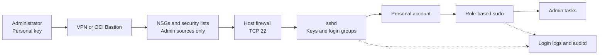

# Hardening Oracle Linux, SSH, and Host Administrative Privileges

## 1. Objectives and Scope

In the **Network and Host Security** chapter of the Oracle Cloud Infrastructure (OCI) module, hardening is the process of reducing the attack surface and limiting damage if a protection layer is bypassed. A server that only allows key-based SSH can still face risk if keys are shared, every account has root privileges, or administrators are unaware of configuration changes.

This lesson focuses on Oracle Linux running on OCI Compute: controlling the administrative path, updating the OS, configuring OpenSSH, delegating privileges with sudo, maintaining SELinux, and recording administrative activity. Examples target Oracle Linux 8/9 using systemd and DNF; verify package versions, images, and organizational policies before applying. This is a practical baseline, not a certification of full CIS Benchmark or STIG compliance.

After this lesson, learners can:

- Distinguish OCI IAM permissions from OS login and administrative privileges.
- Transition from a bootstrap account to personal accounts with dedicated SSH keys.
- Apply SSH configurations with syntax validation, effective-value checks, and a recovery plan.
- Grant role-based sudo permissions and recognize grants that can indirectly lead to root.
- Combine NSGs, host firewall, SELinux, patching, and logs for safe operations.

This scope applies to operating systems that customers are permitted to administer. For Autonomous Database or Oracle-managed services, do not assume SSH access to the underlying host to run the commands below. For database hosts where OS access is permitted, you must also check product requirements and impacts on Oracle Database, Grid Infrastructure, or support procedures.

## 2. Understanding Permission Layers on OCI

### 2.1. IAM and Linux Solve Two Different Problems

OCI IAM controls operations on resources within a tenancy and compartment: creating instances, modifying networks, managing Bastion, or executing authorized recovery actions. Linux controls accounts, SSH keys, processes, files, and privilege elevation inside the host.

On many Oracle Linux platform images, the initial account is `opc` and can use sudo. Verify in practice with `sudo -l`, since custom images and internal policies may differ. See [Oracle: Accessing an Instance](https://docs.oracle.com/en-us/iaas/oracle-linux/oci/gs-access-instance.htm).

| Component | Question to answer | Configurations to inspect |
| --- | --- | --- |
| OCI IAM | Who can modify instances, networks, and recovery mechanisms? | Compartment policies, admin groups, boot volume and console permissions |
| Network path | Which sources can reach the SSH port? | Routes, VPN/Bastion, NSGs, and security lists |
| SSH | Which identities are allowed to log in? | Linux accounts, public keys, sshd policy |
| sudo | What can a logged-in user do? | Groups, sudoers, and write permissions on executed programs |
| Process controls | Which resources can processes access? | File permissions, service accounts, and SELinux |
| Visibility | Who changed what, and when? | OS logs, auditd, and OCI Audit |

Removing a user from an IAM group does not automatically delete their key from `authorized_keys`. Conversely, deleting a Linux key does not revoke API permissions they still hold. Offboarding or incident response workflows must cover both sides.

MFA for OCI Console login does not automatically become MFA for SSH into Oracle Linux. If MFA is required on the administrative path, design the authentication chain separately and verify it end to end.

### 2.2. Administrative Path Model

A suitable approach for application servers is keeping instances in a private subnet and routing administrative access through a controlled path:



If using OCI Bastion, distinguish a **Managed SSH session** from an **SSH port forwarding session**. Managed SSH requires OpenSSH, Oracle Cloud Agent, and the Bastion plugin; port forwarding is a different session type. Select and test the access path before applying group or forwarding restrictions on the target host. See [OCI Bastion Overview](https://docs.oracle.com/en-us/iaas/Content/Bastion/Concepts/bastionoverview.htm).

The source address seen by the target host may be the Bastion endpoint's private address or an address behind NAT, rather than the laptop's public IP. Use that actual address when building rules on the target host; the list of IPs allowed into Bastion and the list of sources allowed into the target host are two different configurations.

### 2.3. Restricting SSH at the Right Network Layer

For administrative SSH:

- Prefer private IPs and dedicated administrative paths.
- If a public IP is needed in a lab, open TCP 22 only from a specific admin CIDR, such as a `/32` public address.
- Check both IPv4 and IPv6 if the instance uses dual-stack protocols.
- Inspect every security list attached to the subnet and every NSG attached to the VNIC.

An NSG opening SSH only from the office IP does not neutralize another security list allowing SSH from `0.0.0.0/0`. Allow rules from NSGs and security lists jointly determine permitted traffic; do not treat an NSG as an overlay that automatically blocks broader rules. See [OCI: Security Rules](https://docs.oracle.com/en-us/iaas/Content/Network/Concepts/securityrules.htm).

Changing the SSH port can reduce some automated scan noise, but does not replace source restrictions, strong keys, or patching. Keeping port 22 in the lab reduces the number of variables to handle during verification.

## 3. Preparing Changes While Preserving Access

### 3.1. Lab Environment

The following values are examples only:

| Parameter | Illustrative value |
| --- | --- |
| Oracle Linux instance | `10.20.20.15` |
| Admin network behind VPN | `10.20.10.0/24` |
| Bootstrap account | `opc` |
| Personal admin account | `linhadmin` |
| SSH login-permitted group | `ssh-login` |
| OS administration group | `host-admins` |
| Application operations group | `app-ops` |

The firewall example uses a network behind VPN. When using Bastion, replace it with the source matching your actual Bastion session; do not copy this CIDR verbatim.

The `bash` blocks run in the VM's Linux shell, except blocks explicitly labeled **Admin machine**. They are instructions to practice in an environment you are authorized to modify; they are not a single monolithic script to execute end to end.

Prepare before editing configurations:

1. Keep an active SSH session open with verified sudo access.
2. Prepare a second session to test new connections; do not reuse an already open multiplexed SSH connection.
3. Verify recovery options via the instance console or boot volume repair using an authorized helper host. Console connections still have their own authentication; do not assume creating a console connection grants an automatic root shell.
4. Back up configurations and ensure required boot volume/data backups can be restored. Snapshots of a running machine must be evaluated for application consistency.
5. Schedule a maintenance window if performing package updates, firewall changes, or reboots.

### 3.2. Capturing Initial State

```bash
cat /etc/os-release
uname -r
rpm -q openssh-server sudo firewalld audit
id
sudo -l
sudo systemctl status sshd --no-pager
sudo /usr/sbin/sshd -t
sudo /usr/sbin/sshd -T
sudo ss -lntup
getenforce
sudo systemctl is-active firewalld
```

`sshd -t` normally prints nothing when syntax is valid; also check the exit code. `sshd -T` reports the effective configuration, which is more useful than looking only at a newly edited file. If the service does not use the default config file, check the systemd unit and pass that exact file to the tools.

Identify the source of the current session:

```bash
echo "$SSH_CONNECTION"
```

The four fields are client IP, client port, server IP, and server port. For proxied connections, the client IP here is the peer address seen by sshd. Do not post raw logs or internal details publicly.

Back up to the root directory, outside configuration include paths:

```bash
CHANGE_TAG=$(date +%Y%m%d-%H%M%S)
sudo cp -a /etc/ssh "/root/ssh-before-$CHANGE_TAG"
sudo cp -a /etc/sudoers "/root/sudoers-before-$CHANGE_TAG"
sudo cp -a /etc/sudoers.d "/root/sudoers.d-before-$CHANGE_TAG"
```

A copy of `/etc/ssh` may contain host private keys; protect the backup as sensitive data. Do not leave backup files ending in `.conf` inside `sshd_config.d`, as they could be loaded as active configuration.

## 4. Patching and Minimizing Unnecessary Services

### 4.1. Controlled Updates

On Oracle Linux 8/9:

```bash
sudo dnf repolist
sudo dnf updateinfo list security
sudo dnf upgrade --security
```

Review the planned transaction before accepting. When full package updates within approved repositories are needed, use `sudo dnf upgrade` per maintenance schedule. Depending on the repository, third-party package advisory metadata may be incomplete; do not treat an empty security errata list as sole proof that the machine has no vulnerabilities.

If the system has the plugin providing the following command:

```bash
sudo dnf needs-restarting -r
```

Combine its output with the list of recently updated packages to decide whether to restart services or reboot. Do not promise that package updates take effect immediately for already-running processes. With Ksplice or centralized update tools, still evaluate components outside live-patch scope. See [Oracle: Installing Security Updates Using DNF](https://docs.oracle.com/en-us/iaas/oracle-linux/oci/security-updates-using-dnf.htm) and [Updating Software on Oracle Linux](https://docs.oracle.com/en/operating-systems/oracle-linux/software-management/sfw-mgmt-UpdateSoftwareonEnterpriseLinux.html).

If the service has multiple instances behind a load balancer, drain traffic and update one by one, checking health before returning each to service. A single VM requires a planned outage window and recovery time.

### 4.2. Inventory Instead of Mass Disabling

```bash
sudo systemctl list-unit-files --type=service --state=enabled
sudo systemctl --type=service --state=running
sudo ss -lntup
```

For each listening service, identify its owner, purpose, bound interface, and permitted access sources. Run `systemctl disable --now SERVICE_NAME` only after confirming the service is unnecessary and having a rollback plan.

Do not disable Oracle Cloud Agent, OS management tools, time synchronization, or network daemons merely because you do not recognize the name. A component may support Bastion, monitoring, patching, or instance initialization. At the same time, do not install extra toolkits and daemons that do not serve the workload; fewer components reduce patching effort.

## 5. Creating Personal Identities and Testing sudo First

### 5.1. Generating Keys on the Admin Machine

**Admin machine**, using a shell with an OpenSSH client:

```bash
ssh-keygen -t rsa -b 3072 -a 100 -f ~/.ssh/oci-linhadmin
```

Set a strong passphrase for the private key. The public key is the `.pub` file; the private key must stay on the admin machine or an appropriate key management device, never copied onto the VM. Ed25519 can be chosen when permitted by the environment's cryptographic policy; FIPS environments require checking supported algorithms.

Each user should have a dedicated key, and each purpose should be clearly identifiable. Do not share private keys in chat channels or embed keys into repositories, images, or user-data.

### 5.2. Creating Accounts and Separating Groups

On a fresh lab VM where the illustrative groups and accounts do not yet exist:

```bash
sudo groupadd ssh-login
sudo groupadd host-admins
sudo useradd -m -s /bin/bash -G ssh-login,host-admins linhadmin
sudo passwd linhadmin
sudo usermod -aG ssh-login opc
```

The password just set is used for sudo authentication per the policy below. It does not make SSH accept passwords once SSH configuration disables password authentication. In environments using centralized identity, apply the corresponding account and sudo authentication mechanisms instead of duplicating local identities.

If the names already exist, inspect with `getent` and `id` and adjust; do not recreate or arbitrarily alter UID/GIDs. `usermod -aG` appends supplementary groups; omitting `-a` can strip existing required groups.

Here `ssh-login` only permits login; `host-admins` grants administrative privileges. Being able to log into a host does not mean getting root. Keep `opc` in the login group during transition to preserve a working recovery path.

### 5.3. Installing the Public Key

On the VM:

```bash
sudo install -d -m 700 -o linhadmin -g linhadmin /home/linhadmin/.ssh
sudo -u linhadmin tee /home/linhadmin/.ssh/authorized_keys >/dev/null <<'PUBLIC_KEY'
REPLACE_THIS_LINE_WITH_THE_FULL_PUBLIC_KEY_FROM_THE_PUB_FILE
PUBLIC_KEY
sudo chown linhadmin:linhadmin /home/linhadmin/.ssh/authorized_keys
sudo chmod 600 /home/linhadmin/.ssh/authorized_keys
sudo chmod go-w /home/linhadmin
sudo restorecon -Rv /home/linhadmin/.ssh
```

Replace the placeholder line with the real public key, on a single line, before running. This block is for a new account and writes `authorized_keys`; for accounts with existing keys, preserve approved entries rather than overwriting.

Check permissions along the entire path when SSH rejects a key:

```bash
namei -l /home/linhadmin/.ssh/authorized_keys
ls -ldZ /home/linhadmin /home/linhadmin/.ssh
ls -lZ /home/linhadmin/.ssh/authorized_keys
```

### 5.4. Granting sudo for the OS Administration Role

Create a separate file using the syntax-checking editor:

```bash
sudo visudo -f /etc/sudoers.d/20-host-admins
```

Contents:

```sudoers
%host-admins ALL=(ALL:ALL) ALL
```

After saving:

```bash
sudo chown root:root /etc/sudoers.d/20-host-admins
sudo chmod 440 /etc/sudoers.d/20-host-admins
sudo visudo -c
```

This rule grants full administrative privileges to the `host-admins` group; apply it only to people genuinely administering the OS. It normally prompts for the caller's password, though other rules or existing authentication settings can alter behavior. Inspect all effective privileges. See [Oracle Linux: Granting sudo Access to Users](https://docs.oracle.com/en/operating-systems/oracle-linux/9/userauth/userauth-GrantingsudoAccesstoUsers.html).

From **a new terminal on the admin machine**, after verifying the host fingerprint through a trusted channel:

```bash
ssh -o IdentitiesOnly=yes -o ControlMaster=no -o ControlPath=none -i ~/.ssh/oci-linhadmin linhadmin@10.20.20.15
```

In the new session:

```bash
id
sudo -k
sudo -v
sudo -l
sudo id -u
```

The final output should be `0`. If key login and privilege elevation do not work yet, pause SSH tightening; keep the `opc` session to fix the cause first.

## 6. Hardening OpenSSH Based on Effective Configuration

### 6.1. Checking Configuration Load Order

Do not assume a file with a higher number wins. For many OpenSSH directives, the first value read is the one used; `Include` placement, file order, and `Match` blocks all matter. Oracle Linux supports configuration via `sshd_config.d`, yet you must verify whether the actual image loads that directory and where. See [Oracle: Working With OpenSSH Server Configuration Files](https://docs.oracle.com/en/operating-systems/oracle-linux/openssh/openssh-ModifyingOpenSSHServerConfigurationFiles.html) and [OpenSSH: sshd_config](https://man.openbsd.org/sshd_config).

On the VM:

```bash
sudo grep -nE '^[[:space:]]*(Include|Match)' /etc/ssh/sshd_config
sudo ls -l /etc/ssh/sshd_config.d
sudo systemctl cat sshd
```

If the directory does not exist or is not included, adjust the file actually used by the service. Do not merely create a drop-in file and conclude the policy is active.

On images with an appropriate `Include /etc/ssh/sshd_config.d/*.conf`, a file such as `/etc/ssh/sshd_config.d/00-local-hardening.conf` can be used after verifying it is not overridden by earlier directives or service launch flags. If the file already exists, inspect and edit deliberately instead of overwriting blindly.

### 6.2. Illustrative Baseline

Hardening file contents:

```sshconfig
PermitRootLogin no
PubkeyAuthentication yes
PasswordAuthentication no
KbdInteractiveAuthentication no
PermitEmptyPasswords no
UsePAM yes
AllowGroups ssh-login
MaxAuthTries 3
LoginGraceTime 30
X11Forwarding no
AllowAgentForwarding no
AllowTcpForwarding no
PermitTunnel no
ClientAliveInterval 300
ClientAliveCountMax 2
LogLevel VERBOSE
```

This policy assumes users only need an administrative shell on the target host. If TCP forwarding, agent forwarding, tunneling, specialized SFTP setups, or special operational flows are needed, define the exceptions first and test those exact flows. Do not disable features serving legitimate access without a replacement.

Key decisions:

| Configuration group | Operational significance |
| --- | --- |
| Disable root login | Users log in with personal identities then elevate with control |
| Public key and disable both interactive methods | Prevents leaving password entry open via keyboard-interactive |
| Keep PAM | Does not skip account and session handling just because keys are used |
| `AllowGroups` | Only accounts meeting group conditions can log in |
| Limit auth attempts and login grace time | Reduces resources spent on unauthenticated connections |
| Disable unneeded forwarding | Narrows forwarding capabilities from SSH sessions |
| Alive interval/count | Detects unresponsive peers |
| Verbose logging | Increases traceability details; requires log volume management |

If implementing SSH MFA via PAM/keyboard-interactive, this baseline disabling keyboard-interactive must be redesigned alongside `AuthenticationMethods` and the MFA mechanism. Do not apply two conflicting requirements and expect users to log in.

`ClientAliveInterval` and `ClientAliveCountMax` do not guarantee logging out idle users who stopped typing: an SSH client can still respond to keepalive messages. Idle session timeout policies must be designed separately and account for interactive sessions, long-running commands, alternate shells, and automation tools.

Do not copy a fixed cipher/MAC list from old guides. Prefer patched OpenSSH and the OS's supported crypto policy; any compatibility exceptions need scope and expiration. Changing crypto policy, especially FIPS, is a separate change that can affect services beyond SSH.

### 6.3. Testing Before Reloading

After saving the configuration, set appropriate permissions on the new file:

```bash
sudo chown root:root /etc/ssh/sshd_config.d/00-local-hardening.conf
sudo chmod 600 /etc/ssh/sshd_config.d/00-local-hardening.conf
sudo restorecon -v /etc/ssh/sshd_config.d/00-local-hardening.conf
sudo /usr/sbin/sshd -t
```

Proceed only when syntax checking succeeds. Next check effective values:

```bash
sudo /usr/sbin/sshd -T | grep -E '^(permitrootlogin|pubkeyauthentication|passwordauthentication|kbdinteractiveauthentication|usepam|allowgroups|allowtcpforwarding|allowagentforwarding|x11forwarding|loglevel) '
```

If using `Match`, test with a specific connection context:

```bash
sudo /usr/sbin/sshd -T -C user=linhadmin,addr=10.20.10.25,host=admin-client.example
```

Replace address and hostname with real context; include server-side address/port info when `Match` conditions use them. Separately test both permitted accounts and restricted accounts. `sshd -T` output proves configuration values; it does not prove keys, PAM, file permissions, or network paths all work.

Reload using the operation supported by the unit. With a standard unit supporting reload:

```bash
sudo systemctl reload sshd
sudo systemctl is-active sshd
sudo journalctl -u sshd --since "5 minutes ago" --no-pager
```

If the image requires a restart, perform it after checking syntax and preparing a recovery path. Do not close the old admin session during this process.

### 6.4. Testing Behavior from a New Connection

From the **admin machine**, open a new connection using `linhadmin`'s key, disabling reuse of existing connections as before. Confirm:

1. Login with the valid key succeeds.
2. `sudo -k`, `sudo -v`, and an authorized task work.
3. Direct SSH login as `root` is denied.
4. Login without public key is denied.
5. Accounts outside permitted groups cannot enter over SSH.
6. Legitimate admin tools, including Bastion if used, still work.

Test a path without public key:

```bash
ssh -o ControlMaster=no -o ControlPath=none -o PubkeyAuthentication=no -o PreferredAuthentications=password,keyboard-interactive linhadmin@10.20.20.15
```

This command should fail under the current baseline. Check server-side logs to confirm the reason; a connection blocked by a firewall does not prove sshd disabled password authentication.

Do not use `StrictHostKeyChecking=no` as the default fix for host key errors. When a fingerprint changes, reconcile with a confirmed rebuild/host key rotation and then update the trust store for the right target.

Public-key auth, disabling passwords, and disabling root login align with [Oracle's Compute security recommendations](https://docs.oracle.com/en-us/iaas/Content/Security/Reference/compute_security.htm).

## 7. Restricting sudo by Operational Role

### 7.1. Least Privilege Must Be Expressed with Specific Commands

An operator who only needs to restart an application service does not need permission to alter the kernel, install packages, or edit accounts. Assume the VM has an application unit **`java-app.service`** already created and controlled by administrators; a specific command set can be granted:

```bash
sudo groupadd app-ops
sudo visudo -f /etc/sudoers.d/30-app-ops
```

Contents:

```sudoers
Cmnd_Alias JAVA_APP_OPS = /usr/bin/systemctl restart java-app.service, /usr/bin/systemctl is-active java-app.service
%app-ops ALL=(root) JAVA_APP_OPS
```

Check the actual path of `systemctl` on the machine before using it. After saving, set owner to root, mode `0440`, and run `sudo visudo -c`. Grant `app-ops` membership and `ssh-login` login permission to the personal account needing to operate it; do not simultaneously add this person to the full admin group.

Log in again to pick up the new group and test:

```bash
sudo -k
sudo -l
sudo /usr/bin/systemctl is-active java-app.service
sudo /usr/bin/id
```

The status check command succeeds; running `id` with sudo must be denied for someone holding only the rule above. Only test restarting in an authorized environment or window.

A narrow rule is only meaningful when the user has no broader path via `wheel`, `host-admins`, another sudoers file, or centralized identity. Review all of `sudo -l`, not just the file newly created.

### 7.2. Evaluating Indirect Paths to Root

Permission to run a single command can be broader than the command name suggests:

| Granted permission | Scope-escape potential |
| --- | --- |
| Running a shell or interpreter via sudo | Can execute arbitrary tasks with elevated privileges |
| Running an editor or pager with shell escape | Can spawn a shell or edit unintended files |
| Installing packages with a package manager | Installation scripts can execute as root |
| Editing systemd units or `ExecStart` | Can make the service run a user-controlled program |
| Restarting a root-run service whose scripts/configs are writable by operators | Can turn restart permission into root code execution |
| Joining a group controlling a privileged container daemon | Can reach root-equivalent privileges depending on runtime model |
| Editing a wrapper allowed to run via sudo | Can replace the permitted task with another command |

For `java-app.service`, inspect the unit, drop-ins, executable, environment file, and parent directories. If the application must write data, grant write permissions to a dedicated data directory; do not let application accounts or operators modify privileged startup code.

Do not use broad wildcards like `/usr/bin/systemctl *` instead of listing allowed operations. If a wrapper is needed, it must be owned by root, non-writable by callers, and strictly validate inputs. Do not rely on `NOEXEC` as a complete barrier for arbitrary programs.

### 7.3. Intentional Use of NOPASSWD

For interactive administrators, requiring sudo re-authentication typically reduces risk from an unattended terminal. For automated tasks without human password entry, `NOPASSWD` may be needed for the exact approved command.

Do not set `NOPASSWD: ALL` for everyone just to avoid password prompts. At the same time, understand that a sudo password does not neutralize the risk of a stolen private key if the account still has unauthenticated escalation paths.

The `opc` account must be treated as a bootstrap account that may hold very broad privileges. Once personal access, automation, and recovery paths are tested, choose whether to retain it under strict control, restrict it, or disable daily use per policy. Do not delete the bootstrap account and keys before proving the replacement works.

## 8. Host Firewall and OCI-Specific Rules

### 8.1. Identifying the Active Firewall Tool

```bash
sudo systemctl is-active firewalld
sudo firewall-cmd --get-active-zones
sudo firewall-cmd --list-all-zones
sudo firewall-cmd --permanent --list-all-zones
sudo nft list ruleset
```

Some commands exist only when the corresponding package is installed and the service is running. On images using another mechanism, inspect that mechanism rather than enabling a second parallel firewall. Never manage the same rule set concurrently with multiple tools without clear conventions.

On OCI, the link-local network `169.254.0.0/16` is used for platform functions, including metadata and iSCSI storage connections. Platform images include rules protecting access to iSCSI endpoints; preserve necessary rules and access restrictions. Do not flush all iptables/nftables just to test opening a port. See [OCI: Best Practices for Your Compute Instances](https://docs.oracle.com/en-us/iaas/Content/Compute/References/bestpracticescompute.htm).

Oracle has documented cases where `firewall-cmd --reload` drops boot volume iSCSI connections due to rule load ordering. On affected instances, avoid using reload as a routine action; apply permanent and runtime changes carefully per [OCI: Known Issues for Compute](https://docs.oracle.com/en-us/iaas/Content/Compute/known-issues.htm).

### 8.2. Example: Restricting SSH from an Admin Network

Apply this example only when:

- firewalld is already the firewall management tool on the host.
- The interface receiving SSH belongs to zone `public`.
- The valid source seen by the target host is `10.20.10.0/24`.
- The zone and related policies contain no other broad allow rules bypassing the intended limit.
- A recovery session remains active.

If the interface is in another zone, substitute the right zone. Do not set an entire zone's target to ACCEPT just to open SSH quickly.

Add the permitted source rule to persistent configuration first, then runtime:

```bash
sudo firewall-cmd --permanent --zone=public --add-rich-rule='rule family="ipv4" source address="10.20.10.0/24" service name="ssh" accept'
sudo firewall-cmd --zone=public --add-rich-rule='rule family="ipv4" source address="10.20.10.0/24" service name="ssh" accept'
```

After confirming the rule exists and admin access works from the right source, remove the SSH service for all sources:

```bash
sudo firewall-cmd --permanent --zone=public --remove-service=ssh
sudo firewall-cmd --zone=public --remove-service=ssh
```

Verify both configuration layers:

```bash
sudo firewall-cmd --zone=public --list-all
sudo firewall-cmd --permanent --zone=public --list-all
```

You must also address direct `22/tcp` rules, broad rich rules, direct rules, source-based zones, and other policies if they allow SSH. Those two remove-service commands do not automatically delete those other allow paths. If using IPv6, add required IPv6 source rules or verify SSH is not unintentionally exposed over IPv6.

Test a new TCP/SSH connection from an allowed source and from a test machine on a disallowed source. Do not use an already open session to conclude, because connection tracking may continue permitting that session. Separately record cases blocked at the NSG versus cases blocked at the host firewall to understand which layer is enforcing.

Runtime configuration takes effect immediately, while permanent configuration persists across future loads. Do not run `--runtime-to-permanent` carelessly if runtime contains unapproved temporary changes. See [Oracle Linux: Configuring firewalld Zones](https://docs.oracle.com/en/operating-systems/oracle-linux/9/firewall/firewall-ConfiguringfirewalldZones.html).

## 9. Keeping SELinux Enabled and Fixing Denials Properly

SELinux adds policy-based access control alongside traditional UID, GID, and read/write/execute permissions. It can limit the impact of a compromised process, depending on the confinement domain and applied policy; it does not replace patching or least privilege.

Check status:

```bash
getenforce
sestatus
```

If the system is already configured and tested with SELinux, maintain `Enforcing` mode. If an image is `Disabled` or `Permissive`, transitioning to enforcing requires planning policy evaluation, file labeling, relabeling, and workload testing. Do not treat `setenforce 1` as completing the transition for every system state. See [Oracle Linux: About SELinux](https://docs.oracle.com/en/operating-systems/oracle-linux/9/security/security-AboutSELinux.html).

When SSH rejects a key, first verify the account, group, key path, owner, and mode. If SELinux labels are suspected:

```bash
ls -ldZ /home/linhadmin /home/linhadmin/.ssh
ls -lZ /home/linhadmin/.ssh/authorized_keys
sudo ausearch -m AVC,USER_AVC -ts recent -i
sudo restorecon -Rv /home/linhadmin/.ssh
```

`restorecon` applies labels according to the existing policy, suitable when files in standard paths have wrong labels. If using custom home or data paths, define the appropriate file context mapping before running restorecon; do not assume standard `/home` labels apply to every path.

Do not disable SELinux to resolve routine permission errors and do not generate allow policies from every AVC without understanding the blocked operation. For application services, identify the ports, content types, network access, and Booleans truly required; scope exceptions by function.

Some processes may run in less confined domains. Therefore, seeing `Enforcing` is insufficient to conclude all applications are tightly isolated.

## 10. Logging SSH Activity and Privilege Changes

### 10.1. Which Log Answers Which Question?

| Log source | Useful contents | Limitations to remember |
| --- | --- | --- |
| sshd logs | Connections, accounts, auth results, key details per config | Not a recording of every command inside a shell |
| sudo logs | Caller, target user, and commands accepted/denied by sudo | `sudo -i` does not automatically show commands run inside the root shell |
| auditd | Events collected by audit policy | Requires rules, disk capacity, and appropriate log reading processes |
| OCI Audit | API calls on OCI resources | Does not replace auditing inside the OS |
| OCI Logging or central log system | Retention, search, and alerting once collection is configured | Linux logs do not appear in full automatically just because the VM runs on OCI |

Inspect logs around the time of a change:

```bash
sudo journalctl -u sshd --since "30 minutes ago" --no-pager
sudo journalctl _COMM=sudo --since "30 minutes ago" --no-pager
sudo tail -n 100 /var/log/secure
```

`/var/log/secure` depends on syslog configuration and may not exist on every image. Choose the log source actually collected by the system, verify persistence across reboots, rotation, and read permissions. Time synchronization helps correlate events across hosts, Bastion, and OCI.

### 10.2. Example: Auditing Critical Files

If auditd is not installed yet, install the `audit` package per the approved package management process. Check the service and audit status:

```bash
sudo systemctl enable --now auditd
sudo auditctl -s
sudo auditctl -l
```

On systems using `augenrules` to load `/etc/audit/rules.d/*.rules`, create a separate file, such as `/etc/audit/rules.d/50-host-access.rules`, containing:

```text
-w /etc/sudoers -p wa -k privilege_change
-w /etc/sudoers.d -p wa -k privilege_change
-w /etc/ssh/sshd_config -p wa -k ssh_policy_change
-w /etc/ssh/sshd_config.d -p wa -k ssh_policy_change
-w /home/linhadmin/.ssh/authorized_keys -p wa -k admin_key_change
```

This is illustrative watch syntax for paths existing in the lab. When multiple accounts exist or keys come from a centralized source, expand scope according to the real mechanism; a watch on `linhadmin` does not cover every key on the host.

Keep the file owned by root and non-editable by unprivileged users. After checking contents alongside existing rules:

```bash
sudo augenrules --check
sudo augenrules --load
sudo auditctl -l
```

Do not overwrite other rule files or clear all existing rules to load this example. If audit is in immutable mode, rule changes must be scheduled across a reboot; do not attempt to disable the protection mechanism. `--check` does not replace verifying the loaded output and effective rules.

Query events:

```bash
sudo ausearch -k privilege_change -ts today -i
sudo ausearch -k ssh_policy_change -ts today -i
sudo ausearch -k admin_key_change -ts today -i
```

Make a controlled change in the lab, confirm the event appears, and verify it can be linked to the initial login identity. See [Oracle: Audit Oracle Linux with Auditd](https://docs.oracle.com/en/learn/ol-auditd/index.html) and [Generating Audit Reports](https://docs.oracle.com/en/operating-systems/oracle-linux/9/auditing/generating_audit_reports.html).

### 10.3. Operational Alerts

Prioritize actionable signals:

- Unusual numbers of failed SSH logins or successes from outside operational patterns.
- Changes to sudoers, admin groups, authorized keys, or sshd policy.
- Unplanned stops of SSH/auditd services.
- Log shipping failures, clock drift, or log partition nearing capacity.
- Critical patches overdue per organizational policy.

Monitor disk capacity, log growth rate, and retention periods. Overly broad audit rules or unrotated logs can affect performance and availability. Scope collection to investigation needs; protect centralized logs so compromising one VM does not simultaneously erase all evidence.

## 11. Managing Key and Access Lifecycles

### 11.1. Provisioning and Rotation

Every key entry needs an owner, purpose, and review date in the access management system. The comment at the end of a key aids identification but is not proof of identity; verify the fingerprint:

```bash
ssh-keygen -lf /home/linhadmin/.ssh/authorized_keys
```

When rotating keys:

1. Generate a new key pair on the admin machine.
2. Add the new public key to the actual authentication source in use.
3. Use a brand-new connection to verify login and required privileges.
4. Remove the old public key after the new path is confirmed.
5. Verify the old key can no longer log in and record the revocation.

Do not assume editing SSH keys in instance metadata automatically updates every `authorized_keys` file on running VMs. Identify what actually supplies keys: local files, an agent, a directory service, or an SSH certificate mechanism.

For multi-host environments, centralized identity management or short-lived SSH certificates can reduce the number of local keys needing revocation. This transition still requires designing trust, lifetimes, revocation, and emergency access.

### 11.2. Revocation Must Cover Open Sessions

Deleting a public key prevents some new authentications, yet does not automatically terminate already logged-in SSH sessions. When someone leaves the team or a key is compromised:

- Revoke keys/certificates and group memberships across all relevant authentication sources.
- Review open sessions, processes, scheduled tasks, and potential alternate access paths created.
- Terminate related sessions per incident response procedures after ensuring critical tasks are not mistakenly cut.
- Revoke IAM permissions, tokens, API keys, and Bastion sessions belonging to that person.
- Investigate changes performed if the account ever held elevated privileges.

Locking a password with `passwd -l` should not be treated as the sole measure to disable all access types. Login behavior also depends on PAM, account state, and authentication methods. Verify denial through an actual login path.

Service accounts should run with dedicated UIDs, hold access only to needed data, and never serve as shared admin accounts. When interactive login is unnecessary, choose an appropriate shell and login policy while ensuring the workload is unaffected.

## 12. Recovering When Changes Break Access

### 12.1. An Active Admin Session Still Remains

Keep that session open, check logs, and revert the exact component just changed:

- Bad SSH config: restore the edited file, run `sshd -t`, then reload using the method supported by the unit.
- Bad `AllowGroups`: fix the group list or membership per design, then test a new connection.
- Bad key permissions: fix owner, mode, and SELinux labels; do not open permissions on the entire home directory.
- Bad sudoers: use a session that still has admin privileges to fix via `visudo`, then run `visudo -c`.
- Bad firewall: fix rules with the active management tool, preserve OCI platform rules, and check both runtime and permanent configs.

If `00-local-hardening.conf` is a brand-new file and the direct cause, move it out of the include directory to a protected root location, then test and reload. If you edited a pre-existing file, restore from its backup copy; do not delete the entire configuration directory.

Test a new connection before closing the rescue session. A successful reload alone is not proof that users can log in.

### 12.2. No SSH Sessions Remain

First identify the broken layer: route/NSG, host firewall, sshd, authentication, or sudo. If the error is in a security list or NSG, someone with appropriate IAM permissions can fix it without touching the boot volume.

If the error is inside the OS and no access path remains, use the prepared plan:

- Instance console if configuration and OS recovery mechanisms allow.
- Procedure to stop the instance, detach the boot volume, attach it to a helper host, and repair offline per OCI instance guidance.
- Restore or replace the instance from a verified image/backup if appropriate for the architecture.

Boot volume intervention can cause downtime and must preserve file permissions, SELinux labels, and target the right filesystem. Do not temporarily open SSH to the entire Internet to fix an `authorized_keys` or sudo error; network changes will not fix those errors.

All permissions on console access, boot volumes, and backups must be restricted because they can allow altering OS data or authentication mechanisms.

## 13. Diagnosing Errors by Symptom

| Symptom | Possibilities to check | Next step |
| --- | --- | --- |
| SSH timeout | Routes, actual source behind VPN/Bastion, NSG/security list, host firewall | Test connectivity from the right source; pinpoint which layer is blocking |
| Connection refused | Service not listening, wrong address/port, or firewall actively rejecting | Check `sshd`, `ss -lntp`, and logs |
| Permission denied (publickey) | Wrong user/key, file permissions, SELinux label, login group, or account state | Check server logs, fingerprint, and effective config |
| Config changed yet old behavior persists | File not included, earlier directive wins, Match block, or not reloaded | Run `sshd -T` and `sshd -T -C` with exact context |
| Sudo asks for password then fails | Account lacks matching auth method or different PAM policy | Check identity, PAM, and applied sudo rules |
| Sudo still allows everything | Broad rule or another admin group still active | Check `id` and full `sudo -l` in a new session |
| Old session works, new session fails | New rule or auth blocks new logins; old session still tracked | Keep old session for recovery and test new connection |
| VM hangs after editing firewall | Possible impact on storage connection or platform rules | Use rescue path and review OCI iSCSI notes |
| Key deleted yet user still operates | Old session still alive or another key source exists | Inspect active sessions, processes, and all auth sources |
| AVC appears when app accesses files | Mismatched SELinux label or policy | Identify real requirement; fix label/policy within scope |

On a standard OpenSSH client, diagnostic logging can identify which key is offered and where authentication fails. For Bastion connection commands, follow the service's verbosity level and specific instructions; do not publish logs containing infrastructure details.

## 14. Complete Hands-On Walkthrough and Completion Criteria

Perform on a lab VM with a recovery path, in order:

1. Record the image, OS version, listening services, and actual SSH source.
2. Confirm operational and recovery IAM permissions belong to the right people/groups.
3. Review network paths and remove unintended broad SSH access after valid paths are tested.
4. Create personal accounts and dedicated keys; verify role-based sudo before restricting SSH.
5. Apply the SSH baseline, check syntax and effective config, reload, then test a new session.
6. Restrict the host firewall by source, preserve OCI platform rules, and verify runtime/permanent state.
7. Verify SELinux, security updates, logs, and audit rules.
8. Test revoking a lab key, confirm new connections are denied, and identify still-open old sessions.
9. Practice reverting a small config change from the backup copy in the lab.
10. Only afterward handle the bootstrap path and document the desired operational state.

A passing result requires corresponding evidence:

| Criterion | Minimum evidence |
| --- | --- |
| Only admin sources can reach SSH | New connection test results from an allowed source and a blocked source |
| Personal identities work | Login via dedicated key with clear account ownership |
| No root/password SSH login | Expected failure with right reason and matching effective sshd values |
| Role-based sudo privileges | Permitted commands succeed; out-of-scope commands are denied |
| No unintended indirect root paths | Review of write permissions on units, scripts, configs, and privileged groups |
| SELinux properly managed | Status, workload testing, and justified AVC handling |
| Changes are traceable | SSH/sudo/audit events with matching timestamps and identities |
| Recoverable | Configuration backups and a documented recovery drill |

Save the baseline via configuration management or controlled images when deploying multiple hosts. Automation should validate syntax before reloading services, touch only managed files, and roll out in small batches. Do not bake administrator private keys or fleet-wide shared host keys into images.

When cleaning up the lab environment, remove unneeded test keys and accounts, revoke temporary access sessions, handle instances/volumes/backups per retention requirements, and check for remaining billable resources. For live systems, maintain patching schedules, permission reviews, and periodic recovery drills so the baseline stays effective across changes.
