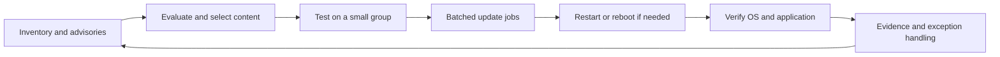
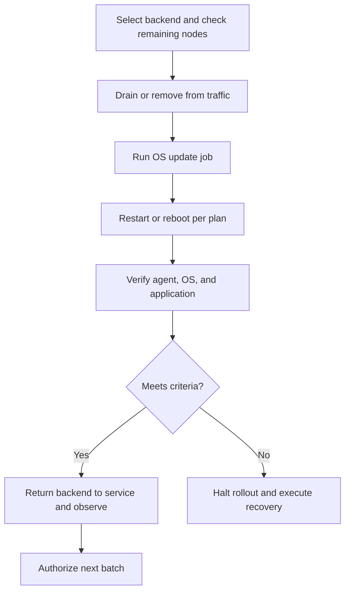

# OS Management Hub and Operating System Patch Management

## 1. Objectives and Scope

A server on Oracle Cloud Infrastructure (OCI) is not fully protected simply by placing it in a private subnet or configuring tight NSGs. The operating system still requires updates to fix vulnerabilities, stability bugs, and compatibility issues. As server counts grow, logging into each machine to run manual updates becomes hard to govern: which machines are patched, which software sources were used, whether a reboot is required, and whether the application is working again?

**OS Management Hub** provides centralized operating system management capabilities for service-supported host types and environments. Within a patch management workflow, the service helps organize managed host records, software sources, host groups, and update jobs. Protection effectiveness depends on agent registration, IAM, network connectivity, patch content, and how changes are rolled out.

After this lesson, learners can:

- Explain the main components of OS Management Hub and the relationships between them.
- Prepare Compute instances, agents, IAM permissions, and network paths required for patch management.
- Organize software sources, host groups, and testing stages before promoting patches to production.
- Schedule, monitor, and verify a patching wave while protecting application availability.
- Distinguish job completion, package installation, reboot completion, and business service restoration.

The running example is a Java application running on three Linux OCI Compute instances behind a Load Balancer, using a database in a separate tier. The platform team manages the OS; the application team verifies health checks and transactions; the security team sets remediation priorities. Linux command examples use an Oracle Linux release with DNF supported by OS Management Hub. Do not infer from the example that every Linux distribution or version can be registered.

## 2. Patch Management Is a Lifecycle

A patching wave must answer more questions than "did the update command exit cleanly?":

1. **Discovery:** which hosts fall within management scope, and how fresh is their inventory data?
2. **Assessment:** what issues does a patch address, and does it apply to the host and installed packages?
3. **Preparation:** are content sources, backups, disk space, and application preconditions ready?
4. **Deployment:** in which batches, in what order, and who is authorized to execute?
5. **Activation:** is a process restart or reboot required to run the new code?
6. **Verification:** do versions, OS state, and application transactions meet requirements?
7. **Evidence retention:** which changes were made, which exceptions remain, and who owns handling them?



OS Management Hub participates in OS management; it does not automatically replace application backups, business testing, vulnerability scanning, secret management, or database authorization. A successful OS patch also does not mean libraries bundled inside the Java application or containers have been updated.

## 3. Core Components

| Component | Role in the workflow |
| --- | --- |
| Managed instance | A registered host enabling the service to collect data and execute supported management actions |
| Agent and related plugins | Host-side components handling communication, inventory collection, and OS management execution |
| Registration profile | Configuration governing registration and initial associations supported by that profile type |
| Software source | Linux software content source managed under the service's model |
| Custom software source | Customized source built from selected content per supported capabilities |
| Versioned custom software source | Versioned source used to control and promote a fixed content set across stages |
| Managed instance group | Group of compatible hosts for organizing shared management operations |
| Lifecycle environment and stages | Organizes stages such as testing and production for supported content |
| Scheduled job and execution results | Defines task, targets, timing, and tracks execution |
| Management station | Component supporting management, syncing, or content distribution for Linux environments where required by the deployment model |

Not every component in the table applies identically to Linux, Windows, OCI hosts, and non-OCI hosts. Choose the right service onboarding workflow for the OS and deployment location. Do not start by installing a management station for every Compute instance.

### 3.1. OCI Hosts and Non-OCI Hosts

For supported OCI Compute instances, the workflow typically involves Oracle Cloud Agent with the appropriate OS Management Hub plugin. Check plugin status and service registration rather than merely confirming Oracle Cloud Agent is installed.

For supported non-OCI environments, such as on-premises systems or other clouds, agent architecture, registration, and management stations have separate requirements. A management station can handle syncing, caching, and distributing Linux software content per service design. Hosts and stations must still satisfy required management connectivity paths; a mirror alone does not replace the full control plane.

Supported OS ranges, versions, CPU architectures, and feature support must be verified at deployment time. Do not assume a custom image or an Oracle Linux-like distribution is supported with the exact same workflow.

### 3.2. Distinguishing from Legacy Management Mechanisms

Do not use plugin names, policies, APIs, or procedures from the legacy OS Management Service as proof that a host is registered with OS Management Hub. When inheriting an existing system, identify which service currently manages the host, its corresponding agent/plugin, and supported migration paths.

Do not run multiple independent package management mechanisms on the same host without clear ownership. A cron job running DNF, another configuration tool, and OS Management Hub jobs can contend for package manager locks or cause drift from the tested package set.

## 4. Preparing Before Registering Hosts

### 4.1. Checking Resources and Operating System

| Condition group | Items to confirm |
| --- | --- |
| OCI identity | Right tenancy, region, compartment, and instance to manage |
| Operating system | Distribution, version, and architecture within supported range |
| Agent | Appropriate agent/plugin installed, enabled, and active |
| Authentication | Machine identification, dynamic group, or auth mechanism matching onboarding flow |
| Software sources | Sources compatible with the host's OS version and architecture |
| Network | DNS, time sync, access to management endpoints, and content download sources working |
| Disk space | Sufficient space for metadata, package cache, downloads, update transactions, and kernels if applicable |
| Recoverability | Backups or instance replacement and data recovery plans ready |

Seeing a host appear in the Console does not guarantee fresh inventory or the ability to download patches. Check last check-in time, management status, and a small read/check action before placing it into centralized patch schedules.

### 4.2. Private Subnets Do Not Mean Unpatchable

A host in a private subnet does not need a public IP to be managed. However, it must be able to reach the endpoints and content sources required by the deployment flow.

Depending on destinations, paths may use a Service Gateway for supported OCI services, a NAT Gateway for Internet destinations, a managed proxy, or a management station. A Service Gateway is not a general Internet gateway; do not assume all external software repositories traverse it.

When the network includes a Network Firewall or proxy:

- Identify the exact endpoints, ports, and domains needed by the agent, service, and content.
- Verify DNS and the TLS trust chain, especially when TLS inspection is active.
- Watch return paths and timeouts, not only egress rules on the source subnet.
- Keep allowed scope aligned with service needs; do not open the entire Internet just to get the agent into an active state.

Centralized management does not require opening SSH/RDP from the Internet to every host. The agent management channel and content download path must follow a supported design, independent of operators' interactive administration choices.

## 5. IAM Permissions and Operational Responsibilities

### 5.1. Separating Operator Permissions from Host Permissions

There are two distinct permission tracks:

1. **Users or pipelines:** view inventory, manage sources, create groups, schedule or run update operations.
2. **Hosts/agents:** register, check in, and invoke required service capabilities per supported mechanisms.

A user permitted to view managed instances does not automatically grant the agent permission to operate. Conversely, a successfully registered agent does not allow every tenancy member to trigger patching jobs.

| Role | Reasonable scope |
| --- | --- |
| Status viewer | View inventory, advisories, and job results in assigned compartments |
| Content manager | Manage software sources and approved versions |
| Patch operator | Create/run jobs within assigned host groups |
| Production approver | Confirm content, timing, and test evidence per organizational workflow |
| Host agent or principal | Only permissions needed for registration and supported management actions |
| Network administrator | Manage routes, gateways, firewalls/proxies needed for management and content paths |

Apply the exact IAM resource types and policies for OS Management Hub, the agent, and the deployment model in use. Do not copy legacy service policies verbatim or grant tenancy-wide administrative privileges to a dynamic group covering all Compute instances.

### 5.2. Compartment Scope and Dynamic Groups

Place test hosts, production hosts, and management components in compartments with clear ownership. When using dynamic groups, write membership rules scoped to required resources; avoid allowing every new instance in the tenancy to inherit unrelated management permissions.

Permissions accumulate across policies. One narrow-looking policy does not prove an operator holds only those rights. Audit effective permissions when designing separation of duties.

If processes require change approval, store decisions in the organization's change management system or workflow. Do not assume creating a scheduled job inherently includes an independent business approval step.

## 6. Registering and Confirming Managed Instances

Hands-on steps in the Console should follow this sequence:

1. Select the correct region and compartment; confirm the host falls within OS Management Hub support scope.
2. Prepare IAM per the registration workflow for that host type.
3. Prepare a registration profile and appropriate initial associations, such as software sources or groups/stages supported by the profile.
4. On OCI Compute, check Oracle Cloud Agent and the corresponding OS Management Hub plugin; for other environments, follow their agent and station workflows.
5. Perform registration using the mechanism provided for the profile and host type.
6. Wait for the managed instance to appear, the agent to check in, and inventory to be collected.
7. Verify OS details, architecture, software sources, groups, or lifecycle stage.
8. Run a supported read or refresh operation before executing updates.

Do not treat a registration profile as universally applicable to every machine. A profile bound to incompatible sources or environments can cause registration or subsequent management tasks to fail.

If registration fails, inspect authentication errors, IAM, region, networking, and plugin status. Do not repeatedly uninstall/reinstall the agent or create duplicate registrations before understanding the root cause.

## 7. Software Sources and Content Control

### 7.1. Software Sources Determine What Hosts Can Receive

On Linux, package and advisory data tie to software sources and their metadata. A host with a healthy agent but missing the right source may not see needed updates.

When selecting sources, verify:

- Exact OS, major version, and CPU architecture.
- Exact kernel stream or content channels in use.
- Content entitlement and support terms if applicable.
- Synced metadata and content ready for download.
- Package dependencies and compatibility with application components.

Do not attach a source from another major version to hunt for a newer package. Upgrading an OS major version is a separately planned change, not an unintended side effect of a routine update job.

### 7.2. Custom Sources and Versioned Sources

Custom sources help narrow or organize content sets according to requirements. Versioned sources explicitly freeze the content set promoted through testing and release stages.

Example workflow:

```text
Content from supported source
    -> content version PATCHSET-TEST-01
    -> Development stage
    -> Test stage
    -> Production stage
```

`PATCHSET-TEST-01` is an illustrative organizational label, not a mandatory format. When testing a version, ensure production receives the exact approved content set rather than accidentally consuming a dynamic source that gained new packages after testing.

Versioned sources do not by themselves prove the entire application environment is reproducible. Java runtimes, embedded libraries, container images, configurations, and data still require separate management.

### 7.3. Lifecycle Environments and Promotion

Lifecycle environments organize stages for delivering supported content to host groups. When promoting a source version, check the target stage, associated instances, and update jobs generated or required by the workflow.

Distinguish two pieces of evidence:

- **Content delivered to stage:** which content set can the hosts consume?
- **Hosts applied the content:** which packages were actually installed and what code is running?

Do not close a change just because promotion succeeded. Review related jobs, per-host results, reboot needs, and application health checks.

### 7.4. Host Groups Must Be Compatible

Do not lump every Linux machine into one group merely because they belong to the same application. Verify compatibility constraints of groups, software sources, and lifecycle stages, especially OS version and architecture.

Even when OS compatibility matches, you may need separate groups by operational role: canary, stateless app nodes, stateful nodes, or hosts requiring different maintenance windows. Group organization serves both technical validity and blast-radius reduction.

## 8. Selecting Patches and Setting Priorities

### 8.1. Security Updates Are Not Every OS Change

Update content can fall into security, bugfix, or enhancement categories per vendor metadata. Prioritization should examine:

| Criterion | Example questions |
| --- | --- |
| Impact severity | Does the flaw enable code execution, privilege escalation, or only narrow faults? |
| Applicability | Is the affected package and version actually present on the host? |
| Exposure surface | Does the component listen on the network or process untrusted data? |
| Existing mitigations | Does network isolation or disabling a feature reduce risk while awaiting patching? |
| Update impact | Does it alter the kernel, base libraries, agents, or active app dependencies? |
| Remediation timeline | How does internal policy govern fix deadlines and exception tracking? |

Advisory counts do not equal independent CVE counts or packages to install. One advisory can cover multiple packages and multiple issues. Conversely, one package can relate to multiple advisories.

Do not compare only upstream version numbers to conclude a package remains vulnerable. Vendors may backport fixes into OS-packaged releases. Check advisories and package release numbers from the exact supported source.

### 8.2. Kernel, Reboot, and Live Patching

Installing a new kernel package and running the new kernel are two distinct states. `uname -r` shows the running kernel; package listings show what is installed. If the workflow requires a reboot, perform it and verify the host boots into the intended kernel.

Oracle Ksplice provides live patching for eligible configurations, content, and entitlements. It can reduce reboot needs for fixes within its supported scope, but it does not mean every patch, upgrade, or OS change requires no restart.

If using live patching, record both live-patch status and the package baseline via supported tools. Do not rely solely on the kernel version string to deny or confirm all live patches. Ultimately, reboot and upgrade plans remain necessary when change types require them.

### 8.3. Application and Database Scope

On self-managed Compute, OS updates can affect a Java runtime installed via package manager, system libraries, or network tools. They do not automatically update JARs packaged inside applications or deployed container images.

For OCI-managed database services, follow the maintenance mechanisms and runbooks of that specific service. Do not arbitrarily install agents or patch the OS of managed components as if operating a general-purpose Compute instance. Oracle Database patches, Data Guard configurations, and schema upgrades are separate workflows requiring coordination.

## 9. Designing Availability-Preserving Patch Waves

### 9.1. Pre-Checks

Before each wave, list target hosts and verify:

1. Hosts are communicating with the service, inventory is sufficiently fresh, and no conflicting update jobs exist.
2. Content sources are correct, synced, and downloadable over the hosts' real network paths.
3. Sufficient disk space exists, especially on filesystems holding caches, package transaction data, and `/boot`.
4. Backups or recovery plans are ready; access paths are known if a host fails to boot.
5. Baselines exist for packages, kernels, configs, and pre-change application metrics.
6. The application team has defined drain, health check, restart, and halt criteria.

Do not treat a boot volume backup as an automatic consistent copy of an entire distributed application. Data on other volumes, database transactions, and off-host systems need appropriate backup plans. Restore capability should be tested in an authorized environment.

### 9.2. Canary Followed by Batched Rollout

With three Compute instances behind a Load Balancer, a plan might look like:

| Wave | Scope | Gate to proceed |
| --- | --- | --- |
| Canary | One test host or representative host removed from user traffic | OS updated cleanly, restart/reboot complete, app tests pass |
| First production wave | One backend while remaining backends serve traffic | Health checks and transactions pass; load on remaining capacity within bounds |
| Subsequent waves | Each remaining backend | Prior wave host stable with no new errors requiring investigation |

A group or scheduled job targeting multiple machines does not automatically guarantee they will be drained and patched one by one within the application's availability budget. If the service does not provide the orchestration required by this design, split target sets and coordinate using operational runbooks or appropriate automation tools.

Do not put all nodes of a cluster or HA pair into the same wave simply because they share the same OS. Patch order, quorum, failover, and serving capacity must follow that application's requirements.

### 9.3. Sequence for a Single Backend



Draining, Load Balancer adjustments, and business health checks are orchestration steps wrapping the OS job. Do not assume OS Management Hub inherently knows when a Java transaction has finished or a backend is ready for customers.

## 10. Scheduling and Monitoring Jobs

### 10.1. Start Time Is Not a Maintenance Window Limit

When creating a scheduled job, verify the exact action, update type, content source, and target set. Specify start time, timezone, recurrence, and how offline hosts are handled at schedule time.

A start time does not automatically create an end deadline or auto-cancel mechanism when the maintenance window closes. Factor in package download time, installation, reboot, verification, and incident buffer. If an operation cannot stop safely mid-flight, do not treat window expiration as a reason to kill the package manager.

Timezone conversion example: **02:00 in Vietnam, UTC+7, corresponds to 19:00 UTC the previous day**. Check which timezone the schedule field actually expects and verify the calculated next run time after saving. Do not infer job timezone solely from the workstation running the Console.

### 10.2. Overall Status and Per-Host Results

Track identifiers for the schedule, run, child tasks, or work requests provided by the operation. In a multi-host wave, record at minimum:

- Which hosts succeeded, failed, were skipped, or did not finish.
- Which packages/updates were applied and exact errors if any.
- Whether restart/reboot was needed and whether it was completed.
- Whether hosts remain reachable after changes.
- Whether the application is confirmed healthy or still isolated from the Load Balancer.

An API response accepting a job is not proof that patching finished. An aggregate summary does not replace per-host checks and post-update operational steps.

### 10.3. Targeted Retries

Before retrying, classify failures as transient or configuration-related. Brief network blips may suit bounded retries; incompatible sources or low disk space require fixing the root cause first.

When only a subset of hosts failed, confirm the retry target set to avoid accidentally re-rebooting hosts that already recovered. Do not assume every update job has identical idempotent behavior across restarts and application orchestration steps.

## 11. Post-Update Verification

### 11.1. Reading Back Configuration from the Service

The example below uses Bash and an authenticated OCI CLI set to the right region. These are read-only commands; replace placeholders with real environment OCIDs.

```bash
COMPARTMENT_OCID='<MANAGED_INSTANCE_COMPARTMENT_OCID>'
MANAGED_INSTANCE_OCID='<OS_MANAGEMENT_HUB_MANAGED_INSTANCE_OCID>'

oci os-management-hub managed-instance list \
  --compartment-id "$COMPARTMENT_OCID" \
  --all

oci os-management-hub managed-instance get \
  --managed-instance-id "$MANAGED_INSTANCE_OCID"
```

A managed instance is a service-managed resource. Do not blindly substitute a Compute OCID into a parameter requiring a managed instance OCID just because both relate to the same host; pass the exact identifier required by the API and cross-check the Compute link.

Via the Console or appropriate APIs, inspect software sources, groups/stages, inventory timestamp, job history, and reboot-required state reported by the service. Instance metadata fields do not necessarily contain full detailed results of every job.

### 11.2. Reconciling on Oracle Linux

The following commands illustrate local checks on a test host with DNF. They do not replace confirming job outcomes from OS Management Hub.

```bash
cat /etc/os-release
uname -r

sudo systemctl status oracle-cloud-agent --no-pager

df -h / /var /boot
sudo dnf repolist

rpm -q openssl-libs
sudo dnf check-update
```

Interpreting output:

- `/etc/os-release` confirms the OS being checked.
- `uname -r` shows the currently running kernel, not every installed kernel.
- `oracle-cloud-agent` status is useful only on hosts using that service; an active agent does not by itself prove the OS Management Hub plugin is healthy.
- `df` checks disk space; different filesystem layouts require adjusting paths.
- `dnf repolist` verifies repositories visible to the host.
- `rpm -q openssl-libs` is an example package; select packages genuinely tied to the advisory or patch wave's job.
- `dnf check-update` can return exit code `100` when updates are available. Do not treat this code as a normal execution error in monitoring scripts.

When metadata and the appropriate plugin are present, you can check security advisories or reboot needs using supported commands on that OS:

```bash
sudo dnf updateinfo list --security --available
sudo dnf needs-restarting -r
```

`needs-restarting` requires the corresponding plugin and can use its exit code to signal a reboot recommendation. Absence of the command or plugin does not prove the host needs no reboot. Conversely, seeing no listed security advisories is insufficient to prove compliance if sources, metadata, or inventory are wrong.

Do not run DNF concurrently with an active package-updating job. Metadata refreshes or checks must be scheduled when the package manager has no conflicting transactions.

### 11.3. Windows Considerations

For Windows, confirm the exact version and environment supported by OS Management Hub, along with its update sources and network requirements. Do not apply Linux software sources, DNF commands, or Linux advisory rules to Windows.

Local PowerShell checks can help reconcile state:

```powershell
Get-CimInstance Win32_OperatingSystem |
  Select-Object Caption, Version, LastBootUpTime

Get-HotFix |
  Sort-Object InstalledOn -Descending |
  Select-Object -First 10 HotFixID, InstalledOn
```

`Get-HotFix` is not an exhaustive inventory of all Windows update types. Combine job results, update history, reboot-required state, and application testing via supported tools. Local update source policies, proxies, or other Windows Update settings must align with centralized management to avoid conflicts.

### 11.4. Application Verification

Once the OS is ready, verify the Java application against the agreed baseline:

| Layer | Example evidence |
| --- | --- |
| Process | Application service starts cleanly without restart loops |
| Connectivity | TLS, DNS, and database connections operate |
| Health check | Readiness endpoint and Load Balancer health checks pass |
| Business logic | A controlled read/write test transaction completes within authorized scope |
| Performance | Latency, errors, and resource usage stay below halt thresholds |
| Availability | Backend returned to service with sufficient spare capacity for next wave |

Do not rely solely on a single HTTP `200` to validate the entire application if that endpoint does not check critical dependencies. Conversely, testing must not write arbitrary business data; use controlled test transactions or designed synthetic checks.

## 12. Recovery and Rollback

### 12.1. There Is No Universal Rollback for All Patches

Downgrading packages, booting into a previous kernel, and restoring a boot volume are different options. Whether an option works depends on packages, install scripts, data compatibility, and host state.

Do not treat `dnf history undo` or a downgrade command as a complete recovery guarantee. Old packages may no longer exist in sources, configs may have changed, or application data may be incompatible with older versions.

### 12.2. Preparing Architecture-Appropriate Recovery Options

| Host type | Option to evaluate |
| --- | --- |
| Stateless backend | Replace with a tested instance/image, apply config, and return to Load Balancer |
| Host with local data | Restore boot/data volumes per consistency plan and verify data |
| Cluster node | Halt wave expansion, preserve quorum, and use cluster-specific recovery runbook |
| Host failing after kernel change | Use supported admin/recovery path; evaluate booting prior kernel or restoring |

Before changes, confirm operators hold permissions to access console connections or appropriate recovery tools if SSH/RDP fails. If using customer-managed encryption keys for boot/data volumes or backups, ensure keys and IAM required for restore remain available.

Proceed to the next wave only after incidents are understood and safety criteria are met. A failed canary host is a stop-and-investigate signal, not a reason to skip canary and patch the entire group.

## 13. Monitoring and Diagnostics

### 13.1. Signals Worth Tracking

- Hosts failing to check in or inventory staler than organizational requirements.
- Failed jobs, jobs missing expected completion times, or many skipped hosts.
- High-priority patches overdue past deadline, along with exceptions and owners.
- Hosts still awaiting reboot/restart after jobs finish.
- Content sources or management stations failing sync, low on space, or failing package delivery.
- Application errors or backends not returning to service after patching waves.

Select Logging, Monitoring, Audit, Events, or external tools based on the data and integrations the resources actually provide. Do not assume every state change automatically emits a notification. Configure collection, alerts, and test routing alerts to the right operations teams.

### 13.2. Diagnostic Table

| Symptom | Cause group | Inspection direction |
| --- | --- | --- |
| Host does not appear after registration | Wrong profile/region, agent/plugin, IAM, or network path | Check onboarding workflow, plugin state, and registration errors |
| Host appears yet data is stale | Agent lost contact, proxy/TLS/DNS, or inventory task failed | Check last check-in time, agent logs, and connectivity to required endpoints |
| Expected patch not visible | Wrong source, stale metadata, non-applicable package, or backported fix | Check advisories, OS/architecture, sources, and package releases |
| Job fails downloading packages | Repository/station out of sync, missing network path, or unavailable content | Test appropriate download path, check sync and source access permissions |
| Package manager locked | Another job, auto-updater, or config tool running concurrently | Identify lock holder; do not blindly delete locks or kill processes |
| Insufficient disk space | Cache, `/var`, boot partition, or log growth | Assess usage and clean per procedure; do not randomly delete needed packages/kernels |
| Job succeeded yet kernel unchanged | Not rebooted yet or booted into another kernel | Check running kernel, reboot schedule, and boot config per runbook |
| OS healthy yet application fails | Library/runtime compatibility, config, or service dependency | Compare baseline, app logs, and transactions; halt wave expansion |
| Some hosts miss scheduled runs | Wrong schedule target, host offline, permissions, or execution conditions | Inspect actual target list and per-host results, not just group name |

During investigation, record timestamps with timezone, managed instance, job/run ID, content source, and error messages. Do not include credentials, registration tokens, or sensitive application data in shared records.

## 14. Automating a Patching Wave

Automation should preserve critical control gates rather than merely firing many concurrent update commands. An orchestration model can look like:

```text
Receive approved host set and content version
    -> verify agent, source, disk space, and backup
    -> drain backends in current batch
    -> create or run appropriate OS Management Hub job
    -> wait for per-host results
    -> restart/reboot per plan
    -> verify health and transactions
    -> return backend to service
    -> authorize next batch or halt to investigate
```

Unavailable-host budgets, Load Balancer draining, and business verification are the workflow's orchestration responsibilities if the job feature in use does not provide them natively. Do not write these requirements into an arbitrary file and treat it as native OS Management Hub job schema.

When building pipelines:

- Use exact target sets and identifiers; record outcomes before advancing steps.
- Set wait timeouts, yet ensure timeout handling never aborts an active package transaction mid-write.
- Retry only when operation safety is confirmed.
- Never run update jobs and independent reboot workflows targeting the same host without explicit dependencies.
- Protect pipeline credentials; prefer environment-appropriate supported authentication mechanisms.
- Keep content approvals and production change policies inside organizational workflows.

When the goal is updating an entire fleet from golden images, consider combining patched images with instance replacement workflows for suitable workloads. New hosts should not always launch from stale images and wait for a long patch cycle to receive a secure baseline.

## 15. Cost and Long-Term Operations

Evaluate costs according to the service model, deployment environment, and actual content entitlements. Do not assume a feature carries identical usage terms or fees in every environment.

Relevant cost items and limits may include:

- Compute, volumes, and cache/mirror capacity for management stations if required by architecture.
- Content download traffic, gateways, inter-network links, and inline proxies/firewalls.
- Boot/data volume backups and test recovery resources.
- Logs, retention, and monitoring systems.
- Entitlements for content or live-patching capabilities per supported configurations.
- Spare capacity to drain and patch in batches while applications continue serving.

Shared stations require monitoring capacity, synchronization, connectivity, and recoverability; do not turn a critical content-delivery component into an unowned single point of failure. Choose topology and redundancy according to service-supported capabilities; do not assume placing arbitrary stations behind a load balancer automatically provides HA.

Periodically clean up decommissioned hosts lingering in inventory, unused sources, duplicate schedules, and expired exceptions. Patch management must span provisioning new machines, environment promotion, and end-of-life decommissioning.

## 16. Integrated Lab Exercise

### 16.1. Preparation

Use a test compartment, an Oracle Linux Compute instance compatible with OS Management Hub, and supported software sources. Hosts can reside in a private subnet if management and content download paths are designed. Use sample data and prepare a recovery plan before updating.

To practice rolling patching, expand to two or three test backends behind a Load Balancer. If using only a single host, explicitly note the lab does not demonstrate reboot availability.

### 16.2. Execution Steps

1. Record region, compartment, Compute OCID, OS version, architecture, and baseline kernel/packages.
2. Prepare IAM, profile, and agent/plugin matching the OCI host workflow in use.
3. Register and verify the managed instance, check-in time, and inventory.
4. Attach or confirm the right software sources; check metadata and content download paths.
5. Select an advisory or update set suited for the lab; identify applicable packages and restart/reboot needs.
6. Create a compatible test group; if practicing lifecycle management, document the source version and stage.
7. Prepare backups/recovery plans and check disk space and package manager conflicts.
8. Run the job first on a canary or single test host; monitor to final completion.
9. Perform restart/reboot if required by the plan; confirm the agent returns and kernel/packages match.
10. Verify the application, test database connection, and health checks. Advance to another wave only after criteria pass.
11. Create a scheduled job within lab scope if practicing scheduling; check timezone and next run time.
12. Record per-host results, errors or exceptions, and completion decision. Cancel unused lab schedules and clean up resources per environment policy.

Do not disable package security, skip TLS verification, or turn off all egress controls just to force the lab to pass. If errors occur, use the diagnostic table to pinpoint the exact layer needing repair.

### 16.3. Completion Criteria

| Item | Passing condition |
| --- | --- |
| Scope | Exact host, region, compartment, and supported OS identified |
| Onboarding | Agent/plugin healthy, managed instance accurate, and inventory sufficiently fresh |
| IAM and networking | Operator permissions, host permissions, and required connectivity paths explained |
| Content | Compatible sources, applicable advisories, and update set documented |
| Execution | Job reaches final result, reconciled per host and affected package |
| Activation | Distinguishes package install from restart/reboot and running code state |
| Application | Health checks and test transactions pass after changes |
| Availability | If practicing multi-backend, includes drain, wave order, and halt conditions |
| Recovery | Practical recovery plan ready, not relying on assumptions that all packages downgrade safely |
| Evidence | Baselines, jobs, post-patch results, and exceptions saved; no credentials or tokens included |

## 17. Key Principles to Remember

OS Management Hub enables centralized patch management when hosts are properly registered, agents are active, IAM and networks allow communication, software sources match, and update jobs are monitored. One broken link can leave reports incomplete or prevent hosts from receiving patches even while the managed resource still exists.

Completing patch management requires proving content was installed, necessary restarts/reboots were handled, and the application returned to serving state. Rolling out in small batches, maintaining recoverability, and tracking exceptions are essential both to reduce security risk and preserve OCI system availability.
