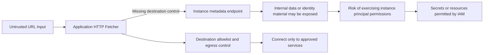

# Protecting Metadata Endpoints and Preventing Credential Exposure

In Oracle Cloud Infrastructure (OCI), a Compute instance needs to know where it is running, which VNICs it has, and what configuration launched it. The Instance Metadata Service, commonly called IMDS, supplies this information to the operating system, agents, and applications. Components authenticating via instance principal also use the instance's identity details to make OCI calls.

If an application lets an untrusted request control outbound HTTP connections from the server, the metadata endpoint can become a path to internal data or the instance's identity. Residing in a private subnet does not eliminate this risk: the dangerous request originates from the workload already running on the machine.

This lesson belongs to the **Network and Host Security** chapter and focuses on protecting OCI Compute metadata, mitigating SSRF, narrowing IAM permissions, and keeping credentials out of metadata, logs, or deployment artifacts. Examples tie to an application on Compute that needs to access a secret holding an Oracle Database password, without re-implementing the entire network or database stack.

## 1. Learning Objectives

After this lesson, learners can:

- Classify metadata, identity artifacts, and authentication data requiring protection.
- Explain what OCI IMDSv2 does and the limits of its protection.
- Plan a migration to IMDSv2 and disable legacy endpoints while keeping applications operational.
- Combine application HTTP controls, host-level access restrictions, and least-privilege IAM policies.
- Verify effectiveness using non-sensitive data, monitor anomalous signals, and respond when credentials are at risk of exposure.

All OCIDs, usernames, and configurations in this lesson are examples. Execute only on assigned resources; command snippets do not retrieve private keys, identity certificates, or tokens as lab evidence.

## 2. What Does the Metadata Endpoint Contain and Why Protect It?

### 2.1. Metadata Has Multiple Sensitivity Levels

In OCI Compute, the metadata service uses the link-local address `169.254.169.254`. Common data categories include instance details, VNICs, and custom metadata supplied by the deployer. Cloud-init also reads metadata for instance initialization. [Source: Getting Instance Metadata](https://docs.oracle.com/en-us/iaas/Content/Compute/Tasks/gettingmetadata.htm).

| Data group | Examples | How to evaluate |
| --- | --- | --- |
| Operational info | Instance OCID, region, availability domain | Not passwords, yet can reveal infrastructure topology |
| Network info | Private addresses, VNICs, associated subnets | Useful for mapping the internal environment |
| Initialization data | Custom metadata and `user_data` | Can become sensitive if deployers embed secrets into it |
| Public login data | SSH public keys in launch configuration | Public keys are not private keys; still require proper ownership controls |
| Auth material and auth artifacts | Instance identity components, security tokens in SDK flows | Must be protected across the authentication mechanism's lifecycle |

Not every metadata field is a credential. However, an endpoint containing both administrative metadata and identity-related material should never be exposed to arbitrary URL-fetching features or untrusted users.

### 2.2. `user_data` Is Not a Secrets Vault

A common mistake is putting DB passwords, API tokens, or private keys into a cloud-init script and Base64-encoding it before sending to OCI. Base64 is merely a data encoding; it does not make secrets disappear. Anyone who can read the value can decode it.

Initialization data can also appear in IaC configurations, state files, deployment plans, image copies, local files, or bootstrap logs. Therefore, do not check only whether the application prints passwords; inspect every place the value passes through.

Deployment configurations should carry references and non-secret parameters, such as:

```yaml
application: orders-api
environment: lab
secret_reference: <db-password-secret-ocid>
database_service: <approved-service-name>
```

This YAML snippet only illustrates configuration structure, not a complete cloud-init schema. The Secret OCID helps the application locate the resource; it does not replace authorization policies and is not the password content itself.

### 2.3. Instance Principals Magnify the Impact of Host Compromise

Instance principals allow applications to call OCI APIs without placing a user's API signing key on the machine. OCI manages the identity certificates required for this mechanism. However, Oracle explicitly notes that anyone with access to the instance can use the permissions granted to that instance. [Source: Calling Services from an Instance](https://docs.oracle.com/en-us/iaas/Content/Identity/Tasks/callingservicesfrominstances.htm).

If the instance is only allowed to read one secret for the application, impact on business resources can be bounded to that scope. If the instance holds broad tenancy-wide administrative privileges, a single application bug can cause far larger consequences.

The IAM boundary of an instance principal is the instance's identity. It does not distinguish individual Java processes, Linux users, or containers running on that same instance.

## 3. Risk Flow from SSRF to Credential Exposure

SSRF, short for Server-Side Request Forgery, occurs when untrusted input causes a server to send requests to an unintended destination. Functions requiring attention include URL previews, remote image fetching, webhook forwarding, and API calls to user-supplied addresses.



The diagram shows a risk model for designing defenses. It does not mean every SSRF automatically steals credentials: actual impact depends on response visibility, header control, network paths, IMDS settings, and instance permissions.

Three scenarios must be separated:

1. **URL control only:** the application sends a simple GET without allowing custom headers. IMDSv2's mandatory header requirement can block some of these flows.
2. **Control over both URL and headers, or a supporting proxy:** requiring a static header alone is no longer a sufficient barrier.
3. **Code execution or login on the host:** a process can craft HTTP requests directly. Host permissions, identity scope, and OCI policies must be restricted rather than relying solely on request formatting.

SSRF defenses must combine application controls with actual network controls; checking a URL string alone does not cover destination shifts via DNS or redirects. [Source: OWASP SSRF Prevention Cheat Sheet](https://cheatsheetseries.owasp.org/cheatsheets/Server_Side_Request_Forgery_Prevention_Cheat_Sheet.html).

## 4. Understanding OCI IMDSv2 Properly

### 4.1. Endpoint and Required Header

IMDSv2 uses the `/opc/v2` path and requires the header:

```http
Authorization: Bearer Oracle
```

The value `Oracle` is a fixed marker that requests must include, not an application-specific secret or a per-user token. IMDSv2 also rejects requests containing forwarding headers `Forwarded`, `X-Forwarded-For`, or `X-Forwarded-Host`. When legacy endpoints are disabled, `/opc/v1` and `/openstack` paths are rejected. [Source: Upgrading to IMDSv2](https://docs.oracle.com/en-us/iaas/Content/Compute/Tasks/gettingmetadata.htm).

Do not rely on adding a forwarding header as an active defense mechanism: a request sender might omit or strip it. The necessary measure is restricting who and which functions can establish connections to metadata.

### 4.2. What IMDSv2 Does Not Do Automatically

| Assumption | Accurate assessment |
| --- | --- |
| Having the header means the process is IAM-authenticated | A static header does not identify a user or process |
| Disabling v1 disables all metadata | v2 still works for valid consumers |
| Private instances have no path to metadata | Workloads on the instance can still reach the link-local endpoint |
| Enabling v2 solves SSRF completely | URL, redirect, header, and egress controls are still required |
| Every process on the same VM has separate OCI permissions | Instance principals share the instance's identity |

The goal is moving metadata requests to a safer protocol and reducing unintended access paths while preserving intentional usage.

## 5. Migrating to IMDSv2 Without Disrupting Service

### 5.1. Inventory Consumers Before Changing Settings

List every component that may use metadata:

- Cloud-init or image initialization components.
- Oracle Cloud Agent and active plugins.
- OCI SDKs, CLI, and providers authenticating via instance principal.
- Scripts fetching region, hostname, VNIC, or custom metadata.
- Containers or co-located services on the same host with different release lifecycles from the main app.

Verify support on the exact running image, agent version, SDK, and configuration. Do not infer from one successfully migrated VM that every other image in the fleet is ready.

Roll out first on a test instance or small canary group. Observe a full cycle covering boot, credential refreshes, scheduled jobs, and relevant plugins; a single successful API call might only be using cached data.

### 5.2. Reading Configuration from the Control Plane

The example below uses **Bash and OCI CLI** on an admin workstation with appropriate permissions:

```bash
OCI_REGION='<instance-region>'
INSTANCE_OCID='<lab-instance-ocid>'

oci compute instance get \
  --region "$OCI_REGION" \
  --instance-id "$INSTANCE_OCID" \
  --query 'data."instance-options"' \
  --output json
```

The API property `areLegacyImdsEndpointsDisabled` reflects whether legacy endpoints are disabled. In CLI JSON output, the field name typically appears as `are-legacy-imds-endpoints-disabled`. Read the exact value; do not mistake an absent field for proof that legacy is blocked.

### 5.3. Disabling Legacy Endpoints

After confirming compatibility and migrating required consumers:

```bash
oci compute instance update \
  --region "$OCI_REGION" \
  --instance-id "$INSTANCE_OCID" \
  --instance-options '{"areLegacyImdsEndpointsDisabled": true}' \
  --query 'data."instance-options"' \
  --output json
```

`--instance-options` accepts a JSON object. The command illustrates changing the metadata-related option only; operators must review the target and environment change workflow before executing. [Source: CLI Update Instance](https://docs.oracle.com/en-us/iaas/tools/oci-cli/latest/oci_cli_docs/cmdref/compute/instance/update.html).

In the Console, select the IMDS configuration allowing version 2 only once images and components meet requirements. Prepare an admin path and recovery procedure in case a consumer is incompatible; do not assume the application keeps running simply because the update call succeeded.

### 5.4. Maintaining via IaC

Inside an existing `oci_core_instance` resource, the relevant configuration block looks like:

```hcl
instance_options {
  are_legacy_imds_endpoints_disabled = true
}
```

This is a snippet placed within a full resource, not a standalone Terraform configuration. Apply the same standard to templates or instance configurations actually used by provisioning pipelines. Fixing an existing instance does not guarantee replacement or autoscaling instances share the same setting. [Source: Terraform resource `oci_core_instance`](https://docs.oracle.com/en-us/iaas/tools/terraform-provider-oci/latest/docs/r/core_instance.html).

## 6. Testing Endpoints Without Collecting Authentication Data

Use a metadata key containing no credentials, such as the instance ID, and print only the HTTP status code. The following commands are for Linux with `curl` running on the lab instance.

### 6.1. Valid Consumer Calling IMDSv2

```bash
curl --silent --show-error \
  --connect-timeout 2 --max-time 3 \
  --noproxy 169.254.169.254 \
  --output /dev/null \
  --write-out '%{http_code}\n' \
  --header 'Authorization: Bearer Oracle' \
  http://169.254.169.254/opc/v2/instance/id
```

With an authorized runtime and active endpoint, a success code is expected. The command does not print the instance ID content, does not follow redirects, and bypasses any environment HTTP proxy. Short timeouts suit connectivity checks and are not a universal retry setting for every application.

### 6.2. Missing-Header Requests and Legacy Requests

```bash
# Missing required header: must not receive a successful response.
curl --silent --show-error \
  --connect-timeout 2 --max-time 3 \
  --noproxy 169.254.169.254 \
  --output /dev/null \
  --write-out '%{http_code}\n' \
  http://169.254.169.254/opc/v2/instance/id

# After disabling legacy, the v1 endpoint must be denied.
curl --silent --show-error \
  --connect-timeout 2 --max-time 3 \
  --noproxy 169.254.169.254 \
  --output /dev/null \
  --write-out '%{http_code}\n' \
  http://169.254.169.254/opc/v1/instance/id
```

If the request missing the header still succeeds, re-check the endpoint and actual request path. If legacy still succeeds, verify the target instance and whether the configuration took effect. When legacy is disabled, OCI documentation describes a `404` response; a connection error from a host firewall is a different case.

When `curl` receives no HTTP response, `000` is not a status code returned by IMDS. Inspect the exit code and connection error to distinguish timeouts, rejects, and HTTP errors.

There is no need to dump the entire metadata tree, `user_data`, identity payloads, or security tokens to prove protections work.

## 7. Preventing SSRF at the Application Layer

### 7.1. Narrowing Input Types by Design

If the application only needs to call a few known partners, the API can accept a `partnerId` instead of an arbitrary URL. The server maps that ID to an administrator-controlled origin. Users must not freely choose scheme, host, port, or sensitive headers.

A status-checking feature should not reuse an HTTP client holding an OCI signer, token, or authentication headers meant for internal systems. Data from user requests must also never be copied verbatim into outbound request headers.

### 7.2. Java Example Restricting Targets and Disabling Redirects

The snippet below illustrates part of a design for Java 11 and later:

```java
import java.io.IOException;
import java.net.URI;
import java.net.http.HttpClient;
import java.net.http.HttpRequest;
import java.net.http.HttpResponse;
import java.time.Duration;
import java.util.Map;

public final class PartnerHealthProbe {
    private static final Map<String, URI> TARGETS = Map.of(
            "billing", URI.create("https://billing.example/health"));

    private static final HttpClient CLIENT = HttpClient.newBuilder()
            .connectTimeout(Duration.ofSeconds(3))
            .followRedirects(HttpClient.Redirect.NEVER)
            .build();

    public static int check(String partnerId)
            throws IOException, InterruptedException {
        URI target = TARGETS.get(partnerId);
        if (target == null) {
            throw new IllegalArgumentException("Unknown partner");
        }

        HttpRequest request = HttpRequest.newBuilder(target)
                .timeout(Duration.ofSeconds(5))
                .GET()
                .build();

        return CLIENT.send(request, HttpResponse.BodyHandlers.discarding())
                .statusCode();
    }
}
```

`billing.example` is an illustrative hostname and must be replaced with an approved destination. The client does not follow `Location` headers automatically and carries no OCI signer or headers. Redirect configuration is supported by the Java HTTP client. [Source: `HttpClient.Builder`](https://docs.oracle.com/en/java/javase/21/docs/api/java.net.http/java/net/http/HttpClient.Builder.html).

This pattern is not a complete SSRF defense suite. You must still control who can edit the target table, DNS, proxies, and the actual destination IP used by connections. An approved hostname resolving to a disallowed IP remains an issue to handle on the egress path.

### 7.3. When Business Requirements Force Accepting URLs

The design must explicitly constrain permitted schemes, ports, hostnames, or target groups; verify DNS resolution results and the actual connection destination. Never just compare a string against `169.254.169.254` and conclude it is safe. Account for loopback, private/link-local ranges, IPv4/IPv6, alternate IP notations, and DNS rebinding.

Disable redirects when unnecessary. If following redirects is required, each subsequent target must be re-evaluated; never validate only the initial URL. Checks at validation time and connection time must remain consistent to avoid gaps from DNS changes.

Timeouts, response size caps, connection limits, and content-type checks should also be considered. They help constrain remote fetching behavior, though they do not replace allow/deny decisions on the destination.

## 8. Restricting Metadata at the Host and Runtime Levels

### 8.1. Why Not Rely on NSGs or Security Lists?

OCI documentation states that VCN security rules are not enforced on traffic involving `169.254.0.0/16`, which includes metadata and iSCSI. Consequently, you cannot prove metadata is blocked simply by removing normal egress rules in an NSG or security list. [Source: VCN Security Rules](https://docs.oracle.com/en-us/iaas/Content/Network/Concepts/securityrules.htm).

Additional control layers include IMDS configuration, application validation, host firewalls or sandboxing, and runtime boundaries. Private subnets, NAT Gateways, and Internet Gateways are not per-process authorization mechanisms for IMDS.

### 8.2. Separating Processes Needing Metadata from Processes Handling Untrusted Input

For example, a `url-fetcher` process only fetches partner data and needs no OCI privileges. Another backend needs to read DB secrets. Do not run both under the same UID and expect the firewall to distinguish them by account.

UIDs or process management mechanisms can restrict access paths when processes share a host. When trust levels differ significantly, separating them onto distinct instances with separate identities and permission scopes establishes a clearer boundary. This decision must weigh additional Compute, operational, and availability costs.

### 8.3. Example nftables Rule Restricting a Single UID

Assume a service that does not need metadata runs directly on a Linux host under UID `2001`. In an environment that uses nftables for firewall management, a dedicated table can be designed as follows:

```nft
table inet metadata_guard {
    chain local_output {
        type filter hook output priority 10; policy accept;
        meta skuid 2001 ip daddr 169.254.169.254 tcp dport 80 counter reject with tcp reset
    }
}
```

`meta skuid` matches the UID associated with the socket originating traffic. The sample rule blocks only HTTP to the exact metadata IP for the specified UID; it does not block the entire link-local range. [Source: nftables socket UID/GID](https://wiki.nftables.org/wiki-nftables/index.php/Matching_packet_metainformation).

This configuration must be integrated and tested with the existing firewall, not applied blindly across every Oracle Linux image. Verify the actual UID, firewall backend, rule evaluation order, and persistence across reboots. Never mix firewall management tools without clear ownership of the ruleset.

Limitations of the sample must be clearly understood:

- It targets locally generated traffic at the `output` hook and does not automatically cover all container paths.
- Processes under another UID, local proxies, or intermediaries may create a path needing separate control.
- Someone with root or network-admin privileges on the host can modify the rule; it is not a barrier against compromised host admin privileges.
- If an application needing instance principals runs under the blocked UID, credential issuance or refresh will fail.

Never block all of `169.254.0.0/16` with a blanket rule just to restrict metadata. That range also serves platform functions; overly broad changes can impact boot volumes, storage, or instance services.

### 8.4. Containers Require Testing Actual Paths

Containers using bridge networking, host networking, or CNI plugins may traverse different hooks and namespaces. The UID seen inside a container can also differ from the UID on the host. A test run from an SSH account on the node does not prove containers are blocked.

Execute tests using the exact container, OS service account, and deployed network configuration. Restrict privileged containers, network modification capabilities, and access to host management sockets. Do not let a container processing untrusted input inherit the broad node identity as a default choice.

## 9. Limiting Blast Radius with IAM and Secret Management

### 9.1. Narrowly Scoped Identities

Dynamic groups identify instances matching a rule; policies grant permitted actions on resources. Avoid writing rules covering an entire compartment containing workloads of varying trust levels and then granting broad permissions to the whole group.

For example, a runtime needing only one secret can be restricted as follows:

```text
Allow dynamic-group OrdersRuntime to read secret-bundles in compartment OrdersSecrets where target.secret.id = '<db-password-secret-ocid>'
```

This is an illustrative resource-scoped policy; you must still review all other policies granted to the principal. Do not grant IAM management, key management, or access to all secrets just because an application needs one password. Check supported resource types and conditions when authoring real policies. [Source: IAM for Vault and Secret Management](https://docs.oracle.com/en-us/iaas/Content/Identity/policyreference/keypolicyreference.htm).

Even when a process is blocked from metadata, host administrative accounts remain part of the trust boundary. IAM must be designed so that if a host is compromised, the volume of business resources at risk remains as small as possible.

### 9.2. Store Secrets Properly While Still Controlling Consumers

Oracle Database passwords should be stored in Secret Management and supplied only to runtimes that need them. Centralized storage supports content and version lifecycle management. [Source: Secret Management Overview](https://docs.oracle.com/en-us/iaas/Content/secret-management/overview.htm).

A secret store does not automatically fix an instance granted overly broad read permissions. If an attacker exercises an identity authorized to read that secret, its contents can still be retrieved under those granted permissions.

Never place secrets in display names, tags, custom metadata, command lines, or error messages. Inside applications, minimize copying values into environment variables, temporary files, and log objects; environment variables are not a security boundary against a process with permission to read process environments or memory.

### 9.3. Cleaning Up Leak Sources and Handling Exposed Data

When a secret is discovered to have been stored in `user_data`, rotate the credential at the target system and audit related copies. Simply deleting a line from a template does not invalidate an old token or password.

CLI instance updates have limitations on certain launch fields like `user_data` and `ssh_authorized_keys`; do not assume they can be arbitrarily edited or cleared after launch. You may need to recreate the instance from a clean configuration, alongside cleaning images, state, and artifacts per procedure. [Source: Metadata Update Limitations](https://docs.oracle.com/en-us/iaas/tools/oci-cli/latest/oci_cli_docs/cmdref/compute/instance/update.html).

Distinguish credential types when rotating: DB passwords must be changed at the DB; API tokens must be revoked at the token issuer; API signing keys must follow key management revocation procedures. Rotating an instance's identity certificate does not change passwords the application already read and may have copied.

## 10. Observing Metadata and Identity Usage Behavior

### 10.1. Metrics for Metadata Requests

OCI provides the `InstanceMetadataRequests` metric in the `oci_compute` namespace. Dimensions include `metadataVersion`, `path`, `resourceId`, `userAgent`, and `status`, helping observe legacy consumers, paths, and request outcomes. [Source: Compute Management Metrics](https://docs.oracle.com/en-us/iaas/Content/Compute/References/compute-management-metrics.htm).

From this, operational signals can be built:

| Signal | What to investigate |
| --- | --- |
| v1 requests persist past migration schedule | Unmigrated consumer or legacy script still running |
| Metadata errors spike after option change | Incompatible image, agent, SDK, or proxy |
| Sharp increase in call frequency | Unbounded retries, missing cache, or anomalous behavior |
| Unexpected paths or user agents | New component, misconfiguration, or activity needing investigation |

Do not treat the user agent as definitive proof of process identity; that value can be set by the client. Aggregated metric data also does not pinpoint which PID originated the request.

A request blocked on the host may never reach IMDS, so combine firewall counters or runtime telemetry. Never enable full response-body logging to compensate for missing visibility; that itself can create another copy of credentials.

### 10.2. Auditing OCI Calls Made via Instance Principal

For OCI APIs called by an instance, Audit can correlate actions with the instance principal. Reconcile operations on secrets, storage, or other resources against approved business flows. A local HTTP request to metadata should not be assumed to generate a full Audit event equivalent to control-plane APIs.

If multiple processes share an instance principal, Audit typically identifies only the instance identity, not which individual process initiated the call. For finer attribution, combine application/host telemetry with appropriate workload boundaries.

### 10.3. Keeping Logs Out of Credential Exposure Paths

Diagnostic logs should contain only status, timestamps, consumer type, and resource references when needed. Strip authorization headers, tokens, private keys, secret bundles, and passwords from logs, traces, or APM attributes.

Do not enable shell tracing such as `set -x` in secret-fetching flows. When sharing error bundles, inspect request dumps, environment dumps, and agent-collected support files. A token masked in a dashboard UI may still exist in raw logs if masking happens only in the frontend.

## 11. Responding When Metadata or Credentials Are Suspected Compromised

Response workflows must address both the entry point and the permissions or data potentially accessed:

1. **Isolate the instance or workload:** restrict unnecessary flows, preserve an administrative path for investigation, and avoid destroying evidence.
2. **Document identity scope:** identify the instance, dynamic group, policies, and resources accessible at the time of the incident.
3. **Contain OCI permissions:** narrow or revoke unneeded permissions per procedure, and verify changes take effect rather than assuming instant revocation.
4. **Rotate credentials at issuer or target:** change DB passwords, revoke tokens, or rotate relevant keys if exposure is possible.
5. **Audit resource activity:** review Audit, application/host logs, and business data access during the suspected window.
6. **Remediate and redeploy:** fix SSRF, sanitize configurations, and rebuild the workload from trusted sources if the host is no longer trustworthy.
7. **Verify post-recovery:** test both allowed paths and denied paths, and monitor credential refreshes and scheduled tasks.

Dynamic group matching rule updates have propagation delay; Oracle documentation notes it can take roughly an hour. Do not treat merely removing a tag or editing membership as immediate proof that all uses of that identity are blocked. [Source: Managing Dynamic Groups](https://docs.oracle.com/en-us/iaas/Content/Identity/Tasks/managingdynamicgroups.htm).

Disabling IMDSv1 or blocking new credential retrieval does not revoke passwords or data already copied. Successful recovery requires evidence for each affected credential type and resource, not just a single endpoint check.

## 12. Hands-On Practice in a Lab Environment

### 12.1. Preparation

Use a test instance, an assigned admin account, and a service that does not need metadata running under its own UID. Never put real secrets into custom metadata. If testing secret read permissions, use dummy resources and narrowly scoped policies only.

Record the image, agent/SDK versions, IMDS configuration, metadata consumers, and instance permissions before making changes. Keep an administrative path independent of the HTTP feature under test so you can recover from misconfigurations.

### 12.2. Execution Sequence

1. Read IMDS configuration from the control plane and identify v1 consumers via metrics.
2. Migrate required consumers to v2, testing both startup and refreshes in the lab.
3. Disable legacy endpoints on the test instance and update corresponding IaC templates.
4. Run instance ID checks with v2 plus header, v2 missing header, and the legacy endpoint; record only HTTP response codes.
5. Apply an appropriate host-level restriction for the service that does not need metadata.
6. From that service's exact UID/runtime, attempt a v2 request with the header to a non-sensitive key; expect it to be blocked by the host layer.
7. From an authorized consumer, confirm operations needing metadata still work, including credential refreshes.
8. Test the URL-fetching feature against controlled dummy destinations to verify allowlists and redirects behave as designed.
9. Verify logs, metrics, and deployment evidence contain no sensitive content.

### 12.3. Technical Evaluation Criteria

| Item to prove | Appropriate evidence |
| --- | --- |
| Legacy is disabled | Option verified on the right instance and legacy requests rejected |
| Valid consumers keep working | v2 succeeds alongside agent/app checks and refreshes |
| Non-metadata service is restricted | Tested from exact UID/container with matching counters or connection errors |
| HTTP feature cannot pick arbitrary destinations | Mapping/allowlist, redirect, and egress verified using test targets |
| IAM has narrow business scope | Matching rules and aggregate applied policies reconciled |
| Credentials never enter evidence | Logs and artifacts contain only references and needed status |

Do not conclude success merely because one `curl` command from an admin account succeeded or failed. Evidence must tie to the exact runtime, endpoint, and control layer under evaluation.

## 13. Key Takeaways

Protecting metadata in OCI means securing the link between host workloads, launch configurations, and instance identity. IMDSv2 combined with disabling legacy endpoints is one part of the solution; a static header does not create per-process permissions.

A complete design must minimize sensitive data in metadata, mitigate SSRF, enforce host/runtime access controls, keep IAM narrowly scoped, and monitor how identities are used. When incidents occur, address both exposed credentials at target systems and the source of exposure, then re-verify operational flows after recovery.
