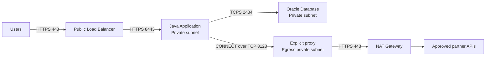

# Network Segmentation and Controlling Application Outbound Connections

## 1. Objectives and Deployment Scenario

In the **Network and Host Security** chapter of the **CLOUD_PROVIDERS_ORACLE** module, this lesson focuses on two questions: which components is a component allowed to connect to, and where is an application allowed to initiate outbound data transfers? This bridges VCN design, IAM authorization, Compute operations, and securing Oracle database services in Oracle Cloud Infrastructure (OCI).

After this lesson, learners can:

- Partition infrastructure into zones with clear responsibilities and connectivity permissions.
- Build a connectivity matrix, translate it into NSGs, and design appropriate routing paths.
- Distinguish the capabilities of NAT Gateway, Service Gateway, proxies, and OCI Network Firewall.
- Verify both permitted connections and connections that must be blocked.
- Integrate network policies into automation, monitoring, and controlled change workflows.

Consider an ordering system: users call a Load Balancer over HTTPS; the Load Balancer forwards requests to a Java application; the application accesses Oracle Database and calls partner APIs. If the application host is exploited, an attacker can attempt to reach other internal services or exfiltrate data. Securing inbound request ports alone does not address these application-initiated connections.

The design in this lesson is **one illustrative approach**: separating edge, application, data, and egress proxy zones; the application calls external APIs through a proxy. Addresses, ports, and domains must be replaced with real environment values. This lesson does not assume every OCI database product uses identical protocols or listener configurations.

## 2. Multi-Layer Network Segmentation

### 2.1. Segmentation by Path and by Role

Two traffic categories must be described:

- **North–south:** connections between the system and the Internet or external networks.
- **East–west:** connections between internal components, such as the application and the database.

Subnets organize addressing and routing policies. NSGs group resources sharing the same connectivity role, such as the Load Balancer group, application group, and database group. Within the same VCN, an NSG can reference another NSG as a source or destination; this avoids maintaining per-host IP lists as the application scales instance counts. [Oracle Documentation on Network Security Groups](https://docs.oracle.com/en-us/iaas/Content/Network/Concepts/networksecuritygroups.htm).

Placing two hosts into two separate subnets does not create a deny rule between them. OCI provides intra-VCN local routing by default; restricting communication requires designing explicit security rules. If traffic must be inspected by an intermediate firewall, corresponding internal routing must be configured. [Oracle Documentation on VCN Routing](https://docs.oracle.com/en-us/iaas/Content/Network/Tasks/managingroutetables_topic-working.htm).

For example, separating the application and database into two subnets while still allowing all TCP between all VCN addresses fails to meet the requirement "only the application may connect to the database on the listener port."

### 2.2. Distinguishing Each Layer's Responsibility

| Component | Primary question | How applied in the design |
| --- | --- | --- |
| Compartments and IAM | Who can create, modify, or use resources? | Restrict who can edit NSGs, routes, gateways, and data access |
| VCN, subnets, routes | Where can packets route and through which hops? | Separate application and egress route tables |
| Security Lists, NSGs | What traffic may cross a VNIC? | Allow exact roles, protocols, and ports |
| Host firewall | Which connections does the host accept or emit? | Add restrictions matching OS and process characteristics |
| Proxy or Network Firewall | Which destinations or contents may pass the control point? | Control external APIs and log allow/deny decisions |
| Service auth, data IAM | Once connected, what actions are permitted? | Restrict database accounts, buckets, and API privileges |

Compartments do not automatically create traffic barriers. Conversely, being able to open a network connection to a service does not automatically grant permission to read that service's data.

An engineer should not have permission to alter the entire network policy merely to deploy an application release. Similarly, the application's instance principal should hold permissions only for required resources. Network design and identity design work together to bound blast radius if one component is compromised.

## 3. OCI Characteristics That Determine Policy Correctness

### 3.1. Allow Rules Are Additive

Rules from Security Lists attached to the subnet and all NSGs attached to a VNIC combine as a union. NSGs and Security Lists are **allow** rules; they do not provide a higher-priority deny rule to override an allow rule elsewhere. If any applicable rule permits a packet, removing a rule in another NSG does not revoke that permission. [Oracle Documentation on Security Rules](https://docs.oracle.com/en-us/iaas/Content/Network/Concepts/securityrules.htm).

Default Security Lists include broad egress allow rules. Before enforcing a restricted destination list, inspect and remove inappropriate broad allow rules across every Security List and NSG applied to the VNIC. [Oracle Documentation on Security Lists](https://docs.oracle.com/en-us/iaas/Content/Network/Concepts/securitylists.htm).

Example of a misleading configuration:

```text
Application NSG:
  EGRESS TCP -> Database NSG:2484
  EGRESS TCP -> Proxy NSG:3128

Application subnet Security List:
  EGRESS ALL -> 0.0.0.0/0
```

In this example, the application still retains broad IPv4 egress permission at the VCN layer. Actual restriction still depends on routing, host firewall, and downstream control points.

### 3.2. Stateful Does Not Mean Opening Both Directions for Replies

With stateful rules, return traffic for a tracked connection is allowed automatically. Stateless rules require explicit rules for the return direction; when both types match the same traffic, stateless takes precedence. Therefore, do not mix both types casually. [Oracle Documentation on Stateful and Stateless Rules](https://docs.oracle.com/en-us/iaas/Content/Network/Concepts/securityrules.htm).

For a new connection from the application to the database, the design must still permit egress on the source VNIC and ingress on the destination VNIC. Statefulness does not substitute for the destination host's permission to accept new connections.

The matrix in this lesson describes the **connection initiator**. A database lacking permission to initiate Internet calls does not mean the database is prohibited from returning query results over an authorized connection. Likewise, restricting egress does not prevent sensitive data from being exfiltrated in the response of a valid ingress session; the application must still enforce authorization and output controls.

### 3.3. Do Not Infer Policy from a Single Route Table

In OCI, IP/VNIC-level route tables can exist alongside subnet route tables. When tracing paths, inspect the table actually in effect; a resource-level route can send traffic differently than expected. [Oracle Documentation on VCN Route Tables](https://docs.oracle.com/en-us/iaas/Content/Network/Tasks/managingroutetables.htm).

For the lab, assume no per-IP/VNIC route overrides are configured. When porting the design to a live environment, verify that assumption along with secondary VNICs, peering, DRGs, and links to on-premises networks.

## 4. Designing a Three-Tier Application and Egress Zone

### 4.1. Diagram and Addressing

Choose VCN `10.42.0.0/16` with four subnets:

| Zone | Illustrative CIDR | Resources | Path outside VCN |
| --- | --- | --- | --- |
| Edge | `10.42.10.0/24` | Public Load Balancer | Internet Gateway serving public flows |
| Application | `10.42.20.0/24` | Compute running Java | No Internet default route; calls proxy over internal network |
| Data | `10.42.30.0/24` | Oracle Database with TCPS | No Internet default route |
| Egress | `10.42.40.0/24` | Explicit HTTPS proxy | Default route to NAT Gateway |

Application, database, and proxy reside in private subnets with no public IPs assigned. In this example, the database is configured with TCPS on `2484`, the application accepts backend HTTPS on `8443`, and the proxy accepts HTTP CONNECT on `3128`. These ports are deployment contracts of the sample system.



The diagram shows permitted initiated connections; return packets follow their corresponding sessions. NAT Gateway is a VCN gateway, not a VM placed inside the proxy subnet.

### 4.2. Connectivity Matrix Before Writing Rules

| Initiator | Destination | Protocol/port | Decision | Purpose |
| --- | --- | --- | --- | --- |
| Users | Load Balancer | TCP 443 | Allow | Receive HTTPS requests |
| Load Balancer | Application | TCP 8443 | Allow | Forward requests and health checks on same port |
| Application | Database | TCP 2484 | Allow | Configured TCPS connection |
| Application | Proxy | TCP 3128 | Allow | Request proxy to open HTTPS tunnel |
| Proxy | External APIs | TCP 443 | Per proxy allowlist | Call partner services |
| Application | Direct Internet | All ports | No permission/route | Force external web connections through proxy |
| Load Balancer | Database | All ports | No permission | Prevent bypassing application tier |
| Database | Internet | All ports | No permission/route | Restrict initiated outbound connections |
| Proxy | Database | All ports | No DB ingress permission | Limit lateral movement |

The list must also add real dependencies such as management access, custom DNS, time sync, monitoring agents, backups, and package repositories. Each dependency requires source, destination, port, owner, and rationale; do not resolve unknown dependencies with an allow-all rule.

If the actual database requires multiple ports or a dedicated backup network, update the matrix per the exact Oracle Database service documentation being deployed. Do not blindly apply port `2484` to every DB System or Autonomous Database.

### 4.3. Route Tables Under the Explicit Proxy Model

In the sample configuration, Internet-related route tables are:

```text
RT-edge:
  0.0.0.0/0 -> Internet Gateway

RT-app:
  No default route to Internet

RT-data:
  No default route to Internet

RT-egress:
  0.0.0.0/0 -> NAT Gateway
```

The application connects directly to the proxy's private IP via VCN local routing. **Do not point the application's default route at the explicit proxy VM**: a proxy accepts connections at the application layer and does not automatically act as an IP packet-forwarding router.

If a library ignores proxy configuration, direct Internet connections must fail. This is a property to test, not a reason to add NAT to the application subnet.

## 5. Choosing How to Control Outbound Connections

### 5.1. NAT Gateway Provides Outbound Connectivity and Addressing

NAT Gateway lets resources without public IPs initiate Internet access and receive responses for those connections, while preventing the Internet from initiating connections inward through NAT. It does not provide domain allowlists or HTTP inspection policies. [Oracle Documentation on NAT Gateway](https://docs.oracle.com/en-us/iaas/Content/Network/Tasks/NATgateway.htm).

Consequently, `application -> NAT -> Internet` paired with rule `TCP 443 -> 0.0.0.0/0` permits HTTPS connections to a vast range of destinations. Port 443 neither verifies the destination is a valid partner nor validates that outbound data is permitted.

### 5.2. Proxy Fits When Explicit HTTP/HTTPS Control Is Needed

In the sample model, NSGs allow the application only to reach the proxy; the proxy decides external destinations. Logical policy can be expressed as follows; this is **pseudocode**, not OCI configuration syntax or a specific proxy product:

```text
Accept clients only from the approved application group.
Allow CONNECT only to port 443.
Allow only api.partner.example and telemetry.partner.example.
Deny direct IP destinations and out-of-policy private/link-local destinations.
Log allow or deny decisions.
Deny all remaining requests.
```

The `.example` domains are placeholders. During implementation, check how the proxy handles DNS, DNS rebinding, resolved destination IPs, redirects, and CONNECT tunnels. Avoid wildcarding an entire shared SaaS platform when only one API is required.

A standard CONNECT proxy sees the target hostname and port requested, yet does not inherently read HTTP paths or payloads inside the TLS tunnel. An approved hostname can also be misused; combine authentication, API privilege limits, and data controls inside the application.

### 5.3. Network Firewall Fits Centralized Inline Control

OCI Network Firewall provides traffic inspection and intrusion detection/prevention for a VCN. It is a strong choice when an inline control point is needed across multiple workloads or connection types. [Oracle Network Firewall Overview](https://docs.oracle.com/en-us/iaas/Content/network-firewall/overview.htm).

Unlike NSGs, security rules in a firewall policy have evaluation order and allow/deny actions. If no rule matches, the firewall drops packets; rule ordering must be designed intentionally. [Oracle Documentation on Firewall Policies](https://docs.oracle.com/en-us/iaas/Content/network-firewall/policies.htm).

To filter URLs with paths or query strings inside HTTPS, TLS decryption requirements must be evaluated. Hostname identification on encrypted traffic also has limits; do not assume creating a URL list inspects all HTTPS payloads. [Oracle Documentation on Firewall Policy Lists](https://docs.oracle.com/en-us/iaas/Content/network-firewall/creating-lists.htm), [Network Firewall Known Issues](https://docs.oracle.com/en-us/iaas/Content/network-firewall/knownissues.htm).

### 5.4. Service Gateway Is for Supported Oracle Services

Service Gateway provides a private path to supported Oracle Services Network services within the region. Routes and security rules can use service CIDR labels instead of self-maintained endpoint IP lists. It is not a general gateway to arbitrary Internet APIs. [Oracle Documentation on Service Gateway](https://docs.oracle.com/en-us/iaas/Content/Network/Tasks/servicegateway.htm).

For example, if the application needs Object Storage, a corresponding Service Gateway path can be added to the design. Object write permissions must still be restricted via IAM; connectivity to the Object Storage endpoint does not restrict an application to the organization's own buckets.

A Service Gateway is a distinct egress path that must be declared in the matrix. If policy mandates that all connections traverse centralized inspection, do not add this path and assume it automatically passes through the proxy or firewall.

## 6. Expressing NSG Policies with Terraform

The snippet below illustrates the NSG portion for the chosen matrix. It assumes the VCN, subnets, gateways, Compute, Load Balancer, and database already exist, and the OCI provider is configured with required permissions in the lab compartment.

The code creates four NSGs, three internal rule pairs, one Load Balancer HTTPS ingress rule, and one proxy HTTPS egress rule. NSG source/destination syntax and port bounds follow the official OCI provider resource. [NSG Security Rule Resource Documentation](https://docs.oracle.com/en-us/iaas/tools/terraform-provider-oci/latest/docs/r/core_network_security_group_security_rule.html).

```hcl
variable "compartment_id" {
  type = string
}

variable "vcn_id" {
  type = string
}

resource "oci_core_network_security_group" "tier" {
  for_each = toset(["edge", "app", "db", "proxy"])

  compartment_id = var.compartment_id
  vcn_id         = var.vcn_id
  display_name   = format("orders-%s", each.key)
}

locals {
  internal_flows = {
    edge_to_app = {
      from = "edge"
      to   = "app"
      port = 8443
    }
    app_to_db = {
      from = "app"
      to   = "db"
      port = 2484
    }
    app_to_proxy = {
      from = "app"
      to   = "proxy"
      port = 3128
    }
  }
}

resource "oci_core_network_security_group_security_rule" "internal_egress" {
  for_each = local.internal_flows

  network_security_group_id = oci_core_network_security_group.tier[each.value.from].id
  direction                 = "EGRESS"
  protocol                  = "6"
  stateless                 = false
  destination_type          = "NETWORK_SECURITY_GROUP"
  destination               = oci_core_network_security_group.tier[each.value.to].id
  description               = each.key

  tcp_options {
    destination_port_range {
      min = each.value.port
      max = each.value.port
    }
  }
}

resource "oci_core_network_security_group_security_rule" "internal_ingress" {
  for_each = local.internal_flows

  network_security_group_id = oci_core_network_security_group.tier[each.value.to].id
  direction                 = "INGRESS"
  protocol                  = "6"
  stateless                 = false
  source_type               = "NETWORK_SECURITY_GROUP"
  source                    = oci_core_network_security_group.tier[each.value.from].id
  description               = each.key

  tcp_options {
    destination_port_range {
      min = each.value.port
      max = each.value.port
    }
  }
}

resource "oci_core_network_security_group_security_rule" "edge_https" {
  network_security_group_id = oci_core_network_security_group.tier["edge"].id
  direction                 = "INGRESS"
  protocol                  = "6"
  stateless                 = false
  source_type               = "CIDR_BLOCK"
  source                    = "0.0.0.0/0"

  tcp_options {
    destination_port_range {
      min = 443
      max = 443
    }
  }
}

resource "oci_core_network_security_group_security_rule" "proxy_https_egress" {
  network_security_group_id = oci_core_network_security_group.tier["proxy"].id
  direction                 = "EGRESS"
  protocol                  = "6"
  stateless                 = false
  destination_type          = "CIDR_BLOCK"
  destination               = "0.0.0.0/0"

  tcp_options {
    destination_port_range {
      min = 443
      max = 443
    }
  }
}
```

After creating the NSGs, attach the right NSG to the Load Balancer, application VNICs, NSG-capable database resource, and proxy VNIC. Merely creating an NSG applies no policy to any resource.

The `proxy_https_egress` rule intentionally allows the proxy to open TCP 443 to external IPv4 addresses. Domain restriction belongs in the proxy configuration; NSGs do not have an FQDN field to replace it. The proxy host must be hardened as an egress point with higher privilege than the application. Restrict login access, permissions to modify the allowlist, and the ability to run processes outside the proxy role.

Conditions that must be completed before considering the example properly deployed:

- No inappropriate broad rules remain in associated Security Lists and NSGs.
- Load Balancer uses HTTPS `8443` backend with matching health checks.
- TCPS `2484` listener, certificates, and database authentication are configured separately.
- Proxy enforces a real allowlist, checks private/link-local targets, and logs decisions.
- Management rules, custom DNS, needed ICMP, and operational dependencies are explicitly designed.
- No extra routes or secondary VNICs create alternate egress paths for the application.

When applying to user-serving resources, review the Terraform plan and roll out in a test batch first. The illustrative code does not automatically remove broad rules or fix pre-existing resources outside its configuration.

## 7. Configuring the Java Application to Use the Proxy

In an explicit proxy model, network configuration must accompany HTTP client configuration. For JDK components using the default proxy mechanism, system properties can be passed as follows:

```bash
java \
  -Dhttps.proxyHost=10.42.40.10 \
  -Dhttps.proxyPort=3128 \
  '-Dhttp.nonProxyHosts=localhost|127.*|[::1]' \
  -jar orders.jar
```

The JDK uses `https.proxyHost` and `https.proxyPort` to select a proxy for HTTPS; HTTPS shares `http.nonProxyHosts` with HTTP. [Oracle Documentation on Java Networking Properties](https://docs.oracle.com/en/java/javase/25/docs/api/java.base/java/net/doc-files/net-properties.html).

`10.42.40.10` is a sample proxy IP. HTTP libraries with custom client builders or `ProxySelector` implementations may behave differently; verify the exact client and SDK used by the application. Setting the `HTTPS_PROXY` environment variable does not guarantee every Java library honors it.

In this example, JDBC connects directly to the database over granted internal rules. An HTTP CONNECT proxy does not automatically forward every database protocol. If the application also makes internal HTTP calls, add only truly required hostnames to the bypass list and confirm they hold corresponding network rules.

Preserve TLS certificate and hostname verification. If deploying TLS decryption at a proxy or firewall, manage trust stores and test compatibility with connections using certificate pinning or mTLS; never disable TLS verification as a blanket workaround.

## 8. When Replacing the Proxy with OCI Network Firewall

### 8.1. Paths Must Traverse the Firewall in Both Directions

For transparent connectivity, an alternative design is:

```text
Application -> Network Firewall -> NAT Gateway -> Internet
Internet -> NAT Gateway -> Network Firewall -> Application
```

This is an alternative approach with its own route tables; do not mix it arbitrarily into the explicit proxy model above.

Assume the firewall has private IP `10.42.50.10` in inspection subnet `10.42.50.0/24`. With a NAT Gateway design, typical routing is:

| Where route table is applied | Destination | Next hop |
| --- | --- | --- |
| Application subnet | `0.0.0.0/0` | Network Firewall private IP |
| Firewall subnet | `0.0.0.0/0` | NAT Gateway |
| Ingress route table attached to NAT Gateway | `10.42.20.0/24` | Network Firewall private IP |

The last row directs reply packets from NAT back through the firewall instead of straight to the application. After inspection, the firewall forwards to the application subnet via the appropriate local path. Account for other source subnets as well if they share this inspection path. [Oracle Guide on Network Firewall with NAT Gateway](https://docs.oracle.com/en-us/iaas/Content/Resources/Assets/whitepapers/learn-oci-network-firewall-with-examples.pdf).

Setting only a default route on the application subnet is usually insufficient to prove no bypass exists. Evaluate return paths, more specific routes, and separate paths to Oracle services.

### 8.2. Security Rules Must Match the Forwarding Role

Security Lists/NSGs on the firewall subnet and VNIC are evaluated before firewall policies. Those rules must allow the traffic intended for firewall inspection. Do not mechanically copy stateful rules from an application host onto a subnet acting as a transit hop. [Oracle Documentation on Routing Traffic Through a Firewall](https://docs.oracle.com/en-us/iaas/Content/network-firewall/network-firewall-routing-traffic.htm).

In a transparent firewall design, the application's NSG still evaluates the final destination address. It does not treat packets routed via the firewall as connections to a firewall service port. Therefore, the `app -> proxy:3128` rule from the prior model must be replaced with rules matching actual traffic, while domain restrictions and blocking actions live in the firewall policy.

If inspecting application-to-database traffic as well, separately design the application–firewall–database path and its return path. Having a firewall in the VCN does not automatically route east–west connections through it.

### 8.3. Decision Points Before Selecting a Model

| Requirement | Selection direction |
| --- | --- |
| Only a few HTTPS APIs, application supports proxy config | Explicit proxy with allowlist and blocked direct path |
| Centralized control across multiple connection types | Network Firewall and mandatory routing |
| Stable IP targets, simple protocols/ports | NSGs combined with routes and tightly scoped host firewall |
| Access to supported Oracle services in region | Service Gateway combined with IAM and appropriate rules |
| Inspecting HTTPS payloads or URL paths | Design app/TLS-layer inspection and define visibility limits |

Selection must be grounded in actual data flows and operational capability. Every new inline control point can add latency, cost, and availability dependencies; plan telemetry and incident handling accordingly.

## 9. DNS, Link-Local, IPv6, and Commonly Overlooked Egress Paths

### 9.1. DNS Is Not Just a Minor Pre-Connection Step

Applications may need DNS to locate databases, proxies, or service endpoints. With custom DNS, create rules for approved resolvers; account for both UDP and TCP 53 as needed. If using an OCI Private DNS resolver endpoint, apply NSGs and access controls to that endpoint. [Oracle Documentation on Resolver Endpoints](https://docs.oracle.com/iaas/Content/Network/Concepts/dns-topic-resolver_endpoints.htm).

Do not open DNS to all addresses just to fix a resolution error. DNS can also exfiltrate data; if the threat model includes DNS tunneling, control resolvers, query permissions, and DNS monitoring.

Blocking queries to public resolvers on port 53 also does not prevent DNS over HTTPS through a permitted HTTPS destination. Destination allowlists and application capabilities must be evaluated together.

### 9.2. Link-Local Is an Exception Worth Understanding Clearly

OCI does not enforce Security Rules on traffic within `169.254.0.0/16`, which hosts services such as instance metadata. Metadata cannot be protected solely by removing NSG egress allow rules. [Oracle Note on Security Rules and Link-Local](https://docs.oracle.com/en-us/iaas/Content/Network/Concepts/securityrules.htm).

Consequently, for SSRF defense, applications must validate destination addresses after resolution and across redirects; proxies must handle link-local targets; host firewalls can add restrictions as needed. Before blocking at the OS level, map dependencies for DNS, agents, storage, and platform services to avoid breaking operations.

### 9.3. IPv4 Policies Do Not Cover IPv6

If the environment enables IPv6, inspect IPv6 routes, security rules, and paths too. Lacking an IPv4 NAT path does not prove egress is impossible over IPv6. OCI maintains separate addressing and rules for IPv6. [Oracle Documentation on IPv6](https://docs.oracle.com/en-us/iaas/Content/Network/Concepts/ipv6.htm).

The sample lesson configures IPv4 only. In a dual-stack environment, make one of two verified decisions: implement equivalent policies for IPv6, or withhold IPv6 paths from workloads lacking corresponding control designs.

### 9.4. Other Paths Must Also Have Owners

During design review, also inventory:

- Secondary VNICs or IP/VNIC-level route overrides.
- DRGs, peering, VPNs, and FastConnect leading to systems that can forward to the Internet.
- Service Gateways and private endpoints for data services.
- Other proxies, administrative tunnels, or processes permitted to forward traffic.
- For container workloads, paths from pods through nodes and orchestrator-layer policies.

Every path needs a purpose, owning team, and test evidence. A single active path outside the matrix can invalidate the claim that "all traffic is forced through the control point."

## 10. Hands-On Deployment and Verification

### 10.1. Preparing the Environment

Perform in a lab environment with appropriate admin privileges. Prepare the VCN and resources per the diagram; record addresses, attached NSGs, route tables, and existing rules. Prepare two HTTPS endpoints with valid DNS controlled by the testing team: one approved destination and one unapproved destination.

Recommended rollout sequence:

1. Inventory application dependencies, including health checks, DNS, database, agents, and external services.
2. Set up the proxy with allowlists and logging, and verify operation from an authorized source.
3. Create NSGs from the matrix; attach to the right resources, confirming egress and ingress on both ends.
4. Configure the Java HTTP client to use the proxy and verify application functionality.
5. Tighten broad Security Lists/NSGs; apply route tables without an Internet default route for application and data tiers.
6. Run the verification suite from exact sources; reconcile logs before expanding rollout.

Keep an independently designed administrative path to fix misconfigurations. Do not add public SSH or broad egress permissions as a default precondition of the lab.

### 10.2. Testing Functionality from the Application Host

The following commands use Bash on a lab host with `curl` and `nc`. Replace `.example` hostnames, proxy address, and database address with real values before running. Do not treat a failure to resolve a placeholder hostname as proof of network blocking.

```bash
PROXY='http://10.42.40.10:3128'
DB_HOST='10.42.30.10'
ALLOWED_URL='https://api.partner.example/health'
DENIED_URL='https://blocked.partner.example/health'

# Must establish TCP connection to the configured listener.
nc -vz -w 5 "$DB_HOST" 2484

# Must traverse the proxy and receive a response from the approved endpoint.
curl --verbose --connect-timeout 5 --max-time 15 \
  --proxy "$PROXY" --noproxy "" "$ALLOWED_URL"

# Must be denied by the proxy before opening a tunnel to an unapproved destination.
curl --verbose --connect-timeout 5 --max-time 15 \
  --proxy "$PROXY" --noproxy "" "$DENIED_URL"

# Bypass all proxies: direct connection must fail.
curl --verbose --connect-timeout 5 --max-time 15 \
  --noproxy '*' "$ALLOWED_URL"
```

`nc` succeeding confirms only TCP reachability, not TCPS, certificates, or database login permissions. Add tests using a real database client and a least-privilege account.

For requests blocked at the proxy, inspect the CONNECT response and proxy logs. An HTTP 403 returned by the destination service after the tunnel opens does not prove the proxy blocked the destination.

To rule out direct connection failure caused merely by DNS errors, test an HTTPS endpoint with a confirmed IP. The example below preserves the hostname for SNI and certificate validation while supplying the IP via `--resolve`:

```bash
# Replace both hostname and IP with an active lab endpoint.
DIRECT_TEST_IP='<LAB_PUBLIC_ENDPOINT_IP>'
curl --verbose --connect-timeout 5 --max-time 15 \
  --noproxy '*' \
  --resolve "api.partner.example:443:$DIRECT_TEST_IP" \
  https://api.partner.example/health
```

The direct test must fail due to designed policies/routes. Confirm the endpoint remains healthy via the allowed path to avoid false conclusions from an outage at the external service.

### 10.3. Verifying Segmentation and Anti-Bypass

| Test | Source | Required result | Evidence |
| --- | --- | --- | --- |
| Call approved API via proxy | Application | Succeeds | Proxy log showing right target and service response |
| Call out-of-allowlist API via proxy | Application | Denied | Proxy log recording block decision |
| Call external HTTPS directly | Application | Fails | Path check paired with healthy-endpoint check |
| TCPS connection to DB | Application | Succeeds | TCP and DB client authenticate cleanly |
| Connect to DB | Test source representing edge role | Fails | Effective rules and corresponding logs |
| Initiate Internet connection | Database or lab source with same policy | Fails | No out-of-design permissions or routes |
| Remove proxy config from client | Application | External web connection fails | No direct fallback path |
| Test IPv6 egress if dual-stack | Application | Follows same policy | IPv6 routes, rules, and connection results |
| Access out-of-scope bucket | Application, if using Object Storage | Cannot read/write | IAM error and appropriate service logs |

A test source representing the edge role must be arranged cleanly; do not log into the managed Load Balancer service to run shell commands. If using a test instance, verify it carries NSGs and routes matching the test's intent.

Additionally, test HTTP redirects to unapproved hostnames and IP-literal targets. When testing SSRF, use safe lab targets simulating protected ranges; do not harvest credentials or metadata contents as verification evidence.

### 10.4. Layer-by-Layer Fault Diagnosis

When a legitimate connection fails, follow this sequence:

1. **Application:** is the client using the right proxy, hostname, port, and timeout?
2. **DNS:** do A/AAAA records match the expected endpoint?
3. **Source:** which NSGs are attached to the VNIC, and are custom routes or host firewalls blocking?
4. **Path:** which gateway/firewall does the effective route table send packets through?
5. **Destination:** does ingress permit the right source, and is the service listening on the right port?
6. **Return path and protocol:** is routing symmetric where required, and do TLS and authentication succeed?

In particular, never change rules to `ALL -> 0.0.0.0/0` and treat restored connectivity as "fixed." If a diagnostic exception is needed, give it a clear scope and expiration time.

## 11. Monitoring Allow and Deny Decisions

### 11.1. Using Multiple Evidence Sources

VCN Flow Logs record accepted or rejected traffic per Security Lists/NSGs, including source, destination, port, and protocol. They are not HTTP logs and cannot tell whether a request is valid at the business layer. Some link-local traffic, including VCN DNS and other platform services, does not appear in flow logs. [Oracle Details for VCN Flow Logs](https://docs.oracle.com/en-us/iaas/Content/Logging/Reference/details_for_vcn_flow_logs.htm).

If using Network Firewall, enable appropriate logging to observe traffic and threats; do not assume creating the firewall automatically finishes log setup. [Oracle Documentation on Enabling Firewall Logs](https://docs.oracle.com/en-us/iaas/Content/network-firewall/enable-logs.htm).

Combine sources:

| Source | What to observe |
| --- | --- |
| VCN Flow Logs | Unusual addresses/ports, connections rejected by NSGs/Security Lists |
| Proxy access logs | Client, requested hostname, allow/deny decisions, tunnel creation errors |
| Network Firewall logs, if used | Policy/rule, action, session, and threat indicators |
| Application logs | Dependencies called, timeouts, retries, and business outcomes |
| OCI Audit | Who modified resources or control configurations |

OCI Audit tracks changes made via API/Console/CLI, which differs from firewall traffic logs. [Oracle Documentation on Network Firewall Security and Auditing](https://docs.oracle.com/en-us/iaas/Content/Security/Reference/network-firewall_security.htm).

Do not conclude "no traffic occurred" merely because a log query returned zero rows. Verify whether logging is enabled, the right VNIC and time window were selected, or collection filters/gaps exist. Similarly, an ACCEPT record on a VNIC does not prove the application completed a TLS handshake or received a valid response.

### 11.2. Monitoring Signals Tied to the Design

Useful signals for the sample system include:

- Application attempting direct connections to public IPs.
- Proxy repeatedly rejecting new hostnames or receiving CONNECT requests to non-standard ports.
- Sharp spikes in bytes sent to an approved destination compared to normal behavior.
- Increases in proxy or TLS errors following certificate changes.
- Someone adding broad allow rules, public IPs, default routes, or new gateways.
- Database initiating outbound connections outside the matrix.

Set thresholds based on measured system behavior. A legitimate backup job may transfer high volumes; an unauthorized command-and-control channel may transfer very little. Correlate signals with workload identity, destination, and change schedules.

Log only necessary details. Avoid logging tokens, passwords, sensitive query strings, or full request payloads just to diagnose connectivity.

## 12. Operations, Availability, and Cost

### 12.1. Restricting Permissions That Can Weaken Policy

Separate duties between application deployment teams and network platform administrators. Controlled operations include editing NSGs/Security Lists, attaching additional NSGs to resources, assigning public IPs, modifying routes, and updating proxy/firewall policies.

A strict rule can lose effect if a resource gets attached to another NSG with a broad allow rule. Therefore, govern both rule contents and resource attachments. With Terraform, review changes as code, detect drift, and keep change history; avoid letting two tools manage the same object without conventions.

### 12.2. Do Not Let Egress Points Become Unplanned Outages

A single proxy suffices for a lab but does not meet all availability requirements. For production, design multiple instances across fault domains/availability domains, health checks, and connection distribution or failover mechanisms. When adding intermediary endpoints, update the matrix and NSGs to match actual paths.

Applications need timeouts, bounded retries, and backoff so a proxy outage does not trigger a connection storm. Never configure automatic fallback to direct Internet when the proxy goes down, because doing so lets an outage disable the security control itself.

For Network Firewall, verify availability and recovery behavior of the selected configuration. Being a managed service does not remove the operator's responsibility for routing, policies, and observability.

### 12.3. Controlling Cost by Approach

Compare costs across approaches rather than just counting resources:

- Self-operated proxies require Compute, storage, patching, and operational staff time.
- Network Firewall incurs service and data-processing charges per current pricing.
- Logging generates storage and processing data; retention and collection filters must fit investigation goals.
- Multi-tier or cross-domain/cross-zone flows can add latency and corresponding data transfer charges.

Use measured traffic and real log retention requirements to estimate costs. Never hardcode a fixed price into long-term designs; check current regional pricing and terms before finalizing.

### 12.4. Small Changes, Evidence, and Recoverability

Before tightening egress, build a dependency list from application configs, service docs, and observed logs. Roll out to a small batch of instances first, keep test results alongside infrastructure changes, and then expand.

Recovery plans should restore a known-working configuration or roll back the specific faulty change. If emergency exceptions are granted, record destination, port, owner, and expiration; never let temporary exceptions become permanent entitlements.

## 13. Design Completion Criteria

The design can advance to review once backed by the following evidence:

- Diagrams and matrices describing initiators, destinations, protocols, ports, and operational dependencies.
- Every VNIC/resource attached to the right NSG; all applicable Security Lists and NSGs audited together.
- Application reaches approved database and APIs while failing to reach out-of-scope destinations.
- Direct paths, firewall return paths if used, IPv6, and secondary gateways/routes checked.
- Metadata, DNS, and SSRF addressed per platform behavior rather than relying solely on NSGs.
- Logs distinguish network decisions, proxy/firewall decisions, and application outcomes.
- Clear plans exist for policy modification rights, automated changes, recovery, availability, and cost.

Restricting outbound connections is a contract across application, network, and identity. In the sample system, that contract is realized by allowing the application only approved internal connections while the proxy governs external APIs. Whenever adding a new Oracle service or partner, update the contract and re-verify affected paths before granting additional permissions.
