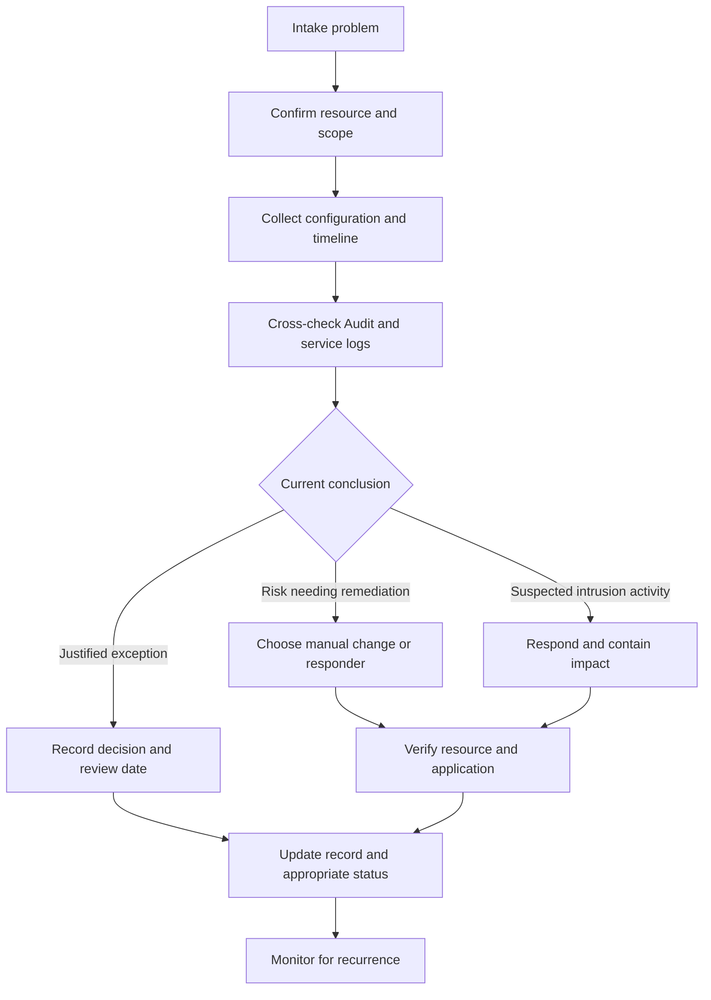
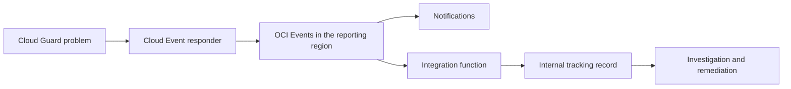

# Investigating and handling Cloud Guard problems

A security alert is only valuable when the operations team can identify which resource is affected, what the cause is, what needs to change, and have evidence of the remediation outcome. With Oracle Cloud Infrastructure (OCI), Cloud Guard problems are the starting point for that chain of work.

This lesson belongs to the **Security, Governance, and Auditing** chapter of the `CLOUD_PROVIDERS_ORACLE` module. Its scope focuses on investigating and handling problems on deployed OCI infrastructure: identifying the tenancy, compartment, and related resources; checking IAM; cross-referencing evidence; remediating; and verifying security, availability, and operational cost.

## 1. Learning outcomes

After this lesson, learners will be able to:

- Read a problem and place it in the right business context, target, region, and access permissions.
- Distinguish insecure configurations from suspicious activities to choose the investigation approach.
- Choose appropriately between running a responder, handling via another workflow, and dismissing with justification.
- Monitor a responder execution and identify the cause when remediation has not succeeded.
- Maintain a record containing pre-change evidence, remediation actions, and verification results.
- Automate appropriate steps while still controlling the blast radius.

## 2. Understanding the object under investigation

### 2.1. Problem, detector, and responder

A **detector rule** describes a detection condition; a **detector recipe** groups rules; a **target** defines the inspection scope; a **problem** records a finding; a **responder** performs a response action. Targets are attached to compartments and child scopes according to the target structure. Therefore, always confirm the actual target managing the resource. See [Cloud Guard Concepts](https://docs.oracle.com/en-us/iaas/Content/cloud-guard/using/cg-concepts.htm).

For example, a bucket used for database backups is configured to allow public access. The problem raises a question about the security of the configuration. It is not enough on its own to conclude that data was downloaded without authorization. Conclusions about data access require separate evidence.

Similarly, unusual administrative activity is a signal that needs verification. An on-call engineer handling an emergency and someone using compromised credentials can generate very similar actions on the infrastructure. Identity context, timestamps, and accompanying changes help distinguish the two cases.

### 2.2. Choosing an investigation path by finding type

| Detection type | Opening question | Evidence to look for in an illustrative scenario |
| --- | --- | --- |
| Configuration | Where does the current configuration deviate from requirements? | Resource attributes, IaC configuration, most recent changes |
| Activity | Who performed the action, and with which identity? | Audit, access source, change request, account owner |
| Threat or multi-signal findings | Do the signals form a suspicious chain? | Timeline, related entities, logs from multiple services |

This table is a way to organize investigations in this lesson. Actual problem names, detail fields, and available detectors must be read from the live environment; do not assume every tenancy has the same set of detections.

## 3. Preparing before remediation

### 3.1. Confirming scope and ownership

Before changing a resource, record:

1. Tenancy and environment: lab, development, or production.
2. Compartment containing the resource, detecting target, and resource region.
3. Workload owner and security point of contact.
4. Change management or incident response process applicable to the issue.
5. Dependent services: applications, management network paths, backup, and recovery.

For example, making a bucket private may be appropriate for a backup store, but you must check recovery flows and applications reading the data. For Compute or VCN, isolating a resource must also preserve authorized management paths and consider the impact on remaining active components.

### 3.2. Separating investigation permissions from modification permissions

The person reading a problem, the person modifying a resource directly, and the service running a responder are different principals. User permissions do not automatically become permissions of the `cloudguard` service.

The example below is for an investigation team with tenancy-wide observation scope. Administrators must adjust the identity domain, group names, and scope according to the organization's IAM model:

```text
Allow group SecurityInvestigators to read cloud-guard-problems in tenancy
Allow group SecurityInvestigators to read compartments in tenancy
Allow group SecurityInvestigators to inspect cloud-guard-config in tenancy
```

This covers reading problems; it does not yet include permissions to view all pages, Audit, all responder activity, or modify resources. When additional capabilities are needed, grant them separately by role. Oracle distinguishes `inspect` for listing and `read` for reading details in [Cloud Guard Prerequisites](https://docs.oracle.com/en-us/iaas/Content/cloud-guard/using/prerequisites.htm).

For a responder that fixes buckets, an example compartment-level service policy is:

```text
Allow service cloudguard to manage buckets in compartment SecurityLab
```

Only use policies matching the chosen responder and permitted scope. Do not copy every responder permission into the tenancy to resolve a single error. Refer to permissions by action type in [Policy Statements for OCI Responders](https://docs.oracle.com/en-us/iaas/Content/cloud-guard/using/respond-recipes-about.htm).

### 3.3. Distinguishing the reporting region and resource region

Cloud Guard has a **reporting region**; monitored resources can be in other regions. Cloud Guard Create, Update, and Delete operations must use the reporting region; read operations can be performed from other regions. CLI examples in this lesson use the reporting region consistently for Cloud Guard. Commands to modify buckets and read Audit use the region associated with the resource or event. See [Cloud Guard CLI](https://docs.oracle.com/en-us/iaas/tools/oci-cli/latest/oci_cli_docs/cmdref/cloud-guard.html).

Do not assume the reporting region matches the home region. When results look incomplete, check the service endpoint being called and the problem region filter as two separate factors.

## 4. Triaging and prioritizing problems

### 4.1. Opening the list and removing misleading filters

In the Console, go to **Identity & Security → Cloud Guard → Alerts → Problems**. Select the compartment, child compartment scope, time range, and required filters. When opened from a summary tile on Overview, the list may already be pre-filtered.

Open a problem to inspect its details, **Problem History**, and **Responder Activity**. Columns such as risk level, resource, target, region, first detected, and last detected help guide the next step. Refer to [Listing Problems and Getting Their Details](https://docs.oracle.com/en-us/iaas/Content/cloud-guard/using/problems-page-view-list.htm).

Not finding a problem is not enough to conclude a resource is safe. First, check reader permissions, target scope, rule status, time filters, and problem state.

### 4.2. Prioritizing by actual risk

The risk level provided by the tool helps with initial triage. Remediation decisions also require asset value, reachability, signs of exploitation, and business impact.

| Factor | Question to answer | Example impact on priority |
| --- | --- | --- |
| Data | Is customer data, backup data, or secret material present? | A bucket containing production backups needs early handling |
| Reachability | Can entities outside the organization reach the resource? | A public access path widens who can attempt access |
| Identity permissions | What can the involved identity change? | A deployment account with permissions across many compartments |
| Activity evidence | Is there ongoing activity or an unusual behavior sequence? | Changing permissions and then creating additional credentials |
| Availability | Which services could remediation disrupt? | Disabling the wrong identity causes backup jobs to fail |

A team can define intake and remediation targets by priority level. This is an internal operational commitment; do not infer incident response SLAs from Cloud Guard alert colors.

## 5. Evidence-based investigation



This diagram is a recommended workflow for the operations team, not an Oracle API state diagram.

### 5.1. Creating the initial record

At a minimum, record:

- Problem OCID and internal ticket ID.
- Detector rule, detector type, and displayed recommendation.
- Resource OCID or resource identifier, compartment, target, and region.
- First detected, last detected, and investigation start timestamps.
- Current configuration, responder results if any, and hypotheses to verify.

Use OCIDs to correlate data across sources. Display names can be reused, changed, or duplicated across environments. Normalize timelines to UTC and note the time zone when coordinating with on-call teams.

### 5.2. Distinguishing detection time from change time

Consider the following illustrative timeline:

| Time (UTC) | Evidence |
| --- | --- |
| 02:10 | Audit shows a successful request to update the bucket |
| 02:18 | Cloud Guard records first detection |
| 02:30 | Engineer begins investigation |
| 02:42 | Bucket is reverted to the desired configuration |
| Afterward | Operations team re-checks the resource and problem progression |

Do not treat 02:18 as the definitive start of exposure. If the 02:10 record was indeed the misconfiguration change, the investigation window begins earlier than when the detector recorded it. When the root change has not been identified, widen the search window and clearly note the limits of the conclusion.

### 5.3. Cross-checking OCI Audit

Look for administrative actions around the relevant time window. Cross-reference the API-calling identity, resource, access source when available, operation, outcome, and request ID. Do not stop at the first change request; check subsequent edits and the actual state.

Audit records supported API calls. For Object Storage, Audit covers bucket-related events, not operations on objects. Therefore, do not use Audit alone to conclude that an object was never read. See [Overview of Audit](https://docs.oracle.com/en-us/iaas/Content/Audit/Concepts/auditoverview.htm).

### 5.4. Supplementing logs according to the investigation question

For buckets, if you need to investigate object reads or writes, check whether Object Storage service logs were enabled during the relevant period. Logs can help cross-reference objects, access sources, methods, and results. Oracle notes that service log delivery is best effort; a missing log record does not prove no access occurred. See [Details for Object Storage Logs](https://docs.oracle.com/en-us/iaas/Content/Logging/Reference/details_for_object_storage.htm).

For other workloads, choose the corresponding evidence:

- Compute: OS logs, application logs, and signs of credential usage.
- VCN: route configuration, security lists, NSGs, and VCN Flow Logs if collected.
- Oracle Database: database logs and audit records according to the configured mechanism.
- Pipeline: deployment runs, execution identity, commits, and input changes.

Enabling logs after an incident helps observe ongoing activity, but cannot reconstruct data that was never logged. In the record, clearly distinguish available evidence, unfound evidence, and uncollected evidence.

### 5.5. Finding reproducible root causes

A misconfiguration often has multiple layers of causes. For example: a bucket was made public because of a default value in Terraform; the pipeline had permission to update the bucket; pre-deployment checks did not catch that change.

If you only fix it directly in the Console, the next deployment may reintroduce the misconfiguration. The remediation plan must identify both the immediate action and where the desired configuration is stored.

For suspected intrusion activity, expand the investigation along the identity: check changed permissions, newly created credentials, and other resources that may be affected. Avoid bulk-disabling identities without assessing dependencies, as this can cut off management paths or disrupt recovery flows.

## 6. Choosing a handling action and reading status accurately

### 6.1. Three distinct decisions

| Decision | Meaning | Usage condition in the recommended workflow |
| --- | --- | --- |
| Remediate | Run a Cloud Guard responder | Appropriate action, sufficient permissions, and impact assessed |
| Mark as Resolved | Record that it was handled by other means | Actual remediation evidence exists |
| Dismiss | Ignore and close the finding | Justification and exception decision exist |

Not every problem has a Remediate option. You can review the Recommendation and handle it through a separate workflow; when updating the status, add an explanation to support traceability. See [Resolving a Problem](https://docs.oracle.com/en-us/iaas/Content/cloud-guard/using/problems-page-resolve.htm).

For example, a pipeline has fixed the bucket and a re-read confirms the right configuration: there is a basis for using Mark as Resolved. If the bucket is still unintentionally public, clicking this button does not change the bucket's properties.

A bucket distributing public documentation can be a valid exception if the data and purpose are confirmed. Conversely, leaving a store of sensitive backups public simply because there hasn't been time to fix it is accepting a risk that must be explicitly managed.

### 6.2. Lifecycle and recurrence

The Console uses labels Open, Remediated, Resolved, Dismissed, and Deleted. When an issue recurs, a resolved problem can reopen; an open problem typically updates its history. Dismissed can continue updating its history; with Activity Detector, it can even transition back to Open. Disabling a rule or detaching a recipe can also cause a problem to move to Resolved without fixing the resource. See [Problem Lifecycle and Reconciliation](https://docs.oracle.com/en-us/iaas/Content/cloud-guard/using/problems-page-about.htm).

Therefore, closure criteria must include both the actual configuration and the finding progression. When the problem count drops suddenly, check for monitoring scope changes before interpreting it as a security improvement.

### 6.3. Console labels differ from CLI parameters

In the `problem list` command, `--lifecycle-state` accepts `ACTIVE` or `INACTIVE`; `--lifecycle-detail` accepts `OPEN`, `RESOLVED`, `DISMISSED`, or `DELETED`. Do not pass `OPEN` to `--lifecycle-state`. Listing defaults to only the specified compartment; to include child compartments, configure subtree querying. See [CLI problem list](https://docs.oracle.com/en-us/iaas/tools/oci-cli/latest/oci_cli_docs/cmdref/cloud-guard/problem/list.html).

Do not infer a `--status REMEDIATED` parameter from the Remediated label. Valid representations and operations must follow the command reference of the command being used.

## 7. Executing and monitoring responders

### 7.1. Pre-execution checks

Before selecting a responder, answer four questions:

1. Which exact attribute or resource does it modify?
2. Do the applicability conditions match the current problem and resource?
3. Do the operator and the service have sufficient permissions for their respective parts?
4. How will the application continue operating after the change, and what is the recovery plan?

Re-read the configuration right before acting if there has been a long wait. Another person or pipeline may have modified the resource since the time of investigation.

For example, the **Make Bucket Private** responder is appropriate when the goal is to remove unintended public access. If an application relies on anonymous access, transition to an authorized access mechanism and verify business logic alongside the security change.

### 7.2. Reading execution status

| Execution status | Interpretation and next step |
| --- | --- |
| Started | Started; monitor progress |
| Awaiting confirmation | Waiting for an Execute or Skip decision |
| Awaiting input | Additional input required |
| Failed | Read the error; check permissions and resource |
| Skipped | Read the skip reason |
| Succeeded | Action succeeded; proceed to verify the resource |

Skipped can appear when multiple responders apply, but only one action is executed. Inspect details in Responder Activity rather than concluding from the status name alone. Refer to [Listing Responder Rule Actions and Getting the Details](https://docs.oracle.com/en-us/iaas/Content/cloud-guard/using/respond-dash-work.htm).

Succeeded is evidence of the responder action. The record still needs to prove that the application continues working, the unwanted access path has been removed, and the configuration source does not keep reintroducing the flaw.

### 7.3. Automating within a tested scope

For responders that support automatic mode, configuring **Execute automatically** requires an applicability condition. This setting is adjusted in the responder rule of the recipe attached to the target. See [Editing Responder Rule Settings in an OCI Target's Recipes](https://docs.oracle.com/en-us/iaas/Content/cloud-guard/using/targets-modify-rules-respond.htm).

A recommended rollout path:

1. Run manually on test resources and verify results.
2. Keep confirmation steps during the impact assessment phase.
3. Choose a small scope based on conditions the rule actually supports.
4. Monitor execution errors and application impact.
5. Expand after evidence meets requirements.

Prioritize automating actions with clear scope and easily verifiable results. For changes that can stop workloads, disable identities, or affect production connectivity, design dedicated applicability conditions and service continuity plans.

## 8. Hands-on lab: investigating a public bucket and remediating it

### 8.1. Lab prerequisites

Use a lab compartment and an existing test bucket containing no real data. The target must cover the resource and the relevant detector must be active. Only use a problem that has appeared in an authorized practice environment; do not make production resources public to trigger alerts.

The examples below assume a problem involving a public bucket. Specific detector names, risk levels, and responders must be read from the actual problem.

The command snippets use **Bash**, suitable for OCI Cloud Shell or a Bash environment with OCI CLI installed and configured. They are examples for learners to run in their own accounts; they are not output captured from a specific tenancy.

### 8.2. Defining inputs

Replace placeholders with verified values:

```bash
export REPORTING_REGION='<cloud-guard-reporting-region>'
export RESOURCE_REGION='<bucket-region>'
export COMPARTMENT_ID='<compartment-ocid>'
export PROBLEM_ID='<cloud-guard-problem-ocid>'
export NAMESPACE='<object-storage-namespace>'
export BUCKET_NAME='<lab-bucket-name>'
export START_TIME='<YYYY-MM-DDTHH:MM:00Z>'
export END_TIME='<YYYY-MM-DDTHH:MM:00Z>'
```

`START_TIME` and `END_TIME` form the actual investigation window, including the period prior to first detection. The Object Storage namespace differs from the compartment name and bucket name.

### 8.3. Listing and reading the problem

```bash
oci cloud-guard problem list \
  --compartment-id "$COMPARTMENT_ID" \
  --compartment-id-in-subtree true \
  --access-level ACCESSIBLE \
  --lifecycle-detail OPEN \
  --region "$REPORTING_REGION" \
  --all

oci cloud-guard problem get \
  --problem-id "$PROBLEM_ID" \
  --region "$REPORTING_REGION"
```

The first command aids searching; the second fetches the exact selected problem. Verify the resource, target, compartment, and region in the output before moving to changes. `--all` paginates results; it does not automatically widen time filters or access permissions. Detailed reading syntax is described at [CLI problem get](https://docs.oracle.com/en-us/iaas/tools/oci-cli/latest/oci_cli_docs/cmdref/cloud-guard/problem/get.html).

### 8.4. Reading problem history and responder activity

```bash
oci cloud-guard problem list-problem-histories \
  --compartment-id "$COMPARTMENT_ID" \
  --problem-id "$PROBLEM_ID" \
  --region "$REPORTING_REGION" \
  --all

oci cloud-guard responder-activity-summary list-responder-activities \
  --problem-id "$PROBLEM_ID" \
  --region "$REPORTING_REGION" \
  --all
```

Use the compartment matching the read problem. Check whether someone has already handled it, which responders have run, and whether there are errors to follow up on. Refer to [CLI list-problem-histories](https://docs.oracle.com/en-us/iaas/tools/oci-cli/latest/oci_cli_docs/cmdref/cloud-guard/problem/list-problem-histories.html) and [CLI list-responder-activities](https://docs.oracle.com/en-us/iaas/tools/oci-cli/latest/oci_cli_docs/cmdref/cloud-guard/responder-activity-summary/list-responder-activities.html).

### 8.5. Cross-checking Audit

```bash
oci audit event list \
  --compartment-id "$COMPARTMENT_ID" \
  --start-time "$START_TIME" \
  --end-time "$END_TIME" \
  --region "$RESOURCE_REGION" \
  --all
```

Locate the event that updated the exact bucket, then cross-check the identity, request, and outcome. The command fetches events by compartment and time; the output requires further analysis. Audit command timestamps require seconds and fractional seconds to be zero. See [CLI audit event list](https://docs.oracle.com/en-us/iaas/tools/oci-cli/latest/oci_cli_docs/cmdref/audit/event/list.html).

If the investigation expands to IAM or other services, additionally query the compartments and regions associated with those events. Do not mechanically restrict all evidence to the bucket's region.

### 8.6. Choosing a remediation method

**Option A — using a responder:** on the problem, select Remediate if available, read the proposed action, verify permissions, and run after confirming impact. Then monitor Responder Activity. Do not assume clicking Remediate means the operation has completed.

**Option B — modifying directly:** if your team's workflow requires changes via an operator or pipeline, read the bucket first, then update the required property:

```bash
oci os bucket get \
  --namespace-name "$NAMESPACE" \
  --bucket-name "$BUCKET_NAME" \
  --region "$RESOURCE_REGION"

oci os bucket update \
  --namespace-name "$NAMESPACE" \
  --bucket-name "$BUCKET_NAME" \
  --public-access-type NoPublicAccess \
  --region "$RESOURCE_REGION"
```

The `update` command is an actual change requiring Object Storage permissions for the executing principal. If multiple parties update concurrently, you can use `--if-match` with the just-read ETag and handle conflicts by re-reading before deciding how to proceed. Refer to [CLI os bucket update](https://docs.oracle.com/en-us/iaas/tools/oci-cli/latest/oci_cli_docs/cmdref/os/bucket/update.html).

The two options are alternatives for the same remediation step. Avoid re-running an action while a responder is executing just because the Console status has not refreshed yet.

### 8.7. Verifying before updating status

```bash
oci os bucket get \
  --namespace-name "$NAMESPACE" \
  --bucket-name "$BUCKET_NAME" \
  --region "$RESOURCE_REGION"
```

Confirm the `public-access-type` attribute is `NoPublicAccess`, test access with an authorized identity, and verify anonymous requests against a known test object. Do not rely solely on object listing not displaying objects: listing objects and reading an object are two separate checks.

Separately review pre-authenticated requests (PAR). PARs provide URLs that allow access within the granted scope without requiring credentials from the URL user; changing the public configuration does not replace checking these URLs. See [Object Storage Pre-Authenticated Requests](https://docs.oracle.com/en-us/iaas/Content/Object/Tasks/usingpreauthenticatedrequests.htm).

If using Option B and verification is complete, update the problem:

```bash
oci cloud-guard problem update-problem-status \
  --problem-id "$PROBLEM_ID" \
  --status RESOLVED \
  --region "$REPORTING_REGION"

oci cloud-guard problem get \
  --problem-id "$PROBLEM_ID" \
  --region "$REPORTING_REGION"
```

`update-problem-status` changes the problem status; it does not modify the bucket. The command accepts `OPEN`, `RESOLVED`, `DISMISSED`, and `DELETED`. In this lab, only use `RESOLVED` after remediation; the other values are not substitutes for fixing the configuration. See [CLI update-problem-status](https://docs.oracle.com/en-us/iaas/tools/oci-cli/latest/oci_cli_docs/cmdref/cloud-guard/problem/update-problem-status.html).

Save evidence in the internal record and monitor subsequent finding progression. If the problem reopens, check the resource and pipeline to distinguish configuration recurrence from status synchronization lag.

## 9. Verifying results across three layers

| Verification layer | Closure question | Sample evidence |
| --- | --- | --- |
| Resource | Has the risk-inducing condition been removed? | Re-read configuration output, access test |
| Service | Does the workload still meet requirements? | Health check, business flow, test reading a backup |
| Monitoring and governance | Is detection still covered and has the root source of error been fixed? | History, responder activity, active target, IaC change |

For resources used for Oracle Database backups, verify read and recovery capability according to the team's test procedure. A permission change can protect data while breaking the recovery flow if the workload lacks required permissions.

If another access path is discovered or there are signs of credential compromise, open corresponding incident response tasks. Do not use the result of fixing a single attribute to conclude that the entire incident is over.

## 10. Exceptions and controlled dismissals

An exception should have a dedicated record containing:

- Resource OCID, rule, and excepted scope.
- Business justification along with evidence that the data fits the purpose.
- Residual risk and compensating controls.
- Owner, decision-maker, and expiration or review date.
- Conditions requiring investigation to reopen.

For example, a public bucket contains only documents approved for public release. The team must control who has write permissions and ensure pipelines do not put backups or internal files into that same location. Validity of a public purpose does not guarantee that every item written to the bucket is appropriate.

The expiration date is the responsibility of the exception process. Do not assume the Dismiss action automatically creates a review schedule or automatically reopens the problem on the recorded date.

When reducing noisy alerts, prioritize finding the exact condition causing noise and constrain changes to what the rule supports. Every recipe change must be reviewed for affected monitoring scope.

## 11. Notification integration and work tracking

Cloud Guard has a **Cloud Event** responder to forward problem information to OCI Events, enabling integration with Notifications or Functions. Configure this flow in the reporting region. Check the responder recipe attached to the target and the Cloud Event rule before troubleshooting the notification pipeline. See [Configuring Notifications](https://docs.oracle.com/en-us/iaas/Content/cloud-guard/using/export-notifs-config.htm).

A recommended design:



When building integrations, design for receiving duplicate events or closely spaced updates. Use the problem OCID to link records, store the event ID to identify already-processed events, and retain history of recurrences. Do not collapse all events for a problem into a single handling record.

Notifications must contain enough context for assignment: problem, resource, compartment, region, timestamp, and owner contact. For problem closure events, check the content and reason before automatically closing incident response tickets; tool status does not automatically describe all business verification outcomes.

## 12. Handling common scenarios

| Symptom | Investigation direction | Next step |
| --- | --- | --- |
| Expected problem not visible | Compartment, time, read permissions, target, detector | Confirm scope and use problem OCID if available |
| Can read problem but cannot execute remediation | Operation permissions, service policy, reporting region | Read the error and add the exact missing part |
| Responder Failed | Execution error, resource existence, changed configuration | Identify root cause before retrying |
| Prolonged Awaiting confirmation | No decision-maker or not assigned | Assign an owner and process the confirmation step |
| Resolved then Open again | Recurring misconfiguration, pipeline overwrite, root cause unfixed | Read the resource and compare timelines |
| Problem count drops after recipe change | Coverage may have changed | Reconcile target and rules against the change plan |
| Dismissed still gets new history | Finding may still be ongoing | Re-review the exception and detector type |
| Event emitted but no notification | Integration rule, topic, subscription, region | Check each stage of the delivery pipeline in order |

This table is a diagnostic guide; it does not assert that each symptom has only one cause. Record the error and request ID to coordinate with administrators or support when needed.

## 13. Audit records and completion criteria

A short record template can be used as follows:

```text
Ticket ID:
Problem OCID / detector rule:
Resource / compartment / target / region:
Workload owner / investigator:
First detected / last detected:
Investigation time window:
Priority level and rationale:
Pre-change evidence:
Conclusion / unconfirmed hypotheses:
Root cause:
Action / executing user or service / timestamp:
Change ticket ID / responder execution / request ID:
Security verification result:
Application and recovery test result:
Post-handling Cloud Guard status:
IaC or pipeline changes to prevent recurrence:
Exception / review deadline if any:
Evidence limitations / remaining work:
```

Store query outputs and configurations with collection timestamp, source, and collector. Control read access to records because logs may contain identity information or operational details. For evidence preservation requirements, apply retention and integrity verification mechanisms per organizational policy.

Do not use the Cloud Guard interface as the sole long-term evidence repository. Export required data early and set retention policies based on actual audit needs; the data lifecycles of problems, Audit, and service logs must be managed separately.

A remediation work item can be closed once evidence shows that:

1. Affected resources and scope have been identified.
2. The root cause has been addressed or residual risk has a clear owner.
3. Post-change configuration meets security objectives.
4. Critical application flows continue operating.
5. Problem status is updated consistently with the action taken.
6. Evidence, decisions, and recurrence prevention measures have been documented.

## 14. Measuring operational effectiveness

Track metrics that can lead to concrete actions:

| Recommended metric | How to use it |
| --- | --- |
| Time from detection to intake | Identify assignment and on-call coverage gaps |
| Time to verified remediation | Measure actual risk reduction speed |
| Recurrence count by rule and resource | Find unfixed configuration or process sources |
| Responder success rate | Identify permission errors, input issues, and automation scope |
| Expired exceptions | Review risks that were dismissed without re-evaluation |
| Exported log and record volume | Adjust scope, retention duration, and cost |

If remediation time is measured by when Resolved is clicked, the team may report good numbers even though the resource was not fixed. Separately record the status change timestamp and the verification completion timestamp.

Operational cost includes time spent handling noisy alerts, log storage, queries, integrations, and change impact. Collect evidence aligned with investigation goals, retain necessary data, and avoid creating duplicate records for the same finding.

When operated properly, every problem leads to an evidence-backed decision: verified remediation, continued incident response, or a time-bound accepted exception. An auditor must be able to trace that decision from initial evidence to the post-remediation resource state.
