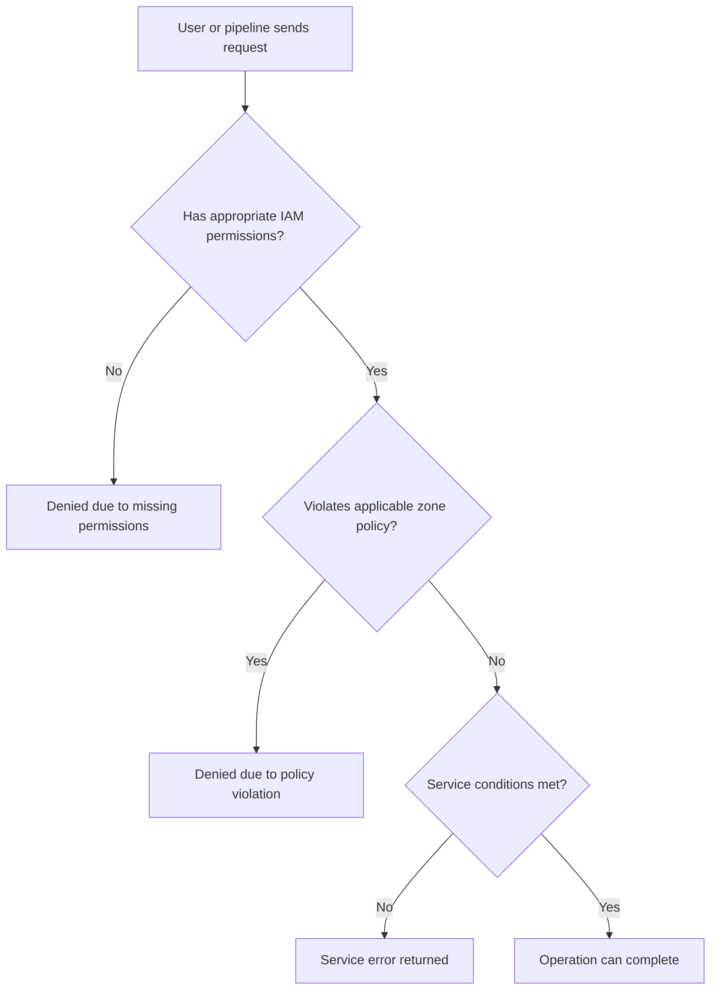

# Security Zones and secure configuration policy enforcement

## 1. Objectives and application scenario

In Oracle Cloud Infrastructure (OCI), an account with sufficient deployment permissions can still accidentally create an inappropriate configuration: exposing a bucket containing customer records to the public, placing resources in a network outside the protection scope, or choosing the wrong key management mechanism. For the **Security, Governance, and Auditing** chapter of the `CLOUD_PROVIDERS_ORACLE` module, this lesson focuses on turning secure configuration requirements into enforceable constraints using Security Zones.

After this lesson, learners will be able to:

- Explain the relationship between security zone, compartment, recipe, and policy.
- Distinguish between IAM permissions, Security Zones configuration checks, Cloud Guard findings, and Audit evidence.
- Select a protection scope aligned with VCN, Compute, storage, and Oracle Database architectures.
- Build a verification lab containing both allowed and denied operations.
- Integrate recipe changes into automation workflows, exception management, and evidence-backed operations.

**Overarching scenario:** a development team operates a Java application that processes customer records. The application stores files in Object Storage and uses an Oracle Database. The team needs to ensure that an update via the Console or a pipeline cannot make the records bucket public. At the same time, operations must know who attempted to change the configuration, which request was blocked, and which legacy resources still need remediation.

## 2. Enforcement mechanism of Security Zones

Security Zones bind a compartment scope to a **security zone recipe**. The recipe contains configuration policies supported by OCI. When processing an operation within the controlled scope, OCI evaluates the operation against enabled policies and denies it if a violation occurs. This check applies regardless of who the caller is; Security Zones do not grant additional resource administration permissions. [Oracle: Overview of Security Zones](https://docs.oracle.com/en-us/iaas/Content/security-zone/using/security-zones.htm).

The following expression can be used to design and explain a test:

```text
An operation can succeed when:
    IAM permits it
    AND it does not violate applicable Security Zones policies
    AND service-specific conditions are met.
```

The expression above is a mental model; it does not describe OCI's internal execution order. Service-specific conditions may include quotas, valid bucket names, resource state, or key usage permissions.



In the customer records bucket scenario, granting extra IAM permissions to the deployer will not resolve a request blocked by a policy forbidding public access. The proper fix is to correct the target configuration or review the architectural requirement through governance processes.

Someone with permission to edit recipes or delete zones can alter the guardrail itself. Therefore, evaluate two types of permissions separately: **workload deployment permissions** and **permissions to administer workload guardrails**.

## 3. Components and protection scope

| Component | Significance in design |
| --- | --- |
| Compartment | Resource organization unit and applicability boundary |
| Security zone | Binds a compartment scope to a recipe |
| Security zone recipe | Selected set of configuration policies to enforce |
| Security zone policy | A specific configuration requirement provided by Oracle |
| Cloud Guard target | Scope for monitoring and detection |
| Cloud Guard problem | Recorded finding needing triage and handling |

By default, child compartments belong to the same zone as their parent compartment. OCI supports creating a dedicated zone for a child compartment or excluding a child compartment from a zone. A compartment cannot simultaneously belong to multiple security zones. Therefore, the compartment tree structure alone is not enough to prove actual protection scope; inspect the list of compartments associated with the zone. [Oracle: Managing Security Zones](https://docs.oracle.com/en-us/iaas/Content/security-zone/using/managing-security-zones.htm).

Example structure for the Java application:

```text
Tenancy
├── SecurityArtifacts
│   └── Location for managing recipes and security governance info
├── CustomerWorkload
│   ├── Application
│   ├── Database
│   └── Documents
└── SecurityZoneLab
    └── Independent test environment
```

This is an illustrative design structure. When placing `CustomerWorkload` into a zone, cross-check the actual locations of subnets, volumes, databases, and related resources. Being in the same tenancy or sharing an environment label does not prove resources belong to the same zone.

A useful design rule is to list **dependency relationships** before choosing boundaries:

```text
Compute instance → subnet
Compute instance → boot volume and block volume
Database → subnet and backup configuration
Application → bucket → encryption key, if a dedicated key is required
```

This list supports architectural review. Not every arrow corresponds to a policy requiring two resources to be in the same zone; verify the policy applicable to each relationship type.

## 4. Distinguishing four layers of control

| Layer | Question to answer in the customer records scenario |
| --- | --- |
| IAM | Which principal is permitted to create or update the bucket? |
| Security Zones | Does the intended change violate enforced configuration requirements? |
| Cloud Guard | Do existing resources have any issues requiring remediation? |
| Audit | Which request occurred, who called it, and what was the outcome? |

Distinguish **a blocked violating request** from **an existing resource in a violating state**. If a public update attempt is denied, the bucket may remain private; do not assume Cloud Guard must create a problem for that blocked attempt. During investigation, retain both the request's error response and the bucket's state after the test.

Conversely, enabling a zone on a compartment with pre-existing resources does not mean old configurations are automatically fixed. Pre-existing resources must be detected, assigned to an owner, and remediated. An active zone status is evidence that the mechanism is deployed; workload compliance requires separate evidence.

## 5. Choosing a recipe aligned with architectural requirements

### 5.1. Oracle-managed recipes and custom recipes

OCI provides `Maximum Security Recipe`, managed by Oracle, which users cannot edit directly. You can create or clone into a custom recipe to select appropriate policies. A custom recipe is a selection from OCI's policy catalog, not a place to author arbitrary business conditions in IAM syntax. [Oracle: Managing Recipes in Security Zones](https://docs.oracle.com/en-us/iaas/Content/security-zone/using/managing-recipes.htm).

A recipe name alone is insufficient to judge suitability. An environment requiring management access paths, software package downloads, or data recovery must have a design compatible with the enabled policies. OCI's catalog contains policies that tightly restrict even resource administration operations; read the actual contents before applying a broad recipe.

### 5.2. Policy examples and impacts to verify

The examples below take effect only when the corresponding policy is enabled and the resource type is supported.

| Example policy | Restricted condition |
| --- | --- |
| `deny public_buckets` | Public buckets |
| `deny buckets_without_vault_key` | Buckets lacking a customer-managed key in Vault |
| `deny public_subnets` | Public subnets |
| `deny NAT_gateway` | Adding a NAT gateway to a VCN in the zone |
| `deny SGW_gateway` | Adding a service gateway to a VCN in the zone |
| `deny database_without_backup` | Missing automatic backup on supported DB system types |

Other policies can restrict compartment moves, resource attachments, or data cloning. Map each policy to the exact service and operation; do not generalize a DB system constraint across all Oracle database services. [Oracle: Security Zone Policies](https://docs.oracle.com/en-us/iaas/Content/security-zone/using/security-zone-policies.htm).

### 5.3. Turning requirements into a verification matrix

Before deployment, build a table such as:

| Organizational requirement | Intended design | Evidence to collect |
| --- | --- | --- |
| Customer records must not be public | Private bucket and anti-public policy | Private creation succeeds; switching to public is blocked |
| Use only organization-managed keys | Vault setup and appropriate key usage permissions | Creation with valid key succeeds; missing key is blocked |
| Separate deployment and security permissions | Two separate IAM groups | Deployment group cannot modify the zone or recipe |
| Recoverability | Backups, restore plan, and compatible placement constraints | A test restore meets defined objectives |
| Every exception has an owner | Tracking process and review deadline | List of active exceptions and responsible owners |

This is a recommended matrix for the lesson's example. Each row needs an owner, environment, and acceptance criteria when applied in practice. Do not use the count of enabled policies as the sole measure of protection quality.

## 6. Designing VCNs, keys, and recoverability

### 6.1. Defining network flows before enabling policies

For the Java application, describe each flow instead of merely writing "use a private subnet":

- Through which component do users access the application?
- Which address does the application use to connect to the database?
- Which path does the application use to access Object Storage?
- Where do servers obtain patches or download dependencies?
- How do operators access the environment during an incident?

Cross-reference each flow with the intended gateways, endpoints, routes, and policies. A subnet not assigning public IPs does not answer all questions about outbound access. At the same time, do not assume a NAT gateway or service gateway is always available if the recipe enables policies restricting them.

For example, the team needs to download Java artifacts from an external repository. If the design requires an egress path that the recipe disallows, resolve it before deployment: review artifact distribution, workload boundaries, or network exceptions. Waiting until the pipeline fails and then disabling the policy turns security decisions into reactive improvisation.

Security Zones also do not replace designing NSGs, security lists, application authentication, and TLS. Each layer addresses a different part of the access path.

### 6.2. Customer-managed keys introduce operational dependencies

If the organization chooses to enforce using a Vault key for the records bucket, a syntactically valid OCID parameter is not enough. The deployment team must verify key availability, required permissions for principals and services, and rotation and recovery procedures.

Proceed in order:

1. Prepare the key and key usage permissions.
2. Verify the workload can create and read test data with the desired configuration.
3. Enable the mandatory-key constraint in a test environment.
4. Verify that omitting the key is denied.
5. Only then expand the scope.

Do not disable or schedule deletion of a key solely to perform a failure test. A test configuration omitting the key is sufficient to verify the constraint without affecting data readability.

### 6.3. Recovery must also be part of the design

Requirements to keep resources and data within a protection boundary can affect compartment move plans or creating recovery copies. Therefore, ask restore questions from the start:

- Which compartment and zone will the restored resource belong to?
- Are required networks and keys already available at the recovery location?
- Is there a test proving this procedure can execute?
- Who is responsible if a restore step is denied by a configuration constraint?

Backup policies and completing a restore are two different types of evidence. RPO/RTO targets must be evaluated using an actual recovery drill.

## 7. Preparing IAM and Cloud Guard

### 7.1. Separating administrative roles

Suggested role assignment for the example:

| Role | Responsibilities |
| --- | --- |
| Platform administration | Enable Cloud Guard, prepare compartments and service permissions |
| Security administration | Select recipes, manage zones, evaluate exceptions |
| Deployment team | Create and update workloads within granted scope |
| Audit | Read protection configurations and operational evidence |

Example IAM policies for a configuration-reading group in the governance compartment:

```text
Allow group SecurityAuditors to read security-zone in compartment SecurityArtifacts
Allow group SecurityAuditors to read security-recipe in compartment SecurityArtifacts
```

Replace the group name, identity domain if needed, and compartment scope to match the actual tenancy. Permission to read these two resource types does not automatically grant permission to read Audit, Cloud Guard problems, or workload configurations. Also review broad permissions via `cloud-guard-family`, as this aggregate resource type includes permissions for Security Zones. [Oracle: Securing Security Zones](https://docs.oracle.com/en-us/iaas/Content/Security/Reference/securityzone_security.htm).

For teams creating zones, onboarding documentation lists permissions for working with Cloud Guard configuration, targets, problems, and managing security zones. Obtain the appropriate statements from current guidance; do not assume a single zone management permission covers all Console operations. [Oracle: Getting Started with Security Zones](https://docs.oracle.com/en-us/iaas/Content/security-zone/using/get-started.htm).

In permission design, specifically check who can update recipes, change a zone's recipe, exclude child compartments, or delete zones. These are operations that can alter enforcement scope.

### 7.2. Checking impact on Cloud Guard targets

Cloud Guard must be enabled before creating a zone. When creating a zone, OCI configures a security zone target; existing targets for the compartment and child compartments may be replaced, and default detector recipes are applied. A dedicated zone on a child compartment also gets its own target. [Oracle: Creating a Security Zone](https://docs.oracle.com/en-us/iaas/Content/security-zone/using/create-security-zone.htm).

Before applying to an active workload, record the current target and detector recipes, especially customizations the monitoring team uses. After the change, re-verify monitoring scope and incident handling routes. Creating a zone should not cause operations to lose the ability to explain why an issue is detected or no longer visible.

## 8. Hands-on lab: enforcing a private bucket

### 8.1. Scope and prerequisites

This lab uses only the `SecurityZoneLab` compartment, an empty bucket, and test data. The goal is to observe a single constraint, so use a **custom recipe with only the deny public buckets policy enabled**. This minimal recipe serves to learn the mechanism; production requires controls tailored to specific requirements.

Preparation:

- Cloud Guard has been enabled by an administrator.
- The lab compartment contains no active workloads and is not unexpectedly covered by another zone.
- The lab principal has the necessary permissions to administer the lab and create, read, and update buckets.
- OCI CLI has authentication configured, if using the commands below.
- You know the Security Zones management endpoint region and the bucket creation region in your environment.

The commands are examples for learners to run in the lab; this article does not assume they have been deployed to a tenancy.

### 8.2. Creating a custom recipe and zone in the Console

1. Open **Identity & Security → Security Zones → Recipes**.
2. Create recipe `sz-lab-private-bucket-v1` in the compartment dedicated to the lab.
3. In the policy list, keep only `deny public_buckets` enabled; disable the other policies for this minimal test.
4. On the review page, confirm the exact list of enabled policies and create the recipe.
5. Copy the recipe OCID.
6. Create zone `sz-lab-private-bucket` for the exact lab compartment and select the newly created recipe.
7. Wait for the zone to reach `Active` state, and verify the associated compartment and recipe.

When creating a new custom recipe, policies are enabled by default; thus the list review step is decisive. Do not just filter for one policy, check it, and ignore other policies still enabled outside the filter. [Oracle: Creating a Security Zone Recipe](https://docs.oracle.com/en-us/iaas/Content/security-zone/using/create-recipe.htm).

You can replace the Console zone creation step with OCI CLI. **Choose one creation method**, and avoid running the create command again if the zone already exists:

```powershell
$LabCompartmentId = '<lab-compartment-OCID>'
$LabRecipeId = '<custom-recipe-OCID>'
$ZoneControlRegion = '<security-zones-management-endpoint-region>'

oci cloud-guard security-zone create `
  --compartment-id $LabCompartmentId `
  --display-name 'sz-lab-private-bucket' `
  --security-zone-recipe-id $LabRecipeId `
  --region $ZoneControlRegion `
  --wait-for-state ACTIVE
```

The zone creation parameter is `--security-zone-recipe-id`. The recipe retrieval command below uses `--security-recipe-id`; distinguish them when writing scripts. [Oracle CLI: security-zone create](https://docs.oracle.com/en-us/iaas/tools/oci-cli/latest/oci_cli_docs/cmdref/cloud-guard/security-zone/create.html).

Re-read the configuration using the returned OCID or one copied from the Console:

```powershell
$LabZoneId = '<created-zone-OCID>'
$LabRecipeId = '<custom-recipe-OCID>'
$ZoneControlRegion = '<security-zones-management-endpoint-region>'

oci cloud-guard security-zone get `
  --security-zone-id $LabZoneId `
  --region $ZoneControlRegion

oci cloud-guard security-recipe get `
  --security-recipe-id $LabRecipeId `
  --region $ZoneControlRegion
```

Verify the actual ID, state, compartment, and policies rather than relying solely on the display name. Parameters for both commands are described in [Oracle CLI: security-zone get](https://docs.oracle.com/en-us/iaas/tools/oci-cli/latest/oci_cli_docs/cmdref/cloud-guard/security-zone/get.html) and [Oracle CLI: security-recipe get](https://docs.oracle.com/en-us/iaas/tools/oci-cli/latest/oci_cli_docs/cmdref/cloud-guard/security-recipe/get.html).

### 8.3. Allowed test: creating a private bucket

Use a bucket name that does not yet exist in the namespace. PowerShell example:

```powershell
$LabCompartmentId = '<lab-compartment-OCID>'
$ObjectNamespace = '<object-storage-namespace>'
$WorkloadRegion = '<bucket-creation-region>'
$LabBucketName = 'sz-lab-' + [guid]::NewGuid().ToString('N').Substring(0, 12)

oci os bucket create `
  --compartment-id $LabCompartmentId `
  --namespace-name $ObjectNamespace `
  --name $LabBucketName `
  --public-access-type NoPublicAccess `
  --region $WorkloadRegion

if ($LASTEXITCODE -ne 0) {
  throw 'Private bucket creation failed; stop lab to investigate root cause.'
}
```

Expected: creation succeeds and the bucket has public access set to `NoPublicAccess`. If it fails, resolve IAM, region, quota, or recipe errors before running the blocked test. Public access options for the create command are listed in [Oracle CLI: bucket create](https://docs.oracle.com/en-us/iaas/tools/oci-cli/latest/oci_cli_docs/cmdref/os/bucket/create.html).

### 8.4. Blocked test: updating to public

Continue in the same PowerShell session to retain variables from the previous step:

```powershell
oci os bucket update `
  --namespace-name $ObjectNamespace `
  --bucket-name $LabBucketName `
  --public-access-type ObjectRead `
  --region $WorkloadRegion

$PublicUpdateExitCode = $LASTEXITCODE
Write-Output "Exit code of public update test: $PublicUpdateExitCode"
```

Expected: the request fails and the response indicates a Security Zones constraint. Do not tie pass criteria to a fixed HTTP status or fixed error message string. Record the message, timestamp, request ID if available, principal, and target bucket. Syntax for updating public access is in [Oracle CLI: bucket update](https://docs.oracle.com/en-us/iaas/tools/oci-cli/latest/oci_cli_docs/cmdref/os/bucket/update.html).

Then open the bucket details in the Console to confirm it is **still private**. A non-zero exit code alone does not prove the policy worked: wrong namespace, network loss, or missing update permissions can also cause the command to fail.

If the public update unexpectedly succeeds, stop the test, immediately return the empty bucket to `NoPublicAccess`, and then check the recipe, zone, and compartment. Do not put real data into the bucket to continue testing.

### 8.5. Lab completion evidence

| Verification check | Pass criteria |
| --- | --- |
| Right scope | Bucket belongs to the compartment with the selected zone |
| Right protection config | Zone is active and uses the intended custom recipe |
| Valid behavior | Creating a private bucket succeeds |
| Violating behavior | Updating to public is blocked by the applied policy |
| Final state | Bucket remains private |
| Investigability | Timestamp, principal, and request details exist for cross-checking |

Using the same principal for both tests reduces confusion from identity changes between steps. Still, confirm the principal has permission to update buckets; create and update permissions are two separate actions that must be reviewed independently.

When finished, delete the empty bucket and lab-only resources per the prepared scope. Deleting a zone changes enforcement and Cloud Guard configuration, so verify monitoring status after cleanup. [Oracle: Deleting a Security Zone](https://docs.oracle.com/en-us/iaas/Content/security-zone/using/delete-security-zone.htm).

## 9. Onboarding pre-existing resources and handling violations

For compartments that already contain data, split the work into two streams:

1. **Enforcement verification:** use an intentional test request to confirm new violating operations are blocked.
2. **Backlog remediation:** use Cloud Guard findings and resource checks to address legacy configurations.

From zone details, inspect associated compartments and open violations in Cloud Guard. Problems indicate the resource, description, risk level, and remediation guidance. Oracle notes that a new zone may take up to three hours to detect violations; an empty list immediately after creation does not prove resources are compliant. [Oracle: Viewing Policy Violations in a Security Zone](https://docs.oracle.com/en-us/iaas/Content/security-zone/using/view-policy-violations.htm).

Recommended workflow for a backlog resource:

1. Confirm the exact resource OCID, environment, and owner.
2. Read the current configuration to determine the cause.
3. Assess the impact of the change on applications and users.
4. Prepare a remediation plan along with a rollback method to a safe operational configuration if issues occur.
5. Execute the change, verify the service, and re-read the configuration.
6. Monitor detection results after the next scan.

If you need to practice this flow, use a separate lab with a **private** bucket lacking a dedicated key and then apply a recipe requiring keys, after preparing Vault. There is no need to pre-create public resources to illustrate backlog items.

Exception records must include justification, owner, scope, and expiration. Accepting a risk in an internal process does not automatically alter OCI policy enforcement.

## 10. Integrating Security Zones into automation workflows

### 10.1. Managing recipes as infrastructure changes

A custom recipe can be used by multiple zones. Editing a recipe in use can affect all associated zones. [Oracle: Updating a Security Zone Recipe](https://docs.oracle.com/en-us/iaas/Content/security-zone/using/edit-recipe.htm).

Use a versioning convention such as `customer-data-v1`, `customer-data-v2` and create a new recipe for significant changes. Version-suffixed names are a team governance convention; they do not automatically create versioning or immutability in OCI.

Process for expanding protection:

```text
Identify new requirement
→ Compare intended policies with currently enforced configuration
→ List affected zones, compartments, and workloads
→ Verify in lab
→ Pilot on a small scope
→ Switch recipe according to plan
→ Verify operational flows and monitor backlog
```

OCI allows changing a zone's recipe. Because two recipes may enforce different policy sets, treat this change as a system behavior change. [Oracle: Updating a Security Zone](https://docs.oracle.com/en-us/iaas/Content/security-zone/using/edit-security-zone.htm).

### 10.2. Pre-deployment gates

A pipeline for the Java application example can collect and check:

| Input | How it is used |
| --- | --- |
| Target compartment | Verify exact deployment scope |
| Current zone ID and recipe ID | Detect unexpected changes |
| Enforced policy list | Compare against intended resource configuration |
| Network and key dependencies | Check readiness before creating workloads |
| Deployment output | Link resources and requests to the pipeline run |

Pre-checks catch errors early, while OCI's response remains the decisive condition for whether the actual operation succeeds. A successfully generated infrastructure plan does not prove the API apply will be accepted.

If a pipeline is rejected by Security Zones, save the response and halt dependent deployment steps. Do not build loops that automatically disable policies, grant broad permissions, or retry indefinitely for a configuration that does not satisfy the recipe.

### 10.3. Verifiable exception governance

Suppose the team needs a connection not allowed by the current recipe. The exception record should answer:

- What is the specific business need?
- Which resources and policies are affected?
- How were alternatives evaluated?
- Who owns the risk and compensating controls?
- When will the exception be reviewed or terminated?
- Which test proves the final configuration still meets remaining requirements?

Especially examine blast radius when choosing to edit a shared recipe. One application's need is not automatically a reason to relax constraints for every application using that recipe.

## 11. Audit and incident troubleshooting

### 11.1. Collecting evidence per request

When a change fails, start from a minimum information set:

```text
Timestamp
Executing principal
Target compartment and resource
Operation and relevant configuration parameters
Error response and request ID if available
Zone, recipe, and policy enforced at that time
Resource state after the operation
```

In Audit, filter by compartment, time range, and operation. Convert time zones when searching in GMT/UTC; events can appear with latency, typically around 15 minutes according to Oracle documentation, though processing time may vary. [Oracle: Viewing Audit Log Events](https://docs.oracle.com/en-us/iaas/Content/Audit/Tasks/viewinglogevents.htm).

Do not include credentials, tokens, or customer record contents in evidence packages. Request IDs, OCIDs, and relevant configurations are usually sufficient to link events across pipelines, service errors, and investigations.

### 11.2. Evidence-based diagnostics

| Symptom | Next check |
| --- | --- |
| Private bucket creation also fails | Create permissions, region, namespace, quota, and other enabled policies |
| Public update fails but error does not mention configuration constraints | Update permissions, service errors, and request parameters |
| Public update unexpectedly succeeds | Is zone active, right compartment, is policy enabled |
| Resources in child compartment behave differently | Does a dedicated zone exist or was it excluded from parent scope |
| No problems visible immediately after zone creation | Detection cycle, target, scope, and current configuration |
| Workload fails after recipe change | Changed policies, network/key dependencies, and affected admin operations |
| A group unexpectedly modifies guardrails | Direct permissions, inherited permissions, and permissions via aggregate resource types |

Example incident in the Java pipeline: creating a private bucket succeeds, but the subsequent configuration update step fails. Do not immediately conclude the pipeline identity lacks permissions. First compare parameters of both requests, read the message, and check the active policy set. If the second request switches the bucket to public, fix the configuration in declarative source code so subsequent deployments do not repeat the same error.

## 12. Cost, availability, and completion criteria

Recipes must be evaluated alongside operational design. Keys, storage, backups, monitoring tools, and supporting architectural resources can incur costs; estimate based on current configurations and pricing for each service. A lab verifying only a private bucket can keep scope small, use an empty bucket, and clean up afterward.

For availability, test operations the team actually needs: application updates, capacity expansion, instance replacement, key rotation, and recovery. If an operation is constrained, incident response procedures must know the handling plan and decision-maker in advance.

An implementation for the customer records workload meets this lesson's criteria when it includes:

- A compartment map and actual zone scope.
- A recipe selected to match requirements, with policy list and rationale.
- Permission separation between deployers and guardrail modifiers.
- Paired tests proving compliant configurations are accepted and violating configurations are blocked.
- Post-test evidence of re-reading resource state.
- Processes for handling backlog resources, exceptions, and recipe changes.
- Monitoring, cost, and recovery plans aligned with the architecture.

Security Zones are valuable when configuration requirements are expressed as verifiable platform behavior. For the Java application in this lesson, the direct evidence is that the private bucket is created properly, the request to switch to public is denied, and operations can trace the corresponding request to explain the outcome.
