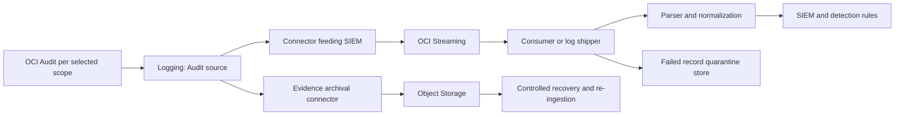

# Centralizing audit logs and SIEM integration

An IAM change in a tenancy, a VCN network route update, and a bucket operation can all belong to the same sequence of activities. If evidence is scattered across regions and compartments, the security team struggles to reconstruct events or detect cross-service behavior. Centralizing audit logs establishes a shared audit trail; integrating with a SIEM enables searching, correlation, and turning findings into actionable work.

In the **Security, Governance, and Auditing** chapter of the `CLOUD_PROVIDERS_ORACLE` module, this lesson shows how to bring OCI Audit into a controlled collection pipeline. The design connects tenancy, compartments, and IAM with monitoring across Compute, VCN, storage, and Oracle Database services, while also addressing automation, resilience, and cost.

## 1. Learning outcomes

After this lesson, learners will be able to:

- Distinguish OCI Audit from service logs, application logs, and database-level auditing.
- Scope collection by tenancy, region, compartment, and source type.
- Design an Audit → Connector Hub → Streaming → SIEM pipeline alongside an evidence archival branch.
- Separate permissions for administrators, connectors, consumers, and investigators.
- Normalize events while preserving originals, handle duplicates, and manage checkpoints.
- Verify collection using test events, reconciliation checks, and outage simulations.

A **SIEM** is a Security Information and Event Management system: it ingests security events, normalizes, searches, and correlates them to support detection and investigation. Receiving JSON is only the first step; data must also cover the right scope, include the right fields, and arrive soon enough to meet operational objectives.

## 2. Identifying which logs to centralize

### 2.1. What does OCI Audit record?

OCI Audit automatically records calls to supported public APIs, including calls from the Console, CLI, SDK, and OCI services. Records identify the timestamp, principal, resource, request, and outcome. For Object Storage, Audit records bucket-level events and does not cover operations on individual objects. See [Overview of Audit](https://docs.oracle.com/en-us/iaas/Content/Audit/Concepts/auditoverview.htm).

For example, a bucket configuration update answers "who changed the access mode?". To investigate "which object was read?", supplement with an appropriate data access logging source. Do not infer that data was never read simply because no read operation appears in Audit.

### 2.2. Distinguishing evidence layers

| Source in design | Question to answer | How it is used |
| --- | --- | --- |
| OCI Audit | Who called an administrative API, and with what outcome? | Trace IAM and infrastructure changes |
| Service logs | How did the service process a request or access? | Analyze access and errors for log-enabled services |
| OS and application logs | What happened inside the workload? | Correlate accounts, processes, and application transactions |
| Database auditing | Who performed actions inside the database? | Investigate accounts, statements, and objects per audit config |
| Cloud Guard problems | Which risks did the tool detect? | Add detection and remediation context |

This table is a data-source plan; it does not assert that events in every layer automatically appear in OCI Audit. Service logs, OS logs, application logs, database logs, and supplemental identity sources must be configured and verified separately.

For Oracle Database, an API call creating or updating a database resource belongs to the cloud management layer; an SQL operation inside the database belongs to a different layer. If the goal is to investigate actions on data, the collection plan must include the database layer.

### 2.3. Separating retention goals from detection goals

Evidence retention prioritizes completeness, traceability, and preservation duration. SIEM detection additionally requires low latency, parsers, correlation rules, and alert recipients.

A team can retain a broader raw set in an evidence store while forwarding a selected subset to the SIEM to control cost. Filtering must be documented: if an event type does not enter the SIEM, the investigation team must know where to find it and how to retrieve it.

## 3. Mapping scope before creating connectors

### 3.1. Collection source matrix

Create an inventory like the following before deployment:

| Tenancy | Region | Compartment or scope | Source | Intended target | Owner |
| --- | --- | --- | --- | --- | --- |
| Lab tenancy | Region A | Root and governance scopes to verify | Audit | SIEM and evidence store | Platform team |
| Lab tenancy | Region A | Production | Audit | SIEM and evidence store | Security team |
| Lab tenancy | Region B | Disaster Recovery | Audit | SIEM and evidence store | Operations team |
| Lab tenancy | Region A | Database | Audit and dedicated database sources | Per investigation objectives | DBA |

This is an organizational example, not a mandatory list of compartment names. For each row, also record the connector OCID, stream OCID, filters, start time, and verification status.

### 3.2. Verifying coverage with live events

Do not treat the word "central" in a compartment or connector name as proof of tenancy-wide collection. Explicitly confirm child compartment coverage in the active configuration. Pick sample events from root, child compartments, and each region to be covered for verification.

When a new compartment or region is added, the infrastructure provisioning workflow must update this matrix. When resources move compartments, verify both source scope and investigator read permissions.

For IAM and identity sources, verify where events actually appear rather than inferring from the application's region. Identity domain sources must also be included in the inventory if detection scenarios depend on them.

## 4. Reference architecture

### 4.1. Independent collection and archival flows



This diagram is a recommended architecture. The two branches use separate connectors: one forwarding to Streaming, and one forwarding to Object Storage. The evidence branch does not depend on SIEM ingestion availability, though it still depends on its own source, connector, and access permissions.

Oracle provides the pattern of exporting Audit via Connector Hub and using Streaming for SIEM integration in [Enable Security Operations](https://docs.oracle.com/en-us/iaas/Content/cloud-adoption-framework/security-strategy.htm).

### 4.2. Role of each component

- **Logging** provides the access point for the Audit source in this flow.
- **Connector Hub** moves data from OCI sources to selected targets; older docs may call it Service Connector Hub.
- **Streaming** provides a buffer between collection and processing.
- **Consumer** reads data, converts it into a format accepted by the SIEM, and manages progress.
- **Object Storage** preserves intact originals or raw envelopes for investigation and replay.
- **SIEM** applies parsers, data models, rules, and assignment workflows.

You do not need to move all logs into one physical region just to have a centralized investigation interface. Pipelines can be organized per region and unified for search in the SIEM, depending on data residency, network, and recovery requirements.

### 4.3. Alternative integration options

| Option | When it may fit | Aspects to evaluate |
| --- | --- | --- |
| Logging → Streaming → consumer → SIEM | Need buffering and consumer scaling | Retention, checkpoints, parsers, replayability |
| Logging → Functions → SIEM ingest API | HTTP target integration, batch processing | Timeouts, target limits, ack handling, retries |
| Logging → Object Storage → SIEM batch pull | Batch latency acceptable, raw retention needed | Object listing, deduplication, processing time |
| Connector or add-on supported by SIEM vendor | Compatible product-version integration exists | Schema, auth, permissions, scope, support limits |

These are design options. Configurations for Splunk, Microsoft Sentinel, QRadar, or another SIEM must follow the actual integration; do not treat one Kafka or HTTP configuration as universal across all products.

## 5. Designing IAM and protecting transport paths

### 5.1. Separating principals

| Principal | Responsibility | Permission scope to review |
| --- | --- | --- |
| Pipeline admin | Create and edit connectors and related configs | Assigned sources, connectors, and targets |
| Connector | Transfer data to targets | Write to the specific stream or bucket |
| Consumer | Read stream and send to SIEM | Read the specific stream, fetch required secrets |
| Investigator | Search data and retrieve evidence | Read permissions aligned with duties |
| Retention admin | Manage retention and lifecycle | Evidence repository under separate privileges |

A team allowed to view logs should not necessarily be able to alter collection filters; a consumer does not need admin rights over the entire infrastructure. This separation reduces both data exposure risk and the risk of disrupting the evidence stream.

### 5.2. Audit read permissions

Example for a team assigned tenancy-wide Audit investigation:

```text
Allow group SecurityAuditReaders to read audit-events in tenancy
```

Replace group name and identity domain according to your environment. Narrow the scope if duties apply to only one compartment. The `audit-events` resource type uses `read` for `ListEvents`; `inspect` does not grant event-reading permission. See [Details for the Audit Service](https://docs.oracle.com/en-us/iaas/Content/Identity/Reference/auditpolicyreference.htm).

If investigators also need to search service logs or custom logs in Logging, grant additional permissions for the corresponding log groups and log content. Audit read permission does not automatically grant read access to all Logging sources. See [Required Permissions for Searching Logs](https://docs.oracle.com/en-us/iaas/Content/Logging/Concepts/searchinglogs.htm).

### 5.3. Connector and consumer permissions

When creating a connector in the Console, review the suggested policies for source, task, and target. Inspect each policy before applying it, paying close attention to the compartments containing the connector and target resources.

A sample Streaming write policy for a connector, with all placeholders to be replaced:

```text
Allow any-user to use stream-push in compartment id <stream-compartment-ocid>
where all {
  request.principal.type='serviceconnector',
  target.stream.id='<stream-ocid>',
  request.principal.compartment.id='<connector-compartment-ocid>'
}
```

The conditions constrain principal type, stream, and connector compartment. This pattern applies to matching connectors in that compartment, not only a single connector. If stricter isolation is required, design dynamic groups or dedicated compartments. See [Connector Hub Authorization](https://docs.oracle.com/en-us/iaas/Content/connector-hub/overview.htm#auth).

Consumers can use a dedicated group to pull from the stream:

```text
Allow group SIEMConsumers to use stream-pull in compartment SecurityLogging
```

This is a compartment-level example and does not include every metadata lookup permission a tool might require. Adjust according to the SIEM connector and actual resource scope. Oracle illustrates these permissions in [Ingest OCI Logs into Third-Party SIEM Platforms Using Log Shippers](https://docs.oracle.com/en/learn/ocilogs-log-shipper/index.html).

### 5.4. Networking and secrets

For consumers using a public endpoint, check egress, DNS, TLS, and the route to the SIEM destination. If using a private endpoint, the consumer must have appropriate network connectivity and name resolution; a collector outside OCI cannot reach a private endpoint merely by possessing credentials.

For integration secrets:

- Store auth tokens or destination keys in the chosen secrets management mechanism.
- Separate integration accounts from engineers' personal accounts.
- Test secret rotation without losing read progress.
- Never write tokens, sensitive headers, or full auth configurations into error logs.

If using OCI Streaming's Kafka API, typical configurations use `SASL_SSL`, `PLAIN`, an auth token, and the regional endpoint on port 9092. Obtain credentials matching the tenancy, identity domain, and stream pool; do not use the Console password instead of an auth token. See [Using Kafka APIs](https://docs.oracle.com/en-us/iaas/Content/Streaming/Tasks/kafkacompatibility_topic-Configuration.htm).

## 6. Configuring the flow from Audit to Streaming

### 6.1. Create the buffer first

In the logging compartment, create a stream pool and stream for the Audit source. Record the region, stream OCID, stream pool OCID, partition count, endpoint, and retention period.

OCI Streaming lets you choose stream retention from 24 to 168 hours at creation time. Partition count affects read and write throughput; size it based on actual load and tenancy limits. See [Creating a Stream](https://docs.oracle.com/en-us/iaas/Content/Streaming/Tasks/creatingstreamsandstreampools_create-stream.htm).

For example, a team expects SIEM maintenance may last several hours, so it needs enough buffer to detect faults, remediate, and drain the backlog. Retention choices only help if the consumer has enough capacity to catch up before old records expire.

### 6.2. Select the Audit source

In Connector Hub, create a connector with **Source = Logging**, choose the source compartment, and select the special **`_Audit`** log group. Check every scope included in the source; add required sources via UI configuration or supported queries.

Select **Target = Streaming** and the right stream. Enable service logs for the connector to monitor transfer progress. After checking policies and configuration, create the connector and record the collection start timestamp. Refer to [Creating a Connector](https://docs.oracle.com/en-us/iaas/Content/connector-hub/create-service-connector.htm).

Do not create a regular log group named similarly to Audit and treat it as the built-in audit source. Look for sample source events to confirm the right selection before putting the pipeline into production.

### 6.3. Filter data purposefully

During validation, start with a small enough lab scope and easily reconcilable filters. Add filters only after verifying which fields actually exist in the incoming data.

Connector Hub supports a subset of the Logging query language. Do not copy an analytical query with aggregations from Search into a connector assuming it works as an event forwarder. See [Log Query Reference for Connector Hub](https://docs.oracle.com/en-us/iaas/Content/connector-hub/queryreference.htm).

Two useful filtering principles:

1. Document which filters apply before the evidence store and which apply only before the SIEM.
2. Evaluate both successful and failed actions. An unauthorized or out-of-process successful action can be more important to investigate than an isolated permission error.

A pipeline keeping only HTTP 4xx/5xx misses many successful changes. A pipeline keeping only HTTP 2xx can miss permission probing. Filters must derive from detection and investigation objectives.

## 7. Understanding retention windows and backfill capabilities

### 7.1. Four distinct retention periods

| Layer | Meaning of retention period | Operational decision |
| --- | --- | --- |
| OCI Audit | How long events remain in the Audit source | Queryability and re-export from source |
| Connector Hub Logging source | Window the connector can catch up forwarding | Deadline for fixing source-to-target errors |
| OCI Streaming | How long messages remain in the buffer | How far behind the consumer is allowed to fall |
| SIEM and evidence store | Retention per each target's configuration | Search, investigation, and preservation |

OCI Audit retains logs for **365 days**; current documentation states this is a non-configurable tenancy-level setting. Do not use outdated guidance about changing Audit retention when designing new systems. See [Audit Log Retention Period](https://docs.oracle.com/en-us/iaas/Content/Audit/Tasks/settingretentionperiod.htm).

### 7.2. The 24-hour window of the Logging source

The Logging source in Connector Hub has a **24-hour** catch-up window. A new connector starts forwarding from creation time; if an outage lasts longer than the source window, some data will not be forwarded. You cannot assume a connector will automatically backfill the entire 365-day Audit history. See [Retention Period: Logging Source](https://docs.oracle.com/en-us/iaas/Content/connector-hub/create-service-connector-logging-source.htm).

Illustrative example: stream write permissions are broken for 30 hours. After fixing permissions, the connector resuming operation does not prove the SIEM received all events from those 30 hours. You must identify the gap and run a recovery procedure from remaining source data or collected evidence stores.

### 7.3. Recovery time must include catch-up time

Suppose steady source load is `r` events/second and the consumer processes `c` events/second with `c > r`. After an outage of `t` seconds, estimated backlog is `r × t`. Approximate catch-up time is:

```text
backlog = r × t
catch_up_time = backlog / (c - r)
```

If the source emits 100 events/second, the consumer processes 300 events/second, and it stops for 2 hours, the backlog is roughly 720,000 events; it takes about 1 additional hour to catch up while new load continues arriving. This is an illustrative calculation excluding bursts, throttling, or parser errors.

Select retention and alert thresholds based on the total time to detect, recover, and catch up. Track the age of the oldest unprocessed record to know how much time remains before data expires.

## 8. Normalizing events for the SIEM

### 8.1. Preserve raw originals before transformation

The consumer should store or forward the intact source data alongside routing metadata and parser version. Normalization serves querying, while the raw copy helps explain issues when mappings break or schemas change.

Example partial event in the Audit envelope, solely to illustrate fields:

```json
{
  "eventID": "11111111-2222-4333-8444-555555555555",
  "eventTime": "2026-11-20T02:10:00Z",
  "data": {
    "compartmentId": "<compartment-ocid>",
    "eventName": "UpdateBucket",
    "resourceId": "<bucket-ocid>",
    "identity": {
      "principalId": "<principal-ocid>",
      "ipAddress": "192.0.2.10"
    },
    "request": {
      "id": "example-request-id",
      "action": "POST"
    },
    "response": {
      "status": "200"
    }
  }
}
```

In this envelope, `eventID` identifies the event; `data.request.id` identifies the request; `data.request.action` is the HTTP method; `data.eventName` is the API operation name. Do not use these fields interchangeably. See [Contents of an Audit Log Event](https://docs.oracle.com/en-us/iaas/Content/Audit/Reference/logeventreference.htm).

### 8.2. Build parser profiles from live inputs

Data received via CLI, Logging, and individual integrations may wrap payloads or represent field names differently. Do not force one JSON path onto all inputs. Capture real samples and explicitly document which envelope, array, and region fields the parser handles.

A recommended internal mapping table:

| Team normalized field | Meaning | Transformation rule |
| --- | --- | --- |
| `event_uid` | Source event identifier | Keep stable ID; do not regenerate on retry |
| `event_time` | Event timestamp | Parse timestamp and normalize to UTC |
| `ingested_at` | SIEM ingestion timestamp | Record separately; do not overwrite event time |
| `tenant_id`, `region`, `compartment_id` | Infrastructure scope | Extract from payload or verified metadata |
| `actor_id`, `source_ip` | Principal and access source | Preserve null when absent in source |
| `operation`, `http_method` | API business operation and protocol | Split into two fields |
| `resource_id`, `request_id` | Target object and request correlation | Preserve source value verbatim |
| `status_code` | HTTP outcome when present | Normalize data type with validation |
| `raw_reference`, `parser_version` | Traceability | Link raw copy and transformation version |

The field names above are an illustrative model, not a mandatory schema of OCI or a specific SIEM. If using a standard SIEM data model, mappings must satisfy both the semantics and data types of that model.

### 8.3. Handling nulls, batches, and schema evolution

Do not auto-fill an administrator name, internal IP, or default region when fields are missing. Guessed values can skew correlation and misattribute responsibility.

The consumer must distinguish a transport message from an Audit event. Check whether the input is an object, an array, or a compressed payload, and verify the transport encoding. With the native Streaming API, handle Base64 per the API; Kafka libraries handle byte representations separately. Avoid double-decoding or treating an entire batch as a single event.

For unparseable records, preserve the raw payload in a controlled quarantine store, record the reason, and alert by volume. This store is a component designed by the implementation team; do not assume every tool provides a built-in dead-letter queue for this pipeline.

## 9. Handling duplicates, checkpoints, and ordering

### 9.1. Designing for at-least-once delivery

Connector Hub uses **at-least-once** batch delivery; retries can re-deliver data that already reached the destination. Updating connector configuration can also affect resume points. See [Connector Hub Delivery Details](https://docs.oracle.com/en-us/iaas/Content/connector-hub/overview.htm#deliverydetails).

Therefore, do not equate total messages received with total unique events. Design a deduplication key based on the source event ID combined with context such as tenancy and source type. Do not rely solely on request ID: a single operation can produce multiple related records that must remain distinct.

If a schema lacks a reliable event ID, build a documented fallback strategy, flag records using the fallback key, and check for accidental collision risks. Hashing the full record after adding an ingestion timestamp will not be stable across retries.

### 9.2. Commit after data is safely persisted

The following pseudocode describes consumer responsibilities, not directly runnable API calls:

```text
read batch from stream
for each message in partition order:
    decode according to transport format
    extract events from message
    normalize or route to durable quarantine store
    send valid events with deduplication key
    confirm each outcome or write to durable buffer
commit contiguous progress that has been safely persisted
if any step is not yet safe:
    hold checkpoint and retry per policy
```

If the SIEM accepts partial batches, an HTTP-level request acknowledgement alone may be insufficient to conclude all records were ingested. Understand the target's per-record acknowledgement and error semantics.

Do not commit past a message that has not been safely processed in the same partition merely because a subsequent message succeeded. If the consumer stops after sending to the SIEM but before committing, data may be re-read; deduplication handles that case.

### 9.3. Consumer groups and ordering

Instances in the same consumer group share partitions. Two independent targets need separate groups so each target receives its full dataset. Native Streaming offers start options such as `TRIM_HORIZON`, `AT_TIME`, and `LATEST`; choose based on requirements and retained data range. See [Using Consumer Groups](https://docs.oracle.com/en-us/iaas/Content/Streaming/Tasks/using_consumer_groups.htm).

Streaming guarantees ordering per partition, not a global chronological order across all sources and regions. See [Overview of Streaming](https://docs.oracle.com/en-us/iaas/Content/Streaming/Concepts/streamingoverview.htm).

Correlation rules should rely on event timestamps, handle late-arriving events, and use appropriate windows. Do not infer causality solely from the order in which the SIEM receives two messages.

## 10. Evidence retention and recovery

### 10.1. Designing the raw archive store

The Object Storage branch should include:

- Dedicated buckets partitioned by governance scope or data classification.
- Pipeline write permissions separated from investigator read and retention management permissions.
- Data partitioning by source, region, and time aligned with actual export patterns.
- Reconciliation manifests: time window, record count, object list, and integrity check results.
- Procedures to read back, decompress, verify, and re-ingest data when needed.

If generating supplemental objects or manifests, record checksums and schema versions to detect alterations. A checksum does not prove provenance or chain of custody on its own; access controls, operation history, and protected manifest storage are still required.

### 10.2. Retention rules differ from lifecycle policies

Retention rules prevent modifying or deleting data during the protection period. Lifecycle policies manage tier transitions or expiration-based deletion and cannot be used to bypass an active retention rule. Locking a retention rule is irreversible; test and finalize retention decisions separately before locking. See [Object Storage Data Retention Rules](https://docs.oracle.com/en-us/iaas/Content/Object/Tasks/usingretentionrules.htm).

Do not assume versioning, retention, and replication can all be enabled simultaneously in every bucket configuration. Verify feature compatibility against your actual design. Test object restoration before selecting archive tiers with long restore times.

### 10.3. Backfill runbook

When missing data is detected:

1. Identify affected tenancy, region, compartment, source, and time range.
2. Preserve error evidence and checkpoints; avoid resetting consumers based on guesses.
3. Check whether data still exists in the stream, evidence store, or Audit source.
4. Select an appropriate re-read method, split time intervals, and handle pagination.
5. Tag backfill runs, preserve original event timestamps, and use deduplication keys.
6. Control detection rules so historical events do not flood out-of-context alerts.
7. Reconcile event IDs, recording what was recovered and what lacks evidence.

A newly created connector does not replace a historical export tool. When using APIs for recovery, account for permissions, query limits, and load; do not treat a small query command as a bulk export pipeline for an entire tenancy.

## 11. Guided hands-on lab

### 11.1. Preparing the environment

Use a lab compartment with test resources, granted permissions, and a test SIEM or collector whose output can be inspected. Prepare the stream, forwarding connector, and evidence storage branch per earlier sections.

The following commands use **Bash**, suitable for OCI Cloud Shell or an environment with OCI CLI installed. They are examples for learners to run in an authorized environment, not output executed on a specific tenancy.

```bash
export REGION='<source-region>'
export COMPARTMENT_ID='<audit-source-compartment-ocid>'
export CONNECTOR_ID='<siem-connector-ocid>'
export STREAM_ID='<audit-stream-ocid>'
export START_TIME='<YYYY-MM-DDTHH:MM:00Z>'
export END_TIME='<YYYY-MM-DDTHH:MM:00Z>'
```

### 11.2. Inspecting transport resource configuration

```bash
oci sch service-connector get \
  --service-connector-id "$CONNECTOR_ID" \
  --region "$REGION"

oci streaming admin stream get \
  --stream-id "$STREAM_ID" \
  --region "$REGION"
```

Verify the actual source, filter tasks, target, connector state, and stream details. Correct metadata does not yet prove the SIEM has ingested the data. Refer to [CLI service-connector get](https://docs.oracle.com/en-us/iaas/tools/oci-cli/latest/oci_cli_docs/cmdref/sch/service-connector/get.html) and [CLI stream get](https://docs.oracle.com/en-us/iaas/tools/oci-cli/latest/oci_cli_docs/cmdref/streaming/admin/stream/get.html).

### 11.3. Generating a traceable test event

Choose a low-impact permitted change in the lab, such as updating a tag on a test resource owned by the learner. Record:

- Resource OCID and compartment.
- Actor, region, and UTC timestamp.
- Test tag value, such as `audit_test=siem-lab-001`.
- Request ID if provided by the tool.

After verification, revert the tag if needed; reverting itself may generate another record. Do not require permission-failure operations, production IAM changes, or making resources public to test the pipeline.

### 11.4. Finding the record at the source

```bash
oci audit event list \
  --compartment-id "$COMPARTMENT_ID" \
  --start-time "$START_TIME" \
  --end-time "$END_TIME" \
  --region "$REGION" \
  --all
```

Timestamps require seconds and fractional seconds to be zero; the command fetches events by compartment and time range. `--all` fetches result pages; it does not automatically add all compartments or regions. See [CLI audit event list](https://docs.oracle.com/en-us/iaas/tools/oci-cli/latest/oci_cli_docs/cmdref/audit/event/list.html).

In Logging Search, you can start with this scope query and select the time window in the UI:

```text
search "<compartment-ocid>/_Audit"
```

Open the JSON to verify the event ID, operation name, and resource matching the test change. Account for data latency; if not visible yet, check permissions, scope, and time before concluding logs are lost. The Audit UI supports event exploration and JSON export; see [Audit Logs](https://docs.oracle.com/en-us/iaas/Content/Logging/Concepts/audit_logs.htm).

### 11.5. Following the same event across stages

| Stage | What to prove |
| --- | --- |
| Audit or Logging | Source event exists and falls within selected scope |
| Connector | Matching data transfer occurred without permission or target errors |
| Stream and consumer | Consumer received payload containing the test event |
| Parser | Time, actor, operation, and resource fields are mapped accurately |
| SIEM | Unique event is searchable by source key |
| Evidence store | Data containing the same event ID can be retrieved |

Do not just compare message counts. One message can contain multiple events; one event can be transported more than once. Success means locating the same event and reconciling key fields at every required checkpoint.

### 11.6. Testing consumer interruption

In the lab, stop the consumer briefly while leaving connector and stream configurations unchanged. Generate another test event, then restart the consumer using its saved checkpoint.

Verify that the backlog is read, lag decreases, and the restart does not create duplicate normalized events. If the consumer is configured to start at `LATEST` on every startup, it may skip queued data; check how the actual tool manages checkpoints.

Record catch-up time and any errors. This test validates consumer interruption; it does not replace testing connector failures upstream of the stream or recovery after retention expiration.

## 12. From centralized data to SIEM detections

### 12.1. Starting with verifiable use cases

| Recommended use case | Additional context needed | How to reduce noisy alerts |
| --- | --- | --- |
| Out-of-process IAM changes | Owner, deployment window, change ticket | Distinguish valid pipelines from unusual identities |
| Network changes widening access | Before/after rules, workload, source CIDR | Evaluate change content rather than API name alone |
| Bucket access changes | Data classification and bucket purpose | Separate public document stores from internal data |
| Unusual API activity by identity | Activity baseline, auth type, access source | Correlate IP, timing, and action sequence together |
| Log collection config changes | Connector, policy, and maintenance schedule | Verify both authorized changes and actual impact |

These are internal rule ideas, not a catalog of built-in OCI or SIEM rules. For each use case, confirm the required fields are being collected.

### 12.2. Time-windowed correlation

Conceptual logic example:

```text
if the same actor_id in the same tenancy:
    modifies administrative permissions
    and then performs a sensitive action on a resource
    within the selected investigation window
and does not match an approved change:
    create a finding with the related event_uids
```

Do not call this proof of intrusion solely because the rule matched. Alerts must include raw events, change context, and an assigned investigator. A finding can be further correlated with Cloud Guard, OS logs, or database logs when available.

### 12.3. Preserving investigation links

A finding record should contain tenancy, region, compartment, resource, actor, time window, event IDs, and links to raw originals. When handling the issue, record changes made and verification evidence—not just closing the alert in the SIEM.

## 13. Monitoring the collection pipeline itself

### 13.1. Measuring complete and accurate delivery

| Recommended metric | Meaning | Action when abnormal |
| --- | --- | --- |
| Event latency to SIEM | Difference between event time and ingestion time | Identify the slow stage |
| Oldest unprocessed record age | Margin before buffer expiration | Scale capacity or perform controlled recovery |
| Transfer errors and throttling | Path cannot handle load or lacks permissions | Read errors and check source/target |
| Parser error rate | Unhandled schema or payload | Preserve raw copy, fix parser, replay |
| Duplicate event rate | Retries, overlap, or checkpoints | Check deduplication and resume points |
| Unique events by source and time | Baseline for coverage reconciliation | Investigate gaps |
| Bytes into SIEM and archive | Track cost, load, and sudden spikes | Check sources and filters |

Zero new logs can mean low activity or a collection failure. Use periodic authorized canary events and per-source baselines to distinguish the two scenarios.

### 13.2. Observing Connector Hub

Connector service logs show individual transfer successes and failures and are disabled by default. Enable them during deployment for operational evidence; see [Logs for Connector Hub](https://docs.oracle.com/en-us/iaas/Content/connector-hub/service-logging.htm).

Also monitor data freshness and service errors per [Troubleshooting Connectors](https://docs.oracle.com/en-us/iaas/Content/connector-hub/troubleshooting.htm). A connector in active state that is not forwarding the right sources still fails collection requirements.

Store pipeline logs in a dedicated scope and avoid feeding those generated logs back into an uncontrolled forwarding loop. Pipeline alerts need a notification channel that on-call staff still receive when the SIEM is unavailable.

## 14. Diagnosing common incidents

| Symptom | First check | Remediation direction |
| --- | --- | --- |
| Audit has events, SIEM does not | `_Audit` source, filters, stream write perms | Trace by event ID stage by stage |
| Logs appear in only one region | Source inventory and per-region pipelines | Add scope and verify each region |
| Root has logs but workload logs are missing | Child compartments and access permissions | Verify source scope with sample events |
| Consumer auth errors | Token, user/domain, stream pool, endpoint | Fix config and re-read from checkpoint |
| Consumer runs but reads nothing | Group, offset, partition, network path | Check actual progress and remaining data |
| SIEM receives JSON but queries return nothing | Parser, index, timestamp, timezone | Compare source payload with normalized fields |
| Alert spike after restart | Duplicates, replay, or group change | Reconcile event keys and backfill tags |
| SIEM has new logs but misses an older gap | Outage exceeded source or stream window | Identify gap and run recovery runbook |
| Parser error blocks a partition | Single malformed record | Quarantine durably and advance per policy |
| Archive has objects but missing events | Batching, filters, decompression, format | Inspect content and manifests instead of object names alone |

Each symptom can have multiple causes. Preserve request IDs, connector OCIDs, error timestamps, and sanitized payload samples to aid investigation.

## 15. Cost, availability, and change management

### 15.1. Estimating cost across the full path

Costs can include Streaming buffers, additional Logging volume, Object Storage retention, queries, networking, collectors, Functions, and SIEM ingest volume. Do not assume the entire pipeline is free just because Audit is provided by default.

Estimate raw volume before pricing by service:

```text
raw_bytes_per_day = events_per_second × average_event_bytes × 86400
```

For example, 100 events/second averaging 2 KiB/event generates roughly 16.48 GiB/day before compression. Billable volume also depends on batch formatting, replicas, indexing, and each service's billing rules. Measure real samples before deciding on filters or retention durations.

### 15.2. Protecting resilience

Separating the evidence archival branch reduces SIEM dependency, but does not eliminate all single points of failure. Verify permissions, sources, networking, and per-region recovery. If a secondary store or standby region is required, confirm replication configurations are compatible with retention and data residency requirements.

Do not place evidence data, decryption keys, and all recovery permissions under a single operational account. Replication is useless if the incident response team lacks permissions or keys to read the data.

### 15.3. Managing the pipeline as infrastructure

Place connector definitions, source lists, streams, permissions, parsers, and rules under appropriate version control. Every change must describe scope, cutover timing, potential for duplicates or gaps, and rollback steps.

When replacing a pipeline, run both in parallel briefly with deduplication and reconciliation. Do not delete the old stream just because the new stream received a single message; prove source scope, data fields, and latency meet requirements.

## 16. Acceptance and handover criteria

An Audit centralization and SIEM integration pipeline is ready for handover when:

1. A source matrix by tenancy, region, and compartment exists with owners.
2. Permissions for users, connectors, consumers, and the evidence store are separated.
3. Verification events travel from source to SIEM and archival branch with accurate contents.
4. Parsers preserve timestamp, actor, operation, resource, and raw link.
5. Duplicates, parsing errors, and checkpoints are handled under an explicit policy.
6. Latency alerts and handling plans exist before the backfill window expires.
7. Consumer interruption tests and replay procedures have documented results.
8. Retention configurations, capacity estimates, and change approvers are defined.

The handover record should document connector and stream OCIDs, source scope, filters, parser versions, raw archive location, operational dashboards, recovery runbooks, and verification results. That way, the incoming owner can answer three concrete questions: what is being collected, where any gaps exist, and how to retrieve evidence for an event.
