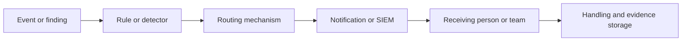

# Assessing landing zone configurations against security requirements

## 1. Objectives and understanding the landing zone accurately

In the **Security, Governance, and Auditing** chapter of the **CLOUD_PROVIDERS_ORACLE** module, this lesson explains how to assess an OCI landing zone before onboarding workloads into production or after platform configuration changes.

A landing zone is the shared foundation for workloads: tenancy and compartment structure, identity and IAM, network connectivity, security services, log collection, and deployment and operations practices. A landing zone assessment must answer four questions:

1. What does the organization require, and to which resources do those requirements apply?
2. Does the actual OCI configuration satisfy those requirements?
3. Which evidence supports the conclusions, and what remains unverified?
4. Who must remediate, re-verify, or accept any deviations?

The OCI Core Landing Zone is an automated blueprint combining compartment design, IAM, networking, and security services. Oracle describes this blueprint as a consolidation of the Oracle Enterprise Landing Zone and CIS Landing Zone approaches. Explicitly record the blueprint version and deployment options when using it as an assessment baseline. [Oracle Documentation on OCI Core Landing Zone](https://docs.oracle.com/en-us/iaas/Content/cloud-adoption-framework/oci-core-landing-zone.htm).

Using a CIS-aligned template does not prove on its own that the deployed tenancy meets all organizational requirements. Input variables, post-deployment resources, manual edits, and inspection scope can all cause live reality to differ from the blueprint.

After this lesson, learners will be able to build assessment criteria, collect OCI evidence, inspect critical configurations, document findings, and deliver clearly conditioned conclusions. Scope covers infrastructure foundations for Compute, storage, and Oracle Database services; it does not replace detailed application code reviews or full database engine audits.

## 2. Turning security requirements into verifiable criteria

### 2.1. Selecting requirement sources and locking versions

An assessment typically combines:

- Internal policies on data classification, privileged access, and log retention durations.
- Workload requirements: partner connectivity, database services, backups, and recoverability.
- Standards or benchmarks chosen by the organization, with exact versions and applicability profiles.
- The approved landing zone design and active exceptions.
- Shared responsibilities of Oracle and the customer for each service.

Under the shared responsibility model, the organization remains responsible for configurations and operations under its control, such as IAM, VCNs, applications, and data. Exact boundaries must be evaluated per service in use. [Oracle Documentation on Shared Security Model](https://docs.oracle.com/en-us/iaas/Content/cloud-adoption-framework/security.htm).

If no approved benchmark exists yet, build an internal baseline for practice. Label it clearly as an illustrative baseline; never mark something as "CIS compliant" or "compliant" based on self-authored criteria.

### 2.2. Writing requirements so they are verifiable

A requirement like "the system must be secure" is insufficient for assessment. Translate it into:

```text
Requirement:
  Servers processing sensitive data must not have public IPs.

Scope:
  All Compute VNICs in App-Prod and Data-Prod,
  across all operational regions.

Verification method:
  Cross-check inventory, VNIC configs, and subnet configs;
  include secondary VNICs and resources created outside Terraform.

Pass criteria:
  No public IPs; subnets prohibit assigning public IPs;
  no unapproved exceptions.

Evidence:
  API outputs with OCID, region, and timestamp;
  subnet configs; VNIC list inspection results.

Owner:
  Platform team in coordination with application teams.
```

An approved Load Balancer public endpoint may be a separate case from a public IP on an application VM. Define scope upfront to evaluate against real business needs.

### 2.3. Sample control matrix

The IDs below are **illustrative internal IDs**, not CIS numbers or formal standard identifiers.

| ID | Illustrative requirement | Scope | Primary evidence |
| --- | --- | --- | --- |
| LZ-IAM-01 | Human admin access goes through approved auth with policy-mandated MFA | Identity domains, IdP, admin groups | Sign-on policies, group mappings, login tests |
| LZ-IAM-02 | Workload ops teams lack tenancy-wide admin privileges | Root policies, parent/child compartments | Statements, group members, permission tests |
| LZ-NET-01 | Sensitive apps and databases have no public IPs | All in-scope VNICs | VNICs, subnets, inventory |
| LZ-NET-02 | Internal connectivity and egress serve only approved flows | VCNs, NSGs, Security Lists, routes | Connectivity matrix, configs, probes |
| LZ-DAT-01 | Sensitive data buckets are private with controlled sharing | Object Storage, PARs, IAM | Bucket details, PAR metadata, policies |
| LZ-KEY-01 | Data uses encryption and key management matching classification | Storage, databases, Vault | Key references, key states, IAM |
| LZ-LOG-01 | Admin changes and required logs are retrievable for approved retention | Audit, Logging, archive store | Sample events, source/target logs, retention |
| LZ-DET-01 | In-scope workloads are monitored by appropriate detectors | Cloud Guard targets and recipes | Target scope, enabled rules, sample problems |
| LZ-GRD-01 | Preventive controls exist for identified prohibited configs | Security Zones or chosen mechanism | Recipes, scope, lab tests |
| LZ-OPS-01 | Remediation, recovery, and re-verification processes exist | Operations team and IaC workflows | Change logs, test evidence, owners |

Each row needs a criticality level, owner, verification method, and exception criteria. Do not apply identical criteria to every database service if their connectivity and operating models differ.

## 3. Scoping to avoid conclusions based on incomplete data

### 3.1. Scope must describe both organizational and technical dimensions

Before collecting data, record:

| Scope dimension | Required information |
| --- | --- |
| Tenancy | OCID, home region, owning organization |
| Compartment | Root, parent/child compartments, and relevant shared components |
| Region | Regions hosting workloads, logs, keys, and backups |
| Identity | Relevant identity domains, IdPs, groups, dynamic groups, and service principals |
| Workload | Compute, storage, databases, OKE, or other services actually used |
| Connectivity | Internet, peering, DRG, VPN, FastConnect, and on-premises networks |
| Time | Configuration snapshot timestamp and evaluated log window |
| Tooling | CLI versions, collectors, blueprints, Terraform modules, and rule sets |

Compartments are tenancy-wide resources, whereas many infrastructure resources must be inspected per region. Viewing only one region in the Console can miss resources in the same compartment located elsewhere. [Oracle Documentation on Compartments](https://docs.oracle.com/en-us/iaas/Content/Identity/compartments/Working_with_Compartments.htm).

During assessment, record deleted or transitioning resources if they relate to events in the log window. Current inventory and activity history answer two different questions.

### 3.2. Assessor permissions are part of the evidence

The assessment account needs permissions to read configurations and logs within the agreed scope. Do not default to granting tenancy-wide admin rights just for tool convenience.

If an API returns a permission error or only shows partial resources, the outcome is **insufficient evidence**, not "no non-compliant resources". Collect the list of errors, endpoints, compartments, and regions affected to identify gaps.

Pay special attention to read permissions for IAM, Cloud Guard, log contents, and resource metadata. Assessors do not need to retrieve secret values, private keys, database passwords, or full PAR URLs solely to inspect policies.

### 3.3. Result statuses must have distinct meanings

| Status | Meaning |
| --- | --- |
| PASS | Sufficient evidence and in-scope criterion is met |
| FAIL | Evidence shows the criterion is not met |
| NOT_TESTED | Not yet checked or insufficient evidence, including missing permissions |
| NOT_APPLICABLE | Criterion does not apply, with justification and confirmer |
| EXCEPTION | Deviation exists with an active risk acceptance decision |

An approved exception does not turn a deviating configuration into a PASS. When summarizing, separately report counts of FAIL, NOT_TESTED, and EXCEPTION so approvers see the boundaries of the conclusion.

## 4. Collecting and managing evidence

### 4.1. Three complementary layers of evidence

For a critical control, distinguish:

1. **Design:** diagrams, Terraform, baselines, connectivity matrices, and approved procedures.
2. **Actual configuration:** API or Console data on existing resources.
3. **Operational effectiveness:** controlled test results, logs, and incident handling capability.

For example, Terraform declaring a restrictive NSG only proves design intent. You must verify that the VNIC attaches that NSG, no broader rules exist elsewhere, and out-of-scope connections are actually blocked.

Similarly, having a Notifications topic does not prove alerts reach on-call staff. Having backups does not prove sufficient data can be restored within required time targets.

### 4.2. Every piece of evidence needs context

A minimum record should contain:

```yaml
evidenceId: E-NET-014
controlId: LZ-NET-02
resourceId: "<resource OCID>"
compartmentId: "<compartment OCID>"
region: "<region>"
collectedAtUtc: "<UTC timestamp>"
source: "OCI API or CLI, with operation used"
collector: "<collector identity>"
scope: "NSGs, Security Lists, and routes related to application VNICs"
limitations: "Not yet tested across on-premises network path"
```

This is an assessment record template, not an OCI resource schema. OCIDs and timestamps help distinguish resources sharing a display name while preventing stale evidence from being applied to a newly recreated resource.

Protect the evidence repository with appropriate access controls, change history, and retention periods. If integrity is required, add checksums or corresponding storage controls; checksums are meaningful only when reference values are also protected.

### 4.3. Distinguishing full inspection from sampling

API-listable configurations such as public IPs, NSGs, and buckets should generally be inspected across the entire in-scope inventory. Tests for sign-in, recovery, or alert handling can sample across risk tiers and deployment models.

Reports must clearly state the inspected population and sampling method. Never generalize a single successful restore in a test environment to all production databases with different configurations.

## 5. Assessing resource organization and IAM

### 5.1. Compartment trees must support separation of duties

An illustrative structure might be:

```text
Tenancy
└── LandingZone
    ├── Network
    ├── Security
    ├── App-NonProd
    ├── App-Prod
    └── Data-Prod
```

Identify which team manages each branch, which resources are shared, and who can edit policies. Clean compartment names do not prove separation of duties on their own.

In OCI, permissions from parent compartments inherit downward to children. Therefore, read policies at root and all relevant parent levels rather than reading only workload compartment policies. [Oracle Documentation on Policy Inheritance](https://docs.oracle.com/en-us/iaas/Content/Identity/Concepts/policies.htm).

### 5.2. Reading statements and identity relationships

For every high-impact privilege, determine:

- Subject: user group, dynamic group, service, or federated identity.
- Granted verbs and resource types.
- Scope: tenancy, compartment, and accompanying conditions.
- Who actually belongs to the group, which IdP maps to it, and who can edit the group.
- Who can modify policies, tags, or attributes that could alter effective permissions.

Illustrative statement requiring investigation:

```text
Allow group CorpDomain/AppOperators to manage all-resources in tenancy
```

If the role is solely operating production applications, this statement is broader than the stated need. Narrow it to the actual tasks and scope; never replace it with another policy based merely on group name.

`manage all-resources` in a compartment can also include permission to manage policies there. Where a policy is attached determines who can manage that policy; check this when designing separation of duties. [Oracle Documentation on Policy Attachment](https://docs.oracle.com/en-us/iaas/Content/Identity/policieshow/Policy_Attachment.htm), [Oracle IAM Guidance](https://docs.oracle.com/en-us/iaas/Content/Resources/Assets/whitepapers/best-practices-for-iam-on-oci.pdf).

### 5.3. Checking human authentication and workload credentials

For human users, cross-check identity domains, IdP links, sign-on policies, and actual login behavior. If MFA resides in an external IdP, collect evidence from that authentication chain. MFA policies for the OCI Console do not prove on their own that API credentials are equivalently protected. [Oracle Documentation on IAM MFA](https://docs.oracle.com/en-us/iaas/Content/Security/Reference/iam_security_topic-IAM_MFA.htm), [Scope of Console Sign-On Policy](https://docs.oracle.com/en-us/iaas/Content/Security/Reference/iam_security_topic-iam_mfa_identity_domains_signon_policy.htm).

For workloads, review API keys, auth tokens, secrets, and instance/resource principal permissions. Dynamic groups need properly scoped matching rules; if membership relies on tags, evaluate tag-editing permissions too. Avoid situations where one group can self-assign attributes to join a higher-privileged resource group.

Emergency accounts need owners, custody methods, usage testing, and post-use monitoring. Assessment records should never contain credentials for those accounts.

## 6. Assessing networking and management paths

### 6.1. Inspecting by data flow

Start from the approved flow diagram and connectivity matrix, then inspect resources:

| Area | Assessment question | Signs needing investigation |
| --- | --- | --- |
| Public exposure | Do only approved endpoints face the Internet? | New public IPs on app or database VMs |
| Segmentation | Can only required roles connect to each other? | Whole VCN allowed to all ports |
| Administration | Who can access SSH/RDP and via which path? | Admin ports open broadly to the Internet |
| Egress | Which destinations may applications actively call? | Default routes and broad egress allows outside design |
| External VCN links | Where do peering, DRG, and on-premises links lead? | Bypass paths circumventing inspection points |
| IPv6 | Does it have the same control level as IPv4? | Unassessed IPv6 rules or routes |

For each critical connection, inspect from source VNIC to destination VNIC and the return path. If the design requires traversing a firewall, prove traffic actually flows through the inspection point; merely having a firewall in the VCN is insufficient.

### 6.2. Evaluating all rules applied to a VNIC

In OCI, allow rules from associated Security Lists and NSGs are additive; a narrow NSG rule does not override a broad Security List rule. Assessors must pull both rule lists and their subnet/VNIC attachments. Also check stateful/stateless flags to understand permissions for new connections and return traffic. [Oracle Documentation on Security Rules](https://docs.oracle.com/en-us/iaas/Content/Network/Concepts/securityrules.htm).

A finding should describe the effective configuration, for example: "The Security List attached to the application subnet permits TCP to all destinations on all ports, exceeding the approved egress matrix", instead of just writing "NSG is insecure".

If the landing zone uses Zero Trust Packet Routing (ZPR), also assess security attributes, ZPR policies, and permissions to edit them. Endpoints with ZPR attributes must be inspected alongside related network control layers, not just NSGs. [Oracle Documentation on ZPR](https://docs.oracle.com/en-us/iaas/Content/zero-trust-packet-routing/home.htm).

### 6.3. Verifying administration and out-of-scope connections

Select tests aligned with approved criteria, for example:

- Operators can administer via Bastion or the designed private path.
- Out-of-scope sources cannot open connections to management ports.
- Applications can reach the exact database listener, while non-application sources cannot.
- Approved partner APIs work, while direct out-of-policy egress paths are blocked.
- When an inspection point fails, no automatic fallback bypasses the control.

Active tests require planning and suitable environments. Avoid editing production policies solely to create an observable misconfiguration. Preventive behavior can be verified in a lab compartment with test resources and synthetic data.

## 7. Assessing data, keys, and workload foundations

### 7.1. Object Storage: a private bucket does not end the review

Inspect public access, IAM for buckets/objects, sharing mechanisms, encryption, logging, backups, and retention periods per data classification.

In particular, a Pre-Authenticated Request (PAR) grants access via a URL that anyone holding the URL can use within the granted scope. Therefore, non-public buckets still require inspecting PARs, expirations, read/write scopes, and owners. Never include full PAR URLs in broadly circulated reports. [Oracle Documentation on Object Storage PAR](https://docs.oracle.com/en-us/iaas/Content/Object/Tasks/usingpreauthenticatedrequests.htm).

Distinguish three conclusions:

```text
Bucket is not public:
  No public access configuration detected.

Controlled sharing:
  IAM, PARs, and active sharing mechanisms have been assessed.

Data protected as required:
  Encryption, retention, backups, and required logs have also been evaluated.
```

One piece of evidence does not substitute for all three conclusions. If requirements forbid sharing via PARs and PARs could not be listed, the related criterion remains NOT_TESTED.

### 7.2. Encryption must pair with key lifecycle management

For each resource group, determine whether the organization requires Oracle-managed keys or customer-managed keys (CMKs). Do not mark every resource using Oracle-managed keys as FAIL if the baseline does not require CMKs.

For resources requiring CMKs, verify:

- The resource references the right key and right governance scope.
- Key status and the service's ability to use the key.
- Key administrators are separated from key-only users when separation of duties applies.
- Rotation policies, usage monitoring, and key recovery plans.
- Roles permitted to disable or schedule key deletion and corresponding change procedures.

OCI KMS manages keys in vaults and integrates with data services. Having a vault in the Security compartment does not prove on its own that all storage or databases use keys from that vault. [Oracle Documentation on Vault and Key Management](https://docs.oracle.com/en-us/iaas/Content/KeyManagement/Concepts/keyoverview.htm).

Never test disabling or scheduling deletion of a production key to check permissions. Oracle notes that Pending Deletion state can make data encrypted with that key immediately inaccessible before permanent deletion. Evaluate permissions and test behavior with lab keys under a dedicated plan. [Oracle Documentation on Deleting Keys](https://docs.oracle.com/en-us/iaas/Content/KeyManagement/Tasks/managingkeys_topic-To_delete_a_key.htm).

### 7.3. Compute and databases must have clear owners

For Compute, inspect base images, OS patching, admin accounts, required agents, and vulnerability scanning coverage. A "scanning service enabled" status does not prove all instances are targeted, recently scanned, and triaged by an owner.

For Oracle Database services, platform assessment records must specify:

- Actual service and deployment model.
- Public/private endpoints, subnets, NSGs, and approved connection flows.
- Credential management, wallets/certificates if applicable, and workload database permissions.
- Responsibilities for patching, backups, database auditing, and recovery.
- Checks belonging to the landing zone foundation versus checks handed off to DBAs or service owners.

OCI Audit for service control-plane operations does not replace inside-database auditing. OCI IAM also does not automatically replace database user/schema privileges inside the DBMS.

### 7.4. Recoverability is a requirement needing evidence

If requirements state RPO/RTO, collect evidence of backup policies, usable copies, and restore results. RPO is acceptable data loss measured in time; RTO is target restoration time. Both values must tie to specific workloads.

A recovery procedure must cover encryption keys, identities, DNS, and connectivity—not just data. For instance, having backups in a standby region without permissions to use the required keys can prevent recovery plans from meeting targets.

## 8. Assessing Audit, Logging, and notification routes

### 8.1. Choosing the right log type for the question

OCI Audit automatically records calls to supported public API endpoints, including operations via Console, CLI, and SDK. Audit can tell who performed an administrative operation, when, and with what result. For Object Storage, Audit records bucket-level events and does not cover object events. [Oracle Audit Overview](https://docs.oracle.com/en-us/iaas/Content/Audit/Concepts/auditoverview.htm).

For object access, inspect appropriate service logs. Object Storage provides Read Access Events and Write Access Events categories; which is needed depends on data observation requirements. [Oracle Documentation on Object Storage Logs](https://docs.oracle.com/en-us/iaas/Content/Logging/Reference/details_for_object_storage.htm).

VCN Flow Logs observe flows accepted or rejected by network rules; they do not replace HTTP logs or database audits. Some platform traffic on link-local addresses does not appear in flow logs. [Oracle Details for VCN Flow Logs](https://docs.oracle.com/en-us/iaas/Content/Logging/Reference/details_for_vcn_flow_logs.htm).

| Question | Appropriate evidence source |
| --- | --- |
| Who modified a policy or resource? | OCI Audit and before/after config if available |
| Was app–database traffic blocked at network layer? | Flow Logs, path configuration, and probes |
| Who accessed a sensitive object? | Appropriate Object Storage access logs |
| What operations happened inside the database? | Database-level auditing mechanism |
| Did alerts reach handlers? | Evidence across entire detect–notify–intake route |

Do not conclude logs are missing when searching the wrong compartment, region, or time range. Conversely, a "logging enabled" screenshot does not prove required events can be queried.

### 8.2. Reconciling retention against real requirements

Per OCI documentation, Audit retains logs for 365 days; this duration applies at the tenancy level and cannot be altered. If the organization requires longer retention, evaluate supplemental export/archival mechanisms. [Oracle Documentation on Audit Retention](https://docs.oracle.com/en-us/iaas/Content/Audit/Tasks/settingretentionperiod.htm), [Oracle Auditing Strategy Guidance](https://docs.oracle.com/en-us/iaas/Content/cloud-adoption-framework/auditing.htm).

**Internal hypothetical example:** the organization requires retrieving administrative events for 730 days. To assess this, inspect the log forwarding pipeline to archival storage, source coverage, outage detection, and access/delete permissions. Checking Audit retention alone does not prove 730-day compliance.

Retention for other log types must be checked separately; do not use Audit's retention to infer retention for OCI Logging, object buckets, or SIEMs.

### 8.3. Testing a complete notification pipeline

An illustrative pipeline:



Specific components depend on design and event sources; not every detector flows through the same service.

In a planned test, generate a suitable lab event and verify:

1. The event appears at the source.
2. Rule/detector conditions actually match.
3. The target recipient is configured and has required permissions.
4. The receiving person or system observes the alert.
5. An owner and tracking mechanism exist for follow-up.

An unconfirmed subscription, a misconditioned rule, or an outdated recipient can break the notification pipeline.

## 9. Assessing Cloud Guard and Security Zones

### 9.1. Cloud Guard: assessing scope and detection configuration

Cloud Guard uses targets to define scope, detectors to find issues, and responders to handle them per configuration. Assessments must check target structure, recipes attached to targets, and the list of rules actually enabled. [Oracle Documentation on Getting Started with Cloud Guard](https://docs.oracle.com/en-us/iaas/Content/cloud-guard/using/part-start.htm).

Verify:

- Are production compartments, shared services, and monitored regions included in scope?
- Do child branches have dedicated targets that alter the active rule set?
- Are required rules enabled or disabled, and what exclusions exist?
- How are problems triaged, classified, and handled?
- Which responders only suggest actions, and which are permitted to act automatically?

Do not assume all detector rules are enabled by default. Some rules require customer-managed recipes and configurations aligned with monitoring goals. [Oracle Documentation on Detector Recipes](https://docs.oracle.com/en-us/iaas/Content/cloud-guard/using/detect-recipes.htm).

A dashboard with zero problems might mean zero deviations, or it might mean scope or rules are misconfigured. Cross-check inventory, configuration, and controlled test events.

### 9.2. Security Zones: identifying actual preventive policies

A Security Zone binds a compartment to a recipe. OCI checks supported operations against policies in the recipe and denies violating actions. Resources existing before the zone still need checking; Cloud Guard integration helps detect violations on pre-existing resources. [Oracle Documentation on Security Zones](https://docs.oracle.com/en-us/iaas/Content/security-zone/using/security-zones.htm).

An assessment must specify:

- Which compartments the zone covers, and whether child branches are excluded or have separate zones?
- Which recipe is active and which policies have been disabled?
- Do policies match the workload's resource types and deployment paths?
- Who can modify zones/recipes or move resources?
- Which tests prove prohibited operations are denied within supported scope?

Security Zones do not replace NSGs, host firewalls, data IAM, or application security. Nor should you conclude "PASS" just because a compartment displays a Security Zone icon: a custom recipe may diverge from the approved baseline.

### 9.3. Distinguishing three functions

| Function | Role in assessment | Sample evidence |
| --- | --- | --- |
| Prevention | Stops prohibited configs from being created or edited | Effective policies and blocked lab action |
| Detection | Identifies problematic configs or activities | Detectors, targets, and matching problems |
| Response | Routes findings to owners or remediation actions | Alert logs, workflows, and handling outcomes |

A landing zone must be evaluated across all three functions against the chosen baseline. If prevention is required yet only post-event alerting is deployed, document that gap.

## 10. Collecting configurations with OCI CLI

### 10.1. Preparing context and command limits

The commands below are **read-only** examples for learners to run in an OCI environment authorized for assessment. They do not constitute a complete audit suite and do not modify resources.

Examples use Bash, OCI CLI installed, and an authorized assessment profile. Replace all placeholders with real values; use the home region for IAM queries in the example, the workload region for NSGs, and the configured reporting region for Cloud Guard.

```bash
OCI_PROFILE='LZ_REVIEW'
TENANCY_OCID='<tenancy OCID>'
LZ_OCID='<LandingZone compartment OCID>'
PROD_OCID='<App-Prod compartment OCID>'
APP_NSG_OCID='<application NSG OCID>'

HOME_REGION='<home region>'
WORKLOAD_REGION='<workload region>'
CLOUD_GUARD_REGION='<Cloud Guard reporting region>'
```

Never embed private keys or tokens in commands. In the collection log, record the profile/principal used, CLI version, region, timestamp, and any errors; protect outputs according to data classification.

### 10.2. Listing compartments

```bash
oci iam compartment list \
  --compartment-id "$TENANCY_OCID" \
  --compartment-id-in-subtree true \
  --access-level ANY \
  --all \
  --profile "$OCI_PROFILE" \
  --region "$HOME_REGION"
```

When querying from tenancy root, `--compartment-id-in-subtree true` retrieves the compartment tree; `--all` paginates results. Add the tenancy root itself to the assessment inventory rather than assuming it appears as a child compartment. Listing options do not automatically grant read access to resources inside compartments. [Oracle CLI Reference for compartment list](https://docs.oracle.com/en-us/iaas/tools/oci-cli/latest/oci_cli_docs/cmdref/iam/compartment/list.html).

Reconcile the list against the approved scope and per-region resource inventories. A complete compartment tree is not yet a complete inventory of Compute, networking, buckets, and databases.

### 10.3. Reading policies at root, parent, and workload levels

```bash
for COMPARTMENT_ID in "$TENANCY_OCID" "$LZ_OCID" "$PROD_OCID"; do
  oci iam policy list \
    --compartment-id "$COMPARTMENT_ID" \
    --all \
    --profile "$OCI_PROFILE" \
    --region "$HOME_REGION"
done
```

This example inspects the branch `Tenancy -> LandingZone -> App-Prod`. If the actual hierarchy has additional parent levels or multiple workloads, query all relevant scopes.

The API returns policies defined in the specified compartment; statements and group relationships must still be analyzed to determine effective rights. Do not treat `policy list` output in App-Prod as all effective permissions on App-Prod. [Oracle CLI Reference for policy list](https://docs.oracle.com/en-us/iaas/tools/oci-cli/latest/oci_cli_docs/cmdref/iam/policy/list.html).

This output also does not replace assessing sign-on policies, group memberships, federation, or dynamic group memberships. Those require their own corresponding evidence sources.

### 10.4. Reading rules of an NSG

```bash
oci network nsg rules list \
  --nsg-id "$APP_NSG_OCID" \
  --all \
  --profile "$OCI_PROFILE" \
  --region "$WORKLOAD_REGION"
```

This command fetches rules of the specified NSG. Afterward, retrieve other applicable NSGs and Security Lists, and confirm VNIC attachments, subnets, and routes. [Oracle CLI Reference for NSG rules list](https://docs.oracle.com/en-us/iaas/tools/oci-cli/latest/oci_cli_docs/cmdref/network/nsg/rules/list.html).

If resources use ZPR, firewalls, or resource-specific routing, add those configuration sources to the record. A single rule JSON does not prove network segmentation.

### 10.5. Listing accessible Cloud Guard targets

```bash
oci cloud-guard target list \
  --compartment-id "$TENANCY_OCID" \
  --compartment-id-in-subtree true \
  --access-level ACCESSIBLE \
  --all \
  --profile "$OCI_PROFILE" \
  --region "$CLOUD_GUARD_REGION"
```

The subtree option expands the target list down through child compartments. With `ACCESSIBLE`, results depend on the principal's visibility; reconcile against inventory and explicitly document inaccessible scopes. The target list also does not show whether every detector rule is enabled. [Oracle CLI Reference for Cloud Guard target list](https://docs.oracle.com/en-us/iaas/tools/oci-cli/latest/oci_cli_docs/cmdref/cloud-guard/target/list.html).

Finding no targets may be due to wrong region or missing permissions. Before recording FAIL for missing targets, verify query context and target inheritance/coverage across the compartment tree.

### 10.6. Treating collection errors as a separate result

A collector should record at least:

```text
Query source and scope parameters
Start/end timestamps
Whether all result pages were retrieved
Count of collected resources
Failed compartments/regions
Permission errors or rate-limit errors
Criteria impacted by missing data
```

Never replace a query error with an empty array and conclude PASS. For large scopes, handle pagination, bounded retries, and rate limiting; preserve errors so assessors know actual coverage.

## 11. From evidence to findings and decisions

### 11.1. A finding must pinpoint the gap

Minimum structure:

```yaml
findingId: LZ-F-001
controlId: LZ-IAM-02
title: Application operations group holds broad tenancy-level privileges
status: FAIL
severity: HIGH
scope:
  tenancyId: "<tenancy OCID>"
  policyId: "<policy OCID>"
expected: Operational permissions restricted to approved tasks and compartments
observed: Statement grants manage all-resources in tenancy to AppOperators
evidence:
  - E-IAM-001
  - E-IAM-002
impact: Can modify resources outside application operations scope
owner: IAM administration team
remediation: Redesign task-scoped permissions and test related deployment pipelines
dueDate: "<date per risk handling process>"
retest:
  - Re-read policies at root and all relevant parent levels
  - Confirm group can still perform approved tasks
  - Confirm out-of-scope tasks fail in a test environment
```

This is a hypothetical finding sample. The HIGH rating is meaningful only within an agreed classification scale; do not apply this exact severity blindly across all organizations.

A useful finding links **requirement – observed configuration – impact – re-verification method**. Writing "IAM has issues" or "needs hardening" is hard to assign and hard to verify as resolved.

### 11.2. Classifying severity based on context

Consider at least:

- Sensitivity and value of the data/resources.
- Reachability from the Internet or lower-trust zones.
- Privileges achievable if the configuration is exploited.
- Blast radius: one instance, one workload, or the entire tenancy.
- Verified compensating controls.
- Detectability, recoverability, and duration of the deviation.

Do not use aggregate scores to mask a severe deviation. For example, passing many logging checks does not offset an operations account able to edit every policy in the tenancy.

For NOT_TESTED, state the unknown risk and what is required to obtain evidence. Never equate "untested" with zero risk.

### 11.3. Example summary of an assessment

The table below is purely illustrative, not scan output from a real tenancy:

| Finding | Hypothetical observation | Status | Handling direction |
| --- | --- | --- | --- |
| LZ-F-001 | Application team holds tenancy-wide admin rights | FAIL | Narrow permissions, test valid and out-of-scope tasks |
| LZ-F-002 | Audit 730-day retention required, but no external archive exists | FAIL | Design and verify log export and archive protection perms |
| LZ-F-003 | Data-Prod compartment lacks required detector coverage | FAIL | Fix target/recipe config, verify scope and detections |
| LZ-F-004 | No recovery test results for active database model | NOT_TESTED | Execute test aligned with RPO/RTO |
| LZ-F-005 | Test public endpoint has an approved active exception | EXCEPTION | Track scope, conditions, and expiration date |

If workload onboarding criteria mandate recovery evidence, LZ-F-004 can block onboarding even without proving a violating configuration.

A sample conclusion might read: "Not yet eligible to onboard sensitive workloads in App-Prod and Data-Prod: deviations remain in permissions, log retention, and detection scope; recovery evidence is incomplete. Re-assessment required after assigned actions are completed."

Conclusions must state exact scope, timestamp, and data limitations. Never extrapolate from one assessed branch to the entire tenancy or all regions.

### 11.4. Managing exceptions and risk acceptance

Exceptions must specify the deviated requirement, specific resources, business justification, compensating controls, owner, accepting authority, and expiration date. Early revocation triggers can be added if data or usage scope changes.

Assessors describe risk and evidence; acceptance decisions belong to organizationally authorized roles. An implementer's note does not substitute for exception approval.

Upon expiration, exceptions must be renewed through governance or closed with remediation evidence. Never keep an EXCEPTION status indefinitely simply because the system keeps running.

## 12. Integrating assessments into deployment and operations

### 12.1. Pre-deployment and post-deployment checks

Before deployment, inspect IaC code and parameters to catch baseline deviations: unapproved public endpoints, overly broad policies, disabled logs, or wrong scope.

After deployment, collect live configurations and run required probes. Both stages complement each other because source code does not reflect manual out-of-band edits, while live snapshots do not fully prove design intent.

In OCI Resource Manager, drift detection compares live state against the stack's executed configuration. It helps catch out-of-process edits, though it covers only resources within managed/inspected stacks and does not become a tenancy-wide security assessment on its own. [Oracle Documentation on Resource Manager Drift Detection](https://docs.oracle.com/en-us/iaas/Content/ResourceManager/Tasks/detect-drift.htm).

### 12.2. Automating repeatable parts

An assessment workflow can be organized as follows:

```text
Versioned baseline + approved scope
    -> Inventory and configuration collection
    -> Automated rule checks
    -> Evaluation of data gaps and judgment-based controls
    -> Planned behavioral testing
    -> Reporting, task assignment, and decisions
    -> Remediation followed by re-verification of affected scope
```

Checks such as public IPs, broad rules, enabled logs, or missing owner tags can usually be automated. Evaluating whether privileges match job duties, whether exceptions are justified, and whether recovery meets business needs still requires human accountability.

If using benchmark tooling, record versions, sources, required permissions, supported criteria, and limitations. Avoid running poorly understood collection code with privileged credentials; chosen tools must match the assessment's action scope.

### 12.3. Re-assessing on changes

Events that should trigger reviewing affected portions include:

- Adding regions, compartments, workloads, or database services.
- Changing group structures, federation, dynamic groups, or IAM policies.
- Changing routes, gateways, peering, public endpoints, or egress mechanisms.
- Editing Cloud Guard/Security Zones recipes or ZPR policies.
- Changing encryption, keys, log retention, or backup mechanisms.
- Upgrading blueprint/IaC module versions or detecting significant drift.
- Expiring exceptions, security incidents, or changing data requirements.

You do not need to repeat the entire assessment after every minor edit. Identify affected components, shared dependencies, and invalidated evidence, then re-verify that exact scope.

### 12.4. Balancing security, availability, and cost

A new control must have an operator, required logs, and incident handling capability. Blocking egress can break software updates; altering key permissions can disrupt data reads; increasing logging can raise storage and processing costs.

In the assessment, explicitly note dependencies and operational costs of remediation options. Examples to budget include long-term log storage, backups/restores, Compute for inspection points, and selected security services. Use current rate cards, measured traffic, and regional conditions when estimating.

Proposed controls need phased rollouts and failure rollback plans. Never disable logs or widen permissions to ease operational friction while keeping a PASS rating under an outdated baseline.

## 13. Output records and completion criteria

Assessment records should enable someone else to understand and verify decisions, including:

- Objectives, versioned baseline, tenancy/compartment/region scope, and timestamp.
- Resource list, coverage level, and any unresolved collection errors.
- Control matrix with statuses, evidence, and owners.
- Findings with impact, severity, remediation actions, and re-verification methods.
- Exception list, approving authority, and deadlines.
- Test results for security controls, alerting pipelines, and recovery within scope.
- Acceptance or rejection conclusion, with explicit conditions and residual risks.

An assessment concludes when conclusions have sufficient evidence for the agreed scope, unverified portions are transparently disclosed, and remediation ownership is assigned. Whenever an underlying configuration, assumption, or requirement changes, prior evidence must be re-examined before continuing to rely on that conclusion.
