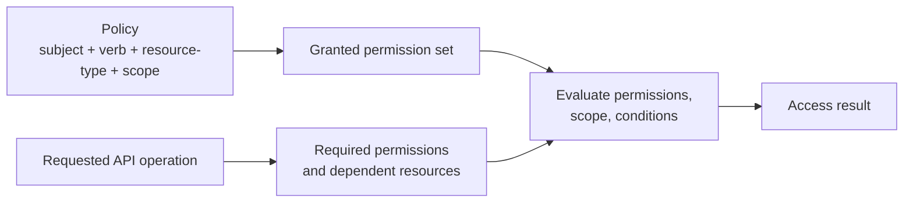

# Distinguishing inspect, read, use, and manage

## Objectives and Context

In the **IAM Identity and Access Management** chapter of the **CLOUD_PROVIDERS_ORACLE** module, the four verbs `inspect`, `read`, `use`, and `manage` are fundamental components of OCI policies. Choosing the right verb lets operations teams perform necessary work across Compute, networking, storage, and Oracle services while keeping permission scopes explainable and verifiable.

A statement like "just let this person use the resource" is not precise enough to write a policy. "Using" could mean downloading an object, rebooting an instance, or attaching a volume; each action requires different permissions.

After this lesson, learners will be able to:

- Explain the general meaning of the four verbs.
- Read the relationship between verb, resource-type, permission, and API operation.
- Identify cases where permissions cannot be inferred from the verb name alone.
- Choose appropriate permissions for a specific task.
- Design allow and deny verification tests in a lab compartment.

## 1. Where Does the Verb Sit in a Policy?

Illustrative structure:

```text
Allow group <identity-domain>/<group-name>
to <verb> <resource-type>
in compartment <compartment-name>
[where <condition>]
```

Example assuming the group already exists in the Default domain and compartment `OCI-Lab` sits directly under root:

```text
Allow group Default/LabObjectReaders to read objects in compartment OCI-Lab
```

Where:

| Component | Value | Meaning |
| --- | --- | --- |
| Subject | `Default/LabObjectReaders` | Group receiving the permission |
| Verb | `read` | Applicable permission group |
| Resource-type | `objects` | Resource type granted access |
| Scope | `OCI-Lab` | Compartment containing the relevant resources |

You cannot evaluate a policy solely by the word `read`. You must read the subject, resource-type, scope, and any conditions as well.

For example, `read objects` and `read buckets` do not grant the same set of permissions. One concerns object contents; the other concerns bucket resources. The level of access also depends on the exact resource type being requested.

## 2. General Meaning of the Four Verbs

Oracle defines the verbs in ascending levels of access. The following table is an initial guide; exceptions and exact permissions must be looked up per resource-type. [Verbs in OCI Policies](https://docs.oracle.com/en-us/iaas/Content/Identity/policieshow/Verbs.htm).

| Verb | Directional Meaning |
| --- | --- |
| `inspect` | Observe and inventory resource metadata |
| `read` | Includes inspect plus ability to read details or contents per resource type |
| `use` | Includes read plus operations working with existing resources |
| `manage` | Includes the administrative permission set for that resource type |

For the same resource-type and same scope conditions:

```text
permissions(inspect)
    ⊆ permissions(read)
    ⊆ permissions(use)
    ⊆ permissions(manage)
```

The `⊆` notation allows two levels to have equal permission sets. Not every step up adds a new operation.

### Do Not Map Mechanically to CRUD

The mnemonic "inspect = List, read = Get, use = Update, manage = Create/Delete" is only a very rough hint and can lead to incorrect policies.

An API starting with `Get` may be granted at the `inspect` level. An API starting with `Update` may require `manage`. Even some APIs starting with `List` are not included at the `inspect` level of the resource-type in question.

Therefore, when concluding whether an operation is permitted, use the service's permission/API reference table instead of translating the verb name literally.

## 3. From Verb to Permission and API

A verb is shorthand for a set of permissions. A permission is the granular authorization unit OCI checks when handling an operation.

Example of reading policy evaluation flow:

```text
Policy with verb and resource-type
  → grants corresponding permissions
  → API requires one or more permissions
  → scope and conditions are also checked
  → request is allowed or denied
```

One API can require permissions across multiple resource types. For instance, attaching a volume to an instance involves the volume, the volume attachment, and the instance; a policy for a single resource-type may be insufficient. [Relationship Between Verbs, Permissions, and APIs](https://docs.oracle.com/en-us/iaas/Content/Identity/policies/permissions.htm).



### How to Read a Service Reference Table

Reference tables typically have these columns:

| Column | How to Use |
| --- | --- |
| Verbs | Select inspect, read, use, or manage |
| Permissions | View permissions granted at that level |
| APIs Fully Covered | APIs already covered by that permission level |
| APIs Partially Covered | APIs that also require permissions on other resource types |

If you see `no extra`, that level adds no permissions beyond the preceding level in the table. If you see `READ + ...`, the listed permissions are the additions on top of the `read` set.

The word "partially" is a signal to keep reading. Do not skip the "also need" notes and jump to concluding that the entire policy must be raised to tenancy-wide administration.

## 4. Inspect: Observation Access Is Not Always Just Names and OCIDs

`inspect` is often the starting point for inventory needs. However, how much detail is returned depends on the service.

### Compartment Example

For `compartments`, `inspect` covers both `ListCompartments` and `GetCompartment`. The `read` level adds no permissions beyond `inspect` in the corresponding table.

This shows you cannot conclude every `Get` API requires the `read` verb. [IAM Policy Reference by Resource-Type](https://docs.oracle.com/en-us/iaas/Content/Identity/policyreference/iampolicyreference.htm).

### Networking and Policy Examples

`inspect` can reveal detailed configuration. For networking resources, returned details can include route rules or security rules. Inspecting policies can also read policy contents.

Therefore, when giving an identity observation access, understand which configuration data becomes visible. Do not describe `inspect` as a mechanism that always hides everything except resource names. [Exceptions When Using Inspect](https://docs.oracle.com/en-us/iaas/Content/Identity/policieshow/Verbs.htm).

### Compute Example

According to the current Core Services permission table, `ListInstances` sits at the `read` level for `instances`. Consequently, a policy with only `inspect instances` does not ensure a user can list instances as expected. [Permissions for the instances Resource-Type](https://docs.oracle.com/en-us/iaas/Content/Identity/policyreference/corepolicyreference_topic-Details_for_Verb__ResourceType_Combinations.htm).

This is why work requirements should be written as "needs to call `ListInstances` in the lab compartment," rather than simply "needs to inspect Compute."

## 5. Read: Can Read Actual Data

`read` includes the corresponding observation permissions and can unlock reading resource contents.

Example:

```text
Allow group Default/LabObjectReaders to read objects in compartment OCI-Lab
```

With Object Storage, `read objects` permits fetching object contents via `GetObject`. If an object contains reports or data exports, an authorized user can download that content, even without permission to modify or delete it.

`read` is therefore a non-mutating permission with respect to the granted operations, not a permission with zero impact on data confidentiality.

### Reading Buckets Differs from Reading Objects

Someone with permission to read bucket metadata does not necessarily have permission to read the object contents inside. If the task is downloading files from a bucket, check permissions on `objects`, not just `buckets`. [Object Storage Permissions by Bucket and Object](https://docs.oracle.com/en-us/iaas/Content/Identity/policyreference/objectstoragepolicyreference.htm).

Evaluation should start from the data that needs to be read:

- Only inventorying which object names exist?
- Need to read object metadata/properties?
- Need to download full contents?
- Need access to one bucket or all buckets in a compartment?

These questions help establish the appropriate resource-type, scope, and conditions before picking a verb.

## 6. Use: Can Alter Operations and Data

`use` typically serves operators working with existing resources. It should not be understood as passive-only access.

### Compute: Operating Existing Instances

For `instances`, `use` includes permissions for power actions and operational actions defined for that resource type. A person can affect an instance's operational state without having permission to create or terminate instances.

An authorized reboot can still disrupt a Java application or database connection using that machine. Lacking delete permissions is not enough to classify this permission as low-impact. [Use Permissions for instances](https://docs.oracle.com/en-us/iaas/Content/Identity/policyreference/corepolicyreference_topic-Details_for_Verb__ResourceType_Combinations.htm).

### Object Storage: Overwriting Existing Content

For `objects`, `use` adds `OBJECT_OVERWRITE`. A `PutObject` request against an existing name differs from a `PutObject` creating a new name.

Lab design implication: someone with `use objects` can modify the content of a sample object even without permission to create new objects. Therefore, do not test overwrite permissions against a real data file simply because the verb is not `manage`.

### Not Every Update Belongs to `use`

Updates that change access controls or infrastructure behavior may require `manage`. For example, editing policies or route tables cannot be assumed valid solely from `use policies` or `use route-tables`.

Read the operation's impact and actual required permissions. The word "Update" describes the API name; it does not determine the verb level.

## 7. Manage: Administering the Right Resource Type and Scope

`manage` covers the administrative permissions of the specified resource-type. It remains bounded by resource-type, scope, and conditions.

Example:

```text
Allow group Default/LabObjectManagers to manage objects in compartment OCI-Lab
```

This policy applies to objects within the specified scope. It does not automatically grant permission to create VCNs, manage instances, or create buckets.

Compare:

| Policy | Functional Scope |
| --- | --- |
| `manage objects` | Administer the `objects` resource type |
| `manage object-family` | Group of resource types in the Object Storage family |
| `manage all-resources` | Much broader set of resource types |

A resource family bundles multiple resource-types. Do not replace `objects` with `object-family` just because the longer name looks more complete; verify whether the task actually requires managing buckets and other components.

### `manage` Does Not Eliminate Dependent Permissions

Creating an instance can still require permissions to use subnets, VNICs, images, and other resources. If networking resources reside in a shared compartment, permissions on instances in the application compartment alone are insufficient.

Likewise, having the right IAM permissions does not guarantee an operation will succeed: resources may be in an incompatible state, capacity may be unavailable, quotas may be exceeded, or service configurations may impose constraints.

### Policy Management Permissions Must Be Evaluated Separately

Someone permitted to edit policies within an applicable scope can alter how permissions are granted in that scope. When the goal is solely running workloads, do not bundle policy management permissions as a convenience add-on.

This is why identity and authorization administration duties should be separated from routine application operations.

## 8. Three Examples Showing Four Levels Do Not Always Yield Four Distinct Capabilities

### 8.1. Compartment: `inspect` and `read` Can Be Equal

| Selected Operation | Inspect | Read | Use | Manage |
| --- | --- | --- | --- | --- |
| List/Get compartment | Yes | Yes | Yes | Yes |
| Update compartment | No | No | Yes | Yes |
| Create/Delete compartment within allowed scope | No | No | No | Yes |

This table illustrates selected operations only. Do not extrapolate `manage compartments` into permission to move compartments across every topology; move operations have separate requirements.

### 8.2. Policy: `use` Does Not Permit Editing Policies

For the `policies` resource-type, `inspect`, `read`, and `use` do not create three distinct content-editing tiers. `UpdatePolicy` requires permissions at the `manage` level.

Thus, the request "grant `use` so the user can edit existing policies without creating new ones" cannot be achieved via the verb alone. [Permissions Table for policies and compartments](https://docs.oracle.com/en-us/iaas/Content/Identity/policyreference/iampolicyreference.htm).

### 8.3. Route Table: `use` Does Not Permit Editing Route Rules

For `route-tables`, `inspect`, `read`, and `use` do not add permission to modify route tables. Update permissions belong to `manage`; an operation may also require permissions on related targets.

When a team only needs to use a subnet to deploy an application, do not automatically grant `manage` over the entire network so they can edit route tables. Clarify whether the duty belongs to the networking team or the application team first. [Permissions Table for route-tables](https://docs.oracle.com/en-us/iaas/Content/Identity/policyreference/corepolicyreference_topic-Details_for_Verb__ResourceType_Combinations.htm).

These examples all lead to the same method: pick the target API, look up its permissions, and find the smallest verb that covers it.

## 9. Hands-On Scenario: Four Roles Accessing a Lab Bucket

Use a compartment `OCI-Lab` and a dedicated bucket `iam-verbs-lab`. The lab administrator prepares a `sample.txt` object beforehand containing non-sensitive test data.

Assumptions for clear permission observation:

- The bucket is in the chosen compartment and region.
- Access uses the IAM identity under test, not a public URL or pre-authenticated request.
- No broad permissions from other groups apply to the bucket.
- The bucket has no retention rules or extra configurations altering write/delete test outcomes.
- Each test identity receives only the policy matching the role under test.

Four groups already exist in the Default identity domain:

| Group | Duty |
| --- | --- |
| `LabObjectInspectors` | Inventory objects |
| `LabObjectReaders` | Inventory and download contents |
| `LabObjectUsers` | Work with existing objects |
| `LabObjectManagers` | Administer objects in the lab bucket |

### Illustrative Policies

Assume the policies are created at root and `OCI-Lab` sits directly under root:

```text
Allow group Default/LabObjectInspectors to inspect objects in compartment OCI-Lab where target.bucket.name = 'iam-verbs-lab'

Allow group Default/LabObjectReaders to read objects in compartment OCI-Lab where target.bucket.name = 'iam-verbs-lab'

Allow group Default/LabObjectUsers to use objects in compartment OCI-Lab where target.bucket.name = 'iam-verbs-lab'

Allow group Default/LabObjectManagers to manage objects in compartment OCI-Lab where target.bucket.name = 'iam-verbs-lab'
```

The bucket condition focuses the test on one known target. Oracle provides policy examples using `target.bucket.name` to restrict object read access. [Policy Examples Scoped by Bucket](https://docs.oracle.com/en-us/iaas/Content/Identity/policiescommon/commonpolicies.htm).

The four lines target four different groups. Do not put a single account into all four groups and use that to distinguish the four permission levels.

### Expected Outcome Matrix

| Operation on Object in Lab Bucket | Inspect | Read | Use | Manage |
| --- | --- | --- | --- | --- |
| List objects | Yes | Yes | Yes | Yes |
| Download contents of `sample.txt` | No | Yes | Yes | Yes |
| `PutObject` overwriting existing `sample.txt` | No | No | Yes | Yes |
| `PutObject` creating a new name | No | No | No | Yes |
| Delete lab object | No | No | No | Yes |
| Create new bucket with only the policies above | No | No | No | No |

These expectations apply when the lab assumptions hold and only the listed policies are evaluated. The difference between overwriting and creating new comes from `OBJECT_OVERWRITE` versus `OBJECT_CREATE`, not two differently named APIs. [Permissions for PutObject and Object Operations](https://docs.oracle.com/en-us/iaas/Content/Identity/policyreference/objectstoragepolicyreference.htm).

## 10. Verifying Permissions with OCI CLI

The snippets below are for PowerShell with OCI CLI configured. These are sample commands for learners to run in an authorized lab tenancy, not actions already executed on the learner's behalf.

Each profile must correspond to the exact test identity. A profile name does not create IAM permissions by itself.

### 10.1. List Objects

```powershell
$ociProfile = '<test-identity-profile>'
$ociRegion = '<bucket-region>'
$namespaceName = '<object-storage-namespace>'
$bucketName = 'iam-verbs-lab'

oci os object list `
    --namespace-name $namespaceName `
    --bucket-name $bucketName `
    --limit 10 `
    --profile $ociProfile `
    --region $ociRegion

$listExitCode = $LASTEXITCODE
Write-Output ('List exit code: ' + $listExitCode)
```

An `inspect objects` identity in this lab model is expected to list objects. The command verifies permission only for that step; it does not prove permission to download contents. [Command Reference: object list](https://docs.oracle.com/en-us/iaas/tools/oci-cli/latest/oci_cli_docs/cmdref/os/object/list.html).

### 10.2. Download a Sample Object

Choose a destination file path in your local lab directory, avoiding overwriting an active file:

```powershell
$downloadPath = '.\iam-verbs-sample-download.txt'

oci os object get `
    --namespace-name $namespaceName `
    --bucket-name $bucketName `
    --name 'sample.txt' `
    --file $downloadPath `
    --profile $ociProfile `
    --region $ociRegion

$getExitCode = $LASTEXITCODE
Write-Output ('Get exit code: ' + $getExitCode)
```

`inspect objects` is expected to be denied at this step; `read`, `use`, and `manage` are expected to download successfully under the stated lab conditions. [Command Reference: object get](https://docs.oracle.com/en-us/iaas/tools/oci-cli/latest/oci_cli_docs/cmdref/os/object/get.html).

### 10.3. Test Mutations on Disposable Data

To distinguish `use` and `manage`, the coordinator can prepare these operations:

1. Overwrite an existing sample object with different test content.
2. Create an object with a new name.
3. Delete the test object created by the lab.

Run these only against prepared disposable data. Restore `sample.txt` to its original content before the next test run so resource state does not skew the meaning of the test.

If the object was deleted by a `manage` test run, a subsequent `PutObject` becomes creating a new object rather than overwriting. Having `use` denied at that point is expected behavior, not a policy acting randomly.

### 10.4. Record Both Allowed and Denied Outcomes

Recording template:

| Identity/Profile | Active Group | API/Operation | Object State Before Test | Expected | Observed |
| --- | --- | --- | --- | --- | --- |
| Inspect profile | LabObjectInspectors | ListObjects | `sample.txt` exists | Allowed | Fill in actual |
| Inspect profile | LabObjectInspectors | GetObject | `sample.txt` exists | Denied | Fill in actual |
| Use profile | LabObjectUsers | PutObject same name | `sample.txt` exists | Allowed | Fill in actual |
| Use profile | LabObjectUsers | PutObject new name | Name does not exist | Denied | Fill in actual |

Do not mark "PASS" solely because the policy was saved. Tests must run with the exact identity and observe actual API behavior.

## 11. Choosing Permissions Based on Real Tasks

You can use this workflow when designing policies for an OCI environment:

1. State the task as specific operations.
2. Identify the primary resource-type and dependent resources.
3. Look up service permissions/APIs.
4. Choose the smallest verb that covers the task.
5. Restrict compartment and target objects appropriately.
6. Verify permitted operations and out-of-scope operations.

Example requirements and analysis directions:

| Requirement | Permission Identification Direction |
| --- | --- |
| Inventory compartments | Look up `inspect compartments` and required APIs |
| Download config files from a bucket | Look up `read objects`, scoped to the appropriate bucket |
| Reboot a lab application machine | Look up power action permissions for `instances` |
| Edit route to database subnet | Look up permissions to update route tables and related targets |
| Create and delete resources via deployment tool | Identify each resource-type and dependent permissions |
| View database info in Console only | Look up specific resource-types for the database service in use |

There is no single generic `use database` policy covering all Oracle Database service types. DB Systems, Autonomous Database, and other components maintain separate permission tables.

### OCI Administration Differs from OS and Database Privileges

Having `read instances` does not mean you can log in to Linux. Administering a database resource on OCI also does not automatically create `SELECT` privileges in an Oracle schema.

Similarly, permission to download objects does not open a network path to a private endpoint if the environment lacks appropriate connectivity. When troubleshooting errors, distinguish cloud IAM administration, network connectivity, and target-service authentication.

### Relationship to Cost and Availability

`manage` can allow creating billable resources within the granted scope. `use` can still alter data or disrupt a running machine. Therefore, verb selection must be grounded in the business impact of the operation, not merely the question "can it delete?"

## 12. When One Verb Is Broader Than Needed

Sometimes a task needs a subset of `manage` permissions without needing all of them. OCI lets you combine a verb with conditions based on permissions or API operations. [Restricting Permissions with Conditions](https://docs.oracle.com/en-us/iaas/Content/Identity/Concepts/policyadvancedfeatures.htm).

Example where an operator needs to create and overwrite lab objects without deleting:

```text
Allow group Default/LabObjectWriters to manage objects in compartment OCI-Lab
where all {
    target.bucket.name = 'iam-verbs-lab',
    any {
        request.permission = 'OBJECT_INSPECT',
        request.permission = 'OBJECT_READ',
        request.permission = 'OBJECT_CREATE',
        request.permission = 'OBJECT_OVERWRITE'
    }
}
```

This statement illustrates a permission allowlist for simple object reading, creation, and overwriting in the chosen bucket. It does not grant `OBJECT_DELETE`.

It also shows that looking solely at `manage` is insufficient to conclude all administrative permissions are allowed: conditions can restrict what is granted.

Do not treat this example as a complete policy for every upload workflow. A workflow involving multipart uploads, cleaning up failed parts, lifecycle rules, replication, or bucket configuration may require different permissions. Look up the APIs the workflow actually calls.

## 13. Effective Permissions Do Not Live in One Policy Statement Alone

A user can belong to multiple groups. Permissions can also be granted from a parent compartment or at the tenancy scope.

Suppose an account simultaneously receives:

```text
Allow group Default/LabObjectReaders to read objects in compartment OCI-Lab
Allow group Default/LabAdministrators to manage objects in compartment OCI-Lab
```

If the account belongs to both groups, the `read` statement does not downgrade the `manage` permission already granted. Similarly, a narrow policy on a child compartment does not revoke permissions from a broad policy at a parent level. [Policy Inheritance and Organizing Policies](https://docs.oracle.com/en-us/iaas/Content/Identity/Concepts/policies.htm).

When evaluating permissions, check:

- The actual identity sending the request.
- All groups associated with that identity.
- Effective policies in the compartment and ancestor levels.
- Resource-types, scopes, and conditions of each grant path.
- Supplementary service access mechanisms, if enabled.

For Object Storage tests, public URLs or pre-authenticated requests can prevent the test from reflecting the user's IAM policy. Therefore, tests must control how requests are sent.

## 14. Diagnosing Unexpected Results

| Symptom | Where to Check First |
| --- | --- |
| `inspect compartments` still allows `Get` | This may be expected behavior for that resource-type |
| `inspect instances` fails to `List` as expected | Check the required permission level for `ListInstances` |
| `use route-tables` cannot edit rules | `UpdateRouteTable` is not granted by `use` alone |
| `read buckets` cannot download objects | Check permissions on `objects` |
| `use objects` can overwrite but creating a new name fails | Distinguish `OBJECT_OVERWRITE` and `OBJECT_CREATE` |
| Read-only user can still write | Check grants from other groups, parents, or supplementary access mechanisms |
| Has `manage instances` yet launch fails | Check dependent permissions, limits, state, and service errors |
| Changed policy yet result hasn't changed | Check propagation time, active CLI profile, and auth session |
| Console is missing part of the UI | The page may call multiple APIs with differing permission requirements |

A "not found" or "not authorized" message is insufficient to conclude only a verb is missing. Check region, compartment, target name/identifier, and identity before editing the policy.

An empty list result is not always a denial either: there may simply be no resources matching the filter. Cross-check against known lab data with an appropriate administrative identity.

When escalating for support, record the timestamp, operation, region, compartment, error code, and request ID if available. Never include private keys or tokens in diagnostic notes.

## 15. Capstone Practice Exercise

In an authorized lab environment:

1. Choose three specific operations: one observation operation, one content-reading operation, and one resource-mutating operation.
2. Identify the resource-type of each operation.
3. Look up required permissions and the smallest sufficient verb.
4. Prepare policies scoped to the test compartment and target objects.
5. Test using an identity without broad administrative privileges.
6. Record one permitted operation and one denied operation for each role.
7. Explain the outcomes in terms of permissions/APIs, not just verb names.
8. Revoke lab-only permissions and clean up lab-only resources upon completion.

Evidence to capture:

```text
Test identity:          <profile-or-principal>
Related group:          <group>
Resource-type:          <resource-type>
Verb:                   <inspect/read/use/manage>
Scope:                  <compartment-and-condition>
API tested:             <operation>
Required permission:    <permission>
Pre-action state:       <actual-value>
Expected result:        <allowed/denied>
Observed result:        <actual-value>
Additional grant source:<none/list>
```

The goal is to explain why the results occurred and verify exact permission boundaries, not to make every operation succeed by granting broader permissions.

## 16. Key Takeaways

**`inspect`, `read`, `use`, and `manage` are permission groupings per resource-type.** They are cumulative, though adjacent levels can be identical and API mappings have exceptions.

When authoring IAM policies in OCI, start from the required task and API, look up permissions, pick the right verb, and bound the scope. Verify both dependent permissions and other grant sources so policies fulfill operational needs while remaining auditable.
