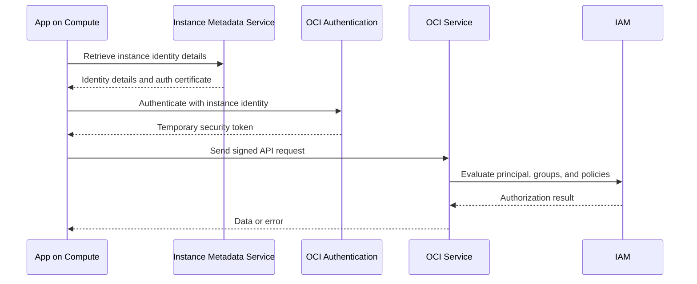

# Dynamic Groups and Instance Principals

In Oracle Cloud Infrastructure (OCI), an application running on Compute may need to read configuration from Object Storage, send monitoring data, or perform an automation task. If you place a user's API signing key on each machine, the operations team must distribute, protect, and rotate keys; the application's permissions also risk becoming tied to a personal account.

**Instance Principals** allow a Compute instance to use its own identity to call OCI APIs. **Dynamic Groups** group resources based on conditions; **IAM policies** grant permissions to those groups. Together, these three components let applications use job-appropriate permissions without storing a long-lived IAM user API key on the machine.

This lesson belongs to the **IAM Identity and Access Management** chapter of the Oracle Cloud Infrastructure module. The focus is designing permissions for Compute workloads, practicing reading Object Storage, and operating this mechanism when deploying, scaling, or replacing infrastructure.

## 1. Objectives and Prerequisites

After this lesson, you will be able to:

- Distinguish instance identity, group membership conditions, and resource access permissions.
- Write matching rules by instance OCID, compartment, and defined tag.
- Grant a Compute instance read access to a single bucket using a clearly scoped policy.
- Use the OCI CLI and understand how to integrate the OCI Java SDK with Instance Principals.
- Analyze authentication errors, authorization errors, network errors, and the impact of membership changes.

You should know tenancy, compartment, OCIDs, and the basic structure of an OCI IAM policy. To practice, you need an accessible Compute instance, OCI CLI installed on the instance, and an administrator authorized to create Dynamic Groups and appropriate policies.

## 2. Three Questions to Keep Separate

| Component | Question Answered | Example |
| --- | --- | --- |
| Instance Principal | Who is calling the API? | Compute instance with an identified OCID |
| Dynamic Group and matching rule | Which resource set does that instance belong to? | Application machines in a chosen compartment |
| IAM policy | What can that resource set do, and where? | Read objects in a bucket within a data compartment |

Creating a Dynamic Group does not automatically grant permissions to read data, create machines, or administer networks. Conversely, writing a policy for a group does not automatically make an instance a member if the matching rule does not match.

One instance can match multiple Dynamic Groups. When analyzing permissions, review the sum of relevant policies, including any existing broad policies. Adding a narrow policy does not automatically cancel permissions granted by another policy.

Dynamic Groups can also represent other OCI-supported resource types beyond Compute. In this lesson, matching rules and the primary authentication flow are scoped to Compute instances. Conditional resource grouping concepts are described in [Managing Dynamic Groups](https://docs.oracle.com/en-us/iaas/Content/Identity/dynamicgroups/managingdynamicgroups.htm).

### 2.1. Comparison with Using an IAM User

| Criterion | IAM User API Signing Key | Instance Principal |
| --- | --- | --- |
| Identity calling OCI APIs | Configured user | Compute instance |
| Long-lived user key on machine | Typically must be provisioned with this approach | No need to distribute user API keys |
| Grouping for permission grants | User group | Dynamic Group |
| Where appropriate | User tools or environments with separate key management flows | Workloads running on OCI Compute |
| Risks to manage | Compromised key, overly broad user permissions | Host or process on host compromised |

Instance Principal does not mean "no credentials exist." The mechanism still uses certificates and tokens for authentication; OCI and the SDK handle the corresponding parts of that lifecycle.

## 3. Flow for Calling Services Using Instance Identity

Each Compute instance has an identity bound to a certificate provisioned by OCI. The SDK's authentication provider or the CLI's auth mode fetches required details via instance metadata, performs a federation flow, and uses temporary credentials to sign requests.



This is a conceptual diagram. Applications do not need to copy certificates manually, construct tokens, or write tokens to files. Let the official authentication provider handle and refresh credentials. Oracle's signer documentation describes fetching details from metadata and refreshing security tokens in [InstancePrincipalsSecurityTokenSigner](https://docs.oracle.com/en-us/iaas/tools/ruby/latest/OCI/Auth/Signers/InstancePrincipalsSecurityTokenSigner.html).

Two independent conditions must both hold true:

1. The instance proves its identity and the client sends a validly authenticated request.
2. IAM authorizes that identity to execute the specific API on the target resource.

In addition, the network path to the relevant endpoints must work. A valid policy cannot fix DNS, routing, or TLS connectivity failures.

### 3.1. Identity Scope Is the Machine

An Instance Principal is tied to the instance, not to a specific Linux user, Java process, or container. Never assume two applications on the same VM have separate OCI permissions merely because they run under two OS accounts.

Treat the instance's permissions as part of the machine's trust boundary. Workloads with different trust levels should be placed and authorized appropriately rather than sharing one broad identity.

## 4. Writing Matching Rules for Compute

A matching rule selects **which resource calls APIs**. It is not a condition selecting the bucket, database, or resource the application wants to access.

In the examples below, every string inside `<...>` is a placeholder that must be replaced with real values. Names and OCIDs are different value types; never replace a compartment OCID with a display name.

### 4.1. Selecting One Exact Instance

```text
instance.id = '<INSTANCE_OCID>'
```

This works well for a lab or a machine with a dedicated responsibility. When a replacement instance is created, the new machine gets a different OCID and will not automatically match the old rule.

For example, if a config-reading machine is recreated after an incident, reinstalling the application is not enough; you must also update the membership rule or use a group model suited to machine replacement.

### 4.2. Selecting Instances by Compartment

```text
instance.compartment.id = '<APP_COMPARTMENT_OCID>'
```

This rule matches instances whose compartment OCID equals the specified value. It does not express recursive lookup across all child compartments in a tree; if an instance resides in a child compartment, verify the instance's actual compartment OCID.

This condition is convenient for instance pools or frequently replaced machines. However, every instance matching the condition inherits the group's permissions, including future machines. Consequently, permission to create or move Compute instances into this compartment becomes a security design factor.

### 4.3. Combining Compartment and Defined Tag

Suppose the organization has a defined tag namespace `AccessControl`, key `Workload`, and value `config-reader`:

```text
ALL {
  instance.compartment.id = '<APP_COMPARTMENT_OCID>',
  tag.AccessControl.Workload.value = 'config-reader'
}
```

`ALL` requires both conditions simultaneously. A machine in the right compartment lacking the tag will not match; a machine with the right tag in a different compartment will also not match.

The `tag.<namespace>.<key>.value` syntax here uses a **defined tag**. Do not substitute a similarly named free-form tag and expect identical membership.

Tags used for authorization must be governed like security data. If someone can attach a qualifying tag to a machine they control, they can bring that machine into the authorized group. Review permissions to update instances, permissions to use tag namespaces, and default tags applied at resource creation.

### 4.4. Selecting One of Multiple Instance Sets

```text
ANY {
  instance.compartment.id = '<APP_A_COMPARTMENT_OCID>',
  instance.compartment.id = '<APP_B_COMPARTMENT_OCID>'
}
```

`ANY` requires only at least one condition to be true. Replacing `ALL` with `ANY` in the previous tag example widens the scope to "right compartment **or** right tag."

| In Application Compartment | Has Required Tag | Result with ALL | Result with ANY |
| --- | --- | --- | --- |
| Yes | Yes | Match | Match |
| Yes | No | No match | Match |
| No | Yes | No match | Match |
| No | No | No match | No match |

This is a logic shift that can escalate privileges across many machines, even though the rule differs by just one word.

Oracle publishes matching rule syntax and variables in [Writing Matching Rules to Define Dynamic Groups](https://docs.oracle.com/en-us/iaas/Content/Identity/dynamicgroups/Writing_Matching_Rules_to_Define_Dynamic_Groups.htm). When combining multiple conditions, write `ALL` or `ANY` explicitly with braces and commas.

## 5. Writing Policies for the Right Target Resource

The matching rule selects **which machine can call**; the policy selects **which operations that machine can call on which resources**.

Suppose:

- The application instance resides in compartment `app-dev`.
- The data bucket resides in compartment `data-dev`.
- The Dynamic Group is named `dg-oracle-config-readers`.
- The private bucket is named `oracle-iam-lab`.

The two compartments can differ. Do not attach the policy to `app-dev` simply because Compute lives there when the target data resource actually lives in `data-dev`.

### 5.1. Policy to Read Objects in One Bucket

For a tenancy using IAM identity domains with the group located in domain `Default`, for example:

```text
Allow dynamic-group 'Default'/'dg-oracle-config-readers' to read objects in compartment id <DATA_COMPARTMENT_OCID> where target.bucket.name = 'oracle-iam-lab'
```

Meaning of each component:

| Component | Meaning |
| --- | --- |
| `dynamic-group 'Default'/'dg-oracle-config-readers'` | Authorized principal, including domain and group name |
| `read objects` | Read permission on the `objects` resource type |
| `in compartment id <DATA_COMPARTMENT_OCID>` | Compartment scope containing the target resource |
| `target.bucket.name = 'oracle-iam-lab'` | Restricts objects to the specified bucket |

Replace `Default` with the actual domain name if the group resides in another domain. In legacy IAM models without identity domains, the subject is typically written as `dynamic-group dg-oracle-config-readers`. Never copy a domain name verbatim to another tenancy without checking. Oracle includes group names with domains in [Access Object Storage with Resource Principals](https://docs.oracle.com/cd/E17952_01/heatwave-en/mys-hw-resource-principal.html).

The policy must be created in a location capable of granting permissions on the data compartment, such as at that compartment itself or an appropriate ancestor level. Placing the policy in a sibling application compartment does not grant administrative scope over the data compartment.

### 5.2. Choose Permissions Based on Actual APIs Needed

For the data-reading lab, the application needs `ListObjects` and `GetObject`. The `read objects` policy covers this need; there is no need to grant object creation or deletion rights.

| Common API | Related Permission |
| --- | --- |
| `ListObjects` | `OBJECT_INSPECT` |
| `GetObject` | `OBJECT_READ` |
| `PutObject` creating a nonexistent object name | `OBJECT_CREATE` |
| `PutObject` writing to an existing object name | `OBJECT_OVERWRITE` |
| `DeleteObject` | `OBJECT_DELETE` |

For write-only-new workloads, you can design a separate policy granting only `OBJECT_CREATE`. If a library uses multipart uploads or needs overwrites, cross-check auxiliary APIs and corresponding permissions; never infer permissions from a feature label like "upload."

Object read permission also does not mean permission to list all buckets or modify bucket configuration. The lab receives the namespace and bucket name from the administrator, so there is no need to open extra permissions just for client discovery. Detailed permission tables are in [Details for Object Storage and Archive Storage](https://docs.oracle.com/en-us/iaas/Content/Identity/policyreference/objectstoragepolicyreference.htm).

### 5.3. Avoid Overly Broad Policies When Troubleshooting

The following policy grants a scope far wider than reading configuration:

```text
Allow dynamic-group 'Default'/'dg-oracle-config-readers' to manage all-resources in tenancy
```

Never use this statement as a default troubleshooting step. An error may stem from the wrong bucket, wrong region, non-matching rule, or network path; opening the entire tenancy breaks permission design without resolving the true cause.

When a new API requires extra permissions, document the exact API, resource type, compartment, and relevant condition before updating the policy.

## 6. Hands-On Lab: Compute Reading a Private Bucket

### 6.1. Preparation and Role Separation

The administrator prepares:

1. A Compute instance for the lab and its exact OCID.
2. A private bucket named `oracle-iam-lab` in the data compartment.
3. A small text object `demo/hello.txt` with non-sensitive content.
4. The Object Storage namespace and actual region of the bucket.
5. A second private bucket containing a test object, used as a target that must be denied.
6. Permissions to manage Dynamic Groups and policies in the required scope.

The learner runs CLI commands on the **selected Compute instance**. A personal laptop or Cloud Shell is a different environment; running commands there does not make them use this VM's identity.

The lab does not require granting the instance permission to create Dynamic Groups, edit policies, or create buckets. Administrative tasks are performed using the administrator's own identity.

### 6.2. Create the Dynamic Group

In the OCI Console, select the appropriate identity domain, open Dynamic Groups, and create the group:

- Name: `dg-oracle-config-readers`.
- Description: Compute group reading lab data from the designated bucket.
- Matching rule:

```text
instance.id = '<INSTANCE_OCID>'
```

Use an instance OCID rule so the lab stays tightly scoped and easy to identify. If using a compartment or tag rule, proactively list all other machines that might also match.

The Console may validate syntax without verifying that the OCID you entered is the intended object. Therefore, creating the group successfully does not prove membership is right. Group creation steps are documented by Oracle in [Creating a Dynamic Group](https://docs.oracle.com/en-us/iaas/Content/Identity/dynamicgroups/To_create_a_dynamic_group.htm).

### 6.3. Create the Bucket Read Policy

The administrator creates the policy at an appropriate scope for the data compartment:

```text
Allow dynamic-group 'Default'/'dg-oracle-config-readers' to read objects in compartment id <DATA_COMPARTMENT_OCID> where target.bucket.name = 'oracle-iam-lab'
```

If using another domain, update the subject accordingly. Check existing policies that might grant broad permissions to the same instance through another Dynamic Group.

### 6.4. Prepare Connectivity

The instance needs access to local metadata and OCI endpoints for authentication and Object Storage calls. For machines in a private subnet, design routes and gateways per endpoint; do not assume merely creating a Service Gateway allows all traffic to flow.

Inspect the route table, gateway-supported targets, NSG or security list, DNS, proxy, and host firewall together. There is no need to assign a public IP just to make Instance Principal valid.

### 6.5. Call the CLI on the Instance

The commands below are **Bash on a Linux instance**. Replace namespace and region with provided values:

```bash
export OCI_NAMESPACE='<OBJECT_STORAGE_NAMESPACE>'
export OCI_REGION='<BUCKET_REGION>'
export OCI_BUCKET='oracle-iam-lab'

oci os object list \
  --namespace-name "$OCI_NAMESPACE" \
  --bucket-name "$OCI_BUCKET" \
  --prefix 'demo/' \
  --limit 5 \
  --region "$OCI_REGION" \
  --auth instance_principal
```

The expected result is a list of objects with prefix `demo/`, including `demo/hello.txt`. If the list is empty, check the sample object and prefix before concluding authorization failed.

Download the sample object to a new file in the lab directory:

```bash
oci os object get \
  --namespace-name "$OCI_NAMESPACE" \
  --bucket-name "$OCI_BUCKET" \
  --name 'demo/hello.txt' \
  --file './hello-from-oci.txt' \
  --region "$OCI_REGION" \
  --auth instance_principal

cat './hello-from-oci.txt'
```

`--auth instance_principal` instructs the CLI to use the instance identity. Never omit this option and judge results using a preconfigured user API key profile. Official documentation for this CLI mode is in [Calling Services from an Instance](https://docs.oracle.com/en-us/iaas/Content/Identity/Tasks/callingservicesfrominstances.htm).

### 6.6. Verify Out-of-Scope Access

Use the corresponding namespace and region if the test bucket resides elsewhere:

```bash
oci os object list \
  --namespace-name "$OCI_NAMESPACE" \
  --bucket-name '<KNOWN_PRIVATE_BUCKET_OUTSIDE_POLICY>' \
  --limit 1 \
  --region "$OCI_REGION" \
  --auth instance_principal
```

The expected outcome is denied access. The test bucket must actually exist and be confirmed by the administrator; using a random name and getting an error does not prove the policy bounded access properly.

If access still succeeds, check other Dynamic Groups the instance matches, ancestor policies, and bucket conditions. Do not look only at the policy just created.

| Check | Expected Result |
| --- | --- |
| List objects in granted bucket | Succeeds |
| Get sample object in granted bucket | Succeeds with exact content |
| List objects in out-of-scope private bucket | Denied |
| Authentication method of every command | Uses `--auth instance_principal` |

A read lab does not need delete or overwrite operations to prove permission limits. When building a dedicated write test, use data and resources reserved for that purpose.

## 7. Integrating into a Java Application

The OCI Java SDK provides `InstancePrincipalsAuthenticationDetailsProvider`. Applications use this provider when running on a Compute instance that already has the required membership and policies.

The following example reads one small text object. Environment variables are passed from deployment configuration; they describe the target resource and contain no user API keys.

```java
import com.oracle.bmc.auth.InstancePrincipalsAuthenticationDetailsProvider;
import com.oracle.bmc.objectstorage.ObjectStorageClient;
import com.oracle.bmc.objectstorage.requests.GetObjectRequest;
import com.oracle.bmc.objectstorage.responses.GetObjectResponse;

import java.io.InputStream;
import java.nio.charset.StandardCharsets;

public class ReadConfigUsingInstancePrincipal {
    public static void main(String[] args) throws Exception {
        String namespace = requiredEnv("OCI_NAMESPACE");
        String region = requiredEnv("OCI_REGION");
        String bucket = requiredEnv("OCI_BUCKET");
        String objectName = requiredEnv("OCI_OBJECT");

        var provider =
                InstancePrincipalsAuthenticationDetailsProvider.builder()
                        .build();

        try (ObjectStorageClient client =
                     ObjectStorageClient.builder().build(provider)) {
            client.setRegion(region);

            GetObjectResponse response = client.getObject(
                    GetObjectRequest.builder()
                            .namespaceName(namespace)
                            .bucketName(bucket)
                            .objectName(objectName)
                            .build()
            );

            try (InputStream body = response.getInputStream()) {
                String content = new String(
                        body.readAllBytes(),
                        StandardCharsets.UTF_8
                );
                System.out.println(content);
            }
        }
    }

    private static String requiredEnv(String name) {
        String value = System.getenv(name);
        if (value == null || value.isBlank()) {
            throw new IllegalArgumentException(
                    "Missing environment variable: " + name
            );
        }
        return value;
    }
}
```

This example uses Java 11 or later. The project needs a compatible OCI Java SDK, the Object Storage module, and the dependencies and HTTP client specified by the chosen SDK version's documentation. Do not arbitrarily mix library versions.

Set `OCI_OBJECT=demo/hello.txt` and keep the remaining variables consistent with the lab. The example prints the content for observation; in real applications, never log sensitive configuration. For large objects, process the stream incrementally rather than calling `readAllBytes()`.

An application running on a typical laptop will lack this Compute metadata. For local development, use an appropriate separate authentication mechanism and select the provider explicitly per environment; avoid silently falling back to an overly broad API key that skews Instance Principal testing.

Client, provider, and region configuration concepts are described in [OCI SDK for Java — Concepts](https://docs.oracle.com/en-us/iaas/Content/API/SDKDocs/javasdkconcepts.htm).

## 8. Security and Boundaries to Understand

### 8.1. Host Access Affects Cloud Permissions

Anyone who can log in and execute code on an instance can exercise the permissions granted to that instance, depending on access to the credential mechanism on the machine. Therefore, control SSH, OS accounts, software allowed to run, and remote code execution paths.

Oracle also notes a baseline capability of Compute Instance Principals: `compartment_inspect`, which permits listing certain compartment information and cannot be revoked like an ordinary policy. Thus, the statement "an instance has zero permissions without any policy" must be understood with this exception. See [Security Considerations When Calling Services from an Instance](https://docs.oracle.com/en-us/iaas/Content/Identity/callresources/callingservicesfrominstances.htm).

### 8.2. Protecting the Instance Metadata Service

Instance metadata serves details tied to workload identity. An application vulnerable to SSRF or an untrusted process can introduce risk if it can reach this endpoint.

Use IMDSv2 and disable IMDSv1 once software components on the machine are compatible. Audit proxies and local networking rules so metadata traffic is not misrouted; allow only necessary processes to access it per operational design.

Never blindly copy a rule blocking all link-local addresses: it can break background services and the SDK itself, which depend on metadata. Guidance on protecting metadata and local services is in [Securing Compute](https://docs.oracle.com/en-us/iaas/Content/Security/Reference/compute_security.htm).

### 8.3. Cloud Permissions Do Not Replace Other Access Layers

An Instance Principal may allow calling OCI APIs to manage a database without granting any SQL privileges inside Oracle Database. Database connectivity still depends on authentication mechanisms supported by the service and driver, accounts or identity mappings, in-database privileges, and network connectivity.

Similarly, an Object Storage policy does not open an NSG; a Compute management policy does not grant SSH access to the OS. When designing applications, specify each permission layer along the actual access path.

## 9. Membership Changes, Deployment, and Revocation

### 9.1. Changes Do Not Take Effect Instantly

Oracle notes that updating a matching rule can take about an hour for permissions under the new membership to take effect. Never treat a test immediately after editing a rule as final. This guidance is documented in [Updating Dynamic Groups](https://docs.oracle.com/en-us/iaas/Content/Identity/dynamicgroups/Updating_Dynamic_Groups.htm).

Distinguish between:

- Editing a granting policy.
- Editing a matching rule.
- Changing a tag or compartment that alters match criteria.
- The SDK continuing to use existing credentials during their lifetime.

These changes have different propagation paths and lifecycles. Do not assume a single fixed timeline across all scenarios, and never treat restarting the application as a guarantee that IAM has converged.

### 9.2. Choose Rules Aligned with Infrastructure Lifecycle

| Workload Type | Potentially Suitable Rule | Point to Control |
| --- | --- | --- |
| One lab VM | Instance OCID | Must update when replacing the VM |
| Frequently replaced app machine fleet | Compartment combined with defined tag | Control who creates machines and who attaches tags |
| Multiple workloads with distinct permissions | Separate Dynamic Groups and policies by responsibility | Avoid overlapping rules causing cumulative rights |

With instance pools, bake required defined tags into the machine provisioning flow and verify new machine membership before routing work to it. This model avoids editing policies on every scale event but demands strict tag governance.

### 9.3. Revocation During an Incident

If an instance is suspected of compromise, do not merely remove a tag and wait for membership to update. Coordinate workload or host isolation per incident response procedures, review granting policies, identify data that may have been accessed, and verify outcomes once changes take effect.

Removing one policy does not ensure all permissions are gone if the instance still matches another group granted similar rights. Nor does data the application already downloaded disappear when cloud permissions are revoked.

## 10. Layered Error Diagnosis

| Symptom | Possibilities to Examine | Targeted Check |
| --- | --- | --- |
| Provider cannot retrieve metadata | Running outside Compute, metadata blocked, wrong proxy | Confirm host environment, proxy settings, and metadata reachability |
| Timeout, DNS, or TLS error | Endpoint, route, firewall, proxy, CA | Confirm endpoint and region; test connectivity from the instance itself |
| `401 NotAuthenticated` | Invalid credential or signature, clock skew, broken auth flow | Inspect SDK/CLI error, sync system clock, and check client version |
| `403` or `NotAuthorizedOrNotFound` depending on API | Membership, policy, wrong target resource, or nonexistent resource | Check OCID, bucket, region, domain, and relevant policies |
| List succeeds but Get fails | Policy has only `inspect`, condition mismatch, or different resource | Cross-check exact API and required permissions |
| Old instance works, new instance fails | Rule uses old OCID, missing tag, different compartment, or network config | Compare conditions of both machines instead of copying credentials |

Error codes are directional signals, not sufficient proof of root cause. Some services intentionally do not distinguish nonexistent resources from resources the caller is unauthorized to view.

Diagnostic sequence should proceed in order:

1. Confirm which instance the command runs on and whether Instance Principal is selected.
2. Verify target namespace, region, bucket, or resource OCID.
3. Test connectivity to metadata, authentication endpoints, and service endpoints.
4. Compare the instance's actual attributes against the matching rule.
5. Cross-check the API against policies, policy placement, and `where` conditions.
6. Check when rules, tags, and policies were modified; allow appropriate propagation time.
7. Collect the request ID and redacted error output for further investigation.

Never include private keys, security tokens, or full metadata payloads in logs or support tickets.

## 11. Observability, Cost, and Lab Cleanup

In operations, document the mapping between workload, instance OCID, Dynamic Group, rule, and policy. If using infrastructure as code, manage these components alongside deployment changes so reviewers can see how cloud permissions change.

Monitor authentication and authorization errors in application logs; correlate OCI Audit and service logs appropriate for the operations under investigation. Do not assume every data read appears identically in one log source. Request IDs, timestamps, and regions help correlate related trails.

Instance Principals do not cap API call rates, data volume, or budgets. A validly authorized workload can still loop on API calls, generate traffic, or consume billable resources. Pair least privilege with application limits, bounded retries, and cost monitoring.

After the lab:

- Learners delete downloaded files in the lab directory if no longer needed.
- Administrators remove test policies and Dynamic Groups once unused, per service deletion requirements.
- Clean up objects, buckets, Compute instances, and auxiliary resources only if they belong exclusively to this lab.
- Check for retained boot volumes or storage after terminating Compute to avoid unexpected charges.

## 12. Self-Check Questions

1. **Instance is in compartment A, bucket is in compartment B: which compartment do the matching rule and policy use?** The rule selects instances in A; the policy grants permissions on data in B. Policy placement must hold appropriate governance scope.
2. **Why might adding the right tag still be insufficient?** The rule may require compartment, tag value, and other conditions together; the tag must also use the exact defined tag type and key referenced by the rule.
3. **Why can changing `ALL` to `ANY` cause privilege escalation?** Meeting just one condition becomes enough for membership, allowing more machines to receive the group's permissions.
4. **What does a CLI command succeeding on a laptop with an API key prove?** It only proves that user identity can call the API; it does not prove Compute Instance Principal works.
5. **Why can a narrow policy still allow unexpected access?** The instance may receive extra permissions from another policy or another Dynamic Group.
6. **If a VM is replaced while keeping the same hostname, does `instance.id` membership persist?** No; the new OCID must be accounted for.
7. **Can removing a tag be treated as instant revocation during an incident?** No; propagation time, active cached credentials, and other grant paths must all be accounted for.
