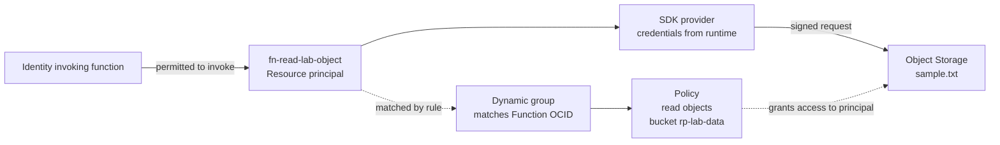

# Resource Principals and Identities for OCI Applications

## Objectives and Context

In the **IAM Identity and Access Management** chapter of the **CLOUD_PROVIDERS_ORACLE** module, applications also need an identity to call OCI APIs. A Java Function reading Object Storage, a notebook accessing data, or an automation workload should not by default run with the permissions of the person who deployed it.

A **Resource principal** lets a supported OCI resource authenticate using the identity of that resource itself. IAM then decides what that identity is permitted to do with other resources.

This lesson explains the mechanism and guides the design of a Java Function reading an object in a lab bucket. Networking, monitoring, credential lifecycle, and permission scope are brought into one cohesive model so learners can diagnose a request end-to-end from application to target service.

After this lesson, learners will be able to:

- Distinguish human user identities from workload identities.
- Explain the roles of resource principals, dynamic groups, policies, and SDK providers.
- Choose the appropriate authentication mechanism for Functions, Compute, or OKE workloads.
- Design Object Storage read access for a specific function.
- Identify authentication, authorization, configuration, and network connectivity errors.
- Test both permitted flows and out-of-scope flows.

## 1. Why Do Applications Need Their Own Identity?

Suppose an engineer with tenancy administrator privileges deploys a function that reads a configuration file from Object Storage.

There are two separate permissions to evaluate:

```text
Operator → deploys or invokes function
Function → reads object in bucket
```

A caller having invoke permission does not mean the function has permission to read the bucket. Conversely, a function having permission to read the bucket does not mean every user has permission to invoke it.

If you bake the administrator's API signing key into the image so the function works, calls from the function become tied to that person's identity and may carry permissions far beyond reading a file.

With a resource principal, the model is organized around the workload's identity: the function is identified as a specific resource and granted only the permissions it needs.

### Authentication and Authorization

| Question | Component Addressing It |
| --- | --- |
| Which resource did this request originate from? | Resource principal authentication mechanism |
| Is this resource allowed to read the object? | Effective IAM policies |
| Can the request reach the service endpoint? | DNS, routing, and networking mechanisms |
| Does the application process the data correctly? | Application-layer logic and validation |

A working system requires all of the pieces above to align. Creating a dynamic group alone does not make an API call succeed.

## 2. What Is a Resource Principal?

A resource principal is an identity that a supported OCI resource uses to access other resources. With OCI Functions, a running function can use the SDK's resource principal provider to obtain credentials supplied by the execution environment and sign API requests. [Accessing Other OCI Resources from Functions](https://docs.oracle.com/en-us/iaas/Content/Functions/Tasks/functionsaccessingociresources.htm).

The application does not need its own IAM user and long-lived API signing key just to make these calls.

Nevertheless, the mechanism still involves credentials: session tokens and signing key material. They must be protected as authentication material, even though the runtime manages them instead of the developer packaging them manually.

### Core Components

| Component | Responsibility |
| --- | --- |
| Source resource | Function or supported resource running the application |
| Service runtime | Supplies the authentication environment for the resource |
| Resource principal provider | Integrates credentials with the SDK and request signing mechanism |
| Dynamic group | Selects resources via matching rules in dynamic-group-based models |
| IAM policy | Grants permissions on target resources |
| Target service | Verifies the request and executes the permitted operation |

There is no universal resource principal switch that works identically across every service. Verify which mechanism the source service supports and which SDK provider corresponds to it.

## 3. Distinguishing Types of Application Identities

| Mechanism | Typical Context | What to Identify |
| --- | --- | --- |
| User principal | Tools running under an IAM user identity | User profile, credentials, and groups |
| Instance principal | Applications on OCI Compute instances | Instance identity, dynamic group, and policy |
| Resource principal | Functions or services supporting resource principals | Runtime, matching rule, policy, and appropriate provider |
| OKE workload identity | Kubernetes workloads on supported OKE configurations | Cluster, namespace, service account, and dedicated policy |
| Service principal | An OCI service specified in a policy | Service name and service operation required |

### Instance Principal vs. Resource Principal

Java applications on Compute typically use `InstancePrincipalsAuthenticationDetailsProvider` per instance principal guidance. The Java Function in this lesson's example uses `ResourcePrincipalAuthenticationDetailsProvider`.

Both avoid bundling a user's API key into the application, but how credentials are obtained and the execution environment differ. [Calling Services from a Compute Instance](https://docs.oracle.com/en-us/iaas/Content/Identity/Tasks/callingservicesfrominstances.htm).

Do not copy the Functions provider into a process running on a laptop or Compute instance and expect the runtime to supply Functions-style environment components automatically.

### OKE Workload Identity Uses Its Own Model

OKE workload identity identifies workloads by the combination of cluster, namespace, and Kubernetes service account. OKE documentation specifies its own cluster prerequisites, SDK requirements, and policy syntax; this model does not currently use dynamic groups like the Functions example in this lesson. [Granting Workloads Access to OCI Resources in OKE](https://docs.oracle.com/en-us/iaas/Content/ContEng/Tasks/contenggrantingworkloadaccesstoresources.htm).

Therefore, saying "every OCI application must be added to a dynamic group" is overly broad. Choose the mechanism matching where the application actually runs.

## 4. Lab Model: Java Function Reading Object Storage

Suppose the tenancy has two compartments directly under root:

```text
Tenancy / root
├── AppLab
│   └── OCI Functions application
│       └── Function: fn-read-lab-object
└── DataLab
    └── Bucket: rp-lab-data
        └── Object: sample.txt
```

Goal:

```text
fn-read-lab-object
  allowed to read sample.txt in rp-lab-data

Function is NOT granted:
  write/delete objects or manage the entire compartment
```

In this lesson, the policy is scoped to the bucket for clarity and testability. If you need to restrict down to a specific object or object prefix, add conditions and verify supported APIs in Object Storage documentation.

Values to prepare:

| Value | Role |
| --- | --- |
| Function OCID | Identifies the exact resource running the code |
| `AppLab` compartment OCID | Administrative location of the function |
| `DataLab` compartment | Target resource scope |
| Object Storage namespace | Identifies the namespace in API calls |
| Bucket name | `rp-lab-data` |
| Object name | `sample.txt` |
| Target region | Actual region of the bucket |

The Function OCID differs from the Application OCID. In OCI Functions, an application groups functions and shared configurations; the matching rule in this lesson targets the function itself.



The dynamic group and policy are authorization decision objects. They are not network hops that packets pass through.

## 5. Which Resources Does a Dynamic Group Select?

A dynamic group uses a matching rule to determine which resources belong to the group. You do not add functions manually via membership edits like a user group.

### Selecting One Exact Function for the Lab

Illustrative rule:

```text
resource.id = '<FUNCTION_OCID>'
```

Replace the placeholder with the OCID of `fn-read-lab-object`. This keeps the test tightly scoped: only that function matches the rule.

If you delete the function and create a new one with the same name, check the new OCID. Identical display names do not mean the same identity.

### Selecting All Functions in a Compartment

When an architecture requires it, you can use:

```text
ALL {
    resource.type = 'fnfunc',
    resource.compartment.id = '<APP_LAB_COMPARTMENT_OCID>'
}
```

`fnfunc` is the resource type for functions. Both conditions must hold simultaneously. [Matching Rule Syntax for Dynamic Groups](https://docs.oracle.com/en-us/iaas/Content/Identity/dynamicgroups/Writing_Matching_Rules_to_Define_Dynamic_Groups.htm).

The compartment condition here describes the **source resource**. It does not dictate that the target bucket must reside in the same compartment.

### Why Be Cautious with Broad Rules?

If a rule matches every function in `AppLab`, any newly created function in `AppLab` will also match. That design attaches security significance to permissions to create, move, and update workloads within that scope.

Before choosing a compartment-wide rule, establish:

- Who is allowed to create functions in that compartment?
- Who is allowed to change function code or configuration?
- Do all those functions genuinely need the same permission set?
- If a function is replaced, how are identities and rules updated?

Rules using defined tags are another option in supported scenarios. When using them, govern permissions to modify tags as well; free-form tags do not substitute for defined tag conditions in matching rules.

## 6. Policies Granting Permissions on Target Resources

Suppose dynamic group `LabFunctionReaders` is created in the `Default` identity domain and matches the source function. Policy at root:

```text
Allow dynamic-group Default/LabFunctionReaders to read objects in compartment DataLab where target.bucket.name = 'rp-lab-data'
```

What the policy expresses:

```text
Identity:   resources matching LabFunctionReaders
Operation:  read objects
Scope:      DataLab, restricted to bucket rp-lab-data
```

Principal syntax supports referencing dynamic groups by domain or OCID. [Subjects in IAM Policies](https://docs.oracle.com/en-us/iaas/Content/Identity/policysyntax/subject.htm).

### Matching Rules and Policies Do Not Substitute for Each Other

| Configuration | Outcome |
| --- | --- |
| Rule exists, no policy yet | Function may match the group, but no target operations are granted |
| Policy exists, rule does not match function | Function receives no permissions via that dynamic group |
| Rule matches, policy is right, but network path is missing | Requests still fail to reach the service |
| IAM and networking are right, but namespace/object is wrong | Call still fails due to invalid request target |

### Reading Objects Is Not Administering Buckets

The code in this lesson calls `GetObject` directly once namespace, bucket, and object name are known. There is no need to grant `manage` over all of Object Storage just to read one file.

If the application also lists buckets, creates objects, or reads secrets from Vault, add permissions matching the actual APIs called. Never widen to `manage all-resources in tenancy` simply to bypass an access error.

Bucket-scoped object read policies are documented by Oracle in [Object Storage Policy Templates](https://docs.oracle.com/en-us/iaas/Content/Identity/policiescommon/commonpolicies.htm).

## 7. How Runtime, Tokens, and Providers Work Together

With OCI Functions, the runtime injects environment variables related to the resource principal. For example:

| Variable | Meaning in the Functions Environment |
| --- | --- |
| `OCI_RESOURCE_PRINCIPAL_VERSION` | Resource principal mechanism version |
| `OCI_RESOURCE_PRINCIPAL_RPST` | Reference to the runtime-supplied session token |
| `OCI_RESOURCE_PRINCIPAL_PRIVATE_PEM` | Reference to the key used to sign requests |
| `OCI_RESOURCE_PRINCIPAL_REGION` | Region where the function is running |

Values and paths are managed by the runtime; applications should use the corresponding SDK provider. [Environment Variables Provided by OCI Functions](https://docs.oracle.com/en-us/iaas/Content/Functions/Tasks/functionsenvironmentvariables.htm).

### Resource Principal Session Token

The session token is called the **Resource Principal Session Token**, abbreviated RPST. It is one part of the authentication mechanism for the resource, not a policy encoding all application authorization logic.

Conceptual flow:

1. The runtime prepares credentials for the executing resource.
2. The provider reads credentials according to the runtime-supported protocol.
3. The SDK signs requests using the resource principal mechanism.
4. The target service authenticates the request and evaluates applicable permissions.
5. The application receives the response or error to handle.

You do not need to decode JWTs manually, read private keys directly, or implement custom signing in this lab. The SDK provides a dedicated provider for that purpose.

### Credentials Remain Sensitive Material

Never log the RPST, PEM contents, or all environment variables just to verify "whether resource principal is present." Likewise, never copy credential files from a function back to a laptop to use like a personal profile.

Verification signals should be that the provider initializes cleanly, the lab call succeeds, and the request ID can be correlated when needed.

## 8. Java Example Using `ResourcePrincipalAuthenticationDetailsProvider`

The following example is a handler for a Java Function. It reads a small configured object and returns a status string without returning the object's contents to the caller.

### Configuration Without Credentials

Prepare the function's configuration values:

```text
TARGET_REGION=<bucket-region-identifier>
OBJECT_STORAGE_NAMESPACE=<actual-namespace>
BUCKET_NAME=rp-lab-data
OBJECT_NAME=sample.txt
```

Namespace, bucket name, and object name are target configuration. They do not replace credentials. Never manually set `OCI_RESOURCE_PRINCIPAL_*` variables with tokens or keys copied from elsewhere.

### Illustrative Code

```java
import com.oracle.bmc.auth.ResourcePrincipalAuthenticationDetailsProvider;
import com.oracle.bmc.objectstorage.ObjectStorageClient;
import com.oracle.bmc.objectstorage.requests.GetObjectRequest;
import com.oracle.bmc.objectstorage.responses.GetObjectResponse;

import java.io.InputStream;

public class LabObjectReader {

    public String handleRequest(String ignoredInput) throws Exception {
        String targetRegion = requiredEnv("TARGET_REGION");
        String namespace = requiredEnv("OBJECT_STORAGE_NAMESPACE");
        String bucket = requiredEnv("BUCKET_NAME");
        String objectName = requiredEnv("OBJECT_NAME");

        ResourcePrincipalAuthenticationDetailsProvider provider =
                ResourcePrincipalAuthenticationDetailsProvider
                        .builder()
                        .build();

        try (ObjectStorageClient client =
                     ObjectStorageClient.builder().build(provider)) {
            client.setRegion(targetRegion);

            GetObjectRequest request = GetObjectRequest.builder()
                    .namespaceName(namespace)
                    .bucketName(bucket)
                    .objectName(objectName)
                    .build();

            GetObjectResponse response = client.getObject(request);

            try (InputStream body = response.getInputStream()) {
                int firstByte = body.read();
                return firstByte == -1
                        ? "READ_OK_EMPTY_OBJECT"
                        : "READ_OK";
            }
        }
    }

    private static String requiredEnv(String name) {
        String value = System.getenv(name);

        if (value == null || value.trim().isEmpty()) {
            throw new IllegalStateException(
                    "Missing configuration: " + name);
        }

        return value.trim();
    }
}
```

Using `ResourcePrincipalAuthenticationDetailsProvider.builder().build()` is the provider pattern supported by the Java SDK. [Java SDK Resource Principal Provider](https://docs.oracle.com/en-us/iaas/tools/java/latest/com/oracle/bmc/auth/ResourcePrincipalAuthenticationDetailsProvider.html), [Official Java Example for Functions](https://github.com/oracle/oci-java-sdk/blob/master/bmc-examples/src/main/java/FunctionsEphemeralResourcePrincipalAuthenticationDetailsProviderExample.java).

### Prerequisites to Run the Example

- Package the handler using a Java FDK configuration suitable for your function.
- Include the Object Storage module and common components of the OCI Java SDK.
- Select an HTTP client implementation compatible with your SDK version.
- Run in a Functions environment supplying resource principals.
- Have the dynamic group and policy configured as modeled.
- Have network connectivity to the Object Storage endpoint in the target region.

With OCI Java SDK 3.x, an HTTP client implementation must be explicitly chosen in dependencies, such as an appropriate Jersey module; do not add only the service module and omit the transport. [OCI Java SDK Guide](https://github.com/oracle/oci-java-sdk).

This article illustrates the authentication and object-reading flow, not a complete Functions project with packaging, deployment, and test harness files.

### Why Not Accept the Bucket Name from Input?

The handler fixes its target via configuration so the lab retains a tight scope. If a real API lets callers choose a bucket, object, or secret, the application must authorize that request against the caller's business permissions.

The function uses the resource principal's permissions to access targets. It does not automatically translate the invoker's OCI permissions into the downstream call's permissions. Returning arbitrary data to anyone allowed to invoke the function can unintentionally turn the application into a confused-deputy data access path.

## 9. Running Locally vs. Running in OCI Functions

On a laptop, calling the resource principal builder typically lacks the runtime credentials present inside Functions. Never work around this by downloading runtime private keys onto a personal machine.

You can structure code in two layers:

```text
Object-reading logic
  ← receives storage client or abstraction

Environment-specific authentication config
  ├── Local: appropriately authorized development identity
  └── Functions: resource principal provider
```

This allows testing business logic with mock data or a separately configured client. Local testing under an IAM user does not replace end-to-end testing under the function's identity.

### Do Not Silently Fall Back to an Administrative Identity

A program might appear to succeed because it picked up a local API key profile from the environment, even though resource principal is broken.

When deploying to Functions, select the provider explicitly and let authentication errors surface with their true cause. Never build a "if resource principal fails, try the admin API key" fallback for production environments.

In services supporting multiple authentication modes, verify which mechanism the code or configuration actually selects. Data Science documentation likewise distinguishes resource principals from user/API key setups. [Authentication in Notebook Sessions](https://docs.oracle.com/en-us/iaas/Content/data-science/using/use-notebook-sessions.htm).

## 10. IAM Does Not Replace Network Connectivity

A function with the right identity still needs network reachability to the Object Storage endpoint.

For a Functions environment attached to a subnet, verify:

- Does DNS resolve the endpoint accurately?
- Do routes provide a path to the target service?
- Do security rules allow the required outbound flow?
- If using a service gateway or NAT gateway, does the configuration match the target and region?
- Are any proxies, private endpoints, or middleboxes interfering?

There is no need to open ingress into the subnet just for a function to make an outbound HTTPS call. Design connection direction and return traffic per the chosen network architecture.

### Principal Region vs. Target Region

`OCI_RESOURCE_PRINCIPAL_REGION` reflects the function's source environment. The Java example uses `TARGET_REGION` to explicitly target the bucket's region.

Changing the target region does not replicate buckets or create cross-region permissions automatically. When accessing another region, verify endpoints, networking, service availability, and relevant IAM conditions.

### Separating Error Signals

| Symptom | Cause Group to Inspect |
| --- | --- |
| Cannot initialize provider | Runtime environment, credentials, or SDK version |
| Authentication error from service | Signature, token, clock skew, or credential refresh behavior |
| Unauthorized or not-found error | Policy, matching rule, target resource, or scope |
| DNS/TLS/connection timeout | Endpoint reachability and network configuration |
| Object accessed successfully but app still errors | Data parsing, format, or business logic |

Error messages narrow the search space; they are not absolute conclusions. For instance, "not found" requires checking both permissions and resource names.

## 11. Short-Lived Credentials and IAM Propagation Delays

The advantage of resource principals is that applications do not distribute long-lived user API keys. The runtime and provider coordinate according to service mechanics.

However, not all token delivery approaches share identical refresh behavior. Java provider documentation distinguishes reading credentials from a runtime-updated file versus receiving direct token values; stick to the integration pattern supported by your environment.

### Do Not Pin One Token in Application Memory

Use the provider properly rather than extracting a token and caching it indefinitely. Turning runtime credentials into a static string can let an application run briefly and then fail once the credential expires.

### Permission Changes May Not Reflect Immediately

Functions documentation notes that tokens are cached for roughly 15 minutes. Dynamic group documentation also notes that matching rule changes can take roughly an hour to take effect. These are operational factors to account for when testing permission edits, not universal SLAs across every service and update type. [Functions Caching](https://docs.oracle.com/en-us/iaas/Content/Functions/Tasks/functionsaccessingociresources.htm), [Matching Rule Propagation](https://docs.oracle.com/en-us/iaas/Content/Identity/Tasks/managingdynamicgroups.htm).

Immediately after revoking permissions:

1. Record the timestamp and exact configuration changed.
2. Confirm the right policy or rule was updated.
3. Check for any other remaining grant paths.
4. Evaluate results factoring in service propagation and caching behavior.
5. Never conclude revocation is complete merely because a console form saved.

If you need to stop a function from serving during an incident, apply appropriate operational controls to restrict execution and access; do not rely solely on assuming policy edits take effect instantaneously.

## 12. Testing the Model Layer by Layer

### Step 1: Confirm the Source Resource

Record the actual Function OCID, compartment, and application name. Cross-check against the matching rule. Never use the application OCID or deployer's OCID in place of the Function OCID.

### Step 2: Confirm Target Permissions

Verify the dynamic group, domain, policy, and `DataLab`. Match bucket name, namespace, and target region against real resources.

In the lab, use a dedicated bucket and a sample object containing no sensitive data.

### Step 3: Confirm Runtime and SDK

Deploy the handler with the resource principal provider. Verify required target configuration variables and compatible SDK dependencies are present.

Do not print the entire environment to verify runtime behavior. You can log the application version and selected provider class in a message containing no credentials.

### Step 4: Invoke the Function with an Authorized Identity

If the function cannot be invoked, resolve invoke permissions or endpoints first. If the function runs and fails on `GetObject`, inspect source identity, policies, target identifiers, and networking.

These two stages involve different principals and permissions.

### Step 5: Test an Out-of-Scope Target

Prepare a control lab bucket confirmed to exist but not granted to the dynamic group. Switch target configuration in an authorized test run and verify the function cannot read that bucket.

Denied results must be paired with confirmation that the target resource actually exists. Misspelling a nonexistent bucket name does not prove IAM conditions are enforcing boundaries properly.

### Step 6: Test Permission Changes or Revocation

Within the lab scope, adjust the policy or rule per test plan, wait an appropriate propagation window, and re-test. Afterward, restore the expected configuration or revoke all lab permissions upon completion.

Never delete a production function just to practice testing resource principal revocation.

### Evidence Template

| Item | Value to Record |
| --- | --- |
| Source principal | Function OCID |
| Dynamic group | Domain, name, and rule |
| Policy | Verb, resource-type, compartment, and condition |
| Target | Region, namespace, bucket, sample object |
| Operation | `GetObject` |
| In-scope outcome | Actual status and request ID if available |
| Out-of-scope outcome | Control target and actual status |
| Timestamps | IAM change time and test execution time |
| Credentials in logs | Confirmation no tokens or private keys were logged |

## 13. Observability, Error Handling, and Operations

### Log Enough to Diagnose

Useful fields include function version, operation, target region, error status, service code, and request ID. Log only target identifiers consistent with your organization's logging policy.

When corresponding Audit events or service logs exist, correlate the principal and request ID with the invocation. Check which operations the service actually records; do not assume every API appears identically in one log source.

Never log real object response bodies or credentials just to prove a feature is running.

### Distinguish Retries by Root Cause

A transient connectivity glitch may warrant bounded retries. An error caused by missing policy permissions will not be resolved by retrying repeatedly or auto-escalating privileges.

The SDK includes credential handling per provider and version; use supported mechanisms instead of writing custom token-reading loops. For write operations, evaluate idempotency before adding retries.

### Govern Code Deployment Permissions

Anyone able to modify function code can make the function execute operations granted to its principal. Therefore, a function's IAM scope must match the trust level of the deployment pipeline.

If it only needs to read one bucket, keep permissions scoped to that bucket. Using short-lived credentials does not make an overly broad policy acceptable.

### Clean Up the Lab Environment

After the exercise, inventory created functions, images, and supporting resources, along with lab-specific buckets/objects, logs, and policies.

Revoke permissions prior to or alongside retiring the workload; check whether the dynamic group still serves other functions before deleting it. Never delete shared groups or policies simply because their names appeared in an example.

## 14. Extending to Other OCI Services

Resource principals are not limited to Functions. Other environments such as Data Science or supported database services also use resource identities to access OCI in service-specific ways.

For example, MySQL HeatWave provides features using resource principals to access related OCI resources. Configurations must be verified against the exact DB system type and active feature. [Resource Principals in MySQL HeatWave](https://docs.oracle.com/en-us/iaas/mysql-database/doc/resource-principals.html).

When adapting this example to another service, re-verify:

1. Does the service support resource principals for the required operation?
2. Which resource type and identifier appear in matching rules?
3. Does it use dynamic groups or another workload identity model?
4. Which SDK/provider is supported?
5. Who manages credentials and refresh behavior?
6. Which permissions must be granted on the target service?

Never simply replace `fnfunc` with a name guessed from the UI. Resource types and authorization rules must come from that exact service's documentation.

### Resource Principals Do Not Grant In-Database Privileges

OCI API call permissions and SQL privileges are separate layers. If a function connects to Oracle Database, you still need database authentication configuration, networking, TLS/wallets where required, and appropriate schema privileges.

A database service supporting IAM integration does not mean a resource principal token automatically works as a JDBC password in every configuration. Design around the authentication mechanisms supported by that database.

## 15. Misconceptions to Avoid

| Misconception | Accurate Understanding |
| --- | --- |
| The function uses the deployer's permissions | The function calls services via its configured provider and principal |
| Having invoke permission lets the function read the bucket | Invoke rights and downstream target rights are granted separately |
| Dynamic groups grant permissions automatically | Rules only select resources; matching policies are required |
| Function and bucket must share a compartment | Source compartment and target scope are independent settings |
| Using resource principals means no credentials exist | Session tokens and signing keys still require protection |
| Every OCI application uses the same provider | Choose based on runtime and source service |
| Succeeding locally proves resource principal works | Local runs may be using an IAM user or different config |
| Editing a rule changes permissions instantaneously | Propagation delays and caching must be accounted for |
| Valid IAM removes the need to check routing | Networking and endpoints must still work |
| Short-lived credentials justify tenancy-wide `manage` | Permission scope must still adhere to the task |

## 16. Key Takeaways

**Resource principals let applications authenticate with the identity of a supported OCI resource instead of carrying a user's long-lived API key.** Dynamic groups select resources, policies grant permissions, providers integrate credentials with the SDK, and networking supplies reachability to the target service.

In the Java Function reading Object Storage example, the desired outcome is that the right function reads the right bucket, out-of-scope targets are denied, and credentials never enter code or logs. When extending to Compute, OKE, or databases, re-select the identity model and configuration matching the exact service hosting the workload.
