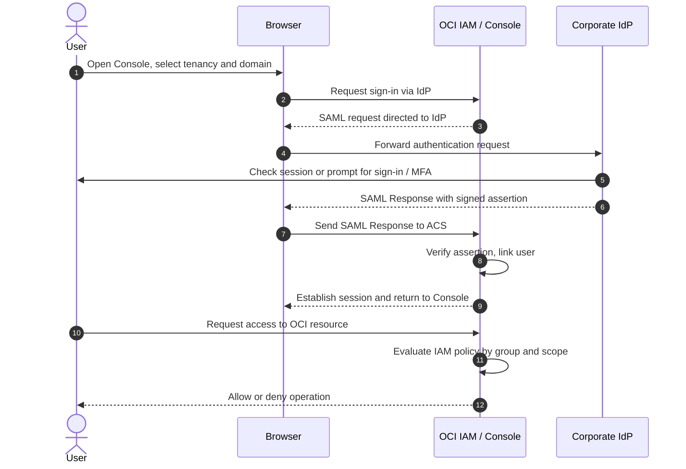

# Federation, SSO, and Identity Provider Integration

In Oracle Cloud Infrastructure (OCI), an organization can let employees sign in with corporate identities instead of managing a separate set of cloud passwords. Federation establishes a trust relationship between an identity system and OCI; single sign-on (SSO) lets users move across services with a unified sign-in experience.

In the **IAM Identity and Access Management** chapter, this topic connects corporate identities to OCI infrastructure access permissions. An engineer may use a corporate account to enter the Console, yet permissions to view VCNs, operate Compute, access storage, or administer database resources still must be granted with the right scope. Console sign-in also does not automatically create SQL accounts or grant privileges inside Oracle Database.

After this lesson, you will be able to:

- Distinguish federation, SSO, provisioning, and OCI resource authorization.
- Describe the SAML flow between an identity provider and OCI IAM.
- Select user linking, group, and policy approaches suited to Identity Domains.
- Plan an IdP integration configuration, test permissions, and prepare sign-in recovery options.
- Troubleshoot common issues involving certificate rotation, group changes, or account revocation.

## 1. Four Problems to Solve Separately

Suppose An Binh Company uses Microsoft Entra ID to manage employees. Mai belongs to the cloud operations team and needs to read Compute details in a learning environment.

| Problem | Question | Example in Mai's Scenario |
| --- | --- | --- |
| Authentication | Who is signing in? | Entra ID verifies Mai's account and enforces MFA per company policy |
| Federation | Which system's authentication outcome does OCI trust? | OCI accepts valid evidence from the configured IdP |
| Provisioning | How are profiles and group relationships created, updated, and deactivated? | Mai is pre-created in the identity domain or provisioned via a chosen mechanism |
| Authorization | Which operations can Mai perform on which resources? | An IAM policy lets Mai's group read Compute in the test compartment |

**SSO is a sign-in experience**, not the name of the entire account governance mechanism. If Mai already holds an IdP session, the IdP can authenticate without re-prompting for a password; MFA prompts, re-authentication, or device checks can still appear per policy.

Federation is also not password synchronization. In the federated sign-in flow described here, users enter their passwords at the IdP; OCI receives authentication proof and does not need to receive corporate passwords.

For example, Mai signs in to the Console successfully yet sees no instances. That alone does not prove SSO is broken: check groups in the right domain, IAM policies, compartment, region, and resource existence before altering authentication settings.

## 2. Identifying the Tenancy's IAM Model

OCI documentation covers both **IAM with Identity Domains** and the legacy federation model. Confirm which model applies before following a procedure.

### IAM with Identity Domains

An identity domain holds users, groups, and associated authentication configurations. In this lesson's practical model, the external IdP connects to the domain; authenticated identities are linked to domain users, and infrastructure permissions are governed through groups and OCI IAM policies.

For SAML SSO without provisioning enabled, the corresponding user must already exist in the domain. JIT is an option to create users at sign-in when explicitly configured. User creation and update capabilities are documented in [Oracle: Managing Identity Providers](https://docs.oracle.com/en-us/iaas/Content/Identity/identityproviders/manage-identity-providers.htm).

### Legacy Federation Model

Some older tenancies or documents use the tenancy-level Federation section and map **IdP group → OCI IAM group** directly. The target OCI group receives permissions from IAM policies. Group names used in mapping must match what the IdP emits, including case sensitivity as required by the configuration.

Oracle describes this model in [Federating with SAML 2.0 Identity Providers](https://docs.oracle.com/en-us/iaas/Content/Identity/Tasks/federatingSAML.htm). Do not take group mapping screens from that workflow and assume every Identity Domain configures things identically.

| Point to Confirm | Identity Domains | Legacy Federation Model |
| --- | --- | --- |
| Active configuration location | Specific domain, IdP, and domain policies | Tenancy-level federation configuration |
| Identity management target | Users and groups inside the domain | Federation relationship and corresponding IAM groups |
| Infrastructure authorization | Groups in the exact domain referenced in IAM policies | Mapped IAM groups receiving permissions from policies |
| Common mistake | IdP exists but matching user is missing or IdP not assigned in rule | Trust exists but group mapping or policy is missing |

The remainder of this lesson uses **IAM with Identity Domains** as the primary model. Menu labels may vary across Console versions; verify which domain you are editing rather than relying solely on menu names.

## 3. Components of a SAML Connection

SAML 2.0 is widely used for enterprise federation. In a connection from an external IdP into OCI IAM:

- **Identity Provider (IdP)** authenticates the user, such as Entra ID, Okta, or AD FS.
- **Service Provider (SP)** receives the authentication result. In this connection, the OCI IAM identity domain acts as the SP.
- **SAML assertion** carries statements the IdP asserts about the user and the authentication event.
- **Metadata** describes entity identifiers, endpoints, and public key details needed for both sides to establish trust.

An identity domain can also act as an IdP for another application. Thus, the precise question is "which role does this system play in the connection being configured?" Setting up a SAML IdP in a domain is documented by Oracle in [Managing a SAML Identity Provider](https://docs.oracle.com/en-us/iaas/Content/Identity/identityproviders/add-saml-identity-provider.htm).

### SP-Initiated Sign-In Flow from OCI



This diagram shows the conceptual flow; the browser relays messages via supported bindings. It does not imply every message uses the same HTTP request type.

### Details That Must Match

| Component | Role | Misconfiguration Can Cause |
| --- | --- | --- |
| IdP entity ID / issuer | Identifies the issuing party | OCI fails to recognize the right partner |
| SP entity ID / audience | Identifies the intended recipient | Assertion appears issued for a different app |
| Assertion Consumer Service (ACS) | SP endpoint receiving SAML responses | Response sent to the wrong destination |
| IdP signing certificate | Verifies signature | Invalid signature or rotated certificate mismatch |
| NameID or correlation attribute | Locates the matching user | User not found or matches multiple users |
| Validity window | Time bounds on usage | Assertion treated as expired or not yet valid |

Signing and encryption address two different goals: signing protects integrity and origin; encryption protects confidentiality of encrypted payloads. Do not assume an assertion is encrypted merely because it is signed. Partner, endpoint, and user-correlation fields are also key items to check when troubleshooting [SAML login errors](https://docs.oracle.com/en-us/iaas/Content/Identity/troubleshooting/saml_login_errors/saml-login-errors.htm).

## 4. OIDC, OAuth, and the Scope of SSO

Not every identity integration uses SAML. When building web applications on OCI, you can use OpenID Connect (OIDC) with an identity domain so applications receive user authentication details.

| Mechanism | Primary Purpose | Design Perspective |
| --- | --- | --- |
| SAML 2.0 | Transmit authentication assertions between IdP and SP | Suits many enterprise SSO integrations |
| OIDC | Adds an identity layer atop OAuth 2.0 | Application receives and validates ID tokens |
| OAuth 2.0 | Delegated authorization for resource access | Access tokens target appropriate resources and audiences |
| SCIM | Account and group lifecycle management | Creates, updates, and deactivates via provisioning integration |

Per [OCI IAM OIDC documentation](https://docs.oracle.com/en-us/iaas/Content/Identity/api-getstarted/usingopenidconnect.htm), OIDC supplies identity information and authentication event context; OAuth by itself does not provide all of those sign-in semantics.

Inside an application, simply decoding a JWT payload is insufficient to trust a token. The login handler must use a proper library to verify signature, issuer, audience, expiration, and flow constraints. An ID token is also not automatically an access token for the application's APIs.

This yields two boundaries to keep in mind when designing OCI systems:

1. Having SSO into the Console does not mean custom applications deployed on Compute are already SSO-integrated. Each application requires its own role, endpoint, and authentication setup.
2. A token issued by an identity domain does not automatically substitute for credentials across every OCI infrastructure API. Choose the mechanism supported by the target service.

The lab below uses **SAML into OCI IAM**, without switching to application OIDC setup.

## 5. Designing User Linking and Groups

### 5.1. Choosing the Identity Correlation Key

Suppose the IdP emits NameID `mai.nguyen@example.com`. If correlation searches by primary email, the domain user must hold the matching, unique email required by that model.

Email is convenient for a lab, yet requires careful governance in an enterprise. Users can change names, change email addresses, or hold multiple aliases. If a departed employee's email is recycled, uncontrolled account matching can link a new hire to an old profile.

When selecting a correlation key, document:

- Which source attribute is emitted and which target attribute is queried.
- Who is allowed to change values on each side.
- How missing matches, multiple matches, or identifier changes are handled.
- Whether a more stable identifier is supported by both sides and the correlation config.

Never auto-link a privileged account solely because an email attribute matches. Ensure the IdP governs and verifies that attribute per organizational policy.

### 5.2. IdP Groups and OCI Groups Are Not Automatically Identical

The company may have a source group `AB-Cloud-Lab-Readers`, while the OCI domain has a target group `SSO_Lab_Readers`. Two different names can still serve the same role if provisioning or mapping is configured accordingly.

The desired design chain is:

```text
Organization-managed business group
    -> Chosen provisioning / mapping workflow
    -> Group in OCI identity domain
    -> OCI IAM policy
    -> Set of operations within specific resource scope
```

Assigning a user to an application in the IdP only determines whether they may use that login connection under IdP rules. Infrastructure permissions must still be established by target groups and IAM policies.

An enterprise group design might split permissions by duty:

| Illustrative Target Group | Need | Boundary to Define |
| --- | --- | --- |
| `SSO_Lab_Readers` | View Compute in the learning environment | Lab compartment |
| `Network_Operators` | Operate networking | Assigned networking resources and compartment |
| `Database_Operators` | Operate database service resources | Specific service, operations, and environment |
| `Identity_Integrators` | Manage identity integrations | Domain and required administrative tasks |

These group names are design examples, not Oracle defaults. Every group needs appropriate real policies; a name like `Database_Operators` grants neither OCI permissions nor SQL privileges by itself.

## 6. JIT and Lifecycle Provisioning

### Pre-Creating Users

This is the easiest approach to observe on a first test: pre-create a test user in the domain, configure clear correlation, and test SSO. When sign-in fails, you can isolate trust issues from account-creation issues.

This approach does not scale manually to thousands of employees, but it is valuable for validating configuration before enabling automation.

### Just-in-Time Provisioning

With SAML JIT, a user can be created during SSO if they do not yet exist and user creation is enabled. Depending on configuration, JIT can also update attributes and group relationships. Define exact add, retain, or remove behaviors for groups before using it with privileged groups. Oracle documents these options in [Adding a SAML Just-in-Time Identity Provider](https://docs.oracle.com/en-us/iaas/Content/Identity/identityproviders/add-saml-idp-jit-prov.htm).

For example, the company adds Mai to a source group on Monday morning. If group updates rely on JIT, update timing is tied to a qualifying sign-in; do not assume the change appears in OCI the instant an administrator edits the source group.

JIT also does not prove that a departed employee has been deactivated across all systems. Someone who no longer signs in will not generate a new sign-in event to trigger update logic.

### Provisioning and Deprovisioning via Lifecycle Integration

When pre-provisioning, change synchronization, and systematic offboarding are required, design a user lifecycle integration, such as via SCIM when connectors and systems support it. OCI identity domains provide APIs for managing users, groups, and applications; API integration capabilities are introduced in [OCI Identity Domains with Postman](https://docs.oracle.com/en-us/iaas/Content/Identity/tutorials/rest/rest_postman.htm).

| Management Method | When Can Data Be Processed? | What Must Be Proven in Operations |
| --- | --- | --- |
| Manual creation | When an administrator acts | No missed additions, updates, or removals |
| JIT | During a matching sign-in flow | Create/update behavior and revocation limits |
| Lifecycle connector | Per integration events or schedule | Latency, sync scope, and deactivation outcomes |

If combining multiple mechanisms, designate an authoritative source for each attribute and group. For instance, avoid letting one process remove a group after termination while another process re-adds that group from stale data.

## 7. Hands-On Lab: SAML SSO with Compute Read Access

This is a guide for learners to execute in an authorized environment. This article does not execute changes against a live tenancy.

### 7.1. Scope and Expected Outcomes

Use an existing identity domain and a prepared lab compartment. Names below are examples only; substitute your environment's real names.

| Component | Illustrative Value |
| --- | --- |
| Tenancy | `anbinh-lab` |
| Identity domain | `Default` |
| Compartment | `FederationLab` |
| External IdP | Enterprise IdP supporting SAML 2.0 |
| IdP connection name in domain | `Corporate-SAML` |
| Target OCI group | `SSO_Lab_Readers` |
| User with read access | `mai.nguyen@example.com` |
| SSO user not in read group | `nam.tran@example.com` |

Mai should sign in and read Compute details in the lab. Nam should sign in successfully yet have no Compute read access from that group. Neither should hold broader permissions via other groups during the test, or negative test results lose meaning.

You do not need to create new Compute instances, VCNs, buckets, or databases to prove federation. If the lab lacks instances, an empty list is insufficient to prove read permission; use a prepared test resource or another authorized form of evidence. `read instances` also does not grant SSH access to an instance's OS.

### 7.2. Prepare Administrative Privileges and a Recovery Path

The person configuring the connection needs permission to manage domain IdPs. Creating groups, assigning members, and creating IAM policies require corresponding permissions; domain administration and OCI resource administration should not be assumed identical.

Before changing sign-in flows:

1. Confirm a backup administrative account exists that signs in independently of the IdP being integrated, is properly protected, and has been tested.
2. Keep an active administrative session open to recover if the test configuration is wrong.
3. Verify the exact domain and fallback sign-in URL.
4. Start with narrow-privilege test users and a clear test scope.

This is a recovery design for changes that can impact administrative reachability. Backup accounts must be monitored and tested periodically, never used as daily driver accounts.

### 7.3. Establish Trust Between Domain and IdP

Download SP metadata from the **exact domain**, then use its values to configure the SAML application at the IdP. Never guess ACS URLs or copy entity IDs from another tenancy.

Then take the corresponding IdP application metadata to configure the `Corporate-SAML` connection in the domain. Note the direction:

```text
SP metadata of OCI domain -> IdP-side configuration
IdP metadata of enterprise connection -> OCI domain-side configuration
```

For Entra ID, Oracle provides an [SSO tutorial between OCI and Microsoft Entra ID](https://docs.oracle.com/en-us/iaas/Content/Identity/tutorials/azure_ad/sso_azure/azure_sso.htm). Follow your chosen provider's process to import metadata and assign test users to the application. Never arbitrarily reuse a SAML application serving another environment.

### 7.4. Configure Identity Correlation

For the initial test, pre-create Mai and Nam in the domain. This example uses an email-format NameID and matches users by primary email. Verify actual values on both sides, especially when corporate email and login username differ.

For each test account, record three details:

| Account | Expected NameID from IdP | Expected OCI Domain User |
| --- | --- | --- |
| Mai | `mai.nguyen@example.com` | Mai's profile in `Default` |
| Nam | `nam.tran@example.com` | Nam's profile in `Default` |

If no profile or multiple profiles match, fix data or correlation rules before proceeding. Leaving JIT off during the baseline test lets you isolate sign-in errors from provisioning errors.

### 7.5. Enable the IdP in the Right Policy Rule

Creating the connection alone does not ensure users see or get routed to it at sign-in. Activate the connection and assign the IdP to the appropriate IdP policy rule.

For the lab, keep IdP selection explicit for easy observation. If the environment uses routing conditions, inspect rule order and conditions before modifying. Oracle documents this assignment in [Assigning Identity Providers to the Policy](https://docs.oracle.com/en-us/iaas/Content/Identity/identityproviders/assign-identity-providers-policy.htm).

### 7.6. Grant Permissions to the Target Group

Create the `SSO_Lab_Readers` group in the lab's domain and add only Mai to it. Nam remains assigned to the SAML application at the IdP without belonging to the read group.

With the chosen illustrative names, the IAM policy to read Compute details is:

```text
Allow group 'Default'/'SSO_Lab_Readers' to read instances in compartment FederationLab
```

Group reference syntax using domain and group is explained in [Best Practices for IAM on OCI](https://docs.oracle.com/en-us/iaas/Content/Resources/Assets/whitepapers/best-practices-for-iam-on-oci.pdf). `read instances` is used by Oracle in [policies to read instance info](https://docs.oracle.com/en-us/iaas/stack-monitoring/doc/service-requirements.html).

The policy must be created in a location with scope covering the target compartment. Substitute `Default`, `SSO_Lab_Readers`, and `FederationLab` if your environment uses different names.

This permission does not grant the ability to create, stop, or delete instances. Nor does it grant permission to read all networking resources, volumes, objects, or database contents. If the Console needs extra permissions for a secondary panel, identify the exact need before adding them.

In this example, group membership is added deliberately in the domain first to validate SSO and policies. Switch to automated sync or mapping only after choosing a group management mechanism; emitting a group claim from the IdP does not complete that configuration by itself.

### 7.7. Sign In Using an Isolated Test Session

Use a separate browser window to avoid colliding with your admin session:

1. Open the OCI Console and select the lab's tenancy and domain.
2. Select `Corporate-SAML`, then authenticate at the IdP.
3. Verify the identity displayed in the OCI session.
4. Select the right region and compartment before opening Compute.
5. Sign out and repeat with Nam's account.

If the IdP option is missing, check policy rules and connection status. If you return to OCI without read access, inspect groups and policies instead of re-importing metadata.

### 7.8. Permission Test Matrix

| Scenario | Expected Outcome | Significance |
| --- | --- | --- |
| Mai has IdP app assignment, OCI profile, and read group | SSO succeeds; reads prepared lab instance | Both auth flow and read permissions work |
| Nam has IdP app and OCI profile, no grants via other groups | SSO succeeds; reading lab instance is denied | Authentication and authorization are properly separated |
| Account outside IdP app assignment | Blocked per IdP assignment settings | Verifies source-side control layer |
| User without OCI profile, JIT off | User linking fails to complete | Verifies account pre-existence requirement |
| Mai requests reading a resource outside policy scope | Denied unless granted elsewhere | Verifies compartment boundary |
| Mai is removed from read group and re-tested after propagation | No longer holds read access from this policy | Verifies permission revocation |

To verify create or delete boundaries, favor permission inspection and non-mutating test methods. Never create billable resources solely to check whether an action is denied.

Record the test account, timestamps, domain, region, compartment, and outcome. Never place passwords, session cookies, or full active SAML responses into shared reports.

## 8. MFA, Sessions, and Permission Revocation

### Enforce MFA Where Authentication Responsibility Lives

If the IdP authenticates employees, MFA policies at the IdP are a critical control layer. Also inspect domain and application requirements to know when step-up authentication triggers.

Never conclude "MFA is enforced" solely from seeing an IdP icon on the login page. Test fresh IdP sessions, existing sessions, privileged accounts, and fallback login paths. Evidence must show which policy actually applies to each flow.

### Sessions and Credentials Have Separate Lifecycles

In a federated system, an IdP session, an OCI session, and credentials for other tools or apps can coexist simultaneously. Signing out on one side is not enough to assume all sessions ended; single logout capabilities must be configured and tested per integration.

When Mai leaves the company, offboarding should inspect every access path Mai held:

- Block new sign-ins at the IdP and remove assignments as needed.
- Sync user deactivation or remove target groups via the lifecycle workflow.
- Address active sessions using supported administrative mechanisms.
- Audit API signing keys, auth tokens, or dedicated credentials that were issued.
- Audit application accounts, database privileges, or OS accounts outside Console sign-in scope.

Revocation latency must be measured through real testing. Avoid promising "instantaneous" revocation across every session and mechanism simply because the source account was locked.

## 9. Operating Trust and Availability

Federation centralizes sign-in while creating dependencies on the IdP, DNS, network paths, and trust settings. During an IdP outage, users may be unable to establish new sessions even while OCI resources continue running normally.

An operational runbook should cover:

| Item | What to Manage | Useful Evidence |
| --- | --- | --- |
| SAML signing certificate | Owner, expiration date, rotation plan | Pre- and post-change test logins |
| Metadata and endpoints | Controlled changes across environments | Config values and change history |
| IdP policy | Rules, conditions, and scope | Login outcomes for each test group |
| OCI groups and policies | Grant sources, approvers, and scopes | Effective permissions of sample accounts |
| Provisioning | Schedule, sync errors, and failed record handling | Outcomes for joiner, mover, leaver |
| Fallback sign-in | Access rights, protection, and periodic tests | Most recent recovery test |

When rotating certificates, coordinate the change sequence between the IdP and OCI. If the active mechanism supports overlapping keys, use it per both sides' documentation; do not assume every product behaves identically. Verify sign-in in a fresh session before closing the change.

In infrastructure environments, testing identity recovery is part of operational availability: on-call staff need access to management tools when responding to Compute, networking, or database service incidents.

## 10. Monitoring and Troubleshooting

Monitor both IdP/domain authentication events and relevant OCI administrative and resource access events. Each source captures part of the flow; correlate timestamps, identities, and request IDs where available.

| Symptom | Check First | Remediation |
| --- | --- | --- |
| IdP option not visible | Right domain, IdP status, active rule | Fix scope or assign connection to rule |
| IdP reports user not assigned to app | IdP-side assignment | Assign right account or group per workflow |
| Federation partner not recognized | Issuer and metadata of the connection pair | Match exact application, tenancy, and domain |
| Signature error after IdP change | Trusted signing certificate | Update trust per key rotation plan |
| User not found or multiple users found | NameID, correlation attribute, target data | Fix data and linking rule |
| Assertion treated as expired | Validity window, clock sync, latency | Fix root cause and test a fresh flow |
| SSO succeeds but action is denied | Actual groups, policies, resource scope | Fix authorization at the right layer |
| Permissions unchanged after source group edit | Provisioning mechanism, sync schedule, new login | Verify when target data updates |
| Redirect loop | Routing rules, callback URL, session state | Trace each hop in a clean test session |

For example, after the company updates Mai's email, the IdP emits the new email while the domain still holds the old email. If correlation uses email, sign-in may fail to locate the profile. Immediately creating another user can sever ties to old groups and permissions; define an identifier-change procedure before creating new records.

Never fix trust errors by relaxing assertion validation. Never fix read-permission errors by granting tenancy-wide admin rights. Fix the broken component and re-run the corresponding scenario.

## 11. Cost and Automation Scope

Solution cost can involve identity domain tier, enabled features, connectors, and IdP licensing. Check your actual environment's terms before choosing a configuration; this lesson does not assume every feature is free.

The lab needs only test identities, groups, policies, and an SSO connection. Creating extra VMs or databases introduces infrastructure costs to an exercise meant solely to prove sign-in and authorization.

For operational automation, separate human identities from workload identities. A Compute process or deployment job should not depend on an employee's browser session. Choose a workload mechanism supported by OCI and the target service, grant task-scoped permissions, and manage its lifecycle separately.

If automating trust or provisioning via API, still govern execution permissions, integration secrets, and configuration changes. Automation makes workflows repeatable; it does not replace decisions about which group can access which compartment.

## 12. Knowledge Self-Check

1. **Mai signs in successfully yet cannot read Compute. Do we need to rebuild trust?**  
   No evidence suggests that. Check target groups, domain referenced in policies, compartment, and other permission grants first.

2. **Is sending a group attribute in SAML enough to grant infrastructure access?**  
   No. You need a group handling mechanism matching the IAM model, target OCI groups, and granting policies.

3. **Can JIT completely replace the offboarding workflow?**  
   Never assume that. Updates tied to sign-in flows do not ensure revocation of all profiles, sessions, and other credentials.

4. **Does having SSO into the OCI Console let a user log in to Oracle Database?**  
   Cannot conclude that. In-database authentication and authorization require separate configuration per service and connection method.

5. **Why test Nam, who can sign in yet lacks the read group?**  
   To prove success at the authentication layer does not grant resource permissions, while checking whether policies were inadvertently broadened.

6. **Why must backup admin accounts be tested before changing sign-in rules?**  
   To maintain a verified recovery path if the IdP or new rule prevents administrators from establishing sessions.

After completing the practice, you should be able to explain the trust chain from IdP to domain user, from group to policy, and from policy to specific operations. Reliable results include allowed cases, denied cases, permission revocation, and a recovery plan when the sign-in flow fails.
