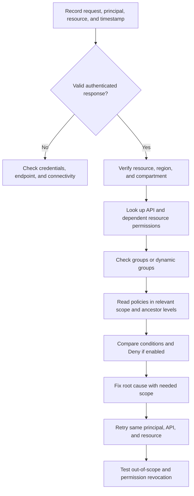

# Evaluating Effective Permissions and Troubleshooting IAM Policies

A user who signs in to Oracle Cloud Infrastructure (OCI) successfully may still fail to read Compute, select a subnet, or create database resources. Conversely, someone who appears to have only read access might still perform broader operations because they belong to another group or inherit permissions from a parent compartment policy.

**Effective permissions must be tested for a specific request**: which principal calls which API, on which resource, in which compartment, and in which context. A group name, policy name, or ability to open the Console provides only partial evidence.

This lesson belongs to the **IAM Identity and Access Management** chapter, focusing on how to trace permissions across OCI infrastructure. This methodology applies when operating VCNs, Compute, storage, and Oracle database services; it helps fix permission errors with an appropriate scope, limit outages, and avoid over-provisioning privileges that cause unexpected changes or costs.

After this lesson, you will be able to:

- Distinguish authentication errors, missing permissions, wrong target resources, and non-IAM errors.
- Build an evidence chain from principal to group, policy, permission, and API.
- Check policy inheritance, conditions, and deny policies when enabled.
- Use read requests to reproduce errors, cross-reference Audit, and verify changes.
- Confirm granted permissions, bounded scope, and permission revocation.

## 1. Define the Exact Question to Answer

The question "Does Mai have Compute access?" is too broad. Turn it into a verifiable request:

> Mai, in the Default identity domain, using CLI profile IAM_LAB, calls GetInstance for a test instance in compartment IamLab in a designated region. This request must be allowed to read instance details, without granting the ability to create or delete resources.

An investigation record should contain the following information:

| Component | Example to Record | Why It Matters |
| --- | --- | --- |
| Principal | User Mai, instance principal, or resource principal | Selects the exact grant source |
| Identity domain | `Default` | Distinguishes groups and users across domains |
| Authentication mechanism | API key, security token, instance principal | Console and CLI may use different identities |
| API operation | `GetInstance` | Looks up required permissions |
| Resource | Actual lab instance OCID | Avoids mistaking resources or duplicate display names |
| Compartment | OCID of the compartment holding the instance | Identifies policy scope |
| Region | Region actually hosting the instance | Calling the wrong endpoint can resemble missing permissions |
| Timestamp and request ID | UTC timestamp, `opc-request-id` | Correlates across evidence sources |

All names and OCIDs in this lesson are illustrative. Never infer the principal solely from a profile name; check the authentication configuration and actual identity used by that profile.

## 2. Permission Evaluation Model for a Request

A typical grant statement looks like:

```text
Allow group 'Default'/'IAM_Lab_Readers' to read instances in compartment IamLab
```

You can break the statement down into five questions:

1. **Who?** Does the principal receive permissions via group `IAM_Lab_Readers` in domain `Default`?
2. **Do what?** Which permissions does verb `read` include for `instances`?
3. **Where?** Does the resource fall within `IamLab` and its applicable inheritance scope?
4. **Under what conditions?** If `where` is present, do the conditions match the request?
5. **Do any blocking constraints apply?** Such as deny policies in a tenancy where that feature is enabled.

For **Allow** statements, permissions accumulate across matching sources. One narrow Allow does not narrow another broad Allow. If Mai belongs both to a lab reader group and a group managing Compute across the whole tenancy, the lab read statement does not make Mai read-only.

You can use the following conceptual model for reasoning, rather than treating it as an API simulator:

```text
For each permission required by the API:
    find Allow sources matching the principal, resource, and context;
    check applicable Deny if enabled in the tenancy, accounting for feature exceptions.

Then check operational conditions and service-specific controls.
```

A request involving multiple dependent resources may require multiple permissions across different compartments. Having sufficient permissions on the primary resource does not guarantee the operation will complete.

### Deny Policies Must Be Checked According to Tenancy State

OCI provides deny policies as an opt-in feature. When enabled, matching Deny statements can block permissions already granted by Allow statements. Therefore, do not mechanically apply the old conclusion that OCI only ever has Allow statements. Oracle announced this feature in [Deny Policies in IAM: Explicit Access Control](https://docs.oracle.com/en-us/iaas/releasenotes/identity/deny-policies.htm).

During investigation, check feature status and any relevant Deny policies. Enabling it is a long-term change per Oracle documentation; this lab does not require enabling the feature. Deny has its own verb expansion behavior, so look up exact permissions rather than guessing from verb names. See [Deny Policies](https://docs.oracle.com/en-us/iaas/Content/Identity/policysyntax/denypolicies.htm).

The default administrator group in the default domain has exceptions regarding Deny; Deny also does not override Identity Domain administration roles. Testing with that admin account instead of a regular account can yield false conclusions about whether Deny blocked access. Current limitations are documented by Oracle in [Deny Policies Known Issues](https://docs.oracle.com/en-us/iaas/Content/Identity/known-issues/known-issues-deny-policies.htm).

## 3. Tracing the Exact Principal and Membership Sources

### 3.1. Users in an Identity Domain

For human users, verify the domain, profile, and every group relevant to the request. Two domains can have groups with identical names, yet they are not the same authorization object.

Example:

```text
Default / IAM_Lab_Readers
Engineering / IAM_Lab_Readers
```

If the policy references the first group while Mai belongs only to the second, matching group names will not make the policy match.

With federated sign-in, verify the user and groups OCI actually receives or manages under your federation/provisioning model. A user belonging to a group at the IdP does not prove the target OCI group has been updated.

### 3.2. Instance Principals or Resource Principals

A program running on Compute may call APIs using an instance principal. In that case, the user group memberships of whoever SSH'd into the machine are not the permission source for those requests. Inspect dynamic groups and policies targeting the workload's principal.

Helpful questions include:

- Which authentication mechanism is the SDK/CLI actually using?
- Does the API-calling resource match an active dynamic group rule?
- Which OCID, compartment, or tag does the rule use? Do actual values match?
- Does the policy reference the exact dynamic group, domain, and target resource scope?

Never assume a compartment-based resource rule automatically includes all child compartments. Check the semantics of the rule in use rather than applying policy inheritance rules to dynamic group membership evaluation.

### 3.3. Service Principals

Some tasks also require an OCI service to access resources on behalf of a workflow. Separate two questions: does the person initiating the task have sufficient permissions, and does the service executing the next step have sufficient permissions?

For example, a user may submit a resource creation request successfully while the asynchronous task later fails when the service needs to read a secret. Adding the user to a broader group is unlikely to fix the failing principal.

## 4. Checking Scope, Inheritance, and Policy Placement

Suppose the compartment structure is as follows:

```text
Tenancy
├── Learning
│   ├── IamLab
│   └── NetworkLab
└── Production
```

Permissions applying to `Learning` can be inherited down into `IamLab` and `NetworkLab`. Permissions applying only to `IamLab` do not automatically extend to `Production` or sibling compartments. This mechanism is described in [Policy Inheritance](https://docs.oracle.com/en-us/iaas/Content/Identity/policieshow/Policy_Inheritance.htm).

### Do Not Read Only Policies in the Target Compartment

To find grant sources for an instance in `IamLab`, examine relevant policies at the tenancy, parent compartments, and `IamLab`, then compare each statement's scope. Looking only at a recently edited policy easily misses a broad parent Allow or an active Deny.

A simple trace table might look like:

| Policy Placement | Relevant Statement | Effect to Check |
| --- | --- | --- |
| Tenancy | Lets ops team read instances in `Learning` | Can cover instances in `IamLab` |
| `Learning` | Grants extra rights to another group of Mai's | Can make effective rights broader than expected |
| `IamLab` | Grants read access directly to lab group | One grant source, not necessarily all rights |
| `Production` | Rights relating only to production environment | Does not automatically apply to lab instances |

This example assumes the hierarchy and statements match what is described. Whenever compartments move or resources move across compartments, re-verify the actual scope tree.

### Distinguish Policy Placement from Statement Scope

A policy is a resource attached to a compartment or tenancy. Attachment location determines policy management rights; the scope inside each statement determines where resource permissions are granted, within structural limits. Oracle explains policy attachment in [Working with Policies](https://docs.oracle.com/en-us/iaas/Content/Identity/policymgmt/managingpolicies_topic-Working_with_Policies.htm).

Therefore, "policy lives at root" does not mean "statement grants tenancy-wide access." A policy at root may grant read access only within `IamLab`. Conversely, a policy named `LabReadOnly` must still have its statements read to know what it actually grants.

When using nested compartment paths or duplicate names across branches, verify resolution from the policy attachment point. During investigations, always record exact OCIDs rather than relying on display names.

## 5. Look Up from API to Permission Instead of Guessing from Verb Names

The four familiar verbs are `inspect`, `read`, `use`, and `manage`. For Allow statements, levels are cumulative, yet specific permission sets depend on each resource-type. You cannot infer that every API named `List...` needs only `inspect`.

An important Compute example:

| API | Related Permission | Key Point |
| --- | --- | --- |
| Standard `ListInstances` | `INSTANCE_READ` | Requires read permission, do not guess from "List" |
| `GetInstance` | `INSTANCE_READ` | Reads details of a single instance |
| `UpdateInstance` | `INSTANCE_UPDATE` | Distinct from read permission |
| `InstanceAction` | `INSTANCE_POWER_ACTIONS` | Power state control is not read permission |

When listing instances in a compute cluster, compute cluster requirements also apply. Look up specific cases in [Permissions Required for Each API Operation](https://docs.oracle.com/en-us/iaas/Content/Identity/policyreference/corepolicyreference_topic-Permissions_Required_for_Each_API_Operation.htm).

Verb and permission sets for Compute, Networking, and Block Volume are listed in [Details for the Core Services](https://docs.oracle.com/en-us/iaas/Content/Identity/Reference/corepolicyreference.htm). When errors occur, start from the actual API and locate the required permission, resource-type, and scope.

### One Console Action Can Invoke Multiple APIs

An instance details screen may need instance, networking, and volume information. If `GetInstance` succeeds while part of the screen errors, do not hastily broaden permissions for the entire screen. Identify which auxiliary request was denied.

Similarly, creating an instance can reference an image in one place and a subnet in another. Creating a database resource can involve networking, encryption keys, or dependent resources. Tabulate according to actual needs:

| Referenced Resource | Actual Compartment | Principal Needing Permission | Permissions Cross-Checked? |
| --- | --- | --- | --- |
| Primary resource | Application compartment | User or workload calling API | Check primary API |
| Subnet/NSG | Networking compartment | Corresponding principal | Check Networking branch |
| Image/volume | Compartment holding that resource | Corresponding principal | Check API and options used |
| Key/secret | Security compartment | User or service per design | Check service-specific requirements |

This is an investigative table, not a mandate to grant every permission group for every operation.

## 6. Inspecting `where` Conditions

A statement with the right subject, verb, and compartment can still fail to authorize a request because a condition does not match.

Example:

```text
Allow group 'Default'/'IAM_Lab_Readers' to read instances in compartment IamLab where request.operation = 'GetInstance'
```

With no other grant sources, this statement can authorize `GetInstance`, yet not authorize `ListInstances` because the operation name differs. A user opening an instance directly may succeed while the list page fails.

| Condition Type | What to Verify |
| --- | --- |
| Operation or permission | Exact name used by the API |
| Principal | Actual principal of the request, not the investigator |
| Target resource | Whether the attribute exists for that request type |
| Tag | Namespace, key, value, and which side carries the tag |
| Network source or other context | Actual conditions when the request executes |
| `all`/`any` combinator | Must match every branch or just one branch |

If a variable does not apply to a request, the condition does not automatically evaluate true. For the Allow statement under review, it may fail to grant access; still check other Allow statements. Oracle covers inapplicable variables in [Conditions](https://docs.oracle.com/en-us/iaas/Content/Identity/policysyntax/conditions.htm).

In particular, a list request typically lacks the same target resource context as a single-object get request. Never assume a condition on resource attributes automatically filters every list API the way you intend.

When editing conditions, state the exact intended behavior. "Mai only reads instance details by OCID" and "Mai can browse the lab instance list" are two distinct requirements.

## 7. Categorize Errors Before Editing Policies

### 7.1. Unauthenticated

`NotAuthenticated` points toward missing or invalid credentials. Check the authentication mechanism, active key or token, system clock, and request signing configuration before editing resource policies.

Signing in to the Console successfully does not prove the CLI uses the right credentials. One workstation can hold multiple profiles, multiple tenancies, and expired tokens.

### 7.2. Not Authorized or Not Found

`NotAuthorizedOrNotFound` is insufficient to conclude a resource was deleted. Per [OCI API Errors](https://docs.oracle.com/en-us/iaas/Content/API/References/apierrors.htm), this error can arise either because the resource does not exist or because the principal lacks permission to access it.

Verify independently:

- Are the OCID and resource type right?
- Are the tenancy, region, and endpoint right?
- Which compartment currently holds the resource?
- Does the principal have the required permissions in that scope?

Have an authorized administrative principal confirm resource existence, then re-test with the failing principal. An admin succeeding only proves the resource is readable with admin privileges.

### 7.3. Related Resource Denied

`RelatedResourceNotAuthorizedOrNotFound` suggests checking resources referenced inside the request payload. A wrong subnet, secret, or image OCID can cause errors even when permissions on the primary resource are right.

Oracle illustrates checking dependent resources in [troubleshooting API Gateway create/update failures](https://docs.oracle.com/en-us/iaas/Content/APIGateway/Tasks/apigatewaytroubleshooting_topic-gateway_create_or_update_fails.htm). Apply the same decomposition to the service under investigation, then consult that service's dedicated policy reference.

### 7.4. Non-IAM Errors

| Symptom | Branch to Check |
| --- | --- |
| Timeout, DNS, or TLS failure | Connectivity to endpoint, proxy, VCN, and network path |
| Invalid request parameters | Payload format and API contract |
| Exceeded quota or service limit | Limits and applicable scope |
| Out of capacity | Available resources at requested location |
| Request violates service control | Specific operational or security constraints |
| SQL connection refused | In-database auth and privileges, plus network reachability |

Never add IAM policies to fix a network connectivity or SQL privilege error simply because the action involves an OCI resource.

## 8. A Repeatable Investigation Workflow



### Step 1: Reproduce with the Minimal Request

If an error appears in the Console, identify the failing API and reproduce it with an appropriate read request. Keep principal, region, and OCID constant. Never swap account, endpoint, and resource simultaneously and compare two outcomes as though only the policy changed.

### Step 2: Confirm Facts from Authoritative Sources

Regular users often lack permission to read all policies or group memberships. If blocked during investigation, ask an authorized administrator to supply evidence. Inability to view a policy does not prove no policy exists.

### Step 3: List All Permission Sources

For each relevant group or dynamic group, locate statements capable of granting required permissions. Record parent policies, conditions, and Deny state. For multi-resource operations, add a row for each dependent resource.

### Step 4: Choose an Explainable Change

A good change answers: which permission is missing or blocked, which principal needs it, and which scope fits business requirements? Proposing `manage all-resources in tenancy` just to read one instance is not a well-justified fix scope.

### Step 5: Retry and Record Outcomes

Keep before/after records, allow IAM propagation time, and retry in a controlled manner. Once the primary request succeeds, verify an out-of-scope request and verify remaining access after revocation.

## 9. Hands-On Practice with Read Commands

The commands below are instructions for learners to run in an authorized environment; this article does not execute CLI commands on a live tenancy. OCI CLI and preconfigured auth profiles are required.

### 9.1. Prepare the Test Context

Use an existing lab instance. There is no need to create billable resources to test read permissions.

```powershell
$ociUserProfile = 'IAM_LAB'
$ociAdminProfile = 'IAM_REVIEW'
$ociAuthMode = 'security_token'
$ociAdminAuthMode = 'security_token'
$targetRegion = '<region-id>'
$homeRegion = '<home-region-id>'
$labCompartmentId = '<lab-compartment-ocid>'
$labInstanceId = '<lab-instance-ocid>'
$tenancyOcid = '<tenancy-ocid>'
```

Replace all values inside `<...>`. Selecting `security_token` is only valid if the profile is configured with a valid session token. If using another mechanism, choose the matching auth mode and config; do not change auth flags while assuming you switched principals.

Profile `IAM_LAB` represents the narrow-privilege test account. Profile `IAM_REVIEW` represents an investigator authorized to inspect policies; never use it as a stand-in for the principal under test.

### 9.2. Separate Detail Retrieval and Listing

Get a single instance by OCID:

```powershell
oci compute instance get --instance-id $labInstanceId --region $targetRegion --profile $ociUserProfile --auth $ociAuthMode
```

List instances directly within the compartment:

```powershell
oci compute instance list --compartment-id $labCompartmentId --region $targetRegion --profile $ociUserProfile --auth $ociAuthMode --all
```

Official references: [instance get](https://docs.oracle.com/en-us/iaas/tools/oci-cli/latest/oci_cli_docs/cmdref/compute/instance/get.html) and [instance list](https://docs.oracle.com/en-us/iaas/tools/oci-cli/latest/oci_cli_docs/cmdref/compute/instance/list.html). `--all` fetches all result pages for the command; it does not traverse all child compartments.

If `get` succeeds while `list` fails, inspect operation conditions and context differences. If `list` returns an empty list, confirm region, compartment, and filters; an empty list does not prove the principal holds all intended permissions.

### 9.3. Read Policies by Attachment Location

Using a principal authorized to investigate:

```powershell
oci iam policy list --compartment-id $tenancyOcid --region $homeRegion --profile $ociAdminProfile --auth $ociAdminAuthMode --all
oci iam policy list --compartment-id $labCompartmentId --region $homeRegion --profile $ociAdminProfile --auth $ociAdminAuthMode --all
```

If intermediate parent compartments exist between tenancy and lab, repeat for each relevant level. [iam policy list](https://docs.oracle.com/en-us/iaas/tools/oci-cli/latest/oci_cli_docs/cmdref/iam/policy/list.html) lists policies in the specified compartment; one call at root does not substitute for reading the entire policy tree.

Read the statements themselves, not just policy names. Searching for a single group name helps narrow scope initially, yet can miss grants via other groups, dynamic groups, or broader subjects.

### 9.4. Cross-Reference Audit

Search for matching events in a narrow time window, in the relevant region and scope. Reading Audit requires corresponding permissions; do not assume the test user can read tenancy-wide events.

Cross-reference operation, principal, timestamp, resource, response, and request ID if present. Account for event delivery latency. A failed event helps pinpoint the request, though it does not necessarily list every evaluated statement.

If using the CLI to query Audit, consult [audit event list](https://docs.oracle.com/en-us/iaas/tools/oci-cli/latest/oci_cli_docs/cmdref/audit/event/list.html) and constrain the query time window. Never grant Audit read access to an entire lab group solely for one-off troubleshooting convenience.

## 10. Two Illustrative Scenarios

### Scenario A: Has `inspect` Yet Cannot List Instances

**Current state:** Mai belongs to `IAM_Lab_Readers`, the resource is in the right region and compartment, and the policy has only:

```text
Allow group 'Default'/'IAM_Lab_Readers' to inspect instances in compartment IamLab
```

**Observation:** `ListInstances` is denied. The configurator assumed `List` always corresponds to `inspect`.

**Analysis:** Checking permissions shows standard instance listing requires `INSTANCE_READ`. If the business requirement is reading instance details and no other grant or Deny interferes, replace the statement with:

```text
Allow group 'Default'/'IAM_Lab_Readers' to read instances in compartment IamLab
```

**Verification:** Re-run `list` and `get` as Mai against the known lab resource. Confirm a real out-of-scope instance remains denied unless granted elsewhere. Evaluate create and delete rights via permission analysis or approved test methods rather than running destructive actions "just to see if it's allowed."

Moving from `inspect` to `read` must be approved against data sensitivity requirements. For Compute, returned data can include user-supplied metadata; read access should not be treated as completely non-sensitive.

### Scenario B: Removed a Policy Yet Still Able to Read

**Current state:** An administrator deleted the lab read statement for `IAM_Lab_Readers`, yet Mai still calls `GetInstance` successfully.

**Investigation:** Confirm the same principal and exact instance. Check change timestamp and region. Investigation then reveals Mai also belongs to `Cloud_Observers`, which holds an Allow to read instances in `Learning` at the parent level.

**Conclusion:** Removing one Allow source does not revoke remaining Allow sources. Determine Mai's business permissions across both groups and edit the exact offending grant source. Never switch endpoints or delete resources to force a failure and count that as successful revocation.

**Verification:** After adjusting the appropriate grant source, re-run the same request. Simultaneously confirm other users still needing access via `Cloud_Observers` did not lose access unexpectedly.

## 11. Propagation Delay, Sessions, and Test Limitations

IAM changes can take time to propagate across regions. Oracle covers policy, user, and group updates along with propagation notes in [Managing Policies](https://docs.oracle.com/en-us/iaas/Content/Identity/Tasks/managingpolicies.htm). Record change time, test region, and retry count; avoid rapidly editing multiple policies before distinguishing propagation delay from misconfiguration.

With federation, provisioning, session tokens, and dynamic groups, also understand each mechanism's update lifecycle. Opening a new session can help during verification, though it should not be used as a catch-all explanation for every authorization error.

If your environment provides an appropriate policy simulation or analysis tool, use its output to support reasoning. Verify which resource scopes, principals, and conditions the tool actually models; live requests remain necessary to confirm the failing access path.

One successful test only proves the request was allowed in that context. It does not prove the entire account complies with least privilege. A test failing due to a wrong OCID also does not prove IAM boundaries are configured properly.

## 12. Investigation Completion Criteria

To conclude an IAM error is resolved, collect parallel evidence:

| Item | Expected Evidence |
| --- | --- |
| Right principal | Domain, profile, or workload principal confirmed |
| Right request | API, resource, region, and compartment recorded clearly |
| Explainable root cause | Missing permission, wrong condition, wrong scope, or Deny identified |
| Appropriate change | Only permissions needed for the task granted or adjusted |
| Permitted case | Business request succeeds using the original principal |
| Out-of-scope case | Control request on a real resource is denied as expected |
| Revocation and impact | Remaining grant sources and affected users checked |
| Cost and operations | No leftover temporary broad rights or unplanned test resources |

A short recording template for lab exercises:

```text
Principal / domain:
Authentication mechanism and profile:
Operation:
Resource OCID / compartment OCID / region:
UTC timestamp / opc-request-id:
Pre-change outcome:
Relevant permissions and policies:
Relevant conditions or Deny statements:
Root cause:
Applied change:
Post-change outcome for same request:
Out-of-scope control outcome:
Revocation or impact check outcome:
```

Never place private keys, tokens, session cookies, or secret contents into investigation records. Store necessary details within the operations team's access boundary.

## 13. Knowledge Self-Check

1. **Why doesn't belonging to a group named Readers prove someone has only read access?**  
   Group names do not dictate permissions. Read applicable policies and all other groups the principal belongs to.

2. **Why can't you conclude a resource was deleted from `NotAuthorizedOrNotFound`?**  
   The same error code appears when a resource does not exist or the caller lacks access. Verify OCID, region, scope, and permissions from authoritative sources.

3. **Why might `inspect instances` be insufficient for listing Compute?**  
   Permissions are defined per API and resource-type. Standard `ListInstances` requires `INSTANCE_READ`.

4. **Does an Allow for `GetInstance` automatically permit `ListInstances`?**  
   No, if the operation condition matches only `GetInstance` and no other grant exists. Evaluate the two requests separately.

5. **Does adding an Allow always fix missing-permission errors?**  
   No. Check principal, scope, conditions, dependent resources, and Deny if enabled in the tenancy.

6. **Does an admin account succeeding in a test prove Mai's account is fixed?**  
   No. Re-test as Mai; admin accounts have different grant sources and potential exceptions.

7. **Why might an Oracle Database connection error not be an OCI policy error?**  
   The access path also depends on networking, database login credentials, and SQL privileges, which are separate from cloud resource management permissions.

When troubleshooting OCI permissions, maintain an unbroken evidence chain from the request to the granting or blocking source. This ensures policy changes have clear justification, verifiable outcomes, and access scopes aligned with operational duties.
