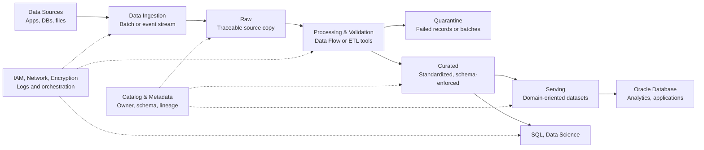

# Designing a Data Lake on Object Storage

## 1. Objectives and Problem Statement

In the **Data and Analytics** chapter of the Oracle Cloud Infrastructure (OCI) module, a data lake is a data storage foundation serving multiple consumption patterns: SQL analytics, distributed processing, data exploration, and machine learning model development. OCI Object Storage provides the object storage layer; to become a usable data lake, the design also requires ingestion flows, data structures, metadata, access control, quality checks, and operational procedures.

This lesson walks through designing a data lake on OCI Object Storage, from tenancy and compartment to buckets, network paths, processing services, data publication mechanisms, and cost-control and recovery strategies. Resource names, volumes, and retention periods in the examples are illustrative assumptions for learning design principles, not mandatory OCI configurations.

After completing this lesson, you will be able to:

- Translate business requirements into data zones, buckets, and object key structures.
- Choose formats, partitions, and file sizes suited to the workload.
- Design pipelines that handle retries, late-arriving data, and schema changes.
- Separate permissions for ingestors, transformers, analysts, and administrators.
- Combine catalogs, logs, lifecycle policies, versioning, and replication for specific goals.
- Practice creating private buckets and ingesting a small batch of data using the OCI CLI.

### 1.1. Running Scenario

An enterprise wants to analyze sales events from its physical stores and e-commerce system:

| Assumed Requirement | Design Implications |
| --- | --- |
| Approximately 100 GiB of source data per day | Must estimate cumulative capacity and copy/replica costs |
| 15-minute batch ingestion | Requires batch identifiers and knowing when a batch is complete |
| Most queries read the last 7–30 days | Time-based partitioning and storage tiers for active data |
| Some events arrive up to 3 days late | Requires a process to reopen affected data intervals |
| Retain source data for 1 year per example policy | Lifecycle rules based on replay capability and retention requirements |
| Source data contains customer information | Separate raw from general-purpose analytics zones |
| Need to reprocess when business logic changes | Retain source data, code versions, schemas, and run history |

The goal of "15-minute batches" differs from "data ready for querying within 15 minutes." Actual freshness also includes transfer time, queuing, validation, and metadata updates. Clear start and end points must be defined when measuring SLAs.

## 2. Role and Limitations of Object Storage

### 2.1. OCI Resource Model

Key concepts to distinguish:

| Concept | Role in the Data Lake |
| --- | --- |
| Tenancy | Organizational and governance boundary for OCI resources |
| Compartment | Resource grouping for IAM, environment separation, and ownership |
| Region | Location where buckets and processing services are deployed |
| Namespace | Tenancy's Object Storage namespace |
| Bucket | Container holding objects, with access configuration and protection features |
| Object key/name | Full name of an object within a bucket |
| Object metadata | Technical or user-defined information attached to an object |

For standard buckets within a namespace, you must choose a name not already in use within the applicable namespace/region scope. The namespace name is not the compartment OCID; do not infer it from the tenancy name—retrieve it via the Console or API/CLI.

For example, an object is identified by region, namespace, bucket, and key:

```text
Region:     ap-singapore-1
Namespace:  <tenancy-namespace>
Bucket:     lake-raw-dev
Object key: sales_events/source=web/ingest_date=2026-11-20/batch_id=web-20261120T010000Z/part-00001.jsonl
```

The `/` character in the key helps organize and browse data by prefix; it does not automatically create a POSIX directory tree with per-directory permissions. A bucket belongs to only one compartment, though data in the bucket can be accessed by multiple workloads according to policies. See [OCI: Overview of Object Storage](https://docs.oracle.com/en-us/iaas/Content/Object/Concepts/objectstorageoverview.htm).

### 2.2. Guarantees You Should Not Assume

Object Storage is suited for durable object storage and large-scale data processing. It does not natively provide a table model, primary keys, business constraints, or multi-file update transactions like a relational database management system.

OCI Object Storage provides strong consistency. However, if a batch consists of 100 objects, being able to read the first object does not prove that the remaining 99 objects have finished uploading. Object-level operation consistency does not automatically create a transaction across an entire batch.

Similarly:

- Replacing an object's content is not equivalent to updating a row in a table.
- A rename or move operation across a prefix should not be assumed to be an atomic transaction for the entire dataset.
- A successful upload does not mean the data is valid against business rules.
- Multiple Parquet files in a bucket do not automatically form a table with ACID guarantees or safe MERGE support.

When a workload requires row-level updates/deletes, multiple writers, or consistent snapshots, consider a compatible table format and catalog, or move the serving layer into a database.

## 3. Reference Architecture

### 3.1. Decoupling Storage, Compute, and Consumption



Object Storage holds durable data, while compute is selected according to the workload:

| Need | Potentially Suitable OCI Option | Additional Design Considerations |
| --- | --- | --- |
| File uploads, exports from applications | SDK/CLI, application pipelines, or integration tools | Retries, checksums, batch identifiers |
| Connection- and data-flow-based ETL | OCI Data Integration | Source connections, mappings, schedules, and permissions |
| Distributed processing with Spark | OCI Data Flow | Runtime, dependencies, resources, and output commit |
| Metadata discovery and governance | OCI Data Catalog | Harvesting, patterns, glossary, and ownership |
| SQL for analytics | Oracle Autonomous Database or compatible engine | Credentials/principals, external tables, or load pipelines |
| Features and machine learning models | OCI Data Science or suitable tools | Data permissions, versioning, and reproducibility |

OCI Data Flow runs Apache Spark applications and integrates with Object Storage; processing compute is a separate layer from data storage. See [OCI: Data Flow Concepts](https://docs.oracle.com/en-us/iaas/Content/data-flow/using/concepts.htm).

You do not need to deploy every service in the table from the start. A small batch workload can begin with Object Storage, a single pipeline, and one query engine. When integrating multiple engines, verify support for formats, data types, partitions, catalogs, and authentication mechanisms for each engine.

### 3.2. Choosing a Region and Data Path

Prefer placing compute and frequently read data in the same region to reduce latency and cross-region traffic. Also consider the location of data sources, data residency requirements, and approved regions.

An Object Storage bucket is not a server residing inside a user's private subnet. Workloads in a VCN can reach the service via a service gateway with appropriate routes and security rules. A service gateway does not replace IAM and does not automatically revoke other access paths permitted by policies.

For workloads in a private subnet, separately design outbound paths to fetch dependencies or call services outside the scope of the service gateway. Do not assume that creating a service gateway makes all Internet connections work. See [OCI: Access to Oracle Services — Service Gateway](https://docs.oracle.com/en-us/iaas/Content/Network/Tasks/servicegateway.htm).

## 4. Organizing Data Zones and Buckets

### 4.1. Zoning by Data Responsibility

| Zone | Contents | Typical Accessors | Primary Mutation Pattern |
| --- | --- | --- | --- |
| Raw | Source data and ingestion metadata, preserved for reconciliation/replay | Ingestors and controlled processing groups | Append new objects/batches |
| Curated | Standardized data with schemas and quality rules | Pipelines and authorized users | Publish versions or table commits |
| Serving | Business-oriented datasets, aggregated or query-optimized | BI, analytics teams, applications | Per serving data contract |
| Quarantine | Non-conforming data, failure reasons, and source references | Data incident response team | Remediate via workflow and reprocess |
| Control | Manifests, run state, checkpoints, and quality reports | Pipelines and operations | Per orchestration protocol |

The names raw/curated/serving are architectural conventions, not OCI bucket types. Quarantine can contain sensitive data just like raw and requires separate permissions and retention periods. Control can also expose dataset names or error details, so do not leave it readable by everyone by default.

Raw prioritizes preserving the original source meaning and content. You may add an envelope or ingestion metadata, but you must clearly distinguish source-supplied fields from pipeline-generated fields. When byte-exact traceability is required, store the original payload or a checksum of the original payload.

### 4.2. When to Separate Buckets vs. Use Prefixes

Separate buckets when there are significant differences in:

- Authorized user groups and ownership boundaries.
- Encryption configuration using customer-managed keys.
- Versioning, retention rules, replication, or lifecycle policies.
- Dev/test/prod environments and data sensitivity levels.
- Blast radius in case of accidental operations.

Use prefixes for datasets sharing the same governance tier, rather than creating a bucket per day or per file. If writing policies scoped by object name/prefix, verify that IAM conditions and every relevant API support the intended behavior; displayed folder names do not automatically act as security boundaries.

One layout for the lab:

```text
Compartment: DataLakeDev
  lake-raw-dev
  lake-curated-dev
  lake-quarantine-dev
  lake-control-dev
```

The serving zone can use a dedicated bucket when distinct access or configuration requirements arise; there is no need to create empty buckets just to fill out every tier.

In production, compartments can be separated by environment and data domain. Avoid dumping every dataset in the tenancy into a single shared bucket with broad administrative policies.

## 5. Designing Object Keys, Schemas, and Formats

### 5.1. Distinguishing Event Time and Ingestion Time

- **Event time**: when the business event occurred at the source.
- **Ingestion time**: when the platform received the data.
- **Processing time**: when the pipeline processed the data.

An event from day 19 may arrive in the lake on day 21. Raw is typically organized by ingestion date for operational management; curated serves queries by event date if that is how users filter data.

Raw example:

```text
sales_events/
  source=web/
    ingest_date=2026-11-20/
      batch_id=web-20261120T010000Z/
        part-00001.jsonl
```

Example of a curated version:

```text
sales_events/
  dataset_version=v1/
    runs/run_id=run-20261120T011500Z/
      event_date=2026-11-19/part-00001.parquet
      event_date=2026-11-20/part-00001.parquet
```

This is a naming schema; lines representing prefixes do not require creating directory objects beforehand. Each run has its own output namespace so writers do not overwrite data currently in use by readers. Selecting which run to read must go through the publication mechanism described later.

Standardize the timezone and the rule for deriving `event_date`. UTC is convenient for operations, whereas business-day reporting in Vietnam may require dates in `Asia/Ho_Chi_Minh`; those two dates do not always match.

Do not put phone numbers, emails, tokens, or secrets in object keys. Keys frequently appear in logs, manifests, and management tools.

### 5.2. Minimum Data Contract

Example of an immutable event record:

```json
{
  "schema_version": 1,
  "source_system": "web",
  "event_id": "evt-1001",
  "event_time": "2026-11-20T01:02:03Z",
  "event_type": "SALE",
  "currency": "VND",
  "amount_minor": 125000
}
```

The contract must clearly specify:

| Field/Rule | Decision in the Example |
| --- | --- |
| Business key | The pair `source_system, event_id` uniquely identifies an event |
| Immutability | Same key must have identical content; conflicts require investigation |
| `event_time` | Timestamp with timezone, parsed per published rule |
| `amount_minor` | Integer in the smallest unit defined for each currency |
| `currency` | Required currency code; never sum across different currencies |
| `event_type` | Accepted set of values, e.g., SALE or REFUND |
| Refund values | Documented sign convention and business linkage |
| Missing/invalid data | Route to quarantine or fail the batch based on thresholds |

Declaring data-type schemas alone is not enough. The pipeline must also check duplicate keys, valid values, relationships between event types and amounts, anomalous timestamps, and rules for handling invalid records.

Using integer `amount_minor` is an illustrative choice to avoid floating-point rounding errors. For data requiring decimal precision, choose an intentional decimal type and scale rather than converting currency to floating point.

### 5.3. Choosing Formats and Compression

| Format | Suitable When | Limitations to Consider |
| --- | --- | --- |
| CSV | Simple exchange with legacy/existing sources | Requires rules for delimiter, quoting, encoding, nulls, and data types |
| JSON Lines | Semi-structured events, one record per line | Size and parsing overhead are usually higher than columnar formats |
| Avro | Schema-backed exchange, row-oriented ecosystems | Must verify read support in the target engines |
| Parquet | Columnar analytical scans and compression | Requires managing schemas, codecs, and file sizes |

A common design keeps source format in raw and Parquet in curated. Parquet is column-oriented; compatible engines can leverage column pruning, statistics, and predicate pushdown. The actual benefit depends on the data, write layout, and engine—not every query speeds up by the same factor automatically. See [Apache Parquet: Overview](https://parquet.apache.org/docs/overview/).

Choose a codec supported by all target engines. For example, Snappy can be a speed-oriented starting point; Zstandard requires verifying compatibility and CPU/storage trade-offs. Do not externally wrap an entire Parquet file with gzip simply out of habit from text files.

### 5.4. Partitioning and the Small Files Problem

Choose partitions based on query patterns and actual data volume. If most queries filter by event date, start with `event_date`; add hour only when daily volume and selectivity truly warrant it.

Avoid partitioning by `event_id`, email, or very high-cardinality keys. Doing so can create millions of tiny partitions, increasing listing, planning, and metadata management overhead.

A curated file size around 128–512 MiB can serve as an initial testing hypothesis, not a mandatory OCI limit or recommendation. Re-measure based on your engine, parallelism, compression, and SLA. Small datasets should not be forced into large files by waiting indefinitely for data.

For 1 GiB of data, roughly one million 1 KiB files create vastly different request counts and overhead compared to a few large files. The design needs compaction: merging small files into appropriately sized files and publishing a new version, without deleting old files while readers are still using them.

## 6. Designing Ingestion and Publication Pipelines

### 6.1. Batch Identification and Deduplication

Each batch needs a deterministic identifier derived from the source or the extracted data range. If every retry generates a new batch ID, the same dataset may be processed as multiple distinct batches.

Minimum operational metadata includes:

```text
dataset
source_system
batch_id
source_range or source_offset
object_keys and size/checksum
schema_version
ingested_at
processing_run_id
code_version
status
```

Distinguish between two types of duplicates:

- **Delivery/processing duplicates**: the same batch or object is retried.
- **Business duplicates**: the same event appears across multiple different batches.

Batch-level checkpoints solve the first type; the second type requires business keys and processed-state tracking across an appropriate scope. Calling `dropDuplicates` within a single batch does not guarantee there are no duplicates across batches.

For immutable events, if two records share `source_system, event_id` with different payloads, do not arbitrarily keep one row based on file read order. Define conflict-handling rules and preserve source reconciliation evidence.

### 6.2. Confirming Raw Batch Completeness

A simple protocol:

1. The producer writes data objects under the batch prefix.
2. The producer verifies upload results, sizes, and appropriate checksums.
3. The producer writes a manifest listing the expected objects after all data is ready.
4. The pipeline only picks up batches with a valid manifest.
5. The pipeline reconciles the manifest list against the readable objects before processing.

Example input manifest:

```json
{
  "manifest_version": 1,
  "dataset": "sales_events",
  "source_system": "web",
  "batch_id": "web-20261120T010000Z",
  "schema_version": 1,
  "objects": [
    {
      "key": "sales_events/source=web/ingest_date=2026-11-20/batch_id=web-20261120T010000Z/part-00001.jsonl",
      "expected_rows": 2
    }
  ]
}
```

This is a minimal example for a small batch; production should add file size, checksum algorithm, and agreed checksum values. Do not assume ETag is the MD5 or SHA-256 of the entire file, especially when using multipart uploads.

A `_SUCCESS` file is only meaningful if both producer and consumer adhere to the corresponding protocol. An empty marker does not specify how many files should exist. If the consumer still scans every incomplete object, creating a marker does not fix the underlying race condition.

Processing can be triggered on a schedule or by Object Storage events when object events and rules/targets are configured. Either way, the pipeline must tolerate duplicate triggers, out-of-order delivery, and have a reconciliation process for unprocessed batches. Do not use the number of trigger deliveries as the number of times to accumulate data.

### 6.3. Processing Steps for a Batch

```text
Receive manifest
  -> Check whether batch was already published
  -> Validate input data completeness and integrity
  -> Parse using known schema
  -> Run quality checks and classify errors
  -> Standardize and check business keys
  -> Write output to isolated run_id
  -> Reconcile row counts and business metrics
  -> Create output metadata/snapshot
  -> Commit readable version
  -> Record outcome and emit completion signal
```

Set error thresholds per dataset. For critical financial/transactional data, a single schema error or key conflict may fail the entire batch. For other datasets, invalid records can be routed to quarantine while publishing conforming records if the data contract permits.

Quarantine must retain the error reason, source object/line reference, and rule version. Do not simply drop bad rows from the output and report pipeline success.

### 6.4. Publishing Output Without Exposing In-Progress Writes

In a simple file-based model, writers write to a new `runs/run_id=...` prefix and never modify already published files. After validation, create a manifest/snapshot listing the exact objects authorized for reading.

Example of a pipeline-managed pointer in the control bucket:

```json
{
  "dataset": "sales_events",
  "snapshot_id": "snapshot-20261120T011500Z",
  "manifest_key": "published/sales_events/snapshots/snapshot-20261120T011500Z.json"
}
```

The referenced manifest must fully describe the snapshot within its defined scope. If the snapshot represents the entire dataset, it must also reference all still-valid older partitions; do not replace it with a list containing only the newly arrived batch and accidentally drop historical data from query results.

Readers must:

1. Read the pointer once at job start.
2. Load the corresponding manifest.
3. Read the exact set of objects in that snapshot.
4. Keep the snapshot selection fixed until the job finishes.

An engine that only supports wildcard prefix scanning will not natively understand this custom manifest. In that case, you need an appropriate connector/resolver layer, external tables pointing to the exact version, or a table format supported by the engine.

If there are multiple writers, simply overwriting `latest.json` with a normal put can cause lost updates. You need a single writer, lock coordination, or optimistic concurrency using appropriate ETag conditions. Updating the pointer and updating a separate checkpoint are not inherently atomic in a single transaction; the design must define which commit is the source of truth and how to reconcile if a process crashes between the two steps.

For production workloads with frequent updates or multiple writers, prioritize evaluating a table format like Apache Iceberg with a compatible catalog/engine rather than building the entire transaction layer yourself. Iceberg manages snapshots and metadata commits to provide consistent table states; usability on OCI depends on the chosen connector, runtime, and catalog. See [Apache Iceberg: Reliability](https://iceberg.apache.org/docs/latest/reliability/).

### 6.5. Late-Arriving Data, CDC, and Schema Evolution

**Late-arriving data:** a batch ingested on day 21 may contain events from day 19. The pipeline must update the day 19 business partition and related aggregations within the agreed lateness window. Do not overwrite event date with ingestion date merely to avoid reopening partitions.

**CDC:** do not treat every change record as a new sales event row. You must understand the primary key, operation type (insert/update/delete), and source ordering, such as a sequence/SCN appropriate to the CDC source system. Ingestion timestamp alone is insufficient to determine the latest update during replays or out-of-order delivery.

**Schema evolution:** distinguish compatible changes from breaking changes:

| Change | Handling to Evaluate |
| --- | --- |
| Add nullable column | Check older readers, schema registry/catalog, and default values |
| Change data type or unit of measure | Controlled migration, typically requiring a new version |
| Rename field | Do not assume all engines treat it as the same column |
| Remove an actively used field | Provide a transition period and audit affected consumers |
| Change business semantics | Update contract, lineage, and output tests |

Do not mix incompatible schemas under the same prefix and expect the engine to resolve them automatically. With table formats, use the format's evolution mechanisms and verify support across all reading engines.

## 7. Access Control, Connectivity, and Data Protection

### 7.1. Separating Roles Across the Data Lifecycle

| Role | Raw | Curated/Serving | Control/Quarantine |
| --- | --- | --- | --- |
| Ingestor | Create input data | No write access to analytics data | Write input manifests within scope |
| Transformer | Read assigned sources | Write assigned outputs | Write run state and error handling |
| Analyst | No access by default | Read approved datasets | Typically no access needed |
| Data steward | Per policy | Manage descriptions, owners, and quality | View necessary reports |
| Storage administrator | Manage configuration per responsibility | Manage configuration per responsibility | Controlled delete/restore permissions |

This table is a design specification, not an automated policy generator. OCI IAM policies are additive; a narrow policy does not restrict broader permissions granted to the same principal elsewhere.

Use instance principals/resource principals and dynamic groups where supported by the workload to reduce distribution of long-lived API keys. Dynamic groups must accurately scope authorized resources rather than grouping every instance in the tenancy for convenience.

### 7.2. Bucket-Scoped Policy Examples

Assume compartment `DataLakeDev`, groups, and dynamic groups already exist in the appropriate identity domain. Principal names in policies must match your tenancy's domain configuration.

Example allowing ingestors only to create new objects in raw:

```text
Allow dynamic-group LakeIngestors to manage objects in compartment DataLakeDev where all {target.bucket.name='lake-raw-dev', request.permission='OBJECT_CREATE'}
```

Allowing transformers to read raw and analysts to read curated:

```text
Allow dynamic-group LakeTransformers to read objects in compartment DataLakeDev where target.bucket.name='lake-raw-dev'
Allow group LakeAnalysts to read objects in compartment DataLakeDev where target.bucket.name='lake-curated-dev'
```

These are illustrative policy snippets, not a complete permission set for a service. You must separately add permissions for outputs, control, logging, namespace/bucket discovery, running services, or using encryption keys as needed by the workload.

Granting only `OBJECT_CREATE` intentionally prevents overwrite/delete and does not grant list/get. It fits single-request uploads of small files. Multipart uploads have different permission requirements, including overwrite permissions for the underlying APIs; do not apply a create-only policy directly to large multipart uploaders and conclude the service is broken.

When multipart uploads and broader permissions are needed, continue using non-reused keys, separate buckets/roles, and appropriate protection mechanisms. If you must guarantee that data cannot be modified for a period, evaluate retention rules; an "append-only raw" convention in application code is not equivalent to WORM.

Consult [OCI: Details for Object Storage and Archive Storage](https://docs.oracle.com/en-us/iaas/Content/Identity/policyreference/objectstoragepolicyreference.htm) for API permission details. Always test both allowed operations and operations that must be denied using the exact workload principal.

### 7.3. Private Buckets, TLS, and Network Paths

Set buckets to `NoPublicAccess`. This does not mean the bucket has a private IP inside your VCN; it controls public access. Authenticated requests still undergo IAM authorization.

An access path from a private subnet typically involves DNS, routes to a service gateway, appropriate network rules, and IAM policies for the principal calling Object Storage. If requirements restrict access to a specific VCN/network source, configure supported IAM conditions and audit any other policies granting access.

Encrypt connections with TLS and protect stored data using Object Storage encryption. If using customer-managed keys via OCI Vault, add service permissions, key rotation, and key recovery procedures; disabling or deleting a key can render data unreadable even though the objects remain.

For temporary access via pre-authenticated requests (PARs), the URL itself is a bearer credential that must be kept secret. Use minimal scope, short expiration, and revoke when no longer needed; do not embed PARs in source code, public metadata, or logs. PARs are not the default mechanism for sharing the entire raw lake with analysts. See [OCI: Object Storage Pre-Authenticated Requests](https://docs.oracle.com/en-us/iaas/Content/Object/Tasks/usingpreauthenticatedrequests.htm).

### 7.4. Reducing Sensitive Data in Analytics Zones

Mask, tokenize, or drop unnecessary fields before exposing curated data to broader groups. Storage-level encryption does not prevent a user with object-read permissions from seeing decrypted contents.

OCI Object Storage IAM governs access at the resource/object level; it does not enforce row-level or column-level security inside a Parquet file. If users can download files directly, they can bypass column-filtering views in a query engine. Therefore, align bucket permissions with SQL/application-layer permissions.

Minimize sensitive data in error logs and quarantine reports. Data deletion workflows must account for raw, curated, temporary outputs, old versions, replicas, and applicable retention requirements.

## 8. Metadata and Data Discoverability

### 8.1. Datasets Need More Description Than Filenames

For each dataset, record at minimum:

- Business owner and technical owner.
- Data semantics, row granularity, and business keys.
- Schema/version, timezone, units of measure, and null conventions.
- Storage location, partitioning, and authorized snapshots.
- Sensitivity classification and access request procedure.
- Expected freshness, quality thresholds, and retention period.
- Data source, pipeline version, and input–output lineage.

Data Catalog can harvest technical metadata from Object Storage. Filename patterns / logical data entities group multiple files belonging to a dataset instead of creating separate catalog entries for every file. Define patterns aligned with your naming convention and verify harvest results. See [OCI: Harvesting Object Storage Files as Logical Data Entities](https://docs.oracle.com/en-us/iaas/Content/data-catalog/using/logical-entities.htm).

### 8.2. Discovery Catalogs vs. Transactional Metadata

A dataset discovery service is not automatically a transactional catalog for a table format, and not every engine reads the same metadata store. Distinguish:

| Metadata Layer | Question Answered |
| --- | --- |
| Discovery catalog | What does this dataset mean, who owns it, and where is it located? |
| Engine metastore or table format catalog | Which schemas, partitions, and snapshots exist to execute queries? |
| Pipeline manifest/checkpoint | Which batches have completed and which outputs have been published? |
| Lineage | Which inputs and processing versions produced this output? |

Harvesting is a job that must be scheduled and monitored; metadata updates can lag behind newly written objects. Dataset publication must coordinate updating the required catalog/metastore rather than treating "file write job succeeded" as the sole signal that BI data is ready.

A catalog helps users discover data, but it does not replace IAM. A user who can see a dataset description may still lack permission to read the data, and a user with direct object permissions can read data without going through the catalog.

## 9. Hands-On Lab: Creating a Minimal Lake with OCI CLI

### 9.1. Prerequisites and Lab Scope

The commands below run in **Bash** on a machine with OCI CLI installed and valid authentication configured. Replace the region, compartment OCID, and bucket names with values for your authorized environment.

The identity used for this lab needs permissions to create buckets and read/write/list objects within the assigned scope. It is not the `OBJECT_CREATE`-only principal from the earlier IAM example. Steps such as existence checks, listing, downloading, and verifying uploads require additional permissions.

Use synthetic data and do not enable public access, retention locks, or replication solely for this lab. The snippets create resources and objects sequentially; inspect the output of each step before continuing.

```bash
LAKE_REGION=ap-singapore-1
LAKE_COMPARTMENT_OCID='REPLACE_WITH_COMPARTMENT_OCID'
LAKE_NAMESPACE=$(oci --region "$LAKE_REGION" os ns get --query data --raw-output)
```

If the namespace cannot be retrieved, check your region/profile and discovery permissions before creating buckets. Do not paste private keys or auth tokens into scripts.

### 9.2. Create Private Buckets

The example bucket names must not already exist in the applicable scope. If you rename them, update the corresponding commands, manifests, and policies consistently.

```bash
for LAKE_BUCKET in lake-raw-dev lake-curated-dev lake-quarantine-dev lake-control-dev
do
  oci --region "$LAKE_REGION" os bucket create --namespace-name "$LAKE_NAMESPACE" --compartment-id "$LAKE_COMPARTMENT_OCID" --name "$LAKE_BUCKET" --public-access-type NoPublicAccess --storage-tier Standard
done
```

Inspect the raw bucket:

```bash
oci --region "$LAKE_REGION" os bucket get --namespace-name "$LAKE_NAMESPACE" --bucket-name lake-raw-dev
```

Verify the compartment, public access status, and storage tier against the design. Versioning and retention are not enabled in this creation command; configure them separately after understanding their goals and compatibility. Parameters are documented at [OCI CLI: os bucket create](https://docs.oracle.com/en-us/iaas/tools/oci-cli/latest/oci_cli_docs/cmdref/os/bucket/create.html).

### 9.3. Generate Sample Data and Upload to Raw

Create a local file containing two independent events:

```bash
cat > sales-events.jsonl <<'JSONL'
{"schema_version":1,"source_system":"web","event_id":"evt-1001","event_time":"2026-11-20T01:02:03Z","event_type":"SALE","currency":"VND","amount_minor":125000}
{"schema_version":1,"source_system":"web","event_id":"evt-1002","event_time":"2026-11-20T01:03:04Z","event_type":"SALE","currency":"VND","amount_minor":75000}
JSONL

LAKE_DATA_KEY='sales_events/source=web/ingest_date=2026-11-20/batch_id=web-20261120T010000Z/part-00001.jsonl'

oci --region "$LAKE_REGION" os object put --namespace-name "$LAKE_NAMESPACE" --bucket-name lake-raw-dev --name "$LAKE_DATA_KEY" --file sales-events.jsonl --content-type application/x-ndjson --no-multipart --no-overwrite --verify-checksum
```

Small files use single-part upload for easier observation. For large datasets, evaluate multipart uploads, retries, concurrency limits, and required permissions; do not use `--no-multipart` as a blanket default for all sizes.

`--no-overwrite` instructs the CLI not to overwrite an existing object; it does not replace a dataset-level concurrency protocol. `--verify-checksum` verifies transfer integrity, not the business validity of the two events. See [OCI CLI: os object put](https://docs.oracle.com/en-us/iaas/tools/oci-cli/latest/oci_cli_docs/cmdref/os/object/put.html).

Inspect the object and download a copy to compare:

```bash
oci --region "$LAKE_REGION" os object head --namespace-name "$LAKE_NAMESPACE" --bucket-name lake-raw-dev --name "$LAKE_DATA_KEY"
oci --region "$LAKE_REGION" os object get --namespace-name "$LAKE_NAMESPACE" --bucket-name lake-raw-dev --name "$LAKE_DATA_KEY" --file downloaded-sales-events.jsonl
cmp sales-events.jsonl downloaded-sales-events.jsonl
```

`cmp` prints nothing and exits with code 0 when both files match. Proceed to publish the batch only after required operations succeed; if an upload was skipped because the object already existed, confirm that the existing object matches the expected batch and content rather than assuming a fresh ingestion.

### 9.4. Write the Manifest After Data Upload

Create the corresponding minimal manifest:

```bash
cat > batch-manifest.json <<'JSON'
{
  "manifest_version": 1,
  "dataset": "sales_events",
  "source_system": "web",
  "batch_id": "web-20261120T010000Z",
  "schema_version": 1,
  "objects": [
    {
      "key": "sales_events/source=web/ingest_date=2026-11-20/batch_id=web-20261120T010000Z/part-00001.jsonl",
      "expected_rows": 2
    }
  ],
  "expected_amount_minor_by_currency": {
    "VND": 200000
  }
}
JSON

LAKE_MANIFEST_KEY='sales_events/source=web/ingest_date=2026-11-20/batch_id=web-20261120T010000Z/_manifest.json'

oci --region "$LAKE_REGION" os object put --namespace-name "$LAKE_NAMESPACE" --bucket-name lake-raw-dev --name "$LAKE_MANIFEST_KEY" --file batch-manifest.json --content-type application/json --no-multipart --no-overwrite --verify-checksum
```

Consumers read the data object list inside the manifest rather than parsing `_manifest.json` as a sales event record. In production, the manifest is generated by the producer from exported data and transfer results—never hand-enter counts just to make checks pass.

List objects in the batch scope:

```bash
oci --region "$LAKE_REGION" os object list --namespace-name "$LAKE_NAMESPACE" --bucket-name lake-raw-dev --prefix 'sales_events/source=web/ingest_date=2026-11-20/batch_id=web-20261120T010000Z/' --all
```

The output should contain both the data object and the manifest. Curated data does not exist yet simply because two raw objects are present; you must implement the processing job and corresponding publication mechanism.

### 9.5. Define Output to Connect an Analytics Engine

Configure the pipeline with your chosen tool to:

1. Read the exact batch from the manifest.
2. Confirm two valid rows, two distinct business keys, and a VND total of 200000.
3. Standardize timestamps and derive the date in the published timezone.
4. Write Parquet curated output to an isolated run.
5. Publish the output after validation.
6. Register metadata/external tables or load into an appropriate serving table.

Once the SQL relation `sales_events_curated` has been created via the engine's mechanism, a verification query can look like:

```sql
SELECT event_date,
       currency,
       SUM(amount_minor) AS net_amount_minor
FROM sales_events_curated
WHERE event_date >= DATE '2026-11-20'
  AND event_date < DATE '2026-11-21'
GROUP BY event_date, currency;
```

This queries an already-configured relation, not an automatic table creation statement from a bucket. For the sample data and corresponding date rule, the VND group for day 20 should total 200000. In real datasets, the net amount definition must properly account for event types and agreed sign conventions.

Test three additional scenarios: resending the same batch, adding an event with an invalid schema, and adding a late-arriving event. Inspect checkpoints, quarantine, and snapshots; do not merely look at whether the job status shows succeeded.

## 10. Lifecycle, Versioning, and Retention

### 10.1. Choosing Storage Tiers by Access Pattern

| Storage Tier | Potentially Suitable Role | Things to Verify |
| --- | --- | --- |
| Standard | Hot data, actively processed or frequently queried | Volume and access frequency |
| Infrequent Access | Rarely read data that still needs direct access | Retrieval fees and minimum billable retention period |
| Archive | Long-term archival data, seldom needed | Requires restore before reading, impacting recovery time |

Do not move daily-queried partitions to Archive simply because their creation date is old. Query engines may not automatically restore and wait for data; queries or replay pipelines will fail.

Auto-Tiering can help adjust between supported tiers based on access patterns; check object size/age criteria and compatibility with lifecycle rules. Do not assume Auto-Tiering moves data into Archive. See [OCI: Object Storage Storage Tiers](https://docs.oracle.com/en-us/iaas/Content/Object/Concepts/understandingstoragetiers.htm).

### 10.2. Lifecycle Is an Operational Policy, Not Just a Deletion Timer

A hypothetical plan for discussion:

| Data Category | Planned Policy | Prerequisites Before Applying |
| --- | --- | --- |
| Raw | Retain 365 days, consider colder tier when rarely replayed | Still meets reprocessing time and retention mandates |
| Active curated | Keep in direct-read tier for the frequent query window | Matches actual query patterns |
| Quarantine | Short retention per error-handling SLA | Reconciled, no remaining investigation or retention needs |
| Uncommitted run outputs | Clean up after a safe grace period | Guaranteed not referenced by any snapshot or active reader |
| Incomplete multipart uploads | Clean up after an appropriate timeout | Does not abort legitimate long-running uploads |
| Old versions | Retain per approved recovery window | Do not delete only current versions and assume storage shrank |

Lifecycle rules operate on object attributes/timestamps and rule type, not by parsing the date inside an `event_date=...` string. Prefix filters select objects; they do not interpret business age.

Cleaning up files in a snapshot-based table must follow the table format's maintenance mechanism. An age-based object deletion rule can delete files still referenced by the current snapshot, even if those files were created long ago.

Ensure permissions exist for lifecycle management and verify that policies are executing. When updating via API/CLI, preserve all existing rules you intend to keep instead of accidentally replacing the entire policy with a single new rule. See [OCI: Object Lifecycle Management](https://docs.oracle.com/en-us/iaas/Content/Object/Tasks/usinglifecyclepolicies.htm).

### 10.3. Versioning vs. Retention/WORM

**Versioning** preserves previous versions when objects are overwritten or deleted according to service behavior. It helps recover from accidental operations, though older versions still consume capacity, and users with version-delete permissions can remove them.

**Retention rules** prevent prohibited modifications for a specified duration or legal-hold condition. Locking a retention rule is difficult to reverse and impacts both data cleanup and cost.

OCI enforces constraints between versioning and active retention rules; do not design assuming both are enabled together on the same bucket. Separate buckets when two data groups require two different protection mechanisms. See [Object Storage Versioning](https://docs.oracle.com/en-us/iaas/Content/Object/Tasks/usingversioning.htm) and [Object Storage Data Retention Rules](https://docs.oracle.com/en-us/iaas/Content/Object/Tasks/usingretentionrules.htm).

Do not store frequently updated pointers or mutable checkpoints inside a WORM bucket simply because raw data requires immutable retention.

## 11. Capacity, Cost, and Performance

### 11.1. Estimate Capacity Before Sizing Compute

With 100 GiB/day of source data retained for 365 days:

```text
Raw before compression = 100 × 365 = 36,500 GiB ≈ 35.6 TiB
```

If processed curated data averages 30 GiB/day and is retained for 90 days:

```text
Curated = 30 × 90 = 2,700 GiB ≈ 2.64 TiB
```

These are cumulative steady-state storage assumptions excluding old versions, temporary outputs, quarantine, logs, replicas, and metadata. A newly launched system ramps up gradually to this level; do not treat end-of-period capacity as the average capacity for every month.

A cost model must cover:

```text
Total Cost
  = storage by tier and capacity-duration
  + API requests
  + retrieval/restore fees and applicable minimum retention charges
  + processing/query compute
  + network data transfer by path
  + logs, catalog, and related operational services
  + retained replicas and object versions
```

Consult regional/service pricing schedules and terms when building an actual budget. Never use a single per-GiB storage rate to represent the entire lake.

### 11.2. High-Impact Design Decisions

- Read only required partitions and columns instead of scanning full history.
- Compact small files appropriately to reduce request and scheduling overhead.
- Retain intermediate outputs only as needed for reuse, with cleanup deadlines.
- Avoid launching a large distributed job for individual tiny objects.
- Co-locate compute with data and measure cross-region traffic.
- Track compression ratios, retries, and repeated reads of the same data.
- Stop or deallocate compute when jobs finish per service capabilities.
- Apply tags and allocate cost accountability by bucket, job, and environment.

For the 15-minute scenario, increasing batch size can reduce overhead at the expense of data freshness. Optimize using measured wait times, processing times, and cost per GiB/batch rather than single-job execution time alone.

Budgets and alerts help detect unexpected spending; do not assume they automatically halt all cost accrual. Define alert recipients, response thresholds, and concrete operational actions.

## 12. Monitoring, Quality, and Recovery

### 12.1. Monitor Both Infrastructure and Data

| Metric Category | Examples |
| --- | --- |
| Ingestion | Batches received, missing objects, bytes ingested, API errors |
| Freshness | Latency from event time and from ingestion time to publication |
| Quality | Failed rows, duplicate keys, payload conflicts, row count/sum discrepancies |
| Processing | Queue time, runtime, retries, failures, and resource utilization |
| Storage | Capacity by bucket/tier, object count, versions, and incomplete uploads |
| Consumption | Query duration, bytes scanned, snapshot/schema read errors |
| Protection | Changes to public access, policies, lifecycle, encryption keys, and anomalous deletions |

A pipeline that reports success while dropping a batch or routing 30% of data to quarantine can still violate business requirements. Check completeness against the source and reconciliation metrics, not just scheduler status.

OCI Audit and Object Storage access logs have different scopes. Per Audit documentation, Object Storage audit events are supported at the bucket level; to observe object-level read/write access, configure the corresponding service log categories in OCI Logging. Do not assume OCI Audit records every object download. See [OCI: Overview of Audit](https://docs.oracle.com/en-us/iaas/Content/Audit/Concepts/auditoverview.htm) and [Logging: Details for Object Storage](https://docs.oracle.com/en-us/iaas/Content/Logging/Reference/details_for_object_storage.htm).

Service logs are delivered on a best-effort basis; combine them with pipeline metadata, reconciliation, and access controls when operational evidence is needed. Protect logs, limit sensitive content, and account for log storage costs.

### 12.2. Separating Recovery Scenarios

| Incident | Mechanism to Evaluate |
| --- | --- |
| Code produced wrong output | Point back to a valid snapshot, then reprocess |
| Batch missed or duplicated | Reconcile inputs, fix checkpoint/commit per protocol, and replay |
| Accidental overwrite/delete | Versioning or independent copies per design |
| Bad source data | Reconcile with source, fix contract, and reprocess affected data |
| Lost read access due to IAM/keys | Restore configuration and key usability per procedure |
| Region outage | Standby data, metadata, and compute per RPO/RTO |

RPO defines acceptable data loss; RTO defines target recovery time. Having replicated data can still miss RTO if rebuilding the catalog, restoring Archive objects, and provisioning compute take hours.

### 12.3. Understanding Object Storage Replication Correctly

OCI Object Storage replication is asynchronous. As documented, objects existing before policy creation are not automatically backfilled; you need a plan for historical data. The destination bucket is managed in a read-only state by replication, and deletions at the source can propagate to the destination. See [OCI: Object Storage Replication](https://docs.oracle.com/en-us/iaas/Content/Object/Tasks/usingreplication.htm).

Therefore, replication alone is not an independent backup against all accidental operations. You must also evaluate versioning, retention, or separate copies with isolated lifecycles/permissions depending on service compatibility.

For multi-file datasets, do not assume that because a manifest has arrived in the standby region, every referenced file is also ready. During recovery, verify the entire snapshot being read. Beyond objects, you must also restore schemas, catalogs/metastores, jobs, policies, keys, and connection configurations.

A recovery drill should prove that the team can read and query the exact dataset, meet reconciliation metrics, and measure actual RPO/RTO.

## 13. Common Design Pitfalls

| Practice | Consequence | Improvement |
| --- | --- | --- |
| Dumping all data into one shared bucket | Hard to manage permissions, lifecycle, and ownership | Draw boundaries by responsibility and protection needs |
| Treating prefixes as folders with default ACLs | Unintended broad access | Verify actual IAM behavior or separate buckets |
| Letting BI read raw data containing PII directly | Data exposure and coupling to source schemas | Create desensitized curated zones with contracts |
| Overwriting partitions while readers are active | Incomplete results or mixed states | Write immutable outputs and publish via snapshots |
| Generating a new batch ID on every retry | Duplicate data | Use deterministic batch IDs and idempotent processing |
| Deduplicating only within a single batch | Duplicates persist across ingestion runs | Enforce keys across the appropriate business scope |
| Partitioning by very high-cardinality keys | Excessive tiny files and metadata overhead | Partition by query patterns and data volume |
| Archiving actively queried data | Cannot read directly when needed | Tier based on access patterns and RTO |
| Deleting old objects while ignoring snapshots | Corrupts tables or breaks time travel | Clean up using mechanisms aware of table metadata |
| Treating replication as an absolute backup | Accidental deletions can propagate to replicas | Separate DR goals from accidental-operation recovery |
| Reporting only "job succeeded" | Blind to missing, late, or corrupted data | Implement reconciliation, quality checks, and data SLAs |

## 14. Design Completion Criteria

An implementation-ready design must answer the following questions:

1. Who does the dataset serve, what is the row granularity, and who owns it?
2. How does data enter, how are batches/offsets identified, and how are retries handled?
3. Where do raw, curated, quarantine, and control live, and who holds what permissions?
4. Are object keys, schemas, timezones, units of measure, and evolution policies clear?
5. How do readers distinguish in-flight writes from published snapshots?
6. Are late-arriving data, conflicting records, and source deletes/updates handled?
7. Do the chosen engines genuinely support the selected formats, catalogs, and authentication mechanisms?
8. Does the cost model include versions, temporary outputs, logs, requests, compute, and replicas?
9. Do lifecycle rules retain data needed for replay while avoiding deletion of referenced files?
10. Has the team tested recovering both data and metadata and measured RPO/RTO?

For the lab, minimum evidence includes private buckets in the right compartment, matching data objects and manifests, ability to read back data, and permission test results across relevant roles. When expanding to a full pipeline, add evidence of duplicate-free retries, traceable error records, and readers consuming only published outputs.

When finishing the lab, clean up resources within the created scope and retention requirements: data objects, manifests, versions if enabled, incomplete uploads, empty buckets, jobs, and unneeded auxiliary resources. Do not delete shared resources or attempt to bypass active retention rules.
