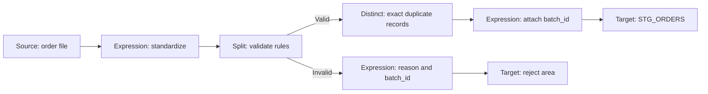

# OCI Data Integration and Building Data Pipelines

A sales report is only trustworthy when data is extracted from the right source, transformed by the right rules, and updated verifiably. Connecting Object Storage to a database is just the starting point; a data pipeline must also handle invalid records, reruns, schema changes, credentials, and when data becomes ready for consumers.

In the **Data and Analytics** chapter of the `CLOUD_PROVIDERS_ORACLE` module, this lesson guides you through building pipelines with OCI Data Integration. The example connects Object Storage and Autonomous Database while tying into OCI infrastructure components including compartments, IAM, VCNs, monitoring, automation, and cost control.

## 1. Objectives and Scope

After completing this lesson, you will be able to:

- Distinguish data asset, connection, data flow, task, pipeline, application, and run.
- Prepare permissions, networking, and staging before designing data processing.
- Build a data flow that cleanses data, routes invalid records, and loads data into a staging table.
- Orchestrate tasks, pass parameters, and control pipeline completion conditions.
- Publish, execute, monitor, and reconcile results.
- Design incremental loads, reruns, and controlled recovery.

OCI Data Integration is a managed service for moving, loading, and transforming data using ETL or ELT workflows. The service provides a visual designer and multiple task types; see [OCI Data Integration](https://docs.oracle.com/en-us/iaas/Content/data-integration/home.htm).

**ETL** transforms data before loading it into the consumption target. **ELT** loads data into the target system first and transforms it there. A practical solution may combine both: standardize and validate in a data flow, then use a stored procedure to merge data inside the database.

The pipeline in this lesson targets batch processing and job orchestration. For millisecond-level response requirements or near-real-time change replication, evaluate another architecture rather than assuming a batch pipeline suffices.

## 2. Data Integration Object Model

### 2.1. From Design to Execution

| Object | Role in This Lesson |
| --- | --- |
| Workspace | Container for design and operational resources of the solution |
| Project, folder | Organizes designs by business domain and ownership |
| Data asset | Declares a source or target system along with metadata |
| Connection | Connectivity details attached to a data asset |
| Data entity | Selected table, view, or file dataset |
| Data flow | Design of transformations and data movement between entities |
| Pipeline | Design orchestrating tasks and activities |

These concepts are defined in [Overview of Data Integration](https://docs.oracle.com/en-us/iaas/Content/data-integration/using/overview.htm).

To run a data flow, create an **integration task** using that data flow. To run a pipeline, create a **pipeline task** using that pipeline. Next, publish tasks into an **application** and create a **run**. The application holds published executable resources, separating active design edits from the currently running version.


### 2.2. Choosing the Right Task Type

| Need | Task Type to Consider |
| --- | --- |
| Process using a designed data flow | Integration task |
| Move and load entities using tool configuration | Data loader task |
| Call a stored procedure in a supported database | SQL task |
| Invoke a Spark application in OCI Data Flow | OCI Data Flow task |
| Call a REST endpoint | REST task |
| Orchestrate a pipeline | Pipeline task |

This list guides component selection; it does not guarantee every connector supports identical read, write, or incremental load capabilities. Verify source types, versions, and limitations in [Data Assets](https://docs.oracle.com/en-us/iaas/Content/data-integration/using/data-assets.htm).

### 2.3. Data Flows vs. the OCI Data Flow Service

A **data flow** in Data Integration is a transformation design resource. **OCI Data Flow** is a separate service for running Spark applications. An integration task can run in Data Integration under default configuration, or be configured to execute in OCI Data Flow. The latter requires appropriate compute resources, permissions, and execution settings. See [Working with Integration Tasks](https://docs.oracle.com/en-us/iaas/Content/data-integration/using/integration-tasks.htm).

In the hands-on lab, use Data Integration execution to keep scope clear. Add OCI Data Flow only when there is a specific requirement for Spark applications or its execution environment.

## 3. Designing the Problem Before Opening the Designer

### 3.1. Source, Target, and Expected Outcome

The example uses test order files in Object Storage. The goal is to standardize data, keep non-conforming records in a separate area, and update the orders table in Autonomous Database.

```text
Object Storage: order file
    → read and standardize
    → validate data
    → business staging table and rejected records area
    → validate batch
    → merge into target table
    → record processing outcome
```

Do not use real customer data in the lab. Bucket, schema, and table names below are examples and must be replaced for your provisioned environment.

### 3.2. Data Contract

Finalize the rules before building the flow:

| Attribute | Example Rule |
| --- | --- |
| `order_id` | Non-null; business key for this order source |
| `customer_id` | Non-empty after trimming whitespace |
| `amount` | Non-negative decimal with appropriate precision and scale |
| `currency` | Normalized to uppercase; lab accepts only `VND` |
| `updated_at` | Parseable and converted to UTC |
| Exact duplicate records | Keep only one copy in the valid dataset |
| Same key with differing data | Must have a version selection rule or raise an error |

The key `order_id` suffices only within this single-source example. When consolidating multiple systems, you may need `(source_system, order_id)`.

Explicitly state the error-record policy: whether to proceed with the valid subset or fail the entire batch. Do not let this choice become an accidental side effect of a type cast.

## 4. Preparing the Workspace, Network, and Security

### 4.1. Environment Separation

A recommended layout uses separate compartments for integration resources, raw buckets, technical staging buckets, reject areas, and target databases. Dev, test, and production must each have environment-appropriate connections and permissions.

Separating data paths matters more than merely giving tasks different names. A task named `TEST` can still write to production if its connection or parameter points to the wrong target.

Record the region, workspace OCID, buckets, database, schema, data owner, and operational owner. These serve as inputs for access provisioning, monitoring, and handoff.

### 4.2. Network Connectivity Must Be Prepared First

For private sources, prepare the VCN, regional subnets, DNS, and rules for the required connectivity paths. The workspace must be configured for that network; IAM alone does not make a database endpoint reachable. See [Getting Started with Data Integration](https://docs.oracle.com/en-us/iaas/Content/data-integration/using/preparing-for-connectivity.htm).

Check in order:

1. Does the endpoint hostname resolve properly from the execution environment?
2. Do routes and paths to Object Storage or the database exist?
3. Do NSGs or security lists allow the required connections and return traffic?
4. Do the endpoint, port, and TLS settings match the database configuration?
5. If using external sources outside OCI, is there an authorized connection path with sufficient bandwidth?

Do not assume adding an Internet Gateway solves every error. For OCI sources, choosing a service gateway, NAT, or private connectivity must be based on the actual endpoint architecture.

### 4.3. Separating Designer Permissions from Execution Permissions

Having permission to design inside a workspace does not prove the workspace can read objects or write to a database. Distinguish the human operator, the workspace principal, and the database account.

An example policy granting workspace access to an engineering group:

```text
Allow group DataEngineers to use dis-workspaces in compartment DataEngineering
```

Replace the group name, identity domain, and compartment for your environment. This grants workspace-level access in the compartment and is not a complete permission set for a pipeline. See [Data Integration Policy Examples](https://docs.oracle.com/en-us/iaas/Content/data-integration/using/policy-examples.htm).

For buckets, databases, and Vault, grant corresponding permissions to the exact principals. Do not apply a tenancy-wide administrator policy to troubleshoot connectivity errors. When staging configuration requires writing or managing PARs, scope permissions strictly to the required staging resources.

### 4.4. Managing Passwords and Wallets

Data Integration supports referencing OCI Vault secrets for sensitive credentials across many data asset types, including password and wallet options suitable for Oracle Database. See [OCI Vault Secrets and Oracle Wallets](https://docs.oracle.com/en-us/iaas/Content/data-integration/using/data-assets-support.htm).

In implementation:

- Use a dedicated integration database account with permissions on the required schemas and procedures.
- Reference secrets instead of placing passwords in business parameters or logs.
- Document secret rotation procedures and retest connections after changes.
- Restrict data-preview permissions if sources contain sensitive information.

Base64 encoding of a secret is a representation format, not a security control replacing encryption and IAM.

## 5. Declaring Data Assets and Understanding Staging

### 5.1. Object Storage Data Asset

Create the Object Storage data asset using the appropriate tenancy, region, and namespace. Connections and policies must allow connection verification, metadata browsing, and task-appropriate data operations. See [Object Storage Data Asset Properties](https://docs.oracle.com/en-us/iaas/Content/data-integration/using/creating-oracle-obj-storage.htm).

Clearly distinguish:

- The raw bucket holding input data.
- The prefix or object list for the batch being processed.
- The reject area holding rejected records and rejection reasons.
- The technical staging bucket used by the load mechanism.

When selecting sources by filename pattern, verify that the pattern does not pick up duplicates, temporary files, or the pipeline's own outputs. Object count and total input size should be recorded in the batch log.

### 5.2. Autonomous Database Data Asset

Prepare the connection, user, service or TNS alias, and wallet or secrets per the chosen configuration type. When Autonomous Database is the target, Data Integration uses Object Storage for staging before loading, so appropriate Object Storage permissions, database privileges, and staging configuration are required. See [Autonomous Database Data Asset](https://docs.oracle.com/en-us/iaas/Content/data-integration/using/creating-adw-atp.htm).

A successful Test Connection verifies only part of the path. An account may connect yet lack privileges to write tables, invoke procedures, or perform required staging steps. Run a small batch to verify the entire path.

### 5.3. Two Meanings of Staging in This Lesson

| Staging Type | Purpose |
| --- | --- |
| Technical staging bucket | Used internally by Data Integration when loading into Autonomous Database |
| Table `STG_ORDERS` | Team's business staging design for validating a batch before updating the target |

The business staging table does not replace the technical staging bucket. Both components need separate cleanup policies; avoid deleting data belonging to an in-flight batch.

## 6. Building a Data Flow to Cleanse and Separate Invalid Data

### 6.1. Organizing Operators



Operators such as Source, Expression, Split, Distinct, and Target are described in [Data Flows](https://docs.oracle.com/en-us/iaas/Content/data-integration/using/design.htm).

Design each step so you can explain how the data changed. A flow with very few operators that packs all logic into one hard-to-inspect expression can make data debugging much slower.

### 6.2. Locking Down the Input Schema

For CSV, configure header, delimiter, quote character, encoding, and data types. Verify how empty fields, decimals, and timestamps are represented. Do not rely solely on a few sample rows to assume the entire file matches the schema.

In the example, `amount` maps to decimal; `updated_at` is parsed using a format with UTC designator. In the target table, use `TIMESTAMP` with a consistent UTC storage convention. If preserving the original timezone is required, add a dedicated column or choose a data type that meets the requirement.

Distinguish file-parsing errors from business-rule errors. A readable row with a negative amount differs from a row containing the string `abc` in a numeric column. Split can only evaluate rows that survived reading and preceding conversions.

### 6.3. Standardizing with Expression

Rules for the example:

```text
customer_id: trim leading and trailing whitespace
currency: trim whitespace and convert to uppercase
updated_at: normalize to UTC
amount: preserve decimal precision, no unrequested rounding
```

This is a transformation specification. When configuring in the designer, use the Expression Builder and supported functions to construct expressions, reference the proper operator outputs, and verify return types. Do not paste raw Oracle SQL syntax into every Expression field without confirming compatibility.

Retain enough metadata to trace back to the source file and batch. On the Distinct branch, select only the business attributes used for deduplication; including row numbers or per-row processing timestamps can prevent business duplicates from being recognized as identical.

### 6.4. Separating Valid and Invalid Records

The validity condition in the example is:

```text
order_id is not empty
AND normalized customer_id is not empty
AND amount is not null and amount >= 0
AND currency = VND
AND updated_at is valid
```

Design expressions so nulls do not cause records to fall outside both branches. You can define the valid branch and route non-matching records to the reject branch, with validated conditions and null-handling behavior.

The reject branch should preserve necessary original data, batch ID, source file, and reason code. If a row violates multiple rules, decide explicitly whether to capture the first reason or a list of reasons.

### 6.5. Choosing a Target Write Strategy

For database targets, Data Integration offers options such as Insert, Overwrite, and Merge depending on configuration. Overwrite can truncate the target before loading; Merge requires keys to match rows for update or insert. See [Target Operators and Integration Strategies](https://docs.oracle.com/en-us/iaas/Content/data-integration/using/using-operators.htm).

In the lab, load data into staging and then merge in a controlled step. Do not choose Overwrite on a shared target table merely to rerun a batch; it can affect data outside that batch.

## 7. Parameterizing by Batch and Environment

### 7.1. Recommended Parameter Set

| Illustrative Parameter | Meaning | Example |
| --- | --- | --- |
| `P_SOURCE_ENTITY` | Input object or entity set | Order file for the processing date |
| `P_TARGET_SCHEMA` | Target schema | `ETL_LAB` |
| `P_BATCH_ID` | Staging load identifier | `LAB_ORDERS_001` |
| `P_BUSINESS_DATE` | Business date | `2026-11-20` |
| `P_LOW_WATERMARK` | Lower bound for incremental load | Confirmed timestamp |
| `P_HIGH_WATERMARK` | Fixed upper bound of the window | Timestamp fixed before extraction |

The names above are lesson conventions. Create parameters with the exact data types supported by the target properties; entity, connection, or schema parameters are not interchangeable with arbitrary path strings.

Data flows and pipelines have distinct mechanisms for configuring and passing parameters; see [Using Data Flow Parameters](https://docs.oracle.com/en-us/iaas/Content/data-integration/using/parameterization.htm).

### 7.2. Passing Parameters Across Layers

Verify the binding chain:

```text
Runtime value on pipeline task execution
    → pipeline parameter
    → incoming parameter of task operator
    → integration task or SQL task parameter
    → source, target, or condition inside data flow
```

A parameter defined on a pipeline but not bound to a child task will not alter the data flow. Log the actual runtime values for each run to distinguish logic bugs from parameter binding mistakes.

System values such as `SYS.TASK_RUN_KEY` and `SYS.TASK_START_TIME` aid traceability, and outputs from an upstream task can be passed downstream. Choose the right parent vs. child run scope when using them as correlation IDs. See [Using Parameters in Pipelines](https://docs.oracle.com/en-us/iaas/Content/data-integration/using/pipeline-parameters.htm).

A single business date may be loaded multiple times. Therefore, keep the business batch ID separate from each execution's run ID rather than overloading one timestamp for every purpose.

## 8. Orchestration with Pipelines

### 8.1. Splitting Responsibilities into Tasks

A proposed pipeline for the example:

```text
Start
  → PREPARE_BATCH
  → LOAD_AND_VALIDATE_ROWS
  → CHECK_BATCH
  → APPLY_ORDERS
  → RECORD_SUCCESS
  → End
```

- `PREPARE_BATCH`: confirm source readiness, register the batch, and prepare the batch staging scope.
- `LOAD_AND_VALIDATE_ROWS`: integration task running the cleansing and reject-routing flow.
- `CHECK_BATCH`: verify reconciliation, keys, and quality policies.
- `APPLY_ORDERS`: invoke the stored procedure to merge into the target table.
- `RECORD_SUCCESS`: record completion outcome or send notifications per design.

The batch-management tasks are components built by the implementation team, not mandatory built-in OCI task names.

### 8.2. SQL Task Calling an Existing Procedure

Currently, SQL tasks execute stored procedures in supported databases. The procedure must exist beforehand and belong to the workspace's database data asset; procedure parameters are exposed in the task configuration. See [Working with SQL Tasks](https://docs.oracle.com/en-us/iaas/Content/data-integration/using/sql-tasks.htm).

Accordingly, the SQL step in the example selects `APPLY_ORDERS` already created in the database and binds `P_BATCH_ID` to its input parameter. Pasting a raw `MERGE` statement into a pipeline does not automatically turn it into a callable stored procedure.

### 8.3. Dependencies and End Conditions

When configuring downstream tasks, set execution conditions based on upstream outcomes. For parallel branches, the Merge operator synchronizes continuation conditions; this is task orchestration, distinct from the SQL `MERGE` operation for combining table rows.

Specifically, the End operator has an **All completed** option that can mark the pipeline Success even when an inner task failed; **All success** requires tasks along that path to succeed. See [Using Pipeline Operators](https://docs.oracle.com/en-us/iaas/Content/data-integration/using/pipeline-operators.htm).

Test the failure path when designing notification branches. A "failure notification sent successfully" task must never mask the fact that data loading failed. For quality checks, the procedure must return an appropriate failure status or raise an error per contract; logging a warning row while returning success will not halt downstream steps automatically.

### 8.4. Bounded Parallelism

Run tasks in parallel only when they are independent in data and resources. For example, two reference sources can load concurrently before an aggregation step; two tasks overwriting the same staging table require redesign.

Pipelines have limits on concurrency, nesting depth, and task count, and there can be latency between steps. Check current service limits and workspace capacity before designing wide fan-out pipelines. See [Pipeline Support and Considerations](https://docs.oracle.com/en-us/iaas/Content/data-integration/using/pipelines-support.htm).

## 9. Rerunning Without Duplicating Data

### 9.1. Idempotency Is a Design Property

An idempotent step produces the same business outcome when reprocessing the same input under the same rules. Simply naming a batch or enabling retries does not create idempotency.

You must determine:

- Which business key identifies a record.
- Which version is allowed to update existing data.
- Which batch and attempt owns the staging rows.
- What happens if a write succeeded on the server but the task missed the response.
- Whether two concurrent runs are prevented from processing the same window.

### 9.2. Distinguishing Three Types of Duplicates

| Scenario | Required Handling |
| --- | --- |
| Two identical rows within the same input | Distinct or equivalent mechanism over the right attributes |
| Same order ID representing two different versions | Select version using a reliable timestamp or sequence |
| Rerunning data already present in the target | Upsert or procedure with anti-duplicate rules |

Distinct does not resolve two differing versions of the same key. Conversely, Merge with the right key can still overwrite newer data with older data if version ordering is not checked.

### 9.3. Transactions Cover Only Their Designed Scope

A pipeline consisting of object reads, staging loads, and multiple task calls does not automatically form a distributed transaction. A downstream task failure does not roll back data committed by an earlier task.

If target data and checkpoints must update atomically within the same Oracle Database, place those operations inside a single procedure and controlled transaction. Do not assume sending notifications or writing objects in another service participates in that transaction.

Maintain batch state records, locks, or concurrency guards to prevent overlapping runs. Pausing a schedule does not automatically prevent someone from triggering a manual run.

## 10. Incremental Loading and Watermarks

### 10.1. Fixing a Bounded Window

A conceptual rule:

```text
updated_at >= low_watermark
AND updated_at < high_watermark
```

Fix both bounds before extraction and keep them constant across retries. Do not recompute the upper bound inside child tasks, as different steps could then process different windows.

Advance the checkpoint only after the corresponding data is confirmed loaded and meets quality policies. For tied timestamps, late-arriving data, or long-running source transactions that commit late, add strategies such as overlapping windows with deduplication, monotonic sequences, or appropriate CDC.

### 10.2. Verify Connector Capabilities

Some sources offer built-in Incremental load and watermark options; supported column types and behavior depend on the connector. For example, data loader source configuration specifies rules for watermark columns. See [Selecting the Source for a Data Loader Task](https://docs.oracle.com/en-us/iaas/Content/data-integration/using/data-loader-add-source.htm).

Do not force a single generic timestamp configuration onto every source, especially when a source has its own incremental mechanism. Clarify who owns the checkpoint: Data Integration or a control table managed by your team.

### 10.3. Changes Watermarks Cannot Detect Automatically

If a source performs a hard delete without a tombstone marker, filtering by `updated_at` will not propagate deletions to the target. Similarly, an overwritten file may require an explicit version-detection mechanism.

For files, use a finalized object list, checksums, or a manifest supplied by the upstream producer. Never treat filename alone as proof that contents have not changed.

## 11. Hands-On Lab: Object Storage → Autonomous Database

### 11.1. Prepare Test Data

Create a small CSV file in the lab environment with the following contents:

```csv
order_id,customer_id,amount,currency,updated_at
1001,C01,120000.00,vnd,2026-11-20T02:10:00Z
1001,C01,120000.00,vnd,2026-11-20T02:10:00Z
1002,C02,250000.00,VND,2026-11-20T02:11:00Z
1003,C03,-10.00,VND,2026-11-20T02:12:00Z
1004,,90000.00,VND,2026-11-20T02:13:00Z
1005,C05,175000.00,vnd,2026-11-20T02:14:00Z
```

There are six data rows: two violate business rules and one is an exact duplicate in the valid set. After deduplication, the valid set contains three orders totaling `545000.00 VND`.

### 11.2. Create Tables in the Lab Schema

The SQL below targets a test schema without pre-existing tables of the same names. Administrators must grant appropriate privileges before learners execute it. These are example data structures, not resources pre-created by Data Integration.

```sql
CREATE TABLE stg_orders (
    batch_id     VARCHAR2(100) NOT NULL,
    order_id     NUMBER(18) NOT NULL,
    customer_id  VARCHAR2(50) NOT NULL,
    amount       NUMBER(18,2) NOT NULL,
    currency     VARCHAR2(3) NOT NULL,
    updated_at   TIMESTAMP NOT NULL
);

CREATE TABLE orders_curated (
    order_id     NUMBER(18) PRIMARY KEY,
    customer_id  VARCHAR2(50) NOT NULL,
    amount       NUMBER(18,2) NOT NULL,
    currency     VARCHAR2(3) NOT NULL,
    updated_at   TIMESTAMP NOT NULL
);
```

In the lab, the reject area can be a separate Object Storage target. Map the rejection reason, batch ID, and source attributes needed for traceability. Table `STG_ORDERS` contains only valid rows after standardization and in-flow deduplication.

### 11.3. Create a Simple Merge Procedure

The following example is strictly for a single-source lab with no two differing versions of the same order ID within one batch. It deduplicates identical staging rows and rejects batches containing conflicting data for the same key.

```sql
CREATE OR REPLACE PROCEDURE apply_orders (
    p_batch_id IN VARCHAR2
) AS
    v_conflicts NUMBER;
BEGIN
    IF p_batch_id IS NULL THEN
        raise_application_error(-20001, 'Batch ID is required');
    END IF;

    SELECT COUNT(*) INTO v_conflicts
    FROM (
        SELECT order_id
        FROM (
            SELECT DISTINCT order_id, customer_id,
                   amount, currency, updated_at
            FROM stg_orders
            WHERE batch_id = p_batch_id
        )
        GROUP BY order_id
        HAVING COUNT(*) > 1
    );

    IF v_conflicts > 0 THEN
        raise_application_error(-20002, 'Conflicting rows in batch');
    END IF;

    MERGE INTO orders_curated d
    USING (
        SELECT DISTINCT order_id, customer_id,
               amount, currency, updated_at
        FROM stg_orders
        WHERE batch_id = p_batch_id
    ) s
    ON (d.order_id = s.order_id)
    WHEN MATCHED THEN UPDATE SET
        d.customer_id = s.customer_id,
        d.amount = s.amount,
        d.currency = s.currency,
        d.updated_at = s.updated_at
        WHERE s.updated_at > d.updated_at
    WHEN NOT MATCHED THEN INSERT
        (order_id, customer_id, amount, currency, updated_at)
    VALUES
        (s.order_id, s.customer_id, s.amount, s.currency, s.updated_at);

    COMMIT;
EXCEPTION
    WHEN OTHERS THEN
        ROLLBACK;
        RAISE;
END;
/
```

The procedure owns the transaction for this merge step on its dedicated execution connection. It does not yet implement batch locking, checkpointing, full reconciliation, or conflict detection against target rows with the same timestamp but different content. In production, those cases must have explicit rules; do not rely on monotonically increasing timestamps as an absolute assumption across all sources.

### 11.4. Build and Validate the Data Flow

In the lab project:

1. Create a data flow and select the CSV file through the Object Storage data asset.
2. Verify the schema and parse the UTC timestamp into the chosen target type.
3. Standardize customer ID and currency.
4. Use Split to separate valid and rejected rows.
5. Use Distinct over the business attributes on the valid branch.
6. Attach `P_BATCH_ID`, map to `STG_ORDERS`, and configure the reject branch.
7. Validate each operator and the full flow; inspect data previews/samples to verify mappings.

With this dataset, set `P_BATCH_ID = LAB_ORDERS_001`. Expect three rows in staging on the initial load and two rows in reject. These expectations assume the source contains exactly the six rows above and staging does not yet hold rows for the same batch.

### 11.5. Create Tasks and Pipeline

Create an integration task for the flow. Create a SQL task selecting the `APPLY_ORDERS` procedure in the right schema and bind the batch ID to `p_batch_id`.

Create a pipeline with the integration task followed by the SQL task, running the SQL task when the load step succeeds. Choose an appropriate End condition so errors are not masked. Since the lab allows keeping three valid rows and two rejects, document that policy in the description; if zero error rows are required, add a check task that fails before the apply step.

Create a pipeline task wrapping the pipeline, verify parameters, and publish to the lab application. Do not enable a schedule before completing at least one reconciled manual run.

### 11.6. Verify Results with SQL

After the run completes, use an account with read access to verify:

```sql
SELECT batch_id, COUNT(*) AS row_count,
       COUNT(DISTINCT order_id) AS distinct_orders,
       SUM(amount) AS total_amount
FROM stg_orders
WHERE batch_id = 'LAB_ORDERS_001'
GROUP BY batch_id;

SELECT order_id, customer_id, amount, currency, updated_at
FROM orders_curated
ORDER BY order_id;

SELECT COUNT(*) AS order_count, SUM(amount) AS total_amount
FROM orders_curated;
```

Starting from an empty target table, the expected result is three order IDs `1001`, `1002`, and `1005`, all with currency `VND`, totaling `545000.00`.

Input row-count reconciliation:

```text
6 source rows
= 4 valid rows before deduplication + 2 rejected rows
= 3 unique valid rows + 1 duplicate copy + 2 rejected rows
```

Do not count the header line as a data record. At larger scale, explicitly specify whether counts are before or after deduplication and at which stage they were measured.

### 11.7. Test Reruns

First, rerun only the apply step for the same staging data to confirm the order count does not increase. Next, rerun the full pipeline with a different batch ID but the same source data, and confirm the target still holds three business keys.

If reusing the same batch ID with an Insert strategy into staging, staging row counts can grow even if the target does not duplicate rows. Production needs a staging cleanup/re-preparation policy or attempt tracking rather than relying solely on `SELECT DISTINCT` inside the lab procedure.

Finally, test a batch containing two rows with the same order ID but different content to verify that the procedure raises an error and downstream steps do not record business success.

## 12. Publishing, Running, and Automation

### 12.1. Publishing Is a Deployment Step

Before running tasks in Data Integration, publish them to an application. Each publish generates application patch information; use it to track deployed versions. See [Publishing to a Data Integration Application](https://docs.oracle.com/en-us/iaas/Content/data-integration/using/publish-task.htm).

After editing a data flow or task, confirm the application has received the updated version before running. Record the version, connection settings, and parameters alongside the run ID so results can be reproduced when needed.

Promoting across environments requires reviewing data assets, secrets, buckets, and schemas. Do not assume copying a project means all permissions and target endpoints are properly configured.

### 12.2. Schedules and Overlapping Runs

Create schedules and task schedules for published tasks after verifying manual runs. Select the timezone, cadence, effective window, and parameters according to the business date. See [Scheduling Published Tasks](https://docs.oracle.com/en-us/iaas/Content/data-integration/using/schedules.htm).

If a pipeline takes 45 minutes while scheduled every 30 minutes, decide whether to queue, skip, or allow overlapping runs. Evaluate runs triggered by schedules, CLI, and manual users alike. A concurrency restriction setting may have a specific scope; do not infer that it locks every trigger mechanism. See [Running Published Tasks](https://docs.oracle.com/en-us/iaas/Content/data-integration/using/published-tasks.htm).

### 12.3. Inspecting Runs via OCI CLI

The commands below use Bash in OCI Cloud Shell or an environment with OCI CLI installed and authorized. These are examples, not outputs executed against a specific tenancy.

```bash
export REGION='<workspace-region>'
export WORKSPACE_ID='<workspace-ocid>'
export APPLICATION_KEY='<application-key>'
export TASK_RUN_KEY='<task-run-key>'

oci data-integration task-run list \
  --workspace-id "$WORKSPACE_ID" \
  --application-key "$APPLICATION_KEY" \
  --region "$REGION" \
  --all

oci data-integration task-run get \
  --workspace-id "$WORKSPACE_ID" \
  --application-key "$APPLICATION_KEY" \
  --task-run-key "$TASK_RUN_KEY" \
  --region "$REGION"
```

Workspaces use OCIDs; applications and task runs use their respective keys. Do not substitute display names for keys. See [CLI task-run list](https://docs.oracle.com/en-us/iaas/tools/oci-cli/latest/oci_cli_docs/cmdref/data-integration/task-run/list.html) and [CLI task-run get](https://docs.oracle.com/en-us/iaas/tools/oci-cli/latest/oci_cli_docs/cmdref/data-integration/task-run/get.html).

If automating run creation via API, use the verified operation schema and parameter mappings. Poll or track until terminal state; a successful run-creation API response does not mean data has finished loading.

## 13. Observing Pipelines and Data Quality

### 13.1. Inspect Both Parent and Child Runs

A pipeline task has a parent run and child runs corresponding to inner tasks. Open child runs during diagnosis to identify which step is queued, running, or failed. See [Listing Task Runs](https://docs.oracle.com/en-us/iaas/Content/data-integration/using/task-runs-list.htm).

Record the run key, batch ID, publish version, timestamps, parameters, object counts, row counts, rejects, and apply outcome. If source data changed between two attempts, keep version or manifest evidence for fair comparison.

### 13.2. Logs and Metrics

Service logs can be enabled via OCI Logging at the workspace level; execution logs aid task-run troubleshooting. Appropriate permissions must be granted for both configuring logs and reading logs. See [Enabling Data Integration Logs](https://docs.oracle.com/en-us/iaas/Content/data-integration/using/logging.htm).

Data Integration emits metrics in the `oci_dataintegration` namespace to track bytes read, bytes written, and task executions. See [Data Integration Metrics](https://docs.oracle.com/en-us/iaas/Content/data-integration/using/metrics.htm).

Never write passwords, wallets, or sensitive data into error messages. Technical logs should provide enough traceability without turning into an uncontrolled copy of raw data.

### 13.3. Technical Success vs. Business Success

| Check Layer | Question |
| --- | --- |
| Execution | Did the required tasks finish in the expected status? |
| Completeness | Were all expected source objects or windows processed? |
| Quality | Do nulls, keys, values, and reject rates adhere to policy? |
| Reconciliation | Do row counts and business totals match transformation rules? |
| Freshness | Did data arrive in time for reporting needs? |
| Re-runnability | Does the same input cause duplicates or invalid overwrites? |

For example, a pipeline that reads zero files and finishes without error can still leave a reporting date missing data. Monitor for the absence of expected batches, not merely Failed tasks.

## 14. Retries, Errors, and Recovery

### 14.1. Retry Only After Understanding Write Behavior

Retries suit transient errors such as brief network interruptions, but they will not fix wrong passwords or incompatible schemas. Configure run options and verify actual task behavior; do not assume pipelines retry indefinitely by default. See [Configuring Run Options for Tasks](https://docs.oracle.com/en-us/iaas/Content/data-integration/using/configuring-runs.htm).

Before rerunning, identify which steps have already committed and whether inputs remain unchanged. For stored procedures causing side effects outside the database, implement separate idempotency guards for those side effects.

### 14.2. Troubleshooting Matrix

| Symptom | Where to Check | Next Step |
| --- | --- | --- |
| Bucket or schema not visible | Metadata permissions, region, namespace, connection | Confirm exact resource and principal |
| Test connection passes but load fails | Write permissions, database grants, staging, PAR | Inspect the actual load stage |
| Database connection timeout | DNS, routes, network rules, endpoint, wallet | Isolate network issue before raising timeouts |
| Valid rows lost | Null checks, parsing, mappings, and Split rules | Reconcile data across each step |
| Distinct fails to deduplicate | Varying metadata included in attributes | Redefine deduplication attributes |
| Merge hits duplicate keys or unstable data | Multiple versions of same key in source | Normalize/deduplicate source before apply |
| Task failed yet pipeline shows Success | Incoming links and End condition | Fix error path and check child runs |
| Duplicate data after retry | Staging Insert, pre-failure commit, batch ID | Apply rerun policy |
| Run succeeds but report misses a day | Wrong window, missing files, wrong checkpoint | Reconcile source coverage |
| Increasing runtime | Source load, skew, joins, file sizes, busy target | Measure each stage before optimizing |

Look up error codes and context in [Troubleshooting Data Integration](https://docs.oracle.com/en-us/iaas/Content/data-integration/using/troubleshooting-dis.htm). Preserve request IDs and run keys when seeking support; avoid changing multiple settings simultaneously, which obscures the root cause.

### 14.3. Recovery Runbook

1. Pause new triggers if there is risk of overlapping writes for the same batch.
2. Identify the run, publish version, input manifest, and parameters.
3. Record which tasks already wrote data or advanced checkpoints.
4. Fix the root cause; prepare staging according to the retry policy.
5. Decide whether to rerun the entire pipeline or part of it based on dependencies and committed data.
6. Reconcile row counts, keys, total amounts, and batch status.
7. Re-enable schedules only after missing data intervals are processed or explicitly accounted for.

For historical backfills, use separate windows and batch IDs while controlling load and version ordering. Never let a historical load advance the regular stream's checkpoint in a way that skips newer data.

## 15. Performance, Cost, and Data Lifecycle

### 15.1. Optimize Through Measurement

Measure read volume, transformation duration, staging time, and target write duration. Common improvements to evaluate include:

- Selecting only required columns and data ranges.
- Applying early filtering or pushdown where supported by connectors and expressions.
- Avoiding excessive tiny files or a single huge file that hinders parallelism.
- Checking many-to-many joins causing row explosion and key skew.
- Bounding parallelism so neither the source nor target database is overwhelmed.
- Measuring resource wait time separately from data processing time.

Do not assume adding processing compute will speed up a load bottlenecked by the network or target database.

### 15.2. Control Costs Across the Entire Pipeline

Cost accounting must cover workspaces, task execution, Object Storage, databases, logs, networking, and auxiliary services. Obtain actual rates and billing units per service, region, and configuration when budgeting.

Match schedules to actual data freshness requirements. Running repeatedly on unchanged data wastes compute and increases the risk of duplicate side effects. Track bytes processed per successful batch to spot abnormal reruns.

### 15.3. Controlled Cleanup

Set distinct retention periods for raw, technical staging, business staging, reject areas, and logs. Retain data long enough for reconciliation and recovery while limiting exposure of sensitive data.

Do not purge staging solely by file creation timestamp if a batch could still be running. Tie cleanup to completion status and retention policies. After the lab, disable unused schedules, revoke temporary test permissions, and clean up resources per team procedures.

## 16. Pipeline Completion Criteria

A pipeline is ready for handoff when it has demonstrated:

1. Source, target, schema, and data contract have clear owners.
2. Workspace, IAM, networking, secrets, and staging are properly scoped.
3. The flow handles valid, rejected, duplicate, and conflicting records under explicit policies.
4. Parameters propagate accurately through pipeline, tasks, and data flow.
5. The application is running the exact published version.
6. Both success and failure paths behave properly operationally.
7. Reconciliation proves data is complete, accurate, and timely.
8. Retries, backfills, overlapping runs, and recovery are addressed.
9. Logs, metrics, schedules, retention, and costs are actively monitored.

The handoff package should include the workspace OCID, project, application key, task keys, publish version, referenced connections, parameters, data rules, and runbook. The incoming owner must be able to identify which batches loaded, which records were rejected, which version is running, and how to rerun safely while preserving business accuracy.
