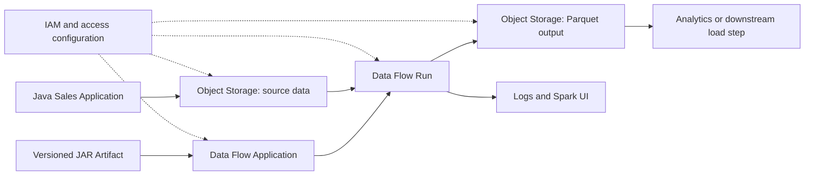

# Data Flow and Running Apache Spark on OCI

## 1. Objectives and Use Case

OCI Data Flow provides a managed environment for running Apache Spark applications. You focus on the data processing code, execution configuration, access permissions, and outputs, while the service manages the execution infrastructure. Data Flow offers a Console, API, and CLI for integration into deployment or orchestration workflows. [Oracle: Data Flow Overview](https://docs.oracle.com/en-us/iaas/Content/data-flow/using/dfs_service_overview.htm).

In the **Data and Analytics** chapter of the `CLOUD_PROVIDERS_ORACLE` module, this lesson connects Spark with compartments, IAM, Object Storage, network reachability, and cost-controlled operations. The goal is to run an explainable and verifiable batch processing job.

After completing this lesson, you will be able to:

- Distinguish Data Flow Application, Data Flow Run, and Spark execution components.
- Prepare artifacts, data, logs, Run-submitter permissions, and workload permissions.
- Package a Java Spark application matching the chosen OCI runtime.
- Run a CSV-to-Parquet aggregation job and reconcile expected results.
- Diagnose failures using logs, Spark UI, Run status, and output data state.
- Design reruns, output publication, execution timeouts, and resource cleanup.

**Running scenario:** a Java sales application exports order data to Object Storage. Daily, the data team needs to aggregate paid order counts and revenue by sales channel. The results are stored in a standardized data zone for downstream analytics systems or loading into an Oracle Database.

This lab uses synthetic data, batch processing, and a Java JAR. The commands and source code below are illustrative examples for learners and do not imply prior execution on an actual tenancy.

## 2. Distinguishing Application, Run, and Spark Execution

### 2.1. An Application Is a Reusable Configuration

A Data Flow Application bundles the program, dependencies, Spark version, default parameters, and resource configuration. Each execution creates a separate Data Flow Run with its own status, logs, and operational metadata. Data Flow also supports resource pools for suitable workloads; this lab uses on-demand execution and does not require creating a pool. [Oracle: Data Flow Concepts](https://docs.oracle.com/en-us/iaas/Content/data-flow/using/concepts.htm).

| Concept | Usage in This Lesson |
| --- | --- |
| JAR Artifact | Contains the Java class processing revenue |
| Application | Points to the JAR, main class, runtime, and default config |
| Run | A single execution with specific input, output, and business date |
| Driver | Runs `main`, builds and coordinates Spark jobs |
| Executor | Executes tasks processing partitions of data |
| Partition | A chunk of data distributed by Spark for processing |
| Spark job and stage | Execution units inside a Spark application |

One Data Flow Run can spawn multiple Spark jobs. For example, within the same program, quality checks, duplicate-key detection, data writes, and reading back results can trigger separate jobs. Do not confuse the Data Flow Run count with the Spark job count when reading the Spark UI.

### 2.2. Transformations and Actions

Operations such as filtering and column selection describe how data is transformed. Actions instruct Spark to execute work to produce a result, such as counting rows or writing output. Because data is processed in a distributed manner, pulling the entire dataset back to the driver defeats the purpose of distributed execution. [Apache Spark: RDD Programming Guide](https://spark.apache.org/docs/3.5.8/rdd-programming-guide.html).

Mental model for the program in this lesson:

```text
Read CSV with explicit schema
→ Standardize string values
→ Validate data contract conditions
→ Filter by business date and PAID status
→ Group by date and sales channel
→ Compute paid order count and total revenue
→ Write Parquet
→ Read back a slice of the output to reconcile
```

Do not use a Java loop over a `collect()`-ed list of all orders in place of distributed aggregation. DataFrame/Spark SQL functions express the required filtering and aggregation directly.

## 3. Data and Resource Architecture for the Lab



One layout for a learning environment:

| Component | Example Name | Role |
| --- | --- | --- |
| Compartment | `DataFlowLab` | Holds Applications, Runs, and permitted lab resources |
| Artifact bucket | `df-artifacts` | Stores versioned JARs |
| Source bucket | `df-raw` | Stores finalized input data for processing |
| Output bucket | `df-curated` | Stores outputs by date and attempt |
| Log bucket | `dataflow-logs` | Stores run logs |

Bucket names are examples; replace them with valid names in your tenancy's namespace. Keep lab data and artifacts private—do not enable public access.

Object Storage URIs use the format:

```text
oci://<bucket>@<namespace>/<object-or-prefix>
```

Example paths:

```text
oci://df-artifacts@<namespace>/sales-daily/1.0.0/sales-daily-1.0.0.jar
oci://df-raw@<namespace>/sales-lab/orders.csv
oci://df-curated@<namespace>/sales-daily/biz_date=2026-11-01/attempt=lab001/
oci://dataflow-logs@<namespace>/
```

The namespace is not the compartment name. Having a URI also does not prove the caller has permission to read the object or that the chosen region hosts the target resource.

Oracle recommends preparing storage and IAM before using Data Flow. The log bucket stores stdout/stderr; warehouse and metastore-related buckets support configured Spark SQL or managed table capabilities. This lab reads and writes direct file paths and does not require creating a metastore. [Oracle: Set Up Data Flow](https://docs.oracle.com/en-us/iaas/Content/data-flow/using/setup_dataflow.htm).

When moving to production, buckets or compartments can be separated by owner and sensitivity. This separation entails adjusting IAM, data lifecycles, region placement, and operational procedures.

## 4. IAM: Separating Run Submitter from Execution Identity

### 4.1. Two Access Paths to Verify

| Actor | What Must Be Permitted |
| --- | --- |
| Artifact builder | Upload JARs to the managed artifact location |
| User or pipeline submitting Runs | Read Application, create Runs, and use resources needed for submission |
| Workload identity | Read inputs, write outputs, access other services as needed |
| Operator | Read Run details, logs, Spark UI, and cancel Runs when authorized |
| Data consumer | Read only outputs accepted by the publication process |

Having permission to create a Run does not guarantee Spark can read the data. Similarly, read access to the source bucket does not grant permission to edit Applications or cancel another team's Runs.

Data Flow defines dedicated resource types such as `dataflow-application`, `dataflow-run`, and the aggregate family `dataflow-family`. Scope permissions by responsibility and compartment. [Oracle: Data Flow Policies](https://docs.oracle.com/en-us/iaas/Content/data-flow/using/policies.htm).

Example Data Flow administrative policy in the lab:

```text
Allow group Workforce/DataEngineers to manage dataflow-family in compartment DataFlowLab
```

This is broad permission within the lab scope. Production may separate managing Applications, submitting Runs, and monitoring. This statement does not replace Object Storage, Logging, or related service policies.

### 4.2. Resource Principal for Runs

Data Flow supports resource principals. An illustrative matching rule identifying Runs in the lab compartment:

```text
ALL {resource.type='dataflowrun', resource.compartment.id='<DataFlowLab-OCID>'}
```

You can scope further by Application using Data Flow-supported tag conditions rather than letting all Runs in a compartment share identical permissions. Review who can create or modify Applications alongside the data permissions granted to Runs. [Oracle: Resource Principal Policies](https://docs.oracle.com/en-us/iaas/Content/data-flow/using/resource-principal-policies.htm).

Illustrative partial data permissions for the prepared dynamic group:

```text
Allow dynamic-group Default/DFBatchRuns to read objects in compartment DataFlowLab where target.bucket.name='df-raw'
Allow dynamic-group Default/DFBatchRuns to manage objects in compartment DataFlowLab where target.bucket.name='df-curated'
```

These two statements illustrate input/output scoping only. They are not a complete policy set for deploying Data Flow. Permissions for reading artifacts, bucket metadata, writing logs, submitting Runs, and service-level access must follow current documentation and your chosen authentication method. Using the Data Flow templates in the IAM Policy Builder is a good starting point for a complete review. [Oracle: Set Up IAM Policies](https://docs.oracle.com/en-us/iaas/Content/data-flow/using/set-up-iam-policies.htm).

To enable this authentication method, include in the Run or Application Spark configuration:

```text
dataflow.auth = resource_principal
```

Permissions must be in place before enabling it. OCI requires resource principals for Runs expected to exceed 24 hours. When running on Data Flow, do not set `spark.master` to `local[*]` in code or deployment config. [Oracle: Supported Spark Properties](https://docs.oracle.com/en-us/iaas/Content/data-flow/using/dfs_provide_jvm_options.htm).

Never place private keys, database passwords, or long-lived tokens in arguments, display names, or logs. Those values may appear in operational views readable by many users.

## 5. Selecting the Runtime and Packaging Java

### 5.1. Align Versions Before Building

This lesson uses the combination **Spark 3.5.0, Java 17, and Scala 2.12**. OCI's compatibility matrix lists Spark 3.5.0 with Java 17 and Scala 2.12.18. This combination is chosen for the example and does not imply that the newest Spark release in general is always available on Data Flow. [Oracle: Before You Begin with Data Flow](https://docs.oracle.com/en-us/iaas/Content/data-flow/using/dfs_before_you_begin_with_data_flow.htm).

The Spark artifact name carries the `_2.12` suffix because Scala binary compatibility still applies to Java programs using Spark libraries. When changing runtimes, re-verify Java bytecode, Spark APIs, dependencies, and connectors rather than merely changing a dropdown value in the Console.

### 5.2. Minimal POM for the Example

Learners can create a standalone Maven project with the following POM. The source code lives in package `vn.example.analytics`, with main class `DailySalesJob`.

```xml
<project xmlns="http://maven.apache.org/POM/4.0.0"
         xmlns:xsi="http://www.w3.org/2001/XMLSchema-instance"
         xsi:schemaLocation="http://maven.apache.org/POM/4.0.0 https://maven.apache.org/xsd/maven-4.0.0.xsd">
  <modelVersion>4.0.0</modelVersion>
  <groupId>vn.example.analytics</groupId>
  <artifactId>sales-daily</artifactId>
  <version>1.0.0</version>

  <properties>
    <maven.compiler.release>17</maven.compiler.release>
    <project.build.sourceEncoding>UTF-8</project.build.sourceEncoding>
  </properties>

  <dependencies>
    <dependency>
      <groupId>org.apache.spark</groupId>
      <artifactId>spark-sql_2.12</artifactId>
      <version>3.5.0</version>
      <scope>provided</scope>
    </dependency>
  </dependencies>

  <build>
    <plugins>
      <plugin>
        <groupId>org.apache.maven.plugins</groupId>
        <artifactId>maven-compiler-plugin</artifactId>
        <version>3.11.0</version>
      </plugin>
    </plugins>
  </build>
</project>
```

Spark is declared as `provided` because the runtime supplies the core libraries. If the application adds business libraries absent from the runtime, package or distribute them using an appropriate mechanism. Never bundle a different Spark/Hadoop distribution inside the JAR just to silence missing-dependency errors. [Apache Spark: Submitting Applications](https://downloads.apache.org/spark/docs/3.5.0/submitting-applications.html).

The sample program needs only Spark and the Java standard library, so a standard thin JAR suffices. This is not a Spring Boot application; the main class is declared directly when creating the Data Flow Application.

## 6. Sample Data and Correctness Criteria

### 6.1. Input CSV

Create the following synthetic dataset in object `sales-lab/orders.csv` in the source bucket:

```csv
order_id,order_date,channel,amount,status
o1001,2026-11-01,WEB,120000.00,PAID
o1002,2026-11-01,APP,80000.00,PAID
o1003,2026-11-01,WEB,50000.00,CANCELLED
o1004,2026-11-01,WEB,30000.00,PAID
o1005,2026-11-02,APP,70000.00,PAID
o1006,2026-11-02,WEB,20000.00,PAID
```

Business rules for the example:

- Each `order_id` is unique across the entire input of a Run.
- Each row is a complete order, not a status-update event.
- Dates are already standardized at the source to business date; do not derive timezone from a timestamp in this lab.
- Only two channels (`WEB`, `APP`) and two statuses (`PAID`, `CANCELLED`) are accepted.
- `amount` is non-negative and decimal; all values share the same currency.
- Sum only `PAID` orders belonging to the date passed to the program.

If a real source contains multiple events per order, multiple currencies, or refund adjustments, design explicit rules before applying aggregation. This example intentionally rejects duplicate IDs to avoid arbitrarily picking a row.

### 6.2. Expected Output

For business date `2026-11-01`:

| order_date | channel | paid_orders | revenue |
| --- | --- | ---: | ---: |
| 2026-11-01 | APP | 1 | 80000.00 |
| 2026-11-01 | WEB | 2 | 150000.00 |

There are 6 source rows, 3 selected rows, and total revenue of 230000.00. Order `o1003` is excluded because it is cancelled; the two orders on 2026-11-02 do not belong to the processing date.

Parquet output is a set of objects under the target prefix, not a single file with a user-chosen filename by default. Do not assert against a fixed file count or row order. Parquet preserves schema and supports columnar storage for downstream analytics steps. [Apache Spark: Parquet Files](https://downloads.apache.org/spark/docs/3.5.0/sql-data-sources-parquet.html).

## 7. Java Spark Program

### 7.1. Main Class

The class below accepts three arguments in order: input URI, non-existent output URI, and business date formatted as `yyyy-MM-dd`.

```java
package vn.example.analytics;

import java.sql.Date;
import java.time.LocalDate;

import org.apache.spark.sql.Column;
import org.apache.spark.sql.Dataset;
import org.apache.spark.sql.Row;
import org.apache.spark.sql.SaveMode;
import org.apache.spark.sql.SparkSession;
import org.apache.spark.sql.types.DataTypes;
import org.apache.spark.sql.types.StructType;
import org.apache.spark.storage.StorageLevel;

import static org.apache.spark.sql.functions.col;
import static org.apache.spark.sql.functions.count;
import static org.apache.spark.sql.functions.length;
import static org.apache.spark.sql.functions.lit;
import static org.apache.spark.sql.functions.not;
import static org.apache.spark.sql.functions.sum;
import static org.apache.spark.sql.functions.trim;
import static org.apache.spark.sql.functions.upper;

public final class DailySalesJob {
    private DailySalesJob() {
    }

    public static void main(String[] args) {
        if (args.length != 3) {
            throw new IllegalArgumentException(
                    "Usage: DailySalesJob <input-uri> <output-uri> <yyyy-MM-dd>");
        }

        String inputUri = args[0];
        String outputUri = args[1];
        Date processDate = Date.valueOf(LocalDate.parse(args[2]));

        SparkSession spark = SparkSession.builder()
                .appName("daily-sales")
                .config("spark.sql.session.timeZone", "UTC")
                .config("spark.sql.ansi.enabled", "true")
                .getOrCreate();

        Dataset<Row> input = null;
        try {
            StructType schema = new StructType()
                    .add("order_id", DataTypes.StringType, true)
                    .add("order_date", DataTypes.DateType, true)
                    .add("channel", DataTypes.StringType, true)
                    .add("amount", DataTypes.createDecimalType(18, 2), true)
                    .add("status", DataTypes.StringType, true);

            input = spark.read()
                    .schema(schema)
                    .option("header", "true")
                    .option("enforceSchema", "false")
                    .option("mode", "FAILFAST")
                    .option("dateFormat", "yyyy-MM-dd")
                    .option("encoding", "UTF-8")
                    .csv(inputUri)
                    .select(
                            trim(col("order_id")).alias("order_id"),
                            col("order_date"),
                            upper(trim(col("channel"))).alias("channel"),
                            col("amount"),
                            upper(trim(col("status"))).alias("status"))
                    .persist(StorageLevel.MEMORY_AND_DISK());

            long inputRows = input.count();
            if (inputRows == 0) {
                throw new IllegalArgumentException("Input has no data rows");
            }

            Column invalid = col("order_id").isNull()
                    .or(length(col("order_id")).equalTo(0))
                    .or(col("order_date").isNull())
                    .or(col("channel").isNull())
                    .or(not(col("channel").isin("WEB", "APP")))
                    .or(col("amount").isNull())
                    .or(col("amount").lt(0))
                    .or(col("status").isNull())
                    .or(not(col("status").isin("PAID", "CANCELLED")));

            if (input.filter(invalid).limit(1).count() > 0) {
                throw new IllegalArgumentException(
                        "Input violates the sales data contract");
            }

            Dataset<Row> duplicateIds = input.groupBy("order_id")
                    .count()
                    .filter(col("count").gt(1));
            if (duplicateIds.limit(1).count() > 0) {
                throw new IllegalArgumentException("Duplicate order_id in input");
            }

            Dataset<Row> paidOrders = input.filter(
                    col("order_date").equalTo(lit(processDate))
                            .and(col("status").equalTo("PAID")));

            long paidRows = paidOrders.count();
            if (paidRows == 0) {
                throw new IllegalArgumentException(
                        "No paid orders for the requested business date");
            }

            Dataset<Row> result = paidOrders
                    .groupBy("order_date", "channel")
                    .agg(
                            count(lit(1)).alias("paid_orders"),
                            sum(col("amount")).alias("revenue"));

            long expectedGroups = result.count();
            result.write()
                    .mode(SaveMode.ErrorIfExists)
                    .option("compression", "snappy")
                    .parquet(outputUri);

            Dataset<Row> written = spark.read().parquet(outputUri);
            long actualGroups = written.count();
            if (actualGroups != expectedGroups) {
                throw new IllegalStateException("Output group count mismatch");
            }

            System.out.printf(
                    "businessDate=%s inputRows=%d paidRows=%d outputGroups=%d%n",
                    processDate, inputRows, paidRows, actualGroups);
            written.orderBy("channel").show(20, false);
        } finally {
            try {
                if (input != null) {
                    input.unpersist();
                }
            } finally {
                spark.stop();
            }
        }
    }
}
```

`SparkSession` is the entry point for working with DataFrames and Spark SQL. In Java, `Dataset<Row>` represents columnar data with a schema; Spark expressions are built via the API rather than processing the entire dataset in driver-side collections. [Apache Spark: Spark SQL Getting Started](https://downloads.apache.org/spark/docs/3.5.0/sql-getting-started.html).

### 7.2. Key Design Choices in the Program

| Choice | Reason in the Example |
| --- | --- |
| Explicit schema | Enforces date, decimal, and column order per source contract |
| Header verification | Reduces risk of positional column mis-mapping |
| String normalization | Eliminates whitespace and casing discrepancies on channel and status |
| Fail on invalid rows | Prevents generating a successful report when input violates rules |
| Fail on duplicate IDs | Prevents double-counting revenue or picking an arbitrary row |
| Filter by date argument | Decouples program logic from wall-clock run date |
| Decimal type | Avoids binary floating-point rounding for monetary totals |
| Non-existent output path | Reduces risk of overwriting another run's data |
| Read back Parquet | Verifies output readability and post-write group count |
| `finally` block | Releases cache and stops Spark on both success and failure |

`FAILFAST` catches records the CSV parser identifies as malformed; it does not replace full business validation. Per Spark behavior, having fewer or more tokens than the schema is not always flagged as a malformed record. The lab uses headers, explicit schema, and required-field checks; production systems should enforce strict file contracts at ingestion if exact column counts are mandatory. [Apache Spark: CSV Files](https://downloads.apache.org/spark/docs/3.5.0/sql-data-sources-csv.html).

The sample intentionally fails when there are zero paid orders for the requested date so learners can distinguish a bad argument from expected results. Production must agree explicitly on zero-data cases: an empty day may be a valid business state rather than a job failure.

Caching here serves multiple actions reading the same input in the lesson. Validation actions incur cost; do not copy all count checks into every production pipeline without measuring. Matching group counts also does not prove every revenue figure is right: the lab still requires comparing each row against Section 6.

`show(20, false)` prints only a small sample of aggregated results to verify synthetic data. With real data, review logging policies and avoid printing sensitive details or raw source rows.

### 7.3. Build and Upload the Artifact to Object Storage

In your example project, place the class in the matching package, use JDK 17, and run:

```text
mvn package
```

The generated JAR is named `sales-daily-1.0.0.jar`. Upload the JAR and CSV to the prepared object paths; you can use the Object Storage Console for the upload step.

Record the source version, artifact checksum, and JAR URI. Do not overwrite the JAR at the same production URI and assume old and new Runs used the same code. When reproducing a report, you must be able to identify the exact code and inputs used.

## 8. Creating the Data Flow Application

In the Console, open Data Flow, select the lab compartment, and create an Application. Choose Java, Spark 3.5.0, the JAR URI, main class `vn.example.analytics.DailySalesJob`, driver/executor configuration, and log location. Start with a small configuration fitting your environment quota; the illustrative executor count for the lab is 1, not a universal production sizing standard. [Oracle: Creating a Java or Scala Data Flow Application](https://docs.oracle.com/en-us/iaas/Content/data-flow/using/dfs_create_java_data_flow_app.htm).

Values to record for the lab:

| Field | Value or Decision |
| --- | --- |
| Application name | `sales-daily-java-v1` |
| Language | Java |
| Spark version | 3.5.0 |
| Main class | `vn.example.analytics.DailySalesJob` |
| Artifact | Versioned JAR URI in `df-artifacts` |
| Driver/executor shape | Supported shape with sufficient quota in the region |
| Number of executors | 1 for initial small test |
| Log URI | `oci://dataflow-logs@<namespace>/` |
| Resource principal | Enable after completing the corresponding policies |
| Arguments | Supply the three concrete values when creating a Run next |

Autoscaling, private endpoints, and pools are not needed in this lab. Add them only when required and once permissions, networking, and measurement baselines are ready.

Before submitting a Run, double-check the Application ID, main class, Spark version, JAR URI, region, shapes, and authentication settings. A successfully created Application only proves the configuration was saved; it does not prove the program runs or data is accessible.

## 9. Submitting a Run and Tracking Results

### 9.1. JSON Request for an Execution

The request template below supplies arguments directly to avoid swapping input, output, and date positions. Replace the OCIDs, namespace, and output prefix with your actual values, then save it in a request file in your lab project:

```json
{
  "applicationId": "<application-OCID>",
  "compartmentId": "<DataFlowLab-OCID>",
  "displayName": "sales-daily-2026-11-01-lab001",
  "arguments": [
    "oci://df-raw@<namespace>/sales-lab/orders.csv",
    "oci://df-curated@<namespace>/sales-daily/biz_date=2026-11-01/attempt=lab001/",
    "2026-11-01"
  ],
  "configuration": {
    "dataflow.auth": "resource_principal",
    "spark.sql.shuffle.partitions": "2"
  },
  "maxDurationInMinutes": 20
}
```

Two shuffle partitions and a 20-minute cap are illustrative lab values. Run timeout is measured from transition to `IN_PROGRESS`; manage resource provisioning wait times separately in orchestration workflows.

Submission example using PowerShell:

```powershell
$DataFlowProfile = '<OCI-CLI-profile>'
$DataFlowRegion = '<application-region>'
$RunRequestUri = 'file://<absolute-path-to-run-request.json>'

oci data-flow run create `
  --from-json $RunRequestUri `
  --profile $DataFlowProfile `
  --region $DataFlowRegion

if ($LASTEXITCODE -ne 0) {
  throw 'Failed to submit Data Flow Run; inspect response before retrying.'
}
```

The CLI supports JSON requests, arguments, configuration, and duration limits. Save the returned Run ID to track the execution. [Oracle CLI: data-flow run create](https://docs.oracle.com/en-us/iaas/tools/oci-cli/latest/oci_cli_docs/cmdref/data-flow/run/create.html).

### 9.2. Checking Status by Run ID

```powershell
$DataFlowProfile = '<OCI-CLI-profile>'
$DataFlowRegion = '<application-region>'
$RunId = '<created-run-OCID>'

oci data-flow run get `
  --run-id $RunId `
  --profile $DataFlowProfile `
  --region $DataFlowRegion
```

Query the status and details of this exact Run rather than searching by display name, as display names are not guaranteed unique. [Oracle CLI: data-flow run get](https://docs.oracle.com/en-us/iaas/tools/oci-cli/latest/oci_cli_docs/cmdref/data-flow/run/get.html).

| Status | Interpretation in Batch Processing |
| --- | --- |
| `ACCEPTED` | Request accepted; does not yet prove the program is executing |
| `IN_PROGRESS` | Run is actively executing |
| `SUCCEEDED` | Run finished without error; proceed to validate business data |
| `FAILED` | Inspect Run details and logs to identify root cause |
| `CANCELING` | Cancellation request is being processed |
| `CANCELED` | Run was canceled; do not treat output as an accepted result |
| `STOPPING`, `STOPPED` | Inspect Run type and stop reason; do not treat as a successful batch |

Data Flow emits Run-completion events when entering terminal states such as `SUCCEEDED`, `FAILED`, `CANCELED`, or `STOPPED`. Workflows must inspect the status value, because a "finished" event does not imply a successful outcome. [Oracle: Manage Data Flow](https://docs.oracle.com/en-us/iaas/Content/data-flow/using/dfs_manage_data_with_data_flow.htm).

### 9.3. Canceling a Lab Run When Needed

If a lab Run you own is misbehaving or exceeding expectations, use Cancel in the Console. In OCI CLI, the corresponding command is `run delete`:

```powershell
oci data-flow run delete `
  --run-id $RunId `
  --profile $DataFlowProfile `
  --region $DataFlowRegion
```

This command cancels an incomplete Run and stops the active job. It does not delete output data written to Object Storage; you still need to inspect the prefix the run wrote to. [Oracle CLI: data-flow run delete](https://docs.oracle.com/en-us/iaas/tools/oci-cli/latest/oci_cli_docs/cmdref/data-flow/run/delete.html).

### 9.4. Verifying Lab Results

After `SUCCEEDED`, open the driver log to confirm:

```text
businessDate=2026-11-01 inputRows=6 paidRows=3 outputGroups=2
```

Verify the summary table read back and printed by the program: `APP` has 1 order with revenue 80000.00; `WEB` has 2 orders with revenue 150000.00. Inspect the output prefix and generated Parquet objects, and record the Run ID, Application ID, artifact, and input used.

Do not open Parquet files as CSV and conclude the contents are corrupted. If using external validation tools, use a Parquet-capable reader with proper access permissions. The sample job reads back the output inside the Run as basic evidence; independent validation remains valuable in production.

## 10. Reading Logs and Diagnosing Layer by Layer

### 10.1. Identifying Where Failure Occurred

Break execution into stages: request submission, resource provisioning, driver startup, input read, data validation, shuffle/aggregation, and output write. An error occurring before Spark starts will not be fixed by increasing the partition count.

| Symptom | Evidence to Inspect | Investigation Path |
| --- | --- | --- |
| Unable to create Run | API/CLI response and request ID | Submission permissions, Application ID, region, and JSON request |
| Long wait before execution | Run status, quotas, and provisioning details | Capacity, service limits, wait settings |
| Unable to load JAR | Startup info, artifact URI | Object existence, read permissions, and artifact version |
| Main class not found | Driver log | Package/class name, JAR contents, and packaging method |
| Class or method error | First stack trace | Mismatched Java, Spark, Scala, and dependencies |
| Unable to read input | Driver/executor logs and URI | Namespace, object path, execution identity permissions |
| CSV or data validation error | Parser or application exception | Header, dates, decimals, missing fields, and duplicate IDs |
| Executor out of memory | Executor logs and task metrics | Large partitions, skew, shuffle, and shape sizing |
| Driver out of memory | Driver log | `collect`, oversized results, metadata, or driver-side tasks |
| Output write denied | Write logs and target prefix | IAM, pre-existing output, encryption settings if any |
| Run succeeds but report is wrong | Arguments and data reconciliation | Date, input snapshot, and business rules |

Start with the earliest meaningful root-cause exception in the stack trace and match it to the specific Run. A trailing "job failed" line rarely distinguishes permission, data, and memory failures.

### 10.2. Using the Spark UI

The Spark UI lets you drill down from a slow Run to the specific job, stage, and task at fault. When investigating, compare task durations, input/output bytes, shuffle read/write, spill, and task retries. Then confirm your hypothesis in driver or executor logs.

For example, a stage with many short tasks and one straggler task suggests checking key distribution or partition sizing. Treat this as a diagnostic hypothesis rather than jumping to conclusions from duration alone. If all tasks are stalling on data reads, adding executors may only increase concurrent contention.

OCI provisions drivers and workers according to selected shapes; size resources around program execution patterns and data locality. Oracle recommends evaluating Object Storage performance in the same region as the workload. [Oracle: Administer Data Flow](https://docs.oracle.com/en-us/iaas/Content/data-flow/using/dfs_administer_data_flow.htm).

### 10.3. Standardizing a Run Record

Store the following operational metadata in your pipeline tracking system:

```text
Logical batch ID and business date
Application ID, Run ID, region, compartment
Artifact URI, source version, and checksum
Input snapshot or object list
Attempt output prefix
Arguments, configuration, and resource sizing
Submission, start, end timestamps, and status
Input row count, selected row count, group count, and quality checks
Failure reason or output acceptance decision
```

Do not use display name as a unique key. Never store secrets in this record. Read permissions for logs and pipeline records must match the sensitivity of the underlying data.

## 11. Optimizing Performance and Cost

### 11.1. Measure Before Scaling Up Resources

An optimization loop typically includes:

1. Fix input and artifact so runs are comparable.
2. Separately measure queue time, startup time, processing time, and validation time.
3. Identify the dominating stage or operation.
4. Change only one related group of parameters.
5. Rerun and compare business correctness alongside resource consumption.

With six rows in the lab, startup time will dwarf transformation time. Do not extrapolate throughput for hundreds of GB from a tiny lab, and do not add executors just because total Run duration looks long.

### 11.2. Spark Decisions Worth Observing

| Decision | What to Measure or Check |
| --- | --- |
| Driver shape | Coordination, metadata handling, and driver memory |
| Executor shape and count | Effective parallelism and per-task memory pressure |
| Input partition count | Whether there is enough work to utilize allocated resources |
| Shuffle partition count | Task sizes and durations after group/join |
| Data partitioning/skew | Presence of skewed keys or oversized partitions |
| Caching | Whether input is reused enough to justify storage overhead |
| Output file count | Whether too many tiny files or one huge file is generated |
| Data format | Columns read, schema handling, and pruning effectiveness |

Spark SQL provides mechanisms like adaptive query execution and post-shuffle partition coalescing; inspect runtime settings alongside the physical plan rather than relying on a single hardcoded partition count. Also release caches when no longer needed. [Apache Spark: Performance Tuning](https://downloads.apache.org/spark/docs/3.5.0/sql-performance-tuning.html).

Do not blindly call `coalesce(1)` "to get a single easy file." Forcing a single output file serializes work and bottlenecks large datasets. If downstream systems strictly require a single file, design a dedicated export step or exchange format and measure its limits.

In production, organizing source data by date or processing scope avoids rescanning full history. In this lab, one CSV holds two dates solely to exercise filtering; it is not a recommendation to scan every file in a data lake daily.

### 11.3. Per-Run Budget Guardrails

A design-level estimation model:

```text
Pipeline cost
≈ driver and executor resources over active duration
+ storage and data request charges
+ logs, monitoring, and related data transfer
+ auxiliary architectural resources if applicable
```

Use current regional, shape, and service pricing when budgeting; the formula above is not a rate card. When using pools or long-running workloads, evaluate their lifecycle and cost separately.

Practical controls for batch workloads:

- Set appropriate duration caps and monitor resource wait times as well.
- Bound concurrent Runs to avoid multiple attempts burning resources simultaneously.
- Do not infinitely retry unfixed data errors or IAM errors.
- Track resources and costs by workload, environment, and processing date.
- Apply retention policies to old artifacts, input snapshots, failed attempt outputs, and logs.

Serverless reduces infrastructure management, but slow programs, redundant actions, or unexpected repeated runs still require pipeline-level design controls.

## 12. Safe Reruns and Data Publication

### 12.1. Distinguish Task Retries from Full Batch Retries

Spark may retry failed tasks during distributed execution. The orchestrator may also submit a new Data Flow Run. Both retry levels must be accounted for whenever a program causes external side effects.

For output files, track which attempt wrote to which prefix. For external side effects like database updates or API calls from tasks, implement dedicated deduplication; never assume one function call in code equates to exactly one physical execution.

### 12.2. Isolated Output per Attempt

The lab path pattern separates date and attempt:

```text
sales-daily/biz_date=2026-11-01/attempt=lab001/
sales-daily/biz_date=2026-11-01/attempt=lab002/
```

A recommended production workflow:

```text
Finalize input for the logical batch
→ Allocate unused attempt ID and output prefix
→ Submit Run and immediately persist Run ID
→ Wait for terminal status
→ Validate output data only if Run succeeded
→ Reconcile schema, row counts, and business totals
→ Record accepted attempt in metadata/manifest
→ Downstream reads only published attempts
```

In this pattern, the metadata/manifest is maintained by your team—it does not appear automatically just by having a Data Flow Application. It can store logical batch ID, input snapshot, Run ID, output prefix, and acceptance status.

`ErrorIfExists` in code stops writes when a path already exists. However, Spark save modes do not provide distributed locks or transactions across all file operations; never rely on path existence checks as a mutual-exclusion mechanism between concurrent runs. [Apache Spark: Generic Load/Save Functions](https://downloads.apache.org/spark/docs/3.5.0/sql-data-sources-load-save-functions.html).

The orchestration layer must enforce logical batch uniqueness and publication, or adopt a table format/storage system with transactional semantics when required.

### 12.3. Handling Partial Outputs

If a Run fails or is canceled, partial output may already have been written. Keep that prefix in an unaccepted state, record the failure reason, and allocate a fresh prefix for the next attempt. Delete failed attempt data only after gathering sufficient evidence and per retention policy.

Do not switch to `overwrite` across a broad production prefix just to make the next run stop failing. An overly broad overwrite can wipe other dates or corrupt data currently read by downstream jobs.

Also handle the case where the job finished writing but the orchestrator missed the completion response: look up the Run ID, status, and manifest before resubmitting. The system should include a reconciliation step between OCI state and pipeline metadata.

### 12.4. Inputs Must Be Reproducible

If source objects change mid-processing or between retries, the same business date no longer guarantees identical inputs. Establish rules for freezing data, versioning, or snapshots, and maintain an explicit list of accepted input objects per batch.

The duplicate-ID check in the code applies only to that Run's input. It does not prove an order never appeared in an earlier batch, nor does it automatically merge late-arriving status updates.

## 13. Connecting to Private Sources and Oracle Databases

This lab uses only Object Storage. When extending to private databases, add a Data Flow private endpoint and appropriate network configuration. Data Flow supports accessing sources in private networks as well as on-premises sources connected to a VCN via VPN or FastConnect according to the configured architecture. [Oracle: Configuring a Private Network](https://docs.oracle.com/en-us/iaas/Content/data-flow/using/private-network.htm).

Before writing JDBC logic, verify layer by layer:

| Layer | Question to Answer |
| --- | --- |
| IAM | Do the configurator and workload have permissions on relevant services? |
| Private endpoint | Is it attached to the right environment and target network? |
| DNS | Does the database hostname resolve to the expected address? |
| Network | Do routes, NSGs, and security lists allow required traffic flows? |
| Database auth | Are credentials, wallets, or auth methods properly provisioned? |
| Data privileges | Is the workload scoped to read/write only required database objects? |
| Source load | Is parallelism within what the source database can sustain? |

When creating a private endpoint, OCI requires details such as VCN, subnet, and DNS zones for target sources; private Autonomous Databases have specific FQDN guidelines. [Oracle: Creating a Private Endpoint](https://docs.oracle.com/en-us/iaas/Content/data-flow/using/pe-create.htm).

A private endpoint does not replace usernames/passwords, wallets, or database roles. Likewise, network reachability does not prove table query permissions. When scaling up executors to read a database, evaluate connection counts and impact on OLTP workloads—never scale parallelism unboundedly just to shorten Spark runtime.

When loading results into Oracle Database or Autonomous Database, design business keys, staging, upserts, or retry-safe write mechanisms. Never assume JDBC `append` mode avoids duplicate rows during a retry.

## 14. Orchestration and Verification Beyond the First Run

### 14.1. Integrating Data Flow into a Pipeline

A real-world workflow manages steps before and after Spark:

```text
Verify source readiness
→ Lock logical batch and freeze input
→ Select artifact and configuration
→ Submit Data Flow Run
→ Track via Run ID or appropriate events
→ Verify output
→ Publish and trigger downstream
→ Persist run record and apply retention
```

OCI Data Integration offers a task to orchestrate Data Flow Applications, including cross-service IAM policy requirements. This is a strong fit if the organization already uses Data Integration; alternatively, integrate via API/CLI within your existing orchestrator. [Oracle: Working with OCI Data Flow Tasks](https://docs.oracle.com/en-us/iaas/Content/data-integration/using/oci-dataflow-tasks.htm).

When using events, consumers must still verify Run ID and terminal status, handling duplicate or delayed events by design. Never trigger downstream steps merely because the Run creation request succeeded.

### 14.2. Additional Tests for the Lab

| Test Case | How to Run on Separate Test Data | Expected Outcome |
| --- | --- | --- |
| Second business date | Submit date `2026-11-02` with a new attempt output | APP: 1 order, 70000.00; WEB: 1 order, 20000.00 |
| Duplicate ID | Create test input with two rows sharing `order_id` | Run fails before writing report |
| Invalid values | Create test input with negative amount or unknown status | Run fails per data contract |
| Pre-existing output | Rerun sequentially into an already-used prefix | Does not overwrite existing output |
| Zero valid orders for date | Pass a date with no PAID orders | Sample program fails per design |
| Cancel an attempt | Cancel an owned lab Run | Output remains unpublished and status is recorded |

Place test inputs in separate objects to keep the baseline lab dataset intact. These tests are exercises for learners to run in the lab, not descriptions of previously executed results.

### 14.3. Lab Completion Criteria

The lab is complete when you have:

- A versioned Java artifact, main class, and compatible runtime.
- An Application pointing to the right JAR, log bucket, and resource settings.
- Submitter and workload permissions verified per responsibility.
- A successful Run for 2026-11-01 with 6 input rows, 3 selected rows, and 2 output groups.
- Two revenue rows matching 80000.00 and 150000.00, totaling 230000.00.
- Readable Parquet output, logs, and Run ID linked to the same execution.
- Clear explanations for data validation errors, existing-output handling, and rerun behavior.
- A plan for duration limits, retry bounds, evidence retention, and lab resource cleanup.

Upon completion, verify no unexpected lab Runs remain executing. Clean up artifacts, test inputs, failed outputs, and resources created solely for this lesson within your authorized scope; retain required evidence and never delete shared buckets.

Reliable Spark execution on OCI requires correct code, compatible runtime, least-privilege permissions, and clear data processes. In this revenue example, results remain traceable end to end from frozen inputs to artifact, Run, and each accepted Parquet row.
