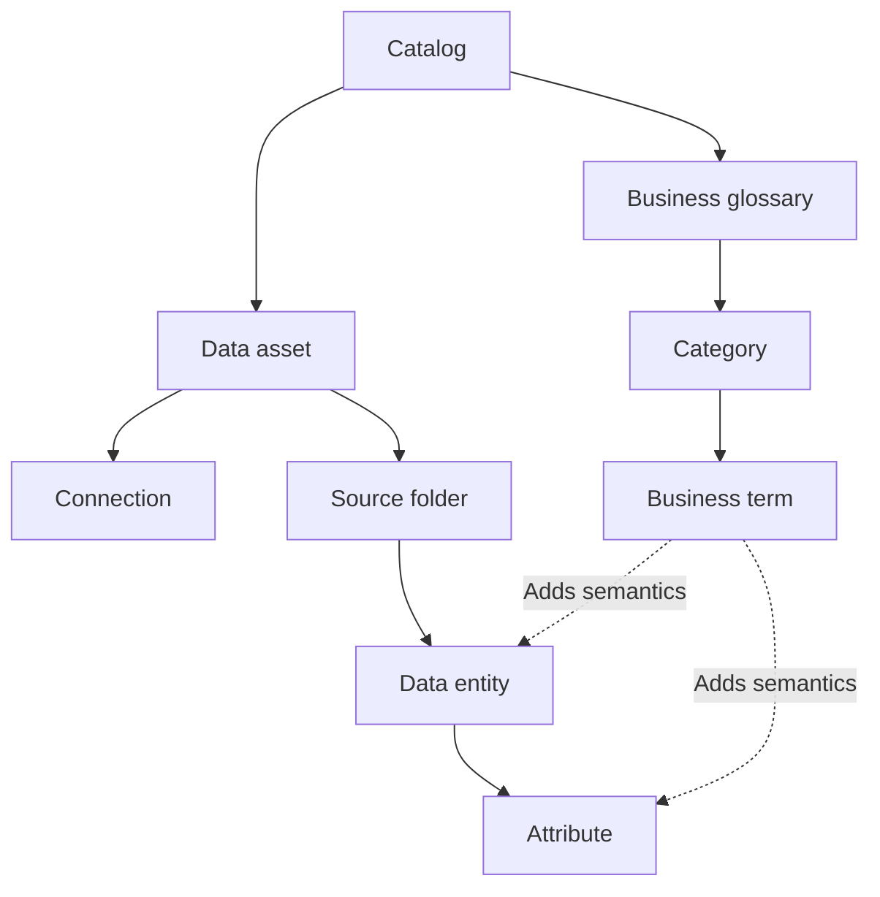

# Data Catalog and Data Metadata Management

## 1. Objectives and Problem Statement

In the **Data and Analytics** chapter of the **CLOUD_PROVIDERS_ORACLE** module, this lesson introduces OCI Data Catalog and how to operate metadata for data in Oracle Database, Object Storage, and supported sources.

An organization may already have databases, object stores, and analytics pipelines deployed, yet users still run into questions:

- Which table holds order data used for reporting?
- Is the `AMOUNT` column pre- or post-discount, and in which currency?
- Which set of files is the official dataset, and who owns it?
- Does the metadata currently shown reflect the current source structure?
- If a column changes, which pipelines and reports could be impacted?
- Once data is found, where do you request access?

OCI Data Catalog supports metadata discovery and management, connecting technical information with business context. The service provides harvesting from supported sources, glossaries, custom properties, tags, and metadata search. [Overview of Oracle Data Catalog](https://docs.oracle.com/en-us/iaas/Content/data-catalog/using/overview.htm).

After completing this lesson, you will be able to register data sources, organize metadata, run harvests, enrich business definitions, and design update workflows with access control, monitoring, and cost control.

The running example uses order data from a sales system. Resource names, addresses, and values in the examples are illustrative and must be replaced with values from your lab environment.

## 2. What Questions Does Metadata Answer?

### 2.1. Three Complementary Metadata Groups

Metadata is information describing data, its structure, its semantics, or how it is governed. A useful description typically spans three groups:

| Group | Example for Orders | Question Answered |
| --- | --- | --- |
| Technical | Schema, table, columns, data types, file paths | Where does the data live and what is its structure? |
| Business | Revenue definition, currency unit, owner, intended usage | What does the data mean and how should it be used? |
| Operational | Last successful load, harvest time, refresh schedule, check results | As of when are the data and metadata trustworthy? |

Operational fields are not necessarily harvested automatically by Data Catalog from every source. They may need to come from pipelines or observability systems and be published via a separate process, through appropriate properties or links to an authoritative system.

For example, a column typed `NUMBER(18,2)` does not tell you whether it holds VND or USD. A table harvested successfully this morning also does not prove the table's data was loaded this morning.

### 2.2. Distinguishing Source Data from Catalog Descriptions

The catalog manages descriptions for discovering and understanding data. Source datasets remain in databases, Object Storage, or their respective services.

Harvesting metadata does not mean copying all business data into the catalog. However, to infer structure for certain file types, the harvester may require permission to read source objects; "managing metadata only" does not imply needing permission only to list filenames. Verify permissions and behavior per connector. [Oracle Documentation on Setting Up Data Catalog Sources](https://docs.oracle.com/en-us/iaas/Content/data-catalog/using/setup-source.htm).

Catalog descriptions can reveal system names, paths, and sensitive data context. Therefore, metadata itself must be classified and access-controlled; never copy tokens, passwords, secret share URLs, or real customer records into descriptions.

### 2.3. Four Things a Catalog Does Not Prove by Itself

| Information Seen in Catalog | Additional Verification Required |
| --- | --- |
| Table and columns are listed | Is the actual data complete, accurate, and loaded on time? |
| Tagged "Sensitive" | Have IAM, database, and storage layers restricted access? |
| Term or status marked approved | Who approved it, for what scope, and when must it be reviewed? |
| Lineage diagram present | Which pipelines provided lineage, and what parts are missing? |

The catalog helps humans make informed decisions. Decisions on access control, data quality, and usage still require enforcement in the underlying systems.

## 3. Object Model in OCI Data Catalog

### 3.1. From Catalog to Attribute

| Concept | Meaning | Illustrative Example |
| --- | --- | --- |
| Catalog | Resource containing and managing metadata | `enterprise-data-catalog` |
| Data asset | Represents a data source | Sales database or Object Storage source |
| Connection | Details for connecting to a data asset | Endpoint, authentication method, and connector parameters |
| Folder | Metadata hierarchy per source type | Database schema or object container group |
| Data entity | A structured dataset | Table, view, file, or logical data entity |
| Attribute | Component of an entity | Table column or field inside a file |
| Harvest job | Task that extracts metadata | Scheduled harvest of schema `SALES` |

A data asset can have multiple connections. The catalog holds metadata about sources, whereas a connection defines the connectivity path to a source; the two concepts are not interchangeable. [Oracle Data Catalog Concepts](https://docs.oracle.com/en-us/iaas/Content/data-catalog/using/overview.htm).

For databases, entities are typically tables or views and attributes are columns. For Object Storage, recognized objects depend on file types and logical entity organization. Verify supported sources, versions, and file types before deploying. [Oracle Documentation on Harvesting Technical Metadata](https://docs.oracle.com/en-us/iaas/Content/data-catalog/using/harvest-technical-metadata.htm).



The diagram illustrates conceptual relationships. Exact folder hierarchy and display depend on the data asset type.

### 3.2. Technical Identifiers Matter More Than Display Names

A catalog is identified by an OCID. Objects such as data assets have their own keys within the catalog; these keys are neither display names nor OCIDs. When writing commands or API integrations, always use the exact identifier type required. [Oracle Documentation on Identifier Variables in Data Catalog Policies](https://docs.oracle.com/en-us/iaas/Content/data-catalog/using/policies.htm).

For example, `SALES_ORDER` might exist in both test and production sources. To identify the right object, inspect the catalog, data asset, source path, environment, and entity key.

Never treat display names as unique keys across automated systems. If a source is recreated or renamed, verify identifier mapping and annotations rather than assuming they automatically carry over as desired.

### 3.3. Data Catalog and Data Catalog Metastore Serve Two Needs

Data Catalog supports data discovery and metadata semantics governance. Data Catalog Metastore provides a Hive-compatible metadata store for structures such as databases, tables, and partitions used by processing engines like Spark. [Oracle Documentation on Data Catalog Metastore](https://docs.oracle.com/en-us/iaas/Content/data-catalog/using/metastore.htm).

For example:

- An analyst searches "Order Revenue" in the catalog to locate the right dataset and point of contact.
- A Data Flow application uses the metastore to look up table definitions for processing data.

Creating a glossary does not automatically create a Spark table. Conversely, having a table definition in the metastore does not supply full business definitions or ownership.

## 4. Designing a Minimum Metadata Set

### 4.1. Pick a Dataset to Clarify Semantics

Suppose an Oracle Database source contains table `SALES.SALES_ORDER`:

```sql
-- Illustrative structure for the lab environment.
CREATE TABLE sales_order (
    order_id        NUMBER(18) PRIMARY KEY,
    customer_id     NUMBER(18) NOT NULL,
    order_time      TIMESTAMP NOT NULL,
    currency_code   VARCHAR2(3) NOT NULL,
    gross_amount    NUMBER(18,2) NOT NULL,
    discount_amount NUMBER(18,2) NOT NULL,
    order_status    VARCHAR2(20) NOT NULL
);

COMMENT ON COLUMN sales_order.gross_amount
    IS 'Order amount before discount, in currency_code';
```

The schema name depends on the user creating the table in the lab. This DDL describes an illustrative source; you do not need to run it on a production database to learn the metadata model.

The harvester can collect table names, column names, data types, and source comments supported by the connector. The data owner still must confirm:

- Does one row represent an order or a change-history version of an order?
- Which timezone does `ORDER_TIME` use?
- On cancellation or refund, is the amount modified or recorded as a separate event?
- Which reports must exclude cancelled statuses?
- Can currency amounts be summed directly, or must they be converted?

These answers directly determine report accuracy yet cannot be inferred from column names alone.

### 4.2. Recommended Internal Attribute Set

| Attribute | Illustrative Value | Governance Rule |
| --- | --- | --- |
| Data Owner | Sales Operations team | Accountable for purpose and usage authorization |
| Data Steward | Sales Data Governance team | Maintains definitions and annotations |
| Environment | `Production` | Distinguishes real sources from lab/non-production |
| Sensitivity | `Confidential` | Follows the organization's approved classification tier |
| Business Grain | One row is one current order | Must be verified against the source model |
| Currency Rule | Amounts pair with `CURRENCY_CODE` | Never sum across different currencies directly |
| Expected Refresh | Hourly | Pipeline commitment, not the harvest schedule |
| Review Status | `Draft` or `Reviewed` | Organization-defined status |
| Access Request | Link to access-request workflow | Must not contain credentials |
| Last Business Review | Timestamp of steward verification | Backed by review schedule and owner |

This is an illustrative attribute set, not a fixed list of built-in OCI fields. It can be implemented using custom properties, descriptions, or links to external systems depending on supported data types and object types.

OCI lets you define custom properties to add context and select applicable object types. When appropriate, use controlled lists of values to prevent variants like `Prod`, `PROD`, and `Production` referring to the same environment. [Oracle Documentation on Custom Properties](https://docs.oracle.com/en-us/iaas/Content/data-catalog/using/custom-properties.htm), [Oracle Tutorial on Configuring Custom Properties](https://docs.oracle.com/en-us/iaas/Content/data-catalog/tutorials/custom-properties/custom-properties-overview.htm).

### 4.3. Separate Definitions from Current Operational Status

"Updated hourly" is an expected schedule; "last successful load" is an operational observation. With only the first field, users could unknowingly consume data that stopped updating days ago.

Distinguish at least:

```text
Source data watermark:
  Business-time boundary of data already present in the dataset.

Last successful pipeline run:
  Most recent successful data processing or load execution.

Last successful harvest:
  Most recent successful metadata collection run.

Last business review:
  Most recent verification of definitions/context by the responsible steward.
```

These timestamps may live in different systems. When publishing them in the catalog, state the source and meaning clearly rather than labeling everything generically as "Last Updated" and leaving users to guess.

## 5. Preparing Permissions and Connectivity

### 5.1. Separate Three Permission Groups

| Principal | Permissions to Evaluate | Example |
| --- | --- | --- |
| Catalog user | Discover or edit metadata | Analyst reads descriptions; steward updates glossary |
| Catalog/harvester | Access source via connector method | Resource principal reads Object Storage |
| Data consumer | Read or process data at the source | Database account or workload with object read access |

Permission to read metadata does not grant `SELECT` privileges on Oracle Database. Conversely, a source-reading account does not automatically hold permissions to edit the catalog glossary.

You can grant catalog permissions using specific resource types such as `data-catalogs`, `data-catalog-data-assets`, `data-catalog-glossaries`, and `data-catalog-namespaces`, rather than giving everyone full administrative rights. Conditions scoped by catalog or object must align with supported APIs. [Oracle Documentation on Data Catalog Policies](https://docs.oracle.com/en-us/iaas/Content/data-catalog/using/policies.htm).

Roles like owner, steward, and consumer in this lesson are organizational assignments. Filling an owner's name into a custom property does not automatically create an IAM policy for that person.

### 5.2. Prepare Source Permissions Within Real Scope

For databases, the DBA should provision an account or authentication method with least-privilege access to harvest selected objects. Avoid using a database administrator account merely to simplify connectivity.

For Object Storage, configure resource principals/dynamic groups and IAM per the connector guide. Review permissions on namespaces, buckets, and objects; narrow scope to the specific compartments or buckets needed where supported by policies.

Do not treat "harvest found no tables" as an excuse to grant broad admin privileges immediately. Check the selected schema, source privileges, supported object types, and job configuration. An empty list often reflects restricted visibility permissions.

### 5.3. Private Connectivity Is Part of Infrastructure Design

Data Catalog can use private endpoints to reach private sources, including on-premises sources connected to a VCN via VPN or FastConnect. Prepare DNS, routes, and network rules matching the source. [Oracle Documentation on Private Networks for Data Catalog](https://docs.oracle.com/en-us/iaas/Content/data-catalog/using/private-network.htm).

High-level workflow:

1. Identify VCN, subnet, source endpoint, and name resolution.
2. Create a private endpoint for Data Catalog with appropriate network/DNS settings.
3. Attach the private endpoint to the catalog.
4. Select private endpoint usage when configuring the data asset.
5. Test the connection before running a harvest.

The endpoint must be created and attached before enabling the private option in the data asset. [Oracle Documentation on Creating a Private Endpoint](https://docs.oracle.com/en-us/iaas/Content/data-catalog/using/pe-create.htm), [Using Private Endpoints](https://docs.oracle.com/en-us/iaas/Content/data-catalog/using/pe-use.htm).

The harvester's network path and an analyst's access path are separate. The harvester reaching a database does not mean an analyst's workstation has network reachability or credentials for it.

## 6. Metadata Harvesting Workflow

### 6.1. Register the Right Source, Choose a Bounded Scope

For the `SALES.SALES_ORDER` example, the hands-on workflow is:

1. Create or select a catalog in the metadata compartment.
2. Create a data asset using the supported Oracle Database type.
3. Add a connection with the lab environment's endpoint and auth method.
4. Confirm the connection reaches the source.
5. Select the schema and objects to harvest, starting with the sample table.
6. Create a job and run it once to inspect results.
7. Open the entity and compare columns and data types against the source.

Before starting, confirm source version, connector, and supported metadata. For unsupported file types, the harvester may capture only basic details such as name and path; that differs from parsing internal field structures. [Oracle Documentation on Supported Sources and File Types](https://docs.oracle.com/en-us/iaas/Content/data-catalog/using/harvest-technical-metadata.htm).

Starting small helps isolate permission, network, and configuration issues before scanning many schemas or buckets. Do not pull every test source, temporary file, and deprecated dataset into the catalog simply because you can list them.

### 6.2. Distinguish Job Configuration from Execution Runs

A job defines the harvest configuration; each execution run has its own timestamp and outcome. In the Console, users can run immediately, schedule, or save configurations for later; Jobs is where run outcomes are tracked. [Oracle Documentation on Harvesting a Data Asset](https://docs.oracle.com/en-us/iaas/Content/data-catalog/using/harvest-asset.htm).

Record or observe:

```text
Catalog and data asset
Connection used
Schema/entity or bucket/file scope
Start and end timestamps
Execution outcome and error details
Objects selected vs. actually harvested
Objects skipped or unprocessed
```

A completed job does not prove all organizational data has been covered. It reflects only that run with its configured scope, permissions, and options.

### 6.3. Full vs. Incremental Harvest

Incremental harvest on subsequent runs focuses on entities changed since the prior run according to service-supported mechanisms. This feature does not apply uniformly to all data asset types; check connector support before choosing it. [Oracle Documentation on Incremental Harvest Options](https://docs.oracle.com/en-us/iaas/Content/data-catalog/using/harvest-asset.htm).

Harvesting collects metadata—it is not CDC for replicating individual business row changes. Inserting new orders into a table does not alter the table's structural metadata.

When picking a schedule, consider schema change velocity, pipeline run timing, and consumer demand. Do not increase scan frequency merely because data loads continuously if schemas rarely change and metadata freshness does not demand it.

### 6.4. Testing Structural Changes and Annotations

In the lab, you can add a column to the source table, re-run the harvest, and inspect the new attribute. Also check existing annotations to observe update behavior for your source type.

For renames, object deletions, recreated sources, or job scope changes, verify how the catalog represents changes. Do not assume every connector automatically deletes stale metadata or preserves annotations on recreated objects.

A change workflow should verify:

- Which entities/attributes are new or modified.
- Which objects no longer exist or are no longer visible at the source.
- Which terms, owners, and descriptions need review.
- Which lineage links require updating.
- Whether users need to be notified that an older object is deprecated.

## 7. Organizing Object Storage Metadata

### 7.1. One Dataset Can Span Many Objects

Suppose bucket `analytics-raw` contains these objects:

```text
orders/dt=2026-11-18/part-0001.parquet
orders/dt=2026-11-18/part-0002.parquet
orders/dt=2026-11-19/part-0001.parquet
customers/dt=2026-11-19/part-0001.parquet
```

From a business standpoint, the first three files belong to the same orders dataset. If every file appears as a separate searchable entity, the catalog becomes hard to navigate as object counts grow.

OCI Data Catalog supports filename patterns to group files into logical data entities. Create the pattern, attach it to the data asset, and harvest to verify grouping results. [Oracle Documentation on Logical Data Entities](https://docs.oracle.com/en-us/iaas/Content/data-catalog/using/logical-entities.htm).

In the example, the goal is to group files belonging to `orders` while keeping `customers` as a separate entity. Actual patterns must conform to path conventions and expressions supported by the service.

### 7.2. Proper Grouping Must Pair with Structural Checks

When designing patterns, verify:

- Directory names and partition segments follow a consistent convention.
- Temporary files, duplicates, and incompatible versions are cleanly excluded.
- Orders and customers are not accidentally grouped together merely for sharing `.parquet` extensions.
- Field semantics and types are compatible across the logical entity.
- Whether unmatched files are ignored per job options.

Inspect the files attached to the logical entity and the harvested attributes. One object can match multiple patterns, so check for overlapping logical entities. [Oracle Documentation on Viewing Harvested Logical Data Entities](https://docs.oracle.com/en-us/iaas/Content/data-catalog/using/logical-entities-view-harvest.htm).

Logical entities organize metadata. They do not physically merge files, repair incompatible schemas, or create a table queryable across every processing engine.

### 7.3. Maintain Path Conventions Like a Contract

Data producers must notify consumers when changing prefixes, partitions, or file layouts. Catalog administrators then update patterns, harvest scopes, and annotations accordingly.

For instance, replacing `orders/` with `orders_v2/` may create a new group requiring its own owner and definition. Do not simply rename the old entity's display name and ignore underlying source and schema changes.

## 8. Adding Glossaries, Custom Properties, and Tags

### 8.1. Glossaries Standardize Business Concepts

An illustrative glossary:

```text
Sales
├── Orders
│   ├── Order ID
│   └── Order Timestamp
└── Transaction Value
    ├── Gross Order Value
    └── Order Discount
```

In OCI, glossaries organize categories and terms; terms live inside categories and carry definitions, owners, and statuses. [Oracle Documentation on Creating a Business Glossary](https://docs.oracle.com/en-us/iaas/Content/data-catalog/using/create-glossary.htm), [Creating Terms](https://docs.oracle.com/en-us/iaas/Content/data-catalog/using/create-glossary-term.htm).

A term "Gross Order Value" could be defined as:

```text
Definition:
  Total value of an order prior to discounts,
  expressed in the currency code attached to the order.

Scope:
  Current order data from the sales system.

Usage Rules:
  When aggregating, group by currency code or apply an approved
  conversion process. Filter by order status per reporting intent.

Owner:
  Sales Operations business team.
```

This is an example definition, not a universal revenue rule for every organization. Business owners must approve calculations, recognition timing, and exceptions for real systems.

### 8.2. Linking Terms to the Right Entities or Attributes

Link the term "Order ID" to `ORDER_ID` and "Gross Order Value" to `GROSS_AMOUNT`, and add dataset descriptions at the entity level. OCI supports linking glossary categories/terms to entities and attributes to enrich metadata. [Oracle Documentation on Linking Glossary Terms to Data Objects](https://docs.oracle.com/en-us/iaas/Content/data-catalog/using/link-glossary-terms.htm).

Do not attach an overly broad term to every column just to boost linkage metrics. For example, tagging `GROSS_AMOUNT`, `DISCOUNT_AMOUNT`, and `CUSTOMER_ID` all as "Revenue" may inflate search hits while corrupting semantics.

When a term definition changes, inspect linked objects and review impacts. Updating a term description does not automatically change formulas inside pipelines or dashboards.

### 8.3. Choosing Annotation Tools by Purpose

| Tool | Best Suited For | Example |
| --- | --- | --- |
| Business glossary | Shared concepts with formal definitions and owners | Customer ID, gross order value |
| Custom property | Structured fields for entry and filtering | Owner, environment, sensitivity level |
| Data Catalog tag | Discovery keywords | `sales`, `legacy`, `pilot` |
| Description | Explanations, caveats, and usage notes | Row grain, historical limitations |

These are the metadata-enrichment mechanisms provided by OCI. [Oracle Documentation on Enriching Technical Metadata](https://docs.oracle.com/en-us/iaas/Content/data-catalog/using/enrich-metadata.htm).

Distinguish Data Catalog tags used for describing data from OCI resource tags used for cloud resource management. Never assume a label in the catalog automatically becomes an IAM condition or enables database masking.

### 8.4. Approval Workflows Need Real Accountability

The stewardship team should agree on who proposes, who reviews, who changes approval status, and when periodic reviews occur. Having a status field does not mean every approval step is automated or enforced.

OCI supports managing permissions on glossaries; your organization's term governance workflow should be reflected in permissions and operating practices. [Oracle Documentation on Managing Business Glossaries](https://docs.oracle.com/en-us/iaas/Content/data-catalog/using/manage-glossary.htm).

Glossaries can be exported/imported in supported formats. When doing so, verify owners, statuses, custom properties, and relationships after import; do not treat glossary export as a full backup of all catalog metadata, connections, and lineage. [Oracle Documentation on Exporting/Importing Glossaries](https://docs.oracle.com/en-us/iaas/Content/data-catalog/using/exp-imp-glossary.htm).

## 9. Lineage and Impact Analysis

### 9.1. Lineage Requires Metadata Producers

Lineage describes the journey of data across processing steps. Example:


This is a designer-drawn illustrative flow, not proof that OCI automatically detected every edge.

Data Catalog can ingest lineage from integrations such as Data Integration, Data Flow, and supported custom sources. Collection, permissions, and metadata integration must be configured accordingly; harvesting a single table does not automatically reconstruct transformation history across every pipeline. [Oracle Overview of Data Lineage](https://docs.oracle.com/en-us/iaas/Content/data-catalog/using/view-data-lineage-dis.htm).

### 9.2. Integration Must Be Configured per Processing Tool

For Data Flow, enabling lineage collection sends Spark job lineage metadata to Data Catalog via the integration mechanism. [Oracle Documentation on Data Flow Lineage](https://docs.oracle.com/en-us/iaas/Content/data-flow/using/data-lineage-about.htm).

For custom applications, OCI provides lineage ingestion mechanisms; payloads and application types must match API capabilities rather than being arbitrary diagrams. [Oracle Tutorial on Custom Lineage](https://docs.oracle.com/en-us/iaas/Content/data-catalog/tutorials/publish-custom-lineage/overview.htm).

Verify whether table-level or column-level lineage is complete for the task/operator types in use. Where part of a pipeline does not yet emit metadata, document the gap and link to documentation or owners.

### 9.3. Use Lineage to Ask the Right Questions Before Changes

Before modifying or dropping `GROSS_AMOUNT`, identify the source entity, transformation steps, and downstream consumers. Then inspect actual pipelines to uncover dependencies not yet captured in the catalog.

Lineage assists impact analysis; the absence of an edge to a report does not prove that report has no dependency on the data. Track lineage coverage as an explicit metric.

## 10. Hands-On Lab with Oracle Database and Object Storage

### 10.1. Prepare the Lab

Prepare the following components in an authorized environment:

- A catalog in the chosen region and metadata compartment.
- An Oracle Database source of a connector-supported type/version.
- A sample orders table containing no real personal data.
- A lab bucket holding files with a known structure.
- Verified catalog user permissions, harvester permissions, and source connectivity.
- A test analyst account with metadata-only permissions.

Never place credentials into descriptive fields. If using private connectivity, complete private endpoints, DNS, and network paths before troubleshooting harvest errors at the application layer.

### 10.2. Register and Harvest Two Sources

Start with the database:

1. Create a data asset named to reflect source and environment, e.g., `sales-db-lab`.
2. Add a connection matching the source type.
3. Select the schema holding `SALES_ORDER` and harvest the table.
4. Compare collected column counts, names, data types, and comments against the source.
5. Record the catalog OCID, data asset key, entity key, and harvest timestamp.

Next, proceed with Object Storage:

1. Create a data asset for the Object Storage source and select an appropriate connection.
2. Select the lab bucket/scope.
3. Create and attach filename patterns if building logical entities.
4. Harvest, then confirm `orders` and `customers` are organized properly.
5. Inspect the files and attributes of the logical entity; check unmatched files.

Before choosing "Add All," define the authorized scope and what users genuinely need to discover. Object Storage source setup must follow actual connectivity and IAM models. [Oracle Tutorial on Harvesting Object Storage](https://docs.oracle.com/en-us/iaas/Content/data-catalog/tutorials/harvest-object-storage/overview.htm).

### 10.3. Enrich and Test Discoverability

Create the glossary and agreed terms. Link terms to exact entities/attributes, then populate owner, environment, classification, and access-request links.

Use the analyst account to test:

- Searching by technical name `SALES_ORDER`.
- Searching by keywords or linked business terms.
- Distinguishing the lab source from a production source if both exist.
- Identifying the owner and access-request process.
- Checking usage caveats and when metadata was last collected.

Evaluate whether users locate the **right object**, not merely whether a query returns many hits.

Some term-linking actions may require the Console per documented product capabilities; do not assume every UI action has a 1:1 CLI/API equivalent. [Oracle Documentation on Linking Terms to Entities](https://docs.oracle.com/en-us/iaas/Content/data-catalog/using/link-glossary-terms-link-data-entities.htm).

### 10.4. Test a Controlled Structural Change

In the lab database, add a column:

```sql
ALTER TABLE sales_order
    ADD (sales_channel VARCHAR2(30));

COMMENT ON COLUMN sales_order.sales_channel
    IS 'Order intake channel in the source system';
```

Re-run the harvest as appropriate for the connector. Verify the new column appears, existing annotations remain accurate, and whether the glossary needs a new concept for "Order Intake Channel."

This lab step validates structural update behavior for the current source. It does not test every rename/drop scenario, every connector, or column data quality.

### 10.5. Target Verification Checklist

| Check | Expected Result | Evidence |
| --- | --- | --- |
| Database harvested | Selected lab table/columns have accurate metadata | Job run and entity/attributes |
| Object Storage harvested | Files or logical entities organized properly | File list and attributes |
| Clear semantics | Users understand amounts, grain, and usage limits | Terms and descriptions |
| Clear accountability | Every critical dataset has an owner/steward | Published property or link |
| Accurate discovery | Analyst finds the right source and environment | Consumer role test results |
| Separated permissions | Reading catalog grants no source data access | Policies and source access test |
| Schema update reflected | New attribute appears after harvest | Before/after comparison |
| Timestamps explained | Fresh harvest not confused with fresh data | Distinct timestamps and sources |
| Scoped lineage | Know which edges come from integration vs. gaps | Configuration and lineage graph |

Record results by object and timestamp. If no lineage-emitting pipeline is deployed in the lab, mark that item as not practiced rather than drawing a diagram and claiming it was auto-collected.

## 11. Reading Metadata via OCI CLI

The commands below use Bash with a configured OCI CLI. They only read metadata and do not create catalogs, run harvests, or alter source data.

### 11.1. List Catalogs in a Compartment

```bash
OCI_PROFILE='CATALOG_LAB'
OCI_REGION='<catalog-region>'
METADATA_COMPARTMENT_ID='<metadata-compartment-OCID>'

oci data-catalog catalog list \
  --compartment-id "$METADATA_COMPARTMENT_ID" \
  --all \
  --profile "$OCI_PROFILE" \
  --region "$OCI_REGION"
```

Select the catalog for the target environment from the output and grab its identifier. This command lists only within the specified compartment/region; an empty result does not prove no catalogs exist elsewhere. [Oracle CLI Reference for catalog list](https://docs.oracle.com/en-us/iaas/tools/oci-cli/latest/oci_cli_docs/cmdref/data-catalog/catalog/list.html).

### 11.2. List Data Assets

```bash
CATALOG_ID='<catalog-OCID>'

oci data-catalog data-asset list \
  --catalog-id "$CATALOG_ID" \
  --all \
  --profile "$OCI_PROFILE" \
  --region "$OCI_REGION"
```

Retrieve the target data asset's key rather than substituting a display name or source database OCID. [Oracle CLI Reference for data-asset list](https://docs.oracle.com/en-us/iaas/tools/oci-cli/latest/oci_cli_docs/cmdref/data-catalog/data-asset/list.html).

### 11.3. List Entities in a Data Asset

```bash
DATA_ASSET_KEY='<data-asset-key>'

oci data-catalog entity list \
  --catalog-id "$CATALOG_ID" \
  --data-asset-key "$DATA_ASSET_KEY" \
  --all \
  --profile "$OCI_PROFILE" \
  --region "$OCI_REGION"
```

The command group is `entity`. Compare path, folder, and source name to select the right table or file group. [Oracle CLI Reference for entity list](https://docs.oracle.com/en-us/iaas/tools/oci-cli/latest/oci_cli_docs/cmdref/data-catalog/entity/list.html).

### 11.4. List Attributes

```bash
ENTITY_KEY='<entity-key>'

oci data-catalog attribute list \
  --catalog-id "$CATALOG_ID" \
  --data-asset-key "$DATA_ASSET_KEY" \
  --entity-key "$ENTITY_KEY" \
  --all \
  --profile "$OCI_PROFILE" \
  --region "$OCI_REGION"
```

Compare retrieved attributes against the entity and lab source. These commands can be used in metadata-audit scripts, provided pagination, permission errors, and deployment regions are handled properly. [Oracle CLI Reference for attribute list](https://docs.oracle.com/en-us/iaas/tools/oci-cli/latest/oci_cli_docs/cmdref/data-catalog/attribute/list.html).

In automation, never turn an API error into an empty list and conclude an entity or attribute does not exist. Always log the executing principal, region, catalog, and timestamp for diagnostics.

## 12. Operating Metadata as a Data Product

### 12.1. Assigning Responsibilities

| Organizational Role | Primary Responsibility |
| --- | --- |
| Source owner | Communicate schema changes and maintain appropriate permissions/connectivity |
| Data Owner | Confirm intended usage, classification, and access criteria |
| Data Steward | Maintain terms, annotations, review statuses, and resolve feedback |
| Data platform engineer | Operate catalog, connections, harvest schedules, and integrations |
| Consumer | Use within approved scope; report inaccurate or missing metadata |
| Security team | Audit access policies and sensitive metadata exposure |

Never point every owner field to an individual personal account with no handoff plan. Publish functional group names and request channels while managing IAM access with proper identities.

### 12.2. Metrics Worth Tracking

The metrics below are recommended governance indicators; not all of them exist natively as out-of-the-box service metrics:

- Percentage of priority sources cataloged compared against an independent source inventory.
- Percentage of critical entities with an owner and meaningful description.
- Percentage of key fields linked to accurate terms.
- Time elapsed from schema change to metadata update.
- Time elapsed since the last successful harvest.
- Consecutive job failures and time to resolution.
- Percentage of objects overdue for business review.
- Lineage coverage across in-scope pipelines.

Example:

```text
Priority source coverage =
  Priority sources registered and satisfactorily harvested
  / Total priority sources in the approved inventory
```

Do not use the catalog's own data asset list as the denominator. Doing so misses sources that were never registered in the first place.

Set metadata freshness targets based on risk and source change velocity. A stable schema requires a different schedule from a rapidly evolving data zone.

### 12.3. Layer-by-Layer Monitoring and Diagnostics

| Symptom | Check First |
| --- | --- |
| Cannot list schemas/entities | Source permissions, selected scope, object types, and connector |
| Connection fails | Endpoint, credentials, DNS, routes, security rules |
| Job succeeds yet expected metadata is missing | Selected objects, filters, file patterns, and read permissions |
| Too many or overlapping logical entities | Path conventions and applied patterns |
| New column not visible | Most recent run, job scope, harvest mode, and source schema |
| Multiple hard-to-distinguish hits | Environment, path, business name, and description |
| Broken lineage | Lineage emission config, permissions, task types, and object mapping |
| Marked "Reviewed" yet definition is wrong | Stewardship workflow and review timestamp |

Inspect job details for the actual scope before re-running an entire source. Blind retries will not fix expired credentials or broken patterns.

Changes to credentials, endpoints, networking, or ownership must update operational runbooks. After changes, test connections, run an appropriate harvest, and verify critical objects.

### 12.4. Controlling Costs and Load on Sources

Choosing harvest frequency and scope must account for object counts, source capacity, networking, and supporting services. Separate service charges under current pricing from storage read requests, source queries, logging, or auxiliary infrastructure costs that may accrue.

Practical controls include:

- Register only sources with clear usage and ownership.
- Separate critical scopes from fast-changing experimental zones.
- Use logical entities where appropriate to prevent metadata fragmentation.
- Use incremental harvests for supported sources and suitable workloads.
- Schedule jobs to avoid unnecessary load during peak business hours.
- Measure runtime and object counts before expanding scope.

Do not arbitrarily cut harvest frequency if consumers depend on fresh metadata to deploy pipelines. Agree on freshness targets, then measure whether the design meets them.

### 12.5. Recovery and Environment Promotion

Store source descriptions, secret-free deployment configs, pattern conventions, custom property definitions, and stewardship procedures in version control.

Glossaries can use supported export/import mechanisms, while other components require dedicated plans. Test restoring or recreating the catalog, reconnecting sources, re-harvesting, and reviewing annotations/lineage within needed scopes.

If a catalog or source experiences an outage, users must be aware of how stale displayed info may be. Being able to open a metadata page does not replace confirming that source data and pipelines are still healthy.

## 13. Lab Completion Criteria

A lab implementation succeeds when the learner can:

- Explain catalogs, data assets, connections, entities, and attributes using concrete sources.
- Harvest at least one supported table or file collection.
- Add terms, owners, and appropriate structured metadata.
- Locate the exact target object using a consumer role.
- Distinguish metadata access permissions from underlying data access permissions.
- Demonstrate a schema change reflected after re-harvesting.
- Identify the source and limitations of freshness, quality, and lineage info.
- Define a refresh schedule, failure-handling procedure, and accountable owner.

Data Catalog's value comes from helping users find the right data, understand its exact meaning, and request access within approved governance. To preserve that value, technical metadata must stay aligned with business context and verifiable operational signals.
