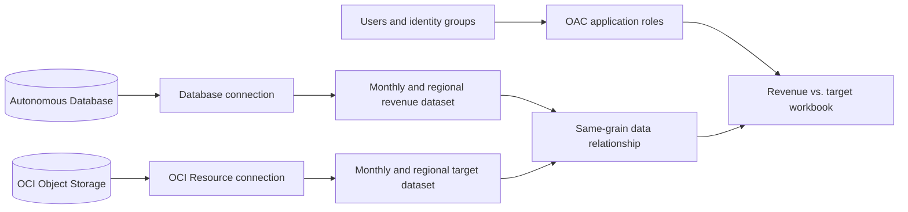
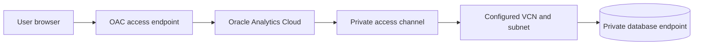

# Oracle Analytics Cloud and Connecting OCI Data Sources

## 1. Objectives and Context

In the **Data and Analytics** chapter of the Oracle Cloud Infrastructure (OCI) module, Oracle Analytics Cloud (OAC) turns data into decision-ready insights. A complete analytics system also depends on trustworthy data sources, proper network paths, least-privilege identities, and observable refresh workflows.

The running example is an enterprise storing revenue in Autonomous Database and sales targets in OCI Object Storage. The analytics team needs a workbook comparing revenue against targets by month and region. The infrastructure team owns compartments, IAM, and VCNs; the data team owns schemas and data quality; report viewers only need permission to consume published content.

After completing this lesson, you will be able to:

- Distinguish connections, datasets, semantic models, and workbooks.
- Choose OCI data-source connectivity approaches and understand the roles of TLS, wallets, and private access channels.
- Structure layered permissions rather than using a single admin account for everything.
- Build a hands-on flow from Autonomous Database and Object Storage to a workbook with verifiable results.
- Design load schedules, monitoring, recovery, and cost controls for an analytics pipeline.

The exercises describe operations in a lab environment. Compartment, group, schema, and resource names are illustrative and must be replaced with values from your actual environment. Reading this lesson does not provision OCI resources or execute the statements below.

## 2. Components in an Analytics Flow

| Component | Responsibility | Example in This Lesson |
| --- | --- | --- |
| Data source | Stores source data and enforces source-level privileges | Revenue view in Autonomous Database; targets file in a bucket |
| Connection | Describes how to access a source, auth mechanism, and parameters | `CONN_SALES_ADB`, `CONN_TARGETS_OCI` |
| Dataset | Selects tables or files, data types, transformations, and relationships | `DS_SALES_MONTHLY`, `DS_TARGETS_MONTHLY` |
| Semantic model | Standardizes shared dimensions, measures, joins, and access rules | Net revenue, business month, sales region definitions |
| Workbook | Presents, filters, and explores data through visualizations | `WB_SALES_VS_TARGET` |

Datasets are well suited for starting analytics in a bounded scope. When multiple teams share definitions such as "net revenue," manage shared definitions centrally rather than letting each workbook calculate them independently. Semantic models serve that governance need, though they are not a mandatory prerequisite for every workbook.

A successful connection verifies only part of the flow. An account may log in yet lack privileges to read a view; a dataset may load yet join on the wrong key; a chart may render quickly while displaying yesterday's data. Therefore, verify connectivity, data permissions, aggregation accuracy, and data freshness.

Conceptual flow of the example:



This diagram shows logical data and permission flows. It does not imply OAC runs as a Compute VM placed directly inside a customer subnet.

## 3. Choosing Data Sources and Connectivity Paths

### 3.1. Autonomous Database and Relational Sources

Autonomous Database fits this example because revenue needs to be validated, aggregated in SQL, and exposed through a stable view. For Oracle Database sources running on OCI database services or Compute, verify supported connectors, versions, authentication methods, and network paths before configuring.

In newer Oracle documentation, you may see the name **Oracle Autonomous AI Lakehouse** for the service line previously commonly called Autonomous Data Warehouse (ADW). Connector labels can vary across updates. Current connection guides support walletless TLS or Mutual TLS with a wallet; your choice must match the database's security configuration. See [Connect to Autonomous AI Lakehouse](https://docs.oracle.com/en/cloud/paas/analytics-cloud/acsds/connect-oracle-autonomous-ai-lakehouse.html).

Do not assume every database in the same tenancy is automatically reachable. A tenancy is an administrative boundary; reachability also depends on DNS, network routes, endpoint policies, and the privileges of the login identity.

### 3.2. Object Storage

Buckets suit target files exported periodically by a business process. OAC supports creating datasets from files such as CSV, XLSX, or TXT in OCI Object Storage. You create an **OCI Resource** connection and then pick files when creating a dataset. This connector is not equivalent to a SQL connection against a bucket and is not universally usable in every OAC modeling tool. See [OCI Resource Connector Scope](https://docs.oracle.com/en/cloud/paas/analytics-cloud/acsds/oci-resource.html).

For large datasets, multiple schema versions, or complex reconciliation checks, consider loading and standardizing data into a data warehouse before exposing it for analysis. That is an architectural choice; you do not need to cram an entire ETL pipeline inside a workbook.

### 3.3. Three Source Access Options

| Option | When to Consider | What to Confirm |
| --- | --- | --- |
| Controlled public endpoint access | Source permits access over public addresses | Allowlisted IP ranges, TLS, and source privileges |
| Private access channel | OAC needs to reach private sources via a VCN and proper routing | Edition, supported connector, DNS, subnet, and network rules |
| Data Gateway | Source resides in a private network suited for an agent | Agent host, reachability to source, and connectivity to OAC |

Base your choice on network policy and connector capabilities. Do not add Data Gateway merely because a source has a private IP if a private access channel satisfies the design, and do not assume a connection working from a personal SQL client automatically works from the OAC service.

## 4. Separating OCI, OAC, and Data Permissions

### 4.1. Responsibility Matrix

| Permission Layer | What It Governs | Example | What It Does Not Replace |
| --- | --- | --- | --- |
| OCI IAM | Operations on OCI cloud resources | Create, view, or scale OAC capacity | Privilege to read a database view |
| OAC application role | Capabilities inside the analytics service | Create workbooks or administer OAC | IAM policy to read bucket objects |
| OAC object permissions | Who can use specific connections, datasets, and content | Share workbook with finance team | Source-level SQL privileges |
| Data-source permissions | Data the connection identity can actually read | `SELECT` on a view; read objects in a bucket | Permission to sign in and use OAC content |

Being allowed to administer an instance in the OCI Console does not automatically grant permission to read all revenue data. Conversely, report viewers rarely need permission to scale capacity or delete instances.

In OAC, **DV Content Author** maps to creating workbooks, connections, and datasets; **BI Content Author** maps to classic analyses, dashboards, and reports; **BI Consumer** is for viewing and running content. **BI Service Administrator** holds broad administrative rights. Exact capabilities also depend on configuration and object-level permissions. See [Predefined Application Roles](https://docs.oracle.com/en/cloud/paas/analytics-cloud/acabi/predefined-application-roles.html).

A lab design should include three personas: infrastructure operator, analytics author, and viewer. Test the viewer experience with a read-only test account; testing only with an admin account never proves permissions are configured properly.

### 4.2. IAM Example for Lab Operators

The example below assumes the group resides in the `Default` identity domain and the policy is placed where it can grant access to compartment `AnalyticsLab`:

```text
Allow group Default/OACLabOperators to manage analytics-instances in compartment AnalyticsLab
Allow group Default/OACLabOperators to read analytics-instance-work-requests in compartment AnalyticsLab
```

These two statements cover managing OAC instances and viewing work requests in the lab. They do not include all permissions needed to create private endpoints, select network resources, or configure an entire VCN. Add network permissions scoped to the required tasks and compartments per design rather than opening the entire tenancy. Resource types and permission levels are illustrated in [Example Policy Statements to Manage Analytics Cloud Instances](https://docs.oracle.com/en-us/iaas/analytics-cloud/doc/example-policy-statements-manage-analytics-cloud-instances.html).

### 4.3. Data Access Identities

For the database, the lab uses the `OAC_READER` account with Basic authentication to focus on the connectivity flow. This account only reads the reporting view. Never use `ADMIN` to work around missing privilege errors.

For OCI Resource, OAC supports using an API key or resource principal. An API key represents the OCI user tied to the key; a resource principal represents an authorized cloud resource. Both require matching IAM policies. Using a resource principal does not automatically grant read access to every bucket. See [Create a Connection to Your OCI Tenancy](https://docs.oracle.com/en/cloud/paas/analytics-cloud/acubi/create-connection-your-oci-tenancy.html).

When using shared credentials inside a connection, treat that credential's read scope as a strict security boundary. If the credential can read all revenue across all regions, a canvas visual filter that users can edit does not isolate regional data securely. Enforce row-level access at the source or in a governed semantic model layer, and also review data export and dataset creation permissions.

## 5. Private Networking: OAC Endpoint vs. Private Access Channel

### 5.1. Two Independent Traffic Directions

The **OAC endpoint** is where browsers or clients reach the analytics service. A **Private Access Channel (PAC)** enables OAC to reach supported private data sources. An OAC instance with a public endpoint can still use a PAC. Conversely, having a private OAC endpoint does not replace configuring a PAC for outbound source access. According to Oracle documentation, PAC requires Enterprise Edition. See [Private Access Channels](https://docs.oracle.com/en-us/iaas/analytics-cloud/doc/private-access-channels.html).



An architecture diagram should explicitly show both directions. Writing only "OAC uses a private endpoint" does not tell operations how OAC reaches the database.

### 5.2. Layers to Verify

When designing a PAC for an OCI database source, verify in this order:

1. **Supportability:** confirm the OAC edition and source type support PAC.
2. **DNS:** determine the source's full hostname and how it resolves inside the target VCN.
3. **Network path:** verify subnets, route tables, and inter-network links if peering or corporate networks are involved.
4. **Security rules:** verify NSGs or security lists for both egress and ingress; open only the actual target service port.
5. **TLS:** match hostname, certificates, and connection details from the database.
6. **Data privileges:** once reachable, confirm the connection identity can read the target view.

Oracle splits private source setup into two stages: configuring the PAC and registering sources in the OCI Console, then creating data connections inside OAC. Modifying a PAC can cause temporary disruption, so schedule changes thoughtfully in critical environments. See [Connecting to Private Data Sources](https://docs.oracle.com/en-us/iaas/analytics-cloud/doc/connecting-private-sources.html).

Do not guess database ports from product names. Obtain the hostname, port, and service name directly from the database's connection details. Never open entire CIDR ranges just to debug an error before knowing whether it lies in DNS, routing, or authentication.

### 5.3. When Using Data Gateway

Data Gateway must run on a host capable of reaching both OAC and the data source. The agent initiates outbound HTTPS connections to OAC over port 443 while maintaining connectivity to the data source. For high availability with multiple agents, every agent must be able to serve shared sources—avoid having agent A reach only source A and agent B reach only source B. See [Frequently Asked Questions for Data Gateway](https://docs.oracle.com/en/cloud/paas/analytics-cloud/acsds/frequently-asked-questions-data-gateway.html).

Data Gateway introduces extra operational components: host servers, patching, sizing, and observability. Choose it only when required by your network topology and connector needs.

## 6. Preparing the Hands-On Lab

### 6.1. Required Resources and Permissions

| Item | Lab Preparation |
| --- | --- |
| Compartment | `AnalyticsLab`; isolated from production |
| OAC | An active instance where authors can create workbooks and datasets |
| Database | Autonomous Database with an approved connectivity path |
| Data schema | `BI_OWNER`, permitted to create tables and views within the lab scope |
| Read account | `OAC_READER`, with `CREATE SESSION` and view read grant below |
| Object Storage | Private bucket `analytics-lab-input`, holding the targets file |
| OCI file-read identity | Technical user and API key for the OCI Resource exercise branch |
| Test users | One author account and one view-only account |

Database accounts should be provisioned by administrators per organizational policy. Enter passwords only in the connection UI—never store them in deployment docs, sample SQL scripts, or repositories. Manage wallets and secrets under the same principle.

The lab can use a restricted public endpoint or a private source over PAC. Pick one fully configured path before starting; never change networking, credentials, and data simultaneously while troubleshooting.

### 6.2. Data Conventions

- Every revenue transaction has an order ID and belongs to a sales region.
- Both revenue and targets are expressed in **million VND**.
- Months are represented by the first day of the month, e.g., `2026-01-01`.
- The reconciliation join key is the pair **month and region code**.
- Each month–region pair has exactly one target row.

These conventions form the example's data contract. If the file producer changes `NORTH` to `North` or switches target units to raw VND, the connection will still succeed while the numbers become wrong.

## 7. Creating Revenue Data and Least-Privilege Read Access

Run the following SQL as `BI_OWNER` in a fresh lab schema. If objects already exist, check state before running; never drop tables actively used by someone else just to rerun the example.

```sql
CREATE TABLE SALES_ORDER (
    ORDER_ID       NUMBER PRIMARY KEY,
    ORDER_DATE     DATE NOT NULL,
    REGION_CODE    VARCHAR2(10) NOT NULL,
    NET_AMOUNT     NUMBER(14, 2) NOT NULL
);

INSERT ALL
    INTO SALES_ORDER VALUES (1001, DATE '2026-01-05', 'NORTH', 1200)
    INTO SALES_ORDER VALUES (1002, DATE '2026-01-10', 'SOUTH',  800)
    INTO SALES_ORDER VALUES (1003, DATE '2026-02-03', 'NORTH', 1500)
    INTO SALES_ORDER VALUES (1004, DATE '2026-02-09', 'SOUTH', 1000)
SELECT 1 FROM DUAL;

COMMIT;

CREATE OR REPLACE VIEW V_SALES_MONTHLY AS
SELECT
    TRUNC(ORDER_DATE, 'MM') AS MONTH_START,
    REGION_CODE,
    COUNT(*) AS ORDER_COUNT,
    SUM(NET_AMOUNT) AS NET_REVENUE
FROM SALES_ORDER
GROUP BY TRUNC(ORDER_DATE, 'MM'), REGION_CODE;

GRANT SELECT ON V_SALES_MONTHLY TO OAC_READER;
```

`OAC_READER` needs no permission to modify orders or read every table in the schema. Exposing a view also gives the analytics team a stable contract even if internal columns are added to the underlying table.

Sign in directly as `OAC_READER` and verify:

```sql
SELECT
    TO_CHAR(MONTH_START, 'YYYY-MM-DD') AS MONTH_START,
    REGION_CODE,
    ORDER_COUNT,
    NET_REVENUE
FROM BI_OWNER.V_SALES_MONTHLY
ORDER BY MONTH_START, REGION_CODE;

SELECT
    COUNT(*) AS MONTH_REGION_ROWS,
    SUM(ORDER_COUNT) AS TOTAL_ORDERS,
    SUM(NET_REVENUE) AS TOTAL_REVENUE
FROM BI_OWNER.V_SALES_MONTHLY;
```

The expected aggregate output is **4 month–region rows, 4 orders, and 4,500 million VND**. Record these numbers as your baseline. They reflect the sample data, not figures queried from a live OCI production environment.

If the view does not appear when browsing sources in OAC, check schema `BI_OWNER` and the `SELECT` grant; do not look inside `OAC_READER`'s own schema by default. No synonym was created in this example, so the qualified name is `BI_OWNER.V_SALES_MONTHLY`.

## 8. Connecting OAC to Autonomous Database

### 8.1. Creating the Connection

This lab branch uses **Basic** authentication with `OAC_READER`. If using Mutual TLS, prepare the appropriate database wallet and service name; if using walletless TLS, prepare the connection string and ensure the database allows walletless TLS.

In OAC, open **Create → Connection**, select the appropriate Autonomous connector, name it `CONN_SALES_ADB`, select the encryption type, and supply credentials. For Mutual TLS, upload the wallet as prompted and choose the service. Test and save the connection. Oracle illustrates this flow in [Creating a Connection to Autonomous Data Warehouse](https://docs.oracle.com/en/cloud/paas/analytics-cloud/tutorial-create-connection-to-oawd/).

Do not confuse a wallet with a database password. They serve distinct parts of the connection; a valid wallet alone does not grant `OAC_READER` access to read the view.

The chosen service name also impacts query behavior. Services such as `low`, `medium`, and `high` differ in resource allocation and concurrency limits; do not default every workbook to `high`. Validate your initial choice against actual load and query queuing. See the service selection notes in [Connect to Autonomous AI Lakehouse](https://docs.oracle.com/en/cloud/paas/analytics-cloud/acsds/connect-oracle-autonomous-ai-lakehouse.html).

### 8.2. Creating the First Dataset

From the newly created connection, create dataset `DS_SALES_MONTHLY` selecting view `BI_OWNER.V_SALES_MONTHLY`. Verify the four columns:

| Column | Expected Role | Verification |
| --- | --- | --- |
| `MONTH_START` | Time dimension | Parsed as a date, not a locale-dependent string |
| `REGION_CODE` | Categorical dimension | Values `NORTH` or `SOUTH` |
| `ORDER_COUNT` | Measure | Sums to 4 |
| `NET_REVENUE` | Measure | Sums to 4,500 million VND |

Build a simple visual table from this dataset before adding the second source. If total revenue is wrong at this stage, fix the data or aggregation logic before creating joins.

## 9. Connecting Object Storage and Loading Targets into OAC

### 9.1. Preparing the Sample File

Create a UTF-8 CSV file named `sales_targets.csv` and upload it to the lab bucket. Contents:

```csv
MONTH_START,REGION_CODE,TARGET_REVENUE
2026-01-01,NORTH,1000
2026-01-01,SOUTH,1000
2026-02-01,NORTH,1600
2026-02-01,SOUTH,900
```

The file contains four data rows totaling **4,500 million VND** in targets. Use commas strictly as column delimiters; do not include thousands separators in the numeric values of this example.

### 9.2. Granting Bucket Read Permissions for the API Key Branch

Assume the technical user belongs to group `Default/OACObjectReaders` and the bucket resides in compartment `AnalyticsLab`. Illustrative policy allowing namespace lookup, compartment inspection, bucket metadata listing in the lab, and object reads in the designated bucket:

```text
Allow group Default/OACObjectReaders to read objectstorage-namespaces in tenancy
Allow group Default/OACObjectReaders to inspect compartments in tenancy
Allow group Default/OACObjectReaders to read buckets in compartment AnalyticsLab
Allow group Default/OACObjectReaders to read objects in compartment AnalyticsLab where target.bucket.name = 'analytics-lab-input'
```

This example allows viewing bucket metadata in the lab compartment while restricting object reads to `analytics-lab-input`. It grants no write or delete permissions. Adjust inspection scopes to match your environment's resource layout. See [Common Policies for Object Storage](https://docs.oracle.com/en-us/iaas/Content/Identity/policiescommon/commonpolicies.htm).

### 9.3. Creating the OCI Resource Connection

Create connection `CONN_TARGETS_OCI`, choose **OCI Resource**, and select **API Key**. Enter the Tenancy OCID, User OCID, and resource region. If the form generates a public API key, register that public key under API Keys for that exact OCI user, wait for registration to take effect, and save the connection. Never register the key on an administrator account to bypass the technical user's policies. Steps are described in [Create a Connection to Your OCI Tenancy](https://docs.oracle.com/en/cloud/paas/analytics-cloud/acubi/create-connection-your-oci-tenancy.html).

This exercise branch intentionally uses an API key to make the object-reading identity explicit. If switching to resource principals, reconfigure IAM policies for the resource identity per supported capabilities and check connection sharing permissions. Never just swap the auth dropdown while keeping assumptions tied to an OCI user.

### 9.4. Creating the Targets Dataset

Select **Create → Dataset**, open the OCI Resource connection, select region, bucket, and `sales_targets.csv`, and add the file. Save as `DS_TARGETS_MONTHLY`. Verify delimiters and data types before saving. File selection steps are documented in [Create a Dataset from OCI Object Storage](https://docs.oracle.com/en/cloud/paas/analytics-cloud/acubi/create-dataset-from-oci-object-storage.html).

In the sample dataset, convert `MONTH_START` to a date using format `YYYY-MM-DD`, keep `REGION_CODE` as text, and keep `TARGET_REVENUE` as numeric. Confirm four rows and a target sum of 4,500. Being able to list the bucket does not guarantee date or number columns were parsed correctly.

## 10. Reconciling Two Sources Without Multiplying Revenue

### 10.1. Grain Determines the Join Key

The revenue dataset in the example has one row per month and region; so does the targets file. The pair `MONTH_START`, `REGION_CODE` is therefore the expected join key. In the workbook, add both datasets and explicitly verify the relationship uses both columns rather than relying solely on matching column names.

Whether modeling relationships in a multi-table dataset or a semantic model, the same principles apply: verify grain, key uniqueness, and unmatched-row handling. Using dataset relationships inside a workbook does not mean OAC created a new physical table inside the database.

A common mistake is joining monthly–regional targets onto order-level rows. Suppose North has 20 orders in a month; a single target row can be duplicated 20 times. Total revenue looks fine while total target is multiplied 20x. Fix this by aggregating revenue to the matching grain or building a model with proper aggregation rules—arbitrarily switching `SUM` to `AVG` does not repair a broken design.

### 10.2. Building the Workbook and Baseline Numbers

Create `WB_SALES_VS_TARGET`, add the revenue and target datasets, verify the join, and build the following reconciliation table:

| Month | Region | Revenue | Target | Attainment |
| --- | --- | ---: | ---: | ---: |
| 2026-01 | NORTH | 1,200 | 1,000 | 120.00% |
| 2026-01 | SOUTH | 800 | 1,000 | 80.00% |
| 2026-02 | NORTH | 1,500 | 1,600 | 93.75% |
| 2026-02 | SOUTH | 1,000 | 900 | 111.11% |
| Total | | 4,500 | 4,500 | 100.00% |

Monetary figures in the table are in million VND. Attainment is calculated as **total revenue divided by total target at the displayed aggregation level**, formatted as a percentage. When target is 0 or missing, return an undefined/null indicator per business rules rather than dividing by zero or reporting 0% attainment.

Never take the simple average of the four detailed percentages as the overall total percentage. Different regions and months have different targets, giving each ratio a different weight.

Alongside the reconciliation table, add a monthly revenue chart, a regional revenue-vs.-target comparison chart, and a month filter. Keep the verification table during acceptance testing to catch aggregation errors before focusing on visual polish.

### 10.3. Missing Rows and Unmatched Keys

Explicitly define how to handle a region with revenue but no target yet. To retain that revenue, the relationship must preserve revenue rows per tool capabilities and design. If business needs require also showing regions with targets but zero revenue yet, model a shared month–region key spine.

A missing target and a target of zero represent two distinct states. Blindly coalescing missing targets to zero can hide file-export errors or join-key mismatches.

## 11. Choosing Data Access Modes and Controlling Freshness

In a dataset's Data Access settings, OAC distinguishes modes based on connector capabilities:

| Mode | Primary Behavior |
| --- | --- |
| Live | Queries the source directly |
| Automatic Caching | Prefers cache; may fall back to live queries if reload fails under supported conditions |
| Extracted | Uses loaded snapshot data; if a refresh fails, keeps serving the prior successful load |

Do not assume every source supports all options or identical fallback behavior. See [Specify Whether a Dataset Table Is Cached or Live](https://docs.oracle.com/en/cloud/paas/analytics-cloud/acubi/specify-whether-dataset-table-is-cached-or-live.html).

For the lab, a clear design sets revenue to Live when immediate reconciliation against the database is desired, while the targets file refreshes via a scheduled load. A single workbook can simultaneously show fresh revenue alongside older targets. Therefore, "workbook open time" does not represent the freshness timestamp of all underlying sources.

Example operational requirements defined by a project team:

- Targets file export completes before 06:00 daily.
- File validation completes before triggering the dataset reload.
- If no successful load occurs by 06:30, trigger an alert.
- The workbook displays the target effective date and last successful load timestamp.

These clock times are illustrative project goals, not an Oracle SLA. In real deployments, align schedules with source owners and business operating hours.

To test freshness in the lab, update one chosen target value, reload per the dataset's refresh mechanism, and verify only that cell changes. Record file creation time, load time, and query time separately. If enabling caching on the database source, also track that source's refresh schedule.

## 12. Protecting Data When Sharing Content

Workbook viewing permissions must align with dataset access and related objects under the chosen sharing model. Before publishing broadly, test with both a view-only account and an unauthorized account outside the group.

For regional reporting, define an expectation table before configuring:

| Test Identity | Expected Data | Expected Actions |
| --- | --- | --- |
| North viewer | Only North region rows | View shared content |
| South viewer | Only South region rows | View shared content |
| National author | Assigned regions | Create and edit content within authorized scope |
| Outsider | Zero protected data | Cannot open corresponding content |

When row-level security is required, choose mechanisms such as database policies, per-user identity propagation, or governed filters in an appropriate semantic model. With shared connection credentials, the database normally sees only the shared identity unless user-context propagation is configured and enforced. Never treat a `REGION_CODE` filter on a workbook canvas as a security boundary.

Also verify data export options, detail downloads, and creating new workbooks from shared datasets. Those paths can expose broader data than a chart designer intended if underlying source and object permissions are too permissive.

## 13. Layer-by-Layer Troubleshooting

| Symptom | Layer to Check First | Evidence to Collect |
| --- | --- | --- |
| Cannot open OAC page | User endpoint, DNS, sign-in | URL, timestamp, error message, scope of affected users |
| Timeout saving database connection | PAC or network path to source | Hostname, actual port, routes, NSGs, source health |
| Certificate or TLS error | Encryption mode and connection bundle | Hostname, TLS mode, wallet in use, database config |
| Database login failed | Credentials or account state | Username, target source, secret-redacted error message |
| Connects yet cannot read view | Schema and SQL privileges | Direct query as read account, fully qualified view name |
| Bucket invisible or object read denied | IAM of signing identity | User OCID or resource principal, policies, compartment, region |
| CSV shows wrong dates or numbers | File format and data types | Header, delimiter, encoding, masked sample values |
| Revenue or targets inflate after join | Join keys, grain, relationship | Row counts, key uniqueness, pre- and post-join sums |
| Workbook is fast yet shows stale data | Data Access mode and refresh schedule | Last successful load, load errors, source data timestamp |
| Slow under concurrent users | Queries, source queuing, capacity | Query duration, concurrent query count, resource usage |

Change only one variable at a time when troubleshooting. For instance, if a view read fails, test SQL directly with `OAC_READER` first—do not simultaneously switch to `ADMIN`, widen network rules, and change the service name. Changing everything at once hides the true root cause even if the error disappears.

Incident tickets must include connection name, timestamp, region, target resource, and secret-free error messages. Never paste wallets, private keys, or passwords into tickets.

## 14. Monitoring, Automation, and Configuration Changes

### 14.1. Monitor Both Platform and Data

In the OCI Console, the OAC page provides instance status, monitoring metrics, and work requests. Work requests help track progress and failures of administrative operations; they do not replace verifying data accuracy inside workbooks. See [Verify Your Service and Instance Information](https://docs.oracle.com/en-us/iaas/analytics-cloud/doc/verify-your-service-sign.html).

A monitoring plan for the example pipeline should cover:

| Signal Group | What to Know | Example Action |
| --- | --- | --- |
| OAC infrastructure | Is the service healthy; did config changes finish? | Investigate failed work requests |
| Database | Are queries slow due to SQL, queuing, or resources? | Review SQL plans and chosen service tier |
| Dataset refresh | Did the latest load finish on schedule? | Alert if refresh misses its window |
| Data quality | Are there duplicate keys, missing rows, or abnormal sums? | Block publishing invalid files |
| Consumer experience | Can viewers open the right workbook with accurate data? | Periodic checks with representative role |

For example, freshness alerts checking only OAC instance health will miss a scenario where OAC is healthy while the targets file stopped updating three days ago.

### 14.2. Automate Along Responsibility Boundaries

Split operations into repeatable stages:

1. Provision and configure infrastructure resources using your organization's chosen IaC tool, covering compartments, networking, tags, and required policies.
2. Version-control view DDL and data contract changes.
3. Validate the targets file before marking it ready for load.
4. Trigger refreshes via supported schedules or APIs and track to completion.
5. Run row-count, total-amount, and viewer-permission checks after changes.

OCI instance administration automation and OAC content automation have distinct scopes, endpoints, and authentication mechanisms. When scripting, separate operations targeting OCI cloud resources from operations targeting OAC analytics objects—never casually reuse one admin credential for both.

For file loads, prevent consumers from reading an object while the producer is mid-write. Use versioned filenames, validation gates, and explicit publication pointers. Match the mechanism to how the dataset references files; never rename objects in storage without updating OAC source configuration.

## 15. Performance, Cost, and Availability

### 15.1. Measure Before Increasing Resources

Slowness can stem from queries pulling excessive rows, wrong join keys, many visuals firing simultaneous queries, database concurrency limits, or load schedules colliding with peak hours. Increasing OAC capacity fixes only a subset of causes.

In the revenue example, the monthly–regional view reduces data volume and enforces clear grain. If line-item order drill-downs are needed later, design a dedicated detail query path with appropriate filters rather than forcing every workbook open to scan full order history.

Compare options using identical datasets, concurrent user counts, and filters. Record cold-open latency, warm-cache latency, source query duration, and data freshness. A faster option achieved by serving stale data fails requirements if the business needs current numbers.

### 15.2. Cost Model Considerations

| Cost Item | Growth Drivers | Design Controls |
| --- | --- | --- |
| OAC | Capacity, uptime hours, licensing model | Size to measured load; separate lab from production |
| Autonomous Database | Query load, processing, storage | Pick right service tier; optimize queries and load schedules |
| Object Storage | Stored capacity, object versions, API requests | Enforce file and version retention policies |
| Data Gateway (if used) | Agent host VMs and operational overhead | Budget redundancy, patching, and monitoring |
| Networking and observability | Data transfer paths and log volume | Check pricing, topology, and log retention |

Do not treat any static figure in a lesson as fixed pricing. When budgeting, check current rate cards and licensing terms for your exact region, edition, and configuration. Budgets and alerts flag usage thresholds; do not assume they automatically halt all charges.

For labs, tag owners and expiration dates and maintain a teardown checklist. If using service pause/stop features, verify billing behavior and limitations for that specific configuration before relying on it for cost savings.

### 15.3. Recovery Means Recovering the Entire Pipeline

OAC uses snapshots to back up and migrate content and configuration per supported options. When restoring across environments with different sources and credentials, choose appropriate restore scopes and re-verify connections afterward. See [Top FAQs for Backing Up and Restoring User Content with Snapshots](https://docs.oracle.com/en/cloud/paas/analytics-cloud/acabi/top-faqs-back-restore-user-content-snapshots.html).

An OAC snapshot does not replace database backups, source file versioning, or IAM and network configurations. A restored workbook still fails if its underlying source was dropped or DNS fails to resolve.

Define acceptable recovery time and data loss objectives for the end-to-end pipeline. A recovery drill should sequentially validate OAC resources, networking, credentials, datasets, and workbooks using representative user accounts. Having a snapshot file on disk without testing restoration does not prove recoverability.

## 16. Lab Completion Criteria

The lab is complete with evidence demonstrating:

- The database connection uses a least-privilege read account able to query the view without admin rights.
- The OCI Resource connection reads the lab bucket file using the exact authorized identity.
- The revenue dataset contains four month–region rows, totaling four orders and 4,500 million VND.
- The targets dataset contains four unique keys totaling 4,500 million VND.
- The workbook reconciles every row accurately with a 100% total attainment ratio and no join multiplication.
- Refresh behavior and effective data timestamps are clearly explained for each source.
- The view-only account accesses shared content while unauthorized accounts are denied protected data.
- Network paths, credential owners, error tracking, and lab teardown targets are documented.

After completing the lab, record verification checkpoints and configuration decisions while stripping all secrets from notes. When the lab is no longer needed, revoke temporary permissions and clean up resources within your created scope after confirming no other users or pipelines depend on them.

## 17. Key Principles to Remember

A reliable OAC pipeline begins with tightly scoped identities, verified network paths, and a data contract with consistent grain. Separating OCI infrastructure admin rights from analytics authoring and source read privileges limits blast radius. Separating user access endpoints from private source access paths keeps network troubleshooting focused. Reconciling totals, join keys, and freshness timestamps turns a workbook into an explainable decision-making tool.

When promoting to operations, give equal attention to accuracy, freshness, access governance, cost, and recoverability—these are end-to-end properties of the entire data system from OCI sources to what end users see.
