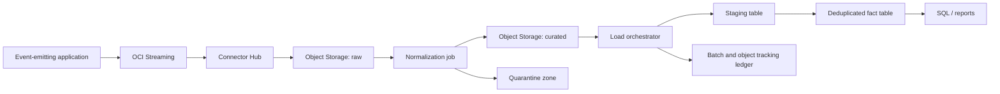

# Combining Streaming, Object Storage, and an Analytics Data Warehouse

## 1. Objectives and Context

In the **Data and Analytics** chapter of Oracle Cloud Infrastructure (OCI), this lesson builds a data flow from continuously generated events to SQL-queryable data. The three core components are **OCI Streaming**, **OCI Object Storage**, and an **analytics data warehouse on Autonomous Database**. Connector Hub, a normalization job, and an orchestrator connect these components into an operable pipeline.

After completing this lesson, you will be able to:

- Explain why the event-ingestion layer, durable storage layer, and analytical serving layer should be separated.
- Design the data flow, event schema, partition key, and late-arriving data handling.
- Configure the Streaming → Object Storage flow and load a standardized batch into Autonomous Database.
- Distinguish file-level deduplication from business-event deduplication.
- Identify IAM policies, monitoring metrics, recovery procedures, and cost drivers across the entire pipeline.

Suppose a sales system emits an event whenever a payment succeeds. Operations needs daily transaction counts and total amounts; the data team needs to preserve raw events for reconciliation and recomputing reports when business rules change. The illustrative target is for data to appear in reports within roughly 15 minutes under normal operation. This is a design target to measure and validate, not an OCI latency guarantee.

In this lesson, "analytics warehouse" refers to data-warehousing tables on Autonomous Database, such as deployments configured for analytical workloads. Choose the actual workload type and configuration in your tenancy; Console option names may vary across service releases.

## 2. Each Service Solves a Different Part

| Component | Responsibility in the Pipeline | Limitations to Recognize |
| --- | --- | --- |
| Streaming | Continuously ingests events, buffers spikes, lets consumers read by partition and offset | Finite retention; does not replace historical archive storage |
| Connector Hub | Moves data from Streaming source to Object Storage target; can attach Functions tasks | Uses batching and retries; does not form a shared transaction with the warehouse |
| Object Storage | Holds raw and curated data for replay, reconciliation, and reloading | Does not automatically update database tables |
| Normalization job | Decodes payloads, validates schemas, standardizes types, isolates invalid records | Requires explicit idempotency, logging, and rerun design |
| Autonomous Database | Loads data into tables, deduplicates by business key, aggregates, and serves SQL | Success of a single load command does not prove end-to-end pipeline completeness |
| Orchestrator | Tracks objects, batches, attempts, checkpoints, and job status | Must handle processes crashing between two steps |

Reading a message does not immediately delete it from Streaming. Consumers can replay within the retention window. Conversely, having a file in Object Storage does not mean it has been loaded or appears in reports. Track each boundary separately. Partitioning, offsets, and replay are described in [OCI Streaming Overview](https://docs.oracle.com/en-us/iaas/Content/Streaming/Concepts/streamingoverview.htm).

## 3. Reference Architecture and Completion Boundaries



The main flow performs four jobs:

1. Producers emit events and verify per-message delivery responses.
2. Connector delivers data into the raw bucket.
3. The normalization job reads raw, writes valid records to curated, and records invalid records.
4. The orchestrator loads curated into staging, runs quality checks, merges into fact, and marks the batch complete.

In this architecture, **raw** is the preserved copy received from the source along with transport metadata. **Curated** is data conforming to the analytics contract. **Quarantine** holds isolated invalid records and failure reasons. Use separate buckets when zones have different access controls or lifecycles.

A prefix does not create a physical directory or an independent permission domain. If sharing a bucket, design appropriate IAM policies; merely naming prefixes `raw/` and `curated/` does not provide isolation.

Completion milestones carry different meanings:

| Milestone | What Is Known | What Still Needs Verification |
| --- | --- | --- |
| Producer receives success response | Message was accepted into Streaming | Whether it reached raw and reports yet |
| Raw object appears | Data was written to Object Storage | Whether payload is valid and loaded yet |
| Staging load succeeds | File was parsed per load configuration | Key duplicates, business rule errors, or missing data |
| Fact and batch state committed | Batch completed orchestrated merge | Whether reports refreshed within target latency |

Connector Hub supports Streaming as a source and Object Storage as a target. Moving data from Object Storage into analytics tables must be implemented separately in this architecture. See [Configuring a Connector with a Streaming Source](https://docs.oracle.com/en-us/iaas/Content/connector-hub/create-service-connector-streaming-source.htm).

### When to Choose This Combination?

This pattern fits when you need replayable history, multiple consumers sharing data, and reports that tolerate micro-batch latency. If there are only a few files per day, load directly from Object Storage without adding Streaming.

If business logic demands sub-second or few-second reactions, build a dedicated stream-processing branch and measure its latency directly. The raw storage branch can still serve auditing and recomputation. Never infer sub-second latency simply because Streaming appears in the architecture.

## 4. Designing the Event Contract

An illustrative payment event:

```json
{
  "event_id": "evt-pay-0001",
  "schema_version": 1,
  "event_type": "ORDER_PAID",
  "order_id": "ORD-1001",
  "occurred_at": "2026-11-20T09:00:00Z",
  "amount_minor": 125000,
  "currency": "VND"
}
```

| Field | Example Convention |
| --- | --- |
| `event_id` | Unique identifier of a logical event; preserved across retries |
| `schema_version` | Contract version to select the right parser and validation rules |
| `event_type` | Example routes only `ORDER_PAID` into the payment fact table |
| `order_id` | Order identifier; also chosen as the message key |
| `occurred_at` | Business timestamp normalized to UTC |
| `amount_minor` | Integer in the smallest currency unit defined by the contract |
| `currency` | Currency code; lab example processes only VND |

For VND in this example, `125000` represents 125,000 VND. For other currencies, check their minor-unit rules; never assume every currency has two decimal places. Multi-currency reports must group by currency or use a conversion process with an explicit exchange-rate source and timestamp.

Producers must keep `event_id` stable when uncertain whether a prior send succeeded or failed. If every retry generates a new ID, the warehouse can double-count transactions despite having a primary key on the fact table.

If writing a payment to the application database and emitting an event are two separate operations, the application can crash in between. Consider the transactional outbox pattern: write both the business transaction and the outbox record in one database transaction, then let a publisher forward outbox rows to Streaming. This closes the producer-side gap; warehouse deduplication handles redeliveries.

### Partition Keys and Ordering

Choose `order_id` as the key when grouping events for the same order. Streaming maps messages sharing a key to the same partition and preserves order within that partition. There is no global ordering across partitions. A heavily skewed key can create a hot partition even when aggregate stream capacity appears sufficient. See [Partitioning a Stream](https://docs.oracle.com/en-us/iaas/Content/Streaming/Concepts/partitioningastream.htm).

Storage order does not equal business order: devices can send late, or producers can retry. When modeling mutable order state, include a business version or sequence number. This example records only immutable payment events, so ingestion time is never used to overwrite order state.

### Timestamps and Schema Evolution

Distinguish at least three timestamps:

- `occurred_at`: when the business event occurred.
- `received_at`: when the ingestion tier received the event.
- `loaded_at`: when the record was written into the analytics warehouse.

The latter two can live in transport metadata or technical columns. Use `occurred_at` to determine business dates and technical timestamps to measure latency.

When adding optional fields, readers can support both old and new versions. When changing a field's semantics or data type, bump the version and keep adapters for historical data. Never silently reinterpret `amount_minor` as a decimal currency amount within the same schema version.

## 5. Organizing Data in Object Storage

A data-team-designed layout might look like:

```text
sales-raw/
  streaming/<objects-created-by-connector>

sales-curated/
  order-paid/schema_v1/event_date=2026-11-20/batch_id=lab-001/part-0001.csv

sales-quarantine/
  order-paid/received_date=2026-11-20/<error-objects>
```

Curated object names are a pipeline convention. In this example, the connector is configured with only a prefix for raw; do not assume the connector automatically partitions by `event_date` inside the payload.

Keep the raw zone immutable after ingestion. To fix transformation bugs, re-read raw and produce a new traceable output version rather than mutating raw objects. If versioning is enabled, account for the storage cost of retained old versions.

### Connector Envelopes Differ from Business Payloads

OCI Streaming uses Base64-encoded keys and values in its APIs. Inspect the exact structure written by the connector—do not assume raw objects are plain business JSON lines with ready-made `event_id` and `amount_minor` columns.

For Object Storage targets, connector documentation notes that output files are gzip-compressed. Before writing the normalizer, pull a sample object produced by your exact configuration to verify compression, envelope format, and key/value encoding. [Connector Creation Docs](https://docs.oracle.com/en-us/iaas/Content/connector-hub/create-service-connector-streaming-source.htm) describe the storage target; [this Oracle Developers example](https://blogs.oracle.com/developers/archiving-stream-data-to-object-storage-with-service-connectors) illustrates decoding keys/values.

The normalization job contract should specify:

1. Read the object and decompress the expected format.
2. Split transport records per the verified envelope format.
3. Base64-decode values when records use that representation.
4. Parse payloads and pick the reader matching `schema_version`.
5. Validate required fields, currency, amounts, timestamps, and event keys.
6. Write curated files in a fixed schema; preserve lineage back to the raw object and stream/partition/offset metadata if available.
7. Write invalid records with error code, source reference, and normalizer version to quarantine.

Never mark a batch successful after silently dropping bad rows. If partial acceptance of valid rows is permitted, batch status must explicitly report quarantined row counts and acceptance thresholds.

### Choosing Formats

| Format | When Suitable | Considerations |
| --- | --- | --- |
| JSON/NDJSON | Flexible schemas, easy payload inspection | Requires schema checks and higher parse cost |
| CSV | Small labs, flat schemas, easy verification | Must handle headers, quoting, delimiters, and data types |
| Parquet | Large analytical datasets needing columnar layout | Requires conversion jobs and schema management |

This lab uses standardized CSV to keep loading and deduplication transparent. That is a custom output of the normalization job, not a built-in format guaranteed by the connector. At scale, consider compacting small files into Parquet; size thresholds must be grounded in benchmarks and latency budgets.

## 6. IAM, Compartments, and Network Connectivity

Lab resources can live in a dedicated compartment such as `analytics-lab`. In production, separate ingestion, storage, and warehouse compartments when independent permission boundaries are needed.

| Principal | Required Data Permissions |
| --- | --- |
| Producer | Put messages into the designated stream |
| Connector | Read source stream, write to raw bucket |
| Normalization job | Read raw, write curated and quarantine |
| Autonomous Database | Read curated bucket |
| Analyst | Query granted tables/views; no default read access to raw |
| Operator | View metrics, logs, and job states within assigned scope |

A user's permission to create a connector differs from the connector's runtime permission to read and write data. Seeing a stream in the Console does not prove the connector is authorized to consume from it.

Example policy for a Streaming source (replace all placeholders with actual OCIDs):

```text
Allow any-user to {STREAM_READ, STREAM_CONSUME} in compartment id <STREAM_COMPARTMENT_OCID>
  where all {
    request.principal.type='serviceconnector',
    target.stream.id='<STREAM_OCID>',
    request.principal.compartment.id='<CONNECTOR_COMPARTMENT_OCID>'
  }
```

This matches the Oracle-documented pattern for connectors reading streams; see [Permissions for Ingesting from Streaming](https://docs.oracle.com/en-us/iaas/log-analytics/doc/ingest-custom-logs-from-oci-streaming-service-using-service-connector.html).

Example policy pattern for a target bucket:

```text
Allow any-user to manage objects in compartment id <RAW_COMPARTMENT_OCID>
  where all {
    request.principal.type='serviceconnector',
    request.principal.compartment.id='<CONNECTOR_COMPARTMENT_OCID>',
    target.bucket.name='sales-raw'
  }
```

The principal condition restricts access to service connectors in the stated compartment; it does not make the bucket public. However, this scope could match multiple connectors inside that compartment. Your IAM team should review and tighten scope per design; `manage objects` is also broader than create-only permissions. See [Connector Hub Security](https://docs.oracle.com/en-us/iaas/Content/Security/Reference/sch_security.htm).

### Resource Principal for Database Reading Curated Data

Create a dynamic group, such as `adb-analytics-loaders`, matching the exact Autonomous Database loading data. Use the Rule Builder to match the database OCID; dynamic group syntax and domain prefix must match your tenancy's identity domain.

Illustrative policy:

```text
Allow dynamic-group <DOMAIN_NAME>/adb-analytics-loaders to read objects in compartment id <CURATED_COMPARTMENT_OCID>
  where target.bucket.name='sales-curated'
```

After creating the policy, a database administrator enables Resource Principal:

```sql
-- Run as ADMIN for the lab database.
BEGIN
  DBMS_CLOUD_ADMIN.ENABLE_RESOURCE_PRINCIPAL();
  DBMS_CLOUD_ADMIN.ENABLE_RESOURCE_PRINCIPAL(
    username => 'ANALYTICS_LOADER'
  );
END;
/
```

The `ANALYTICS_LOADER` schema must exist and hold required database privileges on the lab tables, views, and packages. Once enabled and permitted by IAM, the schema uses the system credential `OCI$RESOURCE_PRINCIPAL` in `DBMS_CLOUD` calls—no user auth token needs to sit in source code. See [Resource Principal with Autonomous Database](https://docs.oracle.com/en-us/iaas/autonomous-database-serverless/doc/resource-principal.html).

Networking is a separate control layer from IAM. Producers, normalization jobs, and the database all need network paths to their respective endpoints. For private endpoints, check DNS, routes, NSGs, and OCI service access requirements. Resources in private subnets may need a Service Gateway for supported services; attaching a gateway alone does not automatically create network paths for every OCI-managed component.

Keep buckets private, enforce encryption per organizational policy, and minimize personal data in payloads. Base64 is merely an encoding format, not a secrecy control.

## 7. Hands-On Lab: From Event to Fact Table

The steps below build a lab verifiable stage by stage. CLI commands run in PowerShell with a configured OCI CLI. SQL statements run in the lab schema on Autonomous Database. Replace placeholders before running; never use production resources.

### Step 1 — Prepare Resources

Provision a stream, connector, three private buckets, and an Autonomous Database able to reach the relevant services. Pick different bucket names if the illustrative names already exist in your namespace.

For a lab stream, starting with one partition suffices for light test loads, with retention sized for your study session. Per OCI Streaming documentation, retention ranges from 24 hours to 7 days, and partition count and retention cannot be altered after stream creation. Plan throughput and recovery windows upfront. See [Streaming Resource Limits](https://docs.oracle.com/en-us/iaas/Content/Streaming/Concepts/streamingoverview_topic-Limits_on_Streaming_Resources.htm).

Record the stream OCID, messages endpoint, Object Storage namespace, and compartment OCIDs. The messages endpoint is the stream's data-plane endpoint, not the Console web URL.

### Step 2 — Configure Streaming → Object Storage Connector

In Connector Hub, create a connector with:

- Source set to Streaming; choose the exact stream pool and stream.
- Appropriate read start position: from retained beginning (trim horizon) if capturing already-sent messages into raw, or latest if capturing only new events.
- Target set to Object Storage; select the raw bucket and a prefix like `streaming/`.
- Batch size and batch time suited to test latency; verify the units of each field.
- Source and target permissions already in place; enable logs for easier inspection.

Creating the connector before emitting test events makes it easy to confirm which messages should appear. When preserving unaltered raw events, do not attach filtering tasks that drop business events in this connector.

If attaching a Functions task to filter or transform, note that data arriving in raw has already passed through that task. Consider keeping a separate unaltered raw branch if needed. Functions tasks and Functions targets also differ: task outputs continue onward to the connector's target.

### Step 3 — Emit an Event with Base64 Key and Value

The following PowerShell snippet generates a CLI parameters file in your lab working directory:

```powershell
$labStreamId = '<STREAM_OCID>'
$labMessagesEndpoint = '<MESSAGES_ENDPOINT>'

$labEvent = [ordered]@{
  event_id       = 'evt-pay-0001'
  schema_version = 1
  event_type     = 'ORDER_PAID'
  order_id       = 'ORD-1001'
  occurred_at    = '2026-11-20T09:00:00Z'
  amount_minor   = 125000
  currency       = 'VND'
}

$labEventJson = $labEvent | ConvertTo-Json -Compress
$labKeyBase64 = [Convert]::ToBase64String(
  [Text.Encoding]::UTF8.GetBytes($labEvent.order_id)
)
$labValueBase64 = [Convert]::ToBase64String(
  [Text.Encoding]::UTF8.GetBytes($labEventJson)
)

$labMessages = ConvertTo-Json -InputObject @(
  [ordered]@{ key = $labKeyBase64; value = $labValueBase64 }
) -Depth 5 -Compress

$labMessageFile = Join-Path (Get-Location).Path 'messages-lab.json'
[IO.File]::WriteAllText(
  $labMessageFile,
  $labMessages,
  [Text.UTF8Encoding]::new($false)
)

oci streaming stream message put --stream-id $labStreamId --endpoint $labMessagesEndpoint --messages file://messages-lab.json
```

Inspect each entry result and the failure count in the response. An HTTP-level success does not guarantee every entry in a multi-message request succeeded. When retrying, preserve the exact ID of the entry being resent.

The put command requires the messages endpoint and Base64 key/value pairs per [OCI CLI: streaming stream message put](https://docs.oracle.com/en-us/iaas/tools/oci-cli/latest/oci_cli_docs/cmdref/streaming/stream/message/put.html).

To test duplicate handling, resend the exact same event without changing `event_id`. Then emit a second event with `evt-pay-0002`, order `ORD-1002`, timestamp `2026-11-20T09:02:00Z`, and amount `275000`.

### Step 4 — Verify Raw and Create a Small Curated File

Wait for the connector flush condition, inspect the object in the raw bucket, decompress it, and examine the actual contents. Verify that both distinct events and the duplicate copy arrived here.

The normalization job should produce output equivalent to the CSV below:

```csv
event_id,schema_version,event_type,order_id,occurred_at_utc,amount_minor,currency
evt-pay-0001,1,ORDER_PAID,ORD-1001,2026-11-20T09:00:00+00:00,125000,VND
evt-pay-0001,1,ORDER_PAID,ORD-1001,2026-11-20T09:00:00+00:00,125000,VND
evt-pay-0002,1,ORDER_PAID,ORD-1002,2026-11-20T09:02:00+00:00,275000,VND
```

Notice the `Z` suffix is converted to `+00:00` to match the timestamp format mask in the SQL below. The first two rows are intentionally identical to demonstrate deduplication.

You may create this CSV manually to test the database stage independently if the normalizer is not deployed yet. Doing so verifies only curated → database; you still need to build and verify raw → curated for full end-to-end automation.

Upload the file to the curated bucket under object name:

```text
order-paid/schema_v1/event_date=2026-11-20/batch_id=lab-001/part-0001.csv
```

A single raw object may contain events spanning multiple business dates. The normalizer must split by `occurred_at` when using this curated layout rather than using the object creation date as the payment date.

### Step 5 — Create Staging, Type-Casting View, and Fact Table

Run in the authorized `ANALYTICS_LOADER` schema. The following objects are dedicated to this lab:

```sql
CREATE TABLE stg_order_paid_lab (
  event_id         VARCHAR2(80) NOT NULL,
  schema_version   VARCHAR2(10) NOT NULL,
  event_type       VARCHAR2(40) NOT NULL,
  order_id         VARCHAR2(80) NOT NULL,
  occurred_at_utc  VARCHAR2(40) NOT NULL,
  amount_minor     VARCHAR2(30) NOT NULL,
  currency         VARCHAR2(3) NOT NULL
);

CREATE OR REPLACE VIEW v_order_paid_lab AS
SELECT
  event_id,
  TO_NUMBER(schema_version) AS schema_version,
  event_type,
  order_id,
  TO_TIMESTAMP_TZ(
    occurred_at_utc,
    'YYYY-MM-DD"T"HH24:MI:SSTZH:TZM'
  ) AS occurred_at,
  TO_NUMBER(amount_minor) AS amount_minor,
  currency
FROM stg_order_paid_lab;

CREATE TABLE fact_order_paid_lab (
  event_id        VARCHAR2(80) PRIMARY KEY,
  schema_version  NUMBER(5, 0) NOT NULL,
  event_type      VARCHAR2(40) NOT NULL,
  order_id        VARCHAR2(80) NOT NULL,
  occurred_at     TIMESTAMP WITH TIME ZONE NOT NULL,
  amount_minor    NUMBER(18, 0) NOT NULL,
  currency        VARCHAR2(3) NOT NULL,
  loaded_at       TIMESTAMP WITH TIME ZONE
                  DEFAULT SYSTIMESTAMP NOT NULL,
  CONSTRAINT ck_opl_schema CHECK (schema_version = 1),
  CONSTRAINT ck_opl_type CHECK (event_type = 'ORDER_PAID'),
  CONSTRAINT ck_opl_amount CHECK (amount_minor >= 0),
  CONSTRAINT ck_opl_currency CHECK (currency = 'VND')
);
```

Staging stores CSV fields as strings to separate file parsing from type conversion. The view performs explicit type casting. In this example, the normalizer must ensure amounts are integer digit strings within bounds, schema version is 1, and timestamps are valid. Do not rely solely on `NUMBER(18,0)` to catch fractional amounts, since casting into a scale-0 column can silently round.

A production design should partition/tag staging by `batch_id`, source object, row count, and quality metadata; the lab table is simplified for sequential single-user runs.

### Step 6 — Load the Exact Curated Object

Replace `<REGION>` and `<NAMESPACE>` with real values. The URL below is an authenticated Object Storage URI used with credentials—it does not require a public bucket:

```sql
BEGIN
  DBMS_CLOUD.COPY_DATA(
    table_name      => 'STG_ORDER_PAID_LAB',
    credential_name => 'OCI$RESOURCE_PRINCIPAL',
    file_uri_list   =>
      'https://objectstorage.<REGION>.oraclecloud.com/n/<NAMESPACE>/b/sales-curated/o/order-paid/schema_v1/event_date=2026-11-20/batch_id=lab-001/part-0001.csv',
    format => JSON_OBJECT(
      'type' VALUE 'csv',
      'delimiter' VALUE ',',
      'quote' VALUE '"',
      'skipheaders' VALUE 1,
      'rejectlimit' VALUE 0
    )
  );
END;
/
```

On the first load, `STG_ORDER_PAID_LAB` should contain three rows. Passing the exact object URI simplifies traceability; never run a wildcard scan over the whole bucket on every execution and treat it as incremental loading.

`COPY_DATA` loads into an existing table. Options `skipheaders`, `quote`, and `rejectlimit` must match the input file; see [DBMS_CLOUD Subprograms](https://docs.oracle.com/en-us/iaas/autonomous-database-serverless/doc/dbms-cloud-subprograms.html) and [Format Options](https://docs.oracle.com/en-us/iaas/autonomous-database-serverless/doc/format-options.html). Never raise `rejectlimit` merely to ignore errors without reconciling rejected rows.

### Step 7 — Check Conflicts Before Deduplicating

Two records with the same ID and identical content are duplicates. Two records with the same ID but differing amounts or orders are data conflicts and must be quarantined for investigation.

First, the following query must return **zero rows**:

```sql
SELECT event_id
FROM (
  SELECT DISTINCT
    event_id, schema_version, event_type, order_id,
    occurred_at, amount_minor, currency
  FROM v_order_paid_lab
)
GROUP BY event_id
HAVING COUNT(*) > 1;
```

Next, check for events already in the fact table whose incoming payload differs:

```sql
SELECT DISTINCT s.event_id
FROM v_order_paid_lab s
JOIN fact_order_paid_lab f ON f.event_id = s.event_id
WHERE s.schema_version <> f.schema_version
   OR s.event_type <> f.event_type
   OR s.order_id <> f.order_id
   OR s.occurred_at <> f.occurred_at
   OR s.amount_minor <> f.amount_minor
   OR s.currency <> f.currency;
```

If either query returns any ID, halt the merge and log a conflict. If type conversion raises errors, halt the batch and fix the upstream data. In an automated pipeline, the orchestrator must enforce these checks as mandatory gates; standalone SQL queries do not prevent someone from running the next statement manually.

Once checks pass, execute:

```sql
MERGE INTO fact_order_paid_lab f
USING (
  SELECT DISTINCT
    event_id, schema_version, event_type, order_id,
    occurred_at, amount_minor, currency
  FROM v_order_paid_lab
) s
ON (f.event_id = s.event_id)
WHEN NOT MATCHED THEN
  INSERT (
    event_id, schema_version, event_type, order_id,
    occurred_at, amount_minor, currency
  )
  VALUES (
    s.event_id, s.schema_version, s.event_type, s.order_id,
    s.occurred_at, s.amount_minor, s.currency
  );

COMMIT;
```

`DISTINCT` removes identical copies within the merge source. The `ON` clause skips events already in the fact table. The primary key protects ID uniqueness, though a primary key itself does not resolve two conflicting payloads.

This example runs sequentially with a single loader. If multiple workers load concurrently, implement batch leasing and lock/transaction coordination. Never assume a `MERGE` statement alone prevents all write races.

### Step 8 — Query and Test Reruns

```sql
SELECT
  TRUNC(CAST(
    occurred_at AT TIME ZONE 'Asia/Ho_Chi_Minh' AS DATE
  )) AS business_date,
  currency,
  COUNT(*) AS payment_count,
  SUM(amount_minor) AS total_amount_minor
FROM fact_order_paid_lab
GROUP BY
  TRUNC(CAST(
    occurred_at AT TIME ZONE 'Asia/Ho_Chi_Minh' AS DATE
  )),
  currency
ORDER BY business_date, currency;
```

With the sample data, the expected output for 2026-11-20 in VND is **2 payment events** totaling **400000 VND**. This reflects received `ORDER_PAID` events, not net revenue after refunds or formal accounting revenue.

Rerun the load, conflict checks, and `MERGE`. If staging retains old rows, staging row count increases while fact stays at two rows with an unchanged total. Next, test an event with a new ID whose `occurred_at` falls on an earlier day to confirm the historical day's numbers update properly.

These results are expected outcomes for the lab that you must verify in your deployed environment. They do not imply OCI resources are pre-created or commands were pre-executed.

## 8. From Lab to Re-Runnable Production Pipeline

### Two Layers of Idempotency

**Object-level idempotency** prevents a completed file from being reloaded during normal operations. The orchestrator tracks a source key consisting of bucket, object name, and an appropriate content marker or version. Object names can be overwritten, so name alone is insufficient. Do not assume ETag has consistent content-checksum semantics across all upload methods.

**Event-level idempotency** prevents double-counting in the fact table when the same event appears across multiple files, producer retries, or backfills. `event_id` must be globally unique across the system; if IDs are only unique per source system, use a composite key `source_system + event_id`.

A minimal tracking ledger can store:

| Field | Purpose |
| --- | --- |
| Batch ID and source object list | Uniquely identifies the unit of work |
| Object identifier and normalizer version | Detects changed inputs or logic versions |
| Status, attempt, owner, and lease expiration | Enables safe retries and prevents two workers claiming one job |
| Counts: raw, valid, quarantined, duplicate, new | Stage-by-stage reconciliation |
| Start time, completion time, and last error | Latency troubleshooting and recovery |

Never enforce "input rows = inserted rows" as an invariant because valid duplicates get dropped. For example, three input records, three valid records, two unique events, and two new inserts is a completely explainable outcome.

### Commit Ordering and Checkpoints

A conceptual flow:

```text
Discover complete unprocessed object
→ acquire batch lease
→ normalize and write output manifest
→ load isolated batch staging
→ validate types, quality, and conflicts
→ merge into fact
→ update status to LOADED in same database transaction
→ commit
→ record external checkpoint if applicable
```

Keep the fact merge and load-status update inside the same database transaction when both reside in the database. Do not assume object downloads, `COPY_DATA`, and updating an external system all share one atomic transaction.

If the process crashes after the fact table commits but before an external checkpoint writes, retries must recognize the batch or events already exist. Conversely, marking complete before committing the fact table risks silently dropping data.

When normalization writes multiple objects, write all data objects first and then write an output manifest listing them. Loaders consume only complete manifests rather than scanning an in-progress prefix. This is an application-level protocol, not a built-in multi-object transaction from Object Storage.

Connector Hub provides **at-least-once** delivery and retries on transfer failures. Duplicate deliveries must therefore be designed for upfront; never claim end-to-end "exactly once" semantics solely from connector settings. See [Connector Hub Delivery Overview](https://docs.oracle.com/en-us/iaas/Content/connector-hub/overview.htm).

## 9. Late-Arriving Data, Bad Schemas, and Replay

### Late-Arriving Data

An event occurring at 23:59 Vietnam time may be loaded after 00:00. Daily reports must group by business time converted to the chosen timezone, never by load date.

When querying the fact table directly, late events automatically update prior-day totals. When maintaining materialized summary tables, mark affected dates dirty and recompute from the deduplicated fact table. Avoid adding an entire batch onto daily totals during retries, which double-counts.

You can define an automatic lookback window—for instance, recomputing recent days. Events older than the window must follow a dedicated backfill or adjustment workflow. The window size is a business decision based on observed lateness distributions.

### Error Records and Quarantine

An error record should capture source, payload or payload reference, error code, received timestamp, and parser version. Examples:

- `SCHEMA_UNSUPPORTED`: no parser available for the schema version.
- `INVALID_TIMESTAMP`: unparseable or out-of-policy timestamp.
- `INVALID_AMOUNT`: malformed or out-of-range amount.
- `EVENT_ID_CONFLICT`: ID already exists with conflicting payload.

Quarantine is designed by your pipeline. Do not assume Streaming or Connector Hub automatically creates a quarantine meeting all business rules. When fixing errors and reloading, link outcomes back to the original quarantined record.

### Replay and Backfill

Read from Streaming within retention for recent recovery. Read from Object Storage raw for longer historical recomputations.

Route backfill data through isolated staging, record the transformer version, and throttle resources to avoid starving live ingestion. Merge or switch reports to updated results only after reconciliation. Raw storage enables recovery only if full payloads, matching schemas, and read permissions remain intact.

## 10. End-to-End Pipeline Monitoring

Monitor both service health and business outcomes. An active connector does not prove reports are up to date.

| Stage | Signals to Monitor | Where to Investigate |
| --- | --- | --- |
| Producer → Streaming | Entry results, send failures, retries, throttling | Endpoints, IAM, payloads, per-key traffic |
| Streaming → raw | Read/write throughput, data age, source/target errors | Connector policies, batching, buckets, retention |
| Raw → curated | Age of unprocessed objects, error counts, job duration | Schemas, formats, compute resources |
| Curated → staging | Queued batches, load status, rejected row counts | URIs, credentials, formats, access policies |
| Staging → fact | Duplicate IDs, conflicts, new inserts | Source quality, worker contention |
| Fact → reports | Refresh timing, event latency, reconciliation metrics | Daily rollups, late data, report caching |

In the `oci_service_connector_hub` namespace, useful metrics include `ErrorsAtSource`, `ErrorsAtTarget`, `ServiceConnectorHubErrors`, `BytesWrittenToTarget`, and `DataFreshness`. Filter by connector and error-code dimensions when troubleshooting. Per Oracle's definition, `DataFreshness` tracks the newest record in the latest processed batch, so it does not reflect the age of the oldest backlogged record. See [Connector Hub Metrics Reference](https://docs.oracle.com/en-us/iaas/Content/connector-hub/metrics-reference.htm).

Track separate metrics for the age of the oldest incomplete job and pipeline heartbeats. During quiet traffic periods, "zero errors" and "zero bytes written" cannot distinguish an idle system from a stalled pipeline.

Start with alerts for latency breaching targets, stalled batches, abnormal quarantine spikes, and backlogs approaching stream retention. Tune thresholds to actual load—never apply one generic threshold to every stream.

For `COPY_DATA`, inspect load history and related log/bad files:

```sql
SELECT *
FROM user_load_operations
ORDER BY id DESC
FETCH FIRST 10 ROWS ONLY;
```

Oracle documents tracking loads via load-operations views in [Loading Data from Cloud Object Storage](https://docs.oracle.com/en/cloud/paas/autonomous-database/serverless/adbsb/load-data-cloud.html). Operational logs should capture batch ID, source, and error codes while avoiding full sensitive payloads.

## 11. Capacity, Latency, and Cost

### Sizing Throughput by Bytes and Keys

Initial estimation:

```text
Inbound rate ≈ events/sec × average bytes/event

Daily raw volume ≈ average rate × 86,400
```

For example, 500 events/sec averaging 2,000 bytes generates roughly 1,000,000 bytes/sec and 86.4 GB/day before compression, envelopes, and retry duplicates. Retaining 30 days equals roughly 2.592 TB before overhead. This is a data-volume calculation, not a billing forecast.

Per Oracle's published Streaming limits, each partition supports up to 1 MB/sec total write throughput. Do not size right up to theoretical limits: leave headroom for traffic spikes, key skew, and consumer read limits. Check [Streaming Resource Limits](https://docs.oracle.com/en-us/iaas/Content/Streaming/Concepts/streamingoverview_topic-Limits_on_Streaming_Resources.htm) before choosing partition counts.

### Cumulative Multi-Stage Latency

```text
Report latency
≈ stream and connector queuing
+ object flush wait
+ normalization schedule wait
+ normalization runtime
+ load schedule wait
+ load and MERGE runtime
+ report refresh wait
```

Smaller batches improve latency but increase object counts, API calls, and processing overhead. Larger batches cut overhead but increase wait times and make retries heavier. Connectors flush on whichever limit—size or time—hits first; benchmark under both low and peak loads.

### Cost Categories to Budget

- Streaming: data volume, retention duration, and configuration under current pricing models.
- Object Storage: raw/curated/quarantine capacity, API requests, versioning, and retrieval operations.
- Normalization: Functions or chosen compute resources, invocation counts, and execution duration.
- Analytics warehouse: compute, storage, autoscaling if enabled, and query workload.
- Operations: logs, monitoring, and cross-region or egress data transfer.

Separate ingestion and analytics budgets, tag owners and environments, and monitor daily storage growth. Budgets and alerts surface unexpected spend; do not assume they automatically halt all resources.

Keep data needed for fast replay in Standard tier, then transition tiers via lifecycle policies. Lifecycle rules require service permissions and must respect data retention requirements. See [Object Lifecycle Management](https://docs.oracle.com/en-us/iaas/Content/Object/Tasks/usinglifecyclepolicies.htm).

Data in Archive must be restored before reading; avoid archiving objects too early if loaders or recovery workflows still need immediate access. See [Archive Storage Overview](https://docs.oracle.com/en-us/iaas/Content/Archive/Concepts/archivestorageoverview.htm). Tier selection must factor in retrieval fees and restore times, not just per-GB storage price.

## 12. Availability, Automation, and Recovery

Streaming retention must exceed expected incident detection, remediation, and catch-up replay time within service limits. If the pipeline fails to flush messages to raw before retention expires, those messages may no longer be readable from the stream.

Raw storage aids recovery from transformation or warehouse errors, but it does not replace protecting raw itself. For regional outage resilience, separately design data replication, standby resources, schemas, policies, checkpoints, and recovery sequencing. Never assume a single-region deployment automatically provides full pipeline disaster recovery.

Distinguish:

- **RPO**: maximum acceptable data loss, determined by where data is durably persisted.
- **RTO**: target time to restore reporting, including provisioning, catch-up reads, and reconciliation.

Infrastructure can be codified in Terraform and deployed through your organization's managed workflows. Orchestrators triggered on schedules or new-object events still need a reconciliation sweep to catch missed objects. When using Events, confirm the bucket emits events and rule targets match scope; merely having a bucket never triggers a loader automatically.

Operational recovery runbook:

1. Identify the last committed batch and the oldest incomplete object.
2. Restore broken access permissions, endpoints, or failing resources.
3. Choose replay from retained stream or backfill from raw.
4. Rerun with deduplication controls and resource throttling.
5. Reconcile unique events, quarantined records, monetary totals, and latency before declaring caught up.

When modifying a connector's source/target configuration, plan a transition and check for duplicates or gaps. Oracle notes that updating a connector configuration can reset internal connector state and cause data to be re-read; see [Connector Hub Overview](https://docs.oracle.com/en-us/iaas/Content/connector-hub/overview.htm). Never edit a connector assuming offsets continue seamlessly as before.

## 13. Common Errors and Isolation Guide

| Symptom | Causes to Check | Verifiable Remediation |
| --- | --- | --- |
| Stream has messages yet raw has no objects | Not flushed yet, start offset set to latest, missing source/target permissions | Inspect metrics, logs, and start-offset setting |
| Messages sent before connector creation are missing | Start position set to latest or messages expired retention | Replay remaining retained range or recover from upstream |
| Raw has data yet CSV load fails | Loading raw gzip/envelope directly instead of curated CSV | Inspect raw structure and run the normalizer |
| Database cannot read bucket | Wrong namespace/region/object URI, missing IAM, or network path | Verify exact URI and Resource Principal for that database |
| Staging grows yet fact does not | All rows are duplicates or batch halted at validation | Check event IDs, logs, and batch status |
| Total amount grows after retries | Loading straight into fact or double-adding into summary tables | Enforce event keys and recompute sums from deduplicated fact |
| Report dates are shifted | Using load date or inconsistent timezones | Convert business timestamps to the agreed timezone |
| Too many tiny objects | Batches too small or sparse producer traffic | Tune batch thresholds and compact files, then re-measure latency |
| Zero errors yet data is still missing | Producer gap, skipped object, or expired retention | Reconcile source IDs, manifests, quarantine, and checkpoints |

Before promoting the pipeline to production, prove end-to-end traversal of an event from producer to fact, unchanged results upon replaying identical data, proper isolation of a conflicting ID, and catch-up replay after an outage. After finishing the lab, pause schedules and delete temporary test resources no longer needed per environment permissions and data-retention rules.

An operable design must answer: where an event currently stands, why it was delayed or rejected, which source it can be replayed from, and whether analytical outputs preserve exact business semantics upon replay.
