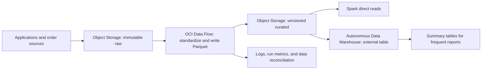

# Data Partitioning, File Formats, and Processing Cost Optimization

In the **Data and Analytics** chapter of the **CLOUD_PROVIDERS_ORACLE** module, this lesson explains how to organize data in OCI Object Storage so processing engines read less data, utilize resources more effectively, and control operational costs. OCI Data Flow and Autonomous Data Warehouse serve as the two data-consumption contexts: one running Apache Spark and the other querying with Oracle SQL.

Even a cheaply stored dataset can produce an expensive pipeline if every job has to open hundreds of thousands of files, rescan full history, or shuffle massive volumes. Conversely, over-partitioning can make planning and metadata management costlier than the compute savings achieved. Design must start from real query patterns, update requirements, and job completion deadlines.

## 1. Objectives and Running Scenario

After completing this lesson, you will be able to:

- Select partition keys and granularity based on query patterns, data volume, and distribution skew.
- Choose among CSV, JSON, Avro, Parquet, or ORC based on data role and reader engine capabilities.
- Explain the relationship among partition pruning, column pruning, predicate pushdown, compression, and file size.
- Build a Spark flow converting raw data into partitioned Parquet on OCI Object Storage.
- Evaluate effectiveness using processing metrics, full-lifecycle cost, and result correctness.

Consider an order system receiving roughly **100 GiB of raw data per day** across four markets: `VN`, `TH`, `ID`, `MY`. Numbers in this lesson are illustrative design assumptions, not OCI benchmarks or price quotes.

Key queries include single-day revenue reports by market, seven-day reconciliations, and monthly region-wide reports. Data may arrive up to three days late. Business users want reports completed before 07:00 in the agreed timezone.

A reference flow:



`raw` retains source data for reprocessing. `curated` holds standardized data for analytics. These names are design conventions in the example, not mandatory OCI bucket types. Deployments must still place buckets and compute resources in appropriate compartments, grant role-based IAM policies, and plan network paths for their environment.

## 2. Distinguishing Three Meanings of Partition

| Concept | Where Is It Organized? | Primary Purpose | What Cannot Be Inferred Directly |
| --- | --- | --- | --- |
| Data partitioning in Object Storage | Objects with prefixes encoding key values | Helps readers recognize data groups and skip irrelevant ones | Prefix names alone create no index or IAM boundary |
| Spark execution partitions | Data slices assigned to tasks inside a stage | Controls parallelism, shuffles, and memory usage | 100 Spark partitions do not mean 100 business partitions |
| Oracle table partitions | Database metadata and table structures | Manages data and supports SQL-plan pruning | A monthly-partitioned DB table does not alter external object layout |

In Object Storage, `/` is part of the object name and is rendered like folders by tools. In the layout below, `event_date` and `market` values are encoded in the path:

```text
curated/orders/v1/
  event_date=2026-11-18/market=VN/part-00000-....snappy.parquet
  event_date=2026-11-18/market=TH/part-00001-....snappy.parquet
  event_date=2026-11-19/market=VN/part-00000-....snappy.parquet
```

Spark can automatically discover `key=value` layouts when reading from the right root path. When reading a subdirectory, the `basePath` option preserves partition columns sitting above that subtree. Column type inference and metadata behavior must be tested on your target runtime. [Spark: Partition Discovery](https://spark.apache.org/docs/3.5.6/sql-data-sources-parquet.html).

One prefix can contain many files, and a single Parquet file can be read by multiple tasks if the engine splits work appropriately. Therefore, measure business partition count, file count, and task count separately.

## 3. Choosing Partition Keys and Granularity

### 3.1. Start from Common Filter Predicates

Good partition keys frequently appear in filter predicates capable of pruning a substantial fraction of data. For this order scenario, `event_date` is the primary candidate because all three query groups filter by time. `market` should be a secondary partition key only if market-filtered queries are common enough and each date–market group holds sufficient data volume.

Do not pick a column merely because it appears in `GROUP BY`. A total revenue report grouped by `customer_id` may still touch all customers; partitioning by customer ID creates huge numbers of prefixes while pruning nothing.

| Candidate | Potential Benefit | Risks to Evaluate |
| --- | --- | --- |
| Event date | Fits daily reporting and time windows | Late-arriving data must update older dates |
| Event month | Fewer partition groups, easier to keep files large | Single-day queries may scan extra data |
| Event hour | Reduces scan scope for hourly workloads | Low hourly volume easily creates tiny files |
| Market or business line | Reduces scan scope when filter is common | Distribution may skew; even low-cardinality keys can make tiny groups |
| Customer ID or order ID | High selectivity for single-entity lookups | High cardinality, excessive small files, and heavy metadata overhead |

### 3.2. Estimate Group Counts and Per-Group Size

If every combination receives data, partitioning by 365 days and four markets creates roughly:

```text
365 × 4 = 1,460 date–market groups per year
```

Adding `customer_id` with one million values creates a massive combinatorial space. Not every combination exists, yet active groups can still become far too numerous and tiny.

Suppose one day yields 30 GiB of compressed Parquet evenly distributed across four markets: each group holds about 7.5 GiB. Targeting a test size of roughly 256 MiB per file gives around 30 files per group. This is an initial estimation to begin testing. Data skew, compression ratios, and writer counts can push actual outputs far from simple division.

Conversely, if one market generates only a few MiB per day, partition by date alone and keep `market` inside the file columns. Every dataset does not need to force the exact same layout.

### 3.3. Pin Down Time Semantics

`event_date` is the business date of the event; `ingest_date` is when the platform received it. The two values can differ.

- Use event date when reports must reflect business occurrence time.
- Retain ingestion timestamps to track latency, reprocessing, and lineage.
- Define timezone before deriving dates; a timestamp near midnight can fall on two different dates in UTC versus Vietnam time.
- Monitor late data arriving beyond the three-day window; never drop it merely because regular schedules already closed that day.

The late-arrival window is an operational assumption to verify against real data. When changing date derivation rules or timezones, create a new dataset version rather than mixing conflicting interpretations within the same partition.

## 4. Choosing File Formats and Compression

### 4.1. Formats Serve Different Purposes

| Format | Strengths | Analytics-Related Limitations | Suitable Role in Example |
| --- | --- | --- | --- |
| CSV | Easy to exchange and inspect with ubiquitous tools | Needs contracts for types, delimiters, quotes, encoding, and nulls; minimal embedded type info | Receiving exports from partner systems |
| JSON Lines (one record per line) | Expresses nested structures, convenient for events | Repeated field names, parsing overhead; inconsistent schemas hard to govern | Raw zone and event traceability |
| Avro | Row-based binary format with schemas and evolution rules | Lacks columnar read pruning advantages for narrow-column queries | Record exchange with schema contracts |
| Parquet | Columnar layout with embedded types and metadata; great for analytics | Small files and incompatible schemas still make queries costly | First test choice for curated |
| ORC | Columnar analytics format with structures supporting read optimization | Must confirm read, write, and type-mapping support across engines | Option when the target ecosystem favors it |

For CSV, explicit schemas usually beat re-inferring types on every run. Explicitly define handling for malformed rows; pipelines should never silently discard records just to speed up runs. CSV read options—including schemas, headers, and error modes—are documented in [Spark: CSV Files](https://spark.apache.org/docs/3.5.6/sql-data-sources-csv.html).

### 4.2. Why Can Parquet Reduce Read Volume?

A Parquet file consists of row groups; each row group contains a column chunk per column, and each column chunk contains pages. This structure lets compatible readers read only required columns instead of decoding every field of every record. [Apache Parquet: Concepts](https://parquet.apache.org/docs/concepts/).

However, selecting three out of thirty columns does not guarantee reading exactly 10% of bytes. Columns vary in size and compression ratio; engines also read metadata and may read extra columns used in filter predicates. Measure actual bytes read from real runs.

### 4.3. Compression Is a CPU–I/O Trade-off

Compression shrinks storage and transfer volume at the cost of decompression CPU. For Parquet, test Snappy for speed-first baselines and compare codecs like Zstandard where runtime-supported against real data. Parquet supports column-level encoding and compression—a different mechanism from wrapping an entire file in an external compression layer. [Apache Parquet: Motivation](https://parquet.apache.org/docs/overview/motivation/).

Do not treat a huge externally compressed CSV as a single processing unit without verifying codec splittability and reader support. Likewise, do not assume `.parquet.gz` is optimal by default. For Parquet, configure the writer's internal compression codec option and verify target readers support it.

To choose, hold data, layout, and compute constant; vary one codec at a time and measure output size, write time, read time, CPU, and downstream query costs.

## 5. Four Mechanisms to Reduce Data Scanned

| Mechanism | Scope Skipped | Conditions Required to Help |
| --- | --- | --- |
| Partition pruning | Irrelevant partition directories or files | Engine knows partition metadata and understands the filter |
| Column pruning | Unneeded column payloads | Format and reader support columnar projection |
| Predicate pushdown | Pushes filter expressions down to the reader layer | Supported expressions, data types, and connector |
| Row-group skipping via statistics | Row groups guaranteed not to match | Useful min/max stats and a reader that actively uses them |

Pushdown does not guarantee every non-matching record avoids being read. If every row group spans very small to very large values, min/max statistics may skip nothing. Sorting data within partitions on common filter columns can sharpen statistics at the cost of write-time sorting—apply only when repeated read savings outweigh sorting cost.

With an `event_date` and `market` layout, Spark SQL queries should express predicates directly on the partition columns:

```sql
SELECT market, SUM(amount) AS revenue
FROM orders_curated
WHERE event_date >= DATE '2026-11-18'
  AND event_date <  DATE '2026-11-20'
  AND market = 'VN'
GROUP BY market;
```

Filtering solely on `event_time` does not guarantee the engine automatically derives a filter on the pipeline-created `event_date` column. When two columns are linked by data contract, supply both partition date bounds and the exact timestamp predicate needed for business correctness.

Avoid wrapping partition keys in functions or UDFs that optimizers cannot push down. Also avoid unnecessary string-to-date casts. Rather than guessing whether a transformation breaks pruning, inspect the execution plan of the specific query.

## 6. File Size, Writer Count, and Data Skew

### 6.1. Why Many Small Files Waste Resources

For the same 10 GiB of data, tens of thousands of tiny files require vastly more listing, file-open, and metadata-read operations than a few dozen moderately sized files. The driver spends longer planning, the scheduler tracks far more tasks, and compute spends substantial time purely on coordination overhead.

An overly huge file can also hurt if formats or readers restrict parallel reads, or if writing takes too long. A range around **128–512 MiB compressed per file** can serve as an initial testing target for this example—not a service limit or universal mandate for all workloads.

### 6.2. Distinguish Spark's Tuning Knobs

- `partitionBy(...)` determines the directory columns in the output layout.
- `repartition(...)` redistributes data via shuffle; useful when rebalancing load.
- `coalesce(...)` reduces execution partition counts with less data movement, though it can starve parallelism if overused.
- `spark.sql.files.maxPartitionBytes` controls input read split sizing, not output file size.
- `maxRecordsPerFile` caps record count per output file, not byte size.

Read and shuffle configs serve distinct roles; Spark also includes Adaptive Query Execution to adjust parts of the plan from runtime statistics. Do not treat AQE as a guarantee of target output file sizes. [Spark: Performance Tuning](https://spark.apache.org/docs/3.5.6/sql-performance-tuning.html), [Spark: Configuration](https://spark.apache.org/docs/3.5.6/configuration.html).

Never default to `coalesce(1)` to fix small files on large datasets. It funnels all writes onto too few resources, slowing jobs down or triggering memory pressure.

### 6.3. Avoid Funneling One Large Day into One Task

`repartition(n, "event_date", "market")` hash-partitions by key. All rows sharing a key pair land in the exact same execution partition for that repartition step. With only four groups in a day, increasing `n` cannot split a huge group across multiple tasks.

You can try `repartition(n)` to spread rows before writing; the trade-off is that multiple tasks may write files into the same output partition. For large datasets, another option adds a temporary salt/bucket column to the repartition key to split hot groups, then drops the temporary column before writing. Measure resulting file counts and task skew; temporary buckets never need to become dataset prefix levels.

Monitor skew across reads, joins, aggregations, and writes. If one market generates 90% of volume, average size per market hides the biggest bottleneck.

## 7. Example: Converting CSV to Parquet on OCI Data Flow

### 7.1. Prerequisites

The snippet below is an educational example for a data transformation run on OCI Data Flow using standard Spark 3.5-line APIs. Select the Spark version provided by your actual Data Flow Application and verify compatibility before deploying.

Requirements:

1. Input CSV bucket, target bucket, and application log location.
2. IAM policies to read source data, write target data, and write logs under the run's identity model.
3. Permissions to use Data Flow resources in the assigned compartment.
4. Network path to Object Storage appropriate for your environment; configure private endpoints and routes where required by architecture.
5. A fresh target prefix separated from active consumer data.

The PySpark script is uploaded to Object Storage and referenced via `oci://<bucket>@<namespace>/<object>`. Namespace is the Object Storage namespace, not compartment name or tenancy OCID. Application settings select the runtime alongside driver and executor resources. [Oracle: Creating a PySpark Data Flow Application](https://docs.oracle.com/en-us/iaas/Content/data-flow/using/dfs_create_pyspark_data_flow_app.htm).

The sample CSV uses timestamps without offsets; the example contract defines them as UTC, with partition dates also derived in UTC:

```csv
order_id,event_time,market,amount
O-1001,2026-11-18 09:15:00,VN,120000.00
O-1002,2026-11-18 10:20:00,TH,85000.00
O-1003,2026-11-19 01:05:00,VN,150000.00
```

### 7.2. Illustrative PySpark Code

```python
from pyspark.sql import SparkSession, functions as F, types as T

spark = SparkSession.builder.appName("orders-layout-lab").getOrCreate()
spark.conf.set("spark.sql.session.timeZone", "UTC")

# Replace illustrative values with your bucket, namespace, and batch.
source = "oci://orders-raw@YOUR_NAMESPACE/orders/batch-20261120/*.csv"
target = "oci://orders-curated@YOUR_NAMESPACE/orders/versions/lab-20261120-a"

schema = T.StructType([
    T.StructField("order_id", T.StringType(), True),
    T.StructField("event_time", T.TimestampType(), True),
    T.StructField("market", T.StringType(), True),
    T.StructField("amount", T.DecimalType(18, 2), True),
])

raw = (
    spark.read
    .schema(schema)
    .option("header", "true")
    .option("mode", "FAILFAST")
    .option("timestampFormat", "yyyy-MM-dd HH:mm:ss")
    .csv(source)
)

normalized = (
    raw.withColumn("market", F.upper(F.trim(F.col("market"))))
       .withColumn("event_date", F.to_date("event_time"))
)

invalid = normalized.filter(
    F.col("order_id").isNull()
    | (F.length(F.trim(F.col("order_id"))) == 0)
    | F.col("event_time").isNull()
    | F.col("amount").isNull()
    | F.col("market").isNull()
    | (~F.col("market").isin("VN", "TH", "ID", "MY"))
)

if invalid.limit(1).count() > 0:
    raise ValueError("Input violates the orders data contract")

# Test value; tune based on data scale and available resources.
write_tasks = 8

(
    normalized.repartition(write_tasks)
    .write
    .mode("errorifexists")
    .option("compression", "snappy")
    .option("maxRecordsPerFile", 1_000_000)
    .partitionBy("event_date", "market")
    .parquet(target)
)

curated = spark.read.parquet(target)

report = (
    curated.filter(
        (F.col("event_date") >= F.lit("2026-11-18").cast("date"))
        & (F.col("event_date") < F.lit("2026-11-20").cast("date"))
        & (F.col("market") == F.lit("VN"))
    )
    .groupBy("market")
    .agg(F.sum("amount").alias("revenue"))
)

report.explain("formatted")
report.show()
spark.stop()
```

The code intentionally uses `DecimalType` for currency amounts, pins the session timezone, and halts if input violates the contract. `FAILFAST` catches parsing errors; business constraints still require explicit checks. In production, invalid records can be routed to quarantine for investigation rather than failing the whole batch, provided quarantined counts are tracked and reconciled.

`write_tasks = 8` does not produce exactly eight files overall or eight files per day. Each task may write across multiple date–market groups, and record limits can split files further. Because the sample data is tiny, producing tiny files is normal—it exercises the flow, not performance benchmarking.

With the three sample CSV rows, `VN` revenue for the query window is `270000.00`. The example omits deduplication: it assumes each order appears once per batch. If sources resend orders, define keys and version rules before summing.

The validation `count()` is a separate action and can cause inputs to be re-read prior to the write action. Include quality-check overhead in pipeline cost budgets. Cache only when reuse payoff is substantial and data fits available memory; caching carries memory and materialization costs.

### 7.3. Inspecting Plans and Results

In the Parquet read plan, look for sections corresponding to `PartitionFilters`, `ReadSchema`, and `PushedFilters` when displayed by your runtime. Exact field names vary across versions and connectors. Partition column filters may appear under `PartitionFilters` without appearing under `PushedFilters`.

`explain` helps inspect plans; pair it with an actual action and Spark UI metrics to verify execution. Measure files read, input bytes, task durations, and shuffle volume. Never treat seeing the word `Filter` in a plan as proof that unneeded objects were skipped.

## 8. When Data Is Queried from Autonomous Data Warehouse

Creating `event_date=...` prefixes does not automatically inform every engine that partitions exist. Direct-path Spark reads, metastore-backed Spark, and Oracle external tables manage metadata differently.

On Autonomous Database, `DBMS_CLOUD.CREATE_EXTERNAL_PART_TABLE` creates an external partitioned table from Hive-style object names. The skeleton below assumes the database's resource principal is enabled and permitted to read the bucket; replace region, namespace, bucket, and prefix with real values:

```sql
BEGIN
  DBMS_CLOUD.CREATE_EXTERNAL_PART_TABLE(
    table_name      => 'ORDERS_EXT',
    credential_name => 'OCI$RESOURCE_PRINCIPAL',
    file_uri_list   =>
      'https://objectstorage.ap-singapore-1.oraclecloud.com/' ||
      'n/YOUR_NAMESPACE/b/orders-curated/o/' ||
      'orders/versions/lab-20261120-a/*.parquet',
    format          => '{
      "type": "parquet",
      "schema": "first",
      "partition_columns": [
        {"name": "event_date", "type": "varchar2(10)"},
        {"name": "market", "type": "varchar2(2)"}
      ]
    }'
  );
END;
/

SELECT market, SUM(amount) AS revenue
FROM orders_ext
WHERE event_date >= '2026-11-18'
  AND event_date <  '2026-11-20'
  AND market = 'VN'
GROUP BY market;
```

In this Oracle example, `event_date` is declared as a standardized `YYYY-MM-DD` string, differing from Spark's inferred date column. String range comparisons work safely only when every value follows the exact fixed format. When designing with `DATE` columns, declare and query consistently as `DATE` rather than relying on implicit session date conversions.

`schema: first` derives schema from the first file, so it does not replace a dataset-wide schema contract. Verify type mappings—especially timestamps and decimals—before production use. Hive-layout table creation and `partition_columns` syntax are documented in [Oracle: Query External Partitioned Data with Hive Format](https://docs.oracle.com/en-us/iaas/autonomous-database-serverless/doc/query-external-partition-hive.html).

With this external partitioned table mechanism, establish a process to refresh or sync metadata when new partitions arrive; do not assume metadata auto-discovers every change. Oracle also provides implicit partitioning for query-time structure discovery on supported configurations, which must be explicitly selected and configured per your database documentation. [Oracle: External Tables with Implicit Partitioning](https://docs.oracle.com/en/cloud/paas/autonomous-database/serverless/adbsb/query-external-partition-implicit.html).

If many reports repeat identical aggregations, compare querying external tables against selective loading or building summary tables inside the warehouse. The latter adds load and storage costs but eliminates repetitive scans and stabilizes query latency. Never rescan raw data every time a user opens a dashboard.

## 9. Compacting Small Files and Updating Late-Arriving Data

### 9.1. Compaction Needs Trigger Criteria

Compaction reads small files and rewrites them into better-sized files. It is a compute job consuming CPU, I/O, and temporary storage. Trigger compaction based on file counts, file-size distributions, and partition query frequency rather than blindly rewriting full history every night.

For instance, a market receiving data every minute generates 1,440 write batches per day. If each write produces multiple files, file counts explode even at modest data volumes. You can keep a continuous ingestion zone and publish curated snapshots hourly or daily matching business freshness needs.

### 9.2. Publishing a New Version Safely

A reference workflow for regular updates and compaction:

1. Identify the exact affected dates or date–market groups.
2. Read existing published data plus new arrivals for that scope; apply deduplication by business key and event version.
3. Write results to a new version prefix using a coordinated writer.
4. Reconcile record counts, duplicate keys, totals by date–market, nulls, and time boundaries.
5. Update the view, table location, or manifest actually used by readers to switch to the validated version.
6. Retain the prior version long enough for rollback, then clean up per retention policies and operator permissions.

Pointer updates must match the capabilities of your metastore or publication layer; multiple sequential updates are not inherently atomic. Object-level consistency does not create a multi-thousand-object transaction. Never expose a directory undergoing simultaneous deletion and rewrite to active readers.

Read, deduplication, and publication steps must be idempotent: rerunning the same batch must never duplicate orders. Persist batch identifiers in the orchestrator and check published versions. Plain `mode("append")` provides no such guarantee.

Spark's dynamic partition overwrite can limit replaced partitions in supported cases, yet it does not turn plain Parquet writes into multi-writer ACID transactions. When row-level updates, snapshots, or coordinated concurrent writes are required, evaluate transactional table formats and actual support in each engine. Parquet is a file format; a set of Parquet files has no built-in transaction log.

## 10. OCI-Aligned Cost Modeling

### 10.1. Account for Every Cost Component

Use an estimation model such as:

```text
C_total = C_storage
        + C_object_requests
        + C_compute_resources
        + C_network_and_tier_retrieval
        + C_metadata_logs
        + C_compaction_and_reruns
```

These categories structure budget planning; convert them to billing units using actual SKUs and contracts. Crucially, **bytes scanned is an I/O efficiency metric, not the default billing unit of OCI Data Flow**. Translate performance gains into billed resource usage and duration.

When comparing two runs, include driver, executors, and scaling intervals. Purely as arithmetic: holding total allocated compute at 6 OCPUs and 48 GiB memory for 20 minutes consumes 2 OCPU-hours and 16 GiB-hours. Cutting runtime to 8 minutes drops that to 0.8 OCPU-hours and 6.4 GiB-hours.

That is a 60% reduction in time-billed compute under this assumption—not a 60% cut to the total bill. Provisioning overhead, shape pricing rules, idle resources, retries, and remaining components must be evaluated separately. Never convert casually between OCPU, vCPU, and ECPU. Check current pricing and units on the [Oracle Cloud Price List](https://www.oracle.com/cloud/price-list/).

When using a Data Flow Pool, resources accrue charges while the pool is active even with zero jobs running. Balance fast-start requirements against idle time and pool shutdown schedules. [Oracle: Creating a Pool — Billing Considerations](https://docs.oracle.com/en-us/iaas/Content/data-flow/using/pools_create.htm).

### 10.2. Estimating Layout Impact

Assuming 100 GiB of raw data daily over 30 days:

```text
Scanning full monthly raw:                       3,000 GiB
Compressed Parquet (assuming 30% size):            900 GiB
Single day only:                                    30 GiB
One of four evenly distributed markets:            7.5 GiB
Selected columns (assuming 10% of bytes):         0.75 GiB
```

This arithmetic shows why layout and format often outweigh throwing more compute at a job. It does not predict exact bytes or wall-clock times: it omits metadata overhead, differing per-column compression, skew, and reader I/O behavior. Never multiply further by row-filter selectivity unless you have proved the reader skips non-matching row groups.

### 10.3. Break-Even Point for Conversion and Compaction

If a conversion or compaction run costs `C_maint` and saves an average of `ΔC_query` per query, the direct break-even query count is approximately:

```text
N_breakeven = C_maint / ΔC_query
```

Use this formula only when `ΔC_query > 0`, using identical currency units and comparison windows. If compacting files costs an assumed 12 units and saves 0.4 units per query, it takes roughly 30 queries to break even. If a partition is read only twice before cold archival, compaction may not pay off.

Also factor in temporary dual storage of old and new versions, Object Storage requests, validation runs, retries, and the business value of hitting report deadlines. Cost optimization must preserve committed correctness, freshness, and recoverability.

## 11. Storage Policies, Access Control, and Availability

Do not move frequently queried data to Archive purely for lower storage rates. Archive requires restoration before reading; Infrequent Access involves retrieval charges and minimum retention durations that must enter the math. Lifecycle policies must align with query windows, late-arrival windows, and rollback windows. [Oracle: Object Storage Storage Tiers](https://docs.oracle.com/en-us/iaas/Content/Object/Concepts/understandingstoragetiers.htm).

For example, keep recent reporting periods of curated data in a direct-access tier and transition rarely accessed history to colder tiers after measuring demand and documenting restore runbooks. Avoid lifecycle rules that purge raw before replay windows expire or delete older versions still referenced by active readers.

Separate read access for analytics from write/delete permissions on published data by role. ETL pipelines should hold only needed bucket/scope permissions; report viewers need no write access to raw. A prefix containing `market=VN` does not isolate data for Vietnam users: if market-level access boundaries are required, enforce them via IAM, separate buckets, or governed query layers.

Keep logs and metadata sufficient to answer which version a report read, which batches produced it, and how to rebuild it. Backups or replayability are only valuable when recovery procedures are tested within business SLAs.

## 12. Controlled Comparison Lab

The lab instructions below are a learner guide, not pre-executed results from an OCI tenancy.

### 12.1. Prepare Three Options

Use the exact same source snapshot and normalization logic to keep comparisons fair:

| Option | Layout | Comparison Purpose |
| --- | --- | --- |
| A | Raw CSV or JSON by ingestion batch | Baseline current state and parsing cost |
| B | Parquet with chosen codec, unpartitioned | Isolate format and compression gains |
| C | Parquet with same codec, partitioned by date; add market if justified | Isolate partition-pruning gains |

Give each option its own prefix. Use a dataset large enough to observe realistic read times; the three sample CSV rows above cannot serve as a benchmark. Measure actual stored sizes for each option instead of assuming compression ratios.

### 12.2. Run the Same Three Query Groups

1. Single day and single market, selecting few columns.
2. Seven days across all markets.
3. Full month across all markets.

Hold runtime, shapes, executor counts, casting rules, and query logic constant across layouts. Record provisioning/queue time separately from application execution time. Distinguish warm-cache reads from cold reads; never mix them into one conclusion.

For Option C, inspect plans to confirm partition filters. After writing, check file counts and byte distributions across each date–market group. If an option generates excessive small files, note that as a writer tuning issue rather than concluding partitioning is inherently slow.

### 12.3. Record and Evaluate

| Measurement Group | Values to Collect | Meaning |
| --- | --- | --- |
| Correctness | Row counts, duplicate keys, per-group totals, nulls, error rows | Guarantee identical business outcomes |
| I/O | Input bytes, files read, listing duration if observable | Confirm read-skipping gains |
| Execution | Application time, stage durations, p50/p95 or max task duration | Identify overhead and skew |
| Resources | OCPU-hours, allocated memory-time, lost executors or retries | Translate to cost and stability |
| Shuffle | Shuffle read/write bytes, spill, relevant stage durations | Distinguish compute vs. distribution bottlenecks |
| Storage | Total bytes, object count, p50/p95 file sizes, retained versions | Measure non-query storage costs |
| Operations | Data latency, publication timestamp, rerunnability, rollback | Validate real-world SLA fit |

Exact metric names and granularity depend on your runtime's observability tools. Combine Spark UI, run logs, and OCI cost/usage metrics—never extrapolate an entire invoice solely from wall-clock time shown in the Spark UI.

Success criteria are met when reconciliation totals match, critical queries hit deadlines, resource savings are backed by measurements, and late-data updates neither duplicate nor drop orders. A full-month scan may gain nothing from daily partitioning; that observation helps define the design's boundaries.

## 13. Diagnosing Common Mistakes

| Symptom | Causes to Check | Appropriate Action |
| --- | --- | --- |
| Date prefixes exist yet full month is scanned | Reading raw, lost partition context, or filter not on partition key | Check input path, schema, and pruning plan |
| Spark takes long before tasks even start | Excessive objects, discovery, or metadata overhead | Measure file counts; consider compaction and metadata strategy |
| Adding executors barely reduces runtime | I/O, listing, skew, or too few useful tasks | Isolate bottleneck stage before changing compute |
| One write task runs far longer than others | Skewed repartition key or oversized group | Inspect key distribution; split hot groups during execution |
| File count explodes after every load | Batches too small, many writers hitting many partitions | Tune publication cadence, writer count, and scoped compaction |
| Revenue inflates after retries | Appending the same batch repeatedly | Add idempotency controls and deduplication rules |
| Queries fail after schema change | Incompatible types mixed or reader using stale metadata | Check schema contract, migrations, and dataset versions |
| Storage cost drops yet total bill rises | Wrong tier, high retrieval fees, or frequent maintenance | Re-evaluate full lifecycle and query frequency |
| Readers see missing data during ETL runs | Overwriting active serving prefix in place | Publish completed versions atomically and keep rollback path |

When fixing an issue, change one directly related group of variables and re-measure. Changing codecs, layout, executor counts, and filter logic simultaneously hides which change actually helped.

## 14. Design Principles to Remember

Effective partitioning skips unneeded data groups; columnar formats limit bytes read inside remaining groups. File sizes and task distribution determine whether that work executes efficiently. These optimization layers complement each other, yet they never replace disciplined schema and metadata management.

On OCI, evaluate designs by total cost, reporting deadlines, and operability. A complete design explains why partition keys fit specific queries, how files are sized and compacted, how late data is integrated, which engines see new partitions, and which metrics prove the savings. Keeping raw replayable, publishing curated versions under strict control, and observing every run form the foundation for optimizing cost while preserving data accuracy.
