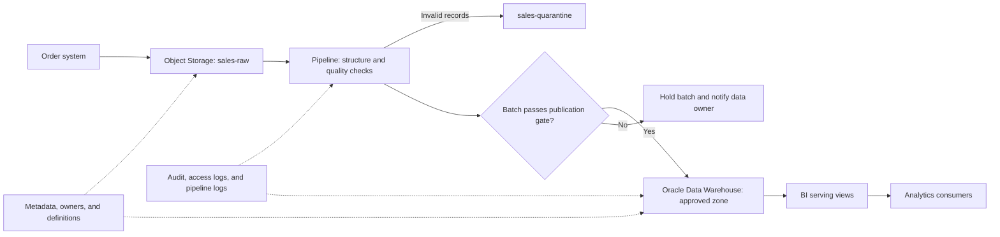

# Access Control, Data Quality, and Data Lifecycle Governance

A revenue report can be mathematically accurate against its formula yet still untrustworthy: viewers might read more customer data than needed, a batch might load twice, or reconciliation files might be purged before an investigation. A data system must simultaneously answer three questions: **who may do what with the data, whether the data qualifies for use, and how long the data is retained**.

This lesson belongs to the **Data and Analytics** chapter of the Oracle Cloud Infrastructure (`CLOUD_PROVIDERS_ORACLE`) module. It connects tenancies, compartments, and IAM with Object Storage, processing pipelines, and Oracle Databases—especially Autonomous Database for data warehousing. The goal is to build a workflow with proper access governance, verifiable quality evidence, and recoverability while controlling storage costs.

## 1. Objectives and Running Scenario

After completing this lesson, you will be able to:

- Distinguish OCI cloud resource management permissions from SQL data privileges inside Oracle Database.
- Design least-privilege access for users, processing workloads, and data stewards.
- Define measurable quality rules, isolate invalid records, and enforce batch publication gates.
- Distinguish lifecycle policies, retention rules, versioning, backups, and replication.
- Establish audit trails, operational metrics, and access-revocation or data-deletion workflows.

Consider a retail enterprise aggregating daily orders. Input files land in bucket `sales-raw`; a pipeline processes them on OCI Compute or an appropriate processing service; valid records load into the data warehouse; and the BI team reads published datasets. Invalid files/records are isolated in `sales-quarantine`.

Resource names and retention periods in this lesson are **illustrative designs**. They are neither mandatory OCI names nor legally mandated retention durations.



"Approved zone" is a logical data state in application design. Creating a bucket named `curated` does not by itself make data high quality.

## 2. Turning Governance Requirements into Concrete Responsibilities

Data governance does not stop at having an administrator group. Each dataset needs people accountable for semantics, quality, access rights, and lifecycle.

| Role | Primary Responsibilities | Example in the Order System |
| --- | --- | --- |
| Data owner | Approves intended usage, publication gates, and retention periods | Finance department defines revenue semantics |
| Data steward | Maintains definitions, classifications, and resolves quality issues | Decides whether cancelled orders count in reports |
| Platform team — data custodian | Implements pipelines, storage, backups, and monitoring | Operates Object Storage and the data warehouse |
| Security team | Manages access policies, auditing, and incident response | Reviews read access to identifying customer data |
| Data consumer | Uses data within approved scope and reports anomalies | BI team queries approved views |

One person may wear multiple hats in a small organization, yet must clearly separate when they are giving business sign-off versus performing technical operations. Having permission to edit a pipeline should not automatically grant permission to self-approve quality exceptions for that pipeline.

For each dataset, maintain at minimum:

| Attribute | Example |
| --- | --- |
| Identifier and version | `sales_daily`, contract version `v1` |
| Grain | One record per order, not per order line item |
| Owner | Finance department |
| Classification | Internal; customer identifiers controlled separately |
| Intended use | Daily revenue reporting on valid orders |
| Readiness SLA | Before 07:00 in the business timezone |
| Quality rules | Non-null order ID; no duplicate order IDs; currency VND |
| Retention and end-of-life | Raw retained 90 days; deletion process covers related copies |
| Recovery plan | Replay sources, required backups, and activation owner |

The data contract must specify business semantics too. For instance, is `amount` gross or net of discounts; what timezone defines `order_date`; does each file represent final state or change events? A column typed `NUMBER` can still carry the wrong business meaning.

## 3. Access Control Must Span Multiple Layers

### 3.1. Compartments, IAM, and SQL Privileges Solve Different Problems

In OCI, compartments organize resources and scope policies. IAM determines which principal can invoke which API actions on which resource types within that scope. Inside Oracle Database, database accounts, roles, and object privileges further govern querying or mutating data. Oracle separately documents cloud user permissions, database user privileges, and network access controls in [Autonomous Database Security Documentation](https://docs.oracle.com/en-us/iaas/autonomous-database-serverless/doc/gs-security-and-authentation-autonomous-database.html).

| Control Layer | Question Answered | Example |
| --- | --- | --- |
| IAM and compartments | Who may manage cloud resources or call OCI APIs? | Ops team can view bucket configs in `AnalyticsProd` |
| Networking | Which clients have network paths to the service? | Only authorized workloads can reach the DB endpoint |
| Database authentication | Which identity establishes the DB session? | Separate accounts for BI and pipelines |
| Data privileges | Which data objects may that identity read or modify? | BI only holds `SELECT` on reporting views |
| Business gating | Which data is approved for reporting consumption? | Only batches marked `PUBLISHED` |

An NSG permitting TCP connectivity does not grant `SELECT`. An IAM policy allowing management of Autonomous Database likewise does not grant business roles inside the database. Even when using IAM identity integration for SQL logins, corresponding database mappings and privileges must still be configured.

Powerful management actions such as altering configurations, cloning, or rotating access settings must also be treated as sensitive. Separating the two permission layers does not mean infrastructure admins have zero indirect paths to influence data.

### 3.2. Permission Matrix for the Order Example

| Identity | Raw | Quarantine | Approved Data | Policies, Logs, and Backups |
| --- | --- | --- | --- | --- |
| Ingestion workload | Create new objects | None | None | Writes its own ingestion logs |
| Transformation workload | Read | Write error records | Write staging; publish per workflow | Writes validation results |
| BI user | None | None | Read granted views | Cannot modify policies |
| Data steward | Metadata and approved samples | Read assigned remediation scope | Inspect metrics and approve exceptions | Read quality evidence |
| Security team | Per investigation mandate | Per investigation mandate | Per investigation mandate | Read logs and audit permissions |
| Platform operations | Manage per duty | Manage per duty | Manage infrastructure per duty | Operate backups and recovery |

This matrix is a design specification. Implement it through multiple IAM policies and database grants; no single policy automatically covers every cell.

### 3.3. IAM Example for Reading Only a Specific Bucket

Assume `AnalyticsProd` is the compartment holding the buckets and `SalesReaders` is a group in the default identity domain. The following policy allows reading objects in `sales-curated`:

```text
Allow group 'Default'/'SalesReaders' to read objects in compartment AnalyticsProd where target.bucket.name = 'sales-curated'
```

If users must list buckets for navigation, you can additionally grant:

```text
Allow group 'Default'/'SalesReaders' to inspect buckets in compartment AnalyticsProd
```

Bucket inspection reveals bucket names within the compartment, though it does not grant object read access across other buckets. For clients that already know the namespace and bucket name, evaluate whether inspection permissions are truly needed. Bucket-scoped patterns appear in [Object Storage Security Guide](https://docs.oracle.com/en-us/iaas/Content/Security/Reference/objectstorage_security.htm); identity domain syntax is covered in [Policy Subject Syntax](https://docs.oracle.com/en-us/iaas/Content/Identity/policysyntax/subject.htm).

OCI IAM uses additive allow statements; permissions across all applicable policies accumulate. A narrow policy never narrows broader permissions granted via another group. When verifying effective permissions, inspect all group memberships and applicable policies, as described in [IAM Policy Syntax Overview](https://docs.oracle.com/en-us/iaas/Content/Identity/policysyntax/policy-syntax.htm).

### 3.4. Workloads Using Dedicated Identities and Create-Only Access

For pipelines running on Compute, use instance principals and a dynamic group tightly matching the designated instances. For managed services, use resource principals where supported. Do not assume every workload configures identities identically.

Suppose dynamic group `SalesIngestDG` exists and matches only ingestion workloads. Example granting permission strictly to create new objects in raw:

```text
Allow dynamic-group 'Default'/'SalesIngestDG' to manage objects in compartment AnalyticsProd where all {target.bucket.name = 'sales-raw', request.permission = 'OBJECT_CREATE'}
```

The `manage` verb here is paired with a condition restricting `request.permission` to `OBJECT_CREATE`; it does not let the workload read, overwrite, or delete objects. This implements create-only access per [OCI Object Management Permissions](https://docs.oracle.com/en-us/iaas/Content/Object/Tasks/managingobjects.htm).

This design requires never reusing object names carelessly, for example:

```text
sales/event_date=2026-11-20/batch_id=B001/part-00001.csv
```

On retries, the pipeline reconciles against manifests and batch IDs before re-uploading. If an upload succeeded on the server while the client missed the response, handle the "already exists" condition via idempotency logic rather than granting overwrite permissions just to silence retry errors. An overly broad dynamic group membership rule likewise defeats least-privilege design.

### 3.5. SQL Privileges for BI Users

Suppose schema `sales_owner` exposes view `sales_daily_approved` containing only approved columns and batches, and account `bi_reader` has been provisioned through your identity workflow.

```sql
-- Administrators with role-creation privileges execute:
CREATE ROLE sales_report_reader;

-- Object owner or sufficiently privileged administrator executes:
GRANT SELECT ON sales_owner.sales_daily_approved
TO sales_report_reader;

-- User with grant privileges for this role executes:
GRANT sales_report_reader TO bi_reader;
```

Login privileges such as `CREATE SESSION` are managed separately. Never grant read access on raw staging tables, broad `SELECT ANY TABLE`, or the `ADMIN` account to a BI tool merely to make queries run.

Views should use explicit column lists and clear filtering rules. Daily revenue reports rarely need customer emails or phone numbers. If branch- or user-level filtering is required, implement appropriate row/column security mechanisms—a shared view that hides columns does not enforce per-user row isolation by itself.

## 4. Metadata, Classification, and Traceability

### 4.1. Catalog Helps Find and Understand Data

OCI Data Catalog manages metadata to support data discovery and governance. Key concepts include data assets, data entities, attributes, and business glossaries. A data asset can represent a database or Object Storage source. See [Data Catalog Overview](https://docs.oracle.com/en-us/iaas/Content/data-catalog/using/overview.htm).

For the order system, document:

- Definitions of "valid order" and "recognized revenue."
- Dataset owner, point of contact, and classification.
- Upstream source, refresh cadence, and schema version.
- Protected identifier columns and approved usage purposes.
- Links to quality rules, manifests, and error-handling procedures.

Never put real sensitive data into descriptions, object names, or metadata examples. Users permitted to browse the catalog may have different access scopes from users permitted to query source data.

### 4.2. Harvesting Metadata Does Not Replace Data Validation

Harvesting extracts technical metadata from connected sources. Registering data assets, creating connections, and running harvests are described in [Oracle Harvesting Guide](https://docs.oracle.com/en-us/iaas/Content/data-catalog/using/harvest-technical-metadata.htm).

A successful harvest does not prove batches are duplicate-free, amounts are accurate, or data is fresh. Tagging metadata "Confidential" does not automatically generate IAM policies or SQL grants. Classification must translate into enforced controls where data is stored and accessed.

### 4.3. Lineage Must Accompany Every Processing Run

Every release should link the following chain:

```text
Source objects + batch_id + manifest + schema_version
    -> processing code version + quality ruleset
    -> validation results + publication decision
    -> output table/partition/view + release_id
```

This is a traceability design requirement for this lesson. When using tool-provided lineage, verify supported connectors and scope; for custom SQL or scripts, still log input/output relationships in pipeline run logs.

Manifests can record expected file counts, byte sizes, producer-computed content checksums, expected record counts, and business time windows. Never assume ETag values across every upload method act as drop-in content checksums.

## 5. Data Quality Needs Measurable Rules and Enforcement

### 5.1. Quality Dimensions

| Quality Dimension | Rule for `sales_daily` | Measurement or Evidence |
| --- | --- | --- |
| Completeness | Order ID, customer ID, and order date are non-null | Count missing records per column |
| Validity | Amount is non-negative; currency is VND in this contract | Count domain-rule violations |
| Uniqueness | Each order ID appears once in the active dataset | Check keys at exact grain |
| Consistency | Customer ID exists in accepted customer set | Reconcile against reference data |
| Timeliness | Business-date batch arrives before deadline | Compare manifests against expected schedule |
| Accuracy | Values match original business transactions | Reconcile against authoritative source |

Validity differs from accuracy. `amount = 100000` is type-valid and range-valid yet still inaccurate if the actual transaction was `1000000`. A regex check on an email likewise does not prove the email belongs to the right customer.

Completeness also applies at the dataset level: a file with all required columns where only 2 of 3 expected files arrived is still an incomplete batch. Inspecting only arrived rows cannot detect missing files.

### 5.2. Rules Need Denominators and Scope

```text
Error record rate = records failing at least one rule / records evaluated
Missing customer ID rate = records missing customer_id / records evaluated
Records in duplicate groups = total rows belonging to keys appearing multiple times
Excess duplicate rows = sum of (rows in each duplicate group - 1)
```

The two duplicate counts carry distinct meanings. Given two rows sharing the same order ID, records in duplicate groups equals 2, whereas excess duplicate rows equals 1. Rule specifications and dashboards must use matching definitions.

One row can violate multiple rules. Summing per-rule violation counts can therefore exceed the total count of failing rows. When a batch is empty, percentages have no denominator; record `NO_DATA` or an equivalent status rather than treating it as a 100% clean batch.

### 5.3. Severity Levels and Publication Decisions

| Issue Type | Example | Illustrative Action |
| --- | --- | --- |
| Critical contract failure | Missing key column, wrong grain, or unknown currency unit | Block the entire batch |
| Record-level error | Missing customer ID or negative amount | Quarantine failing rows; apply contract gate |
| Warning | Revenue swing exceeds monitoring threshold | Require verification; never auto-alter numbers |
| Operational error | Unreachable source or missing expected files | Bounded retries and overdue alerts |

Thresholds must be approved by the data owner. For the financial dataset in this example, we enforce a strict policy: any mandatory-rule failure blocks batch publication. For other sources, publishing valid subsets within agreed thresholds may be allowed, provided consumers are informed of excluded scope and impact.

Checks can run in database SQL or pipeline processing steps via Data Integration, Data Flow, or application code depending on architecture. The ruleset below is application-defined logic; not all rules exist out-of-the-box or run automatically inside OCI services.

## 6. SQL Example: Evaluating a Batch with Errors

### 6.1. Preparing Simulated Data

The SQL below targets a dedicated lab schema on Oracle Database or Autonomous Database with privileges to create tables and views. Object names should not already exist. The data is synthetic, and learners run statements sequentially in the same schema.

The staging table intentionally permits duplicate order IDs so input quality can be observed. The technical primary key identifies each ingested row, not the business key.

```sql
CREATE TABLE stg_sales (
    batch_id       VARCHAR2(30) NOT NULL,
    source_row_id  NUMBER NOT NULL,
    order_id       VARCHAR2(30),
    customer_id    VARCHAR2(30),
    amount         NUMBER(18, 2),
    currency_code  VARCHAR2(3),
    order_date     DATE,
    loaded_at      TIMESTAMP WITH TIME ZONE DEFAULT SYSTIMESTAMP NOT NULL,
    CONSTRAINT pk_stg_sales PRIMARY KEY (batch_id, source_row_id)
);

INSERT ALL
    INTO stg_sales (batch_id, source_row_id, order_id, customer_id,
                   amount, currency_code, order_date)
    VALUES ('B001', 1, 'O1001', 'C001', 120000, 'VND', DATE '2026-11-20')
    INTO stg_sales (batch_id, source_row_id, order_id, customer_id,
                   amount, currency_code, order_date)
    VALUES ('B001', 2, 'O1002', NULL, 80000, 'VND', DATE '2026-11-20')
    INTO stg_sales (batch_id, source_row_id, order_id, customer_id,
                   amount, currency_code, order_date)
    VALUES ('B001', 3, 'O1003', 'C003', -10000, 'VND', DATE '2026-11-20')
    INTO stg_sales (batch_id, source_row_id, order_id, customer_id,
                   amount, currency_code, order_date)
    VALUES ('B001', 4, 'O1001', 'C001', 120000, 'VND', DATE '2026-11-20')
    INTO stg_sales (batch_id, source_row_id, order_id, customer_id,
                   amount, currency_code, order_date)
    VALUES ('B001', 5, 'O1005', 'C005', 50000, 'USD', DATE '2026-11-20')
    INTO stg_sales (batch_id, source_row_id, order_id, customer_id,
                   amount, currency_code, order_date)
    VALUES ('B001', 6, 'O1006', 'C006', 200000, 'VND', DATE '2026-11-20')
SELECT 1 FROM dual;

COMMIT;
```

In production, validate encoding, delimiters, column headers, and parseability before loading into strongly typed staging. An unparseable numeric string can fail during load itself; record it as an ingestion error rather than letting it vanish from metrics.

### 6.2. Attaching Error Codes and Statuses

In this contract, zero amounts are accepted while negative amounts are flagged as errors. If a source encodes refunds as negative amounts, update the contract before applying that rule.

```sql
CREATE OR REPLACE VIEW v_sales_dq AS
WITH counted AS (
    SELECT s.*,
           COUNT(*) OVER (
               PARTITION BY batch_id, order_id
           ) AS duplicate_count
    FROM stg_sales s
), flagged AS (
    SELECT c.*,
           CASE WHEN order_id IS NULL
                THEN 'ORDER_ID_MISSING;' END
        || CASE WHEN customer_id IS NULL
                THEN 'CUSTOMER_ID_MISSING;' END
        || CASE WHEN amount IS NULL OR amount < 0
                THEN 'AMOUNT_INVALID;' END
        || CASE WHEN currency_code IS NULL OR currency_code <> 'VND'
                THEN 'CURRENCY_INVALID;' END
        || CASE WHEN order_date IS NULL
                THEN 'ORDER_DATE_MISSING;' END
        || CASE WHEN duplicate_count > 1
                THEN 'DUPLICATE_ORDER;' END AS error_codes
    FROM counted c
)
SELECT f.*,
       CASE WHEN error_codes IS NULL THEN 'PASS'
            ELSE 'FAIL' END AS dq_status
FROM flagged f;

SELECT source_row_id, order_id, dq_status, error_codes
FROM v_sales_dq
WHERE batch_id = 'B001'
ORDER BY source_row_id;
```

Oracle treats empty strings as `NULL`; with the concatenation above, rows passing all rules have `error_codes IS NULL`. Here, both rows of a duplicate key are flagged as errors so neither is arbitrarily picked without an explicit tie-breaking rule.

Expected results:

| source_row_id | order_id | dq_status | error_codes |
| --- | --- | --- | --- |
| 1 | O1001 | FAIL | DUPLICATE_ORDER; |
| 2 | O1002 | FAIL | CUSTOMER_ID_MISSING; |
| 3 | O1003 | FAIL | AMOUNT_INVALID; |
| 4 | O1001 | FAIL | DUPLICATE_ORDER; |
| 5 | O1005 | FAIL | CURRENCY_INVALID; |
| 6 | O1006 | PASS | NULL |

This view only checks duplicates within a single batch. Before writing to the target, you must also check keys against already-published batches, define rules for updating existing orders, and handle concurrency. Never treat this per-batch check as a global historical guarantee.

### 6.3. Aggregating Quality Evidence

```sql
SELECT COUNT(*) AS input_rows,
       COUNT(CASE WHEN dq_status = 'PASS' THEN 1 END) AS passed_rows,
       COUNT(CASE WHEN dq_status = 'FAIL' THEN 1 END) AS failed_rows,
       ROUND(
           100 * COUNT(CASE WHEN dq_status = 'FAIL' THEN 1 END)
               / NULLIF(COUNT(*), 0),
           2
       ) AS failed_pct
FROM v_sales_dq
WHERE batch_id = 'B001';
```

Expected results: `input_rows = 6`, `passed_rows = 1`, `failed_rows = 5`, `failed_pct = 83.33`. For an empty batch, division yields `NULL`; the orchestrator must handle empty batches as a distinct state.

Quarantined rows can be extracted with:

```sql
SELECT batch_id, source_row_id, order_id, error_codes
FROM v_sales_dq
WHERE batch_id = 'B001'
  AND dq_status = 'FAIL';
```

In production, persist validation outcomes into an evidence table or dedicated object alongside run timestamp, `run_id`, `ruleset_version`, and summary counts. A view reflects current staging state; it does not replace an immutable snapshot of a specific validation run.

`passed_rows = 1` means one row passed record-level checks, not that the row was published. Under the example's strict policy, batch `B001` is blocked and the reporting warehouse is not updated from this batch.

### 6.4. Checks Beyond Record Level

The queries above do not verify every business requirement. Before publishing, the pipeline must also:

1. Reconcile file counts and record counts against the manifest.
2. Check customer IDs against reference tables and define handling for late-arriving reference data.
3. Verify business dates fall within the expected processing window and agreed timezone.
4. Check keys against previously published data alongside update or refund rules.
5. Reconcile totals by currency and order status against the source.
6. Monitor batch freshness on schedule, including alerts when zero files arrive.

Never sum VND and USD amounts together and call it total revenue. Wrong-currency records must follow the contract—never silently rewrite `USD` to `VND`.

## 7. Controlled Data Publication and Reprocessing

A simple batch state machine:

```text
RECEIVED -> VALIDATING -> VALIDATED -> PUBLISHED
                      -> REJECTED
```

These states are maintained by the application or orchestrator, not built-in OCI states. `VALIDATED` is assigned only when structural, record-level, and batch-level checks all pass.

The publication sequence should be:

1. Ingest data with a deterministic `batch_id` and store the source manifest.
2. Load into isolated staging; never let BI read mutating staging tables.
3. Run the versioned ruleset; persist metrics and failing rows.
4. Block non-conforming batches; assign remediation tasks to the right owners.
5. For passing batches, write target data and update publication metadata consistently.
6. Record row counts, business date span, release ID, and links to validation evidence.

Within a single Oracle Database, use database transactions across related DML updates. When data and publication metadata span both Object Storage and a database, do not assume a single distributed transaction covers both. One pattern writes immutable release outputs first, verifies completeness, and then updates the publication pointer or manifest; readers consume only completed releases.

When fixing errors, create a new linked run rather than silently mutating raw files or deleting failure evidence. When sources send corrections, the contract must specify whether they are full replacements, deltas, or adjustment events to avoid double-counting revenue on reruns.

Quarantine also contains potentially sensitive source data. Restrict reader access, enforce short retention, and avoid dumping full payloads into alert messages. Alerts should contain only dataset, batch, rule code, and a link to protected evidence.

## 8. Designing Lifecycle Policies Around Usage Purpose

Data lifecycle spans ingestion, active use, infrequent access, compliance retention, and end-of-life disposal. Retention cannot be determined solely by how "old" data looks.

### 8.1. Example Policy per Data Zone

| Data Zone | Purpose | Illustrative Retention | Primary Controls |
| --- | --- | --- | --- |
| `sales-raw` | Reprocessing and input reconciliation | 90 days | Create-only write; readable only by pipelines and authorized teams |
| `sales-quarantine` | Investigating and fixing invalid data | 14 days post-ingestion | Narrow read access; excluded from reports |
| Active warehouse data | Business-period analytics | 13-month window per design | SQL privileges, release status, backup plan |
| `sales-curated` exports | Controlled sharing and release reconstruction | 730 days | Object-age lifecycle, release manifests |
| Dedicated evidence bucket | Preserving required records or snapshots | 365 days if approved | Retention rules matching preservation mandates |

These are illustrative learning horizons. Data owners must establish actual retention periods based on business purpose, legal obligations, and cost. Datasets containing personal data require reviewing end-of-life deletion across every copy.

Keeping an export in Object Storage does not by itself enable full database recovery. You must know which tables the export covers, at which consistency point, and whether required schemas and relationships are included.

### 8.2. Lifecycle Policies Execute Tiering and Deletion Rules

Object Lifecycle Management automates rule-based actions such as tier transitions, deleting objects or previous versions, and cleaning up uncommitted multipart uploads. You must authorize the Object Storage service to execute lifecycle actions on your behalf in each region used. See [Object Lifecycle Management](https://docs.oracle.com/en-us/iaas/Content/Object/Tasks/usinglifecyclepolicies.htm).

Example for exports in `sales-curated`:

| Object Age per Applicable OCI Criterion | Design Action |
| --- | --- |
| Under 30 days | Keep in Standard for frequent reconciliation |
| 30 days and older | Transition to Infrequent Access if access patterns fit |
| 180 days and older | Transition to Archive when restore time is acceptable |
| 730 days and older | Delete if no retention requirement blocks deletion |

Object age for lifecycle does not automatically equal the business date inside a filename. A freshly reloaded file containing historical transactions has a different storage age than its transaction date. Verify age criteria for the exact rule type and version state.

Lifecycle executes asynchronously rather than on a second-accurate schedule. When updating a policy via API or CLI using replacement semantics, include all existing rules you wish to keep in the new policy payload. These behaviors are noted in [Object Lifecycle Management](https://docs.oracle.com/en-us/iaas/Content/Object/Tasks/usinglifecyclepolicies.htm).

For raw retained only 90 days for fast replay, Archive may not be necessary. Tier choices must consider access patterns, recovery times, and total cost rather than applying one uniform schedule to every bucket.

### 8.3. Retention Rules Protect Data for a Duration

Bucket-level retention rules block modifying or deleting objects within their protection period. For time-bound rules, duration is evaluated per object from its `Last Modified` timestamp; creating a rule today does not protect existing objects for the full duration starting today. Expiring a retention period also does not automatically delete objects. See [Object Storage Data Retention Rules](https://docs.oracle.com/en-us/iaas/Content/Object/Tasks/usingretentionrules.htm).

Locking a retention rule is irreversible; do not test locking on shared lab buckets. OCI enforces a mandatory delay before a lock takes effect, though the rule protects data from creation time onward. Locking mechanics and edit restrictions are detailed in [Creating a Retention Rule](https://docs.oracle.com/en-us/iaas/Content/Object/Tasks/usingretentionrules_topic-To_create_a_retention_rule.htm).

A consistent design might protect evidence for 365 days and schedule deletion only after that mark. A 30-day deletion rule must never override an active retention protection. If an indefinite legal hold is applied, manage hold-release conditions separately rather than treating it as a fixed deletion timer.

### 8.4. Versioning and Retention Have Mutual Constraints

Versioning retains previous object versions to help recover from accidental overwrites or deletes. OCI does not allow enabling versioning on a bucket with an active retention rule, nor adding a retention rule to a bucket with versioning enabled. Suspended versioning states also carry constraints to check before changing settings. See [Object Storage Versioning](https://docs.oracle.com/en-us/iaas/Content/Object/Tasks/usingversioning.htm).

You may need one bucket for frequently updated versioned data and a separate bucket for immutable retained evidence. This is a storage architecture decision, not simply checking another box.

## 9. Recovery and Availability Are Part of Governance

| Mechanism | Primary Problem Solved | Additional Design Required |
| --- | --- | --- |
| Lifecycle | Automated tiering and storage expiration | Deletion conditions, accessibility, and total cost |
| Retention rules | Prevents modification or deletion during hold window | Data scope, locking, and end-of-life plan |
| Versioning | Preserves object change history | Version-delete permissions and pruning old versions |
| Database backups | Restores data per service backup capabilities | Recovery points, access rights, and restore drills |
| Replication | Creates copies for distribution or DR | Deletion propagation behavior and failover procedures |
| Quality gates | Prevents bad data from publishing | Business rules and exception-approval authority |

Replication does not replace backups: corrupted source writes can propagate to replicas depending on sync mechanics. Versioning likewise fails to protect against every scenario if a sufficiently privileged principal deletes object versions. Evaluate each control against the specific failure modes it must mitigate.

Two recovery objectives must be agreed upon with business stakeholders:

- **RPO**: maximum acceptable data loss, measured in time.
- **RTO**: maximum target time to restore the service to a usable state.

For example, `RPO = 15 minutes` and `RTO = 2 hours` are system objectives, not default guarantees for every OCI configuration. Verify whether your chosen backup, logging, standby, or replay architecture actually meets those targets.

A recovery drill must measure cold-storage retrieval time, database restoration, access-permission rebuild, quality validation, and switching consumers onto verified data. A database accepting connections does not mean reports are ready.

Backups and exports are only useful if they remain decryptable and readable. When using customer-managed keys in Vault, document key usage permissions, rotation procedures, and recovery dependencies in runbooks. Never disable or delete keys without auditing every copy that still depends on them.

## 10. End-of-Life and Data Deletion

Data deletion must begin with scope discovery, not a `DELETE` statement. Customer data may reside across source databases, raw buckets, quarantine, target tables, exports, test environments, and backups.

Recommended workflow:

1. Identify the request, approvers, dataset identifiers, and all affected copies.
2. Check for active retention obligations or legal holds blocking deletion; escalate conflicts to authorized decision-makers.
3. Stop pipelines from regenerating retired copies.
4. Delete or transform data across mutable zones per the approved plan.
5. For immutable or time-bound backups, record expiration schedules and access restrictions.
6. When restoring from older backups, reapply deletion lists or exclusion rules before publishing.
7. Retain minimal completion evidence without copying the sensitive data itself into audit records.

Revoking IAM permissions blocks future access under those credentials; it does not erase already-downloaded files. Deleting the current object version also does not prove previous versions, exports, or downstream copies are gone.

Pseudonymized or aggregated data must still be evaluated for re-identification risk. Never assume replacing customer IDs with surrogate strings automatically eliminates all sensitivity.

## 11. Auditing, Sensitive Data, and Monitoring

### 11.1. Choosing the Right Evidence Source

OCI Audit logs API calls to supported services. Specifically for Object Storage, Audit documentation distinguishes bucket-level events from object-level events; do not expect per-object download history in Audit alone. See [Overview of Audit](https://docs.oracle.com/en-us/iaas/Content/Audit/Concepts/auditoverview.htm).

| Investigation Question | Evidence Source to Design |
| --- | --- |
| Who changed configuration or managed cloud resources? | OCI Audit for relevant APIs and resources |
| Who downloaded, listed, or wrote an object? | Object Storage service logs with read/write categories |
| Who queried or modified SQL data? | Configured database auditing; optionally centralized via Data Safe |
| Which batch was rejected and why? | Pipeline logs and versioned quality results |
| Who approved an exception? | Approval system or governance record tied to release |

Object Storage provides separate read and write service log categories. Enable the right categories and log destinations; because service logs deliver on a best-effort basis, understand their evidentiary boundaries too. See [Details for Object Storage Logging](https://docs.oracle.com/en-us/iaas/Content/Logging/Reference/details_for_object_storage.htm).

Never assume every `SELECT` is logged for forensic needs unless database audit policies are configured. Define audited objects, users, actions, detail levels, and retention while sizing log volume.

### 11.2. Data Safe Helps Protect Data in Oracle Database

Oracle Data Safe provides capabilities such as security assessment, user assessment, sensitive data discovery, masking, and database audit collection/alerting. These require target database registration and appropriate privileges; they do not replace IAM, SQL grants, or business quality checks. See [Oracle Data Safe Overview](https://docs.oracle.com/en-us/iaas/data-safe/doc/oracle-data-safe-overview.html).

Use sensitive data discovery to inventory protected columns, then mask non-production clones for development or testing. Verify referential integrity preservation after masking against application designs. Never run destructive masking transformations on production data just to generate test datasets.

### 11.3. Signals to Monitor

| Metric or Signal | Meaning | Illustrative Response |
| --- | --- | --- |
| Expected batch missing | Possible upstream loss before ingestion | Notify source owner when deadline passes |
| Error row count and error rate | Quality drifting over time | Block publication at gate and open investigation |
| Latency from business time to publication | Users may be seeing stale data | Display data timestamp and trigger SLA alert |
| Unusual access denials | Misconfigured permissions or probing behavior | Audit principals, policies, and access paths |
| Permission or retention changes | Could widen data exposure or block deletion | Review actor and change approval |
| Raw, quarantine, and old-version capacity | Possible backlog or stalled lifecycle jobs | Verify before adjusting deletion schedules |
| Measured restore duration | Recovery plan may miss RTO | Adjust architecture and runbooks |

Business quality and latency metrics usually must be emitted by the pipeline itself into custom metrics or an observability platform. Do not assume OCI Monitoring natively understands "duplicate order IDs." Wire alarms and notifications to responsible teams once metrics and thresholds are defined.

## 12. Cost Control and Automation

Data costs extend beyond the size of the final table. Account for raw, quarantine, exports, old object versions, backups, logs, and retention-locked objects.

Key considerations:

- Tier data by access frequency and recovery SLAs, factoring retrieval fees, minimum storage durations, and data-transfer charges under applicable rate cards.
- Enforce expiration limits on quarantine and intermediate outputs rather than letting them accumulate indefinitely.
- For versioned buckets, manage previous versions; looking only at active-version capacity underestimates costs.
- Never shorten mandatory compliance retention solely to hit budget targets.
- Tag resources by owner and purpose for cost allocation; tags aid control only when tied to concrete processes or policies.
- Treat budget alerts as action triggers rather than automatic kill switches halting all spend.

IAM policies, bucket configurations, lifecycle rules, and supporting resources can be managed as Infrastructure as Code using Terraform and OCI Resource Manager as appropriate. Version-control quality rulesets, schemas, and data contracts as well.

Every change should clearly answer: who gained permissions, which data changed retention, which rule can delete data, which consumers are impacted, and what the rollback plan is. When out-of-band console changes occur, detect and reconcile drift rather than leaving conflicting sources of truth.

## 13. Hands-On Lab Implementation

This lab connects all parts of the same order system. Use synthetic data and clearly owned test resources.

### Step 1 — Define Contract and Permissions

Draft the specification for `sales_daily`: one row per order, VND only, required columns, and publication SLA. Record owner, steward, 90-day raw window, and 14-day quarantine window. Adopt the strict publication policy from the SQL example.

List accounts or principals for ingestion, transformation, BI, and operations. Separate OCI permissions from database privileges; never share one admin account across all roles.

### Step 2 — Create Storage Zones and Metadata

In the lab compartment, create private buckets for raw, quarantine, and curated. Record the namespace, bucket names, and purpose of each zone. If using Data Catalog, register supported sources and add business definitions after harvesting technical metadata.

Required evidence includes a data flow diagram, dataset description, and permission matrix. A list of buckets alone does not prove data governance is in place.

### Step 3 — Verify Granted and Denied Permissions

Apply policies after substituting exact identity domain, group, dynamic group, and compartment names. Test with each individual identity:

| Test Case | Expected Result |
| --- | --- |
| Ingestion workload creates a newly named object in raw | Succeeded |
| Ingestion workload tries to read or overwrite raw with create-only access | Denied |
| Curated reader downloads an object in curated | Succeeded |
| Same reader tries to download a raw object | Denied |
| BI account queries the granted view | Succeeded |
| BI account queries an ungranted staging table | Denied |

Run write tests only on dedicated lab objects. If an expected denial succeeds instead, track down extra permissions from other policies, roles, or group memberships before continuing.

### Step 4 — Run a Failing Batch and Protect Report Data

Execute the SQL in Section 6. Record the output showing 6 input rows, 1 passing row, and 5 failing rows along with error codes. Set batch status to `REJECTED` per the chosen policy; active reporting data must remain untouched.

Next, document how the upstream source fixes missing customer IDs, negative amounts, wrong currencies, and duplicate keys. Fixes must stem from source transactions or approved business rules—never fabricate values just to pass the gate.

### Step 5 — Prepare Lifecycle and Recovery

Design export lifecycle rules with 30-, 180-, and 730-day milestones. For a short lab, use a test bucket with dummy objects and lab-appropriate durations to observe behavior, or verify rule configs and service permissions without waiting for calendar milestones.

If testing retention rules, use a separate bucket and do not lock the rule. Document why active versioning cannot be combined with active retention rules on the same bucket. Pick a simulated lost release and document the recovery source, required permissions, quality re-checks, and criteria for reopening BI access.

### Step 6 — Enable Operational Evidence

Verify where to inspect OCI Audit, enable required Object Storage service logs, and configure database auditing per lab requirements. Confirm sample operations appear in their respective log sources. Note delivery latency and evidentiary limits rather than assuming instant log appearance.

Complete the lab with an evidence table covering tested permissions, the blocked batch, publication decision, lifecycle configuration, and recovery plan. Never declare a system compliant merely because a pipeline exited with a success code.

## 14. Common Design Mistakes

| Mistake | Consequence | Fix |
| --- | --- | --- |
| Granting `manage all-resources` to bypass permission errors | Blast radius exceeds job scope | Separate principals, policies, and resource scopes |
| Scoping IAM while ignoring database privileges | Users may still hold excessive SQL access | Audit DB roles, object grants, and connection paths |
| Validating column types only | Misses semantic errors and wrong business totals | Add contracts, reconciliation, and batch-level checks |
| Dropping failing rows and publishing without rules | Reports silently lose data | Enforce gates, thresholds, and approvers |
| Rerunning batches by blindly appending all rows | Double-counted metrics | Track batches, business keys, and idempotency |
| Letting everyone view quarantine | Data leaks through error-handling zones | Restrict access and enforce short retention |
| Treating lifecycle as retention | No protection against edits/deletes during hold | Use retention rules when immutability is required |
| Treating replication as sufficient backup | Logical corruption/deletes replicate too | Design recovery points and practice restores |
| Checking Audit alone for all access | Missing object-level or SQL trails | Add Object Storage service logs and DB auditing |
| Deleting at target while pipelines reload it | Retired data reappears | Coordinate deletion across sources, copies, and restores |

## 15. Design Completion Criteria

A dataset is ready for production operations when you can present evidence for all of the following:

- Clear owner, intended usage, grain, column definitions, and retention periods.
- Least-privilege user and workload identities; negative access tests behave as expected.
- Batches enforce structural, quality, completeness, and freshness checks via a publication gate.
- Invalid data has an isolated quarantine, remediation owner, and retention limit without leaking payloads in alerts.
- Every release traces back to source data, processing code, ruleset version, and check results.
- Lifecycle, retention, versioning, and backups align with purpose and mutual feature constraints.
- Recovery procedures are verified against required RPO/RTO targets.
- Access revocation, end-of-life, and deletion workflows cover all related copies.
- Costs and operational anomalies have defined metrics, thresholds, and alert responders.

Together, these criteria deliver controlled operations: users read only data they are authorized to consume, data publishes only when meeting its contract, and every retention or recovery stage has clear accountability and verifiable evidence.
