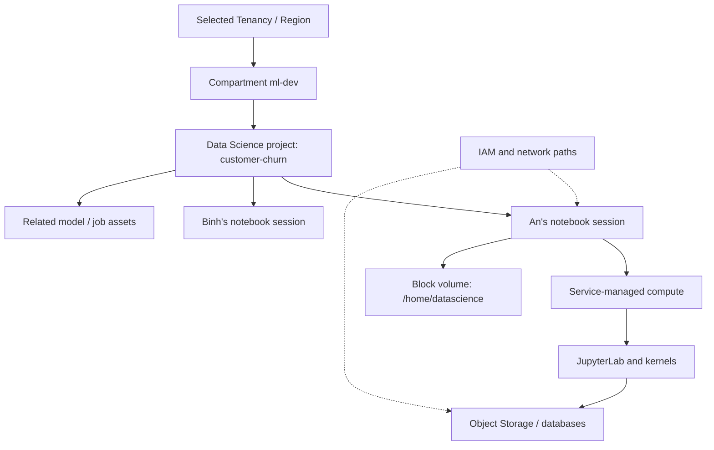
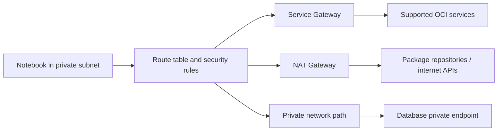

# Data Science Projects, Notebook Sessions, and Compute

In the **AI and Machine Learning on OCI** chapter of the **CLOUD_PROVIDERS_ORACLE** module, this lesson guides you through organizing a model development environment with Oracle Cloud Infrastructure Data Science. The focus is on the relationship among projects, notebook sessions, and compute, along with the accompanying infrastructure decisions: compartments, IAM, networking, storage, monitoring, and cost.

A working notebook is only the starting point. The workspace must also read the right data, use the right permissions, persist results when compute stops, and be reproducible when needed.

## 1. Objectives and prerequisites

After this lesson, you will be able to:

- Distinguish a project, notebook session, notebook file, kernel, and compute.
- Create a project and notebook session in the right region and compartment.
- Choose CPU, RAM, GPU, and storage capacity based on workload characteristics.
- Explain the difference between user permissions and notebook permissions.
- Choose default networking or custom networking suitable for your data sources.
- Store data in the right place, deactivate/activate cleanly, and track costs.
- Prepare source code, environments, and results to continue work outside the notebook.

You should have a basic understanding of tenancy, compartments, IAM policies, VCN, subnets, Object Storage, and Python. The hands-on section uses the OCI Console or OCI CLI; there is no need to deploy a separate Jupyter virtual machine.

The commands in this lesson are guidance for learners to execute in an authorized environment. OCIDs, region, group names, and buckets must be replaced with values from that environment. Creating a notebook may incur charges; this lesson does not assume resources fall within free tier limits.

## 2. How do projects, notebook sessions, and compute relate?

OCI Data Science provides a managed environment for model development and training. Projects organize assets; notebook sessions provide an interactive workspace; jobs serve repeatable tasks. These are distinct resource types within the same service. [Oracle: Overview of Data Science](https://docs.oracle.com/en-us/iaas/Content/data-science/using/overview.htm).

### 2.1. Distinguishing each layer

| Component | Role | Example | What not to confuse |
| --- | --- | --- | --- |
| Compartment | Scope for organizing resources and applying policies | `ml-dev` | Creating a project does not replace IAM design |
| Data Science project | Groups assets by work objective | `customer-churn` | A project is not a machine running Python |
| Notebook session | JupyterLab environment with infrastructure configuration | `churn-exploration-an` | One session can contain multiple notebook files |
| Notebook file | Document containing code cells, narrative, and saved output | `explore.ipynb` | Saving the file does not save the full RAM state |
| Kernel | Process executing code with a library environment | Kernel of the scikit-learn environment | Restarting the kernel loses in-memory variables |
| Compute | CPU/GPU and RAM backing the session | CPU flexible shape | Closing a browser tab is not stopping compute |
| Storage | Where files, data, and results are saved | Block volume, Object Storage | Disk space is not RAM capacity |

A helpful mental model is separating **assets**, **processes**, and **infrastructure**. A `.ipynb` file is an asset; a kernel is a process; compute provides the resources for the process to run. When training fails due to running out of RAM, renaming the project will not solve the problem.

### 2.2. Organization and execution diagram



The diagram illustrates a learning design placing the project and sessions in the same compartment. The links show roles and do not imply that a project is a shared filesystem.

### 2.3. Collaborating through a project

A project helps a team view related assets in a shared context. You can view information such as the OCID, creator, and associated notebook sessions on the project details page. [Oracle: Viewing a Project's Details](https://docs.oracle.com/en-us/iaas/Content/data-science/using/project-get.htm).

However, a project does not automatically create a source-code sharing workflow. The team should still use Git for code, buckets for data, and a naming convention for assets.

Oracle stipulates that the creator of a notebook session is the user who can open and use that session. Therefore, design each member to have their own session and collaborate through shared assets; visibility into a project does not mean sharing the same JupyterLab instance. [Oracle: Data Science Policies](https://docs.oracle.com/en-us/iaas/Content/data-science/using/policies.htm).

For example, An and Binh can work together on the `customer-churn` project, read the same authorized dataset, yet use separate kernels and working directories. An pushes code to Git for Binh to pull; adding a notebook inside An's session does not automatically place that file into Binh's session.

## 3. Preparing compartments and IAM

An operation typically involves three principals:

| Principal | Example action | Permissions to review |
| --- | --- | --- |
| User or IAM group | Create project, create and open notebook | Permissions to manage Data Science resources |
| Data Science service | Use custom networking infrastructure | Policy for the service principal |
| Notebook resource principal | Call API to read an object | Dynamic group and policy on the target resource |

Separating these three principals helps diagnose errors accurately. If a user can open JupyterLab but Python cannot read a bucket, check which identity the SDK is using and what permissions that identity has.

### 3.1. Permissions for user groups

The example below is for a team managing projects and notebooks in a development compartment:

```text
Allow group 'Default'/'DataScientists' to manage data-science-projects in compartment ml-dev
Allow group 'Default'/'DataScientists' to manage data-science-notebook-sessions in compartment ml-dev
Allow group 'Default'/'DataScientists' to read data-science-work-requests in compartment ml-dev
```

Replace the `Default` identity domain and group name according to your tenancy. This grants management permissions within the compartment, including creating or deleting resources of the specified types; a group that only needs to use existing projects can be given narrower permissions by task. Consult the permission table for each resource type when designing policies. [Oracle: Data Science Policies](https://docs.oracle.com/en-us/iaas/Content/data-science/using/policies.htm).

Do not use a tenancy administrator account for daily work just to bypass permission errors. Authorization should reflect who manages the environment, who explores data, and who only views results.

### 3.2. Permissions to use custom networking

When using custom networking, Oracle provides a policy allowing the service to use networking resources:

```text
Allow service datascience to use virtual-network-family in compartment ml-network
```

`ml-network` is the compartment containing the VCN/subnet in this example. The permissions of the user selecting the network must also be appropriate; the service policy does not replace user permissions. Default networking avoids having to manage these network resources yourself in basic labs. [Oracle: Manually Configuring a Data Science Tenancy](https://docs.oracle.com/en-us/iaas/Content/data-science/using/tutorial/get-started/get-started.htm).

### 3.3. Dynamic group for notebooks

A matching rule can select notebook sessions belonging to the `ml-dev` compartment:

```text
ALL {
  resource.type = 'datasciencenotebooksession',
  resource.compartment.id = 'ocid1.compartment.oc1..<ML_DEV_COMPARTMENT_OCID>'
}
```

The rule defines dynamic group membership; the rule itself does not grant data read permissions. After creating the dynamic group, for example named `NotebookSessionsDev`, you must add policies for the resources that those sessions are allowed to access. [Oracle: Manually Configuring a Data Science Tenancy](https://docs.oracle.com/en-us/iaas/Content/data-science/using/tutorial/get-started/get-started.htm).

Example allowing read-only access to objects in a data bucket:

```text
Allow dynamic-group NotebookSessionsDev to read objects in compartment ml-data where target.bucket.name = 'ml-training-data'
```

The `read objects` permission allows listing and retrieving objects; the `target.bucket.name` condition scopes it to that bucket. Calls to manage buckets or write outputs require other corresponding permissions. Do not grant `manage object-family` across the entire tenancy by default to a notebook that only needs to read data. [Oracle: Object Storage Policy Reference](https://docs.oracle.com/en-us/iaas/Content/Identity/Reference/objectstoragepolicyreference.htm).

A compartment-wide rule gives all matching notebooks in that compartment the same permissions. If project teams handle data with different sensitivity levels, narrow the matching rule, separate compartments, or add appropriate conditions. That is an identity-scoping decision, not just a project naming convention.

## 4. Choosing networking by data path

Before creating a session, identify two connection paths:

1. How does the user access the notebook UI?
2. How does code inside the notebook connect to data, libraries, and APIs?

These two paths have different purposes. Being able to open JupyterLab does not prove you can reach a database private endpoint or Object Storage.

### 4.1. Default networking vs. custom networking

| Need | Selection direction |
| --- | --- |
| Lab using public libraries and OCI services, without needing enterprise private networks | Default networking enables quick provisioning |
| Accessing a database via a private IP inside a VCN | Custom networking and a path to the database |
| Accessing on-premises systems via VPN/FastConnect | Custom networking, routing, and DNS per enterprise architecture |
| Environments tightly controlling outbound traffic | Custom networking with explicitly permitted destinations |

Default networking uses a service-configured network; custom networking lets you choose the VCN and subnet. Network mode cannot be switched arbitrarily from default to custom by deactivating and reactivating. The notebook's public/private endpoint is a separate option to evaluate based on UI access requirements. [Oracle: Creating a Notebook Session](https://docs.oracle.com/en-us/iaas/Content/data-science/using/create-notebook-sessions.htm).

### 4.2. Outbound paths from a private subnet

With custom networking:

- Path to the public internet typically uses a private subnet with a route to a NAT Gateway.
- Path to OCI services supported by Service Gateway requires a route to the appropriate service destination.
- Check both DNS and security rules; creating a gateway alone does not establish complete connectivity.
- An Internet Gateway does not replace NAT for a notebook without a public IP.

These distinctions are especially important when downloading Conda environments or accessing Object Storage. [Oracle: Troubleshooting Notebook Sessions](https://docs.oracle.com/en-us/iaas/Content/data-science/using/tshoot-notebook.htm).



This diagram is a design guide, not a requirement to open all paths. If the environment prohibits internet access, prepare an approved package source rather than adding NAT just to silence installation errors.

For example, a notebook that reads data successfully from Object Storage but cannot download packages from PyPI may have a path to OCI services while lacking an outbound internet route. Conversely, being able to download packages does not prove IAM permissions exist to read a bucket.

Connecting to Oracle Database may also require a database account, wallet, or authentication mechanism required by the database. Notebook IAM and network reachability to the endpoint do not replace those requirements.

## 5. Choosing compute based on actual bottlenecks

### 5.1. Four resource types to estimate

| Resource | Question when choosing | Sign that adjustment is needed |
| --- | --- | --- |
| CPU | Can preprocessing and algorithms run in parallel? | Sustained high CPU and runtime does not meet target |
| RAM | How much memory do data and intermediate copies require? | Kernel gets killed during feature engineering or training |
| GPU/VRAM | Do the framework and algorithm leverage GPUs? | GPU-friendly training takes too long on CPU |
| Storage/I/O | How much space do datasets, environments, and checkpoints take? | Disk fills up or pipeline spends heavy time waiting on read/write |

Flexible shapes allow adjusting OCPUs and memory within service-supported ranges. Data Science's supported shape list must be checked separately; do not infer from the general Compute catalog. For x86, one OCPU typically corresponds to two vCPUs; do not apply that conversion across all architectures. [Oracle: Supported Compute Shapes](https://docs.oracle.com/en-us/iaas/Content/data-science/using/supported-shapes.htm).

A learning configuration can start at **2 OCPUs, 16 GB RAM, and 100 GB block storage**, if shapes, limits, and budget allow. This is an illustrative choice for small data, not a mandatory default or performance guarantee.

### 5.2. RAM must account for intermediate data

Suppose a table after decoding has:

```text
2,000,000 rows × 40 numeric columns × 8 bytes ≈ 640,000,000 bytes
                                              ≈ 0.64 GB
```

That is only the numeric value footprint of one dense matrix. Working with it may also require:

- The original DataFrame and index.
- Encoded copies of the data.
- Copies created by type casting or feature transformations.
- Train/test splits, algorithm buffers, and other kernels.

If a step creates three intermediate copies simultaneously in memory, RAM usage can spike sharply even when the initial CSV file is small. String columns and one-hot encoding make estimation even harder. Measure on a representative sample and scale up, rather than sizing the machine solely from compressed file size.

An initial estimation approach is:

```text
Required RAM ≈ active data in use
             + concurrent intermediate data
             + algorithm memory
             + headroom for OS and other processes
```

Adding block storage solves running out of file space; that action does not give the kernel more RAM.

### 5.3. When to choose a GPU?

GPUs fit when the workload, libraries, and runtime configuration all support them. Deep learning or certain algorithms with GPU implementations are candidates; processing small CSVs with sequential code may still suit CPU better.

Before choosing a GPU, check:

1. Is the shape available for Data Science in the region you are using?
2. Do service limits and quotas allow it?
3. Does the Python environment include compatible GPU libraries?
4. Do the model, batch, and tensors fit in VRAM?
5. Does the speedup offset the higher hourly unit price?

Do not assume multiple GPUs automatically make a notebook run distributed. Your code must be able to utilize multiple devices, and there is also data transfer, synchronization, or initialization overhead.

Compare single-run cost using:

```text
Single-run compute cost ≈ runtime duration × configuration unit price
```

In a hypothetical example, configuration A has a relative unit price of 1 and runs for 4 hours; configuration B has a relative unit price of 3 and runs for 1 hour. Their compute portions are 4 and 3 units respectively. This is only a comparison formula, not OCI service pricing.

### 5.4. Limits are different from provisioning capacity

Being granted quota does not guarantee a shape has available capacity at creation or activation time. When automating, distinguish limit errors from capacity errors rather than retrying creation requests in a tight loop.

You can list notebook shapes using the CLI:

```bash
oci data-science notebook-session-shape list \
  --compartment-id "$ML_COMPARTMENT_OCID" \
  --all \
  --region "$OCI_REGION"
```

The output describes valid shapes; this is not a compute reservation command. [Oracle CLI: notebook-session-shape list](https://docs.oracle.com/en-us/iaas/tools/oci-cli/latest/oci_cli_docs/cmdref/data-science/notebook-session-shape/list.html).

## 6. Notebook lifecycle and where data is persisted

### 6.1. Distinguish saving files from preserving runtime state

| Location/state | What to understand | How to protect results |
| --- | --- | --- |
| Python variables, models only in RAM | Lost when kernel or compute stops | Write artifacts/checkpoints to files |
| Saved output inside `.ipynb` | File content only; does not restore full process state | Save notebook and re-run from top to verify |
| Files under `/home/datascience` | Stored on the session's block volume | Save work here and keep a copy outside the session |
| Temporary files outside the persisted volume | Do not use as storage for important results | Move results to a durable directory |
| Git remote or Object Storage | Independent lifecycle from the session | Push code, data, and artifacts per team workflow |

Oracle designates the block volume at `/home/datascience` as the location for data that must persist across deactivate/activate. Data on the compute's local disk is not guaranteed to persist across this lifecycle. [Oracle: Persisting Data and Files on a Notebook Session Block Volume](https://docs.oracle.com/en-us/iaas/Content/data-science/using/notebook-persist-data.htm).

Volume persistence also does not replace backups. A file saved in the right directory can still be overwritten by mistake, accidentally deleted, or lost when the session is deleted.

### 6.2. Deactivate and activate

Deactivate stops compute and preserves the block volume. Activate provisions compute again and reattaches the preserved data. When reactivating, you can adjust certain settings such as shape or increase volume size; you cannot use this step to shrink the volume. Changing subnets still requires maintaining volume attachment compatibility within the same availability domain. [Oracle: Deactivating and Activating a Notebook Session](https://docs.oracle.com/en-us/iaas/Content/data-science/using/deactivate-notebooks.htm).

Your workflow should be:

1. Save open notebooks.
2. Write models/checkpoints and important results to `/home/datascience`.
3. Push code or copies of results needing protection outside the session.
4. Deactivate using the Data Science action.
5. On the next activation, open the kernel and re-run necessary cells.

After activation, the `model` variable from previous RAM will not reappear automatically. You must retrain or load saved artifacts using a compatible environment.

### 6.3. Resource lifecycle state and work requests

When creating or modifying a session, distinguish:

- **Resource lifecycle state:** whether the session is creating, active, inactive, or failed.
- **Work request status:** progress of an asynchronous operation.

For example, `SUCCEEDED` in CLI wait options is a work request status, whereas `ACTIVE` is a resource lifecycle state. Read the output and re-check the session after operations to avoid confusing request acceptance with the workspace actually being ready to open. [Oracle CLI: notebook-session activate](https://docs.oracle.com/en-us/iaas/tools/oci-cli/latest/oci_cli_docs/cmdref/data-science/notebook-session/activate.html).

Never treat closing a browser tab, signing out of the Console, or shutting down a kernel as proof that a notebook session has been deactivated.

### 6.4. Delete has a different meaning

Deleting a notebook session deletes the block volume attached to it. Back up data before deleting; a copy inside the same volume will not survive deletion. [Oracle: Deleting a Notebook Session](https://docs.oracle.com/en-us/iaas/Content/data-science/using/delete-notebooks.htm).

For a learning machine you want to reuse next week, deactivate is usually better than delete. For finished environments, delete only after verifying that code, data, and artifacts you need to keep are stored outside the session.

## 7. Python environments, kernels, and reproducibility

Two notebooks running on the same shape can still behave differently if library versions or kernels differ.

A Conda environment packages libraries and dependencies; in JupyterLab, each environment can have a corresponding kernel. OCI provides Environment Explorer and the `odsc conda` tool to manage notebook environments. [Oracle: Conda Environments](https://docs.oracle.com/en-us/iaas/Content/data-science/using/conda_understand_environments.htm).

### 7.1. Choosing the right environment

A practical workflow:

1. Open Environment Explorer.
2. Select an environment with the required libraries and CPU/GPU compatibility.
3. Record the chosen slug and version.
4. Install the environment.
5. Select the corresponding kernel when opening the notebook.

The installation command uses the slug obtained from an available environment:

```bash
odsc conda install --slug <SELECTED_SLUG>
```

Environments installed through this mechanism reside under `/home/datascience/conda` and remain reusable after activation. There is no need to reinstall simply because the session was deactivated. [Oracle: Installing Conda Environments](https://docs.oracle.com/en-us/iaas/Content/data-science/using/conda_installing.htm).

Verify from a notebook cell:

```python
import sys
from importlib.metadata import version

print("Python:", sys.version)
print("Executable:", sys.executable)
print("scikit-learn:", version("scikit-learn"))
```

If a package exists in the terminal but a cell raises `ModuleNotFoundError`, compare the kernel's interpreter. You can switch kernels via **Kernel → Change Kernel** after the environment is installed. [Oracle: Selecting a Kernel to Run a Notebook](https://docs.oracle.com/en-us/iaas/Content/data-science/using/conda_kernel.htm).

### 7.2. Recording what is needed to re-run

An experiment should capture at minimum:

| Information group | What to record |
| --- | --- |
| Source code | Git commit, notebook, or entry point |
| Data | Object URI, version or checksum, and sampling method |
| Environment | Python, environment slug/version, key libraries |
| Run configuration | Shape, OCPUs, RAM, CPU/GPU, seed, and parameters |
| Results | Metrics, runtime, artifacts, execution timestamp |

A notebook that only runs because of a variable created in a deleted cell is very hard to hand over. Before sharing, restart the kernel and run all cells in order from the top.

For custom environments, you can save a Conda-compatible specification and build it with `odsc conda create`. Managing environments as versioned assets helps teams rebuild environments deliberately. [Oracle: Creating a Custom Conda Environment](https://docs.oracle.com/en-us/iaas/Content/data-science/using/conda_create_conda_env.htm).

Do not write private keys, tokens, passwords, or outputs containing sensitive data into committed notebooks. Sensitive configuration details should pass through the organization's appropriate secret management mechanism.

## 8. Hands-on: creating a project and notebook

The lab uses project `ds-foundations`, session `ds-foundations-dev`, and synthetic data. You can perform it via Console; the CLI section demonstrates how to express the same configuration for automation.

### 8.1. Checking prerequisites

Before creating, note down:

- Permitted region and compartment.
- IAM group with required management permissions.
- Available shapes and corresponding limits.
- Default network, or prepared VCN/subnet.
- Storage plan and deactivation time after the session.

If a project has already been designated by your team, use that project's OCID rather than creating a duplicate project for the same purpose.

### 8.2. Creating in the Console

Locate the **Data Science** service in the OCI Console, select the compartment, then:

1. Create project `ds-foundations` and enter a description stating its learning purpose.
2. Open the project and select **Notebook sessions → Create notebook session**.
3. Name it `ds-foundations-dev`.
4. Choose a CPU shape and appropriate memory configuration.
5. Choose block storage sufficient for notebooks, environments, and data.
6. Select the planned network; configure the endpoint according to access requirements.
7. Add tags such as `Owner`, `Purpose`, `Environment`.
8. Create and monitor progress until the session is ready, then open JupyterLab.

These configuration sections are described in Oracle's session creation guide; UI labels may vary across Console updates. [Oracle: Creating a Notebook Session](https://docs.oracle.com/en-us/iaas/Content/data-science/using/create-notebook-sessions.htm).

For a small lab, 2 OCPUs, 16 GB RAM, and a 100 GB volume is an example to consider. If your tenancy does not support the illustrative shape, choose an allowed shape with equivalent resources within your allocated budget.

### 8.3. Creating with the OCI CLI

The examples below use **Bash**, such as in a configured OCI Cloud Shell. Line-continuation syntax `\` does not work verbatim in PowerShell.

Declare variables:

```bash
export OCI_REGION="<YOUR_REGION>"
export ML_COMPARTMENT_OCID="ocid1.compartment.oc1..<COMPARTMENT_OCID>"
```

Create the project and capture its OCID from the output:

```bash
export PROJECT_OCID="$(oci data-science project create \
  --compartment-id "$ML_COMPARTMENT_OCID" \
  --display-name "ds-foundations" \
  --description "Practice project, notebook session, and compute" \
  --region "$OCI_REGION" \
  --query 'data.id' \
  --raw-output)"
```

`PROJECT_OCID` links the notebook to the project; the display name does not substitute for the OCID in APIs. [Oracle CLI: project create](https://docs.oracle.com/en-us/iaas/tools/oci-cli/latest/oci_cli_docs/cmdref/data-science/project/create.html).

Generate a template config, inspect it, then replace with appropriate values:

```bash
oci data-science notebook-session create \
  --generate-param-json-input config-details
```

An illustrative configuration for a CPU flexible shape is:

```json
{
  "shape": "VM.Standard.E4.Flex",
  "blockStorageSizeInGBs": 100,
  "notebookSessionShapeConfigDetails": {
    "ocpus": 2,
    "memoryInGBs": 16
  }
}
```

Use this shape only if supported by the service list and allowed in your environment. `notebookSessionShapeConfigDetails` specifies OCPUs and RAM; `subnetId` is used for custom subnet configuration. [Oracle Python SDK: NotebookSessionConfigDetails](https://docs.oracle.com/en-us/iaas/tools/python/latest/api/data_science/models/oci.data_science.models.NotebookSessionConfigDetails.html).

Save the JSON as `notebook-config.json` in the lab environment. Omit `subnetId` to use default networking; for custom networking, provide a valid subnet OCID in the config. Then create the session:

```bash
oci data-science notebook-session create \
  --compartment-id "$ML_COMPARTMENT_OCID" \
  --project-id "$PROJECT_OCID" \
  --display-name "ds-foundations-dev" \
  --config-details file://notebook-config.json \
  --region "$OCI_REGION"
```

Use `--config-details` per current CLI syntax; `--configuration-details` is an older option marked deprecated. [Oracle CLI: notebook-session create](https://docs.oracle.com/en-us/iaas/tools/oci-cli/latest/oci_cli_docs/cmdref/data-science/notebook-session/create.html).

Record the notebook's `data.id`:

```bash
export NOTEBOOK_SESSION_OCID="ocid1.datasciencenotebooksession.oc1..<SESSION_OCID>"

oci data-science notebook-session get \
  --notebook-session-id "$NOTEBOOK_SESSION_OCID" \
  --region "$OCI_REGION"
```

Inspect the lifecycle state and any error messages. If a request is still in progress or the CLI times out, check the resource and work request before retrying creation to avoid spawning unintended duplicate sessions.

## 9. Hands-on in JupyterLab

### 9.1. Preparing directories and environment

Install/select a kernel with `numpy`, `scikit-learn`, and `joblib`. Create a notebook at:

```text
/home/datascience/ds-foundations/notebooks/first-run.ipynb
```

Store outputs in a dedicated directory for easier backup:

```python
from pathlib import Path

workspace = Path("/home/datascience/ds-foundations")
artifact_dir = workspace / "artifacts"
artifact_dir.mkdir(parents=True, exist_ok=True)

(workspace / "persistence-check.txt").write_text(
    "File for checking data persistence after deactivate/activate.\n",
    encoding="utf-8",
)
print("Artifact directory:", artifact_dir)
```

### 9.2. Small training run to verify the environment

The following code generates synthetic data so no bucket is needed yet. The goal is to verify the kernel, CPU, artifact writing, and environment capture, not to evaluate a business problem.

```python
import json
import platform
import time
from datetime import datetime, timezone
from importlib.metadata import version

import joblib
from sklearn.datasets import make_classification
from sklearn.linear_model import LogisticRegression
from sklearn.metrics import accuracy_score, roc_auc_score
from sklearn.model_selection import train_test_split
from sklearn.pipeline import make_pipeline
from sklearn.preprocessing import StandardScaler

SEED = 42

X, y = make_classification(
    n_samples=5000,
    n_features=20,
    n_informative=10,
    n_redundant=2,
    random_state=SEED,
)

X_train, X_test, y_train, y_test = train_test_split(
    X, y,
    test_size=0.2,
    stratify=y,
    random_state=SEED,
)

model = make_pipeline(
    StandardScaler(),
    LogisticRegression(max_iter=1000, random_state=SEED),
)

started = time.perf_counter()
model.fit(X_train, y_train)
training_seconds = time.perf_counter() - started

predictions = model.predict(X_test)
probabilities = model.predict_proba(X_test)[:, 1]

report = {
    "created_at_utc": datetime.now(timezone.utc).isoformat(),
    "dataset": "synthetic make_classification",
    "n_samples": int(X.shape[0]),
    "n_features": int(X.shape[1]),
    "seed": SEED,
    "python": platform.python_version(),
    "scikit_learn": version("scikit-learn"),
    "numpy": version("numpy"),
    "training_seconds": training_seconds,
    "accuracy": float(accuracy_score(y_test, predictions)),
    "roc_auc": float(roc_auc_score(y_test, probabilities)),
}

joblib.dump(model, artifact_dir / "model.joblib")
(artifact_dir / "metrics.json").write_text(
    json.dumps(report, indent=2, ensure_ascii=False),
    encoding="utf-8",
)

print(json.dumps(report, indent=2, ensure_ascii=False))
```

The pipeline bundles scaling with the model so the scaler only learns from the training split during `fit`. Expected output includes the metrics and two artifact files; do not set a fixed runtime or score as a pass threshold.

This dataset is too small to draw conclusions about shape performance or GPU benefit. It only validates the baseline execution path. When saving models with mechanisms like joblib, only load artifacts from trusted sources and use matching library environments.

### 9.3. Reading an object using resource principal

This section requires the dynamic group and bucket read policy from the IAM section, plus a network path to Object Storage. Prepare a small, non-sensitive text object in the `ml-training-data` bucket.

```python
import oci

signer = oci.auth.signers.get_resource_principals_signer()
object_storage = oci.object_storage.ObjectStorageClient(
    config={},
    signer=signer,
)

NAMESPACE = "<OBJECT_STORAGE_NAMESPACE>"
BUCKET = "ml-training-data"
OBJECT_NAME = "samples/readme.txt"

response = object_storage.get_object(
    namespace_name=NAMESPACE,
    bucket_name=BUCKET,
    object_name=OBJECT_NAME,
)

target = workspace / "downloaded-readme.txt"
with target.open("wb") as output:
    for chunk in response.data.raw.stream(
        1024 * 1024,
        decode_content=False,
    ):
        output.write(chunk)

print("Downloaded bytes:", target.stat().st_size)
```

The resource principal represents the notebook and does not automatically inherit the permissions of the user logged into the Console. Oracle also supports the CLI with `--auth resource_principal` and ADS with `ads.set_auth(auth="resource_principal")`. Without specifying this method, tools may look for an API key configuration by default. [Oracle: Using Notebook Sessions to Build and Train Models](https://docs.oracle.com/en-us/iaas/Content/data-science/using/use-notebook-sessions.htm).

The example passes the namespace directly and only downloads an object; it does not require permissions to create buckets or write objects. To upload artifacts back to Object Storage, grant appropriate write permissions only on a designated output bucket rather than widening access across all input data.

### 9.4. Verifying after deactivate/activate

1. Save `first-run.ipynb` and confirm `metrics.json` and `model.joblib` exist.
2. Back up any results that must be kept outside the session.
3. Deactivate and wait until the operation finishes.
4. Activate again and open the notebook using the selected kernel.
5. Run the cell defining `workspace` and `artifact_dir`, then check:

```python
print((workspace / "persistence-check.txt").read_text(encoding="utf-8"))
print((artifact_dir / "metrics.json").exists())
print((artifact_dir / "model.joblib").exists())
```

Success means the files still exist and are readable. Python variables from the prior run must be recreated; if you need the model, load the artifact from the verified directory.

You can control the lifecycle via CLI:

```bash
oci data-science notebook-session deactivate \
  --notebook-session-id "$NOTEBOOK_SESSION_OCID" \
  --region "$OCI_REGION"

# Check get until the session reaches the INACTIVE state.

oci data-science notebook-session activate \
  --notebook-session-id "$NOTEBOOK_SESSION_OCID" \
  --region "$OCI_REGION"
```

Run each operation when the state is appropriate; do not send activate immediately while deactivate is still in progress. [Oracle: Deactivating and Activating a Notebook Session](https://docs.oracle.com/en-us/iaas/Content/data-science/using/deactivate-notebooks.htm).

## 10. Monitoring, cost, and troubleshooting

### 10.1. Monitoring resources

Notebook sessions emit metrics in the `oci_datascience` namespace, including `CpuUtilization`, `MemoryUtilization`, `NetworkBytesIn`, and `NetworkBytesOut`. You can filter by `resourceId` to inspect a specific session. [Oracle: Notebook Session Metrics](https://docs.oracle.com/en-us/iaas/Content/data-science/using/metrics-notebooks.htm).

Examples of how to interpret them:

| Observation | Hypothesis to check | Next step |
| --- | --- | --- |
| RAM climbs high then kernel vanishes | Intermediate data or model exceeded RAM | Downsample, reduce copies, measure memory |
| CPU is low but task is slow | Waiting on I/O, network, or sequential code | Separate data read time from compute time |
| Sustained high CPU | Workload is CPU-bound | Check parallelizability before increasing OCPUs |
| GPU provisioned but no speedup | Code is not running on GPU or data is too small | Check device placement, framework, and profiling |
| Disk fills quickly | Multiple environments or checkpoints | Check capacity and artifact retention policy |

These are diagnostic hypotheses, not conclusions from a single chart. Verify GPU usage with appropriate tools inside the runtime environment; do not assume every GPU metric available for jobs or model deployments also exists for notebooks.

Charts can be viewed from the session page under **Monitoring** or **Metrics**, depending on the UI. [Oracle: Viewing Notebook Session Metrics](https://docs.oracle.com/en-us/iaas/Content/data-science/using/metrics-view-notebook.htm).

Users viewing metrics, creating alarms, and configuring Notifications need corresponding permissions. A RAM alarm is helpful operationally, but identifying exactly which cell causes memory growth still requires inspection in code.

### 10.2. Lifecycle-based cost

While a notebook is active, both compute infrastructure and block storage incur charges according to configuration. When deactivated, compute billing for the session stops, while the retained volume continues to incur charges. Object Storage and related resources have their own billing lifecycles. [Oracle: Overview of Data Science](https://docs.oracle.com/en-us/iaas/Content/data-science/using/overview.htm).

A simple estimation model is:

```text
Total cost ≈ compute while active
           + block storage while volume is retained
           + data/artifacts stored outside the session
           + related services and network traffic
```

For example, 22 working days at 6 active hours per day equals roughly 132 compute hours instead of leaving the machine running continuously all month. The volume remains retained between sessions, so storage duration does not scale down in the same proportion. This illustrates hour calculations, not a price quote.

Teams should apply tags for owner, purpose, and environment; set reminders or tested scheduled deactivation aligned with work hours. Before automatically stopping machines, ensure users save work and long-running tasks use checkpointing.

Budget alerts help track spending; do not treat them as a guarantee that compute will automatically stop at a specific dollar amount.

### 10.3. Layered troubleshooting

| Symptom | Check first | Grounded resolution |
| --- | --- | --- |
| Project not visible | Region, compartment, list permissions | Fix query scope or user policy |
| Cannot create notebook | Data Science permissions, work request, config | Read error details before retrying creation |
| Custom subnet error | User/service permissions, subnet, routes, security rules | Identify which permission or network layer is missing |
| Access to open notebook denied | Session creator, signed-in identity, state | Use the creator account and check endpoint |
| SDK reports missing config/API key | Actual authentication method being used | Explicitly select resource principal when appropriate |
| Reading object returns 403/404 | Identity, policy, namespace, bucket, object | Do not conclude object does not exist from a permission error alone |
| Conda install hangs/fails download | DNS, path to Object Storage/package repo, disk space | Fix connectivity or package source |
| Package missing in notebook | Kernel and interpreter | Select the right environment |
| Activation fails | Capacity, limits, subnet/availability domain | Read work request and previous configuration |
| Files lost after session lifecycle | Storage location, deactivate vs. delete action | Check volume or restore from backup |

After modifying policies or dynamic groups, changes seen from a notebook may not take effect immediately because resource principal tokens are cached. Account for the cache duration documented by Oracle before repeatedly editing policies. [Oracle: Using Notebook Sessions to Build and Train Models](https://docs.oracle.com/en-us/iaas/Content/data-science/using/use-notebook-sessions.htm).

When requesting support, record the session OCID, region, timestamp, state, request/work request ID, and error message. Never include tokens or private keys in diagnostic details.

## 11. From personal notebooks to repeatable operations

Notebooks are great for exploration, experimentation, and explaining decisions. When a workflow must run repeatedly, extract core logic into code with clear inputs, outputs, and configuration.

Example of separating assets:

```text
ds-foundations/
├── notebooks/
│   └── explore.ipynb
├── src/
│   └── train.py
├── config/
│   └── experiment.json
└── artifacts/
    ├── metrics.json
    └── model.joblib
```

This is a team organization suggestion, not a mandatory OCI structure.

Move to a job when a task needs to run non-interactively, repeatably, and be tracked independently of a notebook work session. Calling prediction APIs from an application requires model-serving resources with their own lifecycle, monitoring, and availability requirements. Never treat a personal development session as a production serving commitment.

For recoverability, maintain sufficient source code, infrastructure configs, environment specs, data identifiers, and artifacts to spin up another session. Deactivate/activate helps resume work; a recovery plan must also handle cases where the old session can no longer be used.

Runtime configuration supports environment variables, Git repository URLs, and lifecycle scripts. It can standardize initialization, though scripts need appropriate permissions, network paths, and logging; do not override service-managed environment variables. [Oracle: Using a Runtime Configuration](https://docs.oracle.com/en-us/iaas/Content/data-science/using/notebook-runtime.htm).

For initialization scripts, design them to be safe to re-run (idempotent): check whether directories already exist, install exact versions, avoid overwriting user data, and report errors clearly. Automation is only valuable when its outcomes and state are verifiable.

## 12. Lab completion criteria

You have completed the hands-on lab when you can demonstrate:

- Project and notebook session in the right region and compartment, with OCIDs recorded.
- Compute configuration justified by the lab's CPU, RAM, and data needs.
- Notebook running under the selected kernel, producing local metrics and artifacts.
- Files under `/home/datascience` still readable after deactivate/activate.
- For the Object Storage section, the notebook reads the exact object using the authorized resource principal.
- UI access path and notebook data access path documented separately.
- Code and results needing retention backed up outside the session.
- Session deactivated upon finishing; if deleted, backup verified beforehand.
- Learner can explain which cost components remain after deactivation.

The core takeaway to retain is: **projects organize assets; notebook sessions provide workspaces; compute executes; IAM governs permissions; networking governs connectivity paths; storage and backup workflows determine persistence and recovery**. When these six pieces are designed together, a notebook becomes a manageable learning and development environment.
