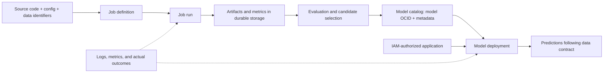

# Training Jobs, Model Catalog, and Model Deployment

In the **AI and Machine Learning on OCI** chapter of the **CLOUD_PROVIDERS_ORACLE** module, this lesson covers how to turn a training program into a repeatable job, store models with clear provenance, and deploy models as prediction endpoints. Learners also address the required infrastructure components: compartments, IAM, networking, storage, monitoring, cost, and recoverability.

A model with good evaluation scores does not automatically become a reliable service. You also have to answer: which data produced the model, where is the artifact stored, which environment can load it, which identity is permitted to invoke the endpoint, and what to do when a new version has defects.

## 1. Objectives and prerequisites

After this lesson, you will be able to:

- Distinguish a job, job run, model in the catalog, and model deployment.
- Package training code with clear inputs, configuration, outputs, and exit status.
- Run a training job using an appropriate environment and persist results outside the execution host.
- Prepare a model artifact containing inference code, the model, and runtime configuration.
- Register a model, record provenance, and organize versions.
- Deploy an endpoint, grant prediction permissions, and validate the data contract.
- Monitor infrastructure alongside prediction quality, choose a rollout strategy, and roll back to a previous version.
- Control costs across training, artifact storage, and serving over each lifecycle.

You need basic knowledge of OCI IAM, compartments, VCN, Object Storage, Python, and how to train a simple model. The hands-on section uses an already-created Data Science project, an appropriate Python environment, and an authorized output bucket.

The code snippets are guidance for your lab environment. OCIDs, region, group names, environment slugs, and buckets must be replaced with actual values. Creating a job run or deployment may incur charges; do not assume these resources fall within free tier limits.

## 2. Four resource types in the path from training to serving

| Component | Meaning | Example | What not to assume |
| --- | --- | --- | --- |
| Job | Task definition with artifact and config | `iris-training` | Creating a job does not mean training has run |
| Job run | One execution of a job with specific config | Run with `C=1.0`, seed 42 | A succeeded run does not prove model quality |
| Model in catalog | Model artifact and metadata | `iris-classifier-v1` | Saving to catalog does not create an endpoint |
| Model deployment | Resource running the model to serve inference requests | `/predict` endpoint | An active deployment does not prove results meet business needs |

OCI Data Science Jobs execute tasks outside a notebook session. A job is a reusable configuration; each job run is an execution that can have different parameters or environment variables. A job's source artifact cannot be modified after upload. [Oracle: Jobs](https://docs.oracle.com/en-us/iaas/Content/data-science/using/jobs-about.htm).

The model catalog is a repository for managing artifacts and metadata, while a model deployment turns a saved model into an HTTP endpoint. These are two distinct resources with separate purposes. [Oracle: Model Catalog](https://docs.oracle.com/en-us/iaas/Content/data-science/using/models-about.htm).

### 2.1. Overall flow



The arrow from output to evaluation is a required step in a team workflow. Do not treat every normally completed job run as automatically approved to update the serving model.

### 2.2. Two different types of artifacts

| Type | Primary contents | Who uses it? |
| --- | --- | --- |
| Job artifact | Training, preprocessing, or batch scoring execution code | Job run infrastructure |
| Model artifact | Saved model, inference code, and runtime config | Catalog and serving infrastructure |

A ZIP containing `train.py` is not necessarily a deployable model artifact. Conversely, a `model.joblib` file containing only the model does not fully define input validation, preprocessing, and HTTP response formatting.

This lab uses a **single-node job** and a **single-model deployment with a Conda environment**. OCI also supports containers and other compute configurations; choosing a deployment path must align with runtime, library, and operational requirements.

## 3. Designing a training job for repeatability

### 3.1. Separating inputs, execution, and outputs

A job should have a clear contract:

```text
Inputs:
  - Code version and environment.
  - Data identifier or data generation rule.
  - Seed, hyperparameters, and run configuration.
  - Authorized output location.

Execution:
  - Read data.
  - Split data, preprocess, train, and evaluate.
  - Write metrics, metadata, and model.

Outputs:
  - Reloadable artifact.
  - Evaluation report.
  - Manifest identifying files successfully saved.
  - Exit status and logs for diagnostics.
```

Having `X_train` in memory or a freshly installed package in the author's notebook is not state that a job run automatically inherits. Ensure the program generates or reads everything it needs on its own.

### 3.2. What to record for each run

| Information group | Contents |
| --- | --- |
| Source code | Repository, commit, entrypoint path |
| Data | URI, version/checksum, data cutoff timestamp |
| Environment | Python, libraries, Conda slug, or container digest |
| Configuration | Seed, model parameters, shape, OCPU/RAM/GPU |
| Results | Metrics, runtime duration, artifact URI, checksum |
| Run identity | Job OCID, job run OCID, compartment, timestamp |

A seed controls randomness within what the algorithm supports; it does not guarantee bit-identical results across every library version or hardware type. To explain discrepancies, record both the environment and the data.

Each run should write to its own output prefix, for example:

```text
training/<JOB_RUN_OCID>/model.joblib
training/<JOB_RUN_OCID>/metrics.json
training/<JOB_RUN_OCID>/training-metadata.json
training/<JOB_RUN_OCID>/_SUCCESS.json
```

This layout prevents two runs from overwriting each other's outputs. `_SUCCESS.json` is a lab convention marking that all files finished uploading; it is not an OCI-issued status or quality certification.

### 3.3. Artifacts and entrypoints

Jobs support artifacts such as Python files, shell scripts, or archives. With a ZIP/tar containing multiple files, configure `JOB_RUN_ENTRYPOINT` to point to the executable file inside the archive while following job artifact root-directory rules. [Oracle: Preparing Job Artifacts](https://docs.oracle.com/en-us/iaas/Content/data-science/using/jobs-artifact.htm).

Example for a multi-file project:

```text
iris-training.zip
└── iris-training/
    ├── train.py
    └── features.py

JOB_RUN_ENTRYPOINT=iris-training/train.py
```

This job ZIP layout differs from the model artifact ZIP layout covered later. For a single-file `train.py` lab, you can upload the Python file directly.

## 4. IAM, networking, and storage for each stage

### 4.1. Grant permissions to the identity actually performing the action

| Identity | Responsibility | Required permission scope |
| --- | --- | --- |
| Training job creator | Create jobs and launch runs | Projects, jobs, job runs |
| Job run resource principal | Read data, write artifacts, emit logs | Designated buckets and logs |
| Model registrar (person or pipeline) | Read outputs, create models and metadata | Artifact bucket, catalog |
| Deployment manager | Create or update serving resources | Target model, deployment, supporting infra |
| Deployment resource principal | Read environment or auxiliary data | Bucket/runtime per configuration |
| Prediction caller application | Send requests to endpoint | Predict permission |

Permissions of the user creating a job do not automatically grant bucket read access to the job run. Likewise, callers permitted to invoke an endpoint do not necessarily have permission to modify the deployment.

Example user group managing training in the `ml-training` compartment:

```text
Allow group 'Default'/'MLBuilders' to read data-science-projects in compartment ml-training
Allow group 'Default'/'MLBuilders' to manage data-science-jobs in compartment ml-training
Allow group 'Default'/'MLBuilders' to manage data-science-job-runs in compartment ml-training
```

Identity domain and group names must match your tenancy. These statements are not the complete policy set for networking, logs, or data; consult permissions per resource type when designing the environment. [Oracle: Data Science Policies](https://docs.oracle.com/en-us/iaas/Content/data-science/using/policies.htm).

### 4.2. Resource principal for job runs

Dynamic group `TrainingRuns` can use the matching rule:

```text
ALL {
  resource.type = 'datasciencejobrun',
  resource.compartment.id = '<TRAINING_COMPARTMENT_OCID>'
}
```

Then grant write permissions to an existing output bucket:

```text
Allow dynamic-group TrainingRuns to {OBJECT_CREATE, OBJECT_OVERWRITE} in compartment ml-data where target.bucket.name = 'ml-artifacts'
```

This example grants `PutObject` permission to create or overwrite objects in the specified bucket. It does not grant bucket management or object deletion. Multipart uploads, listing, or reading back require their corresponding permissions; this lab uses direct uploads of small files. [Oracle: Object Storage Policy Reference](https://docs.oracle.com/en-us/iaas/Content/Identity/Reference/objectstoragepolicyreference.htm).

If the job reads real input data, add `read objects` for the input bucket. If using a team-published Conda environment, the job run also needs read access to the bucket holding that environment.

A compartment-wide matching rule applies to all matching runs in that compartment. Use narrower compartments or conditions if separate workgroups should not receive the same data access scope.

### 4.3. Logging has its own permissions

When integrating Logging, the job run needs permission to emit logs, for example:

```text
Allow dynamic-group TrainingRuns to use log-content in compartment ml-observability
```

The user creating or launching the job also needs permissions on the log group/log depending on how logging is configured. Having permission to run training does not imply permission to create logs automatically. [Oracle: Data Science Policies](https://docs.oracle.com/en-us/iaas/Content/data-science/using/policies.htm).

Configure logging before the hands-on session. `stdout` and `stderr` integrate with OCI Logging when logging is enabled and properly authorized. [Oracle: Logs](https://docs.oracle.com/en-us/iaas/Content/data-science/using/log-about.htm).

### 4.4. Verify network paths independently of IAM

Identify the connections your workload needs:

- Job run to Object Storage for fetching data and writing artifacts.
- Job run to environment/package sources if needed.
- Deployment to runtime bucket or backend systems.
- Application to prediction endpoint.

With custom networking, configure subnets, routes, DNS, and security rules per destination. Paths to OCI services can traverse a Service Gateway; outbound internet from a private subnet typically requires a NAT Gateway per approved design. Choose networking mode based on access requirements, not merely because a creation form accepted the settings. [Oracle: Creating a Job](https://docs.oracle.com/en-us/iaas/Content/data-science/using/jobs-create.htm).

## 5. Hands-on: a training program with durable outputs

The lab uses the Iris dataset included with scikit-learn to stay focused on the OCI lifecycle. The model classifies three flower species from four measurements; this dataset does not represent the complexity of a production problem.

### 5.1. Input/output contract for the model

The feature order is specified as:

```text
1. sepal_length_cm
2. sepal_width_cm
3. petal_length_cm
4. petal_width_cm
```

Example request when serving:

```json
{
  "instances": [
    [5.1, 3.5, 1.4, 0.2],
    [6.7, 3.0, 5.2, 2.3]
  ]
}
```

Each row must contain exactly four finite numbers in this order. Passing the same four values in a different column order can produce wrong predictions without raising a data type error.

### 5.2. Contents of train.py

The following program requires `numpy`, `scikit-learn`, `joblib`, and the OCI Python SDK. It reads parameters from environment variables, trains a pipeline, writes artifacts to a temporary directory, and uploads outputs to Object Storage before exiting.

```python
import hashlib
import json
import os
import platform
import tempfile
import time
from datetime import datetime, timezone
from importlib.metadata import version
from pathlib import Path

import joblib
import oci
from sklearn.datasets import load_iris
from sklearn.linear_model import LogisticRegression
from sklearn.metrics import accuracy_score, f1_score
from sklearn.model_selection import train_test_split
from sklearn.pipeline import make_pipeline
from sklearn.preprocessing import StandardScaler


def write_json(path, value):
    path.write_text(
        json.dumps(value, indent=2, ensure_ascii=False),
        encoding="utf-8",
    )


def main():
    seed = int(os.environ.get("SEED", "42"))
    regularization_c = float(os.environ.get("REGULARIZATION_C", "1.0"))
    if not 0 < regularization_c < float("inf"):
        raise ValueError("REGULARIZATION_C must be finite and positive")

    namespace = os.environ["OUTPUT_NAMESPACE"]
    bucket = os.environ["OUTPUT_BUCKET"]
    run_ocid = os.environ["JOB_RUN_OCID"]
    source_commit = os.environ["SOURCE_COMMIT"]
    prefix = f"training/{run_ocid}"
    output_dir = Path(tempfile.mkdtemp(prefix="iris-training-"))

    dataset = load_iris()
    X, y = dataset.data, dataset.target
    X_train, X_test, y_train, y_test = train_test_split(
        X, y,
        test_size=0.2,
        stratify=y,
        random_state=seed,
    )

    model = make_pipeline(
        StandardScaler(),
        LogisticRegression(
            C=regularization_c,
            max_iter=1000,
            random_state=seed,
        ),
    )

    started = time.perf_counter()
    model.fit(X_train, y_train)
    training_seconds = time.perf_counter() - started
    predicted = model.predict(X_test)

    feature_names = [
        "sepal_length_cm",
        "sepal_width_cm",
        "petal_length_cm",
        "petal_width_cm",
    ]
    bundle = {
        "model": model,
        "feature_names": feature_names,
        "class_names": dataset.target_names.tolist(),
        "source_job_run": run_ocid,
    }
    joblib.dump(bundle, output_dir / "model.joblib")

    metrics = {
        "accuracy": float(accuracy_score(y_test, predicted)),
        "f1_macro": float(f1_score(y_test, predicted, average="macro")),
        "training_seconds": training_seconds,
        "test_samples": int(len(y_test)),
    }
    metadata = {
        "job_run_ocid": run_ocid,
        "created_at_utc": datetime.now(timezone.utc).isoformat(),
        "source_commit": source_commit,
        "dataset": "sklearn.datasets.load_iris",
        "data_sha256": hashlib.sha256(
            X.tobytes() + y.tobytes()
        ).hexdigest(),
        "seed": seed,
        "regularization_c": regularization_c,
        "python": platform.python_version(),
        "scikit_learn": version("scikit-learn"),
        "numpy": version("numpy"),
        "joblib": version("joblib"),
        "feature_names": feature_names,
        "class_names": dataset.target_names.tolist(),
    }
    write_json(output_dir / "metrics.json", metrics)
    write_json(output_dir / "training-metadata.json", metadata)

    signer = oci.auth.signers.get_resource_principals_signer()
    storage = oci.object_storage.ObjectStorageClient(
        config={},
        signer=signer,
    )

    files = ["model.joblib", "metrics.json", "training-metadata.json"]
    checksums = {}
    for name in files:
        path = output_dir / name
        checksums[name] = hashlib.sha256(path.read_bytes()).hexdigest()
        with path.open("rb") as body:
            storage.put_object(
                namespace_name=namespace,
                bucket_name=bucket,
                object_name=f"{prefix}/{name}",
                put_object_body=body,
            )

    manifest = {
        "job_run_ocid": run_ocid,
        "output_prefix": prefix,
        "sha256": checksums,
    }
    write_json(output_dir / "_SUCCESS.json", manifest)
    with (output_dir / "_SUCCESS.json").open("rb") as body:
        storage.put_object(
            namespace_name=namespace,
            bucket_name=bucket,
            object_name=f"{prefix}/_SUCCESS.json",
            put_object_body=body,
        )

    print(json.dumps({
        "event": "training_outputs_uploaded",
        "output_prefix": prefix,
        "metrics": metrics,
    }), flush=True)


if __name__ == "__main__":
    main()
```

The pipeline bundles the scaler with the classifier, enabling serving to reuse the transformation learned on the training split. Evaluation uses a separate test split; for real-world data, splitting must also account for time, entity groups, and data leakage risks.

`JOB_RUN_OCID` is a service-provided variable. Variables such as `OUTPUT_BUCKET` and `SOURCE_COMMIT` are lab configurations and must be supplied. Do not overwrite OCI-managed system variables. [Oracle: Job Environment Variables](https://docs.oracle.com/en-us/iaas/Content/data-science/using/jobs-env-vars.htm).

### 5.3. Why upload before exiting?

Job run infrastructure is reclaimed by the service once execution completes or is canceled. Therefore, files living only on the run's temporary filesystem are not usable outputs for downstream stages. [Oracle: Jobs](https://docs.oracle.com/en-us/iaas/Content/data-science/using/jobs-about.htm).

In the example:

- Errors during training or upload are not caught and silently ignored.
- The manifest is uploaded only after the three output files succeed.
- A different run has a different OCID and thus a different prefix.
- The marker confirms file export finished; metrics still must be evaluated separately.

If you need to resume training after cancellation, periodically export checkpoints to independent durable storage. Do not count on the upload code at the end of the program running if the process is terminated abruptly.

## 6. Creating a job, running it, and checking results

### 6.1. Choosing the execution environment

Jobs do not automatically use the Conda environment of the notebook where you wrote the code. For a Data Science Conda environment, configure:

```text
CONDA_ENV_TYPE=service
CONDA_ENV_SLUG=<SELECTED_ENVIRONMENT_SLUG>
```

Select an existing slug containing the libraries required by `train.py` and matching the CPU/GPU architecture. If using a self-published environment, configure type `published` with the environment's bucket, namespace, and object. [Oracle: Other Ways to Run Jobs](https://docs.oracle.com/en-us/iaas/Content/data-science/using/jobs-other.htm).

`CONDA_ENV_TYPE=service` is the value for jobs; in a model deployment's `runtime.yaml`, the environment type uses a different set of values. Do not copy configurations verbatim between the two resource types.

### 6.2. Creating in the Console

In the prepared project, go to **Jobs → Create job**, then:

1. Select **Single Node** and name it `iris-training`.
2. Upload `train.py`.
3. Select compute small enough for the lab within your limits and available capacity.
4. Select networking with connectivity to Object Storage and the required environment.
5. Enable logging to the prepared log group.
6. Set maximum runtime, e.g., 30 minutes for the lab.
7. Pass the following environment variables.

| Variable | Example value or requirement |
| --- | --- |
| `CONDA_ENV_TYPE` | `service` |
| `CONDA_ENV_SLUG` | Selected slug verified to contain needed libraries |
| `OUTPUT_NAMESPACE` | Tenancy Object Storage namespace |
| `OUTPUT_BUCKET` | `ml-artifacts` |
| `SOURCE_COMMIT` | Full commit hash of uploaded code |
| `SEED` | `42` |
| `REGULARIZATION_C` | `1.0` |

Maximum runtime bounds runaway executions; Logging collects errors and output. These are settings to configure during job creation, not properties inferred from Python code. [Oracle: Creating a Job](https://docs.oracle.com/en-us/iaas/Content/data-science/using/jobs-create.htm).

Once the job is ready, create a job run. Record the job OCID and run OCID. If you later change code, create a job/artifact corresponding to the new code version; do not assume re-uploading over an old artifact is a supported update path.

### 6.3. Launching via CLI

The following example uses **Bash** in an environment with OCI CLI configured. The job already exists with artifact, infrastructure, environment, and logging configured as in the Console step.

```bash
export OCI_REGION="<REGION>"
export TRAINING_COMPARTMENT_OCID="<COMPARTMENT_OCID>"
export PROJECT_OCID="<PROJECT_OCID>"
export JOB_OCID="<JOB_OCID>"

oci data-science job-run create \
  --compartment-id "$TRAINING_COMPARTMENT_OCID" \
  --project-id "$PROJECT_OCID" \
  --job-id "$JOB_OCID" \
  --display-name "iris-c1-seed42" \
  --region "$OCI_REGION"
```

`job-run create` launches one execution of the specified job. When parameters need to vary, the CLI supports `--configuration-override-details`; inspect the JSON template for your installed CLI version rather than guessing field names. [Oracle CLI: job-run create](https://docs.oracle.com/en-us/iaas/tools/oci-cli/latest/oci_cli_docs/cmdref/data-science/job-run/create.html).

```bash
oci data-science job-run create \
  --generate-param-json-input configuration-override-details
```

Inspect the effective configuration on the run page, including defaults and overrides, to verify what the run actually used. [Oracle: Managing Job Runs](https://docs.oracle.com/en-us/iaas/Content/data-science/using/jobs-manage-runs.htm).

### 6.4. Distinguishing technical success from meeting model requirements

After the run, verify in order:

1. Did the run finish successfully or fail/cancel?
2. Do logs confirm outputs were uploaded?
3. Are all files and the manifest for that exact run present in the bucket?
4. Do downloaded checksums match the manifest?
5. Do metrics meet the pre-run acceptance criteria?
6. Can the artifact load inside the inference environment?

For Iris, you can set a lab threshold such as `accuracy >= 0.90` to practice the candidate selection step. This is an illustrative threshold; the small test split makes scores noisy and unsuitable for generalizing into production criteria.

For risk scoring or imbalanced datasets, accuracy may fail to reflect requirements. Choose metrics, data splits, and thresholds according to the decision the model supports.

## 7. Preparing the model artifact for catalog and serving

### 7.1. Downloading the exact outputs of the selected candidate

The person or pipeline packaging the model needs read access to the output bucket. Download files from the exact evaluated job run; do not grab `model.joblib` from an old working directory with the same name.

Example using Bash and OCI CLI with bucket read permissions:

```bash
export OUTPUT_NAMESPACE="<NAMESPACE>"
export OUTPUT_BUCKET="ml-artifacts"
export SELECTED_JOB_RUN_OCID="<SELECTED_JOB_RUN_OCID>"

mkdir -p model-artifact

for NAME in model.joblib metrics.json training-metadata.json _SUCCESS.json
do
  oci os object get \
    --namespace-name "$OUTPUT_NAMESPACE" \
    --bucket-name "$OUTPUT_BUCKET" \
    --name "training/$SELECTED_JOB_RUN_OCID/$NAME" \
    --file "model-artifact/$NAME" \
    --region "$OCI_REGION"
done
```

Verify checksums of the three files against `_SUCCESS.json` before packaging. Hashes catch mix-ups or corrupted files; if the artifact source is untrusted, a manifest placed beside the artifact does not prove trustworthy provenance.

For artifacts using pickle/joblib, load only from trusted sources. Deserialization can execute code; treat artifacts as executable software brought into the runtime environment.

### 7.2. Model artifact structure

For the Conda deployment path in this lesson, prepare:

```text
model-artifact/
├── score.py
├── runtime.yaml
├── model.joblib
├── metrics.json
└── training-metadata.json
```

`score.py` and `runtime.yaml` must sit at the root level of the model artifact archive. Custom modules needed for inference must be at the same level or nested underneath. A standalone `requirements.txt` file does not replace the required runtime configuration. [Oracle: Preparing a Model Artifact](https://docs.oracle.com/iaas/Content/data-science/using/models-prepare-artifact.htm).

You can include the manifest as accompanying documentation or store it separately with release records. The key requirement is that the archive uploaded to the catalog contains the exact model and code dependencies required by serving.

### 7.3. score.py: loading the model and validating payloads

`load_model()` loads the artifact; `predict(data, model=load_model())` receives the payload and produces a response for the client. Resolving paths relative to `score.py` avoids depending on the serving process's current working directory. [Oracle: Best Practices for Model Artifacts](https://docs.oracle.com/en-us/iaas/Content/data-science/using/models-practices.htm).

Example `score.py` for the bundle produced by `train.py`:

```python
import json
from pathlib import Path

import joblib
import numpy as np


def load_model():
    artifact_dir = Path(__file__).resolve().parent
    return joblib.load(artifact_dir / "model.joblib")


def predict(data, model=load_model()):
    if isinstance(data, bytes):
        data = data.decode("utf-8")
    if isinstance(data, str):
        data = json.loads(data)

    if not isinstance(data, dict):
        raise ValueError("Payload must be a JSON object")

    instances = data.get("instances")
    if not isinstance(instances, list) or not 1 <= len(instances) <= 100:
        raise ValueError("instances must contain between 1 and 100 rows")

    X = np.asarray(instances, dtype=float)
    expected_features = len(model["feature_names"])
    if X.ndim != 2 or X.shape[1] != expected_features:
        raise ValueError("Each row must contain exactly four features")
    if not np.isfinite(X).all():
        raise ValueError("All feature values must be finite")

    pipeline = model["model"]
    class_ids = pipeline.predict(X).astype(int).tolist()
    class_order = pipeline.classes_.astype(int).tolist()

    return {
        "class_ids": class_ids,
        "predictions": [
            model["class_names"][class_id] for class_id in class_ids
        ],
        "class_order": [
            model["class_names"][class_id] for class_id in class_order
        ],
        "probabilities": pipeline.predict_proba(X).tolist(),
        "source_job_run": model["source_job_run"],
    }
```

The 100-row limit is a convention of this example, not an OCI payload limit. A real system also needs request size limits, timeout controls, and error-mapping rules appropriate to the serving stack. Do not assume a Python `ValueError` always translates into HTTP 400.

Some design points:

- The model is loaded via module initialization rather than reading from disk per request.
- The scaler stays paired with the classifier from the trained bundle.
- Checking column count does not replace checking exact feature ordering and units.
- Outputs convert NumPy arrays to lists so they are JSON-serializable.
- `class_order` clarifies the ordering of probability columns.
- Referencing the job run in the output aids lab traceability; teams can use another release identifier per product requirements.

Never turn `predict()` into a script that downloads large datasets or retrains the model. Slow operations and external dependencies increase latency, failure points, and per-request cost.

### 7.4. runtime.yaml: inference environment

Example template for a team-published environment:

```yaml
MODEL_ARTIFACT_VERSION: '3.0'
MODEL_DEPLOYMENT:
  INFERENCE_CONDA_ENV:
    INFERENCE_ENV_SLUG: '<INFERENCE_ENVIRONMENT_SLUG>'
    INFERENCE_ENV_TYPE: published
    INFERENCE_ENV_PATH: 'oci://<BUCKET>@<NAMESPACE>/<PREFIX>/<ENV>.tar.gz'
    INFERENCE_PYTHON_VERSION: '<PYTHON_MAJOR_MINOR_VERSION>'
```

Replace all placeholders with details of the published environment. Fields must be consistent with one another; do not pick an arbitrary Python version and point to an environment built with a different version.

For model deployments, `INFERENCE_ENV_TYPE` accepts values such as `published` or `data_science`. This is the model runtime schema, distinct from the `CONDA_ENV_TYPE` variable used by training jobs. [Oracle: The runtime.yaml File](https://docs.oracle.com/en-us/iaas/Content/data-science/using/model_runtime_yaml.htm).

The inference environment can be leaner than the training environment, but it must load the model, scaler, and related modules. With scikit-learn/joblib, tightly control the Python and library versions used when saving and loading the model.

If you need a custom OS, dependencies, or server, you can choose Bring Your Own Container. The BYOC path has its own container and endpoint contract; do not mechanically apply Conda runtime layouts to every deployment. [Oracle: Bring Your Own Container](https://docs.oracle.com/en-us/iaas/Content/data-science/using/mod-dep-byoc.htm).

### 7.5. Testing the artifact in the inference environment

From the corresponding inference environment, inside the `model-artifact` directory, test:

```python
import json
from score import predict

payload = {
    "instances": [
        [5.1, 3.5, 1.4, 0.2],
        [6.7, 3.0, 5.2, 2.3],
    ]
}
result = predict(json.dumps(payload))
assert len(result["predictions"]) == 2
assert len(result["probabilities"]) == 2
assert all(len(row) == 3 for row in result["probabilities"])
print(result)
```

In addition to the happy path, test payloads missing `instances`, wrong column counts, non-finite values, and empty batches. Compare against direct pipeline predictions on the same input.

This is a pre-deployment artifact functional check for learners, not a substitute for model quality evaluation or endpoint load testing.

Package the files with the right root structure, e.g., in Bash:

```bash
zip -j iris-model.zip \
  model-artifact/score.py \
  model-artifact/runtime.yaml \
  model-artifact/model.joblib \
  model-artifact/metrics.json \
  model-artifact/training-metadata.json
```

The `-j` flag in the example places the listed files at the root of the ZIP. If you have subpackages or modules, preserve the needed package directory structure rather than flattening every file.

## 8. Registering models and managing versions

### 8.1. The model catalog needs both artifact and context

A model entry should answer:

| Information | Question answered |
| --- | --- |
| Model OCID | Which exact artifact is being used? |
| Training job run OCID | Which run produced the model? |
| Commit and repository | Which code trained or packaged it? |
| Dataset version/checksum | Which data produced the model? |
| Environment | Which runtime can load the artifact? |
| Input/output schema | What must clients send and expect back? |
| Metrics and evaluation set | Why was this candidate selected? |
| Owner | Who handles updates or rollbacks? |

OCI supports provenance such as repository URL, branch, commit, and `training_id` linking to the training notebook or job run. Metadata aids traceability; it does not automatically verify that the artifact's contents actually match the description. [Oracle: Preparing Model Metadata](https://docs.oracle.com/en-us/iaas/Content/data-science/using/models-prepare-metadata.htm).

### 8.2. Registering via Console or CLI

In the project, go to **Models** to create a model, upload the artifact, and add metadata. With the CLI, creating the model resource and uploading the artifact are two separate steps.

Bash example using the appropriate project and compartment for the catalog:

```bash
export MODEL_COMPARTMENT_OCID="<MODEL_COMPARTMENT_OCID>"
export MODEL_PROJECT_OCID="<MODEL_PROJECT_OCID>"

export MODEL_OCID="$(oci data-science model create \
  --compartment-id "$MODEL_COMPARTMENT_OCID" \
  --project-id "$MODEL_PROJECT_OCID" \
  --display-name "iris-classifier-v1" \
  --description "Iris pipeline from evaluated job run" \
  --wait-for-state ACTIVE \
  --region "$OCI_REGION" \
  --query 'data.id' \
  --raw-output)"
```

`model create` supports metadata, schemas, and associating a model version set via its corresponding options. [Oracle CLI: model create](https://docs.oracle.com/en-us/iaas/tools/oci-cli/latest/oci_cli_docs/cmdref/data-science/model/create.html).

Upload the artifact:

```bash
oci data-science model create-model-artifact \
  --model-id "$MODEL_OCID" \
  --model-artifact-file iris-model.zip \
  --content-disposition "attachment; filename=iris-model.zip" \
  --region "$OCI_REGION"
```

After uploading, verify the exact model OCID, artifact, and metadata before creating a deployment. Creating the model resource alone does not prove the artifact uploaded completely. [Oracle CLI: create-model-artifact](https://docs.oracle.com/en-us/iaas/tools/oci-cli/latest/oci_cli_docs/cmdref/data-science/model/create-model-artifact.html).

Release workflows should treat each selected candidate as an immutable artifact. When changing data, pipelines, or inference code, create a version with a new identifier so you can compare and roll back to the previous one.

### 8.3. Model version sets and approval states

A model version set groups multiple model references—each a model OCID—along with version numbers/labels. It helps organize models belonging to the same line of development. [Oracle: Creating a Model Version Set](https://docs.oracle.com/en-us/iaas/Content/data-science/using/modelversionset-create.htm).

Example:

| Team-assigned label | Model OCID | Source | Team decision |
| --- | --- | --- | --- |
| `candidate-01` | `<MODEL_OCID_A>` | Run A, commit A | Keep for comparison |
| `release-01` | `<MODEL_OCID_B>` | Run B, commit B | Approved for release |
| `candidate-02` | `<MODEL_OCID_C>` | Run C, commit C | Below threshold |

The labels and decisions in the table are illustrative operational conventions. Naming something `production` does not automatically configure routing, permissions, or approval workflows.

Models in the catalog have their own lifecycle. An inactive model cannot be used to create a model deployment; do not confuse deactivating a catalog model with deactivating a serving endpoint. [Oracle: Deactivating and Activating a Model](https://docs.oracle.com/en-us/iaas/Content/data-science/using/deactivate-models.htm).

## 9. Creating a model deployment with explicit configuration

### 9.1. Separating decisions before creation

| Decision | Details to determine |
| --- | --- |
| Model | Exact Model OCID and approved version |
| Runtime | Conda or container, Python, dependencies |
| Compute | Shape, CPU/RAM or GPU/VRAM |
| Capacity | Instance count or autoscaling policy |
| Networking | Client endpoint and workload egress path |
| Logging | Access log and predict log |
| Permissions | Managers, resource principal, callers |
| Operations | Latency targets, load, cost, and rollback |

Training may require large compute to process full datasets, whereas inference only loads the model and computes on small batches. Never copy the training shape blindly into serving without load testing.

Memory usage also depends on the number of workers/processes and how each loads the model. A 500 MB artifact on disk does not mean every server needs only 500 MB of RAM.

### 9.2. Management permissions and runtime permissions

The team managing deployments needs permission to read models and manage deployments within scope:

```text
Allow group 'Default'/'MLDeployers' to read data-science-models in compartment ml-models
Allow group 'Default'/'MLDeployers' to manage data-science-model-deployments in compartment ml-serving
```

Other compartments/projects and infrastructure permissions must be designed consistently; these are illustrative statements for the model/deployment portion.

To read a published environment, create a dynamic group `ServingDeployments` matching resource type `datasciencemodeldeployment` and the serving compartment, then grant access to the runtime bucket:

```text
Allow dynamic-group ServingDeployments to read objects in compartment ml-runtime where target.bucket.name = 'ml-conda-envs'
Allow dynamic-group ServingDeployments to use log-content in compartment ml-observability
```

Permission to read the runtime and emit logs belongs to the deployment's identity. Permissions of the user creating the deployment do not substitute for these permissions. [Oracle: Model Deployment Policies](https://docs.oracle.com/en-us/iaas/Content/data-science/using/model-dep-policies-auth.htm).

### 9.3. Console walkthrough steps

In the appropriate project, go to **Model deployments → Create model deployment**:

1. Choose the compartment and name it `iris-serving-lab`.
2. Select the model using the exact recorded OCID.
3. Choose the Conda deployment path for this lab.
4. Select standard compute and a supported shape.
5. Choose instance count/scaling settings within budget; the lab can start with one instance.
6. Configure networking and endpoint according to where clients need to connect from.
7. Configure access logs, predict logs, and owner tags.
8. Create and monitor the work request until the deployment is active.

One instance is a cost-saving choice for learning, not a design meeting every high-availability requirement. Deployment creation fields and infrastructure options are documented separately by Oracle. [Oracle: Creating a Model Deployment](https://docs.oracle.com/en-us/iaas/Content/data-science/using/model_dep_create.htm).

When using default networking, verify whether egress internet access is enabled or disabled. If only supported OCI services are needed, avoid enabling outbound internet access out of habit. [Oracle: Default Networking for Model Deployments](https://docs.oracle.com/en-us/iaas/Content/data-science/using/model-dep-create-def-net.htm).

The path clients take to reach the endpoint and the path the server takes to fetch its runtime are two separate concerns. With a private endpoint, clients need proper DNS and network routes to the private FQDN; signing requests properly with IAM will not overcome missing network reachability. [Oracle: Invoking a Model Deployment](https://docs.oracle.com/en-us/iaas/Content/data-science/using/model-dep-invoke.htm).

### 9.4. Autoscaling and scale to zero

Configure scaling according to observed load: minimum/maximum instances, metric, and cooldown period must match model load time and latency requirements.

Deployment creation documentation includes scale-to-zero configurations with minimum instances set to 0, paired with request buffering options. When zero instances remain, an observable metric like request count is needed; CPU utilization of machines scaled down to zero is not a suitable wake-up signal. [Oracle: Creating a Model Deployment](https://docs.oracle.com/en-us/iaas/Content/data-science/using/model_dep_create.htm).

Do not select scale to zero purely for hoped-for cost savings. Evaluate cold start time, client timeouts, request buffering behavior, and actual configuration limits. For APIs requiring consistent latency, maintaining minimum capacity may be more appropriate.

## 10. Invoking the endpoint with an authorized identity

### 10.1. Granting predict permission to callers

Example for a dynamic group containing a notebook used to test the endpoint:

```text
Allow dynamic-group NotebookCallers to {DATA_SCIENCE_MODEL_DEPLOYMENT_PREDICT} in compartment ml-serving
```

The dynamic group must actually include the calling notebook. This statement grants predict permission within the specified compartment; it can be narrowed using service-supported conditions.

OCI model deployments use OCI IAM authentication and authorization. A reachable URL does not mean the endpoint accepts unauthenticated requests. [Oracle: Model Deployment Policies](https://docs.oracle.com/en-us/iaas/Content/data-science/using/model-dep-policies-auth.htm).

If end-user applications use another authentication scheme, design an intermediate application tier responsible for authenticating users and calling OCI using an appropriate identity. Never embed cloud-privileged private keys in browser-side code.

### 10.2. Sending a test request from a notebook

Wait until the deployment is active, open **Invoking Your Model**, and copy the endpoint URL. This lesson uses the `/predict` endpoint for a complete response. [Oracle: Invoking a Model Deployment](https://docs.oracle.com/en-us/iaas/Content/data-science/using/model-dep-invoke.htm).

Example running inside an OCI notebook with resource principal and predict permission:

```python
import json

import oci
import requests

predict_endpoint = "<FULL_PREDICT_ENDPOINT_URL>"
payload = {
    "instances": [
        [5.1, 3.5, 1.4, 0.2],
        [6.7, 3.0, 5.2, 2.3],
    ]
}

signer = oci.auth.signers.get_resource_principals_signer()

response = requests.post(
    predict_endpoint,
    data=json.dumps(payload),
    headers={"Content-Type": "application/json"},
    auth=signer,
    timeout=(10, 60),
)

print("HTTP:", response.status_code)
print("Request ID:", response.headers.get("opc-request-id"))
response.raise_for_status()
result = response.json()
print(result)
```

Use the full URL from the Console; do not append `/predict` if the URL already includes it. If running outside an OCI notebook, replace the signer mechanism with an authentication method suitable for that client environment.

A structurally valid response must contain:

- Two predicted elements for the two input rows.
- Each probability row containing three values.
- `class_order` explaining the probability column ordering.
- `source_job_run` matching the deployed candidate.
- Results consistent with the local artifact check for the same payload and environment.

A timed-out request does not prove the server never received or processed it. For side-effect-free inference, bounded retries can be designed; avoid thundering-herd retries while an endpoint is capacity-constrained or cold-starting.

## 11. Monitoring and controlled model rollout

### 11.1. Observing training

Job run metrics reside in the `oci_datascience_jobrun` namespace, including CPU, GPU, memory, disk, and network according to resource type. Filter by run OCID to view a specific execution. [Oracle: Job Metrics](https://docs.oracle.com/en-us/iaas/Content/data-science/using/metrics-jobs.htm).

When training is slow, separate time spent loading the environment, reading data, preprocessing, fitting, and exporting artifacts. Total job run duration is not identical to the `model.fit()` duration measured in Python.

### 11.2. Observing serving

Model deployments emit metrics in the `oci_datascience_modeldeploy` namespace. Key metrics include `PredictRequestCount`, `PredictResponse`, `PredictLatency`, CPU/RAM, and others depending on configuration. [Oracle: Model Deployment Metrics](https://docs.oracle.com/en-us/iaas/Content/data-science/using/metrics-model-deploy.htm).

| Observation layer | Question | Evidence |
| --- | --- | --- |
| Access | Can clients reach the endpoint? | Error rates, HTTP codes, request IDs |
| Performance | How long do requests take; are they waiting for capacity? | Latency, load, CPU/RAM, client-side timing |
| Inference code | Where do model loading or input transform errors occur? | Predict logs, exceptions |
| Data | Have input distributions shifted or schemas broken? | Quality checks and feature statistics |
| Model quality | Are predictions still useful? | Metrics comparing predictions to ground truth and business outcomes |

Access logs contain request metadata; predict logs originate from custom inference code. These two log types answer different questions. [Oracle: Logs](https://docs.oracle.com/en-us/iaas/Content/data-science/using/log-about.htm).

Never equate HTTP 200 with a correct prediction. Infrastructure monitoring cannot generate ground truth for evaluating models on its own. When labels arrive late, build a reconciliation flow pairing predictions with actual outcomes.

When logging, favor request IDs, model identifiers, timestamps, row counts, and error categories. Log payloads only under explicit data-governance requirements; never dump raw input data and secrets into logs by default.

### 11.3. Choosing a rollout strategy and rollback

A practical workflow:

1. Keep the current model alongside its metadata and deployment configuration.
2. Train the new candidate to a new output prefix.
3. Evaluate the candidate on the same appropriate test set.
4. Package and test the artifact in the inference environment.
5. Create a staging deployment or update via supported service capabilities.
6. Compare schemas, predictions, latency, and error rates.
7. Shift client traffic/routing according to the prepared plan.
8. Retain the ability to revert to the previous model and configuration for an agreed retention window.

Oracle supports updating certain groups of attributes while a deployment is active; each update must respect supported change groups and resource states. Do not assume a single request can modify every configuration setting simultaneously. [Oracle: Editing a Model Deployment](https://docs.oracle.com/en-us/iaas/Content/data-science/using/model-dep-edit.htm).

If percentage traffic splitting or shadow/parallel versions are needed, explicitly design the routing layer and evaluation strategy. Do not assume registering two models in the catalog automatically creates a canary rollout.

Rollback covers the artifact, runtime, and input/output contract. Reverting to an older model while leaving an incompatible schema on clients can still break the system.

### 11.4. Availability and recoverability

For critical serving workloads, plan for multiple instances, capacity, dependency failures, and recovery time. Load testing must cover payload sizes, concurrency, model load time, and behavior under capacity changes.

Record infrastructure definitions, model OCID, runtime URI or image digest, required policies, and client configurations. Multiple instances inside one deployment do not replace a recovery plan in another region.

Automated pipelines should halt at evaluation gates when metrics or contract checks fail. Multi-step orchestration can use OCI workflow tools, while preserving end-to-end links from datasets and runs through models and deployments in every orchestration pattern.

## 12. Cost and resource lifecycle

| Component | Primary cost driver | Control measure |
| --- | --- | --- |
| Training runs | Compute, storage, and execution duration | Choose right-sized shapes, cap runtime, cancel bad runs |
| Outputs/checkpoints | Volume and retention period | Retention policies aligned with recovery value |
| Model catalog | Artifact storage | Manage versions and retire obsolete models |
| Active deployment | Serving compute and load balancer | Right-size capacity, scale, or deactivate when appropriate |
| Logging and auxiliary data | Volume, retention, related resources | Track spending and retain deliberately |

Oracle charges according to provisioned infrastructure: the model catalog incurs artifact storage costs; active deployments incur compute and load balancer charges; jobs consume infrastructure during execution. Do not assume a completed job means all related resources have stopped incurring charges. [Oracle: Overview of Data Science](https://docs.oracle.com/en-us/iaas/Content/data-science/using/overview.htm).

Simple estimation model:

```text
Lifecycle cost ≈ sum of training run costs
               + retaining datasets, checkpoints, and model artifacts
               + serving over time and capacity
               + logs, networking, and related services
```

### 12.1. Deactivating a deployment after the lab

Deactivating a deployment makes the endpoint unavailable, stops instances, and stops billing for the deployment's instances/load balancer; metadata is preserved for reactivation. The catalog and artifact buckets have separate lifecycles. [Oracle: Deactivating and Activating a Model Deployment](https://docs.oracle.com/en-us/iaas/Content/data-science/using/model-dep-deactivate.htm).

Bash example:

```bash
export MODEL_DEPLOYMENT_OCID="<MODEL_DEPLOYMENT_OCID>"

oci data-science model-deployment deactivate \
  --model-deployment-id "$MODEL_DEPLOYMENT_OCID" \
  --region "$OCI_REGION"
```

The CLI option name is `--model-deployment-id`; re-check the status after the asynchronous operation completes. [Oracle CLI: model-deployment deactivate](https://docs.oracle.com/en-us/iaas/tools/oci-cli/latest/oci_cli_docs/cmdref/data-science/model-deployment/deactivate.html).

For user-facing services, stop resources only after draining traffic or during an agreed maintenance window. For labs, deactivating after verification prevents leaving endpoints running outside study hours.

### 12.2. Intentional cleanup

At the end of practice:

1. Verify no unexpected training runs are still running.
2. Deactivate or delete the lab deployment depending on reuse needs.
3. Retain artifacts/metadata for versions still needed for reproduction or rollback.
4. Delete temporary outputs per configured retention timelines.
5. Inspect logs, buckets, and shared resources before cleanup.

Deleting a job or run record does not automatically delete objects written to Object Storage by training code. Logs created by Data Science also have retention lifecycles you manage. [Oracle: Logs](https://docs.oracle.com/en-us/iaas/Content/data-science/using/log-about.htm).

## 13. Troubleshooting stage by stage

| Symptom | Layer to inspect | Resolution direction |
| --- | --- | --- |
| Job fails to start | Permissions, capacity, infra config | Check lifecycle/work request and allocation errors |
| `ModuleNotFoundError` in job | Actual run environment | Check slug, libraries, environment variables |
| Job archive cannot find entrypoint | ZIP/tar layout and path | Match `JOB_RUN_ENTRYPOINT` to archive structure |
| Fit finishes but run fails | Output upload or logging | Check exceptions and resource principal permissions |
| Run succeeds without expected model | Output contract and prefix | Verify run OCID, manifest, and filenames |
| Model in catalog fails to deploy | Artifact and runtime | Check ZIP root, dependencies, Python, and model state |
| Deployment fails to load Conda | IAM, bucket, and networking | Check deployment identity and path to storage |
| Model loads but predict fails | Payload, preprocessing, or output | Compare schema and test payload in inference environment |
| Client rejected calling endpoint | Signer and predict permissions | Verify principal, compartment, and URL |
| Client cannot reach private endpoint | DNS, routes, and security rules | Verify network path from client location |
| Latency rises under load | Capacity, queuing, dependencies | Measure concurrency, model load, and resources |
| HTTP succeeds but answers are wrong | Features, units, version, or drift | Reconcile contract and data quality |
| Cost keeps growing after training | Serving, storage, logs still active | Inventory every resource type |

Distinguish management-plane operation failures from inference application failures. A resource transitioning to active does not prove sample requests work; conversely, a timed-out request does not by itself prove the model is broken.

When requesting support, record region, compartment, job run/model/deployment OCID, timestamp, request ID, and relevant logs. Never attach tokens or private keys.

## 14. Completion criteria

The lab is complete when you can demonstrate:

- A job definition and a job run executed with recorded configuration.
- Model, metrics, and metadata exported to storage for that exact run.
- Artifact with verified checksums loaded successfully in the inference environment.
- Model registered in the catalog with OCID, training provenance, and version info.
- Deployment running the exact selected model and runtime.
- Caller with predict permission successfully invoking the endpoint via signed requests.
- Response matching the contract and consistent with local artifact testing.
- Logs/metrics available to distinguish permission, network, runtime, and prediction quality errors.
- A plan to revert to the previous artifact and configuration.
- Lab resources stopped or cleaned up according to the cost plan.

The core flow to master is: **jobs define executions; job runs produce outputs; the catalog stores identified models; deployments serve predictions**. IAM, networking, storage, and monitoring must match the exact identity and lifecycle at each stage so the workflow remains repeatable, controlled, and recoverable.
