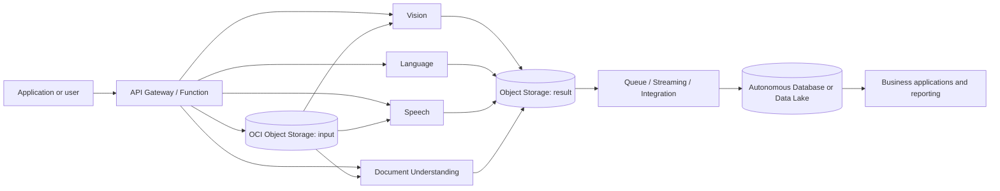
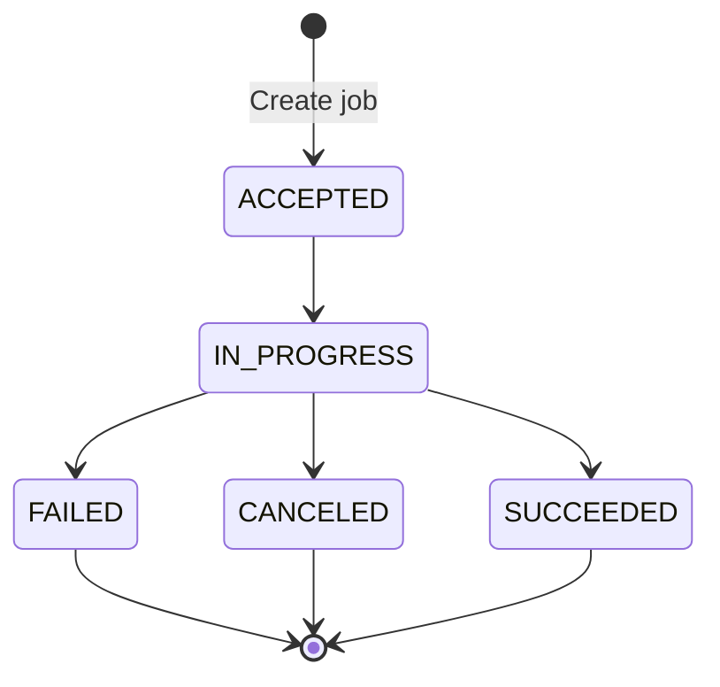
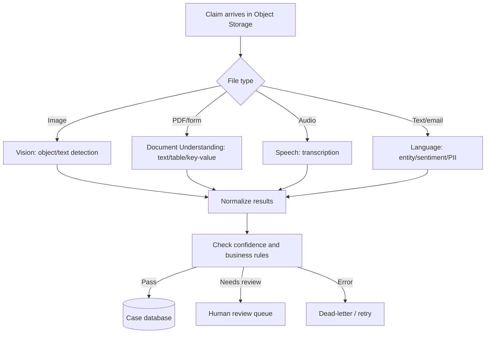

# Using Vision, Language, Speech, and Document Understanding

## 1. Problem statement and objectives

In the **CLOUD_PROVIDERS_ORACLE** module, learners explore OCI from tenancies, compartments, and IAM to networking, Compute, storage, and data services. This lesson focuses on four managed OCI AI services:

- **Vision** analyzes images and certain visual content.
- **Language** analyzes text and translates languages.
- **Speech** converts speech to text, and also supports text-to-speech synthesis within supported regions.
- **Document Understanding** extracts text, tables, key-value fields, and document types.

These services are not a single model for every kind of data. Each service accepts specific input types, returns specific result structures, and has its own limits. Proper design starts by identifying whether your data is images, text, audio, or multi-page documents; only then should you select APIs, IAM policies, object storage layout, and evaluation strategies.

After this lesson, learners will be able to:

1. Choose the right service for a common AI requirement.
2. Distinguish synchronous requests, asynchronous jobs, and event-driven processing flows.
3. Configure OCI permissions by compartment and resource family with least privilege.
4. Call APIs via CLI or SDK, store structured outputs, and validate confidence before use.
5. Build a sample pipeline: Object Storage → AI service → normalized result → queue or database.
6. Recognize model limitations, sensitive data issues, cost, latency, and traceability.

Compartment names, buckets, OCIDs, and group names in this lesson are illustrative values only. Never copy them into a real tenancy without replacing them with values from your own environment. Examples containing placeholders such as `<COMPARTMENT_OCID>` and `<NAMESPACE>` are not valid values to execute verbatim.

## 2. The big picture

### 2.1. Choosing a service by data modality

| Data and goal | Suitable service | Typical output |
| --- | --- | --- |
| Product photos, camera feeds, scenes | Vision – Image Analysis | Labels, objects, bounding boxes, confidence |
| Invoices, receipts, forms, scanned documents | Document Understanding | Text, tables, key-value pairs, document type, confidence |
| Content already in text form | Language | Sentiment, key phrases, entities, classification, PII, translation |
| Call recordings or lectures | Speech | Transcript, timestamps, speaker diarization, SRT |
| Text to read in simple images | Vision Text Detection or Document Understanding OCR | Text regions, content, and confidence |

An invoice PDF should not default to Vision Image Analysis simply because it can be rendered as an image. The problem requires invoice number, date, total amount, and line-item tables; Document Understanding is a better fit. Conversely, camera frames needing vehicle or person detection typically belong to Vision Image Analysis.

### 2.2. Reference architecture



In this architecture, Object Storage stores large inputs and outputs; API Gateway or Functions orchestrate; a database holds normalized results. Avoid writing large binaries or full transcripts into application logs. Results should include `request_id`, `source_object`, `service`, `model`, `created_at`, `status`, and pipeline version info for end-to-end traceability.

### 2.3. Separating four permission layers

When calling an AI service, errors are not always in the model. There are at least four layers to check:

| Layer | Question |
| --- | --- |
| IAM of the calling principal | Is the user, dynamic group, or resource principal allowed to call the service? |
| IAM for Object Storage | Can the principal or service read input objects and write output objects? |
| Compartment and region scope | Are resources, jobs, and buckets in the compartment/region permitted by policy? |
| Data contract | Are file format, encoding, codec, size, language, and schema supported? |

For example, if a user can call Vision but cannot read the object in the bucket, the request still fails. Conversely, being able to read an object does not grant permission to invoke Document Understanding.

## 3. Preparing tenancy and IAM

### 3.1. Organizing compartments

A small lab can use the following compartments:

```text
Tenancy root
└── ai-lab
    ├── ai-input
    ├── ai-output
    └── ai-operations
```

`ai-input` holds unprocessed images, audio, and documents. `ai-output` holds service-generated or pipeline-normalized results. `ai-operations` holds Functions, dynamic groups, logs, and orchestration resources if any. Separating inputs and outputs lets you apply distinct retention, read permissions, and deletion rules.

Never bring real personal data into a lab simply because lab accounts are easy to grant permissions to. Use synthetic or approved data, and document purpose, retention period, and owner.

### 3.2. Users, groups, dynamic groups, and resource principals

- **User/group:** suitable for manual Console operations, CLI usage, or early development.
- **Dynamic group:** matches resources such as Functions or Compute instances via rules to authorize workloads without embedding user credentials in code.
- **Resource principal:** mechanism allowing an OCI resource to call other services under granted IAM permissions.
- **API key:** can be used for a user's CLI or SDK, but the private key must be protected with a rotation process.

In production, pipelines should use dynamic groups/resource principals. Leaving a private key file inside source code or a container image is a design flaw, even if test requests succeed.

### 3.3. Narrowly scoped sample policies

Resource family names and permissions must be checked against each service's policy documentation for your region and realm. The statements below illustrate how to think about scope; replace `<GROUP_NAME>`, `<COMPARTMENT_NAME>`, and conditions for your actual tenancy.

```text
Allow group <GROUP_NAME> to use ai-service-vision-family in compartment <COMPARTMENT_NAME>
Allow group <GROUP_NAME> to use ai-service-language-family in compartment <COMPARTMENT_NAME>
Allow group <GROUP_NAME> to use ai-service-speech-family in compartment <COMPARTMENT_NAME>
Allow group <GROUP_NAME> to use ai-service-document-family in compartment <COMPARTMENT_NAME>
```

For Vision custom models or creating/managing projects, `manage` may be needed within an appropriate scope. Users only calling pretrained models should not be granted full model administration rights unnecessarily.

Object Storage policies for a specific bucket can start from:

```text
Allow group <GROUP_NAME> to read buckets in compartment ai-input
Allow group <GROUP_NAME> to read objects in compartment ai-input
    where target.bucket.name = 'ai-input-bucket'
```

If a workload needs to write outputs, grant write permission on the dedicated output bucket rather than `manage object-family` across the tenancy:

```text
Allow dynamic-group <DYNAMIC_GROUP_NAME> to manage objects in compartment ai-output
    where target.bucket.name = 'ai-output-bucket'
```

Some services require policies at the tenancy root or have separate resource families. Vision, Speech, Language, and Document Understanding do not necessarily share the exact same resource names or permission patterns. Read each service's policy reference before applying. See [Vision policies](https://docs.oracle.com/en-us/iaas/Content/vision/using/about_vision_policies.htm), [Speech policies](https://docs.oracle.com/en-us/iaas/Content/speech/using/policies.htm), and [Object Storage common policies](https://docs.oracle.com/en-us/iaas/Content/Identity/policiescommon/commonpolicies.htm).

### 3.4. Region and realm

Both the AI service and buckets must be checked for region alignment. An object stored in region A is not automatically readable as an object in region B just because they share a tenancy. Some features, such as Text to Speech, have narrower regional availability than other capabilities. The SDK/CLI endpoint region must also match the target service.

Before creating jobs, record:

```text
OCI_REGION=ap-singapore-1
INPUT_BUCKET=ai-input-bucket
OUTPUT_BUCKET=ai-output-bucket
INPUT_NAMESPACE=<NAMESPACE>
AI_COMPARTMENT_OCID=<COMPARTMENT_OCID>
```

Never write secrets, private keys, or tokens into committed config files. The values above are only non-sensitive parameters or placeholders.

## 4. Vision: image analysis and custom models

### 4.1. What does Vision do?

OCI Vision is a serverless, multi-tenant service accessible via Console, REST API, SDK, or CLI. Vision divides core capabilities into Image Analysis for objects/scenes and Document AI for document content. For Image Analysis, pretrained models commonly serve:

- Image classification: assigning labels to an entire image.
- Object detection: locating objects using bounding polygons/boxes.
- Face detection: detecting face locations, landmarks, or quality within supported capabilities.
- Text detection/OCR: detecting text inside images.

Typical Image Analysis inputs are JPG or PNG; Vision's Document AI may additionally support PDF and TIFF depending on the task. Format limits and regional availability must be checked in current documentation before deployment. See [Overview of Vision](https://docs.oracle.com/en-us/iaas/Content/vision/using/overview.htm).

### 4.2. Classification vs. object detection

Classification answers "what labels apply to this image?". Object detection answers "which objects appear and where are they?".

Warehouse inventory example:

```json
{
  "features": [
    { "featureType": "IMAGE_CLASSIFICATION", "maxResults": 5 },
    { "featureType": "OBJECT_DETECTION", "maxResults": 50 }
  ]
}
```

Classification results might be `warehouse`, `box`, `forklift`; object detection additionally returns coordinates for each `box` and `forklift`. Never use a classification label to count the number of packages.

Confidence is a model confidence score, not a probability that business logic can always interpret as "92% sure it is right". Acceptance thresholds must be calibrated against a labeled evaluation set. A high threshold reduces false positives but can increase false negatives.

### 4.3. Calling Vision on an object in Object Storage

Conceptual payload for an image analysis request:

```json
{
  "compartmentId": "<COMPARTMENT_OCID>",
  "image": {
    "source": "OBJECT_STORAGE",
    "namespaceName": "<NAMESPACE>",
    "bucketName": "ai-input-bucket",
    "objectName": "images/product-001.jpg"
  },
  "features": [
    {
      "featureType": "OBJECT_DETECTION",
      "maxResults": 20
    }
  ]
}
```

Exact field names and endpoints depend on the API operation/SDK version. Use the region's API reference to construct clients and request models rather than piecing together URLs from an old example.

Verification flow:

1. The user or workload can read the source object.
2. The principal has permission to use the Vision API.
3. The object uses a supported format and size.
4. The request region matches the input and endpoint.
5. Output contains `requestId` or equivalent for log correlation.
6. The application stores the raw response or a hashed/identified summary per data policy.

### 4.4. Batch processing and custom models

A single request fits one image needing a fast response. A batch job fits processing many images from Object Storage. Batch introduces job states, wait times, retries, and output storage; the application must treat jobs as asynchronous.

Vision custom models fit when domain-specific labels or object types are not adequately covered by pretrained models. Basic workflow:

```text
1. Collect images representative of real-world conditions.
2. Label them using consistent annotation guidelines.
3. Split train/validation/test, avoiding the same scene appearing across multiple splits.
4. Create a project and dataset.
5. Train the model.
6. Evaluate precision, recall, false positives, and false negatives.
7. Set release thresholds according to business risk.
8. Deploy the model and monitor drift.
```

A dataset with too few images or overly similar images may show attractive metrics while performing poorly under new lighting, angles, or cameras. Never force "unknown" items into valid classes just to make report errors look smaller.

### 4.5. Face detection and sensitive data

Face coordinates, landmarks, and facial images can constitute personal data. Face detection is not the same as person identification. Process them only with an approved purpose, legal basis, and access controls. If you only need to blur faces, use detection coordinates to produce a blurred copy and restrict access to the original; never store raw originals in public outputs.

## 5. Language: text analysis and translation

### 5.1. Core capabilities

OCI Language provides pretrained NLP tasks along with certain customization capabilities per current service support, including:

- Sentiment analysis.
- Key phrase extraction.
- Named entity recognition.
- Text classification.
- Language detection.
- PII detection.
- Translation, including text and document translation where supported.

Language expects text as input. If your input is a scanned image, run OCR or Document Understanding first, then pass the verified text to Language. Calling Language with an image path does not turn it into OCR.

See [Language service](https://docs.oracle.com/en-us/iaas/Content/language/using/home.htm) to verify language codes, request limits, models, and regional availability.

### 5.2. Choosing the task for the goal

| Goal | Task | What to store |
| --- | --- | --- |
| Know whether a customer is satisfied | Sentiment | Label, score, and input text/version |
| Find prominent topics in tickets | Key phrase | List of phrases and scores if available |
| Extract company names, locations, people | Entity recognition | Entity type, span, and confidence |
| Redact phone numbers, emails, IDs | PII detection | PII type, offset, and masked version |
| Route tickets to support queues | Text classification | Label, confidence, and model version |
| Translate content | Translation | Source language, target language, output text |

A sentiment label is not a final decision to issue a refund. It is a triage signal and must be evaluated on realistic text data—especially when negation, sarcasm, abbreviations, or code-switching appear.

### 5.3. Example calling Language with the Python SDK

The example below illustrates program structure. Class names, imports, and parameters must be checked against the OCI Python SDK version installed in your project environment.

```python
import oci

config = oci.config.from_file(profile_name="DEFAULT")
endpoint = "https://language.oci.<REGION>.oci.oraclecloud.com"
client = oci.ai_language.AIServiceLanguageClient(config, endpoint=endpoint)

details = oci.ai_language.models.DetectLanguageTextDetails(
    text="The product arrived fast and was very well packaged."
)

response = client.detect_language_text(
    detect_language_text_details=details
)
print(response.data)
```

Treat this snippet as an API illustration skeleton. When running for real, verify the SDK operation name, regional endpoint, and request model in the matching SDK docs. Configure timeouts, backoff retries, and text size limits at the application layer; never infinitely retry requests containing malformed data.

### 5.4. Document translation and asynchronous processing

Translating a short snippet can use a direct request. Translating many documents in Object Storage should use an asynchronous job if supported by the service. A job record should track:

```text
job_id
input_location
output_location
source_language
target_languages
submitted_at
status
failure_reason
```

The application must not treat HTTP 202 or an "accepted" status as completion. Poll with backoff intervals, enforce a deadline, handle `FAILED`/`CANCELED`, and record an idempotency key to avoid duplicate translations if a client loses connection after submission.

## 6. Speech: transcripts, timestamps, and audio

### 6.1. Speech-to-text

OCI Speech uses automatic speech recognition to convert media into text. It can process files in Object Storage or support live transcription within supported capabilities. Outputs typically include JSON and optionally SRT; timestamps synchronize text segments with audio/video.

Factors affecting quality:

- Background noise, volume, and codec.
- Speaking speed, regional accents, abbreviations, and industry jargon.
- Overlapping speakers.
- Mid-sentence language switching.
- Sample rate and audio channel count.

Whisper and Oracle ASR differ in language coverage, features, and behavior. Choose a model based on language, diarization, latency, and your project's own evaluation data—not simply because a model name sounds familiar. See [Speech overview and model comparison](https://docs.oracle.com/en-us/iaas/Content/speech/using/speech.htm).

### 6.2. Transcription jobs

Speech transcription is commonly organized into jobs and tasks. One job can process multiple files from Object Storage. Model the lifecycle explicitly:



The application must store the job OCID/id, source object, model, language code, submission time, and terminal state. Never use the filename as a unique key; the same file may be reprocessed with a different model or configuration.

An illustrative CLI command to inspect the resource can look like:

```bash
oci speech transcription-job get \
  --transcription-job-id <TRANSCRIPTION_JOB_OCID> \
  --region <REGION>
```

Verify exact command and option names using `oci speech --help` in your installed CLI version. Job output may reference the Object Storage location where transcripts are written, so the principal needs appropriate permissions on the output bucket.

### 6.3. Diarization and human review

Diarization labels speakers, but does not inherently know who is the "customer" versus the "agent" without extra rules or metadata. Transcripts with low confidence on proper nouns, product codes, and monetary amounts should go to a review queue.

Overall accuracy is insufficient for automating sensitive workflows. Sample audio/transcript pairs, measure Word Error Rate or an appropriate metric, inspect by speaker/accent, and build an error-correction workflow that logs who edited what and when.

### 6.4. Text-to-speech

Text-to-speech fits notifications, accessibility, or voice responses. Regional availability and character limits must be verified before deployment. Separate input content from SSML/voice configuration; encode inputs and enforce bounds so untrusted text cannot alter synthesis control markup.

When synthetic voice is used in user-facing products, clearly disclose that audio is synthesized, verify content usage rights, and provide text alternatives for users who cannot listen.

## 7. Document Understanding: structured document extraction

### 7.1. Pretrained models

Document Understanding is a serverless, multi-tenant service for detecting and classifying text, tables, and key data in document files. Pretrained capabilities typically include:

- OCR and word/line-level text extraction with bounding boxes.
- Key-value extraction for documents such as invoices, receipts, passports, or driver IDs within supported types.
- Table extraction preserving row and column relationships.
- Document classification.
- PDF OCR to produce searchable PDFs as supported by the service.

See [Document Understanding service overview](https://docs.oracle.com/en-us/iaas/Content/document-understanding/using/overview.htm). Supported models, formats, page counts, file limits, and field types can evolve; do not turn an example list into a guarantee that every real-world document will extract accurately.

### 7.2. Invoice processing

Example invoice pipeline:

```text
1. PDF/JPG file is uploaded to the invoice-input bucket.
2. Validate extension, MIME type, size, and business reference code.
3. Submit processor job with appropriate model/features.
4. Wait for job completion or receive notification.
5. Read result JSON from output location.
6. Normalize dates, currency, invoice number, and line items.
7. Check confidence and reconciliation rules.
8. Route suspect fields to human review.
9. Write approved results to database.
```

Never post `total_amount` directly into an accounting ledger solely because the model returned a number. Reconcile total amount against subtotal, tax, and discounts per business rules; check currency, supplier, date, and duplicate invoice numbers.

### 7.3. Confidence and review zones

Design a three-zone policy:

| Illustrative condition | Action |
| --- | --- |
| High confidence and business rules pass | Auto-accept |
| Medium confidence or unusual critical field | Route to human review |
| Low confidence, corrupted file, or broken schema | Reject, request reprocessing |

Thresholds must be calibrated on a labeled real-world dataset. A `0.90` threshold does not automatically carry the same meaning across vendor name, total amount, and document type. For high-risk fields, set dedicated thresholds and add cross-check rules.

### 7.4. Processor jobs and output locations

Single-file processing and batch processing may use different API operations. For asynchronous jobs, make the application idempotent:

```json
{
  "source_object": "invoice-input/2026/01/inv-001.pdf",
  "source_etag": "<ETAG>",
  "processor": "PRETRAINED_INVOICE",
  "submitted_at": "2026-01-15T10:00:00Z",
  "job_id": "<JOB_OCID>",
  "status": "IN_PROGRESS"
}
```

`source_etag` or a fingerprint detects whether the file changed. If a client retries after a timeout, check for an existing job matching that fingerprint before submitting a new job. Results must stay linked to the specific input version, not just a mutable path that might be overwritten.

## 8. Combining all four services into one pipeline

### 8.1. Use case: insurance claim processing

A claim file may contain scene photos, PDF forms, recorded statements, and text emails. Sample pipeline:



Not every claim runs all four services. A router selects services by MIME type and metadata; a scanned PDF might run Document Understanding, then pass extracted text to Language if business logic needs entities or PII detection.

### 8.2. Schema normalization

Each service returns a different response shape. Create a stable internal schema:

```json
{
  "case_id": "CASE-001",
  "source": {
    "namespace": "<NAMESPACE>",
    "bucket": "ai-input-bucket",
    "object": "cases/CASE-001/statement.mp3",
    "etag": "<ETAG>"
  },
  "analysis": {
    "service": "speech",
    "operation": "transcription",
    "model": "<MODEL_NAME>",
    "language": "<LANGUAGE_CODE>",
    "job_id": "<JOB_ID>",
    "status": "SUCCEEDED"
  },
  "result": {
    "text_uri": "oci://ai-output-bucket@<NAMESPACE>/CASE-001/transcript.json",
    "review_required": true,
    "reason": "low_confidence_entity"
  },
  "created_at": "2026-01-15T10:30:00Z"
}
```

Keep raw results in a controlled location for auditing, while normalized tables serve queries. If outputs contain PII, apply appropriate encryption, retention, and masking across both raw and normalized data.

### 8.3. Events, retries, and dead-letter handling

A production pipeline must handle:

- Files uploaded whose events arrive late or multiple times.
- AI services returning temporary throttling or timeouts.
- Jobs completing while writes to the output bucket are denied.
- Inputs deleted before the job reads them.
- Low-confidence results despite technically successful requests.

Retries only fit transient errors and must include exponential backoff, max attempt limits, and idempotency. Format or policy errors must not be retried indefinitely. Route failed messages to a dead-letter queue with `source_object`, `job_id`, `error_code`, and timestamp for operations triage.

## 9. End-to-end lab walkthrough

### 9.1. Lab objective

The lab uses three synthetic inputs:

```text
ai-input-bucket/
├── images/storefront.png
├── documents/invoice-001.pdf
└── audio/call-001.wav
```

Goals:

1. Vision recognizes content in `storefront.png`.
2. Document Understanding extracts fields and tables from `invoice-001.pdf`.
3. Speech generates a transcript from `call-001.wav`.
4. Language analyzes sentiment, entities, or PII on the transcript.
5. Write a result manifest into `ai-output-bucket`.

You can use the Console initially to inspect responses, then CLI/SDK for repeatable steps. No custom model training is needed to complete the baseline pipeline.

### 9.2. Verifying Object Storage

Check namespace and object via CLI using a configured profile:

```bash
oci os ns get --profile DEFAULT

oci os object head \
  --namespace-name <NAMESPACE> \
  --bucket-name ai-input-bucket \
  --name documents/invoice-001.pdf \
  --profile DEFAULT \
  --region <REGION>
```

If `head` fails, fix IAM, bucket, object name, or region before testing the AI service. Never use Administrator privileges to mask workload policy errors.

### 9.3. Running Vision

In the Console, choose Vision, an appropriate pretrained model, compartment, and an image from local disk or Object Storage. Observe:

- Returned labels or objects.
- Confidence scores.
- Bounding polygons when using detection.
- Request ID.

Save the response to `vision-storefront.json` in your lab folder, stripping unnecessary details if the image involves sensitive data. Ask the validation question: "Did the model find the right business-relevant objects?" rather than "Did I get HTTP 200?".

### 9.4. Running Document Understanding

Choose features suited to `invoice-001.pdf`, then inspect:

| Field | Check |
| --- | --- |
| Vendor | Does the name match the original document? |
| Invoice number | Are characters or leading zeros preserved? |
| Invoice date | Are timezone and format normalized? |
| Currency | Does it distinguish `VND`, `USD`, etc.? |
| Total | Does it reconcile with subtotal + tax - discount? |
| Line items | Do row count, quantities, and unit prices match? |

Missing fields should not silently become empty strings treated as valid. Record `null` or a missing status along with a review reason.

### 9.5. Running Speech

Ensure audio uses a supported codec and language code. Create a transcription job, save the job ID, and track it to a terminal state. For long files, never keep an HTTP request open in the application waiting for completion; separate submission from polling/notification.

Compare the transcript against a known reference passage. Note errors in proper nouns, phone numbers, product codes, and punctuation. If the pipeline runs Language after Speech, explicitly decide whether to send the full transcript or only filtered segments.

### 9.6. Running Language on the transcript

Language can analyze saved or loaded transcript text. A safe pipeline typically detects PII before forwarding text into broader analytics systems:

```text
Raw transcript
  → PII detection
  → masking or tokenization
  → sentiment/entity/classification
  → normalized result
```

Do not mask prior to identity resolution if business logic has no secure way to link tokens; also never dump raw transcripts into logs for debugging convenience.

### 9.7. Result manifest

Create a small manifest for each source:

```json
{
  "source_object": "documents/invoice-001.pdf",
  "analyses": [
    {
      "service": "document-understanding",
      "status": "SUCCEEDED",
      "result_object": "results/invoice-001.json",
      "review_required": true
    }
  ],
  "pipeline_version": "lab-1",
  "created_at": "2026-01-15T11:00:00Z"
}
```

The manifest does not replace raw responses. It serves as an index so downstream consumers know where results live, their status, and whether review is needed.

## 10. Symptom-based troubleshooting

| Symptom | Check first | What not to conclude immediately |
| --- | --- | --- |
| `NotAuthorizedOrNotFound` | Policy, compartment, region, OCID, and principal | Model does not support input |
| Cannot read object | Bucket policy, object path, namespace, and encryption | AI service is broken |
| Job created but never completes | Job status, output location, limits, and service health | Client polling is definitely buggy |
| OCR returns little text | Image quality, DPI, rotation, language, and format | Raise confidence threshold |
| Invoice missing fields | Model/document type, layout, and text regions | Fill in default values |
| Transcript mishears names or numbers | Audio quality, language, model, and glossary | Retry the same file infinitely |
| Unreasonable sentiment result | Slang, negation, domain, and evaluation set | Manually adjust labels by gut feel |
| Response too large or times out | Input size, sync vs. async, pagination, and retries | Increase timeouts indefinitely |
| Same file generates multiple results | Duplicate events, missing idempotency and fingerprint | Manually delete outputs after each run |

Collect request ID, job ID, timestamp, region, service endpoint, and error code when opening a support ticket. Never send raw PII, private keys, wallets, or sensitive document contents into logs or tickets without an approved process.

## 11. Accuracy and human-in-the-loop

### 11.1. Measure the right problem

Choose metrics by task:

| Task | Suggested metrics |
| --- | --- |
| Classification | Per-label precision, recall, F1 |
| Object detection | IoU, precision, recall, and miss rate |
| OCR | Character/Word Error Rate, field accuracy |
| Entity extraction | Precision, recall, span-level F1 |
| Transcription | Word Error Rate, terminology errors, and speaker attribution |
| Key-value/table extraction | Field accuracy, row/column accuracy, reconciliation rate |

Keep test sets separate from data used to tune thresholds. Evaluate by slice: document type, camera, accent, resolution, vendor, and language. A single overall average can hide a slice with severe errors.

### 11.2. Never automate decisions beyond confidence

AI services return predictions. The application must decide how those predictions are used. For payments, hiring, insurance, or personal data, low confidence or conflicting critical fields should go to review rather than auto-acceptance.

Reviewers need to see the original file, relevant text region or timestamp, the model's extracted value, and the flag reason. When reviewers correct outputs, save the corrected version to build evaluation sets and detect drift.

## 12. Security and data governance

### 12.1. Least privilege and data zoning

Separate groups:

```text
AI-Developers   : invoke services in lab compartment, read synthetic data
AI-Operators    : view jobs, logs, metrics, handle retries
AI-Reviewers    : inspect flagged inputs and correct business outputs
AI-Auditors     : read manifests/audits in scope, no raw docs unless needed
```

Do not give `AI-Reviewers` permission to edit policies or delete buckets. Do not give `AI-Operators` access to raw documents if they only need job metadata. When using dynamic groups, rules should identify exact resource types rather than matching every Compute instance in the tenancy.

### 12.2. Encryption, retention, and deletion

OCI Object Storage provides service-managed encryption by default; workloads with stricter requirements can use customer-managed keys by design. When using custom keys, verify principal permissions with Vault/KMS and handle key rotation. Encryption does not replace read-restricting policies.

Define separate retention schedules for:

- Raw inputs.
- Raw AI results.
- Masked results.
- Manifests and audit records.
- Temporary audio/video files.

Automatically purge temporary data after downstream consumers confirm results, while never deleting raw inputs before legal or investigative retention periods expire. Lifecycle rules must be tested against actual object prefixes and versioning settings.

### 12.3. PII and sensitive data

PII can appear in images, transcripts, invoices, and responses. Control:

1. Who can upload and read inputs?
2. Within what scope does the AI service retain or process data?
3. Which bucket stores outputs and who can read them?
4. Do logs accidentally capture request bodies?
5. Are results masked before forwarding to external systems?
6. When purpose ends, how are data and derived copies deleted?

Never bring production data into notebooks or personal local files for a "quick test". Create masked sample datasets and store them inside the lab compartment.

## 13. Cost, limits, and operations

### 13.1. Sizing the workload

Before estimating costs, record:

```text
images_per_day
pages_per_document
audio_minutes_per_day
text_characters_per_day
sync_requests_per_minute
async_jobs_per_day
retention_days
human_review_rate
```

Separate valid inputs, retries, and reprocessing caused by bad data. Retrying the same file due to missing permissions drives up request volume while producing zero value.

### 13.2. Limits to verify at deployment time

File limits, page counts, tasks per job, audio duration, text size, concurrency, and regions vary by service and model. Current Speech documentation, for instance, specifies file/audio limits, tasks per job, and job retention duration; do not apply those numbers to Vision or Document Understanding.

Read the Limits and Service Availability pages for the exact service before setting SLAs. If workloads exceed limits, consider batching, queuing, requesting a limit increase, or redesigning—not merely raising client timeouts.

### 13.3. Observability

Every request/job should carry an application correlation ID. Log at minimum:

```text
correlation_id
source_object_id or fingerprint
service
operation
region
job_id/request_id
submitted_at/completed_at
status
retry_count
review_required
```

Never log raw content, credentials, or entire responses if responses contain PII. Metrics should distinguish latency, error rate, retry rate, review rate, and confidence distribution. A rising review rate can signal drift or input changes even while technical error rate remains 0.

### 13.4. Model versioning and reproducibility

When outputs drive business processes, store model/provider configuration and pipeline version. If a managed service updates models automatically, establish regression testing against a benchmark set before rolling out wider usage. Identical inputs can yield different outputs after a model update; audits need to know why.

## 14. Integrating with other OCI services

### 14.1. Object Storage and Events

Object Storage stores files; Events detects object creation; Functions or Integration invokes AI services. Guard against duplicate events and feedback loops: if outputs land in a bucket monitored by events, prefix/filter rules must exclude outputs from triggering inputs.

### 14.2. Queue, Streaming, and Integration

Queue fits per-case processing messages and dead-letter retries. Streaming fits continuous high-throughput flows requiring partitioned processing. Oracle Integration fits multi-connector low-code workflows. Choose based on throughput, ordering, retries, observability, and your operations team.

### 14.3. Functions and Data Science

Functions fit short, stateless orchestration or event triggers. Long jobs, large batch runs, or specialized libraries may require Data Science jobs or Compute. Never stuff entire file contents into a Function payload when an Object Storage reference can be passed instead.

### 14.4. Autonomous Database and Analytics

Normalized results can be written to Autonomous Database for querying, reconciliation, and reporting. Retain:

- `source_object` and `etag`.
- `service` and `model`.
- `raw_result_uri`.
- `normalized_value`.
- `confidence`.
- `review_status`.
- `processed_at`.

This design lets reports answer "where did this value come from, when, by which model, and who approved it?".

## 15. Acceptance checklist

### 15.1. Functionality

- [ ] Vision processes valid inputs and returns labels/objects matching the schema.
- [ ] Document Understanding extracts fields and tables from test documents.
- [ ] Speech job succeeds and output includes required transcript/timestamps.
- [ ] Language processes text with verified encoding/language.
- [ ] Pipeline writes manifests linked to outputs.

### 15.2. Permissions and networking

- [ ] API caller principal is the intended user/dynamic group/resource principal.
- [ ] Policies cover only necessary compartments/buckets.
- [ ] Inputs and outputs do not use public access without approved justification.
- [ ] Endpoint region and object region are verified.
- [ ] No secrets appear in source code, container images, or logs.

### 15.3. Data and quality

- [ ] Test set represents formats, languages, quality levels, and failure cases.
- [ ] Confidence thresholds are measured, not arbitrarily guessed.
- [ ] Critical fields have reconciliation rules.
- [ ] Human review and dead-letter paths exist.
- [ ] Raw and normalized results link back to exact input versions.

### 15.4. Operations

- [ ] Correlation ID, job ID, and request ID exist for traceability.
- [ ] Retries have backoff, attempt caps, and idempotency.
- [ ] Metrics cover latency, errors, retries, review rate, and cost.
- [ ] Retention/lifecycle rules exist for inputs, outputs, logs, and temporary data.
- [ ] Plans exist for model updates, limit increases, and recovery.

## 16. Extension exercises

1. Replace the storefront photo with a labeled set of 100 images and compute object detection precision/recall at three confidence thresholds.
2. Create two invoice types with different layouts and measure field accuracy alongside human review rate.
3. Run Speech on the same audio segment using two supported models or configurations; compare proper-noun errors and latency.
4. Pass transcripts through PII detection, create a masked version, and verify dashboards cannot read raw text.
5. Design a policy allowing a Function to read only `ai-input-bucket` and write `ai-output-bucket`, then test access against a third bucket.
6. Intentionally introduce a format error, route the message to dead-letter, and prove the pipeline does not retry indefinitely.
7. Build a cost sheet based on image count, page count, audio minutes, and character count; separate reprocessing and manual review costs.

## 17. Conclusion

Vision, Language, Speech, and Document Understanding address four distinct data modalities within the same OCI ecosystem. Their value lies not in getting a successful API call, but in building a pipeline with proper permissions, valid inputs, explainable results, clear review branches, and traceability from outputs back to source objects.

When deploying, start with a small approved dataset. Verify IAM and regions, measure quality on representative data, and only then automate and scale. Every AI output must be treated as a signal carrying confidence and context; final business decisions must follow organizational rules, controls, and accountability.
