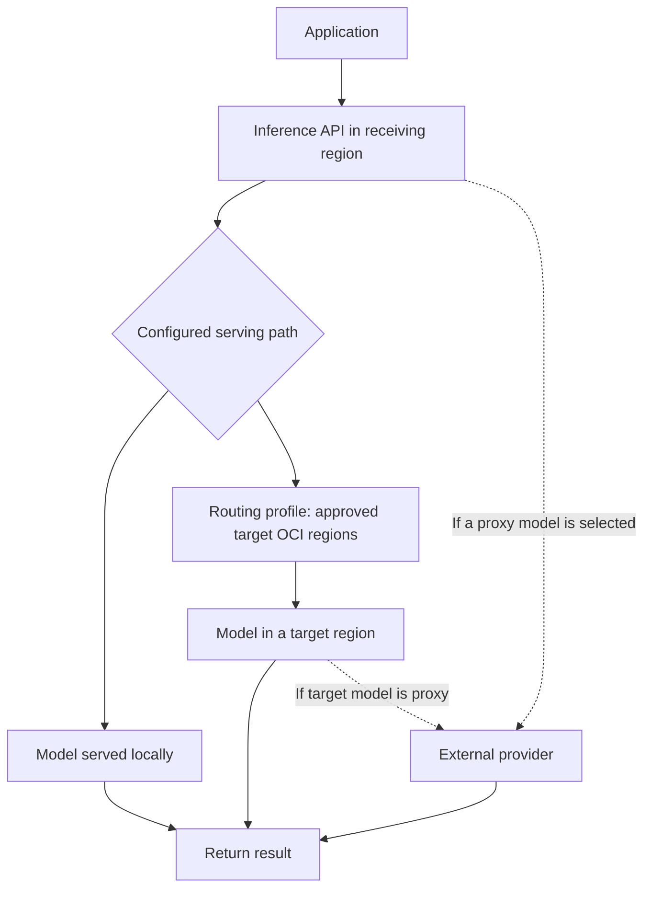

# Generative AI Endpoints and Model Selection by Region

## 1. Objectives and deployment scenario

In the **AI and Machine Learning on OCI** chapter, choosing a Generative AI model always goes hand in hand with choosing how the model is served, the API, and the region. A valid model ID alone is not enough for an application to run inference successfully: the combination of model, serving mode, API, processing location, IAM permissions, and network connectivity must all align.

This lesson enables learners to:

- Distinguish a service API endpoint, model endpoint, private endpoint, and dedicated AI cluster.
- Understand the difference between the application region, the API-receiving region, and the model processing location.
- Look up models by region, serving mode, capabilities, and lifecycle.
- Test-call the OCI-native Chat API in on-demand mode using the OCI CLI.
- Plan for dedicated endpoints, cost tracking, monitoring, and controlled regional failover.

Suppose a customer support application needs to summarize requests in Vietnamese. The application already runs on OCI, but the engineering team has not selected a model yet. The questions to resolve are: which model meets Vietnamese quality needs, from which region can it be called, where is the data processed, should on-demand or dedicated be used, and what options are permitted during an outage.

Endpoint examples in this lesson use the OCI commercial realm OC1. Do not generalize DNS suffixes, model catalogs, or support policies to government or sovereign realms.

Model and region details were verified against Oracle documentation on **2026-11-21**. When deploying, re-verify the catalog, lifecycle status, and actual tenancy capabilities.

## 2. "Endpoint" has multiple meanings

| Concept | Meaning | Example or identifier |
| --- | --- | --- |
| Management API endpoint | API address for managing resources and querying the catalog | Generative AI service host per region |
| Inference API endpoint | API address receiving inference requests | `https://inference.generativeai.ap-osaka-1.oci.oraclecloud.com` |
| Model endpoint | Resource identifying an access point to a model on a hosting dedicated AI cluster | Endpoint OCID used in dedicated requests |
| Private endpoint | Private access path into the service through a VCN | Service-provisioned network resource and FQDN |
| Dedicated AI cluster | Dedicated compute resource for hosting or fine-tuning supported models | Cluster OCID, shape, and model replicas |
| Routing profile | Configuration routing on-demand requests to selected target regions | Profile OCID and set of target regions |

A model endpoint and a cluster are related, but they are not the same resource. A private endpoint controls the network path; it does not select a model, grant inference permissions, or provision GPU capacity. A routing profile is also not a cluster deployed in every region.

With **on-demand**, users do not need to create a model endpoint on a dedicated cluster themselves. With **dedicated**, a matching model endpoint on a hosting cluster is required. See [managing model endpoints](https://docs.oracle.com/en-us/iaas/Content/generative-ai/endpoint.htm).

### Service address vs. endpoint OCID

A dedicated request requires both pieces of information:

1. The inference API address to send the HTTPS request to.
2. The model endpoint OCID so the service identifies the resource serving the model.

Do not place the model endpoint OCID into the URL field. Nor use the cluster OCID in place of the endpoint OCID. For private access, retrieve the actual FQDN from the private endpoint configuration rather than guessing an address from the display name.

## 3. Choosing the right API family and request format

### OCI-native inference API

Example base URL in OC1:

```text
https://inference.generativeai.<region-identifier>.oci.oraclecloud.com
```

The OCI-native API provides operations for chat, embedding, and rerank. The SDK or CLI builds operation paths on top of the base URL. The management client and inference client serve different purposes; successfully querying models via the management API does not prove inference requests are valid.

In the lab, learners use the OCI-native Chat API via:

```text
oci generative-ai-inference chat-result chat
```

Fields such as `compartmentId`, `servingMode`, and `chatRequest` belong to this API path's request structure. Do not copy a request body verbatim from a different API and only change the hostname.

### OCI OpenAI-compatible API

OCI also offers an API path compatible with several familiar request patterns, with base URL:

```text
https://inference.generativeai.<region-identifier>.oci.oraclecloud.com/openai/v1
```

Verify that both the model and region support the exact API needed, such as Responses or Chat Completions. Request compatibility does not mean every model supports every field, tool, or input type. This path still uses OCI-supported authentication mechanisms; do not take an API key from another provider to authenticate arbitrarily. See [OCI OpenAI-compatible endpoints](https://docs.oracle.com/en-us/iaas/Content/generative-ai/openai-compatible-api.htm).

The upcoming lab uses the OCI-native API to make serving modes explicit. If switching to the compatible path, re-select request/response adapters and verify supported features.

### Model compatibility must also be verified

| Need | What must be confirmed |
| --- | --- |
| Text chat | Model supports `CHAT` and the exact request format |
| Embedding | Embedding model, vector dimensions, and matching input types |
| Rerank | Rerank model and document limit rules |
| Images or audio | Modality type, payload limits, and supported APIs |
| Tool calling | Model, tool schema, tool-result return format, and matching API |
| JSON output | Structured output support and supported schemas |

A chat model does not automatically become an embedding model. When switching embedding models, you usually must re-embed documents and verify index compatibility rather than merely swapping the model ID for new queries.

## 4. The API-receiving region may not be the final processing location

Three locations must be distinguished:

- **Application region:** where Compute, OKE, Functions, or the backend calling the model runs.
- **API-receiving region:** the region in the endpoint that the client calls.
- **Model processing location:** the OCI region serving inference, or an external provider's location for proxy models.

For example, an application in one region can directly call an inference endpoint in another region. All data included in the request—including prompts and retrieved documents for RAG—must be evaluated along this path.

### Local processing, routing, and proxy



The diagram shows conceptual processing paths, not a claim that every model supports every branch.

OCI distinguishes regions with local model processing from regions that access models via routing. Available models and serving modes can differ across regions. See [model processing regions](https://docs.oracle.com/en-us/iaas/Content/generative-ai/regions.htm).

With a **routing profile**, the configuration pairs a supported on-demand model with one or more target regions in the same realm. Profiles can be used from regions without local processing, or from regions with local processing that lack the desired on-demand model. This is on-demand inference routing, not a mechanism for replicating a dedicated endpoint. See [managing routing profiles](https://docs.oracle.com/en-us/iaas/Content/generative-ai/routing-profile.htm).

Model discovery also distinguishes:

- `HOSTED`: the model runs inside OCI Generative AI.
- `PROXY`: requests are forwarded to a model hosted by an external provider.

Therefore, an OCI hostname alone is not enough to conclude data is processed only in the region named in the hostname. For proxy models, read the External Calls notes for that exact model and region combination. Refer to [model discovery](https://docs.oracle.com/en-us/iaas/Content/generative-ai/model-discovery.htm).

### A regional boundary example

Suppose processing is only allowed within a set of organization-approved regions. Then you must:

1. Select a model whose hosting mode meets the requirement.
2. If using routing, include only approved regions in the profile.
3. Check the external provider's processing location if the model is a proxy.
4. Account for where RAG documents, logs, and conversation history are stored.
5. Prevent the application from automatically falling back to regions outside the list.

A routing profile with a single target region restricts the processing region, but does not provide multi-region redundancy. If all permitted targets become unavailable, the application must fail gracefully or switch to a designed degraded mode.

## 5. On-demand and dedicated: two different serving models

| Criterion | On-demand | Dedicated |
| --- | --- | --- |
| Getting started | Pick a supported model and invoke inference | Provision a hosting cluster, model, and model endpoint |
| Compute | Service-managed shared capacity | Dedicated capacity per provisioned cluster |
| Identifier in OCI-native request | Model ID | Model endpoint OCID |
| Workload fit to consider | Experimentation, variable load, initial evaluation | Dedicated capacity needs or models requiring dedicated |
| Primary cost drivers | Model pricing basis and usage volume | Shape, AI units, replicas, and commitment terms |
| Limits to evaluate | Throttling, tokens, modality, API, and availability | Quotas, capacity, compatible shapes, cluster/endpoint lifecycle |
| Regional failover | Another region or routing profile where supported | Provision dedicated serving resources in the failover region |

Not every model offers both modes. Dedicated also does not mean every model can be fine-tuned. A model may support dedicated hosting without offering fine-tuning.

For pretrained and custom models, dedicated clusters carry usage commitment terms; imported models may have different rules. Read the applicable terms before creating resources, even solely for learning. See [on-demand and dedicated modes](https://docs.oracle.com/en-us/iaas/Content/generative-ai/modes.htm).

### More endpoints do not equal more capacity

You can create multiple model endpoints for different purposes on a compatible cluster. However, adding endpoints does not automatically add model replicas or increase throughput. To increase capacity, you must size and adjust service-supported compute/replica resources.

Model, cluster selection, and unit shape must be compatible. Never assume one cluster can arbitrarily host unrelated models. Oracle explains these constraints in [relationship between endpoints and hosting clusters](https://docs.oracle.com/en-us/iaas/Content/generative-ai/endpoint.htm).

## 6. Model selection workflow by region

Follow these steps in order to avoid picking a model only to discover it cannot be deployed.

### Step 1 — Lock functional requirements

Define task type, language, document length, user count, latency, and output format. For the support-request summary example:

- Primary input is Vietnamese, potentially with English technical terms.
- Output must preserve order IDs and described issues accurately.
- No internet-access tools are needed for initial testing.
- Test data contains no real customer information.
- Output tokens are capped to control latency and cost.

Select the right capability first, then compare models that satisfy the need.

### Step 2 — Define permitted processing boundaries

List regions eligible for primary and backup processing. Separate processing-region requirements from where the application itself is hosted. If country or data-residency constraints apply, enforce them as mandatory rules in configuration and model approval workflows.

Also decide whether proxy models are permitted. Choosing `HOSTED` vs. `PROXY` is an architectural property to verify explicitly—do not infer it from the model developer's name.

### Step 3 — Read the model × region × mode matrix

Legend on the Models by Region page:

| Symbol | Meaning |
| --- | --- |
| ✓ | Both on-demand and dedicated available |
| ✓o | On-demand only |
| ✓d | Dedicated only |
| ✓G | Conditional access via Oracle Interconnect for Google Cloud |
| - | No corresponding serving option in that region in the table |

Illustrative excerpt for **Cohere Command A** at the time of verification:

| Region | Region identifier | Published mode in table |
| --- | --- | --- |
| US Midwest (Chicago) | `us-chicago-1` | On-demand and dedicated |
| US East (Ashburn) | `us-ashburn-1` | Dedicated |
| Japan Central (Osaka) | `ap-osaka-1` | On-demand and dedicated |
| US West (Phoenix) | `us-phoenix-1` | No local serving for this model |

This illustrative table does not confirm your tenancy's quotas or capacity. A `-` also does not automatically rule out routing paths to another region when supported by the model and API. Re-verify at [Generative AI Models by Region](https://docs.oracle.com/en-us/iaas/Content/generative-ai/model-endpoint-regions.htm).

### Step 4 — Check the catalog and lifecycle

Look up the exact model ID, capabilities, serving mode, API support, hosting type, and retirement date. Never use a display name as a model ID; nor truncate or modify version suffixes yourself.

Separate two operations:

- Discovering the catalog for the target region.
- Listing custom/imported resources already present in the user's compartment and region.

The global catalog does not prove an imported model has been deployed in your tenancy. Likewise, seeing a model resource does not prove an active model endpoint exists.

### Step 5 — Verify tenancy readiness and run a pilot

Confirm region subscription if required by resource flows, IAM permissions, compartment, service limits, networking, and client version. Dedicated also requires compatible shapes, AI units, and capacity in the target region. See [Generative AI service limits](https://docs.oracle.com/en-us/iaas/Content/generative-ai/limits.htm).

Finally, execute a small request and evaluate quality on a representative dataset. Vendor benchmarks help filter candidates, but do not replace testing on Vietnamese text and your application's actual data.

## 7. IAM and networking: two independent control layers

### Separate discovery, inference, and administration permissions

| Role | Permissions to consider |
| --- | --- |
| Model evaluator | Inspect model catalog and invoke inference in lab compartment |
| Application backend | Invoke only approved operations and models |
| Model administrator | Manage clusters, endpoints, and models within scope |
| Network operator | Manage private endpoints and related VCN resources |
| Observer | View authorized metrics, alarms, and logs |

Example policy restricting a group to call chat with a selected model:

```text
Allow group <DOMAIN_NAME>/GenAI-Lab-Users to use generative-ai-chat in compartment id <COMPARTMENT_OCID>
  where target.model.id = 'cohere.command-a-03-2025'
```

This policy does not grant catalog inspection or cluster administration rights. `use generative-ai-chat` permits Chat operations per [chat API permissions](https://docs.oracle.com/en-us/iaas/Content/generative-ai/chat-permissions.htm). The `target.model.id` condition restricts models per [limiting model access guide](https://docs.oracle.com/en-us/iaas/Content/generative-ai/limit-model-access.htm).

For dedicated endpoints or other API paths, verify the exact identifier type and conditions supported by that API. Do not assume an on-demand model policy automatically matches dedicated endpoints or routing profiles.

For discovery, users need appropriate model inspect permissions. Backends on Compute or OCI services can use instance principals or resource principals where supported, paired with dynamic groups and policies. Never copy private keys or user tokens into deployed source code.

### Checking network paths

A successful call requires all of the following simultaneously:

```text
Correct DNS resolution
+ route and TCP/TLS connectivity to the endpoint
+ valid authentication
+ IAM authorization for the operation
+ model/endpoint ready
```

For public paths, inspect actual workload egress, proxies, and firewalls. For private paths, provision a supported private endpoint, configure model endpoint association, DNS, subnets, and related network controls. Never substitute an arbitrary private IP for a public hostname, as this can break DNS or TLS.

Under the dedicated path in this lesson, a private endpoint provides the network path and the model endpoint is associated with it. See [adding a model to a private endpoint](https://docs.oracle.com/en-us/iaas/Content/generative-ai/add-model-private-endpoint.htm). Do not infer that every on-demand model or proxy model shares the exact same private access capabilities.

## 8. Hands-on: discovery and on-demand invocation in Osaka

The commands below are guidance for learners to execute in a lab environment. This lesson does not pre-provision OCI resources or run live inference.

Use an OCI CLI version recent enough to include `list-model-discovery`, a valid authentication profile named `GENAI_LAB`, and an authorized compartment. If using another profile, update the profile name in the commands. The example uses **Cohere Command A** and Osaka after verifying availability at runtime.

### 8.1. Declare lab configuration

Run in PowerShell:

```powershell
$labProfile = 'GENAI_LAB'
$labCompartmentId = '<COMPARTMENT_OCID>'
$labDiscoveryRegion = 'us-chicago-1'
$labInferenceRegion = 'ap-osaka-1'
$labModelId = 'cohere.command-a-03-2025'

oci --version
oci generative-ai model-discovery-collection list-model-discovery --help
```

The discovery region is where the management API is called. The region for filtering model availability can differ. Setting only the global `--region` option does not guarantee discovery results include only models in that region.

### 8.2. Filter the catalog for Osaka

```powershell
$labDiscoveryArgs = @(
  'generative-ai',
  'model-discovery-collection',
  'list-model-discovery',
  '--compartment-id', $labCompartmentId,
  '--profile', $labProfile,
  '--region', $labDiscoveryRegion,
  '--region-parameterconflict', $labInferenceRegion,
  '--capability', 'CHAT',
  '--serving-mode', 'ON_DEMAND',
  '--model-access', 'HOSTED',
  '--is-deprecated', 'false',
  '--is-on-demand-retired', 'false',
  '--all'
)

& oci @labDiscoveryArgs
```

In the CLI reference at the time of writing, the regional availability filter is named `--region-parameterconflict` to distinguish it from the global `--region` option. Check `--help` on your installed CLI version before running; do not rename it to a guessed parameter.

`--all` fetches all pages. See [list-model-discovery reference](https://docs.oracle.com/en-us/iaas/tools/oci-cli/latest/oci_cli_docs/cmdref/generative-ai/model-discovery-collection/list-model-discovery.html).

Inspect the output to confirm the planned model ID still appears in the matching set, supports the required API, and has request limits suitable for the test. If results are empty, investigate filters and lifecycle; do not silently switch to an unapproved model or region.

Oracle provides a [discovery tutorial using SDK and REST](https://docs.oracle.com/en-us/iaas/Content/generative-ai/model-discovery-tutorial.htm) explaining the distinction between endpoint region and filter region. Discovery is a metadata lookup step, not an inference test.

### 8.3. Prepare an OCI-native Chat request

This request targets a Cohere chat model supporting the `COHERE` format. If choosing a model from another family, select the matching format and schema.

```powershell
$labInferenceEndpoint = 'https://inference.generativeai.' +
  $labInferenceRegion + '.oci.oraclecloud.com'

$labChatBody = [ordered]@{
  compartmentId = $labCompartmentId
  servingMode = [ordered]@{
    servingType = 'ON_DEMAND'
    modelId = $labModelId
  }
  chatRequest = [ordered]@{
    apiFormat = 'COHERE'
    message = 'Summarize in Vietnamese in two sentences: The customer did not receive the confirmation email for order DEMO-1001. The customer requested a check on the email delivery status.'
    maxTokens = 128
    temperature = 0.2
    isStream = $false
  }
}

$labRequestJson = $labChatBody | ConvertTo-Json -Depth 10
$labRequestFile = Join-Path (Get-Location).Path 'chat-lab.json'

[IO.File]::WriteAllText(
  $labRequestFile,
  $labRequestJson,
  [Text.UTF8Encoding]::new($false)
)
```

The file is written in UTF-8 to preserve Vietnamese characters. The sample data is synthetic. `maxTokens` caps desired output; you must also account for input tokens and the model's context limit. Token counts do not equal word counts or Vietnamese character counts.

The `message`, `apiFormat`, and parameter structure are documented in [CohereChatRequest](https://docs.oracle.com/en-us/iaas/tools/python/latest/api/generative_ai_inference/models/oci.generative_ai_inference.models.CohereChatRequest.html). Model IDs and per-mode limits must be checked on the [Cohere Command A model card](https://docs.oracle.com/en-us/iaas/Content/generative-ai/cohere-command-a-03-2025.htm).

### 8.4. Invoke inference

```powershell
$labChatArgs = @(
  'generative-ai-inference',
  'chat-result',
  'chat',
  '--profile', $labProfile,
  '--region', $labInferenceRegion,
  '--endpoint', $labInferenceEndpoint,
  '--from-json', ('file://' + $labRequestFile),
  '--max-retries', '0'
)

& oci @labChatArgs
```

This is a direct request to the Osaka inference endpoint; the example does not use a routing profile. Setting the client region and explicit endpoint consistently prevents confusing configurations. When `--endpoint` is specified, do not expect changing `--region` alone to rewrite the explicit hostname.

The command and input JSON structure are documented in [OCI CLI Chat](https://docs.oracle.com/en-us/iaas/tools/oci-cli/latest/oci_cli_docs/cmdref/generative-ai-inference/chat-result/chat.html). This lab disables CLI auto-retries so a single attempt can be observed cleanly; real applications need a bounded retry policy.

### 8.5. Verify results

Check that:

- The CLI reports no authentication, authorization, or request errors.
- The response summarizes the issue accurately and preserves order ID `DEMO-1001`.
- It does not fabricate payment status or claim the email was already sent.
- Response latency and request ID are recorded when returned by the service.
- Region, model ID, mode, and parameters match the chosen configuration.

Responses can still vary across calls even at low temperature. One successful request only confirms this invocation path worked at test time; it does not prove quality, quota, or latency under production load.

## 9. When a dedicated endpoint is needed

You do not need to create a cluster just to complete the on-demand lab. When dedicated hosting is required, the deployment workflow consists of:

1. Select a region and model supporting dedicated mode; check model lifecycle.
2. Select a compatible hosting cluster shape and confirm quota/capacity.
3. Estimate compute, replicas, and commitment terms.
4. Create the hosting dedicated AI cluster and monitor its state.
5. Create a model endpoint for a model compatible with the cluster.
6. Select public or private access within supported capabilities.
7. Wait for the endpoint to become active, then run a small inference test.
8. Load test and configure monitoring before onboarding the application.

If the model must be imported or fine-tuned, complete that corresponding workflow first. Never treat imported models, custom models, and pretrained models as interchangeable labels.

Oracle documents the fields and states when [creating a model endpoint](https://docs.oracle.com/en-us/iaas/Content/generative-ai/create-endpoint.htm).

### Switching serving mode in the request

For an OCI-native request, the dedicated resource selection block looks like:

```json
{
  "servingMode": {
    "servingType": "DEDICATED",
    "endpointId": "<MODEL_ENDPOINT_OCID>"
  }
}
```

This is only a configuration snippet, not a complete request body. Keep `compartmentId` and `chatRequest` aligned with the API, model, and access permissions. The endpoint OCID must belong to a deployment in the region the client is calling.

Never put `modelId` into `endpointId` and never use a cluster OCID. The CLI also offers a dedicated-mode operation; see [chat-dedicated-serving-mode](https://docs.oracle.com/en-us/iaas/tools/oci-cli/latest/oci_cli_docs/cmdref/generative-ai-inference/chat-result/chat-dedicated-serving-mode.html).

### Resource lifecycle and costs

An endpoint may not be ready immediately after issuing the create command. Track status and work request errors if the operation uses a work request. Seeing an endpoint in the list does not mean it is ready to serve traffic yet.

When finishing tests, deleting the endpoint does not automatically stop the hosting cluster from incurring charges. Inspect the cluster, replicas, and billing terms separately. Likewise, creating additional endpoints on the same cluster is not a substitute for scaling compute capacity.

## 10. Using routing profiles with control

A routing profile addresses calling an on-demand model across selected target regions. The configuration should be managed as a versioned deployment resource.

A Console workflow:

1. Select the region where the application will call the service and an authorized compartment.
2. Open routing profile management.
3. Choose a supported on-demand model.
4. Specify permitted target regions that host that model.
5. Create the profile and verify its effective configuration details.
6. Test the profile via Playground or a supported API for the chosen model.
7. Measure latency, verify processing paths, and test behavior when one target is unavailable.

Exact fields must follow the [creating a routing profile guide](https://docs.oracle.com/en-us/iaas/Content/generative-ai/create-routing-profile.htm). When integrating in code, use the request schema or code snippet documented by the service for profiles; never invent a `routingProfileId` field inside an arbitrary body and assume the API accepts it.

Three scenarios must be tested explicitly:

| Case | What must be proven |
| --- | --- |
| Profile has one target region | Requests are constrained strictly to the selected target |
| Profile has multiple target regions | Every target is approved and supports the model/API |
| Target model is a proxy | External provider invocation path has also been evaluated |

Having multiple targets in a profile does not exempt the application from handling timeouts, throttling, or service errors. Nor does it replace quality testing across the active configuration combination.

## 11. Model evaluation, latency, and token limits

### Evaluating with a representative dataset

An initial evaluation set can include Vietnamese support requests that are short, long, missing details, contain identifiers, and include technical terms. Define criteria before comparing models:

| Criterion | Example evaluation check |
| --- | --- |
| Factual fidelity | Does not alter order IDs, amounts, or described root causes |
| Completeness | Retains the core issue and requested action |
| No fabrication | Does not falsely claim support actions were already taken |
| Vietnamese quality | Natural to read, consistent terminology |
| Formatting | Matches exact field count or structure required by the app |
| Latency | Track p50/p95 and time to first token if streaming |
| Cost | Tokens or billing units per quality-passing request |

Record the model ID, target region or routing configuration, mode, prompt version, parameters, and client version alongside evaluation results. If multiple variables change at once, it becomes very hard to tell whether quality shifted due to the model or the prompt.

### Context window is not the output limit

A model with a large context window may still have a lower output limit depending on mode or API. The input budget includes system instructions, conversation history, RAG documents, user content, and tool definitions—not just the final question.

Leave headroom for outputs and model-card-specified limits. When approaching limits, trim intentionally, cap retrieved passages, or summarize history; avoid blind string truncation that cuts off identifiers or evidence.

Switching models can change the tokenizer, parameter schema, and tool interpretation. Never assume the same `maxTokens` yields the same word count or cost across all models.

### Real-world latency

```text
User wait time
≈ network time
+ queuing time
+ input processing time
+ output generation time
+ application post-processing
```

Geographic distance is only one component. A region closer to the application may lack the required model or mode. Streaming responses can improve when users see the first token, but do not automatically reduce total generated tokens.

For outputs driving business actions, allow downstream actions only after receiving the complete response and running required validations. Never trigger an action from a partial streamed chunk.

## 12. Retries, fallback, and availability

### Classify errors before retrying

| Error category | Handling direction |
| --- | --- |
| 400 or parameter error | Check schema, API format, modality, and token limits |
| 401 | Check credentials, profile, signature, and system clock |
| 403 or authorization error | Check principal, policies, and compartment |
| 404 / NotAuthorizedOrNotFound | Check region, resource ID, and read permissions together |
| 429 | Throttle rate, limit concurrency, backoff with jitter |
| 5xx or transient network error | Bounded retries within a time budget |
| Model retired or endpoint not ready | Fix config/lifecycle; never loop indefinitely |

Exact codes and messages depend on the API. Never diagnose from HTTP status alone while ignoring the error code and request ID.

Retries must bound attempt counts, total elapsed time, and concurrency. If the CLI/SDK already retries, account for those lower-layer attempts at the application tier to avoid multiplying load. Client-side timeouts also do not prove the server never ran inference; resending can incur extra work and cost.

On-demand models can experience throttling; never treat a fixed RPM figure from an old article as a universal assumption for every tenancy. Check the model card and measure live load before locking capacity assumptions.

### Separate regional fallback from model fallback

- **Regional fallback:** keep the validated model and contract, switching to another approved region.
- **Model fallback:** switch models, which may require different adapters, prompts, limits, and quality evaluations.
- **Degraded mode:** pause content generation or fall back to template responses when no valid option remains.

Never just swap the region name in the URL while keeping a dedicated model endpoint OCID from the old region. The failover region needs its own deployment and permissions.

An application configuration can separate these factors explicitly:

```yaml
# This is an illustrative application configuration, not an OCI request schema.
applicationRegion: "<APP_REGION>"
inferenceEntryRegion: "ap-osaka-1"
servingMode: "ON_DEMAND"
modelId: "cohere.command-a-03-2025"
requestFormat: "COHERE"
allowedProcessingRegions:
  - "ap-osaka-1"
fallbackEnabled: false
promptVersion: "support-summary-v1"
```

When enabling failover, provision and verify backup resources or profiles and update the permitted processing list. Never expand the allowed list automatically on error.

If a request invokes tools with external side effects, prevent duplicate actions using business idempotency keys in the executing system. Retrying an inference request does not guarantee a tool executes only once.

## 13. Monitoring, cost, and lifecycle changes

### Monitor both the service and the application

At the application layer, log at minimum:

- Request ID and application correlation ID.
- Model ID or endpoint OCID, mode, and API invoked.
- Receiving region, routing profile if used, and processing location when confirmed.
- Total duration, time to first token where applicable, retry count, and outcome.
- Token usage or billing units reported by the API.
- Prompt version, configuration, and format validation result.

Never log the hostname region as definitive proof of final processing location. If requests are routed or proxied, obtain authoritative information confirming the processing path.

OCI Monitoring provides the `oci_generativeai` namespace for supported Generative AI resources. Select the right region, compartment, and resource type when viewing dedicated cluster/endpoint metrics; do not assume every metric for dedicated resources applies identically to on-demand. See [creating Generative AI metric queries](https://docs.oracle.com/en-us/iaas/Content/generative-ai/create-query.htm).

Logs should aid investigation without storing raw prompts or customer data by default. If storing content for evaluation is necessary, define separate read permissions, retention periods, and sensitive-data scrubbing.

### Cost estimation by serving path

For models billed by input/output tokens, a conceptual formula is:

```text
Inference cost
≈ billable input volume × input unit price
+ billable output volume × output unit price
+ other model/API billing components
```

Do not apply a token formula mechanically across every modality or model. Retrieve billing units and current prices from the model card, pricing page, and agreements applicable to your tenancy.

For dedicated mode, estimate based on provisioned resources and commitment duration/terms, not merely request count. An idle cluster can still incur charges. Include RAG workloads, storage, logs, and cross-region data transfer when applicable.

Enforce output limits, input limits, concurrency controls, environment/owner tags, and lab budgets. Budget alarms are alerting tools; never assume they automatically block requests upon reaching a threshold.

### Deprecation and retirement

Models can be deprecated before retirement, and timelines may differ between on-demand and dedicated. Check [on-demand retirement](https://docs.oracle.com/en-us/iaas/Content/generative-ai/deprecating-on-demand.htm) and [dedicated retirement](https://docs.oracle.com/en-us/iaas/Content/generative-ai/deprecating-dedicated.htm) separately.

Never treat policy markers like P1 or P6 as fixed calendar dates; read their definitions and update timelines when replacement models arrive. Similarly, a "Tentative" label is not a commitment that a model will remain indefinitely.

A model replacement workflow should include:

1. Detecting announcements and updating the approved model list.
2. Selecting a replacement model with the right region, mode, and API.
3. Re-running the evaluation suite with representative prompts and data.
4. Verifying limits, cost, policies, and response formatting.
5. Canarying across a controlled slice of traffic.
6. Monitoring errors/quality before migrating 100% of traffic.
7. Maintaining rollback capability to the prior configuration while the old model remains supported.

Infrastructure, policies, and model configurations should be managed as code or through versioned deployment workflows. Secrets do not belong in public config files; discovery outputs should carry timestamps so stale data is recognizable.

## 14. Common errors and how to isolate them

| Symptom | Check first |
| --- | --- |
| Model appears in Playground but API call fails | API principal, compartment, region, model ID, and serving mode |
| Discovery returns models outside desired region | Availability filter; global `--region` does not replace the filter |
| Model supports dedicated but on-demand reports unavailable | Read exact mode symbol for that specific region |
| Dedicated call returns not found | Endpoint OCID, deployment region, lifecycle, and IAM |
| Creating multiple endpoints does not increase throughput | Endpoints share replicas/compute on the cluster |
| Calls from private subnet time out | DNS, egress, routes, private endpoint, and network controls |
| Cohere request fails on another model | `apiFormat`, message schema, and model-supported parameters |
| App fails to parse after switching models | Response schema and API/model family adapter |
| Endpoint configured in one region but data travels elsewhere | Routing profile, proxy model, and External Calls |
| Latency or cost spikes after an error | Stacked retries, long outputs, queuing, and concurrency |
| Model disappears from results | Model lifecycle, discovery filters, mode, and region |
| Endpoint deleted yet charges continue | Hosting cluster and remaining active resources |

The lab meets its technical goal when learners can specify the combination of **model ID + serving mode + API + receiving region + permitted processing location**, verify it in documentation/catalog, and execute a small request returning expected results. For dedicated setups, also prove the endpoint runs on an appropriate cluster and identify which resources must be cleaned up after testing.

When selecting a model for an OCI application, document both the selection rationale and the operational plan. A model name that meets quality criteria only becomes deployable when processing region, access permissions, serving capacity, cost, and lifecycle all align.
