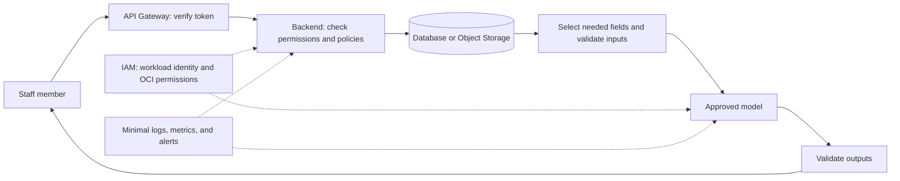

# Protecting Input Data and Controlling Model Access

A model can predict accurately yet still be integrated unsafely: the application sends an entire customer profile when only a few attributes are needed, users can invoke models outside the approved list, or prompt contents appear in logs readable by many people. Securing an AI system must begin with the data flow and the identity performing each operation.

This lesson belongs to the **AI and Machine Learning on OCI** chapter of the Oracle Cloud Infrastructure (`CLOUD_PROVIDERS_ORACLE`) module. It connects IAM, compartments, VCN, Compute, storage, and databases with model invocation. The goal is to design an inference flow with least-privilege permissions, controlled input data, operational auditability, and cost bounds, while maintaining fallback handling when services are unavailable.

## 1. Scope and expected outcomes

This lesson covers two common deployment patterns:

| Pattern | Input data | Resources to protect |
| --- | --- | --- |
| Organization-deployed models via OCI Data Science Model Deployment | Feature vectors, sample payloads, or text per model contract | Model artifact, inference endpoint, runtime identity, and reference data |
| Models consumed via OCI Generative AI | Prompts, conversation history, retrieved documents, and potentially multimodal inputs | Model invocation permissions, endpoint configuration, context, and outputs |

Not every model is an LLM. For a traditional classification model, inputs may consist purely of numeric and categorical fields. For an LLM, input text can also carry untrusted instructions. Both require input validation, authentication, authorization, encryption, monitoring, and resource controls.

After this lesson, learners will be able to:

- Determine which data is permitted to be sent to a model and strip unnecessary data.
- Distinguish permissions of application users, model-calling workloads, and model administrators.
- Apply IAM by operation and scope, paired with application-level controls.
- Distinguish private endpoints, model endpoints, and paths through a service gateway.
- Design input validation, prompt injection controls, safe logging, and usage limits.
- Verify both permitted cases and cases that must be rejected.

## 2. Running scenario and trust boundaries

Suppose an enterprise builds an application assisting staff with ticket handling. Staff request summarization or classification of a ticket they are permitted to view. Ticket data resides in Oracle Database or Object Storage. The backend runs on OCI Compute and calls an approved model.

Business requirements are:

- Staff only process tickets within their authorized scope.
- The model receives only the fields needed for the task.
- Browsers never receive the backend's OCI keys or credentials.
- Application callers cannot arbitrarily pick endpoints, model IDs, or regions.
- Logs suffice for investigation without storing full tickets, prompts, or access tokens by default.
- When service errors or safeguard checks fail, the application returns a controlled status.

Resource names, limits, and configurations in this lesson are design examples and must be adapted to your real environment.



This flow has at least four boundaries:

1. **Client to application:** client-supplied data is not trustworthy merely because it arrives over HTTPS.
2. **User identity to business data:** an authenticated user is not necessarily allowed to read every ticket.
3. **Application to model:** the backend needs permission to call the right service within the right scope.
4. **Document content to system behavior:** ticket content is data, not authority to alter configuration or authorize tool calls.

The backend may hold IAM permissions to read many tickets in order to serve multiple teams. Therefore, the backend's IAM permissions do not prove that the current user is allowed to read a specific ticket. This is where application-level business authorization—and, if architecture permits, data-layer controls—must apply.

## 3. Identifying assets and risks before granting permissions

### 3.1. Assets to protect

| Asset | Primary risk | Priority control |
| --- | --- | --- |
| Training or fine-tuning data | Out-of-scope access, tampering, or source mixing | Separated read/write permissions, provenance, and versioning |
| Inference input data | Over-sharing data, wrong processing location, or unintended logging | Field selection, classification checks, and path controls |
| Model artifacts and containers | Replacement with unapproved versions | Separate deployment permissions, version identifiers, and approvals |
| Inference endpoints | Unauthorized invocation, resource abuse | IAM, application auth, rate limiting |
| Keys, tokens, and secrets | Exposure via clients, source code, or notebooks | Workload identities; secret vaults and narrow access when needed |
| Embeddings, caches, and chat history | Accidental sharing across users or tenants | Data scoping, ACLs, TTLs, and scoped cache keys |
| Logs and evaluation data | Becoming uncontrolled copies of sensitive data | Content minimization, restricted read access, and retention limits |

Model artifacts are independent assets. Callers permitted to invoke a model do not need permission to download weights, modify containers, or replace model artifacts.

### 3.2. Turning risks into verification questions

Before writing policies, answer:

- Who can view source data and who can send that data into a model?
- Does the data contain PII, internal info, credentials, or trade secrets?
- Where is data processed, and does it travel to an external model provider?
- Who is allowed to change models, network config, guardrails, or logs?
- If a workload is compromised, how many models can it invoke and how much data can it read?
- When a user's access is revoked, how are active conversations, caches, and queued tasks handled?

Never solve everything with a single `AIAdmins` group. Separate deployment, inference invocation, data reading, secret reading, and log viewing by responsibility.

## 4. Protecting data before sending it to a model

### 4.1. Send only data required for the task

For ticket summarization, the model may need the issue category, description, and handling history. It usually does not need full account profiles, payment details, or customer credentials.

| Data field | Illustrative decision | Reason |
| --- | --- | --- |
| Internal ticket ID | Keep or replace with a temporary identifier | Correlate results with the task |
| Issue content | Retain permitted portions after inspection | Primary data needed for summarization |
| Email, phone number | Strip or mask when unnecessary | Minimize identifying data |
| Accidentally pasted access token or private key | Block flow and handle per incident procedure | Not needed for the task |
| Restricted internal notes | Include only if the caller is authorized | Prevent privilege escalation via the model |
| Attachments | Handle separately by file type and permissions | Never automatically fetch every referenced resource |

Data minimization must happen before calling the model, before writing logs, and before forwarding to other inspection services. If calling a sensitive-data detection API, that API also receives the data; evaluate that path in your design.

Masking data is not the same as full anonymization. A descriptive paragraph can identify a customer even after emails and phone numbers are replaced. If cross-record linkage is required, use controlled surrogate identifiers and protect the mapping table separately.

### 4.2. Separating client-sent data from server-decided parameters

An application request might look like:

```json
{
  "task": "summarize_ticket",
  "ticketId": "T-204",
  "outputProfile": "short"
}
```

The backend resolves identity from authentication, checks permissions for `T-204`, fetches authorized data, and selects the inference configuration itself.

Fields such as `tenantId`, `modelId`, `endpointUrl`, `compartmentId`, or `region` must not become free-choice options simply because a client sent them. If the product requires letting users pick a model, expose a bounded public profile code, then map and authorize it server-side.

A `tenantId` field inside JSON also does not prove the caller belongs to that tenant. Scope must be derived from or verified against server-managed authenticated identity and authorization data.

### 4.3. Validating structure, size, and value domains

Place checks at multiple stages:

| Stage | Checks |
| --- | --- |
| Before or while reading HTTP body | Max payload size, content type, read timeout |
| During parsing | Valid JSON, nesting depth and element counts, unexpected fields per contract |
| After parsing | Required fields, data types, and allowed values |
| After fetching source data | Classification, per-section permissions, and context limits |
| Before inference | Model-specific token or byte limits, batch sample count, output parameters |

Rejecting a body only after reading the entire payload into memory is too late for certain resource-exhaustion attacks. Similarly, character count does not equal UTF-8 byte count, and byte count does not equal tokenizer token count.

For feature-based models, validate schema, column ordering, missing values, numeric ranges, and preprocessing version. Never accept an arbitrary numeric array and assume it shares the exact semantics of training data.

### 4.4. Java example: validating prepared inputs

The example below uses Java 17+ syntax and illustrates local validation for LLM inputs after the backend has already verified permissions and fetched data. Limits are application choices, not OCI defaults.

```java
import java.nio.charset.StandardCharsets;
import java.util.Set;

public final class AiInputGate {
    private static final int MAX_TEXT_BYTES = 16 * 1024;
    private static final int MAX_OUTPUT_TOKENS = 512;
    private static final Set<String> ALLOWED_TASKS =
            Set.of("summarize_ticket", "classify_ticket");

    public record PreparedInput(
            String task,
            String text,
            Integer maxOutputTokens
    ) {}

    public static void validate(PreparedInput input) {
        if (input == null
                || input.task() == null
                || !ALLOWED_TASKS.contains(input.task())) {
            throw new IllegalArgumentException("TASK_NOT_ALLOWED");
        }

        if (input.text() == null || input.text().isBlank()) {
            throw new IllegalArgumentException("TEXT_REQUIRED");
        }

        int textBytes =
                input.text().getBytes(StandardCharsets.UTF_8).length;
        if (textBytes > MAX_TEXT_BYTES) {
            throw new IllegalArgumentException("INPUT_TOO_LARGE");
        }

        Integer outputTokens = input.maxOutputTokens();
        if (outputTokens == null
                || outputTokens < 1
                || outputTokens > MAX_OUTPUT_TOKENS) {
            throw new IllegalArgumentException("OUTPUT_LIMIT_INVALID");
        }
    }

    private AiInputGate() {}
}
```

This snippet does not validate JWTs, check ticket permissions, or detect all sensitive data. Nor does it replace the model's tokenizer. The HTTP handler must still bound body size, configure parser limits, and map error codes cleanly—never returning stack traces or ticket text in error messages.

### 4.5. Files, URLs, and indirect data

If file uploads are supported, validate file size, actual content type, page counts or unpacked archive element counts, and run extraction within bounded resources. A filename extension alone is not proof of format.

Never let a URL supplied by a client or model turn into an arbitrary fetch command. If a task must load documents from registered sources, the backend must validate host, path, redirect targets, and data permissions. Internal addresses, management endpoints, and metadata services are never default model document sources.

For documents already in Object Storage, prefer selecting objects via business identifiers and server-side permissions rather than accepting an arbitrary URL and fetching it with the workload's privileged identity.

## 5. Where is data processed and how is it retained?

### 5.1. Do not infer processing location from SDK or endpoint names

[Data Handling in Generative AI](https://docs.oracle.com/en-us/iaas/Content/generative-ai/data-handling.htm) distinguishes usage patterns. Some on-demand models are hosted by OCI; others forward requests to provider platforms. Routing can affect processing location. Features that store responses, conversations, files, or memory must also be evaluated separately.

Accordingly, approval records must document the model ID, serving mode, region, processing destination, and enabled retention features. A private endpoint does not automatically prove every model processing step stays in the same region.

### 5.2. Distinguish inference, fine-tuning, and application-side retention

These three questions are not interchangeable:

1. How, if at all, does the inference service retain or use prompts?
2. If the organization intentionally performs fine-tuning, how are training datasets and resulting models governed?
3. Does the application itself store prompts, responses, history, or logs?

Even when inference does not retain content after processing per service documentation, the application may still create copies in caches, conversation stores, evaluation pipelines, or logs. Retention and access controls must govern every copy you create.

Never feed user inference data into subsequent training by default. If an evaluation or fine-tuning workflow uses real data, require an approved purpose, data selection rules, classification checks, and separate access controls.

### 5.3. Processing path approval matrix

| Attribute | Details to lock down |
| --- | --- |
| Task | Ticket summarization vs. ticket classification |
| Permitted data tier | Internal content with unnecessary fields stripped |
| Model | Approved ID and version/configuration |
| Serving location | Region and actual processing destination per docs |
| Network path | Private endpoint or designed service path |
| Content storage | Conversations, caches, logs, and TTL per store |
| Error behavior | Controlled rejection or switch to pre-approved fallback |
| Owner | Decision-maker for model and policy changes |

If failing over to another region or provider, that fallback path must also be explicitly approved. "Keeping the application always able to answer" is not a valid reason to silently route data outside permitted boundaries.

## 6. Separating three permission types before writing IAM policies

### 6.1. Management, inference, and data access permissions

| Permission group | Example actions | Suitable principal |
| --- | --- | --- |
| Model management | Register artifacts, deploy, update, or delete endpoints | ML/platform team per release workflow |
| Inference invocation | Send input data and receive results | Application backend or batch workload |
| Source data reading | Read tickets, documents, or features | Workload needing data for its task |
| Secret usage | Retrieve secrets needed for a connection | Designated workload |
| Log viewing | Investigate errors and anomalous access | Operations/security team within scope |

Inference permissions should not include editing endpoints or reading every bucket. Application login rights should never turn into cloud management rights for staff.

Notebook viewing permissions must be treated as sensitive if a notebook can assume a resource principal. Anyone running code inside that environment can exercise the workload's permissions; you cannot inspect only IAM permissions attached directly to personal accounts.

### 6.2. Workload identity instead of personal keys in applications

Applications running on OCI Compute can use instance principals after configuring a dynamic group and policies. This lets workloads call services without placing personal API keys in application configs. See [Calling Services from an Instance](https://docs.oracle.com/en-us/iaas/Content/Identity/callresources/callingservicesfrominstances.htm).

Good design includes:

- Dynamic groups matching only instances serving a specific workload.
- Separate identities across development, staging, and production.
- Separated permissions across data ingestion, inference, and deployment.
- Traceability showing which application version a workload is running.

For managed services supporting resource principals, use that service's corresponding mechanism. Do not assume Compute SDKs or setups apply verbatim to every environment.

If secrets are still required for external connections, store them in a secret manager such as OCI Vault and grant retrieval only for the exact needed secret. Never embed secrets in prompts, container images, model artifacts, or client-visible variables. Secret read permissions must also be reviewed independently of model call permissions.

### 6.3. Checking additive permissions

Effective permissions can accumulate across multiple groups, dynamic groups, and policies. Adding a narrow policy does not revoke an existing broad policy. Moving a workload into a new compartment also does not guarantee reduced access if parent-level or tenancy-wide policies still apply.

During every review, verify:

- Which principal actually signs the OCI call?
- Which policy permits the action?
- Is there another principal the application could fall back to?
- Can anyone permitted to modify dynamic groups or deploy code indirectly escalate privileges?

## 7. Examples of model invocation permissions on OCI

The examples below are independent by service type. You do not need both if your application uses only one model type. The `Default` identity domain, dynamic group, and compartment names must match your environment.

### 7.1. Data Science Model Deployment: grant predict permission only

Suppose `TicketAppDG` contains only backend instances, and `AIInference` is the compartment holding deployments consumed by this application.

```text
Allow dynamic-group 'Default'/'TicketAppDG' to {DATA_SCIENCE_MODEL_DEPLOYMENT_PREDICT} in compartment AIInference
```

This direct inference-permission pattern is documented by Oracle in [Model Deployment Policies](https://docs.oracle.com/en-us/iaas/Content/data-science/using/model-dep-policies-auth.htm). The example scopes permissions to deployments in the compartment rather than a single deployment.

If narrower scoping is required, structure compartments and service-supported conditions to fit—never invent undocumented condition variable names.

Do not change this to `use data-science-model-deployments` simply because the verb looks intuitive: OCI's permission table indicates `use` also covers related update operations. See [Data Science policy reference](https://docs.oracle.com/en-us/iaas/Content/data-science/using/policies.htm).

### 7.2. Generative AI: operation type and model ID allowlist

For a tester group `ApprovedChatUsers`, chat permission can be restricted to an approved model ID:

```text
Allow group 'Default'/'ApprovedChatUsers' to use generative-ai-chat in compartment AIInference where target.model.id = '<APPROVED_MODEL_ID>'
```

`<APPROVED_MODEL_ID>` is a placeholder and must be replaced with the exact service identifier for the chosen model. This condition restricts inference; it does not replace processing-location controls or resource management permissions. When listing models in the Console, separate inspect permissions may be required. See [limiting access by model ID](https://docs.oracle.com/en-us/iaas/Content/generative-ai/limit-model-access.htm).

Applications needing embeddings or reranking must be reviewed and authorized for those specific operations; never open `generative-ai-family` by default. Resource types are listed in [IAM Policies for OCI Generative AI](https://docs.oracle.com/en-us/iaas/Content/generative-ai/iam-policies.htm).

For production workloads, attach permissions to the appropriate workload identity instead of borrowing a tester account. Always audit broader policies that might nullify the allowlist in practice.

### 7.3. Application-level allowlists must still exist

IAM protects the principal's service calls. The application must still map tasks to approved configurations:

| Task | Server-selected configuration | Illustrative bounds |
| --- | --- | --- |
| `summarize_ticket` | Approved summary model and permitted region | One ticket; max 512 output tokens |
| `classify_ticket` | Classification model and fixed label set | Output must belong to the label catalog |
| Unregistered task | No inference route | Reject before calling any model |

A shared backend may have IAM permission to invoke multiple models. That does not mean every user of the backend may trigger every task. User authorization must occur before the workload exercises its cloud privileges.

## 8. Network controls and encryption

### 8.1. Separating endpoint ingress from runtime egress

Ingress determines which clients can reach the inference endpoint. Egress determines which data sources or external services code running inside the runtime can contact.

A deployment whose egress routes through a private subnet does not automatically expose a private inference endpoint. Published endpoint configuration, DNS, routes, and security rules must be checked explicitly. Networking and endpoint options are described in [creating a Data Science Model Deployment](https://docs.oracle.com/en-us/iaas/Content/data-science/using/model_dep_create.htm).

| Requirement | Controls to verify |
| --- | --- |
| Only the backend can reach the endpoint | Private endpoint or restricted access path, NSGs/security lists, and IAM |
| Runtime reads only designated sources | Egress routes, network rules, and data permissions |
| Clients cannot bypass the app to call directly | No direct client IAM inference permissions; evaluate network path |
| Task does not fetch unlisted URLs | Application URL validation and egress restrictions |
| Access from on-premises systems | Private connectivity, DNS, and routes from source networks |

NSGs do not understand a user's ticket permissions. Conversely, a business permission allowing a user to view a ticket does not create a network route to an endpoint. Both layers are needed.

### 8.2. Model endpoints, private endpoints, and service gateways

| Concept | Role |
| --- | --- |
| Model endpoint | Logical access point serving inference for a model per service mechanics |
| Private endpoint | Network resource providing a private access path into a service |
| Service gateway | Path from a VCN to supported Oracle services over the Oracle Services Network |
| Dedicated AI cluster | Compute resource serving models in dedicated mode; does not authorize callers on its own |

In Generative AI, a private endpoint differs from a model endpoint. Under supported configurations, a private endpoint can serve on-demand model access or associate with a model endpoint on a dedicated AI cluster. Clients must use the exact FQDN and have matching private connectivity. See [Managing Private Endpoints](https://docs.oracle.com/en-us/iaas/Content/generative-ai/private-endpoint.htm).

For Data Science Model Deployments using private endpoints, clients must connect over private networking. Current docs note realm limitations for this feature; verify support in your deployment environment. See [invoking a model deployment via private endpoint](https://docs.oracle.com/en-us/iaas/Content/data-science/using/model-dep-invoking-pe.htm).

A service gateway path does not equate to creating a private endpoint with a private IP inside your subnet. Nor does it automatically disable other service invocation paths. See [accessing Generative AI over private network via service gateway](https://docs.oracle.com/en-us/iaas/Content/generative-ai/private-network-access.htm).

When auditing architecture, trace actual DNS, actual routes, and actual principals—not merely a "private subnet" box on a diagram.

### 8.3. Encryption and key management

Use HTTPS/TLS across all relevant hops and never disable certificate verification to work around connection errors. Never put tokens, ticket text, or prompts into query strings, as URLs can appear across multiple log layers.

For data persisted in Object Storage, databases, caches, and logs, inspect each service's encryption mechanism. If customer-managed keys are required, confirm that the service and resource type support the desired configuration.

Encryption at rest does not replace authorization. An authorized application still receives plaintext for processing. Key usage, rotation, and deletion permissions must be governed alongside recovery plans; losing decryption capability can disrupt both live systems and backups.

## 9. User authentication and OCI calls are two distinct hops

### 9.1. User-to-application hop

API Gateway can validate identity-provider tokens, verifying signatures and required claims such as issuer, audience, and expiration. For new JWT configurations, Oracle recommends `TOKEN_AUTHENTICATION`. See [Token Authentication for API Gateway](https://docs.oracle.com/en-us/iaas/Content/APIGateway/Tasks/apigatewayusingjwttokens.htm).

Application design must verify:

- The token was issued by a trusted issuer.
- The audience targets this API, not merely a valid token for some other system.
- The token is unexpired and meets applicable time checks.
- Scopes or business roles permit the requested task.
- Ticket access rights are verified at time of use.

Base64-decoding a JWT payload is not signature verification. Never trust an `X-User-Id` or `X-Tenant-Id` header simply because its name looks gateway-generated. If the backend relies on forwarded identity headers, lock down the invocation path, strip spoofed client headers, and authenticate the forwarding hop. With multiple entry points to the backend, ensure every path enforces equivalent checks.

### 9.2. Backend-to-model hop

The backend authenticates using the mechanism supported by the OCI endpoint. For Data Science Model Deployments, documentation specifies OCI IAM authentication/authorization; do not forward an application JWT expecting the endpoint to accept it like application OAuth. See [Model Deployment authentication mechanisms](https://docs.oracle.com/en-us/iaas/Content/data-science/using/model-dep-policies-auth.htm).

In this lesson's Compute architecture, the backend uses the SDK and instance principal to make signed OCI calls. The staff member's JWT authenticates to the application; the workload identity authenticates cloud service calls.

The backend must bridge the two hops with an explicit authorization decision:

```text
Valid user
    + permitted to run task
    + permitted to view source data
    + data permitted in this model configuration
    + workload holds appropriate OCI permissions
    = request eligible for execution
```

If the backend holds broader cloud permissions than individual users, it must prevent users from "borrowing" those permissions to access out-of-scope documents or models. That is why every client-supplied resource identifier must be checked.

### 9.3. Recommended processing flow

The following pseudocode shows the order of controls; function names are application logic, not built-in OCI APIs:

```text
1. Read request within allowed body size and time limits.
2. Verify caller identity from a trusted auth channel.
3. Validate request structure and reject unsupported fields.
4. Check permission to execute the task within user scope.
5. Fetch ticket using a query bound to permitted scope.
6. Filter out sections the caller is not allowed to see.
7. Select required fields; inspect sensitive data and content.
8. Select model, region, network path, and parameters from server config.
9. Check usage limits; reserve quota capacity if needed.
10. Run policy guardrails and invoke the model.
11. Validate output; return only contract-compliant results.
12. Log decision, usage, and correlation ID securely.
```

Checks must guard against state changes between time of check and time of use (TOCTOU). For example, if a task sits in a queue before running, the worker should re-verify permissions and active policy versions rather than relying indefinitely on an old decision.

If a mandatory safeguard step cannot run, never proceed with sending data as if the check passed. Return a temporary-unavailable status or transition to a pre-approved fallback flow.

## 10. Prompt injection, RAG, and tool permissions

### 10.1. Valid content can still contain untrusted instructions

A ticket may contain text telling the system to ignore rules, reveal other documents, or call an attacker-specified URL. That passage remains ticket content; it does not alter the user's identity or permissions.

Prompt injection can arrive directly from users or indirectly via retrieved documents. Blocking a few keywords is insufficient because instructions can be rephrased, split, or hidden in attachments.

Combine multiple defenses:

- Keep system config and application instructions separate from user content.
- Inject only authorized data into context.
- Constrain tools, arguments, and network targets on the server.
- Never place secrets in a prompt and ask the model "not to reveal them".
- Treat model output as untrusted data before feeding it into any further action.

Telling the model "only look at the current tenant's data" is not an authorization mechanism. Permissions must be enforced before documents ever enter the prompt.

### 10.2. OCI Guardrails provide an additional layer

OCI Generative AI offers guardrails for content moderation, prompt injection, and PII. This layer does not apply by default to every foundation model. For on-demand, `ApplyGuardrails` can be used; supported dedicated endpoints can configure guardrails. See [Guardrails for OCI Generative AI](https://docs.oracle.com/en-us/iaas/Content/generative-ai/guardrails.htm).

`Inform` mode returns evaluation results; `Block` blocks according to configuration. Verify version and regional availability. See [guardrails on dedicated endpoints](https://docs.oracle.com/en-us/iaas/releasenotes/generative-ai/ai-guardrails-dedicated-endpoints.htm).

At the application design level, detecting and masking data are two different actions. The application must decide whether to reject, ask the user to revise, minimize data, or allow per approved policy. Never assume a PII detection result automatically sanitizes all inputs.

Guardrails do not replace IAM or document ACLs, and do not guarantee catching every phrasing. Evaluate both false negatives and false positives—especially for Vietnamese, domain-specific content, and multimodal inputs in use.

### 10.3. RAG must enforce retrieval permissions

If the application adds RAG, documents fetched from knowledge bases must still obey user permissions.

A safe flow must:

1. Determine retrieval scope from authenticated identity.
2. Apply filters or controlled queries in the search system.
3. Verify permissions on actual documents before pulling content into the prompt.
4. Inject only necessary chunks into context.
5. Return citations or links that the user is also permitted to open.

Never pull multi-tenant documents into a prompt and tell the model to ignore unauthorized ones. By that point, the data boundary has already been breached.

Embeddings and indexes are also data to protect. When a source document is revoked or deleted, update copies, chunks, indexes, and caches by design—do not merely delete the original file.

### 10.4. Model-proposed tool calls still require authorization

If a model proposes calling a tool, the backend must validate tool name, argument schema, data scope, and user permissions. Never let a model freely pass raw SQL, URLs, or tenant IDs into a privileged tool.

In a ticket app, a tool might only be allowed to read an already-authorized ticket. Actions that send notifications, change state, or write records need separate policies and approval flows commensurate with action impact.

JSON-formatted outputs also must be parsed and schema-validated. A string that looks like valid JSON may still contain unapproved labels or point to unauthorized resources.

## 11. Output control, caching, and logging

### 11.1. Outputs do not automatically become approved data

For classification tasks, accept only labels from the catalog. For summaries, enforce length and data policies before displaying or persisting. Never execute HTML, JavaScript, SQL, or shell commands returned by a model.

If rendering Markdown or links, use your application's safe rendering mechanism. Never automatically fetch every URL appearing in an answer. For actions with business impact, treat model output as a proposal subject to workflow review.

### 11.2. Caches must carry access scope

A shared cache keyed solely by question text can serve one user's answer to another user. Cache keys must reflect real access scope, for example:

```text
tenant/user scope or permission group
+ task
+ permitted data version
+ model configuration/version
+ policy version
+ normalized input per design
```

Not every cache must include every single component, but you must prove the key and permission checks cannot create cross-scope leaks. When permissions or data change, enforce appropriate invalidation and TTL strategies.

Never treat a plain hash of short content as anonymization. Low-entropy inputs can be guessed and correlated. If hash-based correlation is needed, evaluate keyed hashing, key management, and log access controls.

### 11.3. Minimal logs that still link events

An application event can record:

```json
{
  "requestId": "req-20261121-001",
  "actorRef": "actor-ref-17",
  "task": "summarize_ticket",
  "modelProfile": "ticket-summary-v3",
  "policyVersion": "ai-input-v2",
  "decision": "ALLOW",
  "inputBytes": 2400,
  "outputTokens": 180,
  "latencyMs": 920,
  "upstreamRequestId": "provider-request-reference"
}
```

This is an illustrative application-defined log schema, not a default OCI schema. `actorRef` may still be a sensitive identifier and require protection.

Normally avoid logging raw prompts, tickets, JWTs, API keys, secrets, or full responses in default logs. If an investigation requires sample payloads, use an approved separate store with narrow read access and short retention.

### 11.4. Combining observability sources

| Question | Required evidence source |
| --- | --- |
| Who modified endpoint config or policies? | OCI Audit for the corresponding API |
| Which user requested the task? | Gateway/application decision logs linked to request ID |
| Did the endpoint return errors or run slowly? | Configured service metrics and access logs |
| What did inference code output? | Runtime/predict logs and application logging config |
| Why was a request blocked? | Policy/guardrail code, version, and enforcement decision |

Data Science integrates Logging for access logs and predict logs; predict logs can include messages emitted by model artifact code. Therefore, control `stdout`/`stderr` writes inside the runtime too. See [Data Science Logs](https://docs.oracle.com/en-us/iaas/Content/data-science/using/log-about.htm).

Never rely solely on OCI Audit to attribute every backend call back to individual staff members. When multiple users share one workload principal, the application must log identity-to-request links itself.

## 12. Usage limits, availability, and incident response

### 12.1. Permission to call does not mean unlimited calls

A valid identity can still generate excessive request volume. Enforce appropriate bounds at both application and infrastructure layers:

| Limit | Example purpose |
| --- | --- |
| Requests per user/tenant | Curb abuse and prevent noisy-neighbor exhaustion |
| Concurrent active tasks | Protect backend and model runtime |
| Samples per batch | Prevent single requests from holding resources too long |
| Input size and token budget | Bound memory, latency, and cost |
| Max output | Bound generation time and response size |
| Timeouts, retries, and queue depth | Bound latency during upstream degradation |

With multiple backend instances, quota counters must fit a distributed topology; per-instance in-memory counters may miss desired global limits. For LLMs, estimate input and output usage before calling, then reconcile actual usage upon completion.

Cloud service rate limits do not replace per-application-user quotas. Budget alerts also do not act as default kill-switches blocking spend.

### 12.2. Controlled retries and fallback

Never automatically retry every error. Auth, permission, or invalid-input errors must be fixed at the source. For transient errors, use bounded retry counts, backoff intervals, and an overall time budget.

A request that reached the model before a client timeout may still have consumed resources. Account for ambiguous outcomes and avoid unbounded retries. Do not assume all inference APIs support idempotency identically.

If fallback exists:

- Maintain identical authorization and data protection standards.
- Use only pre-approved models and regions.
- Never bypass mandatory guardrails just to produce an answer.
- Notify users when features degrade or switch modes by design.

Timeouts must cover authentication, data fetching, safeguard checks, inference, and output validation. Measure each phase separately to find bottlenecks rather than blindly raising the total timeout.

### 12.3. Application error codes

| Scenario | Illustrative response |
| --- | --- |
| Missing or invalid token | `401` |
| Authenticated but unauthorized for the task | `403` with a message that leaks no resource details |
| Request violates contract | `400` or API-specified validation code |
| Input exceeds size limit | `413` |
| Application quota exceeded | `429` |
| Service or required safeguard temporarily unavailable | `503` per API contract |

These are application API status codes. Upstream OCI errors may have their own codes and semantics; never pass raw upstream messages, stack traces, or config details straight through to clients.

### 12.4. Revoking access and incident response

When data exposure or abuse is detected, you must be able to:

1. Disable the task or model profile inside the application.
2. Revoke affected user, workload, or credential permissions scoped to the incident.
3. Audit additive policies and any remaining direct invocation paths.
4. Throttle or shut down risky processing paths per runbook.
5. Preserve investigation logs without leaking additional sensitive content.
6. Audit source data, context, caches, outputs, and related derived copies.
7. Restore operations with verified configs and least-privilege permissions.

Access revocation can experience propagation lag from tokens, caches, or policy refresh cycles. Runbooks must verify actual behavior, including in-flight tasks and open streams—never promise instantaneous shutoff solely from editing one policy line.

## 13. Design and verification lab in a sandbox environment

Use synthetic ticket data and lab resources with clear owners. This lab does not require sending real data to models or provisioning dedicated clusters solely to test permissions; pick services fitting your environment's availability and budget.

### Step 1 — Define data and business permissions

Set up two user groups `Team-A` and `Team-B`, each with separate tickets. Choose summarization and classification tasks; list fields permitted into the model and fields that must be excluded.

Define the server-side model profile, permitted regions, input/output limits, and error behavior. Document every place content may be stored: ticket source, caches, logs, and conversations if applicable.

### Step 2 — Separate identities and OCI permissions

Separate the backend identity from model-deployer identities. If running on Compute, configure a dynamic group matching only the lab instances and grant inference permissions suited to the chosen service.

Do not grant deployment update permissions to the backend just to run predictions. If the backend needs to read source data or secrets, grant those permissions separately within tight scope and record them in a permission matrix.

### Step 3 — Configure networking and two-hop authentication

Select an access path supported by the service and environment. Document actual DNS, routes, NSGs/security lists, and endpoints. Test ingress and egress separately.

On the user hop, validate tokens and task permissions. On the OCI hop, use the workload identity with its corresponding signing/auth mechanism. If authenticating only at the gateway, verify clients have no path bypassing the gateway directly to the backend.

### Step 4 — Build the data preparation gate

For a request specifying a ticket, the backend must verify permissions before pulling content into context. Strip unnecessary info, check sizes, and enforce content policies.

If using the Java example, call `AiInputGate.validate` on prepared input. Add HTTP-layer body and parser limits, model-aware token checks, sensitive-data inspection, and guardrails per design.

### Step 5 — Execute the verification matrix

The tests below must record both outcomes and evidence of whether upstream calls occurred:

| Test case | Expected result |
| --- | --- |
| `Team-A` summarizes a `Team-A` ticket | Succeeds if data satisfies policy |
| `Team-A` requests a `Team-B` ticket | Rejected; ticket content never sent to model |
| Expired token or wrong audience | Rejected before accessing data |
| Client adds unsupported `endpointUrl` | Rejected per request contract |
| Client attempts to select an out-of-profile model | No call made to that model |
| Backend with predict permission tries updating deployment | Rejected without excess privileges |
| Input exceeds limits | Blocked at the corresponding layer before inference |
| Ticket contains instructions to read other documents | Does not expand permissions or tools |
| Requests exceed quota | Throttled; no infinite retry loops |
| Mandatory safeguard step is unavailable | Does not continue sending data normally |
| Inspect logs after processing | Request and decision recorded; no leaked tokens or raw text |
| Change permissions then query old cache | Does not return data outside current permissions |

For update-attempt tests, use only lab resources and blast-radius-controlled checks. If a workload turns out to have unexpected edit permissions, remediate excess privilege before continuing tests.

A rejected test alone does not prove permissions are right—it might fail due to networking rather than IAM. Identify which layer denied the request and confirm using appropriate logs.

### Step 6 — Check operations and wrap up the lab

Record processing times, call counts, usage, and safe error codes. Simulate upstream unavailability and verify the application does not switch to an unapproved processing path.

Complete your lab documentation with the flow diagram, permission matrix, model profile, input rules, negative test results, and log lookup locations. Revoke temporary permissions, delete unnecessary synthetic data, and handle created resources per the lab's cost plan.

## 14. Common design mistakes

| Mistake | Consequence | Remedy |
| --- | --- | --- |
| Dumping entire profiles into prompts | Exposes data beyond need | Select task-specific fields before calling |
| Sending OCI keys to browsers | Clients can exercise app cloud permissions | Keep cloud calls in backend with workload identity |
| Checking login only | Users can read out-of-scope records | Enforce task and per-record permissions |
| Granting `manage` to invoke predictions | Workload can modify resources unnecessarily | Grant targeted inference permission |
| Trusting client-supplied `tenantId` | Can cross tenant data boundaries | Derive from authenticated identity and server mappings |
| Letting clients or models pick upstream URLs | Can reach unapproved targets | Route using server config and allowlists |
| Assuming private subnet means private endpoint | Access path may still differ from design | Verify actual endpoint, DNS, routes, and IAM |
| Enabling inform-only mode thinking it blocks | Risky requests can still execute | Understand guardrail modes and app enforcement |
| Using prompts as ACLs | Unauthorized docs already entered context | Enforce permissions before retrieval and prompting |
| Logging full requests for debugging | Logs become sensitive data copies | Log minimal metadata; protect sample stores separately |
| Failing over freely to other models/regions | Data leaves approved boundaries | Pre-approve and constrain fallback paths |
| Testing only valid requests | Excess privileges go unnoticed | Test rejections and confirm which layer denied |

## 15. Design completion criteria

Before putting an inference flow into production, collect evidence for the following conditions:

- Task, data owners, allowed input fields, and prohibited data are defined.
- Model profile, processing location, and active retention features are documented.
- Users are authenticated and checked for both task and data permissions.
- Workloads have dedicated identities and least-privilege OCI permissions; deployment rights are separated from inference.
- Models, endpoints, and regions are selected from controlled server configuration.
- Body, schema, size, value domain, and resource budget checks are enforced.
- Ingress and egress paths are verified empirically, not just drawn on diagrams.
- RAG documents, caches, and conversations strictly respect permission boundaries.
- Guardrails are configured with explicit behavior when risks trigger or checks are unavailable.
- Outputs are validated before display, storage, or triggering actions.
- Logs sufficiently correlate users, workloads, and calls while avoiding unnecessary data copying.
- Quotas, timeouts, retries, alerts, and unavailability handling exist.
- Revocation procedures cover tokens, caches, in-flight tasks, and derived copies.

The target outcome is an explainable inference flow: who requested it, which data they were allowed to use, which model configuration the workload invoked, why the request was allowed or blocked, and where the evidence is kept.
