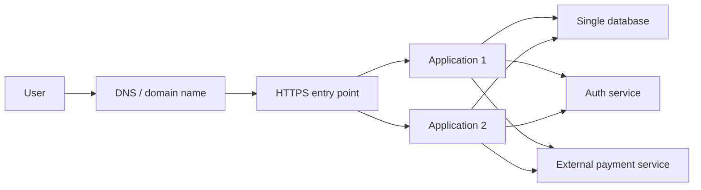
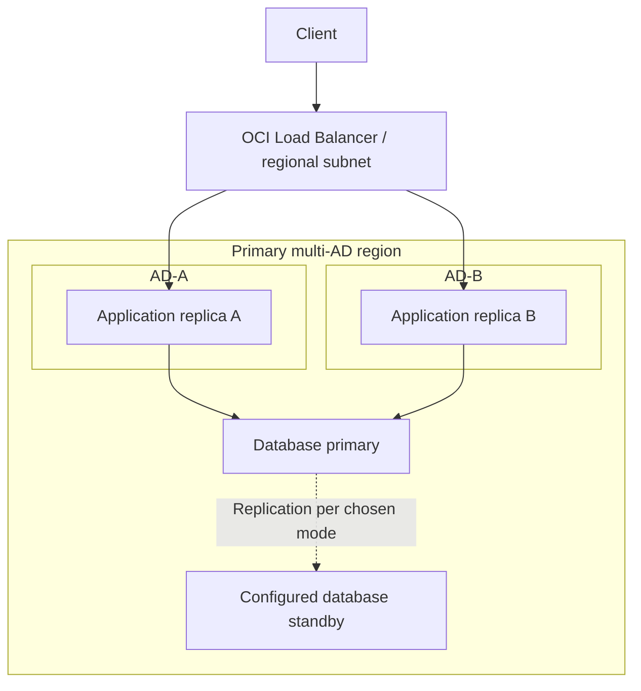

# Analyzing SLAs, Failure Domains, and Single Points of Failure

## 1. Starting from the User Transaction That Must Complete

In the **High Availability Architecture** chapter on Oracle Cloud Infrastructure (OCI), the first question is: when a component fails, can the user still complete critical transactions?

A system with multiple servers can still go down if they all share a dependency on a single database, a misconfiguration, or a single network path. Conversely, a managed service may appear under a single endpoint while having built-in redundancy underneath. You must analyze the transaction path and failure scope rather than merely counting resources on a diagram.

After this lesson, you will be able to:

- Distinguish between SLA, SLO, and SLI; convert availability targets into an error budget.
- Read OCI service SLA terms and identify the boundaries of those commitments.
- Distinguish between failure domains in general and Fault Domains, Availability Domains, and regions in OCI.
- Identify single points of failure across compute, networking, data, configuration, and operational procedures.
- Propose verifiable placement, redundancy, failure detection, and failover mechanisms.
- Build a failure analysis table and a testing plan in a lab environment.

The running example throughout this lesson is an order-placement API. A user logs in, submits an order, the system writes the order to the database, and returns a confirmation code. The illustrative target is **99.95% of valid order requests completing properly within the chosen time limit, measured monthly**. This is an application SLO used for learning, not an SLA guaranteed by Oracle for the entire architecture.

## 2. Distinguishing SLI, SLO, and SLA

| Concept | Meaning | Example in the Order API |
| --- | --- | --- |
| SLI — Service Level Indicator | A measured quantity representing service quality under a specific definition | Percentage of valid order requests recorded properly and responded to within 2 seconds |
| SLO — Service Level Objective | The target value for an SLI over a measurement window | SLI achieves at least 99.95% per month |
| SLA — Service Level Agreement | A service commitment specifying scope, measurement method, conditions, and remedies if unmet | The commitment of an OCI service per its applicable documentation |

An SLI is the actual measurement; an SLO is the engineering target; an SLA defines the commitment and contractual consequences. An organization may set internal SLOs stricter than its external user commitments. These foundational concepts are presented in [Service Level Objectives by Google SRE](https://sre.google/sre-book/service-level-objectives/).

### 2.1. Defining a “Good” Request

For the ordering example, not every HTTP 200 should be treated as a success. A good request must simultaneously satisfy:

1. Input is valid and within the supported scope of the service.
2. The order is persisted according to the system's consistency contract.
3. No duplicate order is created for a single logical request just because a client retried.
4. The client receives the result within the specified time limit.

An API that returns 200 but drops the order still fails from a business perspective. An API that returns 202 only confirms acceptance for asynchronous processing; if order completion must be measured, a separate SLI must track through to the completion step.

Input errors, business rejections, and infrastructure failures must be classified before computing the ratio. Do not mechanically exclude all 4xx responses from the SLI: an authentication failure caused by a system bug can affect legitimate users.

### 2.2. Choosing the Window and Observation Point

Measurements can be taken from the client, the system entry point, or via synthetic transactions. Each observation point sees a different portion of the path:

| Measurement Point | What Can Be Observed | What May Be Missed |
| --- | --- | --- |
| Inside the application process | Processing time and internal errors | Requests that never reach the application |
| At the load balancer | Connections, routing, and backend responses | Some DNS, client, or post-response business errors |
| From the client or synthetic probe | Access path close to user experience | Representativeness of real networks, locations, and load |
| Database reconciliation | Persisted transaction outcomes | Whether the client received a response on time |

If the system only measures requests that reach the application, a DNS or load balancer outage can disappear from the sample. If telemetry is lost, missing data or measurement confidence must be surfaced; never assume gaps represent success.

### 2.3. Availability Is Different from Data Durability

Availability asks whether the system is usable when needed. Durability asks whether stored data is retained. Consistency asks what rules govern what reads and writes observe.

A read replica may be accessible yet lack the latest transaction. A backup may preserve data yet take hours to restore into a serving system. Therefore, “the data still exists” is not enough to conclude the application is available.

## 3. Converting “Nines” into an Error Budget

### 3.1. Time-Based Measurement

For a clearly defined time-based availability SLI:

```text
Availability = Compliant serving time / Total counted time

Unavailability budget = Total counted time × (1 - Availability target)
```

An assumed 30-day month has 43,200 minutes:

| Availability Target | Unavailability Budget in 30 Days |
| --- | --- |
| 99% | 432 minutes, equivalent to 7 hours 12 minutes |
| 99.9% | 43.2 minutes |
| 99.95% | 21.6 minutes |
| 99.99% | 4.32 minutes, equivalent to 4 minutes 19.2 seconds |
| 99.999% | 25.92 seconds |

This is a mathematical conversion for a 30-day month, not the default calculation for every SLA. Actual calendar months, rolling windows, excluded periods, and downtime definitions may differ.

If the time-based SLO is 99.95%, two complete outages lasting 8 minutes and 15 minutes consume 23 minutes, exceeding the 21.6-minute budget of the assumed month.

An error budget is not time deliberately spent ignoring users. It helps decide whether to prioritize risk reduction or continue shipping changes under the current level of control.

### 3.2. Request-Based Measurement

For a request-based SLI:

```text
SLI = Good requests / Total valid counted requests

Failed request budget = Total valid requests × (1 - SLO)
```

With 1,000,000 valid requests and a 99.95% SLO, the budget is 500 non-compliant requests. Do not convert 500 requests directly into a number of minutes without knowing traffic distribution and blast radius.

One minute of errors during peak hours can break more transactions than one hour of errors during low traffic. When only one customer segment or one feature fails, measure per segment or critical journey as well so overall ratios do not mask an incident.

### 3.3. Allocating the Budget Across the Entire System

Do not grant the entire 21.6-minute budget independently to the database, application, and load balancer and expect the overall system to still hit 99.95%. Failures can occur at different times.

Nor should the same outage window be double-counted when multiple components fail simultaneously. The journey's error budget is measured from that journey's outcomes, while component metrics are used to pinpoint root causes and prioritize improvements.

## 4. Reading OCI SLAs by Applicable Terms

Oracle publishes availability, manageability, and performance SLA categories for supported services. Do not assume every service has all three categories or that all SKUs share the same terms. The starting point is the [OCI SLA page](https://www.oracle.com/cloud/sla/).

When analyzing a service, answer the following:

| Section to Read | Practical Question |
| --- | --- |
| Service and SKU | Is the resource being used covered by the commitment? |
| SLA type | Does it cover request serving, administrative operations, or performance? |
| Definition of unavailable | Which failures count as unavailability under the document? |
| Measurement scope | Per instance, instance group, endpoint, AD, or region? |
| Topology conditions | Is deployment across multiple ADs or FDs required? |
| Window and formula | Measured monthly, by error minutes, or by API error rate? |
| Exclusions | Which causes are excluded? |
| Remedies when unmet | What evidence is required and what is the service credit claim process? |

### 4.1. An Example of Reading Practical Terms

The **Oracle PaaS and IaaS Public Cloud Services Pillar Document (October 2026)**, Load Balancer section, ties the definition of unavailable to the condition that at least one healthy backend exists yet all connection attempts to the service fail, while also evaluating exclusions.

Therefore, all application backends failing does not by itself prove the load balancer violated its SLA. Users can still experience a complete outage. This is why an application SLO must be measured separately. Check the version applicable at deployment time in the [Pillar Document](https://www.oracle.com/contracts/docs/paas_iaas_pub_cld_srvs_pillar_4021422.pdf?download=false).

### 4.2. Data Plane and Control Plane

- **Data plane** performs serving work such as processing application traffic.
- **Control plane** performs management operations such as creating, modifying, or scaling resources.

An inability to launch new VMs may affect recovery capability without stopping already-running VMs. Conversely, the Console being reachable does not prove order transactions are working.

Designs that rely on provisioning new resources immediately after a failure add dependencies on the control plane and capacity during an emergency. Pre-provisioned running redundancy has different recovery characteristics than provisioning from scratch.

### 4.3. Service Credits Are Not Business Continuity

Under Oracle's SLA mechanism, service credits relate to a service failing to meet its commitment and the corresponding claim process. They do not recreate data, restore the application, or guarantee full compensation for business losses. See the [Oracle SLA FAQ](https://www.oracle.com/cloud/sla/).

Do not use infrastructure SLA percentages as the sole proof that the application achieves the same availability. Configuration, source code, data, clients, and third-party dependencies remain part of the overall architecture problem.

## 5. Failure Domains and OCI Fault Isolation Levels

A **failure domain** is the scope within which a single common incident can render multiple components unavailable together. It can be physical, software, configuration, or operational in scope.

A **Fault Domain** in OCI is a specific infrastructure concept. Do not use these two terms as if they always share the same scope.

### 5.1. Region, Availability Domain, and Fault Domain

| Level | Meaning in OCI | Effect When Properly Distributed |
| --- | --- | --- |
| Region | A geographic area containing one or more Availability Domains | Provides the foundation for cross-region redundancy |
| Availability Domain — AD | One or more data centers in a region, with infrastructure isolation from other ADs | Reduces the impact of a full-AD outage |
| Fault Domain — FD | A grouping of hardware and infrastructure within an AD | Separates instances from sharing the same hardware/maintenance group |
| Instance | Compute resource placed in an AD and FD | Distributes replicas of the same function |

A region **does not automatically have three ADs**. Each AD has three FDs in the OCI model. AD names also carry a tenancy-specific prefix, so you must query the actual names rather than copying them from another tenancy. The primary source is [Regions and Availability Domains](https://docs.oracle.com/en-us/iaas/Content/General/Concepts/regions.htm).

Two instances in two FDs within the same AD reduce risk from hardware failures and maintenance events belonging to a single FD. They still reside in that same AD; this does not protect against losing the entire AD.

If a region has multiple ADs, consider distributing replicas of the same role across ADs. If a region has only one AD, use multiple FDs for intra-AD fault tolerance and evaluate the need for a second region for broader incidents. Refer to [Oracle Infrastructure Resilience](https://docs.oracle.com/en/cloud/foundation/cloud_architecture/resilience/infrastructure.html).

### 5.2. Resource Scopes Are Not Identical

A VCN is a regional resource; Compute instances and attached volumes have specific placement constraints. A regional subnet allows placing resources across ADs in a region, but it does not automatically replicate instances or data.

Do not assume a volume can be directly attached to an instance in another AD for failover. You must select a data mechanism supported by the service and account for recovery time. See [OCI physical architecture concepts](https://docs.oracle.com/en-us/iaas/Content/GSG/Concepts/concepts-physical.htm).

### 5.3. Logical Failure Domains Cross Physical Boundaries

| Common Failure | Why Multiple FDs/ADs Can Still Be Affected |
| --- | --- |
| Same buggy release | Every replica receives the same software defect |
| Same NSG or route change | Multiple nodes lose network reachability together |
| Expired TLS certificate | Nodes using the same certificate are all rejected by clients |
| Revoked secret | Every node fails to connect to the database together |
| Mandatory authentication dependency | The system stops accepting users even while compute stays healthy |
| Account with overly broad delete permissions | Redundant resources suffer the same erroneous action |
| Replication of accidentally deleted data | Mistakes can propagate to replicas |

Consequently, physical distribution and change control must go hand in hand. Using multiple ADs does not automatically create independence of code, credentials, or data.

## 6. Single Points of Failure: Analyzing by Journey

A **Single Point of Failure — SPOF** is a component or dependency whose single failure is sufficient to prevent the analyzed journey from meeting its requirements.

An initial diagram:



There are two application instances, yet the database can still be a SPOF. If every request must wait on an external payment service without a timeout bound, that dependency can also take down availability.

A single “Database” box on a diagram does not indicate whether redundancy exists. You must open that box: are there primary/standby nodes, replication, promotion conditions, new connection paths, and a mechanism preventing two primaries from writing simultaneously? Similarly, a single endpoint for a managed service does not necessarily correspond to a single physical machine.

### 6.1. Synchronous and Asynchronous Dependencies

If order confirmation requires a successful database write, the database is on the synchronous path. If sending an email happens after the order is saved and queued to a durable queue, the email service may not need to block the ordering step.

Decoupling asynchronous work can reduce dependencies on the critical path, but requires a clear contract:

- What is confirmed to the user at the time the response is returned?
- Is the queue durably persisted?
- Can jobs be retried without creating duplicate side effects?
- When a backlog grows, are there completion time targets and alerts?

Do not return success for an unguaranteed transaction just to make availability metrics look good.

### 6.2. State SPOFs

Commonly overlooked examples:

- User sessions live only in the RAM of the first node.
- Uploaded files are stored only on the local filesystem of a single instance.
- A single cache holds non-reconstructible business data.
- A scheduler runs on only one VM with no takeover mechanism.
- A single lock server or a single quorum node gates every write operation.

Sticky sessions only route a client back to the same backend; they do not replicate session state. Fast VM restarts do not recover data that was never durably persisted.

### 6.3. SPOFs on the Recovery Path

Some components are not on the normal request path yet are required during a failure:

- Images or artifacts used to create replacement instances.
- IAM permissions and admin accounts needed for failover.
- DNS, certificates, and secrets in the standby environment.
- Deployment pipelines or Terraform state.
- Runbooks and personnel authorized to execute them.

If the recovery system can only run from the very region experiencing an outage, the failover plan can get stuck. Both the **serving path** and the **recovery path** must be analyzed.

## 7. Computing Composite Availability Without Inventing Commitments

The following formulas are illustrative probability models. They do not create a new SLA out of individual SLAs, because contracts may use different measurement methods, scopes, and conditions.

### 7.1. Mandatory Components in Series

If a transaction requires all components to work simultaneously, temporarily assuming independent failure states:

```text
A_system = A_1 × A_2 × ... × A_n
```

Three components each with 99.9% availability:

```text
A_system = 0.999 × 0.999 × 0.999
         = 0.997002999
         ≈ 99.7003%
```

Do not average the three percentages to claim the overall system still achieves 99.9%. Each mandatory dependency adds another way for the transaction to fail.

### 7.2. Two Parallel Redundant Branches

If only one of two branches is needed, failures are independent, detection/failover is instantaneous and perfect, and one branch has sufficient capacity:

```text
A_parallel = 1 - (1 - A_1) × (1 - A_2)
```

With two 99.9% branches:

```text
A_parallel = 1 - 0.001 × 0.001
           = 0.999999
           = 99.9999%
```

This is an idealized result. The very strong assumptions of this formula rarely hold completely in real systems:

- Both nodes may share a database or the same FD.
- Health checks may detect slowly or misclassify state.
- The surviving node may lack capacity.
- Clients may hold stale connections or not re-resolve DNS.
- Data or sessions may not be ready on the alternate branch.
- The same buggy release can break both.

Therefore, never use this 99.9999% figure to promise real-world availability merely because two VMs were created.

### 7.3. Shared Dependencies Cap Redundancy Gains

Suppose the application tier has strong redundancy but still requires a single shared database. Under a simple independence model:

```text
A_transaction = A_app_tier × A_database
```

End-to-end transaction availability cannot exceed the availability of the mandatory dependency in that model. Adding more app replicas brings limited benefit if the database remains the failure bottleneck.

Use formulas to uncover assumptions that need verification. Use actual SLIs, fault drills, and incident history to evaluate the deployed system.

## 8. Translating Analysis into OCI Architecture

### 8.1. Application Tier in a Multi-AD Region

A conceptual layout:



The diagram does not fully depict database placement or the connection path after promotion. Those parts must be designed according to the specific database service. Do not infer automatic failover solely from a replication arrow.

With OCI Load Balancer, a public load balancer using a regional subnet in a multi-AD region has its primary/standby placed across ADs by the service. In a single-AD region, primary and standby remain in the same AD and therefore do not protect against losing the entire AD. See [Load Balancer Types](https://docs.oracle.com/en-us/iaas/Content/Balance/Concepts/load_balancer_types.htm).

A regional subnet is Oracle's recommended option in the load balancer creation flow; you must choose a public or private subnet matching the load balancer type. See [Creating Load Balancers](https://docs.oracle.com/en-us/iaas/Content/Balance/Tasks/managingloadbalancer_topic-Creating_Load_Balancers.htm).

A managed load balancer removes the burden of operating a proxy pair yourself, but it does not fix backend bugs, data issues, or application network misconfigurations.

### 8.2. Application Tier in a Single-AD Region

Distribute replicas across different FDs within that AD. Explicitly state the fault tolerance scope as instance or FD—do not claim AD fault tolerance.

If survival of losing the sole AD is required, evaluate a second region along with the application's dependencies and data. Simply standing up another VM in another region without data, DNS, and access permissions does not create a working standby service.

### 8.3. Data Tier

For Oracle Database, one option can be Data Guard depending on the features, edition, and service used. Oracle recommends placing the standby in a different AD; if in the same AD, place it in a different FD. See [About Oracle Data Guard](https://docs.oracle.com/en/cloud/paas/base-database/guide/dg-about.html).

However, having a standby does not automatically answer:

- Is replication synchronous or asynchronous?
- How many transactions can be lost during failover?
- Who decides promotion and prevents the old primary from continuing writes?
- How will connection strings, connection pools, and in-flight transactions be handled?
- Does the application recognize ambiguous commit outcomes and avoid creating duplicate orders?

Choosing a managed database also requires reading the actual topology and HA mode. Do not assume every database tier provides the same protection scope.

### 8.4. Capacity After Losing a Failure Domain

Redundancy is only useful if the remaining capacity is sufficient:

```text
Remaining capacity after failure >= Required serving load + Safety headroom
```

For example, suppose there are three replicas, each capable of handling 75 requests/second as measured within the target latency limit. Peak load is 120 requests/second:

- Normally total measured capacity is 225 requests/second.
- Losing one replica leaves 150 requests/second, with load at 80% of remaining capacity.
- If there are only two replicas of the same type, losing one leaves 75 requests/second, failing to meet peak load.

If one FD holds two of the three replicas, losing that FD is different from losing one replica. You must calculate based on the nodes and capacity actually lost in the **largest failure domain under consideration**.

Autoscaling can add capacity over time, but it depends on quota, capacity, initialization, and backend registration. It does not replace pre-warmed capacity when recovery targets are very short.

## 9. Failure Detection and Failover Are Part of the Architecture

A system with redundant resources that cannot detect failures or fail over can still suffer prolonged outages.

### 9.1. Choosing Health Checks That Reflect Serving Capability

You can separate:

- **Liveness**: is the process alive enough to keep running?
- **Readiness**: should this instance receive business requests right now?
- **Synthetic transaction**: can an external caller complete a test flow?

A health check that merely opens a TCP port does not prove the application can write orders successfully. A `/ready` endpoint that always returns 200 likewise fails to reflect initialization state or configuration errors.

Conversely, checking heavy shared dependencies on every probe can generate extra load or knock all backends out of service simultaneously. Design readiness around the functional contract, with appropriate timeouts and check depth, while still faithfully reflecting business outages.

OCI Load Balancer lets you configure protocol, port, interval, timeout, retries, and HTTP conditions in health checks. Verify the units of each field; see [Backend Set Health Checks](https://docs.oracle.com/en-us/iaas/Content/Balance/Tasks/managingbackendsets_topic-Creating_Backend_Sets.htm).

### 9.2. Recovery Time Budget

This can be roughly broken down as:

```text
Recovery time
≈ failure detection
+ failover decision
+ failover execution
+ startup/warm-up
+ client reconnection
+ verification of stable serving
```

Phases may overlap; measure the actual timeline. For example, if detection takes 20 seconds but the entire process takes 90 seconds, do not report that “failover only takes 20 seconds.”

DNS TTL, connection pools, SDK retries, transaction recovery, and cache warm-up can all prolong the user-visible failure. Switching addresses on the infrastructure side does not guarantee every client has switched.

### 9.3. Preventing Failover from Amplifying Failures

Retries need timeouts, maximum attempts, and backoff with jitter. If multiple layers retry concurrently, request volume to a dependency can spike right when it is weakest.

The remaining capacity must absorb shifted load. When it cannot, use concurrency limits, load shedding, or designed degraded modes. Do not rely on all clients retrying indefinitely.

For stateful systems, protect against split-brain. A cluster with three votes across three FDs can tolerate losing one vote under a majority model, yet still lose quorum if the entire AD goes down. Placing two votes in AD-A and one in AD-B does not survive losing arbitrary ADs; losing AD-A loses majority.

## 10. Hands-On: Inspecting Placement Without Modifying Infrastructure

This exercise walks through reading existing topology using the OCI CLI. The commands below are meant to be run by learners in an authorized lab tenancy; this lesson does not execute OCI operations beforehand.

### 10.1. Preparing the Scope

Choose a region, a lab compartment, and an authentication profile. The operator needs read permissions on the relevant resources. Do not grant tenancy-wide admin privileges just to build an inventory.

```powershell
$labProfile = '<OCI_PROFILE>'
$labRegion = '<REGION_IDENTIFIER>'
$labTenancyId = '<TENANCY_OCID>'
$labCompartmentId = '<LAB_COMPARTMENT_OCID>'

oci --version
```

Region and compartment are two different scoping dimensions. A compartment does not automatically divide resources into independent physical failure domains.

### 10.2. Querying Actual ADs and FDs

```powershell
oci iam availability-domain list --compartment-id $labTenancyId --region $labRegion --profile $labProfile --all

$labAdName = '<AD_NAME_RETURNED_BY_OCI>'

oci iam fault-domain list --compartment-id $labTenancyId --availability-domain $labAdName --region $labRegion --profile $labProfile --all
```

Use the AD names returned by the current tenancy. Do not pick the first item from the list and assume it is always the intended AD; result ordering can vary. See [listing Availability Domains](https://docs.oracle.com/en-us/iaas/tools/oci-cli/latest/oci_cli_docs/cmdref/iam/availability-domain/list.html) and [listing Fault Domains](https://docs.oracle.com/en-us/iaas/tools/oci-cli/latest/oci_cli_docs/cmdref/iam/fault-domain/list.html).

To inspect all ADs, repeat the FD query for each returned AD name. FDs are domains within an AD; the same `FAULT-DOMAIN-1` label across two ADs does not mean the same physical FD.

### 10.3. Reading Compute Instance Placement

```powershell
$labInstanceArgs = @(
  'compute', 'instance', 'list',
  '--compartment-id', $labCompartmentId,
  '--region', $labRegion,
  '--profile', $labProfile,
  '--all',
  '--output', 'json'
)

$labInstanceJson = (& oci @labInstanceArgs) | Out-String
if ($LASTEXITCODE -ne 0) {
  throw 'Failed to read instance list; check OCI CLI errors.'
}

$labInstanceResponse = $labInstanceJson | ConvertFrom-Json
$labInstances = @(
  $labInstanceResponse.data |
    Where-Object { $_.'lifecycle-state' -ne 'TERMINATED' }
)

$labProjection = @(
  'id',
  @{Name='Name'; Expression={ $_.'display-name' }},
  @{Name='AD'; Expression={ $_.'availability-domain' }},
  @{Name='FD'; Expression={ $_.'fault-domain' }},
  @{Name='State'; Expression={ $_.'lifecycle-state' }}
)

$labInstances | Select-Object -Property $labProjection

$labInstances |
  Group-Object -Property 'availability-domain', 'fault-domain' |
  Select-Object Name, Count
```

The list command returns instances in the specified compartment and does not automatically scan child compartments. `--all` fetches all pages of results; it does not mean “all compartments.” Refer to [OCI CLI Compute instance list](https://docs.oracle.com/en-us/iaas/tools/oci-cli/latest/oci_cli_docs/cmdref/compute/instance/list.html).

An instance in the `RUNNING` state does not prove the application is healthy. Grouping results by AD/FD also does not show whether nodes share the same role; use tags or an inventory to separate web, worker, and database nodes.

### 10.4. Building a Placement Table for a Function

Example inventory table:

| Role | Replica | Region | AD | FD | Serving Status |
| --- | --- | --- | --- | --- | --- |
| Order API | app-a | Primary region | AD-A | FD-1 | Needs verification via health and test transaction |
| Order API | app-b | Primary region | AD-A | FD-2 | Needs verification via health and test transaction |
| Database | primary | Primary region | AD-A | Per deployment | Needs verification of role and data |
| Database | standby | Configured location | Per deployment | Per deployment | Needs verification of replication and promotion |

This is a sample table, not output from a real tenancy. From this table, any conclusion must state its scope: the two app replicas are separated by FD but share an AD; claiming the data tier is fault-tolerant requires additional evidence.

### 10.5. Checking Instance Pools

If using an instance pool, compare configured placement against actual instance locations. OCI offers best-effort distribution as well as an option requiring even distribution across selected FDs. Insufficient capacity can cause launch or scale failures when strict distribution is required. See [instance pool distribution across FDs](https://docs.oracle.com/en-us/iaas/Content/Compute/Concepts/instance-pools.htm).

Do not change placement immediately during the inventory step. For a real change, review instance replacement/termination impacts and plan a rollout first.

## 11. Building a Failure Analysis Table and Prioritizing SPOFs

Start from a concrete journey, list mandatory components and assumptions. Then walk through each scenario:

| Scenario | Blast Radius | Expected Mechanism | Required Evidence |
| --- | --- | --- | --- |
| One app process stops | One replica | Health check removes backend; other node absorbs load | Request errors, detection time, and surviving node load |
| Loss of one FD | Nodes in that FD | Replicas outside the FD continue serving | Placement by role and remaining capacity |
| Loss of one AD | Resources in that AD | App and data tiers have cross-AD plan | End-to-end test, replication, and connectivity after role switch |
| Database primary lost | Data-dependent transactions | Promote standby per design | RTO, zero/bounded data loss, split-brain prevention |
| Single cache lost | Cache-dependent features | Bypass cache or fail over | Database does not overload on cold cache |
| Bad NSG/route | Multiple nodes lose network | Rollback or redundant configuration | Config snapshot, recovery permissions, and rollback time |
| Expired certificate | TLS connections | Renew and update correct endpoints | Expiry alerts, certificate rotation procedure |
| Buggy release | Replicas receiving bad build | Canary/rolling and rollback | Un-updated group still serving, schema backward compatibility |
| Primary region lost | Entire regional stack | DR or multi-region plan | Data, DNS, IAM, secrets, and capacity at target |
| Monitoring lost | Incident detection capability | Independent observation source | Probes outside the failure path and alerts still delivered |

A structured template you can use directly in an analysis document:

```text
Journey:
Component / dependency:
Failure domain:
Assumed incident:
User impact:
Detection mechanism:
Continuity or recovery mechanism:
Post-failure capacity:
Data at risk of loss or inconsistency:
Person / system authorized to act:
Verified evidence:
Remaining risks and action items:
```

Prioritize failures that break core journeys, lack an alternative path, or require untested manual steps. Examine both frequent failures and rare high-impact failures. Replica count is an input metric, not a concluded risk level.

### Identifying Common Causes

For every redundant pair, ask what they still share:

- Data source and state storage locations.
- Routes, NSGs, DNS, certificates, and secrets.
- Images, releases, schema migrations, and deployment pipelines.
- Quotas/capacity and recovery tooling.
- Admin accounts, deletion permissions, and approval workflows.

A pair of apps across two ADs that both receive an incompatible schema migration can still fail together. To reduce this risk, use backward-compatible changes, small-batch rollouts, and proper rollback capabilities.

## 12. Designing Fault Tests in a Lab

The goal of testing is to validate hypotheses about fault isolation scope and recovery time. Stopping a single process does not fully simulate losing an FD, AD, or region.

A basic test can follow this sequence:

1. Select the right lab environment, synthetic transaction, and dummy data.
2. Measure baseline success rate, latency, and capacity.
3. Confirm both backends are healthy and a rollback path exists.
4. Make one app process stop accepting traffic using the prepared method.
5. Observe health checks, in-flight requests, and load shifting to the surviving node.
6. Restore the process and verify readiness before re-admitting traffic.
7. Reconcile created orders, errors, and retried transactions.

Do not inject failures in production merely to verify a diagram. When testing a larger failure domain, establish authorized scope, stop conditions, and environment-specific recovery steps.

### Recording the Recovery Timeline

| Milestone | Meaning |
| --- | --- |
| t0 | Fault injection begins |
| t1 | System detects the failed backend |
| t2 | Stops routing new requests to that backend |
| t3 | Critical transactions return to stable serving |
| t4 | Replica is recovered and safely re-accepts load |

Track at least failed request count, requests exceeding the latency threshold, elapsed time from t0 to t3, and duplicate or indeterminate transactions.

If t2 happens quickly yet the surviving node is overloaded until t3, routing worked while serving capacity still fell short. If a client times out after the database has committed, retries must return the existing result or be handled via an idempotency key.

Observing zero errors in a single test run does not prove full-month availability. A test sample only supports conclusions for the verified scenario, load, and configuration.

## 13. HA, Disaster Recovery, and Backup Complement Each Other

| Capability | Focus | Example |
| --- | --- | --- |
| High Availability — HA | Continue serving or recover rapidly from designed-for failures | Multiple backends, health checks, and database failover |
| Disaster Recovery — DR | Recover after an incident exceeding primary operating scope | Stack and data in a standby region |
| Backup / restore | Return to a saved data snapshot or state | Recovery from accidental deletion, data corruption, or logic bugs |

Replication can propagate erroneous operations as well. Backups help address certain logic errors, but restore duration and usability must be measured. Having backups that have never been restored is not evidence of recoverability.

Two objectives must be clearly separated:

- **RTO — Recovery Time Objective**: target time to restore functionality after an incident.
- **RPO — Recovery Point Objective**: tolerable data loss, typically expressed as the time window back to a recoverable data point.

If the RTO is 30 minutes yet provisioning a database and loading data takes two hours, the current restore plan fails to meet the target. If the RPO is 5 minutes yet backups run daily with no supplemental data mechanism, that backup schedule does not demonstrate meeting the RPO.

Intra-region HA does not protect against losing the entire region. Conversely, multi-region DR does not necessarily provide fast failover for routine process crashes. Choose mechanisms based on failure scenarios and required timelines.

## 14. Operations, Automation, and the Cost of Availability

### 14.1. Monitoring by User Experience and Failure Domain

Track end-to-end SLIs while slicing metrics by endpoint, role, AD/FD where available, release version, and critical user segments.

Consider setting alerts for:

- Error or slow-request rates rapidly burning the error budget.
- Decrease in healthy backend count.
- Surviving nodes approaching capacity thresholds when one replica is lost.
- Replication lag or standby unavailability.
- Incomplete backups or untested restores.
- Expiring certificates, secrets, or dependencies.
- Loss of telemetry from the monitoring system.

CPU monitoring does not replace transaction measurement. An API returning corrupt data can consume very little CPU.

### 14.2. Bounded Automation and Least-Privilege Permissions

Infrastructure-as-code and placement rules help reproduce topology, while IAM policies, secret references, artifacts, schemas, and runbooks must also be managed. Scope permissions so failover components can execute required actions without having authority to wipe out all redundancy.

A single shared change can bypass all FD/AD boundaries. Use configuration validation, phased rollouts, and rollbacks; avoid updating all replicas simultaneously without safety evidence.

Automated recovery requires entry conditions, stop conditions, logging, and safeguards against two sides taking conflicting actions. Automating an incorrect procedure only makes mistakes happen faster.

### 14.3. Cost Trade-Offs

High availability can increase costs for idle compute, standby databases, licensing, storage, data transfer, and operational effort. Do not size replica counts solely for normal-state budgets while ignoring post-failure capacity.

You can compare three investment tiers:

| Option | Primary Benefit | Limitations to Document |
| --- | --- | --- |
| Single instance and backup | Low cost, provides a restore path | Losing the instance may require lengthy recovery |
| Multiple replicas across FDs/ADs | Survives certain intra-region failures | Shared dependencies and configurations remain |
| Redundancy in another region | Foundation for handling regional outages | Must manage data, routing, permissions, and DR drills |

Hot standby, warm standby, and backup restore carry distinct RTO/capacity profiles. Tie costs to business impact and measured results; do not promise a number of “nines” based solely on service pricing.

## 15. Expected Deliverables After an Analysis

An analysis complete enough for architecture review should include:

1. User journey, good-request definition, SLI, SLO, and measurement window.
2. List of OCI services along with SLA terms to cross-check.
3. Diagrams of both serving and recovery paths, including external non-OCI dependencies.
4. Actual placement by region, AD, and FD for each role requiring redundancy.
5. Failure table by scope, detection mechanism, failover, and post-failure capacity.
6. RTO/RPO targets, data at risk of loss, and rules for handling indeterminate transactions.
7. Test evidence, recovery timeline, and unverified assumptions.
8. Remaining risks, owners, and costs of improvement options.

The key criterion is being able to clearly answer: **which component fails, how far the fault propagates, how users are affected, how the system continues serving, and what evidence demonstrates that mechanism works**.

Until these questions have answers, adding servers or picking services with higher SLAs only solves part of high-availability architecture.
