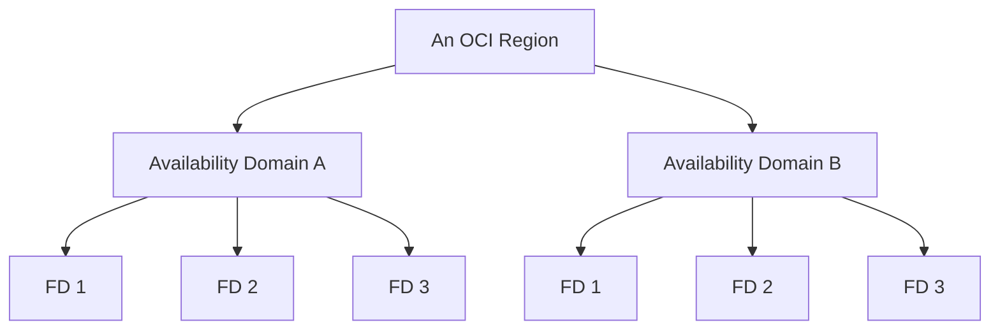
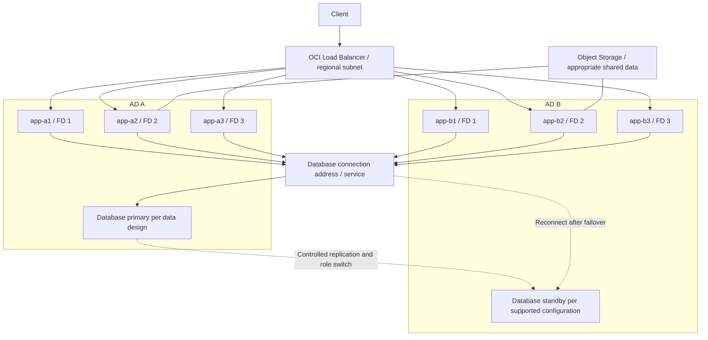

# Designing Multi-Fault Domain and Multi-Availability Domain Applications

In the **High Availability Architecture** chapter of the **CLOUD_PROVIDERS_ORACLE** module, this lesson guides you through designing an OCI application that continues serving when a host, a Fault Domain, or an Availability Domain fails. The focus is on resource placement, traffic routing, state management, and capacity headroom, while also considering IAM, networking, monitoring, automation, and cost.

Simply creating multiple servers is only part of the design. If those servers all share a single database without redundancy, store sessions in local RAM, or lack sufficient capacity after losing a domain, the application can still experience an outage.

## 1. Objectives and Scope

After this lesson, you will be able to:

- Distinguish between Region, Availability Domain, Fault Domain, and compartment.
- Identify which failure scopes a given resource placement can tolerate.
- Choose between a multi-FD architecture within one AD or a multi-AD architecture within the same region.
- Design the app tier, load balancer, sessions, database, and storage to match the same availability objective.
- Calculate remaining capacity after losing a domain instead of merely counting instances.
- Use instance configurations and instance pools to express placement.
- Verify actual placement, shift traffic, and measure recovery time.
- Roll out changes in small batches and maintain a rollback path to the previous version.

The lesson focuses on a web/API application running on Compute behind an OCI Load Balancer. The data section applies OCI principles and service options; do not assume every database or managed service shares the same HA configuration.

The reference deployment uses two ADs, each containing three application instances distributed across three FDs. A single-AD region uses the multi-FD variant and must document its corresponding limitations.

Commands and configurations are guides for an authorized lab environment. Replace OCIDs, regions, and AD names with values from your tenancy. This lesson does not provision infrastructure in your account; resources deployed by following these instructions may incur costs.

## 2. Understanding Fault Boundaries on OCI

### 2.1. Region, AD, FD, and Compartment

| Concept | Role | Meaning for HA Design |
| --- | --- | --- |
| Region | A geographic area containing one or more ADs | Scope for deploying multiple resources and services |
| Availability Domain — AD | One or more data centers in a region, with infrastructure isolation | Use multiple ADs to reduce the impact of a single-AD incident |
| Fault Domain — FD | A grouping of hardware/infrastructure within an AD | Isolates replicas from the same hardware/maintenance group |
| Compartment | Resource organization and IAM scope | Not a physical isolation boundary |

Each OCI AD has three FDs. Distributing instances across FDs protects against hardware failures or maintenance impacting a single FD. Those FDs still belong to the same AD. [Oracle: Physical Architecture Concepts](https://docs.oracle.com/en-us/iaas/Content/GSG/Concepts/concepts-physical.htm).

A region does not necessarily have three ADs. AD names also include a tenancy-specific prefix; matching AD labels across two tenancies does not imply the same physical data center. Query your tenancy's own details rather than copying AD names from external examples. [Oracle: Regions and Availability Domains](https://docs.oracle.com/en-us/iaas/Content/General/Concepts/regions.htm).



AD A and AD B are illustrative labels, not literal values passed directly to the API. `FAULT-DOMAIN-1` in AD A and `FAULT-DOMAIN-1` in AD B are two distinct domains; placement identification must evaluate the **AD + FD** pair.

An instance belongs to one AD and one FD at any point in time. A regional subnet shared across instances does not turn individual instances into resources spanning every AD.

### 2.2. Which Failure Scope Does Each Placement Handle?

| App Tier Placement | Single-Host Failure | Single-FD Failure | Entire App AD Failure | Entire Region Failure |
| --- | --- | --- | --- | --- |
| Single instance | No replica for immediate replacement | No | No | No |
| Multiple instances in same FD | Replicas may remain | May lose everything | No | No |
| Multiple FDs in one AD | Possible | Possible | No | No |
| Multiple ADs in one region | Possible | Possible | Possible | No |
| Multiple regions | Depends on design | Depends on design | Depends on design | Requires corresponding DR/routing/data design |

“Possible” requires that all remaining tiers, traffic shifting, and post-failure capacity meet requirements. This table describes placement scope only and does not guarantee recovery time or overall system availability.

Placing resources across two compartments on the same FD adds no physical fault tolerance. Conversely, resources within the same compartment can still be distributed across multiple ADs.

## 3. Starting from Serving Requirements and Failure Assumptions

### 3.1. Defining What Must Continue Operating

For the order-placement API, separate:

- Catalog reads and lookups of existing orders.
- Creating new orders and recording payments.
- Background processing such as sending notifications.
- Features that can temporarily degrade, such as product recommendations.

Not every feature needs the same recovery mode. When the recommendation service fails, the API can return a basic catalog; when the database can no longer accept writes safely, never return a fake success for order creation.

An illustrative set of targets:

| Incident | Target to Define | Required Conditions |
| --- | --- | --- |
| One app instance stops | New requests shift to another instance within the error budget | Health checks and spare capacity |
| One FD becomes unavailable | Core API continues serving | Replicas and dependencies in other FDs |
| One AD becomes unavailable | Restore core functions within the chosen RTO | Working app, data, ingress, and connectivity |
| Database switches roles | No unintended simultaneous writes to two primaries | Failover mechanism, fencing, and client reconnect |
| Buggy software change | Halt rollout and roll back to previous version | Independent deployment cohorts, old artifacts, and compatible schema |

Set RTO and RPO per data category. **RTO** is the recovery time objective; **RPO** is the acceptable data loss measured back to a recovery point. Having a standby does not automatically imply an RPO of 0.

### 3.2. Application SLO Differs from Individual Service SLAs

For example, a 99.95% SLO in a 30-day month corresponds to:

```text
30 × 24 × 60 × (1 - 0.9995) = 21.6 minutes
```

This is a time-based unavailability budget calculation and does not yet specify measurement rules or exclusions. For a request-ratio SLO, define good requests, valid requests, and the measurement window.

Do not add or multiply service SLAs and treat the result as proven application availability. Failures can be correlated, and software, IAM, or data bugs can affect all replicas simultaneously.

### 3.3. Distinguishing Redundancy from Self-Healing

- **Redundancy**: other resources are already available with enough capacity to serve.
- **Detection and traffic shifting**: stopping new requests from going to the failed location.
- **Self-healing**: restoring the desired instance count or state after an incident.

An app replica already running in the surviving AD can serve before replacement hosts are launched. If a design relies solely on launching new instances after a failure, RTO also depends on the control plane, capacity, image loading, startup, and application warm-up.

## 4. Multi-AD and Multi-FD Reference Architecture

### 4.1. App Tier Placement

Illustrative design:

| AD | FD | Instance | Role |
| --- | --- | --- | --- |
| A | 1 | app-a1 | Stateless Web/API |
| A | 2 | app-a2 | Stateless Web/API |
| A | 3 | app-a3 | Stateless Web/API |
| B | 1 | app-b1 | Stateless Web/API |
| B | 2 | app-b2 | Stateless Web/API |
| B | 3 | app-b3 | Stateless Web/API |

All six backends serve during normal operation. When the app tier in AD A becomes unavailable, the three instances in AD B absorb new requests once health checks and routing reflect the failure.



The database address in the diagram is an application connectivity abstraction, not an OCI resource with that literal name. How clients locate the primary after failover depends on the database service and configuration.

Six instances is chosen to illustrate even placement. You can use a different count provided capacity and fault boundaries are still satisfied.

### 4.2. The Load Balancer Must Also Match the HA Scope

A public OCI Load Balancer in a multi-AD region can use one public regional subnet or two AD-specific subnets in two ADs. With a regional subnet, the service places primary and standby in different ADs. In a single-AD region, there is no other AD for the load balancer to fail over to when the entire AD fails. [Oracle: Load Balancer Types](https://docs.oracle.com/en-us/iaas/Content/Balance/Concepts/load_balancer_types.htm).

For a private load balancer, subnet scope also matters: a regional subnet in a multi-AD region provides failover when one AD fails; an AD-specific subnet does not provide that same capability. [Oracle: Load Balancer Types](https://docs.oracle.com/en-us/iaas/Content/Balance/Concepts/load_balancer_types.htm).

Do not deploy two self-managed reverse proxy virtual machines in the same FD and assume ingress has the same redundancy as a multi-AD design.

### 4.3. When a Region Has Only One AD

Use multiple FDs for the app and for resources that allow FD selection. You still need load balancing, shared state, and sufficient remaining capacity when one FD is lost.

If the system must survive losing the sole AD, multiple FDs within that AD are not enough. You must add an architecture in another region with matching data and traffic routing plans; this is a DR extension and cannot be inferred from a multi-FD model. Oracle publishes dedicated guidance for HA apps in single-AD regions. [Oracle: Building Highly Available Applications in a Region with One Availability Domain](https://docs.oracle.com/en-us/iaas/Content/Resources/Assets/whitepapers/building-ha-apps-in-one-availability-domain.pdf).

## 5. Calculating Remaining Capacity After Losing a Domain

### 5.1. Initial Sizing Formula

Assume:

- `N` is the total number of equivalent app instances.
- `k` is the number of instances lost in the failure scenario.
- `c` is the per-instance throughput measured within acceptable quality limits.
- `u` is the post-failure target utilization factor, less than 1.
- `λ` is the traffic load that must be served.

Sizing condition:

```text
(N - k) × c × u >= λ
```

This formula assumes load distributes evenly enough and dependencies remain responsive. It does not replace load testing, as throughput can drop when the database, connection pool, or network becomes the bottleneck.

### 5.2. Example: Six Instances Across Two ADs

Suppose each instance is measured at a maximum of 300 requests/second under chosen load-test conditions. To operate at no more than 70% of that limit during an outage, the budgeted capacity per instance is:

```text
300 × 0.70 = 210 requests/second
```

For a demand of 600 requests/second:

| App Tier Scenario | Remaining Instances | Budgeted Capacity | Compared to Demand |
| --- | --- | --- | --- |
| Normal | 6 | 1,260 requests/second | Sufficient |
| Loss of one instance / FD with one instance | 5 | 1,050 requests/second | Sufficient |
| Loss of one AD with three instances | 3 | 630 requests/second | Sufficient, little headroom left |
| Loss of one AD plus one more instance | 2 | 420 requests/second | Insufficient |

These numbers are learning assumptions, not benchmarks or OCI commitments. A design that survives one AD failure may not survive simultaneous maintenance on a host in the surviving AD.

If pre-failure load is evenly distributed, post-failure utilization is approximately:

```text
u_after = u_before × N / (N - k)
```

With two balanced ADs, losing one AD roughly doubles load on the remaining hosts. To stay below 70% after failure, normal utilization cannot exceed roughly 35% under this simplified model.

### 5.3. Autoscaling Does Not Replace Immediately Needed Capacity

Adding hosts after a failure can take time because:

- The shape may be out of capacity in the target AD/FD.
- Quotas or service limits may be insufficient.
- Images, packages, or secrets may be unreachable.
- The application may start slowly or require cache/JIT warm-up.
- The database and connection pools may not tolerate additional connections.

Set an appropriate minimum capacity across surviving domains. If autoscaling is allowed to scale down to a single instance for the whole app, initial multi-domain placement no longer guarantees requirements during low traffic.

Quota is permission to consume a level of resources; it is not proof that physical capacity is always available. A capacity report reflects information at check time and does not reserve capacity. [Oracle: Creating Instance Pools](https://docs.oracle.com/en-us/iaas/Content/Compute/Tasks/creatinginstancepool.htm).

## 6. Designing State and Data Around the Same Fault Boundaries

### 6.1. Sessions and User Files

| State Type | Risk When Stored Only on App Instances | Design Direction |
| --- | --- | --- |
| Login session | Switching backends drops user sessions | HA session store or appropriate tokens |
| Shopping cart | Changes lost when host stops | Persist to a data tier meeting requirements |
| Uploaded files | Only the backend receiving the upload sees the file | Store in appropriate shared storage |
| Cache | Cold cache or temporary data loss | Treat cache as expendable; bound load during warm-up |
| In-flight jobs | Re-executed or dropped after failover | Queues, checkpoints, and idempotent processing |

Sticky sessions may reduce backend switching under normal conditions; they do not preserve the RAM of a failed host. A single un-replicated session store becomes a shared dependency that breaks all app replicas together.

Keep app instances replaceable from managed images and configuration. Logs and data requiring retention must have a lifecycle independent of individual hosts.

### 6.2. Block Volume and Cross-AD Recovery

A block volume attaches to an instance in the same AD. Do not design around an instance in AD B directly attaching a volume belonging to AD A when A fails. [Oracle: Overview of Block Volume](https://docs.oracle.com/en-us/iaas/Content/Block/Concepts/overview.htm).

Options serve different purposes:

| Mechanism | What It Achieves | What Still Must Be Done |
| --- | --- | --- |
| Volume backup | Restores data from a point in time | Create/restore volume and rebuild application |
| Volume replication | Maintains an updated copy at the destination | Activate replica, attach properly, and recover system |
| Database-level replication | Protects state using database mechanisms | Manage roles and reconnect clients |
| Managed shared storage | Decouples files from app lifecycle | Verify service HA scope and permissions |

A volume backup can be restored into another AD within the region. Restore capability does not mean an application endpoint is immediately ready to receive traffic. [Oracle: Block Volume Backups](https://docs.oracle.com/en-us/iaas/Content/Block/Concepts/blockvolumebackups.htm).

Block Volume supports asynchronous replication across ADs in multi-AD regions. Replicas complement backups; they do not replace retaining recovery points prior to accidental deletion or corruption. [Oracle: Block Volume Replication](https://docs.oracle.com/en-us/iaas/Content/Block/Concepts/volumereplication.htm).

With multiple volumes or active database writes, data consistency upon recovery must also be considered. Having all files present does not prove transactions recover cleanly.

### 6.3. Oracle Database: RAC and Data Guard Solve Different Layers

In Base Database Service, a two-node RAC configuration can place nodes in different FDs within the same AD. For cross-AD protection, standby and Oracle Data Guard can be used according to supported service configurations. Do not assume a standard two-node RAC spans two ADs. [Oracle: High Availability in the Cloud Adoption Framework](https://docs.oracle.com/en-us/iaas/Content/cloud-adoption-framework/high-availability.htm).

Oracle recommends placing the standby DB system in a different AD from the primary; if in the same AD, place it in a different FD. Review version, edition, networking, and licensing requirements for your database choice. [Oracle: About Oracle Data Guard](https://docs.oracle.com/en/cloud/paas/base-database/guide/dg-about.html).

A database plan must specify:

- Where primary and standby are located.
- Whether replication is synchronous or asynchronous per supported configuration.
- What replication lag is acceptable relative to RPO.
- Who or what mechanism decides failover.
- How the old primary is prevented from accepting writes after role transition.
- How the app rediscovers the service, refreshes connection pools, and handles ambiguous transactions.

An active-active app tier does not require a multi-writer database. A primary database with a standby can fit well, provided the write path and role transition mechanism are clearly designed.

### 6.4. Quorum and Network Partitions

For majority-voting systems, three voters placed two in AD A and one in AD B cannot continue accepting writes if AD A is lost: only one of three voters remains.

Three voters across three independent ADs can retain a majority when one AD is lost, if networking and deployment support it. Three voters across three FDs in the same AD only protect at FD scope; losing the AD loses all three.

This is a general principle for quorum systems, not a formula replacing the failover procedures of every database service. Never allow both sides to accept writes during a network partition just to keep a status chart “green”; protect consistency and prevent split-brain.

## 7. Networking, Permissions, and Shared Dependencies

### 7.1. Regional Subnets Enable Flexible Placement

An illustrative VCN design:

| Component | Example CIDR | Scope/Role |
| --- | --- | --- |
| VCN | `10.20.0.0/16` | Regional network |
| Public regional subnet | `10.20.0.0/24` | Public load balancer |
| Private regional app subnet | `10.20.10.0/24` | App instances across ADs |
| Private regional data subnet | `10.20.20.0/24` | Data resources per supported configuration |

A regional subnet can be used by resources across any AD in the region; an AD-specific subnet restricts placement to the specified AD. Oracle recommends regional subnets where appropriate. [Oracle: Overview of VCNs and Subnets](https://docs.oracle.com/en-us/iaas/Content/Network/Tasks/Overview_of_VCNs_and_Subnets.htm).

These address ranges are examples only and must not overlap existing networks or networks connected via VPN/FastConnect.

A regional subnet does not automatically create extra app replicas, a database standby, or spare capacity. A misconfigured shared route or NSG change can still block both ADs.

### 7.2. Separating Security Rules by Role

| Flow | Example Rule | What to Verify |
| --- | --- | --- |
| Client → public LB | TCP 443 from permitted sources | Listener, certificates, and ingress policy |
| LB → app | TCP 8080 from LB NSG to app NSG | Backend traffic and health checks |
| App → database | Database service port, e.g., TCP 1521 | Apps in both AD A and AD B can connect |
| App → Object Storage | HTTPS to appropriate endpoint | IAM and network path |
| Admin → app | Dedicated management channel per design | Does not depend on a single admin host |

NSGs apply rules to groups of VNICs/resources sharing the same role, decoupling security requirements from subnet layout. Rules must also align with any other network layers and controls in use. [Oracle: Network Security Groups](https://docs.oracle.com/en-us/iaas/Content/Network/Concepts/networksecuritygroups.htm).

Test from each AD, not solely from a single admin host. Successful DNS resolution does not prove TCP, TLS, or database authentication succeeds.

### 7.3. IAM Must Authorize Resources on Both Sides

Distinguish between:

- Deployment identity: creates or modifies instance configurations, pools, subnets, and LBs.
- Workload identity: reads artifacts, configs, or secrets when the app starts.
- Operations identity: views metrics/logs and executes assigned failover actions.

Compartments and policies define which principals can perform which actions on which resources; they do not create physical placement. [Oracle: How Policies Work](https://docs.oracle.com/en-us/iaas/Content/Identity/Concepts/policies.htm).

If apps in AD B can only boot thanks to a script or secret endpoint hosted on a machine in AD A, the design has a dependency that must be fixed. Test launching new instances from each AD using the actual workload identity, not a deployer's personal credentials.

### 7.4. Dependencies That Easily Undermine Multi-AD Designs

| Dependency | Question to Answer |
| --- | --- |
| DNS | Can clients and apps still resolve names properly if one domain is lost? |
| Certificates/TLS | Do replicas use compatible configurations and can certificates be renewed? |
| Artifacts/configuration | Can new instances download them when the failed side is down? |
| Session store/cache | Are there replicas, failover, and recovery load limits? |
| Egress to external services | Does it depend on a single virtual appliance or proxy? |
| Monitoring and alerting | Can we still observe the system when the affected host group fails? |
| Scheduler/background workers | Are duplicate jobs prevented when multiple replicas run concurrently? |

Even a service described as regional must be evaluated against its specific documentation and configuration. Do not assume every resource associated with it shares the same fault tolerance scope.

## 8. Health Checks, Traffic Shifting, and Application Behavior

### 8.1. Health Checks Must Reflect Serving Capability

OCI Load Balancer supports TCP or HTTP health checks. When a backend fails health checks, the LB removes it from distribution; once it recovers and passes checks, the LB brings it back. [Oracle: Health Check Policies for Load Balancers](https://docs.oracle.com/en-us/iaas/Content/Balance/Tasks/load_balancer_health_management.htm).

For HTTP applications, a health check that only confirms an open port can miss an application hung in business logic.

Design endpoints by role:

| Lab Application Endpoint | Meaning |
| --- | --- |
| `/health/live` | Process is alive and able to respond |
| `/health/ready` | Replica is ready to accept requests within defined scope |
| `/whoami` | Returns instance/release to verify backends in the lab |
| Business API | Confirms reads/writes and business rules actually work |

These are endpoints you implement in your application, not OCI-generated URLs. Diagnostic endpoints such as `/whoami` should be protected or restricted to the lab.

Readiness should be lightweight, bounded by timeouts, and reflect essential dependencies. Do not include every optional dependency in readiness to the point that an auxiliary service outage removes all backends. Conversely, if an API must write to a database, a readiness probe returning healthy when unable to write creates a false signal.

### 8.2. Illustrative Configuration

```text
Protocol: HTTP
Port: 8080
Path: /health/ready
Expected status: 200
Interval: 5000 ms
Timeout: 2000 ms
Retries: 3
```

Interval, timeout, retries, status code, and path are parameters of a health check policy. These values are illustrative; measure and tune them based on actual response times. [Oracle: Editing Health Check Policies](https://docs.oracle.com/en-us/iaas/Content/Balance/Tasks/editinghealthcheck_topic-Editing_Health_Check_Policies.htm).

Do not assume RTO equals `interval × retries`. When the failure occurs relative to the probe cycle, timeouts, open connections, client retries, and data role transitions all affect user-observed recovery time.

A recovery estimate can be broken down as:

```text
Recovery time ≈ failure detection
              + required traffic/role shifting
              + reconnecting dependencies
              + warming up serving state
```

Some steps can run in parallel; measure the actual critical path rather than mechanically summing every duration.

### 8.3. Do Not Confuse Backend Removal with Fixing the Application

The LB stopping new requests to a failed backend does not mean the process restarted or the instance was replaced. You need a separate operational mechanism for app recovery, instance count management, and root-cause investigation.

Also distinguish between:

- Instance in `RUNNING` state.
- Application process started.
- Backend passing health checks.
- Business requests meeting the SLO.

One “green” layer does not replace evidence at the remaining layers.

### 8.4. In-Flight Requests and Retries

When a backend drops a connection mid-order, the client may not know whether the transaction committed. Resending the entire write can create duplicate orders or duplicate payments.

The design needs:

- Finite timeouts on HTTP clients and database clients.
- Bounded retries with backoff and jitter.
- Idempotency keys for operations requiring deduplication.
- A way to look up outcomes when transaction state is ambiguous.
- Concurrency limits to avoid overloading dependencies during recovery.

If three layers each retry up to three times, a single request can trigger up to 27 calls at the deepest layer under nested retries. Multiple replicas with uncontrolled retries can amplify an outage.

For background workers, use queues/claims/locks and appropriate fencing mechanisms to prevent two workers from owning the same job unintentionally. A lock in one app process's RAM does not protect across multiple ADs.

## 9. Expressing Placement with Instance Configurations and Instance Pools

### 9.1. Choosing How to Manage Counts per AD

Options include:

| Option | Advantage | Operational Consideration |
| --- | --- | --- |
| One pool with multiple AD placements | Centralized fleet management | Verify actual distribution and scaling behavior |
| One pool per AD | Clear per-AD minimums and rollouts | More pools/scaling policies to manage |

This lesson uses two pools, each bound to a single AD with three instances. That makes remaining host counts obvious when one AD fails; it is not mandatory for every application.

An instance configuration describes the machine to create. The pool's placement overrides the corresponding AD and subnet values when launching instances. [Oracle: Creating an Instance Configuration](https://docs.oracle.com/en-us/iaas/Content/Compute/Tasks/creatinginstanceconfig.htm).

A shared configuration should launch instances from images/artifacts usable in both ADs, with independent boot volumes. Never attach a single data volume from AD A to every instance across both pools.

### 9.2. Best-Effort vs. Strict FD Distribution

By default, an instance pool distributes FDs on a best-effort basis based on capacity. Specifying FDs enforces even distribution across the selected FDs; when capacity is missing in a required FD, the pool may fail to launch or scale. [Oracle: Managing Instance Pools](https://docs.oracle.com/en-us/iaas/Content/Compute/Concepts/instance-pools.htm).

This is a deliberate trade-off:

- Best effort prioritizes launch success, requiring you to verify actual spread.
- Strict placement protects architectural intent, though creation/scaling may fail.
- Selecting a single FD concentrates resources in one FD with no FD redundancy.

Never remove constraints and assume the topology still meets its original requirements. If capacity forces a placement change, document the impact on the fault model.

### 9.3. Terraform Example for Two Pools

The snippet below covers the app pools within an existing infrastructure setup containing the OCI provider, instance configuration, regional private subnet, LB, and backend set. It does not create the entire database, network, or IAM setup.

```hcl
variable "compartment_id" {
  type = string
}

variable "instance_configuration_id" {
  type = string
}

variable "app_subnet_id" {
  type = string
}

variable "load_balancer_id" {
  type = string
}

variable "backend_set_name" {
  type = string
}

variable "availability_domains" {
  type = map(string)

  validation {
    condition = (
      length(var.availability_domains) == 2 &&
      length(distinct(values(var.availability_domains))) == 2
    )
    error_message = "This example requires two different ADs in the region."
  }
}

resource "oci_core_instance_pool" "app" {
  for_each = var.availability_domains

  compartment_id            = var.compartment_id
  instance_configuration_id = var.instance_configuration_id
  display_name              = format("orders-%s", each.key)
  size                      = 3

  placement_configurations {
    availability_domain = each.value
    fault_domains = [
      "FAULT-DOMAIN-1",
      "FAULT-DOMAIN-2",
      "FAULT-DOMAIN-3"
    ]

    primary_vnic_subnets {
      subnet_id = var.app_subnet_id
    }
  }

  load_balancers {
    load_balancer_id = var.load_balancer_id
    backend_set_name = var.backend_set_name
    port             = 8080
    vnic_selection   = "PrimaryVnic"
  }

  freeform_tags = {
    Application = "orders"
    Environment = "ha-lab"
    Placement   = each.key
  }
}
```

Example placement values:

```hcl
availability_domains = {
  ad_a = "<TENANCY_SPECIFIC_AD_A_NAME>"
  ad_b = "<TENANCY_SPECIFIC_AD_B_NAME>"
}
```

Fields such as `placement_configurations`, `fault_domains`, `primary_vnic_subnets`, and LB attachments are defined in the OCI Terraform provider. Use the schema matching your project's provider version. [Oracle Terraform Provider: oci_core_instance_pool](https://docs.oracle.com/en-us/iaas/tools/terraform-provider-oci/latest/docs/r/core_instance_pool.html).

When a pool is attached to an LB, new instances are added to the backend set and only receive traffic once they pass health checks. You still must configure the listener, backend set, health checker, and network rules properly. [Oracle: Creating Instance Pools](https://docs.oracle.com/en-us/iaas/Content/Compute/Tasks/creatinginstancepool.htm).

### 9.4. Declarative Configuration Must Be Verified Against Actual State

After provisioning, verify:

- Are all six instances running?
- Does each pool have the expected AD and three FDs?
- Are all six backends healthy?
- Do applications across both ADs run the matching release/configuration?
- Can instances in each AD reach dependencies with the proper identity?

A pool in `RUNNING` state does not replace counting instances and checking backends. Also, updating a pool's instance configuration does not automatically update existing instances; new instances will use the new configuration. Plan replacements in batches. [Oracle: Managing Instance Pools](https://docs.oracle.com/en-us/iaas/Content/Compute/Concepts/instance-pools.htm).

## 10. Hands-On: Verifying Topology and Shifting Traffic

### 10.1. Preparing the Lab

You need:

1. A lab compartment and an identity with appropriate permissions.
2. A region with at least two ADs for the multi-AD variant.
3. Configured VCN, subnets, NSGs, and LB.
4. An app exposing readiness and a way to identify backends in the lab.
5. Two pools/backend groups with known placement.
6. Tools to observe HTTP responses, metrics, and logs.
7. A plan to restore backends after testing.

If no database standby is present yet, limit conclusions to the app tier. Do not mark the entire application AD-fault-tolerant just because backends still return HTTP responses.

### 10.2. Listing the Tenancy's ADs and FDs

The following commands use **Bash**, for example in an authorized OCI Cloud Shell:

```bash
export OCI_REGION="<REGION>"
export TENANCY_OCID="<TENANCY_OCID>"
export APP_COMPARTMENT_OCID="<APP_COMPARTMENT_OCID>"

oci iam availability-domain list \
  --compartment-id "$TENANCY_OCID" \
  --region "$OCI_REGION" \
  --all
```

Do not rely on list ordering to pick AD A/B. Record the exact selected AD names in your configuration. [Oracle CLI: availability-domain list](https://docs.oracle.com/en-us/iaas/tools/oci-cli/latest/oci_cli_docs/cmdref/iam/availability-domain/list.html).

List FDs for an AD:

```bash
export AD_A="<TENANCY_SPECIFIC_AD_A_NAME>"

oci iam fault-domain list \
  --compartment-id "$TENANCY_OCID" \
  --availability-domain "$AD_A" \
  --region "$OCI_REGION" \
  --all
```

Repeat for AD B. `fault-domain list` takes an AD name and compartment/tenancy OCID. [Oracle CLI: fault-domain list](https://docs.oracle.com/en-us/iaas/tools/oci-cli/latest/oci_cli_docs/cmdref/iam/fault-domain/list.html).

### 10.3. Verifying Actual Instance Placement

```bash
oci compute instance list \
  --compartment-id "$APP_COMPARTMENT_OCID" \
  --region "$OCI_REGION" \
  --all \
  --query 'data[].{Name:"display-name",AD:"availability-domain",FD:"fault-domain",State:"lifecycle-state"}' \
  --output table
```

This lists instances by compartment; match only instances belonging to the lab app and do not count hosts from other applications as replicas. [Oracle CLI: compute instance list](https://docs.oracle.com/en-us/iaas/tools/oci-cli/latest/oci_cli_docs/cmdref/compute/instance/list.html).

Record an inventory table including instance OCID, private IP, AD, FD, pool, and release. When backends use private IPs, matching the backend set against this table lets you select the exact group to remove from traffic.

### 10.4. Measuring the Baseline

From the expected client location:

- Send requests through the LB and confirm backends in both ADs respond.
- Measure success rate, p95/p99 latency, and throughput.
- Execute a read/write business flow.
- Confirm sessions stay valid when requests land on a different backend.
- Record CPU/RAM, connection pool, and database load.

Example lightweight HTTP check, one request per second:

```bash
export BASE_URL="https://<LAB_LB_DOMAIN>"

for N in $(seq 1 60)
do
  date -u +"%Y-%m-%dT%H:%M:%SZ"
  curl --connect-timeout 2 --max-time 5 \
    --silent --show-error \
    --output /dev/null \
    --write-out 'code=%{http_code} total=%{time_total}\n' \
    "$BASE_URL/health/ready"
  sleep 1
done
```

This is a lightweight observation probe, not a load test to validate 600 requests/second. Use a dedicated load test with realistic concurrency and workload when verifying capacity.

### 10.5. Drill Levels and Scope of Conclusions

| Test Method | What Is Verified | What Remains Unproven |
| --- | --- | --- |
| Mark one backend offline | Routing when a backend stops receiving traffic | Natural fault detection via health checks |
| Stop app on one host | Health detection and backend removal | Entire FD power/network loss |
| Stop app on one FD group | App tier retains enough replicas outside FD | All dependencies survive FD failure |
| Cut app serving in one AD | Routing and app capacity in surviving AD | LB, network, and data all survive AD failure |
| Planned database switchover | Role switch and client reconnect | Every sudden primary loss scenario |
| Full drill within approved scope | User flow with included dependencies | Incidents outside tested assumptions |

Only inject failures within the assigned environment and scope. Start with one backend, with abort conditions if error rates or latencies exceed thresholds.

For a backend group in one AD, use the inventory table to pick the right group. Observe the surviving AD immediately after shifting traffic rather than waiting for autoscaling to launch new hosts first.

For write workloads, send requests carrying idempotency keys and reconcile record counts afterward. HTTP 200 on a health endpoint cannot detect lost or duplicated transactions.

### 10.6. Recording the Recovery Timeline

Record at least:

```text
t0: fault injection begins in the lab
t1: health/backend state reflects the failure
t2: new requests stabilize on the surviving group
t3: dependency or database completes role switch if applicable
t4: business flow returns to meeting SLO
t5: full redundant topology restored
```

When the app resumes serving requests can differ from when full redundancy is restored. After surviving an AD failure, the system is typically running in degraded redundancy and requires deliberate monitoring and restoration.

## 11. Maintenance and Rollouts Without Losing All Replicas

### 11.1. Drain Before Stopping a Host

OCI LB provides a backend drain mode to stop forwarding new TCP connections and new non-sticky HTTP requests to a backend, supporting graceful removal for maintenance. Offline mode stops forwarding ingress traffic to the backend. [Oracle: Editing a Load Balancer's Backend Server](https://docs.oracle.com/en-us/iaas/Content/Balance/Tasks/update_backend_server.htm).

Single-instance maintenance procedure:

1. Confirm remaining backends have sufficient capacity and are healthy.
2. Put the backend into drain mode via the LB mechanism.
3. Wait for in-flight requests/connections to finish within a timeout.
4. Stop or replace the instance.
5. Wait for the app to become ready and run functional checks.
6. Return it to service and observe before moving to the next host.

Draining does not automatically ensure every WebSocket, sticky session, or long-running transaction finishes. The application needs graceful shutdown and appropriate timeouts.

### 11.2. Using Small Deployment Cohorts

Never deploy the same change to all FDs/ADs at once. An illustrative sequence:

```text
One canary instance
  → small cohort
  → remainder of AD A
  → observe
  → cohorts in AD B
```

Ensure capacity and blast radius remain safe at each step. In the six-instance example, if three hosts in AD A are already down, do not proceed with maintenance in AD B without re-evaluating demand.

Keep old artifacts/configurations and a rollback plan. For database schema changes, design a phase compatible with both old and new app versions; rolling deployments do not make an incompatible schema change safe.

### 11.3. Avoiding Automation-Induced Common Failures

Using uniform IaC and images ensures reproducibility, yet a bug in a shared template can spread to every AD. Always:

- Review the plan and affected resource scope.
- Split rollouts into stoppable cohorts.
- Verify configuration and secret versions.
- Observe after each cohort instead of only waiting for the tool to report apply success.
- Avoid running migrations or schedulers concurrently across all replicas.

Physical placement reduces certain infrastructure failures; it does not isolate shared business logic or deployment pipelines.

## 12. Monitoring, Verification, and Troubleshooting

### 12.1. Observing by Domain and User Flow

| Layer | Metrics or Evidence |
| --- | --- |
| Placement | Actual instance counts per AD/FD/pool |
| Ingress | Healthy/unhealthy backends, requests, HTTP errors |
| Application | p95/p99 latency, errors, concurrency, queues |
| Compute | CPU, RAM, disk/network per agent and configuration |
| Database | Role, replication lag, reconnects, transaction errors |
| User experience | Business operation completion rate |
| Recovery | Detection time, traffic shift time, capacity restoration time |

OCI LB provides metrics such as `unhealthyBackendServers`, `httpResponses5xx`, and `httpRequests` broken down by component/dimension. Select the right resource, listener, or backend set when reading charts. [Oracle: Load Balancer Metrics](https://docs.oracle.com/en-us/iaas/Content/Balance/Reference/loadbalancermetrics.htm).

Do not rely solely on fleet-wide average CPU. When one AD goes down, stopped hosts stop reporting metrics and can skew aggregates; inspect active backend counts and load on each surviving group.

Alert on loss of redundancy, not just complete outages. For example, having only one healthy backend left while low traffic still succeeds is a warning that requires action.

### 12.2. Common Design Mistakes

| Symptom | Cause to Investigate | Remediation |
| --- | --- | --- |
| Multiple instances fail together | Same AD/FD or single shared dependency | Audit placement and dependencies |
| Backend healthy yet write API fails | Readiness omits mandatory functionality | Fix checks and monitor business flows |
| Surviving AD overloaded | Sized only for normal load | Re-size for largest failure domain |
| Scale-out fails | Missing capacity/quota or overly strict placement | Inspect error, adjust with topology review |
| Sessions lost on backend switch | State stored in old host RAM | Externalize or redesign session handling |
| AD B app cannot load config | Rules/IAM/endpoints only work from AD A | Test with AD B workload identity and network path |
| Volume cannot recover in another AD | Misunderstood volume attachment scope | Use restore/replication and matching runbook |
| DB standby exists yet app hangs | Clients stick to old endpoint/connections | Design reconnect logic and transaction handling |
| Two groups run the same job | Process-scoped scheduler/lock | Use queues, claims, or properly scoped coordination |
| “AD loss” test passes yet real outage fails | Only tested offlining app backends | Expand drills to LB, data, and dependencies |
| Bad rollout breaks whole system | Shared rollout across all domains | Split cohorts, use canaries and rollbacks |

If the LB reports a backend unhealthy, check port, protocol, path, return code, timeout, network rules, and app responsiveness. Never raise timeouts indefinitely to mask dependency failures. [Oracle: Troubleshooting Load Balancer Health Issues](https://docs.oracle.com/en-us/iaas/Content/Balance/Reference/troubleshooting_health.htm).

## 13. Cost, Trade-Offs, and Completion Criteria

### 13.1. Cost of Redundant Capacity

Costs extend beyond app instance count:

- Compute and boot/data volumes for replicas.
- Database primary/standby, resources, and applicable licenses.
- Load balancer and bandwidth per configuration.
- Backups, replicas, logs, and retention windows.
- Observability tooling and drill/operational effort.

There is no universal rule that every app must use two or three ADs. Choices depend on required fault scope, SLOs, data sensitivity, latency, and budget.

| Option | Primary Capability | Trade-Off |
| --- | --- | --- |
| One AD, multiple FDs | Survives certain hardware/maintenance failures in AD | Cannot survive full AD loss |
| Two ADs active-active at app tier | App capacity running in surviving AD | Requires ample headroom and data HA |
| Three ADs | Spreads loss across more domains, more placement options | More resources and coordination overhead |
| Active-passive | Dedicated failover target | Must measure activation time and real readiness |
| Multi-region | Broadens recovery scope | Adds DR, data, and routing complexity |

Optimize costs through right-sizing and matching redundancy to targets. Never lower minimum capacity or collapse replicas onto one FD while keeping the original fault-tolerance claims.

### 13.2. Design Documentation to Retain

A minimal record includes:

1. SLO, RTO, RPO, and required failure scenarios.
2. Diagrams of app, ingress, data, and dependencies.
3. Actual placement by AD + FD pairs.
4. Calculations and load-test results after losing a domain.
5. IAM, network rules, and prerequisites for launching new instances.
6. Runbooks for failover, rollback, recovery, and data verification.
7. Drill results along with the scope limits of each test.
8. Owners, estimated cost, and re-verification schedule.

After the lab, restore tested backends to their expected state, verify replica counts, and clean up unneeded resources. Clean up only lab resources within your assigned permissions; never accidentally delete shared buckets, databases, or networks.

### 13.3. Completion Criteria

You have completed the practice when you can demonstrate:

- Region and AD counts are verified from the tenancy.
- Instances are placed across ADs/FDs as designed.
- Ingress and app tier are not redundant solely within a single fault domain.
- Traffic shifts when a backend group stops serving.
- The surviving group handles target load within acceptable latency/error rates.
- Sessions, files, and data have retention/recovery mechanisms matching the scope.
- Database failover and client reconnection are documented or verified within lab scope.
- Detection time, recovery time, and full redundancy restoration time are recorded separately.
- Maintenance/rollouts do not take down all necessary replicas simultaneously.
- Test conclusions accurately reflect what was actually exercised.

Multi-FD and multi-AD designs fulfill their purpose when **placement, remaining capacity, traffic shifting, and data together satisfy a clear failure assumption**. Each redundancy layer must be wired into the actual serving path and verified from the user's perspective.
