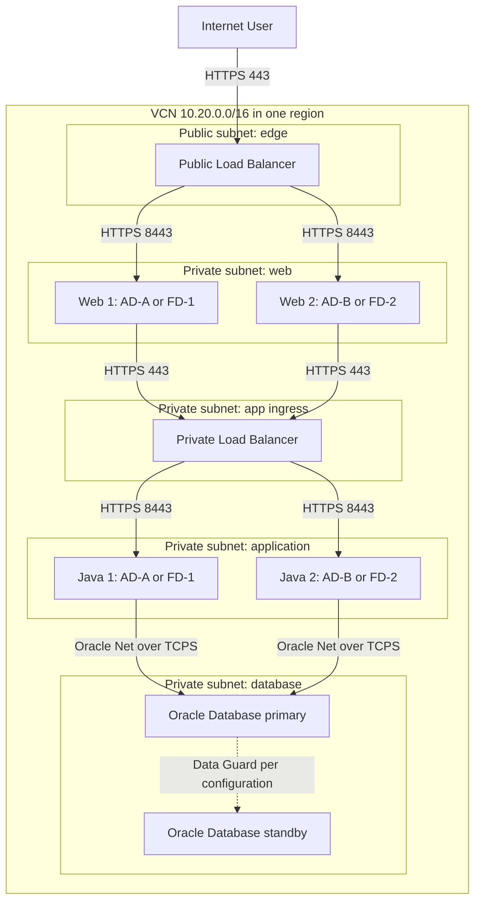

# Three-Tier Web Architecture on Private Subnets

In the **High Availability Architecture** chapter of the **CLOUD_PROVIDERS_ORACLE** module, this lesson builds a three-tier web architecture on Oracle Cloud Infrastructure: the web tier, Java application tier, and Oracle data tier all reside in private subnets. A public load balancer receives Internet traffic and forwards it to backends over private addresses.

The design combines VCN, routing, Network Security Groups, Load Balancer, Compute, and Oracle Database with permissions, monitoring, and automation. The goal is to trace a request's path, blast radius of failures, and remaining capacity when a component is lost, while understanding the operational cost of redundancy options.

## 1. Three Functional Tiers and Design Objectives

Consider an order management website. Users access it via a browser; the Java backend verifies permissions and processes business logic; Oracle Database persists orders, payments, and processing state.

| Tier | Primary Responsibility | Illustrative Components | State Requiring Attention |
| --- | --- | --- | --- |
| Web | Serve frontend assets, reverse proxy, and HTTP policies | Two or more NGINX hosts | Configuration, frontend build version, certificates |
| Application | Business validation, APIs, transactions, and integrations | Two or more Java hosts | Sessions, background jobs, database connections |
| Data | Persist data durably and guarantee transactions | Oracle Database primary and standby per chosen option | Data, redo logs, backups, primary/standby roles |

The public load balancer and private load balancer are traffic distribution components, not fourth or fifth business tiers. Nor do the three functional tiers have to map one-to-one to three subnets; separate subnets can be dedicated to ingress and management.

Reference requirements for this lesson:

- Internet users only access the public HTTPS entry point.
- Web hosts, Java hosts, and databases have no public IPv4 addresses.
- Stopping one web host or one Java host does not take down the entire service.
- The database has a recovery or role-transition mechanism matching business targets.
- Rolling out new versions and maintenance can be performed incrementally.
- Metrics verify network paths, recovery capability, and architectural cost.

Lock down SLO, RTO, and RPO before choosing a topology. For example, a 99.9% SLO over 30 days corresponds to an unavailability budget of roughly 43.2 minutes if time-based; request-based measurement can yield different results. These are hypothetical application targets, not a guaranteed SLA for the combination of OCI services in this lesson.

RTO is the time required to restore the defined service level; RPO is acceptable data loss measured in time. Never set RPO to 0 solely because a standby exists without defining protection mode, lag, and role-transition handling.

## 2. Reference Architecture and Request Flow

### 2.1. Overall Diagram



The diagram shows normal database roles: writes go to the primary and synchronize to the standby. After a role transition, the application must connect to whichever database now holds the primary role using the designed connection mechanism. A standby is not a backend for load-balancing writes via an HTTP load balancer.

Two hosts in the same regional subnet can be placed in different availability domains if the region offers multiple ADs. When a region has only one AD, use different fault domains within that AD; that layout has a different protection scope than multi-AD placement.

### 2.2. How Does a Request Traverse the System?

1. Public DNS resolves the website domain to the public load balancer's public address.
2. The client opens an HTTPS connection to the port 443 listener.
3. The public load balancer selects a healthy web backend and opens a connection to the backend's private IP on port 8443.
4. Web serves frontend content or forwards API requests to the internal DNS name of the private load balancer.
5. The private load balancer selects a healthy Java backend on port 8443.
6. Java checks permissions, borrows a connection from its pool, and executes the transaction against Oracle Database.
7. Responses return along the corresponding proxy connections back to the client.

The browser does not need to know any Java host's private IP. If the frontend uses JavaScript to call APIs, the call URL should be a public path such as `/api/orders` forwarded by the web proxy. Pointing frontend code directly to `https://api.internal.example` will not work for Internet users just because the backend has private DNS.

The load balancers in this lesson use OCI Load Balancer as a reverse proxy. If replaced with a Network Load Balancer preserving client source addresses, re-evaluate the source addresses observed by backends, security rules, and return paths; do not copy this architecture's rule matrix verbatim.

## 3. VCN and Subnet Design

### 3.1. Illustrative Addressing Plan

| Subnet | Example CIDR | Type | Primary Components | Route Table |
| --- | --- | --- | --- | --- |
| `sn-edge` | `10.20.0.0/24` | Public, regional | Public load balancer | `rt-edge` |
| `sn-web` | `10.20.10.0/24` | Private, regional | Web hosts | `rt-web` |
| `sn-app-ingress` | `10.20.20.0/24` | Private, regional | Private load balancer | `rt-app-ingress` |
| `sn-app` | `10.20.30.0/24` | Private, regional | Java hosts | `rt-app` |
| `sn-db` | `10.20.40.0/24` | Private, regional if supported by service/topology | DB systems | `rt-db` |
| `sn-management` | `10.20.50.0/27` | Private, regional | Management endpoints per chosen approach | `rt-management` |

CIDRs are examples only. Before deployment, verify there is no overlap with other VCNs, on-premises networks, or networks connected via VPN/FastConnect. Reserve addresses for scaling, load balancers, backend replacements, and service resources; usable addresses are fewer than total addresses in a CIDR.

A regional subnet supports placing resources across multiple ADs in the same region. It does not automatically add hosts, replicate applications, or turn a standalone database into a redundant database. Public/private is an access property of the subnet, while AD/FD is the resource placement scope. [Oracle: Networking Overview](https://docs.oracle.com/en-us/iaas/Content/Network/Concepts/overview.htm).

### 3.2. Public Entry Point and Private Tiers

A public load balancer must be placed in a public subnet. With a regional subnet, you do not need to create a separate public subnet per AD as in topologies using AD-specific subnets. In a multi-AD region, choosing a regional subnet supports load balancer failover across ADs; in a single-AD region, it does not protect against losing the entire AD. [Oracle: Load Balancer Types](https://docs.oracle.com/en-us/iaas/Content/Balance/Concepts/load_balancer_types.htm).

Place the private load balancer in `sn-app-ingress` to cleanly separate internal listeners from the Java host group. Subnets can be shared when requirements and services allow, though distinct role-based NSGs remain necessary. Never spin up a “temporary web” host with a public IP to bypass the load balancer when health checks fail.

If the website only serves internal corporate users, the entry point can be a private load balancer accessed over private connectivity. In that case, design DNS, forward routing, and return routing from the corporate network; you cannot simply delete the public IP and expect Internet clients to still connect.

## 4. Routing: Separating Serving Paths from Egress Paths

### 4.1. Sample Route Tables

| Route Table | Destination | Target | Purpose |
| --- | --- | --- | --- |
| `rt-edge` | `0.0.0.0/0` | Internet Gateway | Internet traffic for public entry point |
| `rt-web` | `0.0.0.0/0` if needed | NAT Gateway | Downloading patches or calling allowed Internet services |
| `rt-web` | Service CIDR label enabled in region | Service Gateway | Accessing supported Oracle services |
| `rt-app` | `0.0.0.0/0` if business needs | NAT Gateway | External API integrations or public dependencies |
| `rt-app` | Service CIDR label enabled in region | Service Gateway | Artifacts, logs, or supported OCI services |
| `rt-db` | Appropriate Service CIDR label | Service Gateway | Backups and supported service needs |
| `rt-app-ingress` | No default Internet route needed for main flow | VCN internal routing | Web calling private load balancer |
| Relevant tables | Corporate network CIDRs if applicable | DRG | Private access via VPN/FastConnect |

In this lesson's standard VCN model, traffic between private subnets uses VCN internal routing; it does not hairpin through NAT or the Internet Gateway. Route tables determine packet paths and do not replace rules permitting connections. Architectures with intermediate firewalls or intra-VCN routing require explicit forward and return route design. [Oracle: VCN Route Tables](https://docs.oracle.com/en-us/iaas/Content/Network/Tasks/managingroutetables.htm).

“If needed” rows represent design decisions. For example, the database in this lesson lacks a default Internet route; you must therefore ensure required access paths for backups, patching, and operations per actual database service requirements, rather than cutting network paths and assuming all admin operations still work.

### 4.2. NAT Gateway and Service Gateway Have Different Roles

NAT Gateway allows resources without public IPs to initiate outbound Internet connections and receive responses to those connections. It does not provide an inbound entry point for Internet users to initiate new connections to private web servers. OCI's NAT Gateway is a highly available service; do not replace it by default with a single NAT VM to save money. [Oracle: NAT Gateway](https://docs.oracle.com/en-us/iaas/Content/Network/Tasks/NATgateway.htm).

Service Gateway provides a private path to supported Oracle services within the same region via a service CIDR label. It is not a blanket route to arbitrary Internet addresses or every API bearing the Oracle name. Enable the right service group and add matching routes for the subnets that need it. [Oracle: Access to Oracle Services](https://docs.oracle.com/en-us/iaas/Content/Network/Tasks/servicegateway.htm).

Keep the public subnet's route table tailored to entry-point needs instead of blindly copying every private subnet route onto it. Service routes and default routes follow route selection conditions; check for asymmetry rather than assuming every gateway can be added identically to every table.

Even with a default route to NAT, applications still need appropriate egress rules. NAT is not a domain filter or HTTP policy engine. If outbound hostnames/URLs must be restricted, add an appropriate mechanism such as an egress proxy or firewall plus a destination allowlist process.

## 5. Network Security Groups and Connectivity Matrix

### 5.1. Creating NSGs by Role

Use groups such as `nsg-public-lb`, `nsg-web`, `nsg-private-lb`, `nsg-app`, and `nsg-db`. Attach groups to the appropriate VNICs or supported service resources rather than creating NSGs and leaving membership empty.

Within the same VCN, an NSG can reference another NSG as a rule source or destination. This fits well when backend counts change: the rule “Java accepts from private load balancer” does not need to list every new Java IP. Verify that actual resources belong to the right groups. [Oracle: Network Security Groups](https://docs.oracle.com/en-us/iaas/Content/Network/Concepts/networksecuritygroups.htm).

### 5.2. Primary Flow Matrix

The following table uses TCP and **stateful rules** for illustration. Each row must be represented in the initiator's egress and the receiver's ingress, excluding return traffic belonging to connections permitted by stateful tracking.

| Initiator | Destination | Example Destination Port | Purpose |
| --- | --- | --- | --- |
| Internet Client | `nsg-public-lb` | 443 | Public HTTPS |
| `nsg-public-lb` | `nsg-web` | 8443 | Traffic and health checks to web |
| `nsg-web` | `nsg-private-lb` | 443 | Reverse-proxied API requests |
| `nsg-private-lb` | `nsg-app` | 8443 | Traffic and health checks to Java |
| `nsg-app` | `nsg-db` | 1522, per configured TCPS listener | Application database connections |
| Designated DB systems | Peer DB systems | Redo/management ports per topology docs | Data Guard and database operations |
| OCI Bastion private endpoint IP or allowed admin network | Assigned target hosts | 22 or specific admin port | Controlled management sessions |
| Authorized web/app | Required Internet targets or OCI services | Ports as needed, typically including 443 | Artifacts, integrations, logs, and updates |

Port **1522 in this lesson is an illustrative choice for TCPS**, not a default port applicable to every Oracle Database. It only works when the listener, service, certificates/wallet, and JDBC client are configured to match. For services or setups using another port, update both the network matrix and application connection settings consistently.

This matrix describes business flows plus select management flows. It does not replace the full network requirement list for Oracle Database, Data Guard, DNS, time synchronization, agents, backups, or monitoring services. Additional ports must be determined from the specific service/topology and granted between the exact relevant resources rather than opening all ports between subnets.

`nsg-web` does not need direct connectivity to the database in the chosen flow. Nor should port 8443 on Java hosts be opened to the entire VCN merely because those hosts reside in a private subnet.

### 5.3. Understanding Stateful Behavior and Rule Aggregation

Stateful rules track connections and allow corresponding return traffic. A new connection initiated by the load balancer to a backend is still a separate flow that must be permitted; never assume opening port 443 ingress on the public load balancer automatically opens all backend ports.

Subnet security lists and VNIC-attached NSGs are additive across allow rules. An overly permissive security list can nullify tighter NSG designs. Never use an NSG as a “deny” layer to override an allow rule already granted in a security list. [Oracle: Security Rules](https://docs.oracle.com/en-us/iaas/Content/Network/Concepts/securityrules.htm).

When switching to stateless rules for high throughput, explicitly design both outbound and inbound rules, source/destination ports, and MTU/ICMP requirements; do not change rule statefulness while keeping stateful assumptions. OS-level firewalls remain another control layer and must align with network design.

### 5.4. Source Addresses Observed by Backends

With the reverse-proxy Load Balancers in this architecture, connections to web originate from the public load balancer, while connections to Java originate from the private load balancer. Backend NSGs therefore allow the respective proxy sources.

Original client addresses at the HTTP layer can be forwarded via headers like `X-Forwarded-For`. Trust only identified proxy chains and headers processed under trusted configurations; never treat a user-supplied header as authorization evidence. If replaced by a source-IP-preserving mechanism, update this model before editing rules.

## 6. Load Balancers, TLS, and Web Configuration

### 6.1. Listeners and Backend Sets

| Component | Listener | Backends | Health Check |
| --- | --- | --- | --- |
| Public load balancer | HTTPS 443, website domain certificate | Web private IPs, port 8443, backend SSL enabled | HTTP `/health/ready` over SSL to port 8443 |
| Private load balancer | HTTPS 443, internal DNS name certificate | Java private IPs, port 8443, backend SSL enabled | HTTP `/health/ready` over SSL to port 8443 |

Register backends by private IP or a service-supported mechanism, combined with a workflow that updates backends when instances change. A new machine existing in an instance pool is not enough for it to receive traffic until it is registered and passes health checks.

TLS on the listener and TLS from the load balancer to backends are separate configurations. Configure trust chains and peer verification according to service capabilities rather than merely picking port 8443 and assuming traffic is encrypted and verified. Certificates, CAs, chain depth, and backend identity checks must be verified against the actual configuration. [Oracle: Load Balancer SSL Certificates](https://docs.oracle.com/en-us/iaas/Content/Balance/Tasks/managingcertificates.htm).

Each proxy terminates one TLS session and initiates another for the next hop. Manage certificate lifecycles for the public entry point, web, private load balancer, and Java. If using mTLS, add per-hop client certificate validation and matching rotation procedures.

### 6.2. NGINX Example Proxying `/api/` to the Private Load Balancer

The snippet below sits inside NGINX's `http` context. Certificate files and DNS names are illustrative and must be provisioned before loading the configuration:

```nginx
upstream java_api {
    server api.internal.example:443;
    keepalive 32;
}

server {
    listen 8443 ssl;
    server_name web.internal.example;

    ssl_certificate     /etc/company/tls/web-fullchain.pem;
    ssl_certificate_key /etc/company/tls/web-key.pem;

    root /srv/web/current;

    location = /health/ready {
        default_type text/plain;
        return 200 "ready\n";
    }

    location /api/ {
        proxy_pass https://java_api;
        proxy_http_version 1.1;
        proxy_set_header Connection "";
        proxy_set_header Host $host;
        proxy_set_header X-Forwarded-Proto https;
        proxy_set_header X-Forwarded-For $proxy_add_x_forwarded_for;

        proxy_ssl_server_name on;
        proxy_ssl_name api.internal.example;
        proxy_ssl_trusted_certificate /etc/company/tls/internal-ca.pem;
        proxy_ssl_verify on;
        proxy_ssl_verify_depth 2;

        proxy_connect_timeout 3s;
        proxy_read_timeout 20s;
    }

    location / {
        try_files $uri $uri/ /index.html;
    }
}
```

`api.internal.example` must resolve from web hosts to the private load balancer. This name must match the certificate on the internal listener; the example enables SNI and upstream certificate verification. `proxy_pass` has no trailing URI, so the `/api/...` path is preserved; the Java API must serve that same path convention. Refer to [NGINX: HTTP Proxy Module](https://nginx.org/en/docs/http/ngx_http_proxy_module.html) for directive syntax and behavior.

The illustrative config assumes frontend assets are fully deployed and the Java backend follows compatible `Host` rules. The web endpoint returning `ready` only checks web responsiveness; it does not prove frontend assets, Java, and the database are all healthy. If frontend assets are not yet ready, the deployment process must keep the backend out of rotation.

Do not assume the `X-Forwarded-For` chain in the example prevents spoofing on its own. Trust policies must be established across the entire proxy chain and application. Also define how DNS is refreshed if the private load balancer is replaced; do not assume every NGINX version automatically re-resolves upstream names when DNS changes.

## 7. Health Checks Must Reflect Serving Capability

### 7.1. Distinguishing Liveness, Readiness, and End-to-End Checks

| Check | Question to Answer | Appropriate Action |
| --- | --- | --- |
| Liveness | Is the process alive and able to keep running? | Investigate or restart when needed |
| Readiness | Should this instance receive new requests right now? | Add to or remove from backend set |
| Synthetic transaction | Can a user complete a representative business flow? | Alert and evaluate end-to-end SLO |

A successful TCP handshake does not prove an HTTP app returns valid responses. For web/API tiers, use HTTP checks with explicit URIs, status codes, and criteria. When backends enable SSL, health check configuration must match that SSL; avoid sending plaintext probes to a TLS-only port. [Oracle: Health Check Best Practices](https://docs.oracle.com/en-us/iaas/Content/Balance/Tasks/health_check_best_practices.htm), [Oracle: Backend Set SSL and Health Checks](https://docs.oracle.com/en-us/iaas/Content/Balance/Reference/troubleshooting_backend-set.htm).

Java readiness can reflect loaded configuration, completed warm-up, and ability to accept traffic. When checking a shared dependency like the database, use short timeouts, explicit degradation behavior, and avoid turning health checks into heavy continuous queries.

Never use a transient database outage as a trigger to simultaneously restart all Java hosts. When all instances fail readiness due to a shared dependency, replacing Java hosts does not fix the root outage. Observe health checks, database state, and transaction outcomes together.

### 7.2. Detection and Recovery Are Not Instantaneous

You can start testing with a 10-second interval, 3-second timeout, and consecutive failure threshold as needed; these are illustrative parameters that must be measured in real tests. Total detection time depends on when the failure occurs relative to the probe schedule and how thresholds apply. Do not treat simple multiplication as a guaranteed traffic-shift SLA.

Removing a backend from rotation via health checks does not automatically launch a replacement host. Verify the behavior of your chosen instance pool, monitoring, or recovery orchestrator. Similarly, CPU-based autoscaling does not mean the system detects every hung-application scenario.

## 8. High-Availability Placement for Web and Java

### 8.1. Separating Fault Domains

In multi-AD regions, distribute hosts of the same role across appropriate ADs using regional subnets. In single-AD regions, distribute them across different FDs. Instance AD/FD must be set in placement configuration; naming a host `web-ad-b` creates no redundancy.

Instance pools support placement and fault domain distribution, though actual capacity can affect creation or scaling. Check service limits, shapes, and allocation availability rather than assuming a successful scale command guarantees resources in the desired fault domain. [Oracle: Managing Instance Pools](https://docs.oracle.com/en-us/iaas/Content/Compute/Concepts/instance-pools.htm).

### 8.2. Redundancy Must Provide Sufficient Capacity During Failures

Two hosts only provide continuity if the surviving host can handle the required load. A simple planning condition is:

```text
(Surviving instances after incident) × Safe capacity per instance
    >= Peak load to serve
```

For example, suppose each Java host is measured at a steady 150 requests/second within the chosen latency target, and peak load is 240 requests/second. Two hosts suffice during normal operation, yet losing one leaves only 150 requests/second of capacity. You must increase per-host capacity, add instances, shed load, or accept a predefined degraded service level.

If losing one AD takes out multiple instances simultaneously, calculate using the total hosts lost in that entire AD. Post-incident autoscaling carries delay and capacity risk; immediately available headroom must be sized to match RTO.

### 8.3. Application State Must Not Be Tied to One Host

Do not keep critical data solely on local disk or in memory of a single web/Java instance. Options include storing user files in Object Storage, persisting business state in the database, and using a shared session store if server-side sessions are required.

If using tokens to minimize session state, still validate signatures, expiration, permissions, and appropriate revocation mechanisms. If using a session store, that store must itself be evaluated for high availability and timeouts. Moving state off Compute does not automatically make the new dependency fault-tolerant.

Sticky sessions can reduce backend switching during normal operation, but they do not replicate sessions when a host fails. They also affect draining and load distribution; test the scenario where a backend becomes unavailable. [Oracle: Load Balancer Session Persistence](https://docs.oracle.com/en-us/iaas/Content/Balance/Reference/sessionpersistence.htm).

## 9. Oracle Database Tier and Transaction Recovery

### 9.1. Private Subnets Do Not Solve Database Failures

A standalone database in a private subnet can still be the single point of failure for the entire application. Choose a data strategy based on service type, edition, regional support, licensing, and target RTO/RPO.

In the reference architecture, two compatible DB systems can use Oracle Data Guard: primary and standby in different ADs when supported; if in the same AD, select different FDs per service capability. Oracle RAC or Autonomous Database configurations have distinct operational mechanisms and prerequisites and must not be treated as drop-in equivalents without redesigning connectivity and recovery procedures. [Oracle Base Database: About Oracle Data Guard](https://docs.oracle.com/en/cloud/paas/base-database/guide/dg-about.html).

### 9.2. The Java Client Side Must Also Be Designed

When the database switches roles, the application must locate the active writable service. Depending on topology, use connection descriptors, role-based services, and supported driver/pool features. Never put an HTTP load balancer in front of primary and standby to round-robin write connections.

Verify that:

- NSGs and routes allow Java to connect to whichever database can become primary.
- DNS or descriptors do not hardcode the old primary's IP.
- JDBC drivers and connection pools evict broken connections and open new ones to the right target.
- Connection acquisition, network, and query timeouts align with business deadlines.
- Transaction state is handled when connections drop mid-commit.

Updating DNS records does not fix already-open TCP sockets inside a pool. A timeout after a write command likewise does not prove a transaction failed to commit. For operations like creating orders or recording payments, use idempotency keys and reconciliation rules to prevent duplicate writes on retry.

Capabilities such as Application Continuity carry driver, service, and configuration prerequisites. Include them in recovery commitments only after configuring and testing against your exact service; never assume every Java request automatically replays safely.

### 9.3. Bounding Pools by Database Capacity

If each instance has a pool max of 20 connections, scaling from two to eight instances raises the ceiling from 40 to 160, before batch jobs and admin sessions. Application autoscaling can therefore overload the database instead of relieving an incident.

A planning constraint is:

```text
App_instances_max × Pool_max_per_instance
    + Batch connections + Operational headroom
    <= Database connection budget
```

For example, with a budget of 120 and 20 reserved for batch and operations, eight instances with a max pool of 12 give an expected ceiling of 116. This only checks total connection count; you still must measure CPU, I/O, locks, query duration, and pool wait time. There is no single fixed pool size suitable for every Java application.

### 9.4. Data Guard and Backups Address Different Needs

Synchronizing to a standby aids recovery from system failures, yet it can also replicate business-level mistakes. Backups and point-in-time recovery address scenarios requiring restoration prior to logic errors.

Monitor transport lag, apply lag, backup status, and restore drill outcomes. Actual RPO depends on synchronization mode and operational health; RTO must include fault detection, role-transition decision, transition completion, and application reconnection. A single-region architecture also does not cover full-region loss scenarios.

## 10. Administrative Access, IAM, and Secrets

### 10.1. Dedicated Management Path

You can use OCI Bastion to create sessions to resources without public endpoints, or use VPN/FastConnect for a corporate management network. With OCI Bastion, distinguish between the client CIDR allowlist on the admin side and the private endpoint IP used to connect to targets.

Targets must allow traffic from Bastion's private endpoint to the granted port, such as SSH 22. Managed SSH and port forwarding have different requirements; choose the right session type and configure the agent/SSH when required. [Oracle: Connecting to Bastion Sessions](https://docs.oracle.com/en-us/iaas/Content/Bastion/Tasks/connectingtosessions.htm).

If administering over a corporate network, ensure routes to on-premises CIDRs via DRG, return routes on the peer side, DNS, and matching security rules. A private subnet does not automatically make those addresses reachable from the office.

### 10.2. Compartments and Operational Permissions

Network, application, and data resources can be separated into compartments per organizational governance. Compartments are resource permission boundaries; they do not replace NSGs or create packet-routing isolation between hosts.

Network teams need permissions for VCNs, routes, gateways, and NSGs; app teams need scoped Compute/load balancer permissions; database teams need database operational permissions. IaC tooling should hold permissions to use shared networks and create resources in the designated compartments rather than receiving tenancy-wide admin rights just to avoid permission errors.

Applications accessing Object Storage or OCI services should use workload identities where supported. Database credentials, TLS keys, and wallets require clear provisioning, read access, and rotation procedures. Never bake passwords into images or broadly readable user-data; also protect deployment tool state and logs as they may hold sensitive values.

## 11. Deploying via Infrastructure as Code

### 11.1. Dependency Ordering

A Terraform/OCI Resource Manager workflow or equivalent tool can follow these resource groups:

1. Identify compartments, deployer IAM, CIDRs, region, and actual tenancy AD names.
2. Create VCN, appropriate DNS/DHCP, Internet Gateway, NAT Gateway, and required Service Gateway.
3. Create route tables and subnets with matching public/private attributes; attach route tables.
4. Create NSGs and matrix rules, identifying any additional service flows.
5. Provision database resources with data protection and application connectivity configuration.
6. Provision certificates, secrets, and secure retrieval mechanisms.
7. Create Java instance configuration/pool, attach NSGs, and bootstrap the application.
8. Create private load balancer, listener, backend set, health check, and backend membership.
9. Create web instance configuration/pool with the proper internal upstream name.
10. Create public load balancer, attach web backends, test end-to-end, then update public DNS.

In practice, independent resources can be created in parallel, but endpoints should only be exposed once dependencies are ready. Bootstrapping must fail loudly if artifacts, secrets, or configs cannot be fetched rather than exiting cleanly on a broken host.

### 11.2. Keeping New Hosts Reproducible

Instance configurations should reference versioned images/artifacts and repeatable startup configurations. Every host in the same pool needs matching application builds, TLS policies, and health endpoints. Do not rely on SSHing into one host to patch it and expecting replacement instances to contain the same fixes.

When updating an instance configuration, plan how running instances are replaced; updating a pool's configuration does not automatically upgrade existing hosts. Embed image, build, and config versions into observable metadata to detect mixed-version fleets.

Artifact and secret retrieval paths must be included in network design. A private host unable to pull packages or reach configuration services will never become a healthy backend even if user-traffic NSGs are right.

## 12. Rolling Deployments and Fault Drills

### 12.1. Load-Controlled Rolling Deployment

For each tier, a reference procedure is:

1. Verify remaining backends have enough capacity while one host is withdrawn.
2. Put the target backend into drain mode per service capability.
3. Wait for in-flight requests/connections to finish within a defined timeout.
4. Stop accepting new work, perform graceful shutdown, and deploy the new version.
5. Complete warm-up, verify readiness, and run appropriate functional tests.
6. Return the backend to rotation and monitor errors and latency before advancing to the next host.

OCI Load Balancer supports backend drain settings; with persistent sessions, some requests tied to existing sessions may continue routing to a draining backend. Thus draining does not guarantee all connections vanish immediately. [Oracle: Editing a Backend Server](https://docs.oracle.com/en-us/iaas/Content/Balance/Tasks/update_backend_server.htm).

Separately test WebSockets, long polling, uploads, and long-lived requests if used. Coordinate timeouts across the load balancer, web proxy, Java, and database; a proxy read timeout does not automatically enforce an end-to-end transaction deadline.

Database migrations must remain compatible with both old and new application versions during rollout. Expanding the schema first, shifting app instances gradually, and removing deprecated elements afterward reduces risk; rolling back a binary does not automatically reverse data migrations.

### 12.2. Drills by Failure Scope

| Drill Scenario | What to Observe | Predefined Expectation |
| --- | --- | --- |
| Stop one web process | Health checks, request distribution, sessions | Surviving web hosts keep serving |
| Stop one Java host | API errors, surviving backend load, DB pools | Load shifts within recovery budget |
| Withdraw all hosts in one AD | Capacity, latency, surviving dependencies | Meets committed service level for AD loss |
| Remove a required rule in test env | Flow logs, connection errors, alerts | Pinpoints failing hop accurately |
| Planned database role switch | Write service, JDBC reconnect, in-flight transactions | No split writes or duplicate records |
| NAT or external API unavailable | Readiness, externally dependent features | Controlled functional degradation |
| Near-expiry cert or invalid chain | Alerts, handshakes, cert replacement flow | Detected and restored on time |

Withdrawing backends to simulate an AD outage does not reproduce every aspect of a real AD failure; it tests capacity and partial recovery logic. Document simulation limits clearly so conclusions do not outstrip evidence.

Measure from fault onset until users can complete business transactions again, not merely until dashboards turn green. For write flows, reconcile data and idempotency keys afterward. Conduct drills only in authorized environments and scopes.

## 13. Monitoring and Cost Control

### 13.1. Observing from Outside In

| Observation Layer | Useful Metrics or Logs | Question Answered |
| --- | --- | --- |
| Public DNS/HTTPS | Resolution, TLS errors, synthetic transactions | Can users reach the application? |
| Public/private load balancer | Healthy backends, response codes, connections, access/error logs | Is the error at the listener, backend, or downstream dependency? |
| Web | Upstream timeouts, request rate, proxy duration, certificates | Are web hosts receiving and forwarding requests properly? |
| Java | Latency, errors, threads, heap/GC, queues, readiness | Is the app overloaded or waiting on dependencies? |
| JDBC/database | Pool waits, sessions, queries, locks, redo lag | Is the data tier bottlenecking or losing resilience? |
| Network | Flow logs, route/NSG changes, Audit | Where is traffic blocked, and which config just changed? |
| Cost and capacity | Provisioned resources, storage, logs, bandwidth | Did spend shift due to traffic or redundancy config? |

Verify metric names and logging capabilities against the exact services in use. OCI Health Checks can monitor public endpoints; private backends require probes with appropriate internal reachability. Never expose private backends to the Internet merely so external monitoring tools can poll them. [Oracle: Health Checks Overview](https://docs.oracle.com/en-us/iaas/Content/HealthChecks/Concepts/healthchecks.htm).

Propagate request/trace IDs across proxies and applications to correlate logs. Avoid logging sensitive data in URIs, bodies, or connection logs. Log volume and retention periods are also cost items to track.

### 13.2. Estimating Cost by Recovery Strategy

A planning model may include:

```text
C_total = C_public_LB + C_private_LB
        + C_web_pool + C_app_pool
        + C_database_primary_standby
        + C_storage_backup
        + C_network + C_observability + C_related_tooling
```

Unit prices and billing units depend on shapes, database services, licensing, bandwidth, region, and contracts. Consult the [Oracle Cloud Price List](https://www.oracle.com/cloud/price-list/) for real estimates; instance counts on a diagram are not enough to infer a bill.

High-impact cost drivers include standby headroom, autoscaling ceilings, load balancer bandwidth, backup volume, and database topology. Increasing Java instances raises both Compute costs and database connection pressure, so evaluate system-wide impact.

An internal private load balancer decouples web from Java host lists at the cost of an extra hop and dedicated billing. The web tier also needs real responsibilities such as serving UI assets, reverse proxying, or enforcing HTTP policies; avoid adding extra VM tiers just to make a diagram look layered. When simplifying an architecture, update traffic flows, network rules, and fault boundaries accordingly.

Optimize costs by right-sizing shapes, tuning scaling policies, and scheduling non-production environments before stripping out components needed for RTO/RPO. Backups cannot replace immediate standby capacity, and standby capacity cannot replace data restore capability.

## 14. Hands-On: Verifying the Architecture

### 14.1. Practice Steps

1. Using non-overlapping CIDRs, create subnets and route tables per the tailored design.
2. Create NSGs, review applicable security lists, and attach memberships to the right resources.
3. Deploy the database with data protection matching the environment's scope.
4. Deploy Java, the private load balancer, and verify Java readiness from the proper proxy source.
5. Deploy web, the public load balancer, and certificates for each TLS hop.
6. Verify internal DNS, hop-by-hop connectivity, and an end-to-end read/write transaction.
7. Confirm web, Java, and database hosts lack public IPv4 addresses; only required entry points are public.
8. Perform one web backend withdrawal and one Java backend withdrawal, recording timelines and user errors.
9. Verify database reconnection and data reconciliation during a separately prepared role-transition drill.
10. Document topology, config versions, load metrics, and estimated cost so the environment is reproducible.

These steps are learner guidance, not pre-executed deployment or test results in a tenancy. Never conclude an architecture is HA solely from a diagram or from all VMs showing `Running`.

### 14.2. Testing Connectivity from the Right Vantage Point

From a web host authorized to call the private load balancer, test internal HTTPS with an appropriate tool. For example on Linux, with the provisioned CA:

```bash
curl --fail --silent --show-error \
  --cacert /etc/company/tls/internal-ca.pem \
  https://api.internal.example/health/ready
```

Success shows a portion of the web → private load balancer → Java path works at check time. It does not prove the public load balancer, browser path, or database transactions work. Likewise, `ping` does not replace testing HTTPS listeners and application endpoints.

If Java must be checked directly from a diagnostic source, ensure an authorized management path and rule, or run checks locally on the Java host. Never open ports to the entire network just to make a diagnostic command succeed.

### 14.3. Quick Troubleshooting Table

| Symptom | Causes to Examine | First Check |
| --- | --- | --- |
| DNS resolves yet website fails to connect | Listener, public subnet, IGW, ingress rules, or TLS | Port 443 listener and path to public LB |
| Public LB sees web unhealthy | Wrong port, SSL, health URI, NSG, or OS firewall | Backend set and local web check |
| UI loads yet API calls fail | Private DNS, private LB, proxy path, or Java | Web upstream logs and app backend health |
| Java fails to connect to database | Listener/TCPS, service, wallet, NSG, or DNS | Exact JDBC error and target role |
| Backends healthy yet business fails | Health check too shallow or shared dependency down | Synthetic transaction and business logs |
| Scaled up yet load is uneven | New backend unregistered, not ready, sticky sessions, or skew | Membership and request distribution |
| Losing one host overloads survivor | Insufficient spare capacity | Peak load vs. post-failure capacity |
| DB failover done yet app still errors | Pool holds stale connections or wrong descriptor | Write service and new connection creation |
| Cannot SSH to private instance | Wrong admin path, source IP, session, or policy | Bastion/DRG and target host rules |
| Private host cannot fetch artifacts | Missing route, egress, DNS, or service permissions | Whether target goes via NAT or Service Gateway |

The architecture meets requirements when authorized paths work, unauthorized paths are not accidentally exposed, and representative failures do not breach committed service levels. Privacy comes from how network paths are exposed and controlled; high availability comes from fault-domain placement, state management, spare capacity, and verified recovery procedures. Both goals must be engineered together across all three tiers of the OCI application.
