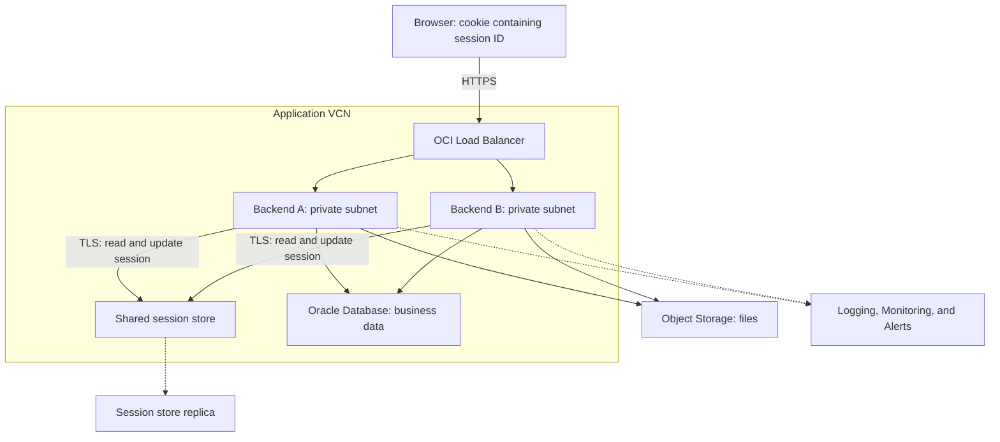
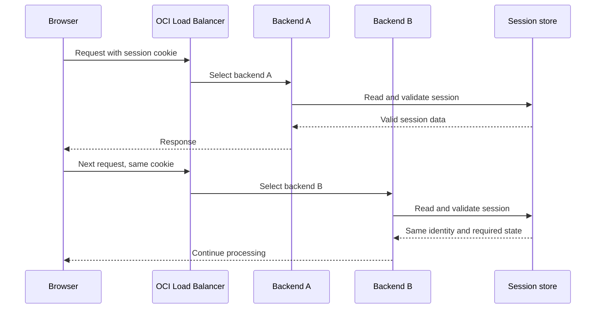

# Designing Stateless Services and Centralized Session Management

## 1. Objectives and Scenario on OCI

In the **High Availability Architecture** chapter of the **CLOUD_PROVIDERS_ORACLE** module, this lesson addresses a concrete requirement: logged-in users must remain able to use the application when requests shift to another server, an instance is replaced, or a new application version is deployed.

Suppose an ordering portal runs on Oracle Cloud Infrastructure (OCI):

- OCI Load Balancer receives HTTPS from browsers.
- Compute instances or pods on Oracle Kubernetes Engine (OKE) process requests.
- A shared session store holds login state.
- Oracle Database persists accounts, recoverable carts, and orders.
- Object Storage stores user-uploaded files.

If login sessions reside only in instance A's RAM, adding instance B is not enough to achieve high availability. Requests routed to B may appear logged out; losing A can wipe out all sessions on A. The design must address state placement, dependency failure behavior, access permissions, and recoverability together.

After this lesson, you will be able to:

1. Identify which state may remain local and which state must be externalized out of the process.
2. Choose an appropriate session management approach among sticky sessions, centralized sessions, and tokens.
3. Design the session store access path inside a VCN, separating infrastructure administration permissions from data access permissions.
4. Explain TTL, session revocation, concurrent update races, and replication limits.
5. Build a deployment, monitoring, and verification plan for replacing backends while preserving sessions.

## 2. What Does Stateless Mean at the Compute Tier?

**A stateless processing instance does not hold the sole copy of state needed by subsequent requests.** Given the same valid request and shared data, another equivalent instance can continue processing without recovering the previous instance's private memory.

The application still has data and login sessions. What changes is where state is stored and how it is accessed.

| State Type | Examples | Appropriate Location |
| --- | --- | --- |
| Ephemeral per-request | Local variables, intermediate computation results | Instance RAM during request processing |
| Reconstructible cache | Product catalog read from database | Local or shared cache with expiration policy |
| Login session | Mapping of session ID to user, authentication timestamp | Shared session store or explicitly designed token mechanism |
| Durable business state | Orders, balances, payment outcomes | Database with proper transactions and constraints |
| Long-lived files | Profile photos, PDF invoices | Object Storage or appropriate shared storage service |
| Long-running job progress | In-progress report export job | Durable job store and job resumption mechanism |

For example, keeping a product-name cache in RAM may be acceptable if losing it only slows down the next read. Holding an unpersisted order in a global variable makes business outcomes depend on a single process staying alive.

Signs an application still depends on local state:

- Logging in succeeds on A, yet hitting B prompts for login again.
- Uploads finish on A, yet B cannot find the file path.
- Rate limits or job locks are enforced only per JVM.
- Scaling in drops shopping carts or aborts long-running tasks.
- Having to copy a session directory from an old server to a new server before deployment.

A useful design check is: **if the current process disappears right after returning success, what data does the next request need and where does it retrieve that data?**

## 3. Why Sticky Sessions Do Not Solve State Loss

Sticky sessions, also called session affinity, try to route requests from the same client back to the same backend. This can help legacy applications during migration, but it does not create a replica of session data.

Example:

```text
1. User logs in via Load Balancer; request is routed to A.
2. A stores session S in RAM.
3. Routing cookie causes subsequent requests to keep going to A.
4. A suffers a hardware failure.
5. Requests are routed to B, but B does not have session S.
```

B can be completely healthy while the user still loses their session.

OCI Load Balancer supports persistence via application cookies or Load Balancer-generated cookies. These two modes are mutually exclusive. When the previous backend becomes unavailable, default behavior can fail over requests to another backend; if fallback is disabled, requests may receive a 502 error. Review these details alongside application behavior during backend switches. [Oracle: Load Balancer Session Persistence](https://docs.oracle.com/en-us/iaas/Content/Balance/Reference/sessionpersistence.htm).

With sessions externalized to a shared store, this lesson's architecture disables cookie persistence on the backend set. The application's login cookie remains; disabling routing cookies does not remove authentication cookies.

## 4. Reference Architecture for Stateless Services



The diagram depicts logical flows; it does not assert that all services are deployed using resources inside a single subnet.

### 4.1. Processing Tier

Backends run matching required configuration versions, session protocols, and data access mechanisms. Absent a specific business reason to differ, backends A and B must be interchangeable.

On Compute, you can manage instance groups and replace instances from consistent images or bootstrap workflows. On OKE, you can use multiple replicas and pod distribution rules. In either case, the scheduler or instance pool cannot automatically fix source code that stores sessions in private RAM.

Distribute backends across the region's actual fault boundaries. In multi-AD regions, consider deploying equivalent backends across different ADs; in single-AD regions, actively spread across fault domains (FDs). FD spread still remains within a single AD. [Oracle: Infrastructure Resilience](https://docs.oracle.com/en/cloud/foundation/cloud_architecture/resilience/infrastructure.html).

### 4.2. Session Store

OCI Cache is one managed service option for in-memory data. A non-sharded cluster has one primary and optional replicas; the service attempts to spread nodes across FDs and ADs where feasible. A sharded cluster partitions data across shards, each with its own primary and replicas. This practice uses the non-sharded model to reduce initial complexity. [Oracle: About OCI Cache](https://docs.oracle.com/en-us/iaas/Content/ocicache/overview.htm).

“Centralized” here means backends share a single authoritative source of session state. It does not mean a single physical server.

Do not assume the session store is durable storage for orders. If exact state recovery after an incident is mandatory, choose a storage mechanism and recovery guarantee matching that requirement.

### 4.3. Networking and Permissions

You can organize resources into an application compartment, separating test and production environments. Deployment teams receive only the administrative permissions needed for their assigned scope.

Reference network paths:

| Flow | Design Rule |
| --- | --- |
| Client → Load Balancer | Open only required listeners and protocols, typically HTTPS |
| Load Balancer → application | Allow the application port from the identified Load Balancer source |
| Application → session store | Allow connections from the backend group; avoid opening to the entire VCN |
| Application → database | Open only the required access path and port |
| Admin tooling → private resources | Use a controlled management path with access auditing |

For OCI Cache, use the service-provided FQDN, keep TLS certificate verification enabled, and configure appropriate private access. Never hardcode node IPs in source code. [Oracle: Connecting to an OCI Cache Cluster](https://docs.oracle.com/en-us/iaas/Content/ocicache/connecttocluster.htm).

Keep three independent questions separate:

1. **Who is allowed to create or modify the cluster?** This is resource administration permission.
2. **Do backends have a network path to the cluster?** This is connectivity.
3. **What data is the client allowed to read and write?** This is data access authorization.

Permission to create a cluster does not prove the app can connect; having a TCP path does not prove the app is authorized to read/write data.

## 5. Choosing a Session Management Mechanism

| Approach | Strengths | Trade-Offs and Applicability |
| --- | --- | --- |
| In-RAM sessions with sticky sessions | Minimal changes to legacy apps | Backend loss easily drops sessions; hard to rebalance and scale in |
| Shared sessions in an in-memory store | Backends interchange easily; fast reads/writes under suitable conditions | Depends on store availability, memory capacity, and recovery behavior |
| Shared sessions in a database | Combines transactional guarantees, durability, and auditing | Increases DB load; requires indexing and expired session cleanup |
| Self-contained signed access tokens | Many requests can verify locally | Requires designing token lifecycle, keys, refresh, and revocation |
| Short-lived access tokens with managed refresh tokens | Balances verification traffic and session control | More components and failure modes to operate |

A signed JWT is not encrypted by default. Never place secrets in the payload merely because the token is signed. If the app requires immediate revocation before token expiration, you must add an authoritative check; at that point, the system still holds shared state.

Similarly, centralized sessions do not mean every microservice directly reads the same session table or keys. A web tier or backend-for-frontend can manage browser sessions while downstream services receive identity via a verified internal protocol. Sharing raw sessions across multiple apps increases blast radius and version coupling.

For this lesson's ordering portal, the baseline choice is:

- Browser sessions use an opaque random ID and a shared session store.
- The database holds authoritative business data and account state.
- Files live outside backend local disks.
- The Load Balancer does not pin clients to an instance.

This is one design option for the stated scenario, not a mandatory rule for all OCI applications.

## 6. Designing Session Data and Lifecycle

### 6.1. Cookies Carry Only an Identifier

The example header below illustrates a session cookie:

```http
Set-Cookie: __Host-OCISESSION=<opaque-random-id>; Path=/; Secure; HttpOnly; SameSite=Lax
Cache-Control: no-store
```

The ID value must come from a cryptographically secure random generator or trusted session library. Avoid user IDs, timestamps, or predictable strings.

The sample cookie omits `Domain` and uses `Path=/` to satisfy the `__Host-` prefix. Choose `SameSite` based on actual flows, especially with cross-domain logins. `Secure`, `HttpOnly`, and `SameSite` protect different aspects; the app still needs CSRF protection for cookie-authenticated actions. [OWASP: Session Management Cheat Sheet](https://cheatsheetseries.owasp.org/cheatsheets/Session_Management_Cheat_Sheet.html).

A cookie still existing in the browser does not prove the session is valid on the server. Conversely, browsers not persisting cookies long-term does not replace server-side expiration policies.

### 6.2. Minimal Session Record

The model below is a framework-agnostic example, not Spring Session's default key format:

```json
{
  "schemaVersion": 1,
  "userId": "u-1058",
  "tenantId": "shop-01",
  "createdAt": "2026-11-21T02:00:00Z",
  "lastSeenAt": "2026-11-21T02:12:00Z",
  "absoluteExpiresAt": "2026-11-21T10:00:00Z",
  "authenticationVersion": 7,
  "version": 3
}
```

Field meanings:

- `schemaVersion` tells readers the data format.
- `userId` and `tenantId` identify the principal and app scope; the server must set them from authentication.
- `createdAt` and `absoluteExpiresAt` enforce maximum session lifetime.
- `lastSeenAt` supports inactivity limits.
- `authenticationVersion` can be compared against authoritative revocation state.
- `version` supports detecting concurrent updates if the store enforces matching conditions.

Do not store passwords, OTPs, card numbers, or entire business entities in the session. For shopping carts, usually store only a reference to the database cart record when durable recovery is needed.

### 6.3. Idle Timeout and Absolute Timeout

Suppose the illustrative policy is:

- Expire after 30 minutes of inactivity.
- Even with continuous activity, require re-authentication 8 hours after creation.

Remaining lifetime at processing time `now` is bounded by:

```text
remainingAbsolute = absoluteExpiresAt - now
newTTL = min(idleTimeout, remainingAbsolute)

If newTTL <= 0: reject session.
If idle timeout exceeded: reject session.
If session is valid: update activity timestamp per policy.
```

Reading a key does not necessarily extend that key's TTL. The application or framework must execute the chosen renewal mechanism.

If reducing writes by renewing only periodically, define the acceptable inactivity drift. Updating timestamps and TTL must also avoid partial updates that leave records alive too long or expire them prematurely.

For a simple single record, you can use a write-with-TTL or an appropriate atomic operation. When a session spans multiple keys, evaluate cross-key atomicity, command support, and constraints of the chosen topology.

The 30-minute and 8-hour values are illustrative policies. Framework idle-timeout settings do not automatically add an absolute timeout; max-age checks must be implemented or configured separately if the product requires them.

### 6.4. Creating, Rotating, and Revoking Sessions

The session creation flow should verify credentials via a dedicated component, generate or rotate the session ID, persist required state, and only then return login success.

After login or privilege changes, rotate the session ID to mitigate session fixation risks. On logout, invalidate the server-side session and clear the cookie with matching scope attributes. [OWASP: Session Management Cheat Sheet](https://cheatsheetseries.owasp.org/cheatsheets/Session_Management_Cheat_Sheet.html).

Immediate revocation requirements must be specified accurately. For example, “log out all devices” can increment an account authentication version in durable storage; any older session carrying a lower version is rejected. If merely deleting keys from an asynchronously replicated cache, factor in the risk of stale state reappearing after recovery.

## 7. Request Processing Flow with Centralized Sessions



The pseudo-code below describes behavior, not complete production code:

```text
handleProtectedRequest(request):
    sessionId = readSessionCookie(request)
    if sessionId is missing:
        return 401

    try:
        session = sessionStore.readFromAuthoritativeEndpoint(sessionId)
    catch dependencyFailure:
        return 503

    if session is missing or session is expired:
        return 401

    if request requires strict revocation check:
        try:
            currentVersion = authoritativeAccountStore.readAuthVersion(session.userId)
        catch dependencyFailure:
            return 503

        if session.authenticationVersion != currentVersion:
            return 401

    checkAuthorization(session.userId, session.tenantId, request.resource)
    result = executeBusinessOperationWithRequiredTransaction()

    touchSessionOnlyIfStillValid(session)
    return result
```

Three points to keep clear:

1. **Inability to reach the store** is different from **reaching the store and finding no session**. The first is typically a dependency failure; the second is an authentication state.
2. Never fall back to creating a local session when identity cannot be verified.
3. If the business operation commits yet the response errors because updating the session failed, the client may retry. Deduplication must protect the business operation independently of the session.

Never catch all exceptions and turn every one into 401. That can turn a session store outage into a thundering herd of re-logins and obscure the operational root cause.

## 8. Illustrative Integration in a Java Application

### 8.1. Example Scope

This example uses Servlet, Spring Boot **3.5.x**, Spring Session, and a Redis client compatible with the chosen OCI Cache engine. The code is presented for learners to integrate into an existing practice app; it is not a standalone buildable project or complete login system.

The app needs real authentication, such as an appropriate Spring Security setup. Never create an endpoint accepting an arbitrary user ID and treat the caller as logged in.

Two additional dependencies commonly used with Spring MVC:

```xml
<dependency>
    <groupId>org.springframework.boot</groupId>
    <artifactId>spring-boot-starter-data-redis</artifactId>
</dependency>
<dependency>
    <groupId>org.springframework.session</groupId>
    <artifactId>spring-session-data-redis</artifactId>
</dependency>
```

Use the BOM from the same Spring Boot release line to manage dependency versions.

### 8.2. Configuration Skeleton for a Non-Sharded Cluster

```yaml
spring:
  data:
    redis:
      host: "<primary-endpoint-fqdn>"
      port: 6379
      ssl:
        enabled: true
      connect-timeout: 2s
      timeout: 2s
  session:
    timeout: 30m
    redis:
      namespace: "oci:orders:lab:session:v1"
      repository-type: default
      flush-mode: on-save
      save-mode: on-set-attribute

server:
  servlet:
    session:
      cookie:
        name: __Host-OCISESSION
        path: /
        secure: true
        http-only: true
        same-site: lax
```

These property names belong to Spring Boot 3.5; when changing release lines, verify against the matching docs. Both connection timeouts are lab starting points only. This block configures session storage and cookies; it does not yet enforce absolute max age or account revocation. [Spring Boot 3.5: Common Application Properties](https://docs.spring.io/spring-boot/3.5/appendix/application-properties/index.html).

Replace the placeholder with the actual primary FQDN and verify DNS, TLS, and network paths from backends. The skeleton omits credentials. If the cluster requires authentication, complete the credential mechanism before testing.

When using OCI Cache IAM authentication, tokens expire and must be refreshed. Clients must use credentials matching OCI Cache configuration and refresh them before reconnecting; pasting a static token into config does not support long-term operations. [Oracle: IAM Authentication for OCI Cache](https://docs.oracle.com/en-us/iaas/Content/ocicache/iam-authentication.htm).

Never disable TLS verification to bypass certificate errors. Nor should session-store auth errors become a reason to open unnecessary network access.

### 8.3. Lab Backend Observation Endpoint

The example below does not perform login. It requires a principal already established by the app's authentication mechanism and an existing session.

```java
import jakarta.servlet.http.HttpServletRequest;
import jakarta.servlet.http.HttpSession;
import java.security.Principal;
import java.util.Map;
import org.springframework.http.CacheControl;
import org.springframework.http.HttpStatus;
import org.springframework.http.ResponseEntity;
import org.springframework.web.bind.annotation.GetMapping;
import org.springframework.web.bind.annotation.RestController;
import org.springframework.web.server.ResponseStatusException;

@RestController
public class SessionProbeController {
    private final String nodeId =
            System.getenv().getOrDefault("NODE_ID", "local");

    @GetMapping("/lab/session/whoami")
    public ResponseEntity<Map<String, String>> whoami(
            HttpServletRequest request,
            Principal principal) {
        HttpSession session = request.getSession(false);

        if (principal == null || session == null) {
            throw new ResponseStatusException(HttpStatus.UNAUTHORIZED);
        }

        return ResponseEntity.ok()
                .cacheControl(CacheControl.noStore())
                .body(Map.of(
                        "user", principal.getName(),
                        "backend", nodeId,
                        "sessionCreatedAt",
                        Long.toString(session.getCreationTime())));
    }
}
```

Set distinct `NODE_ID` values on two backends, such as `backend-a` and `backend-b`. With the same cookie, requests hitting either node must preserve the same user and session creation time while the `backend` field may change.

Never return session IDs or tokens in diagnostic endpoints. Enable the endpoint only in lab environments and restrict who can call it. If the environment has remember-me or automatic IdP re-login, control that behavior during tests so you do not mistake a newly created session for a preserved one.

### 8.4. Data Compatibility Across Versions

When rolling out a new app version while older sessions remain valid, both old and new versions may read session data concurrently. Serializing objects tightly coupled to class layouts can cause deserialization errors when classes change. Spring Session supports custom serializers; format choices must be evaluated alongside actual data and deserialization safety policies. [Spring Session: Redis Configurations](https://docs.spring.io/spring-session/reference/configuration/redis.html).

An application strategy to apply:

1. Prefer small attributes loosely coupled to implementation classes, such as user ID strings.
2. Add new fields in a way older readers still tolerate.
3. Deploy readers that understand both old and new formats before writing only the new format.
4. Remove support for the old format only after old sessions can no longer exist.
5. If forced to change namespaces, explicitly assess session recreation impact and forced re-logins.

Namespaces prevent key collisions. They do not create a security boundary between apps sharing the same store permissions.

## 9. Session Store Availability and Replication Limits

### 9.1. Stateless Compute Still Needs an Available Data Tier

Twenty backends sharing a single non-redundant session store still share a single point of failure. Design must also examine:

- Node redundancy and fault-domain spread of the store.
- Role-change detection and client reconnection capability.
- Headroom, connection limits, and primary load.
- DNS, TLS, and credential failures.
- User-tolerable outage duration.

With OCI Cache, Oracle recommends at least three nodes for a non-sharded cluster requiring HA. In this lesson's session design, reads and writes target the primary to avoid reading stale session state from replicas; this choice is driven by authentication correctness rather than mechanically applying read-scaling optimizations. [Oracle: OCI Cache Client Best Practices](https://docs.oracle.com/en-us/iaas/Content/ocicache/ocicachebestpractices.htm).

Replicas do not guarantee that every acknowledged write survives every failure mode. With Redis asynchronous replication, there is a window of unreplicated data if the primary goes down suddenly. Evaluate actual service mechanics and recovery requirements instead of inferring RPO = 0 from having replicas. [Redis: Replication](https://redis.io/docs/latest/operate/oss_and_stack/management/replication/).

### 9.2. Classifying Impact When Recent Updates Are Lost

| Affected Update | Potential Impact | Design Mitigation |
| --- | --- | --- |
| New session creation | User must log in again | Accept if product allows; track occurrence rate |
| Activity extension | Session expires early | Calculate tolerable drift and verify post-failover |
| Session deletion or revocation | Stale auth state may still be visible | Check authoritative revocation source for strict requests |
| Cart saved only in session | User selections lost | Persist cart durably when recovery is required |
| Payment outcome saved in session | Cannot accurately determine transaction result | Persist transactions in database and use business IDs |

Session RPO can differ from order RPO. Accepting that users re-login does not mean accepting resurrection of a revoked session.

### 9.3. Region Loss and Multi-Region Sessions

Intra-region HA does not guarantee continuity when an entire region is lost. If a standby system exists in another region, align session policy with business data policy.

OCI Cache offers cross-region replication with a read-write primary and a read-only secondary until an appropriate role switch occurs. This replication is asynchronous, so do not interpret it as an arbitrary dual-region active-write session model. [Oracle: OCI Cache Cross-Region Replication](https://docs.oracle.com/en-us/iaas/Content/ocicache/cross-region-replication.htm).

You can choose one of two directions for the application:

- **Re-login after regional failover:** keeps per-region session design simpler while still preserving business data and required revocation policies.
- **Attempt session continuity:** requires replication planning, write-role transfer, endpoint switching, concurrent write control, and handling revocation lag.

This is a UX and authentication-assurance decision. Never point backends across multiple regions to a single distant session endpoint and consider disaster recovery complete.

## 10. Concurrent Updates and Business Correctness

### 10.1. One User Can Trigger Parallel Requests

A browser may fire multiple API calls concurrently, or a user may open multiple tabs:

```text
A reads session version=10, cartCount=2.
B reads session version=10, cartCount=2.
A increments cartCount to 3 and writes back.
B updates preferredLanguage and writes back the entire stale session copy.
Result: cartCount may revert to 2.
```

Mitigations depend on data type:

- Write only changed attributes when the framework supports it.
- Use atomic increments for appropriate counters.
- Use optimistic locking or compare-and-set when updates require version preconditions.
- Move constrained business data into the database.
- With nested objects, understand how the framework tracks dirty changes.

Simply having a `version` field is not enough. The store must atomically enforce “write only if the current version still matches.”

### 10.2. Logout While Another Request Is In Flight

A request may read a session before logout and write back after logout deleted the session. Unconditional write-back can accidentally resurrect stale state.

Define clear semantics:

- Should a request started before revocation be allowed to complete?
- Do sensitive operations require a revocation check right before commit?
- Should an invalidated session ever be recreated by a touch operation?

For custom session handling, use generations, revocation flags, and conditional updates. For frameworks, understand invalidation and concurrency behavior in the chosen repository. Strict revocation requirements need a check source matching the desired consistency level.

### 10.3. Sessions Do Not Replace Idempotency

Suppose a backend successfully commits an order, then the client connection drops. The user resubmits the create-order request. Even though the session remains valid, the system can create two orders without deduplication.

The standard pattern is an idempotency key tied to the user and operation. The database enforces a unique constraint; business processing and storing the outcome under that key must be coordinated within an appropriate transaction. Duplicate requests receive the recorded result or a deterministic processing status.

Never store idempotency keys solely in backend RAM. Nor treat a temporary session lock as proof that payment executes at most once across all failure modes.

## 11. Behavior During Errors, Timeouts, and Health Checks

### 11.1. Responses by Incident Type

| Scenario | Reference Behavior |
| --- | --- |
| One backend removed from serving | Surviving backends use shared store to continue sessions |
| Missing cookie on auth-required API | Return 401 or redirect to login flow per UI |
| Store reports expired/missing session | Treat as unauthenticated; clear cookie per policy |
| Timeout reading session store | Return dependency error, typically 503 for authenticated APIs |
| Failure saving session during login | Do not return login success if session was not persisted |
| Store unreachable yet public pages need no session | Continue serving public routes |
| Database error during order creation | Never report success just because the session is readable |
| Store credentials expired | Alert and renew per procedure; never fall back to RAM sessions |

These HTTP codes are reference policy. Browser flows may use redirects, but should avoid making session store outages look like wrong user passwords.

### 11.2. Timeouts Must Fit Within the Request Budget

Suppose an API has a 1-second latency budget; configuring a 2-second wait on the session store is already misaligned. Allocate budget across connecting, reading the session, business queries, writing the session, and returning the response.

Retries must:

- Have a total time cap.
- Use backoff and jitter where appropriate.
- Distinguish safe-to-retry operations from operations with side effects.
- Account for automatic library retries to avoid multiplying attempts.

If a timeout happens after the server received a write command, the client cannot tell whether it executed. Never assume “timeout means not written.”

### 11.3. Liveness and Readiness Serve Different Purposes

- **Liveness** indicates whether the process needs to be restarted.
- **Readiness** indicates whether the instance should receive expected traffic.

If the entire session store is temporarily unreachable, failing liveness on every process can cause restart loops without fixing the dependency. If readiness depends on the store, plan for all backends marking themselves unready and how the outer layer responds.

You can maintain a lightweight probe endpoint for the Load Balancer alongside a separate synthetic check exercising login, session read, and API calls. Choose health check mechanics matching the resource; avoid creating a new session on every probe.

Long-lived connections like WebSockets still hold connection state at the backend. When a node dies, clients must reconnect and recover application state per protocol; externalizing HTTP sessions does not migrate an open TCP socket to another host.

## 12. Rolling Deployments, Scale-Out, and Scale-In

### 12.1. Adding Backends

New backends need the right image or container version, network path, TLS trust, namespace configuration, and valid credentials before receiving requests.

When multiple instances boot simultaneously, avoid opening excessive concurrent connections to the session store. Reuse connections and cap concurrency per client library behavior; do not open a new connection per request unless required by the client model.

Once a node is ready, add it to Load Balancer rotation. Shared sessions allow the new node to serve logged-in users without copying memory from old nodes.

### 12.2. Removing Backends

Reference rollout sequence:

1. Mark the node not to receive new requests using the active orchestrator mechanism.
2. Wait for in-flight requests to finish within the allowed grace period.
3. Stop the process or terminate the instance.
4. Verify surviving backends have enough capacity and users keep their sessions.

For OCI Load Balancer, draining behavior interacts with persistence: a draining backend may still serve already-pinned sessions. Verify actual configuration when operating legacy apps that still rely on sticky sessions. [Oracle: Load Balancer Session Persistence](https://docs.oracle.com/en-us/iaas/Content/Balance/Reference/sessionpersistence.htm).

With persistence disabled as in this lesson, preserving sessions does not require waiting for every user to log out. However, in-flight requests and long-running tasks must still be handled per design.

### 12.3. Leaving Capacity Headroom for Node Loss

Suppose three equal-capacity backends split traffic roughly evenly, each running around 40% capacity. If one node is lost:

```text
Estimated utilization after incident
= 40% × 3 / 2
= 60% per surviving node
```

This is a linear planning estimate, not a substitute for load testing. Latency and queuing can grow nonlinearly; the database or session store can also hit limits before CPU does.

Likewise, when rolling deployments reduce serving node count, the system must have enough headroom for that reduction. Reactive autoscaling after an incident does not fully replace immediate spare capacity.

## 13. Session Capacity, Performance, and Cost

### 13.1. Memory Estimation

Suppose there are 50,000 active sessions, average app data is 2 KiB per session, and measured overhead factor is 1.7:

```text
Estimated dataset size
= 50,000 × 2 KiB × 1.7
≈ 166 MiB
```

This figure excludes other memory consumers such as buffers, connection structures, and operational headroom. With replicas holding the full dataset in a non-sharded cluster, do not divide 166 MiB by node count to estimate per-node memory demand.

Measure in practice because frameworks can create multiple keys, metadata, indexes, or notifications per logical session. Session count also includes unexpired idle sessions, not just users actively clicking in the UI.

### 13.2. Operation Rate Estimation

With 1,000 session-authenticated requests/second and each request triggering one read and one renewal, the baseline estimate is roughly 2,000 operations/second. Real libraries may issue extra commands or batch them; observe actual load instead of treating this formula as exact.

Well-grounded ways to reduce cost and load:

- Do not create sessions for public pages or stateless APIs.
- Limit payload size inside sessions.
- Avoid rewriting the entire structure when only one attribute changes.
- Choose a renewal cadence aligned with required expiration precision.
- Measure load before adding replicas or moving to sharding.
- Clean up lab resources after completion.

Adding read replicas does not increase a single primary's write capacity. Moving to a sharded cluster also requires compatible clients and multi-key handling, not just changing a hostname.

### 13.3. Memory Exhaustion Is a Session Incident

If eviction removes an active session key, users may be forced to log in earlier than expected. If eviction is disabled, new writes may fail when memory fills up. Pick the right eviction policy and alert before hitting limits.

Separate session workloads from large data caches when they have different operational requirements. Using different database indexes or prefixes separates key names only; they can still contend for the same memory, CPU, and failure domain.

## 14. Monitoring from the User Perspective

A dashboard showing only backend CPU does not tell you whether the system is preserving sessions.

| Observation Group | Required Metrics or Signals | Meaning |
| --- | --- | --- |
| Session experience | Session continuity rate, abnormal re-login counts | Detects dropped sessions even while backends stay alive |
| API | p95/p99 latency, 5xx and 401 rates by route | Separates dependency errors from normal expirations |
| Session store | Read/write latency, timeouts, auth errors, connection errors | Assesses the session access path |
| Capacity | Session count, average size, memory usage, evictions | Forecasts overload and out-of-memory events |
| Orchestration | Active backends, drain duration, restarts, rollouts | Correlates infra changes with user errors |
| Revocation | Logout test results, permission changes, account disablement | Verifies authentication policy |

You can forward app logs and metrics into OCI Logging, Monitoring, and Alarms per environment configuration. Use actual metric names of chosen resources when creating alarms; names in the table above are observability requirements, not a list of OCI API metric names.

A useful synthetic check logs in with a test account, calls a protected API through the Load Balancer, confirms the backend changes while the session persists, then logs out and verifies subsequent requests are rejected.

Never log raw cookies, session IDs, or tokens. To correlate events, use dedicated correlation IDs or keyed hashes per internal policy. Avoid using user IDs or session IDs as metric dimensions, which causes high cardinality and potential exposure.

Set alerts around baselines, SLOs, and product error budgets. Never treat a generic CPU threshold as a proxy for login quality.

## 15. Hands-On: Deploying and Verifying on OCI

### 15.1. Preparation

In an authorized lab environment:

1. Prepare a suitable compartment and VCN, plus a management path to private backends.
2. Prepare at least two backends with distinct `NODE_ID`s and consistent app configuration.
3. Distribute backends across usable ADs/FDs.
4. Prepare a shared session store with the redundancy level to verify.
5. Configure endpoints, TLS, data permissions, and matching credentials.
6. Create a Load Balancer with HTTPS, backend set, and health checks; disable cookie persistence for this test.
7. Use the same session namespace across backends of the lab app.
8. Enable logging and session-store error visibility before injecting faults.

Never use the production namespace for a lab. Never bake credentials into images or commit them with example configs.

### 15.2. Verifying the Baseline Flow

Log in through the application's real authentication flow. Then call `/lab/session/whoami` using the same browser cookie jar.

You can use the following illustrative command on a host with `curl`; `APP_URL` points to the Load Balancer HTTPS URL, and `cookies.txt` is the cookie jar obtained from the lab login flow:

```bash
curl --fail-with-body \
  --cookie cookies.txt \
  --cookie-jar cookies.txt \
  "$APP_URL/lab/session/whoami"
```

The cookie jar contains session secrets; protect it and delete it after the lab. This command only illustrates a post-login request; it does not execute authentication itself.

Do not assume two consecutive requests automatically land on two different backends. Balancing policy, keep-alive connections, and backend health may route both to the same node. Verify via `NODE_ID`; when deterministic verification is needed, use lab controls to shift traffic to the other backend.

Expected results:

- Same user account and same session creation timestamp in the response.
- Different backends still serve the session.
- No copying of session files or memory between the two nodes.

### 15.3. Test Matrix

| Lab Test | Execution | Expected Observation |
| --- | --- | --- |
| Switch backend | Remove serving node from rotation and retry with same cookie | Surviving node validates the same session |
| Add backend | Scale up properly configured nodes | New node serves existing sessions |
| Restart one backend | Restart process on test node | No sessions lost solely from clearing node RAM |
| Block path to store | Temporarily block connection from one backend in lab | Dependency error detected; session not accepted locally |
| Store role switch test | Use service-supported mechanism in test env | Measure outage window, reconnects, and post-recovery session state |
| Idle timeout expiration | Send no requests for configured duration | Protected API rejects expired session |
| Absolute timeout expiration | Use shortened lab setting while sending regular requests | Session still expires at implemented max age |
| Logout | Log out then call again with old cookie | Old session rejected per policy |
| Concurrent updates | Send parallel operations with test data | No lost critical updates or resurrected revoked sessions |
| Rolling deployment | Run old and new versions concurrently | No session read errors from format differences |

Never conclude HA is satisfied solely because one test run showed zero errors. Record success rate, outage duration, affected session types, and limits of the tested scenario.

For tests involving loss of the latest data in the store, separately check newly created sessions and recently revoked sessions. Those two groups carry different risk profiles.

### 15.4. Lab Completion Criteria

The practice succeeds when there is evidence that:

- An active session continues on another backend after removing the old node.
- No essential data resides solely in backend RAM or local disk.
- Store access failures do not create an authentication bypass.
- Expiration and revocation behave according to documented policy.
- Rollouts do not break active session serialization formats.
- Outage duration has been measured and store recovery limits are understood.
- Mechanisms exist to detect dropped sessions, overload, and credential failures.

After testing, restore network rules, remove diagnostic endpoints if no longer needed, and clean up lab resources to control costs.

## 16. Decisions to Document in the Design

An implementation design should concisely answer the following:

| Question | Example Answer for the Ordering Portal |
| --- | --- |
| What state stays on backends? | Only per-request variables and reconstructible caches |
| Where is the authoritative session data? | Shared store via the designated endpoint |
| What does the cookie contain? | Opaque session identifier, no business data |
| How long does a session live? | 30-minute idle; 8-hour absolute max age implemented separately |
| Are sticky sessions used? | Not needed for HTTP flows with externalized sessions |
| What happens when the session store fails? | Protected APIs return dependency errors; no RAM session fallback |
| Is losing very recent sessions after failure acceptable? | Must be decided by product and verified |
| How is immediate revocation enforced? | Via an authoritative check source for applicable requests |
| Where is business data stored? | Oracle Database; files in Object Storage |
| What happens on regional loss? | Explicitly designed re-login or session-continuity policy |
| How is cost controlled? | Measure session size, op rates, spare capacity, and lab resources |

The value of stateless services lies in making backends replaceable and scalable independently of any single process's memory. To achieve high availability on OCI, the design must continue addressing the shared session source, business correctness, and user-visible behavior during system failures.
