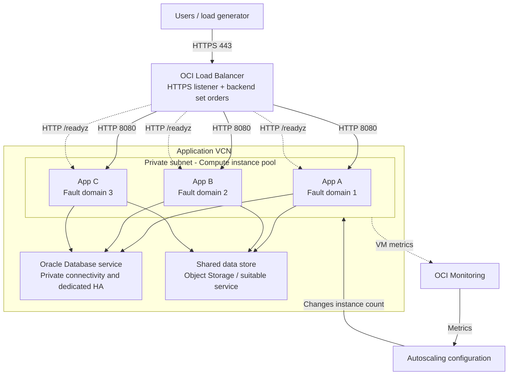
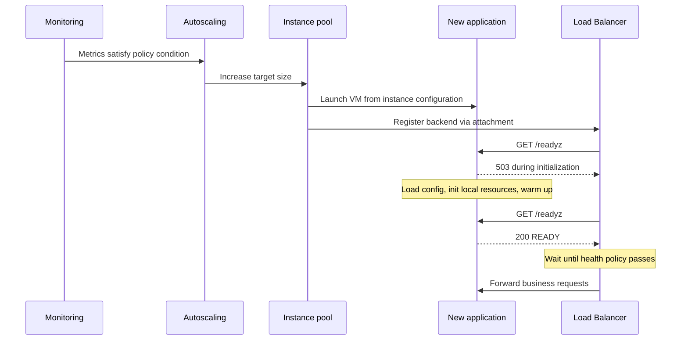

# Combining Autoscaling, Load Balancing, and Health Checks

An application cluster can provision additional virtual machines yet still return errors if newly launched hosts receive requests before finishing startup. Conversely, a load balancer can remove failed hosts accurately yet leave surviving hosts without enough capacity to serve. High-availability architecture must coordinate all three mechanisms: capacity scaling, traffic distribution, and determining which backends are able to serve.

In the Oracle Cloud Infrastructure (OCI) module, this lesson places that coordination inside a realistic system: a Compute instance pool inside a VCN, protected by IAM and network rules, receiving traffic via OCI Load Balancer, backed by shared storage and Oracle Database. The objective is to operate infrastructure with monitoring, automation, and cost limits while understanding each component's fault scope.

## 1. Three Mechanisms Answer Three Different Questions

| Mechanism | Question to Answer | Primary Action | What Cannot Be Inferred from This Mechanism Alone |
| --- | --- | --- | --- |
| Autoscaling | How many instances are needed to serve load? | Adjust instance pool size per policy | That new instances are ready to serve business requests |
| Load balancing | Which backend should receive the next request? | Distribute traffic across a backend set | That backends have enough capacity if the whole cluster is overloaded |
| Health checks | Does this backend pass the defined serving check? | Signal whether to remove or return a backend in rotation | That the underlying root cause is fixed or the VM was replaced |

In OCI Load Balancer, health checks attach to a backend set. When a backend fails checks, it is temporarily removed from distribution; when it passes again, it can be returned to service. Health checks can inspect TCP connectivity or HTTP responses. [Oracle: Health Check Policies for Load Balancers](https://docs.oracle.com/en-us/iaas/Content/Balance/Tasks/load_balancer_health_management.htm).

Track three separate counts:

- **Pool target size**: the number of instances the manager is trying to maintain.
- **Running instance count**: VMs that have reached the corresponding infrastructure state.
- **Actively serving backend count**: healthy backends not set offline or draining, with proper routing configuration.

For example, a pool targets 5 instances, all 5 VMs are running, yet only 3 backends pass the HTTP readiness check. Serving capacity at that moment must be calculated from 3 backends. Never report “we have 5 machines so we have enough capacity.”

A deadlocked Java process can still sit on a running VM. If pool-wide CPU does not trigger scale-out, a backend turning unhealthy does not automatically trigger adding instances. Process recovery, instance replacement, and capacity scaling are distinct workflows that must be designed explicitly.

## 2. Reference Architecture on OCI

Suppose the system exposes an ordering API over HTTPS. The application can run multiple replicas and order data is stored in Oracle Database.



The diagram separates the user data flow from the control flow. Autoscaling does not sit on the path of individual requests. It adjusts pool membership count; the load balancer uses the backend list and health check results to route traffic.

This lesson uses OCI Load Balancer for HTTP/HTTPS applications. If choosing Network Load Balancer, redesign around that service's semantics; do not copy Load Balancer's HTTP, cookie, or TLS handling verbatim.

### 2.1. Attaching the Pool to a Backend Set

Create an instance configuration describing the machine template, then create an instance pool attached to the load balancer, backend set, application port, and appropriate VNIC. When instances are added to an attached pool, OCI automatically registers them in the backend set. Backends should receive traffic only after passing configured health checks. [Oracle: Creating Instance Pools](https://docs.oracle.com/en-us/iaas/Content/Compute/Tasks/creatinginstancepool.htm).

This attachment avoids manually registering individual IP addresses after every scale-out. Still, verify:

- The backend set used by the listener is the exact backend set the pool registers into.
- The attachment port is the application port, such as 8080, not the listener's HTTPS 443 port.
- The selected VNIC has a network path to the load balancer.
- The launch process actually boots the intended application and configuration version.

If you only registered the initial three VMs manually in the backend set and forgot to attach the pool, newly scaled-out VMs can run without ever receiving traffic.

### 2.2. Fault Isolation Scope and Shared State

Distribute instances across fault domains and, when a region offers multiple suitable availability domains, consider multi-AD placement. A cluster of multiple VMs inside a single fault domain can lose availability together. Do not assume every OCI region has the same number of availability domains.

The application must continue working when any instance leaves the cluster:

- Sessions must have an appropriate sharing or recovery mechanism rather than relying solely on one VM's RAM.
- Uploaded files and business data must be stored durably outside ephemeral instance disks.
- Background jobs need a resumption mechanism and duplicate-execution protection when a worker is terminated.
- Logs must be shipped to centralized collection so incidents remain investigable after scale-in.

Scaling out the app tier does not replicate Block Volume data, fail over the database, or create a multi-region DR architecture. Those components require separate plans.

## 3. Proper Lifecycle of a New Backend

A scale-out must pass through this full sequence:



The completion order of backend registration and application startup can vary across launches. The design must be safe even if the load balancer begins probing while the app is still initializing.

Readiness conditions can include:

1. Required configuration has been loaded and validated.
2. Components needed to process requests have finished initializing.
3. The instance can reach mandatory dependencies within acceptable timeouts.
4. The application is not in maintenance mode or draining.

If bootstrapping starts a web server returning 200 immediately before downloading the application, health checks hitting a default page can give a false positive. New hosts will then receive traffic before being ready.

Prefer pre-baked images or artifacts, idempotent bootstrap scripts, and explicit application versions. Avoid downloading excessive packages from the Internet at boot time, since variable provisioning times make scale-out behavior unpredictable.

## 4. Designing Meaningful Health Endpoints

### 4.1. Distinguishing Liveness, Readiness, and External Checks

These meanings are chosen by application architecture; path names in the table are illustrative conventions.

| Check | Example Endpoint | Meaning | Appropriate Place to Use |
| --- | --- | --- | --- |
| Liveness | `/livez` | Process is alive and capable of continuing | Process supervisor or separately configured recovery mechanism |
| Readiness | `/readyz` | Instance can accept new requests | Backend set HTTP health check |
| Synthetic transaction | A controlled read/write operation | User flow works across DNS, TLS, listener, app, and dependencies | Independent monitoring outside the serving path |

Do not let liveness fail solely because an external system has a brief blip. If all instances restart simultaneously due to a shared database glitch, recovery slows down and creates a connection storm when the database returns.

Nor should readiness call the entire ecosystem with heavy queries on every probe. Select truly mandatory dependencies, set short timeouts, and use recent cached check outcomes when appropriate. A failing product recommendation service may allow the ordering API to continue serving in degraded mode.

Example simple response:

```http
HTTP/1.1 200 OK
Content-Type: text/plain
Cache-Control: no-store

READY
```

During initialization or shutdown preparation:

```http
HTTP/1.1 503 Service Unavailable
Content-Type: text/plain
Cache-Control: no-store

NOT_READY
```

Endpoints must never expose passwords, database connection details, or stack traces. If using body regex matching, align exact output including newlines.

### 4.2. Healthy TCP Does Not Mean a Healthy App

A TCP health check proves a connection can be established to the chosen port. It may fail to detect an API returning business errors or an app that opened its socket before finishing data initialization.

For HTTP APIs, a dedicated readiness endpoint usually reflects serving readiness better than a TCP check. Even so, a 200 readiness response only proves what that endpoint checks. It does not guarantee every API and data path is working.

If all backends turn unhealthy together, distinguish a shared failure from per-host failures. Inspect the database, internal DNS, secrets, certificates, config changes, and network paths before adding VMs or replacing instances en masse.

## 5. Illustrative Health Check Policy

Suppose the application serves HTTP on port 8080 and returns exact body `READY` when ready:

| Parameter | Illustrative Value | Reason for Choice |
| --- | --- | --- |
| Protocol | HTTP | Verifies application state |
| Port | 8080 | Matches backend serving path |
| URL path | `/readyz` | Clear readiness semantics |
| Expected status | 200 | Does not treat redirects or errors as healthy |
| Response body regex | `^READY$` | Avoids accepting an unrelated 200 page |
| Interval | 10,000 ms | Periodic probing; measure real overhead |
| Timeout | 3,000 ms | Prevents probes from hanging too long |
| Retries | 3 | Avoids flapping on a single transient error |

OCI lets you configure these parameters when creating a backend set; `retries` also governs recovery back to healthy. This is an illustrative configuration, not optimal settings for every system. [Oracle: Creating a Load Balancer Backend Set](https://docs.oracle.com/en-us/iaas/Content/Balance/Tasks/managingbackendsets_topic-Creating_Backend_Sets.htm).

Short intervals detect issues sooner at the cost of higher probe traffic and noise sensitivity. Too short a timeout can eject a host over a brief JVM pause. Too long a timeout delays recognizing a hung backend.

With a 10-second interval and 3 retries, budget detection on the order of tens of seconds rather than treating it as instantaneous. Never use `interval × retries` as an SLA commitment: failure timing relative to the probe schedule, timeouts, and state transitions all affect timing.

Also distinguish probe cadence from UI display freshness. Oracle notes that aggregated health status summaries update on a three-minute cycle. During tests, cross-check probe logs, request logs, and client results instead of watching Console status colors alone. [Oracle: Understanding Load Balancer Health Issues](https://docs.oracle.com/en-us/iaas/Content/Balance/Tasks/understanding_health_issues.htm).

### 5.1. Network Paths for Requests and Probes

A simple setup within the same VCN might use:

| Flow | Required Design-Level Rule |
| --- | --- |
| Client to listener | Allow TCP 443 to the load balancer from accepted client sources |
| Load balancer to application | Allow TCP 8080 from load balancer NSG to application NSG |
| Application to database | Allow only the database port from the accessing application group |
| Load generator to private backends | Allow only for testing, from explicitly identified sources |

Verify ingress, egress, route tables, and OS firewalls together. With stateless rules, design return paths too. If using TLS on the load-balancer-to-backend leg, configure connections and health checks to match.

A common mistake is binding the app only to `127.0.0.1`: local checks on the VM pass while the load balancer cannot connect to the private IP.

## 6. Designing Autoscaling for Predictable Response

This lesson uses a CPU-based policy so behavior is easy to observe and reproduce. First verify whether CPU correlates with application load. APIs blocked waiting on a database can grow slow even at low CPU.

For the VM-metric-based autoscaling flow documented by Oracle, data is aggregated in one-minute intervals and averaged across instances in the pool; three consecutive threshold breaches trigger an action. Cooldown starts once the pool reaches `Running` state. Do not equate the metric evaluation window with application startup time. [Oracle: Autoscaling](https://docs.oracle.com/en-us/iaas/Content/Compute/Tasks/autoscalinginstancepools.htm).

### 6.1. Starting Parameter Set

The values below are for the practice lab and must be tuned after load measurement:

| Property | Value |
| --- | --- |
| Minimum instances | 3 |
| Initial instances | 3 |
| Maximum instances | 8 |
| Metric | CPU utilization |
| Scale-out | Average CPU >= 65%, add 2 instances |
| Scale-in | Average CPU <= 30%, remove 1 instance |
| Cooldown | 300 seconds |

OCI lets you configure initial, min, max, and scale-out/scale-in rules. Minimum cooldown for metric-based autoscaling is 300 seconds; tenancy service limits can still cap created instances. [Oracle: Creating a Metric-based Autoscaling Configuration](https://docs.oracle.com/en-us/iaas/Content/Compute/Tasks/autoscaling-create-metric-based_tabs.htm).

The gap between 30% and 65% creates a hysteresis deadband, reducing oscillation around a threshold. Adding 2 and removing 1 reflects prioritizing faster capacity addition over removal. These are example design choices to validate with real data.

Scenarios to plan ahead for:

- At 7 instances, adding 2 must obey the max limit of 8.
- At min 3, low load must not shrink the pool to 2.
- If max is reached while latency still climbs, emit alerts and enforce load control.
- When metrics are missing, investigate telemetry collection; never treat missing data as 0 load.
- Pool averages can mask a single overloaded instance caused by heavy requests or sticky sessions.

CPU, memory, request rate, and queue depth are not interchangeable names you can drop into the same config field. OCI provides Compute Agent metric sources and supports custom MQL queries in the current autoscaling schema; if switching to a custom query, configure the proper source, namespace, query, and sustained duration. This example keeps Compute Agent CPU metrics. [Oracle: Auto Scaling Configuration resource](https://docs.oracle.com/en-us/iaas/tools/terraform-provider-oci/latest/docs/r/autoscaling_auto_scaling_configuration.html).

### 6.2. Time to Add Useful Capacity

This can be modeled approximately as:

```text
T_provision =
    T_condition_detection
  + T_decision_and_VM_allocation
  + T_app_initialization
  + T_health_check_pass
```

This is a lesson analysis model, not an OCI SLA formula. Some steps may overlap; measure real durations.

Hypothetical example:

| Time Since Load Increase | Event |
| --- | --- |
| Second 0 | Load begins rising |
| Around second 180 | Enough samples breach threshold and scale-out triggers |
| Around second 330 | New VMs are provisioned and booted |
| Around second 380 | New app instances finish initialization |
| Around second 410 | New backends satisfy the health policy and serve |

Thus the system may need over six minutes before receiving useful additional capacity. During that wait, existing backends carry the load. Spare capacity, concurrency limits, bounded queues, and controlled errors each play a role.

Cooldown prevents rapid oscillation, yet does not replace readiness. If the pool reports `Running` while the app is still warming up, the load balancer must still block unready backends.

If traffic follows predictable schedules, consider schedule-based autoscaling to add capacity ahead of peak hours. Pick the appropriate policy model rather than assuming arbitrary independent autoscaling configs can all bind cleanly to one pool.

## 7. Setting Min and Max from Fault Capacity

### 7.1. Calculating Remaining Capacity After a Failure

Suppose load testing determines each backend safely serves 120 requests/second within chosen latency and error-rate targets. Baseline load is 240 requests/second.

Let:

- `N`: healthy backends before failure.
- `f`: backends potentially lost in the analyzed scenario.
- `q_safe`: measured safe capacity per backend.
- `lambda`: load to serve.

Simple condition:

```text
(N - f) × q_safe >= lambda
```

With `f = 1`:

```text
(N - 1) × 120 >= 240
N >= 3
```

Min 3 satisfies losing one backend in this model. Two backends barely cover baseline load only when both are healthy, leaving zero margin for one failure.

This calculation assumes equivalent backends and balanced load distribution. If losing an entire availability domain removes two instances, use `f = 2`. If the database is the bottleneck, backend capacities do not add linearly. Also add headroom for request bursts, warm-up, and measurement error.

### 7.2. Setting Max from Database Limits and Cost

Max should never be chosen simply as “as high as possible.” One critical constraint is database connections:

```text
Max_app_connections =
    Max_instances × Connection_pool_per_instance
```

With max 8 and up to 25 connections per instance, the app can demand 200 connections. Suppose the database grants a 300-connection budget for the whole system; the remainder must still cover background jobs, operations, and other apps.

If each instance keeps a 50-connection pool, the same max 8 can generate 400 connections. Scaling out could then worsen a database incident. Bound concurrency, connection timeouts, and connection creation rates during startup.

Growth ceilings also depend on:

- Service limits and compartment quotas.
- Shape allocation capacity in the chosen placement.
- Available IP addresses in the subnet.
- Load balancer bandwidth and connection capacity.
- External service, storage, and database limits.

Max 8 caps instance count in the policy, not the total bill. Costs also include load balancers, boot volumes, storage, logs, and network traffic. Budget alerts help detect spend; never treat budget notifications as an automatic hard stop on charges.

## 8. Scale-In Requires a Graceful Departure Workflow

Scale-in removes active serving members, making it harder than lowering a number. A VM may be processing a payment, holding a WebSocket, or running a long job.

Design workflow:

1. Identify the instance selected to leave the pool.
2. Start draining and stop accepting new background jobs.
3. Wait for in-flight requests to complete within the allowed grace period.
4. Hand off or checkpoint unfinished work.
5. Close resources, ship required logs, then allow termination to proceed.

With OCI Load Balancer, drain mode stops forwarding new TCP connections and new non-sticky HTTP requests to the backend. Because sticky traffic behaves differently, check app session persistence; never assume enabling drain instantly halts all new requests. Offline mode pulls the backend from traffic, which is not equivalent to a full graceful shutdown workflow. [Oracle: Editing a Load Balancer's Backend Server](https://docs.oracle.com/en-us/iaas/Content/Balance/Tasks/update_backend_server.htm).

### 8.1. Coordinating with Pre-Termination Lifecycle Actions

OCI instance pools offer pre-termination lifecycle actions: the instance pauses in `TerminationAwait` so the application or automation can run cleanup before deletion. Termination resumes when a continue action is sent or the timeout expires. Configure boot volume and block volume handling explicitly on timeout. [Oracle: Managing Instance Pools Lifecycle](https://docs.oracle.com/en-us/iaas/Content/Compute/Tasks/instance-pools-lifecycle.htm).

The lifecycle action provides a coordination window; the engineering team must still build detection of awaiting instances, draining, monitoring in-flight requests, and sending completion confirmation. Merely enabling the wait hook does not implement graceful exit logic.

Example timeout choices:

- Normal synchronous requests take up to 20 seconds.
- Allow up to 60 seconds to drain and finish requests.
- Reserve extra time to flush logs, close connection pools, and send confirmation.
- Set the lifecycle timeout larger than the total expected work budget, with handling for automation failures.

Never use infinite waits. WebSockets and long jobs need reconnection protocols or checkpoints. Order creation requests need idempotency keys or equivalent business constraints so client retries do not duplicate orders.

### 8.2. Putting a Backend into Maintenance via CLI

The example below uses PowerShell for a normal backend with weight 1, not a backup backend. Retrieve the exact backend name from the list output; never guess a private IP.

```powershell
$lbId = '<LOAD_BALANCER_OCID>'
$backendSetName = 'orders'

oci lb backend list --load-balancer-id $lbId --backend-set-name $backendSetName

$backendName = '<BACKEND_NAME_FROM_LIST_OUTPUT>'

oci lb backend update --load-balancer-id $lbId --backend-set-name $backendSetName --backend-name $backendName --backup false --drain true --offline false --weight 1 --wait-for-state SUCCEEDED
```

Flags `backup`, `drain`, `offline`, and `weight` in the update command must match the backend's current settings. This example uses concrete values for illustration, not a command to run blindly on every backend. [Oracle CLI: Update backend](https://docs.oracle.com/en-us/iaas/tools/oci-cli/latest/oci_cli_docs/cmdref/lb/backend/update.html).

After the work request succeeds, observe in-flight requests on the app. Success of the config update API does not prove all old requests have finished.

If the backend was merely taken down for maintenance and will return, clear drain once the app is healthy using the same command with `--drain false`. During scale-in, follow the pool's lifecycle workflow to proceed with instance termination.

## 9. Preparing Permissions and Operational Readiness

Before deployment, identify compartments holding networking, load balancer, pool, autoscaling, and app resources. Separate permissions across three groups:

| Principal | Permission Need |
| --- | --- |
| Deployer or pipeline | Create and update infrastructure resources within assigned scope |
| Application instances | Access required secrets, artifacts, and data |
| Recovery or scale-in automation | Read state, update the right backend, and complete instance lifecycle actions |

Design IAM around compartments and actual required actions; never grant VMs tenancy-wide admin rights by default. If using instance principals, dynamic group matching rules must automatically cover new instances launched by the pool. A rule listing only the initial three OCIDs will prevent scaled-out hosts from fetching secrets.

Verify monitoring plugins and metric emission paths on new hosts. A cluster serving HTTP without emitting metrics can prevent autoscaling from firing as expected.

In private subnets, bootstrapping also needs paths to fetch artifacts, secrets, and packages. Use Service Gateway or NAT per target service and network policy; never attach public IPs to the entire app tier just to avoid designing this path.

## 10. Hands-On Deployment Sequence

This procedure targets a resource-bounded learning environment. Infrastructure changes are executed by learners inside a practice compartment.

### Step 1: Define Serving Criteria

Choose upfront:

- Latency target, e.g., p95 under 500 ms for the defined workload.
- Acceptable steady-state error rate.
- Target maximum time to isolate a failed backend.
- Target maximum time to bring an additional backend into rotation.
- Remaining capacity required when losing one backend.

These numbers are measurement criteria for the lab, not OCI service commitments.

### Step 2: Prepare the Application and Instance Configuration

The application must expose `/readyz`, log startup timestamps, and provide a way to identify which instance served a request. In a lab environment, you can add a non-sensitive instance header.

Create an instance configuration with explicit image, shape, network config, bootstrap, and artifact version. Ensure a fresh VM boots completely on its own without manual SSH fixes.

If every scale-out requires an operator to SSH in and start the app, the backend provisioning pipeline is incomplete.

### Step 3: Create Load Balancer and Backend Set

Create an HTTPS 443 listener with an appropriate certificate. Create backend set `orders` targeting the app over HTTP on port 8080 with the designed health check.

Example updating the health policy via OCI CLI in PowerShell:

```powershell
$lbId = '<LOAD_BALANCER_OCID>'
$backendSetName = 'orders'

oci lb health-checker update --load-balancer-id $lbId --backend-set-name $backendSetName --protocol HTTP --port 8080 --url-path '/readyz' --return-code 200 --response-body-regex '^READY$' --interval-in-millis 10000 --timeout-in-millis 3000 --retries 3 --wait-for-state SUCCEEDED
```

This command applies a plaintext HTTP health check policy for the backend leg in the example. If using TLS to backends or different health settings, preserve options matching that design. [Oracle CLI: Update health checker](https://docs.oracle.com/en-us/iaas/tools/oci-cli/latest/oci_cli_docs/cmdref/lb/health-checker/update.html).

### Step 4: Create the Pool and Verify Auto-Registration

Create an initial 3-instance pool with appropriate placement and attach it to backend set `orders`, port 8080, and the designed VNIC.

Verify simultaneously:

- The pool reaches the expected instance count.
- The backend set lists the newly created members.
- Each backend passes readiness.
- Requests through the listener hit multiple instances.
- No instance requires manual edits after boot.

### Step 5: Create the Autoscaling Configuration

Choose CPU-based metric autoscaling with min 3, initial 3, max 8, scale-out +2 when CPU >= 65%, scale-in -1 when CPU <= 30%, and 300-second cooldown.

Verify metrics from new instances appear in Monitoring. Sustain workload long enough for evaluation periods to trigger; a few-second spike may not trigger the policy.

If managing the pool via Terraform or OCI Resource Manager, explicitly define who owns dynamic pool size. Avoid having every IaC apply reset the pool back to initial size after autoscaling adjusted it. Only ignore size attribute drift when it aligns with your state-ownership model.

### Step 6: Observe via CLI and Logs

Retrieve backend set health:

```powershell
oci lb backend-set-health get --load-balancer-id $lbId --backend-set-name $backendSetName
```

This reads aggregated backend set health status. Cross-check backend lists, logs, and metrics; never rely on a single aggregate status to pinpoint exact traffic-shift timing. [Oracle CLI: Get backend set health](https://docs.oracle.com/en-us/iaas/tools/oci-cli/latest/oci_cli_docs/cmdref/lb/backend-set-health/get.html).

Record timestamps when load rises, metrics breach thresholds, the pool begins scaling, VMs boot, readiness turns healthy, and the first request hits a new backend.

## 11. Tests to Confirm Coordinated Behavior

Do not only test “CPU goes up and more VMs appear.” Test both normal paths and the handoffs among all three mechanisms.

| Lab Scenario | Controlled Action | What to Observe |
| --- | --- | --- |
| Normal startup | Provision a new backend with warm-up time | Before readiness, backend receives no business requests |
| Sustained load increase | Drive realistic workload through the listener | Policy scales pool; new backends auto-register and serve only after health check |
| Single process failure | Stop app on one lab VM | Backend is removed; VM may stay Running; survivors continue serving |
| Process recovery | Restart the stopped app | Backend passes health policy and rejoins traffic |
| Load decrease | Drop load and wait for policy condition | Pool scales in safely without dropping below min |
| Scale-in with long requests | Send bounded long requests and trigger configured removal | Drain, timeouts, and retries behave per design |
| Shared dependency failure | Simulate database connectivity failure in lab | Alerts indicate shared fault; no endless host replacement loop |
| Scaling ceiling reached | Use a small max configured for testing | Saturation alert fires; clients see designed overload behavior |

In the process-failure test, verify two things separately: whether the load balancer isolated the backend, and which operational mechanism restores the process. Never treat the VM still running as evidence that health checks failed.

When testing scale-out, generate load through the load balancer rather than hammering one VM directly. Load pinned to one host can spike that VM's CPU while pool-average CPU stays below threshold.

After the lab, stop load generators and clean up unneeded lab resources. Check boot volumes, logs, load balancers, and resources retained after lifecycle timeouts to avoid lingering charges.

## 12. Observability and Troubleshooting

### 12.1. Minimum Signal Set

| Group | Signals to Track | Operational Question |
| --- | --- | --- |
| Users | Request rate, p95/p99 latency, error rate | Is user experience meeting targets? |
| Backends | Healthy, unhealthy, draining counts; probe failures | How much capacity is actually serving? |
| Pool | Target size, instance count, states, work requests | Are members being added or removed? |
| Autoscaling | Triggering metrics, events, enabled state, cooldown, max | Why did or didn't the policy act? |
| Application | In-flight requests, thread pools, GC, connection pools | Is the bottleneck inside the process? |
| Dependencies | Database latency, connection counts, external errors | Will adding VMs actually help the system? |
| Cost | Instance-hours, leftover resources, budget alerts | Is growth staying within plan? |

An alert for “fewer than minimum healthy backends” can be more useful than “fewer than min instances.” A pool with full VM count where none are ready is still an under-capacity outage.

Also alert separately when the pool hits max while experience metrics degrade, or when the gap from VM launch to backend serving grows abnormally.

### 12.2. Troubleshooting Table

| Symptom | Hypotheses to Check First | Remediation |
| --- | --- | --- |
| Pool scaled up yet throughput did not rise | New hosts unready; wrong attachment; database saturated | Compare backend list, bootstrap logs, health, and dependency metrics |
| Low CPU yet slow requests | Waiting on I/O, exhausted connection pool, database locks | Profile hop-by-hop latency before tuning CPU thresholds |
| Only one backend overloaded | Sticky sessions, uneven requests, one buggy deploy | Check traffic distribution and app behavior |
| All backends unhealthy after config change | Wrong path, port, regex, TLS, or network rules | Restore last known good config and check layer by layer |
| Backend flapping healthy/unhealthy | Tight timeout, GC pauses, overloaded host | Correlate probes with logs and re-measure time budgets |
| High CPU yet no scale-out | Condition not sustained, cooldown, max hit, policy off, missing metrics | Inspect decision pipeline before launching hosts manually |
| Host creation work request fails | Quota, service limits, out of IPs, placement capacity | Inspect specific error and adjust resources |
| Errors appear during scale-in | Dropped requests, local sessions, missing drain or lifecycle timeout | Fix departure workflow and retry/idempotency logic |

Oracle also notes that health failures can stem from misconfigured listeners, security rules, routes, or health checks. Therefore, “unhealthy” is an investigation starting point, not an immediate conclusion that the application needs reinstalling. [Oracle: Understanding Load Balancer Health Issues](https://docs.oracle.com/en-us/iaas/Content/Balance/Tasks/understanding_health_issues.htm).

## 13. Invariants of a Complete Design

A well-coordinated system preserves these conditions both at steady state and while scaling:

1. An unready backend never receives business requests.
2. Failed backends are isolated while surviving backends retain spare capacity per the chosen fault scenario.
3. Scale-out decisions produce useful backends that emit metrics and auto-register into the right backend set.
4. Scale-in is time-bounded, finishes or hands off in-flight work, and does not rely on data living only on the terminated VM.
5. Database, network, quota, and cost limits are planned alongside instance limits.
6. Dashboards reflect both serving quality and infrastructure state, explaining why the cluster scaled out, scaled in, or held steady.

When reviewing an architecture, answer with measurements: how much capacity remains after losing one backend, how long it takes to stop routing to a failed host, how long a new host takes to actually serve traffic, and what happens at max capacity. Those answers turn autoscaling, load balancing, and health checks into a verifiable operational system.
