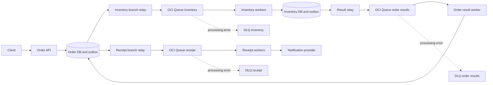

# Event-Driven Architecture and Cross-Service Fault Isolation

## 1. Objectives and Context on OCI

In the **High Availability Architecture** chapter of Oracle Cloud Infrastructure (OCI), event-driven architecture enables services to keep making progress when a downstream processing component slows down or goes offline. Instead of holding an HTTP request open until every service finishes, the system durably records the work, passes messages through an intermediary tier, and processes them at an appropriate pace.

After this lesson, you will be able to:

- Trace fault propagation paths across a synchronous service call chain.
- Assign appropriate roles to OCI Events, Queue, Streaming, and Functions.
- Design outboxes, idempotent handling, bounded retries, and dead letter queues.
- Isolate compute resources, database connections, and IAM permissions per service.
- Measure request acceptance capability separately from business completion capability.
- Practice controlled fault injection to observe blast radius and recovery behavior.

This lesson assumes familiarity with compartments, IAM, VCN, Compute or OKE, and database transactions. The running example is an ordering application on OCI; Oracle Database persists order state and the outbox, while workers handle inventory reservation and notifications.

**Boundary to keep clear:** “order accepted” only means the request has been durably recorded for processing. It does not mean inventory is reserved, payment is captured, or delivery is complete.

## 2. How Do Failures Propagate in Synchronous Chains?

Suppose placing an order executes sequentially:

```text
Client → Order API → Inventory API → Payment API → Email API
```

If Email API takes 20 seconds to respond, the initial request can hold threads, sockets, and connections for a long time. As many requests wait concurrently, resources exhaust; Order API begins rejecting even requests that do not need immediate email delivery. Client retries amplify request volume further.

Three types of dependencies are often conflated:

| Dependency Type | Example | How to Evaluate |
| --- | --- | --- |
| Business dependency | Cannot confirm reservation without verifying inventory | Model via states and state-transition rules |
| Temporal dependency | User must wait for email delivery before receiving a response | Can decouple asynchronously if API contract permits |
| Resource dependency | Email worker and API share one small connection pool | Partition resource budgets to limit fault propagation |

Under the simplified assumption that all four mandatory services must work simultaneously, failures are independent, and each achieves 99.9% availability, chain availability is approximately:

```text
A_chain = 0.999 × 0.999 × 0.999 × 0.999
        ≈ 99.60%
```

This illustrates serial dependency, not a real-world SLA calculation. Network failures, shared databases, and regional incidents can create correlated failures.

Moving to asynchronous processing removes components from the direct response path. In return, the system must manage pending work, duplicate events, ordering, and failures to complete on time.

## 3. Events, Commands, and Acceptance Contracts

An **event** describes a fact that has already happened, such as `OrderAccepted` or `InventoryReserved`. A **command** asks a party to perform an action, such as `ReserveInventory`. Commands can be rejected; emitted events must reflect a fact already recorded.

Example in this lesson:

1. Order API validates input and persists the order in `PENDING_INVENTORY` state.
2. Within the same transaction, the API writes an `OrderAccepted` event to the outbox.
3. The API returns `202 Accepted`, the order ID, and a status lookup URL.
4. Inventory worker handles stock reservation and emits `InventoryReserved` or `InventoryRejected`.
5. Order service consumes the outcome to update order state.
6. Receipt worker can send the “request received” notification independently of inventory reservation.

An illustrative response:

```http
HTTP/1.1 202 Accepted
Location: /orders/ORD-20261121-1042
Content-Type: application/json

{
  "orderId": "ORD-20261121-1042",
  "status": "PENDING_INVENTORY"
}
```

Return this response only after the transaction saving the order and outbox has committed. If the database has not confirmed commit, the API must never claim acceptance succeeded.

If the client misses the response and resends the request, Order API needs an ingress idempotency key, such as a unique constraint on `customerId + clientRequestId`. This key prevents creating two orders for one logical request; it is distinct from consumer-side event deduplication markers.

For workflows requiring immediate confirmation, keep specific steps synchronous with explicit timeouts. Choosing asynchronous execution must fit user experience and business deadlines.

## 4. Selecting the Right Messaging Service on OCI

### 4.1. Role of Each Service

| Service | Appropriate Role | Accompanying Design Decisions |
| --- | --- | --- |
| OCI Events | React to OCI resource state changes, such as new objects or completed backups | Choose event types, filters, actions, and service permissions |
| OCI Queue | Buffer tasks for workers to claim and process independently | Design visibility timeouts, post-processing deletion, retries, and DLQs |
| OCI Streaming | Store event streams for independent consumer groups reading by offset within retention | Choose partition keys, manage read offsets, and handle replay |
| OCI Functions | Run handler code invoked by compatible integration sources | Bound execution time, concurrency, and downstream impact |
| OCI Notifications | Deliver notifications to supported subscription endpoints | Distinguish notification delivery confirmation from business completion |

OCI Events focuses on OCI resource events; documented action targets include Notifications, Streaming, and Functions. Therefore, applications should not assume they can push arbitrary business events onto a generic event bus via Events, or draw a direct `Events → Queue` arrow as a built-in action. See [Overview of Events](https://docs.oracle.com/en-us/iaas/Content/Events/Concepts/eventsoverview.htm) and [Managing Rules for Events](https://docs.oracle.com/en-us/iaas/Content/Events/Task/managingrules.htm).

If a resource event must become a task in Queue, build an adapter using Functions: Events invokes the function, which validates payload and writes to Queue. This adapter is itself a component requiring its own retries, monitoring, and deduplication. A function invocation alone does not prove the message was persisted in Queue.

Resource example: Object Storage emits events when objects change; Events filters by bucket and triggers a file-inspection function. To receive object events, bucket event emission must be enabled per service config. Refer to Object Events in the [Events documentation](https://docs.oracle.com/en-us/iaas/Content/Events/Concepts/eventsoverview.htm).

### 4.2. Queue and Streaming Create Different Boundaries

In a work queue model, multiple replicas of the same worker split tasks among themselves. In an event stream model, multiple consumer groups maintain independent progress over the same stream.

OCI Streaming provides consumer groups with at-least-once delivery semantics per group. Within a single group, each partition is assigned to one instance at a time; scaling instances beyond partition count does not give extra instances work to read. See [Using Consumer Groups](https://docs.oracle.com/en-us/iaas/Content/Streaming/Tasks/using_consumer_groups.htm).

This lesson chooses **two separate Queues for the two business branches** to clearly illustrate per-branch error policies and access permissions. That is an architectural choice for the example, not a claim that Queue lacks consumer group features.

If using Streaming instead, inventory and receipt need two independent consumer groups. Placing both functions in the same group breaks the requirement that each function receives every required event.

## 5. Reference Architecture: Separating Inventory Reservation and Notifications



The diagram shows logical flows; a service's outbox and business data must live within the same transactional boundary. Workers can run on Compute or OKE. Each service owns its own data; they do not all need to share one schema and one database admin account.

Operational flow:

1. API commits the order and event into Order DB.
2. Relays send `OrderAccepted` to each Queue subscribed to that event type.
3. Inventory worker reserves stock; the outcome and outcome outbox commit together.
4. Receipt worker sends acceptance notice; notification failures never hold Order API connections.
5. Inventory outcome returns to Order service via the results Queue.
6. Order result worker updates the order using validated state-transition rules.

If the receipt queue is unreachable, the inventory relay must still make progress. Therefore, delivery state must be tracked separately per `eventId + destination`; each branch needs independent execution pools, timeouts, and retry schedules.

A single relay iterating sequentially across all destinations can become a new fault-propagation bottleneck. Splitting Queues while keeping all relays on one thread blocked waiting on email fails to achieve isolation.

In small environments, relays can run in one process with separate pools and quotas. When stronger isolation is needed, separate each relay's deployment, identity, and compute resources.

## 6. Outbox: Closing the Gap Between Data Commit and Publish

### 6.1. Both Sequential Write Orders Leave a Gap

**Write DB then publish:** DB commit succeeds, then the process crashes before publishing. The order exists, yet inventory never learns to process it.

**Publish then write DB:** consumer receives the message, yet the order-creation transaction rolls back. The system processes a nonexistent order.

Standard database transactions do not span network calls to OCI Queue or Streaming. Placing them side by side inside one transactional method does not close these two gaps.

### 6.2. Writing Business State and Outbox in One Transaction

The pseudocode below illustrates transaction boundaries; tables and functions are application components to implement:

```text
BEGIN TRANSACTION

  if clientRequestId already exists:
      return the order bound to that request

  create order ORD-1042 in state PENDING_INVENTORY

  create event E-9001: OrderAccepted
  write E-9001 to app_outbox
  write inventory destination for E-9001 to outbox_delivery
  write receipt destination for E-9001 to outbox_delivery

COMMIT

return 202 with orderId and status lookup URL
```

If the transaction rolls back, neither the order nor outbox records are created. If commit succeeds, a relay can still publish the event even if the API restarts.

Oracle also documents the transactional outbox among microservices patterns; see [Microservices Architecture](https://docs.oracle.com/en/database/oracle/oracle-database/26/adfns/microservices-architecture.html).

A minimal table design:

| Table | Data Stored | Key Constraints |
| --- | --- | --- |
| `app_outbox` | Event ID, event type, aggregate ID, payload, created timestamp | Unique Event ID |
| `outbox_delivery` | Event ID, destination, status, attempt count, next attempt, lease | Unique per Event ID and destination |
| `request_dedup` or equivalent | Client request ID, sender, order ID | Prevents duplicate orders per request |

A relay should claim a delivery via a short lock or lease. Then perform the network call outside long-running DB locks; mark delivery sent only after the target service confirms acceptance. Lease expiry allows another replica to reclaim work if the relay dies.

If publishing succeeds yet the relay dies before saving status, the event will be published again. Plan for this behavior. Consumers must deduplicate using a stable Event ID.

When publishing a batch, the relay must inspect per-item outcomes per the API used. Never mark an entire batch successful solely because the HTTP call did not throw an exception.

Outboxes add operational duties: monitor unsent record age, prune processed records per policy, and prevent unbounded table growth. When the outbox or DB nears capacity, the API must enforce admission control; intake capacity has real physical limits.

## 7. Event Contracts and Compatibility

An illustrative business message:

```json
{
  "eventId": "7da4e9ba-cdc9-4490-9101-e57028c6eb6f",
  "eventType": "order.accepted",
  "schemaVersion": 1,
  "source": "order-service",
  "occurredAt": "2026-11-21T03:00:00Z",
  "aggregateId": "ORD-20261121-1042",
  "aggregateVersion": 1,
  "correlationId": "checkout-cb1432",
  "causationId": "request-abc123",
  "data": {
    "orderId": "ORD-20261121-1042",
    "items": [
      {
        "sku": "BOOK-OCI-01",
        "quantity": 1
      }
    ],
    "contactReference": "CONTACT-2048"
  }
}
```

This is an application-designed envelope, not a claim about OCI Events' default payload.

Fields serve distinct purposes:

- `eventId`: identifies one logical event; keep unchanged when republishing the same event.
- `aggregateId`: identifies the business entity, here the order.
- `aggregateVersion`: helps detect out-of-order events or version gaps.
- `schemaVersion`: helps consumers pick the right payload parser.
- `correlationId`: links logs belonging to the same user journey.
- `causationId`: indicates the request or event that directly caused this event.

Transport message IDs, Queue receipts, and Event IDs are not interchangeable. Republishing can assign a new transport message ID while still representing the same business event.

When evolving schemas, prefer adding optional fields with defaults. When changing semantics or removing mandatory fields, issue a new contract version and consumer upgrade path. Consumers unable to parse a schema must route failures into an explicit handling workflow.

Never embed passwords, tokens, or full personal data in events. For large files, pass an Object Storage reference with checksum and appropriate object version. Ensure object read permissions and retention outlive both normal processing and replay windows.

## 8. At-Least-Once Delivery and Idempotent Processing

### 8.1. Delete Messages Only After Business State Is Durable

With OCI Queue, a consumer receives a message and deletes it after processing succeeds. Successfully published messages remain stored until deleted or retention expires; retention is not a promise of indefinite storage. See [Overview of Queue](https://docs.oracle.com/en-us/iaas/Content/queue/overview.htm).

Distinguish two crash points:

| Crash Timing | What Happens When the Message Reappears |
| --- | --- |
| Before business commit | Consumer needs to reprocess from the start |
| After commit but before message deletion | Consumer must recognize the work is already done |

Idempotent means repeating the same request creates no additional business side effects beyond the initial outcome. It does not mean the middleware delivers messages exactly once.

### 8.2. Marker and Business Update in the Same Transaction

Example deduplication table in Oracle Database:

```sql
CREATE TABLE processed_events (
    handler_name VARCHAR2(80) NOT NULL,
    event_id VARCHAR2(80) NOT NULL,
    processed_at TIMESTAMP WITH TIME ZONE
        DEFAULT SYSTIMESTAMP NOT NULL,
    CONSTRAINT pk_processed_events
        PRIMARY KEY (handler_name, event_id)
);
```

Inventory processing flow:

```text
receive message with receipt
validate envelope, eventType, and schemaVersion

BEGIN TRANSACTION

  attempt INSERT into processed_events('inventory-reserver', eventId)

  if that exact marker key already exists from a committed transaction:
      ROLLBACK current transaction
      delete message using current receipt
      finish

  check order state and stock
  update stock via locking or conditional update
  create InventoryReserved or InventoryRejected outcome
  write outcome into inventory outbox

COMMIT

delete message using current receipt
```

If the transaction fails, the marker rolls back too. Upon redelivery, the worker can still execute the business logic.

Never use “SELECT to check → execute → INSERT marker” without a unique constraint: two workers can both see no row. Nor should you catch every unique-key error and assume the event was processed; distinguish marker collisions from business data constraint violations.

Handler name is part of the primary key because two distinct functions may legitimately process the same Event ID. If replaying everything under a brand-new handler name, the system will treat events as unprocessed; assess duplicate side-effect risks before doing so.

Marker retention must cover the entire window during which an event might reappear, including slow outboxes, Queue retention, and backup replays. Pruning markers too early can cause old events to process a second time.

### 8.3. Side Effects Outside the Database

Local transactions do not cover sending emails or calling payment gateways.

For example, a payment provider captures funds yet the worker crashes before persisting the result. Retrying with a different key can charge the customer twice.

Use a stable business-operation idempotency key if the provider supports one; also persist provider transaction IDs and reconcile status after timeouts. A timeout only means the caller missed the response, not that the provider did not execute.

If a downstream lacks idempotency or status lookup, accept and manage the corresponding duplication risk. You cannot infer system-wide “exactly-once” guarantees from a single marker table alone.

## 9. Visibility Timeout, Retries, and Isolating Poison Messages

### 9.1. Visibility Timeout Is Temporary Processing Ownership

When OCI Queue delivers a message to a consumer, visibility timeout temporarily hides the message from other consumers. The consumer uses the receipt to update or delete the message, and can extend visibility if processing runs longer than expected. Failing to delete or extend in time allows the message to return to the queue. See [Consuming Messages](https://docs.oracle.com/en-us/iaas/Content/queue/consume-messages.htm).

Sizing rule for applications:

```text
visibility timeout
    > high-percentile typical processing time
      + commit time
      + message deletion time
      + safety margin
```

For example, assuming workers normally finish under 8 seconds, you can start lab testing with a 30-second visibility timeout and re-measure. This is a lab starting point, not a universal formula.

- Too short: two workers can execute side effects concurrently while the first is still running.
- Too long: a crashed worker forces work to wait a long time before reclamation.
- Unbounded renewal: hung tasks can hide failures; enforce a total execution cap.
- Excessive prefetching: messages sitting buffered in memory still burn visibility time.

Visibility timeout does not replace data locks, idempotency, or execution bounds.

### 9.2. Classify Errors Before Retrying

| Outcome Type | Example | Handling Direction |
| --- | --- | --- |
| Transient error | Dropped connection, throttling, downstream temporary error | Bounded retries with backoff and jitter |
| Config or permission error | IAM denies Queue read, bad secret | Alert and fix config; avoid aggressive retries |
| Unprocessable message | Malformed JSON, unsupported schema | Isolate for investigation or fix consumer |
| Valid business outcome | Insufficient stock | Persist rejection and emit outcome event |
| Ambiguous external outcome | Timeout after sending payment request | Reconcile via business key before retrying |

A common application-level backoff formula:

```text
delay(attempt) = random(0, min(cap, base × 2^attempt))
```

Establish which layer owns retries. Retries in HTTP clients, SDKs, workers, and redelivery mechanisms can multiply calls downstream. Three layers each trying up to three times can generate up to 27 calls for one unit of work.

When a downstream is completely down, a circuit breaker can open to pause calls for a period. That worker branch should slow down or pause pulling work; repeatedly claiming and abandoning messages burns delivery counts and dumps healthy work into the DLQ.

Schedule bounded probes when transitioning to half-open. Never let every worker slam the downstream simultaneously the instant it recovers.

### 9.3. Dead Letter Queues and Replay

OCI Queue provides a DLQ to retain messages that fail processing after the configured delivery attempts; the DLQ is created alongside the Queue. Messages in the DLQ are still subject to retention and may eventually be deleted, so monitor and handle them promptly. See [Dead Letter Queues](https://docs.oracle.com/en-us/iaas/Content/queue/deadletterqueues.htm).

A DLQ needs a workflow with clear ownership:

1. Record Event ID, error type, consumer version, and failure timestamp.
2. Determine whether the fault lies in data, handler code, permissions, or downstream.
3. Fix the root cause and test on a small sample.
4. Replay with rate limiting to avoid triggering a fresh overload.
5. Verify business side effects before deleting failed records.

If replaying the original event after fixing the consumer, keep the original Event ID so idempotency still works. If altering business meaning or payload, emit a compensating/corrective event with a new Event ID linked to the old event, with business approval.

Never automatically loop all DLQ messages back to the source Queue infinitely. When using a custom application-built quarantine table, delete the original message only after the quarantined record is durably committed.

## 10. Fault Isolation Must Cover Resources and Ordering

### 10.1. Bulkheads: Partitioning Budgets by Branch

Bulkheading divides the system into pools with independent resource limits. If one pool exhausts its budget, other pools retain capacity to progress.

| Layer | Partitioning in Example | Effect |
| --- | --- | --- |
| Messaging | Separate Queues, DLQs, and retry schedules | Receipt failures do not block inventory |
| Compute | Separate deployments or worker pools | Notification workers cannot starve inventory CPU |
| Threads and concurrency | Separate semaphores, executors, and in-flight caps | Bounds work waiting on downstreams |
| Database | Separate accounts, connection pools, and grants per service | One branch cannot exhaust all connections |
| IAM | Separate producer, consumer, and operator identities | Limits blast radius of operational mistakes |
| Deployment | Independent rollouts, rollbacks, and config per service | Patch receipt without stopping inventory |

Splitting connection pools only partitions one resource. If services still share one database, they still share CPU, I/O, storage, and failover risks. For stronger isolation, evaluate workload management or separate databases as required.

Similarly, two Queues may still share tenancy limits or the same network path. Logical isolation must be paired with checking shared limits.

### 10.2. Backpressure and Admission Control

Backpressure adjusts work intake or processing speed to match real capacity.

For instance, if Inventory DB handles at most 200 transactions/second, scaling workers from 20 to 200 will not necessarily increase throughput; it may only spike lock contention and timeouts.

Set concurrency limits based on downstream capacity, monitor work age, and throttle intake when thresholds breach. Explicitly rejecting new requests protects work already accepted into the system.

Admission control should be per-branch: a slow email queue should not automatically halt order intake. However, if recovery or notification SLAs can no longer be met, the product needs an appropriate degraded state.

### 10.3. Ordering and Late-Arriving Messages

Never build business rules assuming every Queue provides global strict FIFO. Concurrent workers, retries, and replays can change completion order relative to emission order.

With OCI Streaming, messages sharing the same key go to the same partition with per-partition ordering. That is not stream-wide global order; parallelized apps must still enforce valid business commit order where needed. See [Partitioning a Stream](https://docs.oracle.com/en-us/iaas/Content/Streaming/Concepts/partitioningastream.htm).

For orders:

- Use `orderId` as the partition key when events for one order must stay ordered.
- Check current version and state before applying outcomes.
- Never allow a late event to move an order from `CANCELLED` back to `CONFIRMED`.
- When waiting for a missing version, set deadlines and reconciliation procedures; never drop silently.

Events from different services do not automatically form one shared version sequence. `aggregateVersion` must have a clear owner and meaning.

## 11. Multi-Service Transactions and Compensation

Decoupling asynchronously does not turn a multi-service workflow into a single ACID transaction.

Suppose a workflow must reserve inventory and then collect payment:

```text
OrderAccepted
  → InventoryReserved
  → PaymentRequested
  → PaymentSucceeded
  → OrderConfirmed
```

If payment fails after stock was reserved, the workflow must emit a command to release the reservation. This is a compensating action, not a direct rollback of the Inventory DB transaction.

Two coordination styles exist:

| Style | Characteristics | Control Requirements |
| --- | --- | --- |
| Choreography | Services react to each other's events | Harder to trace with many branches; risk of cycles |
| Orchestration | A central coordinator tracks workflow state and issues commands | Coordinator needs durable state, deduplication, and recovery |

Either way, define timeouts for every waiting state and rules for late outcomes. For example, if an order was canceled yet `PaymentSucceeded` arrives late, route it to reconciliation or refund rather than re-confirming the order automatically.

Compensating steps can also fail and require retries, idempotency, and monitoring. For cases that cannot recover automatically, hold a state like `MANUAL_REVIEW_REQUIRED` with reason and owner.

## 12. IAM, Networking, and High-Availability Deployment on OCI

### 12.1. Scoping Permissions by Messaging Role

Compartments organize resources and attach policies; placing two services in separate compartments alone does not replace network isolation or resource limits.

Example policies for two dynamic groups using instance principals via REST API:

```text
Allow dynamic-group OrderRelays to use queue-push in compartment Messaging
Allow dynamic-group InventoryWorkers to use queue-pull in compartment Messaging
```

To narrow down to the inventory Queue, add a condition to each statement:

```text
Allow dynamic-group OrderRelays to use queue-push in compartment Messaging where target.queue.id = '<inventory_queue_ocid>'
Allow dynamic-group InventoryWorkers to use queue-pull in compartment Messaging where target.queue.id = '<inventory_queue_ocid>'
```

The two pairs are broad vs. narrowed alternatives. If the broad policy remains present, it still grants access; adding a narrower policy does not revoke broader grants.

`queue-push` covers publishing; `queue-pull` covers receiving, updating, and deleting messages. Metadata read permissions such as retrieving the Queue endpoint must also be granted when used by the app. Refer to [Queue Policies](https://docs.oracle.com/en-us/iaas/Content/queue/policy-reference.htm).

Group names, compartments, and OCIDs are placeholders to replace with lab resources. OKE workload or Functions identities must follow their respective auth models; do not assume instance principals identically across every runtime.

### 12.2. Network Paths Must Be Explicitly Designed

Workers can reside in private subnets. Verify DNS, routes, NSGs or security lists, and paths to the Queue messages endpoint in the target region.

Choose private endpoints or Service Gateway paths only when supported by the actual service and configuration; if using public endpoints, provide suitable egress paths. External email providers also require dedicated outbound connectivity. A shared egress failure can still impact multiple branches if they share one gateway.

Keep credentials in a proper secret management system, enforce TLS, and keep sensitive fields out of logs. Separate DLQ replay permissions from routine worker permissions.

### 12.3. Intra-Region HA and Cross-Region Recovery

For workers on Compute or OKE, run multiple replicas distributed across fault domains or availability domains where supported by the region and resource type. Replicas must not all rely on a single relay instance. Databases also need matching HA designs.

Durable queues absorb temporary outages within design bounds; they do not automatically fail over the entire application to another region.

If cross-region DR is required, design explicitly:

- Replicas of business data, outboxes, and deduplication markers.
- Queue or Streaming resources, policies, encryption keys, and secrets at the target.
- Recovery of in-flight work, retention windows, and replay ordering.
- Mechanisms preventing two regions from concurrently executing exclusive side effects.
- RPO and RTO validated through drills.

Backing up only order data while omitting the outbox can lose unsent work. Restoring the outbox without markers can replay duplicate side effects. These datasets must be planned together in recovery strategies.

## 13. Measuring Backlog, SLOs, and Cost

### 13.1. Separating Acceptance SLO from Completion SLO

Example application-defined targets:

| Target | Illustrative Definition |
| --- | --- |
| Acceptance | 99.9% of valid requests durably persisted within 500 ms |
| Inventory | 99% of accepted orders obtain reservation outcome within 60 seconds |
| Notification | 99% of acceptance notices sent within 5 minutes |
| Business integrity | One logical request never creates two orders or two reservations |

These figures are lab targets, not Oracle SLAs.

If the API keeps returning `202` quickly while work backs up for hours, acceptance metrics look healthy while business SLOs fail. Dashboards must display both.

### 13.2. Metrics to Collect

Combine native service metrics with custom metrics and structured logs:

- Accepted requests, failed commits, API latency.
- Unsent outbox deliveries and age of oldest pending delivery.
- Visible, in-flight, and DLQ message counts.
- Ingress rate, successful processing rate, processing duration, and retry counts.
- Skipped duplicate events, schema errors, and IAM errors.
- End-to-end time from acceptance to business outcome.
- Concurrency, active DB connections, and circuit breaker states.

Queue statistics provide approximate counts and sizes; they can fluctuate while producers and consumers are active. Never reconcile a single snapshot like an exact ledger. See [Getting Queue Statistics](https://docs.oracle.com/en-us/iaas/Content/queue/queue-statistics.htm).

Metrics like outbox age or per-`orderId` completion time must be computed by the app if native metrics do not match desired definitions. Synchronize clocks across hosts and standardize timestamp conventions.

Logs should include `eventId`, `orderId`, `correlationId`, handler, attempt, and outcome. Use them to trace one order from API to outbox, Queue, worker, and result event. Avoid using Event ID as a high-cardinality metric dimension.

### 13.3. Estimating Backlog Drain Capacity

Let:

- `λ`: arrival rate of new work to the branch, messages/second.
- `μ`: actual successful processing rate, messages/second.
- `B`: backlog to clear.

Under near-steady load with `μ > λ`:

```text
estimated drain time ≈ B / (μ - λ)
```

For example, the receipt branch receives 100 messages/second and stops processing for 10 minutes:

```text
B = 100 × 600 = 60,000 messages
```

Upon recovery, workers process 250 messages/second while new arrivals remain 100:

```text
T_drain = 60,000 / (250 - 100)
        = 400 seconds
        ≈ 6 minutes 40 seconds
```

This estimate excludes replays, retries, traffic spikes, and provider rate limits. If `μ ≤ λ`, the backlog will never drain just by waiting.

Retention and capacity must cover detection, fixing, recovery, and headroom. Different messages have different ages; monitor remaining lifetime of the oldest message rather than total count alone.

### 13.4. Aligning Cost with Load and Failures

Costs stem from message operations, workers, Functions, databases, storage, logs, and network transfer. Aggressive retries or logging full payloads can spike costs right during an outage.

Practical measures:

- Use long polling instead of tight empty-Queue polling loops.
- Batch within service limits while tracking per-message outcomes.
- Set worker min/max and downstream-aligned concurrency caps.
- Cap retries, replay rates, and verbose log retention.
- Set budgets, resource tags, and per-environment alerts.
- Clean up lab resources once observations and results are saved.

Never hardcode fixed pricing into capacity designs; consult regional price lists and tenancy limits at deployment time.

## 14. Hands-On: Breaking One Branch While the Other Continues Making Progress

### 14.1. Preparing a Small Environment

In a lab compartment, prepare:

1. Order API and database with order, outbox, and per-destination delivery tables.
2. Inventory Queue, Receipt Queue, and Order Results Queue.
3. Inventory worker, receipt worker, and order result worker.
4. Per-branch relays; a single app with independent pools works in the lab.
5. Logging, metrics, or app counters to observe states.
6. Sufficient IAM per role and network paths to the right endpoints.

Use lab settings such as 1-day retention and 30-second visibility timeout if aligned with measured processing time; check actual limits and configurable bounds before creating Queues. Pick a finite max delivery count to observe the DLQ. Creation and configuration behavior is described in [Creating a Queue](https://docs.oracle.com/en-us/iaas/Content/queue/queue-create.htm).

The lab receipt worker can call a mock HTTP endpoint configured to succeed or fail via a flag. You do not need to send real emails to prove fault isolation.

Core API operations:

| Operation | Application Responsibility |
| --- | --- |
| `PutMessages` | Publish envelope; update delivery status only upon confirmed success |
| `GetMessages` | Receive messages with appropriate batch size and visibility timeout |
| `UpdateMessage` or batch equivalent | Extend visibility using receipt when needed |
| `DeleteMessage` or batch equivalent | Delete using receipt after state is durable |
| `GetStats` | Inspect Queue and DLQ via messages endpoint |

This is an operation map, not complete SDK code. Choose the OCI SDK for your language and handle timeouts, auth, and per-item outcomes per API docs.

### 14.2. Fault Experiments

| Experiment | Lab Execution | Evidence to Observe |
| --- | --- | --- |
| Receipt worker down | Stop receipt worker only; place new orders | Orders still accepted; inventory completes; receipt backlog grows |
| Receipt downstream failing | Switch mock endpoint to return errors | Backoff or circuit breaker engages; connections do not grow unbounded |
| Consumer crashes before commit | Stop inventory worker prior to commit | Message redelivered; business data not half-written |
| Consumer crashes after commit | Stop after commit but before deleting message | Message redelivered; marker blocks duplicate reservation |
| Relay crashes after publish | Stop relay before updating delivery row | Duplicate publish may occur; consumer produces single side effect |
| Invalid payload | Send test message with unsupported schema | Poison work isolated per policy; healthy messages keep flowing |
| Inventory DB unreachable | Block network access for this worker only | Inventory slows/stalls; receipt keeps running if its deps are healthy |
| Backlog recovery | Restart worker with bounded concurrency | Backlog drains; API and DB are not overloaded by replay |

Modify only lab resources and define clear abort thresholds. DB-loss experiments must state which DB is affected: if Order DB goes down too, new intake may stop even while Queue stays up.

Do not treat repeatedly polling via the Console as a neutral observation step: receiving messages can increment delivery counts. Prefer statistics and metrics for monitoring; see delivery count mechanics in [Consuming Messages](https://docs.oracle.com/en-us/iaas/Content/queue/consume-messages.htm).

### 14.3. Lab Completion Criteria

- A failing notification branch does not stall the inventory reservation worker.
- Resubmitting the same client request does not create extra orders.
- Redelivering the same event does not reserve inventory twice.
- The outbox preserves pending work when Queue is temporarily unreachable.
- A poison message, its root cause, and its replay path can be identified.
- Backlog drain duration is measured after the worker recovers.
- Order status reflects true business outcomes, including rejections and expirations.
- Operators know which limits force the system to throttle or pause intake.

## 15. Common Design Pitfalls

| Pitfall | Consequence | Fix |
| --- | --- | --- |
| API writes DB then publishes to Queue without outbox | Crash between steps drops work | Persist business data and outbox in one transaction |
| Deleting message before commit | Crash loses retry opportunity | Delete after commit or after durable quarantine |
| Marking processed in a separate transaction | Marker exists even when business update fails | Combine marker and business update in one transaction |
| Retrying all errors indefinitely | Overload, higher cost, masked root causes | Classify errors, bound attempts and duration |
| All services share one executor and DB pool | One slow downstream exhausts system-wide resources | Partition budgets and set per-branch concurrency |
| Sending success notification right after `OrderAccepted` | Users mistakenly believe the order is confirmed | Tailor notification content to each state |
| Scaling workers solely on Queue length | Overloads downstream further | Combine work age, throughput, and downstream budget |
| Treating DLQ as permanent storage | Messages expire before handling | Alert, assign owner, and maintain replay workflow |
| Claiming Queue guarantees system-wide exactly-once business execution | Duplicate payments or reservations | Design idempotency and reconcile external effects |
| Restoring DB while omitting markers, outbox, or relay state | Lost or duplicated work post-restore | Design recovery across the entire business journey |

An event-driven architecture achieves high availability when every unit of work has durable state, every branch has an isolated resource budget, and recovery is measured. Queues provide a buffer; business contracts, outboxes, idempotency, and operational procedures determine whether that buffer actually protects the system.
